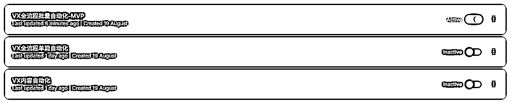
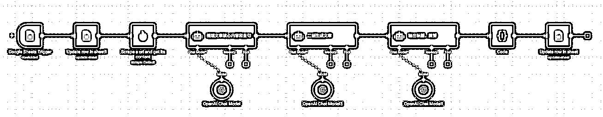
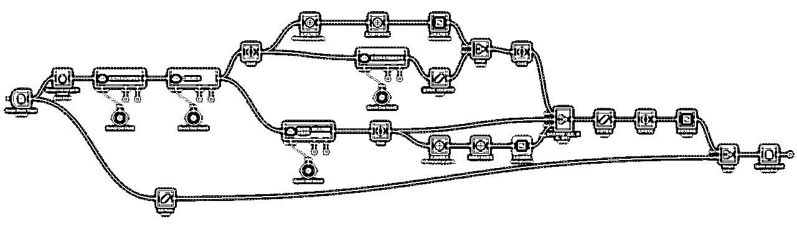
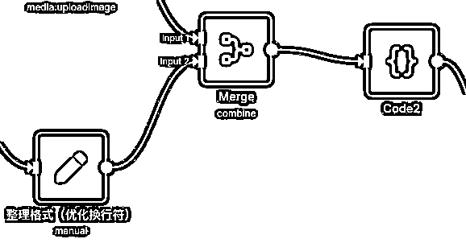
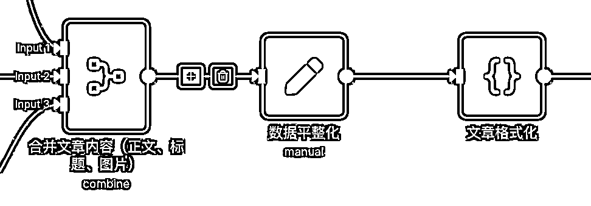
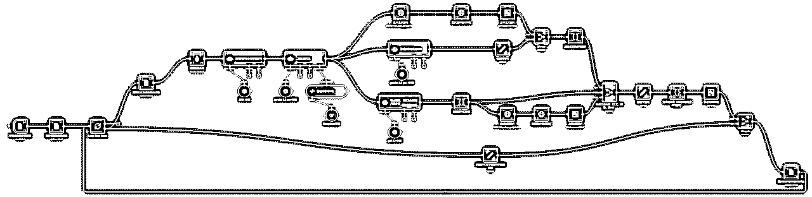
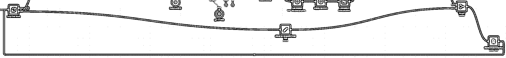
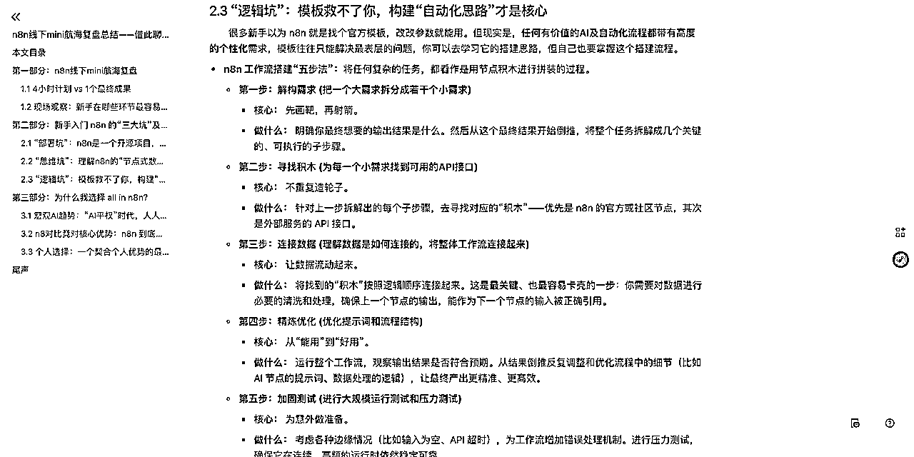

# 用 n8n 搭一条公号内容流水线：从链接到成片发布，全程无人值守

大家好，我是龙哥，n8n 主题航线的带教教练。昨天刚聊完对 n8n 的发展判断，今天来点落地干货：怎样利用 n8n 和谷歌表格，让公号文章改写、配图、上传、发布变成一个自动运转的系统。配置完成后，理论上一天能处理上百篇内容。

这篇文章既有结果展示，也有方法沉淀。我会先拆三个难度逐级递进的链路，再讲我在搭建过程中总结的一套五段心法，最后聊聊这套平台还能往哪些方向升级。

## 一、这条流水线到底能做什么

整套系统可以分成三个阶段：先做好单篇重写，然后接入公号发布，最后扩展成多篇内容连续处理。

实操时的体验是：只需把链接贴进谷歌表格，后续工作全部自动完成——系统会读取链接、抓取正文、提炼重点、生成新文章、产出导语和标题、制作内文插图和封面、组装成发布格式、提交到🛰️后台，最后把状态写回表格。整个链路清晰可控，不用手动干预。

## 二、关卡一：让系统自己完成改写

先做最小闭环，解决“给一个链接，还你一篇内容”的问题。

整体骨架可以这样理解：

链路中需要这些模块：

- 谷歌表格触发器：监听表格变化，当新增链接或字段被修改时启动流程。
- 状态字段更新：在开始处理前把该行状态置为“处理中”，便于追踪进度，也防止重复消费。
- 网页采集：调用爬虫模块读取目标正文。
- 信息蒸馏：让模型提取核心观点、关键事实、重要案例和值得保留的表达。
- 内容重写：在保持原意的前提下，重新组织逻辑和句式，产出一篇新内容。
- 题目与导读生成：自动给出适合公号传播的题目和摘要。
- 代码处理模块：完成字段整理、格式清洗、数据拼接等操作。
- 回写表格：把生成结果和状态更新到原行。

对应到 n8n 画布上，流程示意如下：

做完这一步，内容生产方式已经从“手工复制粘贴”变成了“表格驱动”。

## 三、关卡二：接入公号发布

改写完成只是前半场，真正容易踩坑的是发布环节。腾讯对最终提交的数据有严格的格式约束，所以需要额外增加几个模块。

新增模块如下：

先做版式转换：AI 直接生成的文本默认是普通文本，必须转成🛰️接口认可的 HTML 结构，包括标题层级、段落、加粗、引用、列表、图片占位等。

然后是内文插图：按段落主题调用图像模型生成配图，再把图片传到短期素材通道，拿到 URL 后写回 HTML 正文，确保前端能正常加载。

封面要单独处理：生成封面后，通过长期素材能力上传，并保存资源标识，方便发布时调用。

经过这些处理，一篇内容连同插图、封面会被组装成一条完整的发布请求。

## 四、关卡三：从单篇变成连续作业

单篇自动化已经能省很多事，但真正体现产能的是连续作业。这需要在流程中加入多行数据顺序执行的逻辑，让表格里的每条链接都按顺序走完全部流程。

顺序执行的好处是每篇都能稳定跑完，也便于观察进度。当前优先采用逐条处理而非并发，核心考虑是避免触发接口限流，让运行更可控。

## 五、搭建思路：五段心法比模板更重要

很多朋友拿到现成模板，复制到个人空间只要几分钟。可一旦遇到报错、数据对不上、接口超时，就不知道从哪里下手。

模板只能告诉你拼装步骤，而下面这套方法解释的是背后的设计逻辑，以及报错后该往哪里排查。这套心法我在 n8n 线下 mini 航海中首次提出：

### 1. 把目标切碎

不要指望一次搭一个庞然大物。先把业务目标拆成若干小块。

拿公号改写来说，可以切成这样几种动作：读链接、抓正文、提炼信息、重写文章、起标题、写导语、制作插图、制作封面、组装全文、转换成🛰️要求的格式、上传并发布、更新任务状态。每块动作都能对应一个或多个模块。

### 2. 找到现成的积木

n8n 的设计哲学，就是把能力拼成积木。读取链接可以用爬虫组件，内容生成可以接语言模型，图片生成可以接图像模型，数据清洗可以用代码模块，发布可以调用腾讯开放接口，或者使用社区里已经封装好的组件。

如果社区组件配置报错，最可靠的办法是回到平台官方文档，核对接口权限、参数名称、调用方式和返回字段。

### 3. 让数据顺着链路走

这是最花时间也最容易出问题的一环。每个模块都有各自的输入输出约定，上游模块给出的数据，必须匹配下游模块的期望，否则链路就会中断。

🛰️发布场景里，这些约定尤其严格：正文通常要求 HTML 结构；封面要走长期素材；内文图要使用短期素材上传，并且把返回的 URL 拼进正文；最终提交的内容要封装成指定结构的数组。因此流程中大量代码块，本质上是在解决数据形态适配。

### 4. 打磨模型指令与整体结构

流程能跑通，不表示效果就够好。内容质量主要受模型选择、指令设计、上下文信息量这些因素影响。想让结果更专业、更像自己，可以把历史文章、行业报告、产品说明整理成资料库，通过 RAG 方式喂给模型，让输出质量更稳定。

同时要优化结构本身。一条链路如果太长，任何一个环节出问题都会影响整篇内容。后续不妨让 Agent 负责分支处理，或者把独立环节拆成子流程，让系统更抗风险。

### 5. 反复测试，直到可靠

正式规模化之前，建议把各种可能出错的情形都测一遍：空链接、网页无法访问、抓取内容缺失、接口超时、图片生成失败、图片上传失败、API 返回异常、字段格式不符、多篇连续执行、达到频次上限。

对应的应对策略包括：增加异常分支、自动重试、超时保护、失败状态标记、日志记录、人工介入入口。同时要注意，可靠性不只看流程本身，还与云主机、网络 IP、API 服务商、并发限制等外部条件有关。只有在真实环境里压测过多轮，才算真正可用。

## 六、后续还能往哪些方向拓展

这套系统跑通后，完全可以升级成垂直领域公号的运营中台。

### 1. 固定版式，形成品牌感

按目标定位设计统一排版，或者参考成熟账号的版式，统一字体、配色、标题样式、段落间距、图片比例、关注引导等，让每篇内容都带有专属识别度。

### 2. 接入资料库，打造个性化表达

把以前写过的文章、行业报告、专业笔记全部汇入资料库，让模型学习你的表达习惯和用词方式。资料越完整，输出越接近本人，读起来不像通用 AI 代笔。

### 3. 监控热点，辅助选题

每天自动爬取参考账号最新发布的内容、行业榜单、高赞文章，再根据话题词筛选出上升趋势的内容，帮运营者找到选题方向。过去人工刷热点的时间，可以大幅压缩。

### 4. 对接聊天助手

看到值得借鉴的文章，把链接直接发给🛰️上的聊天助手，系统就能自动触发整条链路：抓正文、改写、配图、写入表格、等待后续发布。这个机制同时能用于个人资料收集和知识管理。

### 5. 后续再尝试并发执行

目前采用逐条顺序执行，主要是想避开并发限制，让流程更稳定。等接口配额、服务资源、异常兜底都足够成熟，可以改成小批量并发，进一步提速。不过并发不是越多越好，还要考虑到图片生成速度、🛰️接口承载能力、失败后的重试成本等因素。

## 结语：真正值钱的是流程化思维

拖拽模块、复制模板，从来不是 n8n 的门槛。当数据对不上、接口报错、任务中断时，能不能快速定位问题、改进链路，才是关键。

从目标切分、组件选型、数据联通、指令打磨到压测加固，这套方法可以迁移到任何搭建任务里。掌握它，你会发现自己不再依赖现成模板，而是能把任何复杂需求拆成一块块积木，再重新拼装起来。

n8n 最终带给你的，不只是一个提效工具，更是一种把重复劳动交给系统、把时间和精力留给创造与决策的工作方式。