你有没有过这种体验：在推特上辛苦发了大半个月内容，粉丝数还是停在三位数以内，眼看别人晒收益，自己连“创作者分成计划”的门槛都没摸到？

别急，这未必是你内容不行，可能是变现路径没选对。

我最近亲测了一个非常适合推特新手入门的玩法——网盘资料变现。谈不上暴利，但门槛极低，逻辑清晰，验证成本也小。从接触到跑通第一笔收入，我只用了一周时间，每天不过花十几分钟，单日收益就做到了78元。而且这个项目最大的好处是：它不完全依赖粉丝量，一条内容爆了，自然流量就能带来收益。

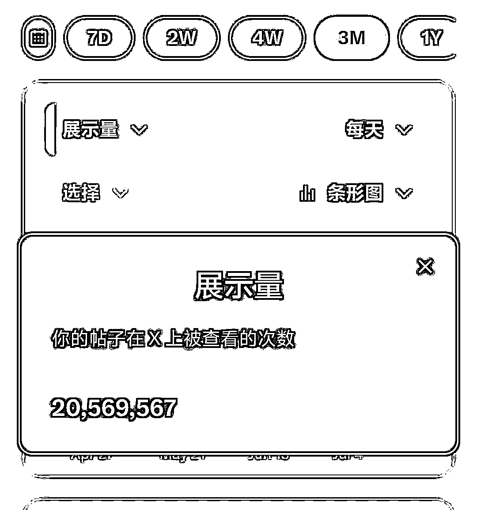

下面我把整个项目完整拆解给你，包括：它到底是什么、为什么低粉也能做、怎么注册绑定、怎么选爆款选题、常见的坑有哪些。

### 一、网盘资料变现在做什么？

通俗讲，就是你在网上整理有价值的资料，用网盘分享给用户，平台为了拉新和促活，会给你结算奖励。

平台为什么肯掏钱？因为这类网盘产品正处在抢用户阶段，需要刺激新用户下载、转存、开会员。奖励一般分三种：

- 按新用户数量计费
- 按转存次数计费
- 按会员购买情况计费

你要做的事很简单：把资料整理好，写好推文附上链接，有人点、有人存、有人买，你就有收入。

### 二、为什么低粉新手适合做这个？

对比其他变现方式，它的优势非常明显：

- 不依赖粉丝基础，一条内容爆了就有流量
- 不用拍视频，只需整理资料+写文案
- 内容有长尾效应，好推文能持续挂在主页赚钱
- 链路清晰：流量→点击→转存→结算，不用做售后

整个项目只需要三个动作：**找资料 → 写内容 → 放链接**。

摸清套路后，内容还能批量复用。

### 三、为什么推特是最佳阵地？

你可能会问，小红书、公众号、抖音不也行吗？

关键在于：推特对链接的包容度极高。你可以在推文里直接放网盘链接，平台很少降权、删帖或封号。而国内主流平台对导流限制非常严格。

晒两个真实案例：

1. 一个2万粉的账号，靠一篇网盘推广推文拿下99万+曝光，既赚收益又涨粉。
2. 一个3000粉的小号，也做到了77万曝光，直接在评论区放网盘地址。

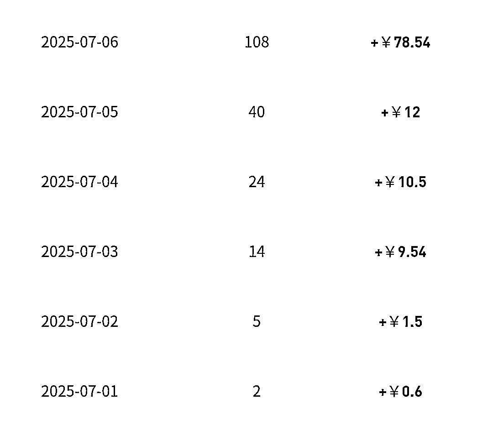

此外，推特的推荐机制非常迅猛。我做过对比测试：同一条内容发推特和小红书，推特轻松跑出几十万曝光，小红书只有几万。

### 四、网盘账号绑定实操

目前市面上常见的网盘奖励平台有百度网盘、迅雷网盘、夸克网盘。

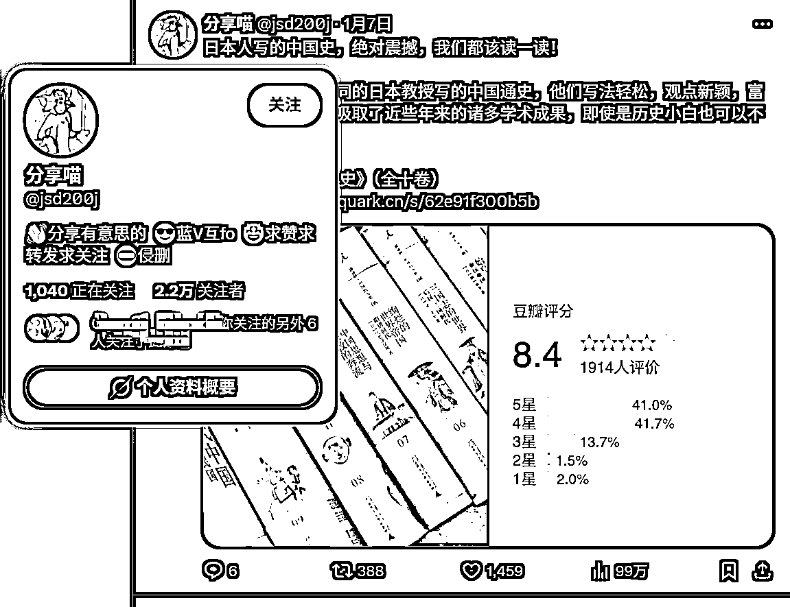

虽然百度网盘的拉新和转存单价最高，但实测在推特环境下链接打不开。所以推特玩家基本都用夸克网盘。

#### 第一步：注册夸克账号

去官网注册就能获得1TB空间。

#### 第二步：申请推广

1. 打开“项侠客”小程序，选择网盘变现板块里的夸克网盘项目，点“立即推广”。

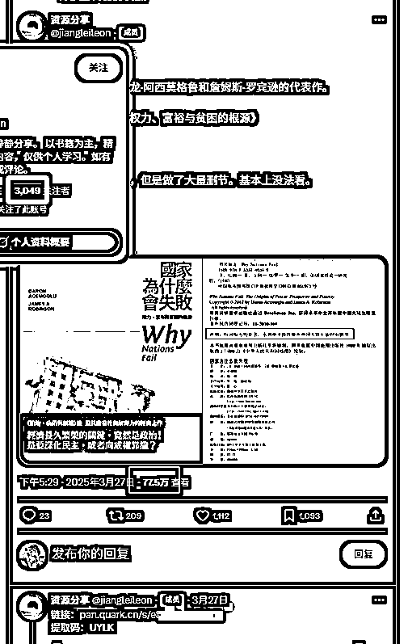

2. 绑定夸克账号：
   - 复制推广链接到浏览器，点“去夸克APP绑定”
   - 在夸克APP里复制显示的ID，确认渠道代码是5002，然后绑定
   - 绑定成功后截图保存ID和成功页面，否则收益统计不上

注意：每个夸克网盘账号只能绑定一个推广渠道，重复绑定会触发限制。

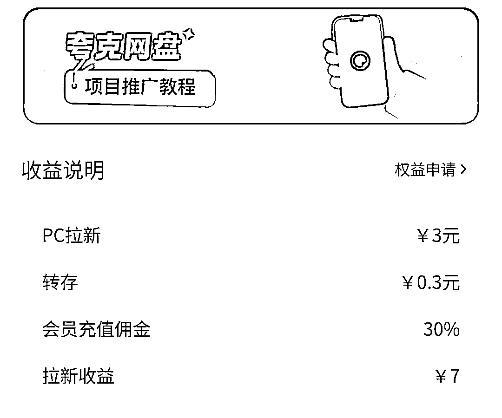

显示这个界面即绑定成功。

3. 回到小程序，填写刚才看到的夸克ID，接着填其他信息，其中有一项是“夸克分享链接”。

操作步骤：
- 打开夸克，任选一个资源，点“分享”，选“公开链接”
- 复制公开链接后，回到小程序粘贴

提交后等待审核，一般1-3个工作日。审核通过后，你分享出去的链接就能产生收益了。

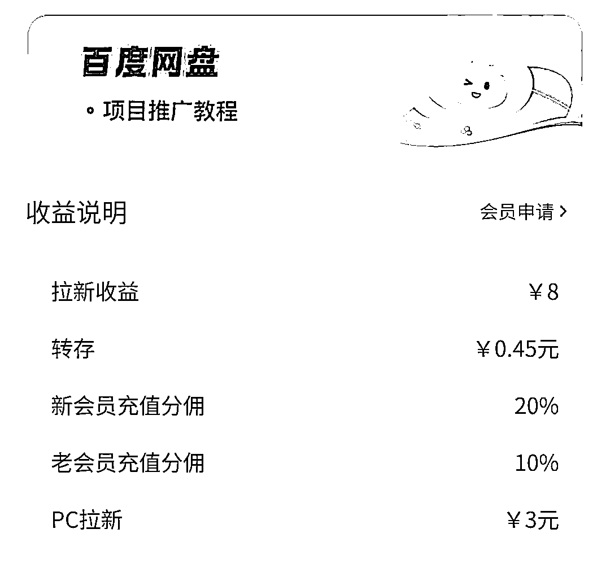

### 五、怎么找到能出爆款的选题？

选题定生死。对网盘项目来说，找对选题，一条推文就能带来几百次下载。

最有效的方式是找对标，直接复制对方的资料，参考人家的写法，再用AI伪原创改写。

分享两个实用的找对标方法：

#### 方法1：用高级搜索挖爆文

“quark.cn”是夸克网盘的域名关键词。只要有人做夸克项目，推文里就一定会出现这个词。

搜索指令：

```
quark.cn min_faves:100 since:2024-06-01
```

意思是：搜出包含“quark.cn”、点赞超100、发布时间在2024年6月1日之后的推文。

结果基本都是网盘推广相关，点赞越高越值得模仿。

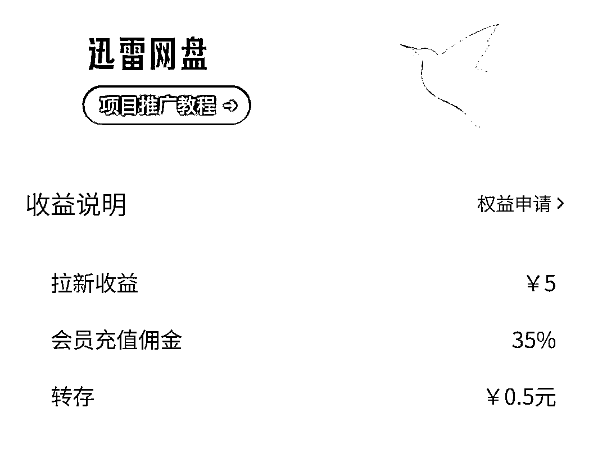

#### 方法2：去网盘推文聚集社区挖掘

推特上有不少网盘项目者聚集的社群，比如“中英文图书推荐分享”。进入社群后，按“点赞最多”排序，就能筛出高赞内容。


找到对标后，操作分两步：
1. 把对方的网盘资源保存到自己的网盘
2. 用AI仿写推文，把原文扔给ChatGPT，提示它“请改写为风格类似但不重复的推文文案”

这个方法的本质是：火过的内容会再火一遍。别自己去创新，直接找经过数据验证的选题和资料，成功率更高。

发布时一般发两条推文：第一条写正文，第二条放链接。虽然以前推特会限流首条放链接的内容，但现在也有正文放链接爆了的案例，都可以试试。

#### 重点推荐：知识型网盘爆文结构

这种内容既能变现，又能强化账号的IP形象，是一鱼两吃。

知识型爆文的要点是：让用户觉得推文本身就是干货，从而通过收藏、点赞增加权重，获得平台推荐，进而带动网盘链接曝光。

结构如下：

1. **开头**：用夸张的数据或痛点吸引停留
2. **中间**：用1、2、3列简单步骤，让用户觉得容易学会
3. **结尾**：想要获取更多，点击链接

下面就是典型案例：

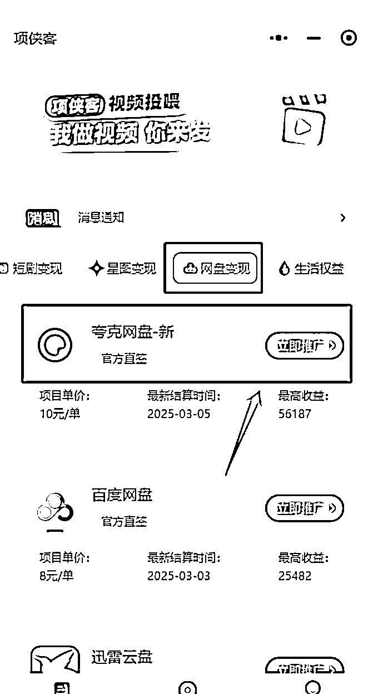

### 六、容易踩的坑

#### 坑1：版权问题

虚拟资料最容易踩版权坑。推特确实比国内平台宽松，不主动删链接，追责难度也更高，但不代表可以无视版权。

安全做法是：选用公开免费的虚拟资料，或做自己原创整理的资料，比如《100篇爆款推文标题模板》《100个提高效率的提示词》。这类原创资料不仅安全，还能建立影响力。

比如分享AI写的工具源代码，不涉及版权，又直击引流痛点，很容易被大量收藏转发。这样既无风险又有大曝光。

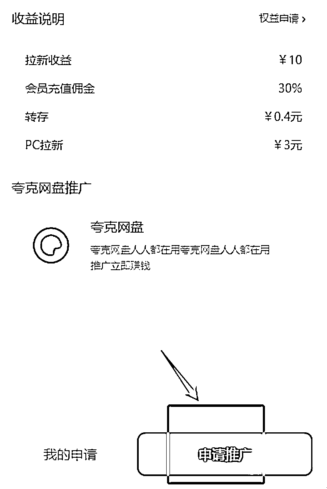

#### 坑2：计费奖励问题

两种情况容易让人误以为系统出错：

- 情况1：自己邀请朋友转存却没计费？
  很可能是朋友当天先点了别人的网盘。规则要求用户当天首次转存才计费。
  所以尽量早点发布推文，但也不用太焦虑，因为推文的传播期有24-48小时，不会因为发得晚就全被抢走。

- 情况2：推文曝光很高，收益却很少？
  大概率是网盘资料不转存也能直接看。用户既然能直接看，就不会转存，转化自然差。
  解决方法是：把资料打包成压缩包再分享。

### 七、最后说两句

如果你正在摸索推特变现，网盘资料项目绝对是一个低门槛、清晰可验证的选择。它可能赚不到暴利，但能帮你跑通第一个变现闭环，获得真实的从0到1正反馈。

如果持续做下去，你还能从单纯“资源分享”升级到“知识整理”“个人品牌搭建”甚至“产品售卖”。想让长期价值最大化，可以把账号简介和昵称包装一下，比如“XX分享官”“XX知识分享”，这样用户看完推文点进主页，会觉得你是长期分享知识的账号，由此成为你的粉丝，从搬运账号慢慢转型成知识IP。

行动起来吧，你的第一笔推特收益，也许就藏在下一篇网盘推文里。

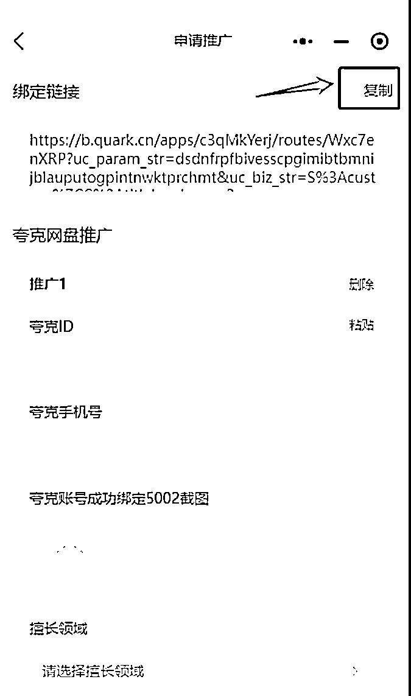 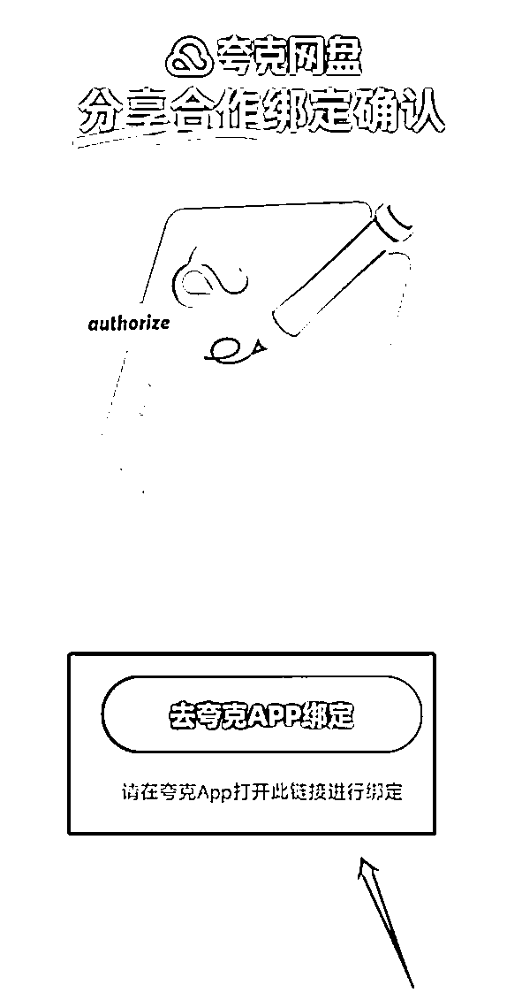 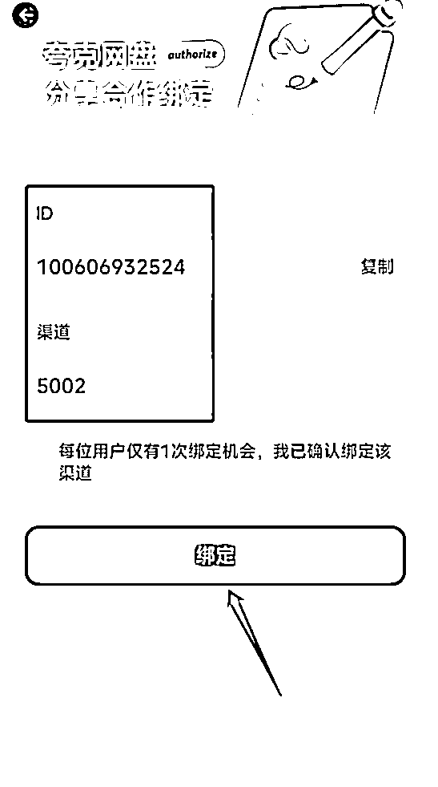 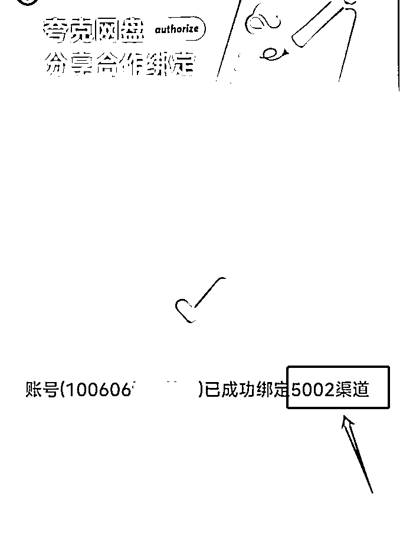 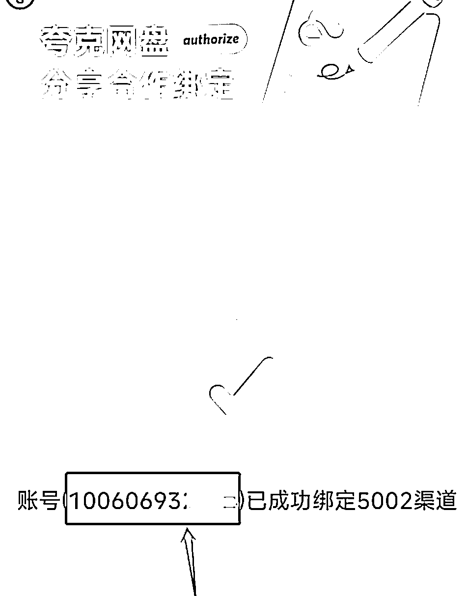 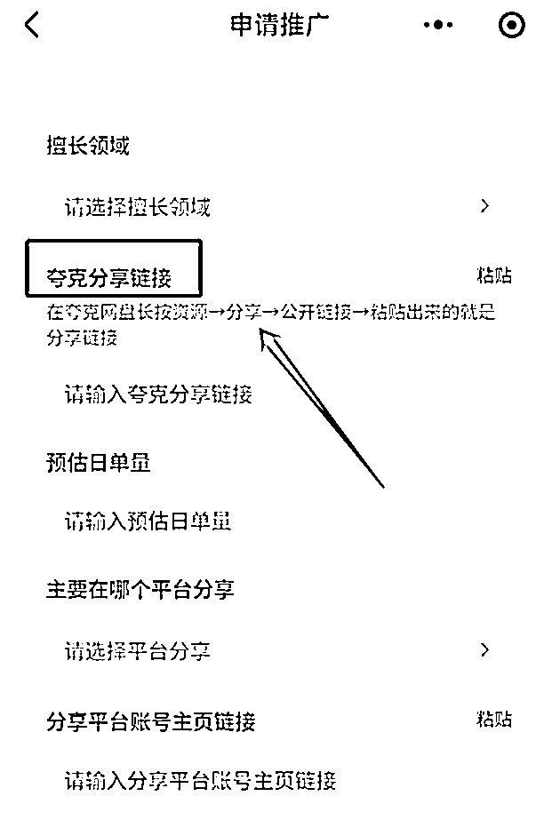 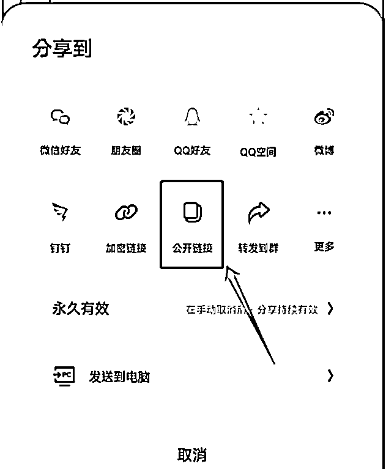 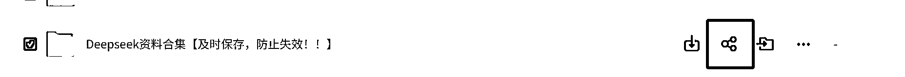 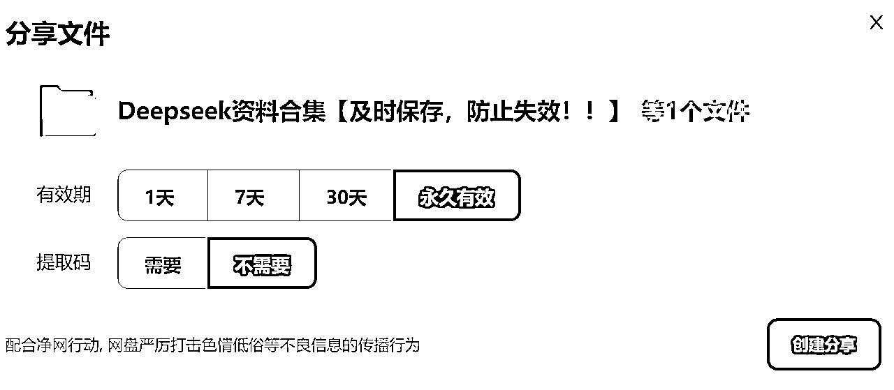 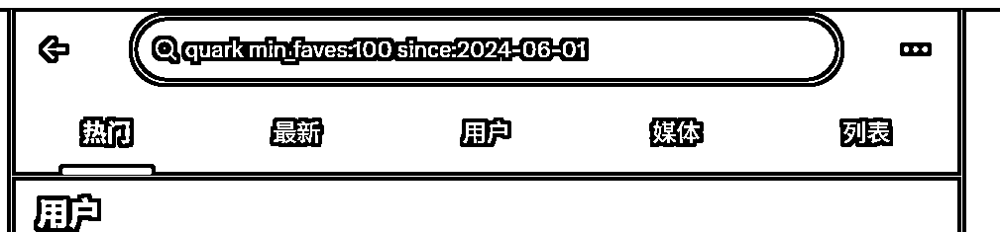  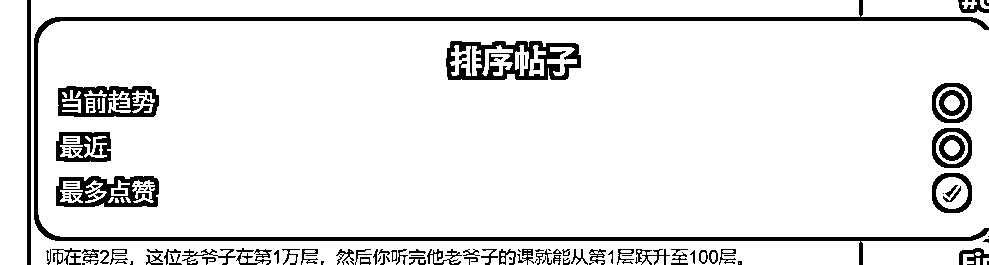 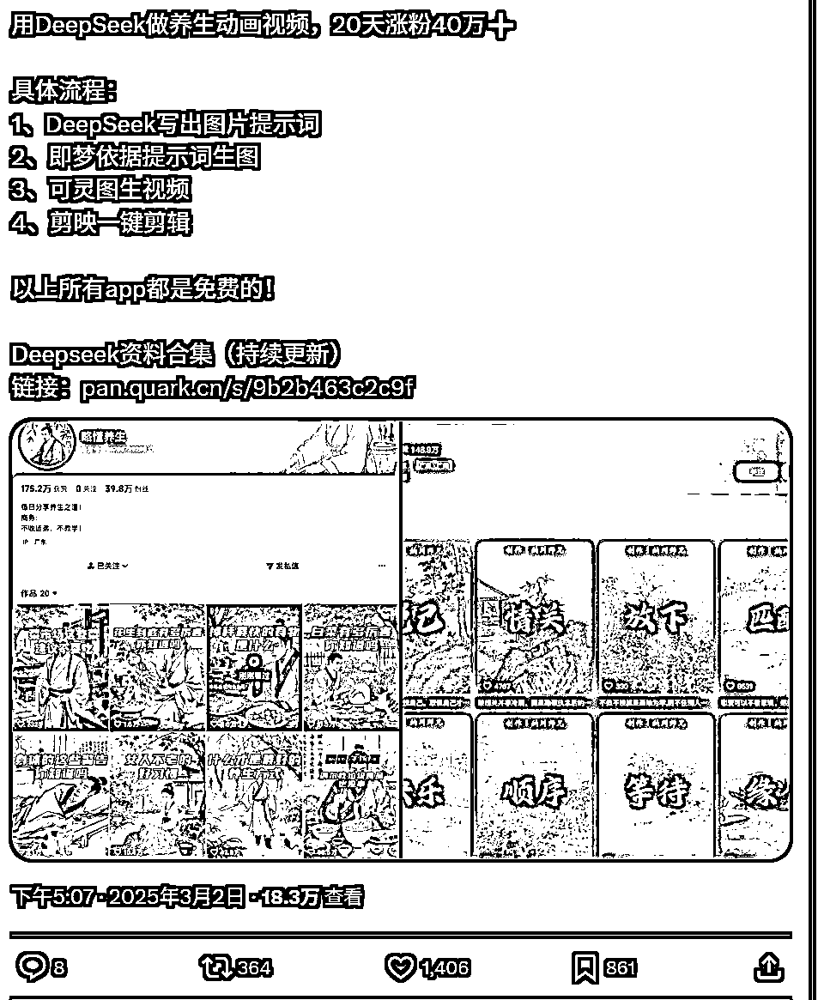 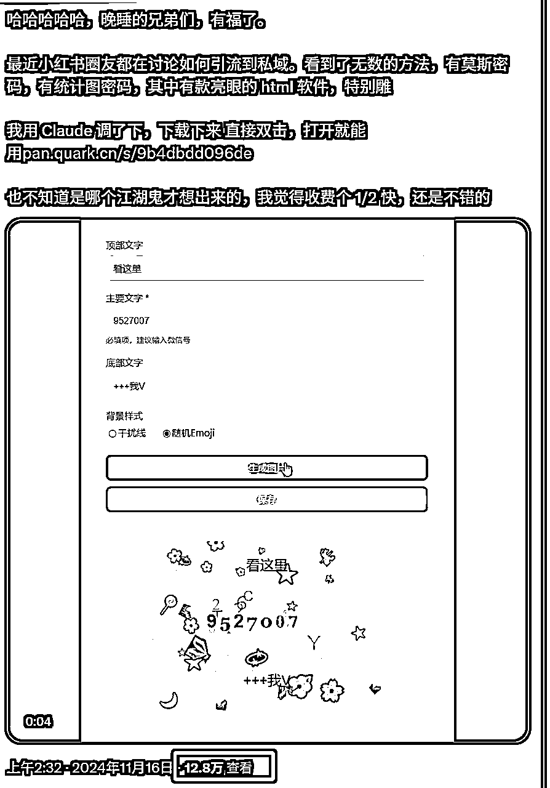