# 零基础也能搞定 n8n 本地部署｜手把手教程 + AI 字幕清洗工作流实战
作者：龙哥

不管你是从未接触过 n8n 的纯小白，还是已经玩得很溜的老手，这篇内容都能让你有收获。前者可以跟着我一步步把 n8n 部署起来；后者呢，直接带走一套字幕清洗工作流——自动拦截敏感词、修正错别字，真正解放双眼，不再需要手动逐句盯屏幕。

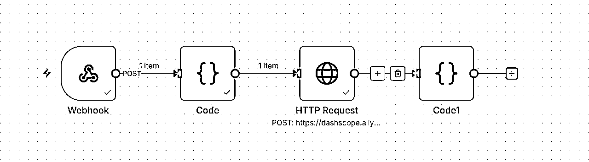

少闲聊，直接上干货：

# 部署前要准备什么

先列个清单，总共四样东西：

+ 能正常上网的电脑一台
+ Node.js 运行时环境（缺了也没关系，我给你装）
+ 至少半小时的宽裕时间，找个舒服的环境慢慢弄
+ 一条含脏话或敏感词的字幕视频，用来验证工作流是否生效

# 正式安装

先让大家放宽心：苹果电脑和 Windows 的安装流程几乎如出一辙。Node.js、nvm 和 n8n 全部支持跨平台，不存在系统间的操作差异。

另外强调两点：第一，所有命令直接复制粘贴，千万别自己手输，敲错一个字符可能就会踩坑；第二，使用 CMD 终端，不要打开 Windows PowerShell。

## 装 Node.js

这次不走常规安装包路线，我们用【nvm】来搞定。nvm 是 Node.js 的版本切换器，可以同时安装多个版本并自由切换，非常灵活。

nvm 下载地址：Releases · coreybutler/nvm-windows

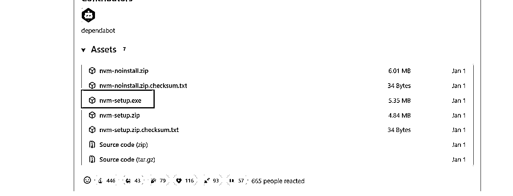

GitHub 访问不太方便，安装包我已经给大家准备好了。

苹果电脑装 nvm 的参考视频：https://www.bilibili.com/video/BV1paZzYqEQ9/?spm_id_from=333.337.search-card.all.click&vd_source=0938c92d0bed0dc8d6956f9d2e97ea39

我自己手里已经没有 Mac 了，没法实际演示，不过 B 站这类教程很多，找找总有合适的。

下面的流程在 Windows 和苹果上都适用。碰到任何问题都可以来找我，我来完善文档。

装完之后先验证一下：按 Win+R，输入 cmd 回车。如果要以管理员身份打开命令行：

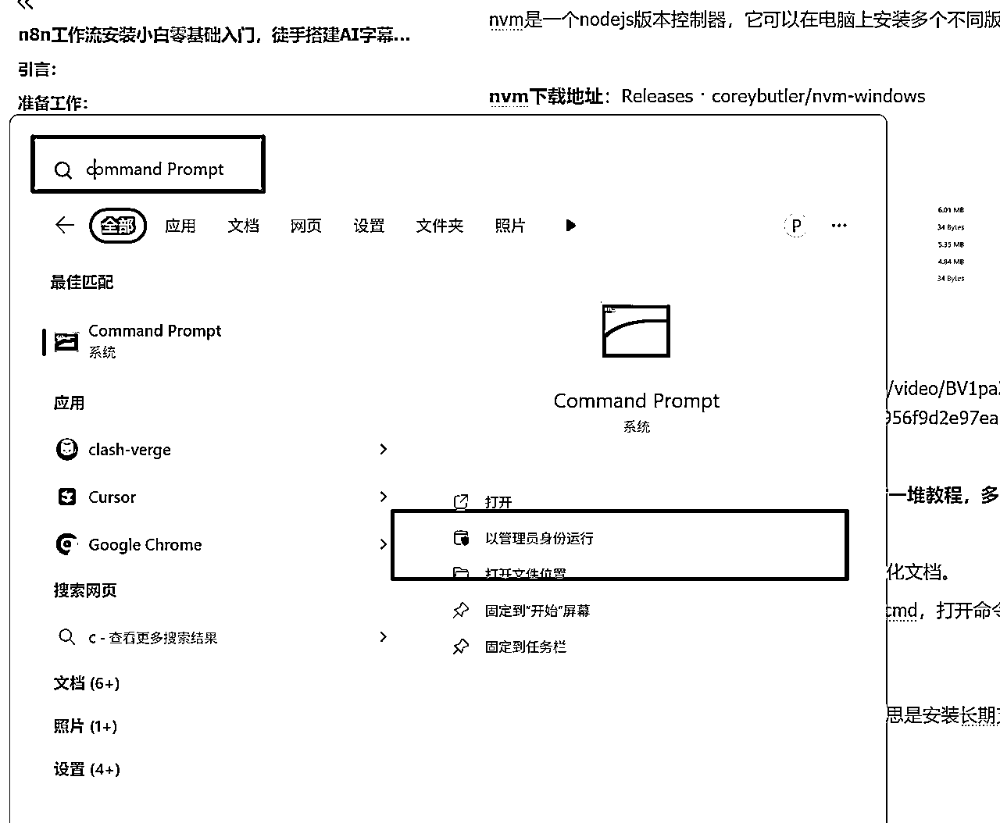

执行：nvm -v，弹出数字版本号就代表成功了。

接下来安装 Node.js，输入：nvm install lts，它的含义是安装当前最新的长期支持版本。

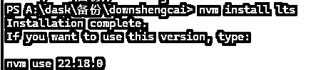

装好之后，用：nvm list 查看机器上现在有哪些 Node.js 版本。

我这台机器装了两个版本，所以列出来两条。前面带星号的那条，就是当前正在使用的版本。

切换版本时输入：nvm use 22.18.0（注意：换成你自己的版本号，别照搬）

不管你装了多少个版本，这步都不能省，否则系统根本不知道你想用哪个。

这句话容易忘，必须唠叨三遍：nvm use 22.18.0（换成你自己的版本号）
再唠叨一遍：nvm use 22.18.0（换成你自己的版本号）
继续唠叨一遍：nvm use 22.18.0（换成你自己的版本号）

确认切换结果：输入：node -v 查看版本。

这里专门提醒一下：n8n 对 Node.js 的版本要求相当苛刻，20.11.0 都过不了关，所以务必安装并切换到最新版。

## 安装 n8n

命令行里输入：npm i -g n8n，然后等它自动拉取安装包，大概三分钟后能装完。完成后照例验证：

输入：n8n -v 查看版本号。

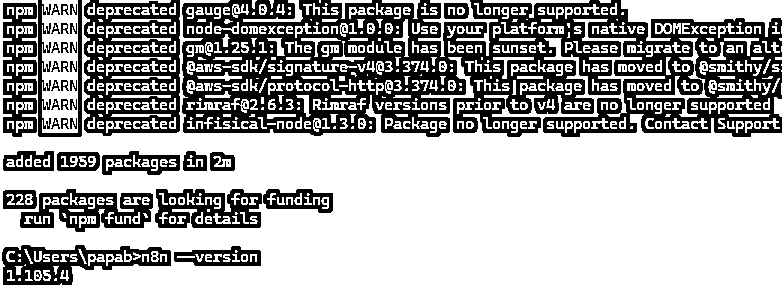

如果上面这步卡住或下载不动，看这里：

npm 默认的源头在海外服务器，受众所周知的网络环境影响，拉取速度极其感人，甚至直接超时。有两种处理办法。

方案一：给终端配上代理

适合手头有现成代理工具的朋友，但操作起来确实稍复杂。

第一步，搞清楚你代理软件的监听端口号。

什么？你不知道？那别纠结了，直接看方案二。

确定端口后，在终端依次执行：

npm config set proxy http://127.0.0.1:7890

npm config set https-proxy http://127.0.0.1:7890

注意：7890 要替换成你自己的真实端口。

如果装好 n8n 后想移除代理配置（可选，不影响安装）：

npm config delete proxy

npm config delete https-proxy

方案二：切换淘宝镜像

直接执行：

npm config set registry https://registry.npmmirror.com

国内镜像虽然存在更新稍慢、兼容性一般的小缺点，但好在不需要代理也能飞速下载。

恢复官方源（装完 n8n 后可自行决定是否执行）：

npm config set registry https://registry.npmjs.org/

提醒一下：敲完这些设置命令，终端没有回显是正常的，不用慌。这里只是修改了包的来源，接下来你还需要再运行一次：npm i -g n8n

## 启动 n8n

终端输入：n8n，等待数据加载完毕，直到出现下面的界面：

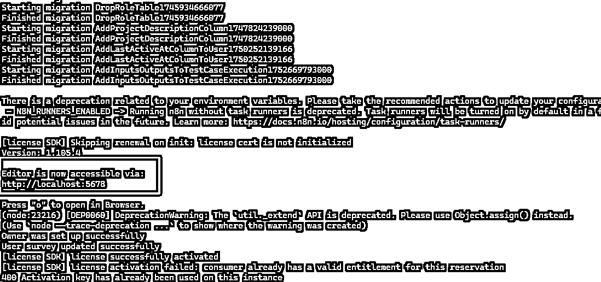

红框内是一个 IP 地址，那就是进入 n8n 的入口。把它复制到浏览器地址栏即可访问，也可以直接按键盘上的【o】键自动弹出。

以后每次访问 n8n 网页端，都要先执行这条命令。

到这里安装全部完成。下面进入一个实操示例。

## 设计工作流时先想清楚什么

搭工作流之前，先聊一个理念层面的问题：无论是写代码还是搭工作流，说到底就是把脑子里的想法翻译成机器能执行的指令。所以动工之前，先有个清晰的项目蓝图是非常重要的。

就拿今天的字幕清洗项目来说，我的构思是这样的：

1. 从剪映导出字幕，通常是 .srt 格式。
2. 交一个字幕文件给工作流。
3. 把字幕文件转为纯文本格式。
4. 将文本字幕通过 API 提交给 AI，同时附上处理指令，或者接入现成的敏感词库和错别字接口。
5. 把 AI 返回的文本转回 .srt 文件。
6. 下载处理完成的 .srt 字幕。

思路先行，剩下的就是步骤落地。有了这份蓝图，就可以开始把它翻译成工作流了。

# 搭建详解

## 一、上传字幕文件

n8n 给我的感觉更像一个后端服务，它的核心职责是处理数据，本身没有提供文件上传的入口。因此我们需要借助 HTML 页面来完成上传动作。页面我已经提前准备好了，使用前只需调整接口路径。

具体怎么改？下面会说明。

现在开始配置工作流的第一节点——接收上传的字幕文件。

首次进入时，系统会要求填邮箱并发送激活链接，按提示激活即可。

到主页后，点击上方的【Create Workflow】新建一个工作流。

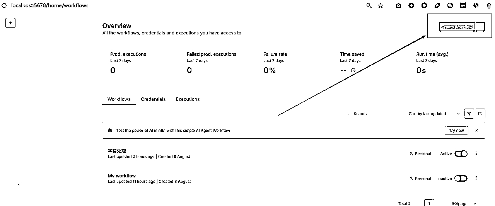

点击中间的【+】号，在右侧搜索框中输入【web】，然后选择下拉菜单里的第二个选项【web hook】。

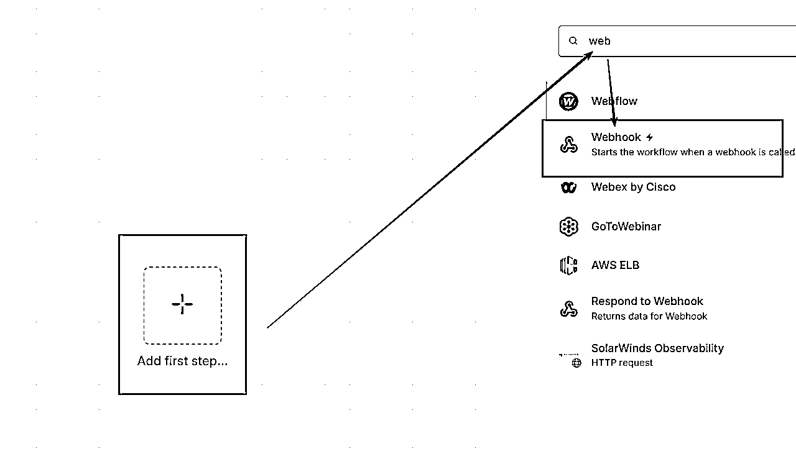

进入节点后，看中间区域，把红框标出的两处配置改成和示例一致。

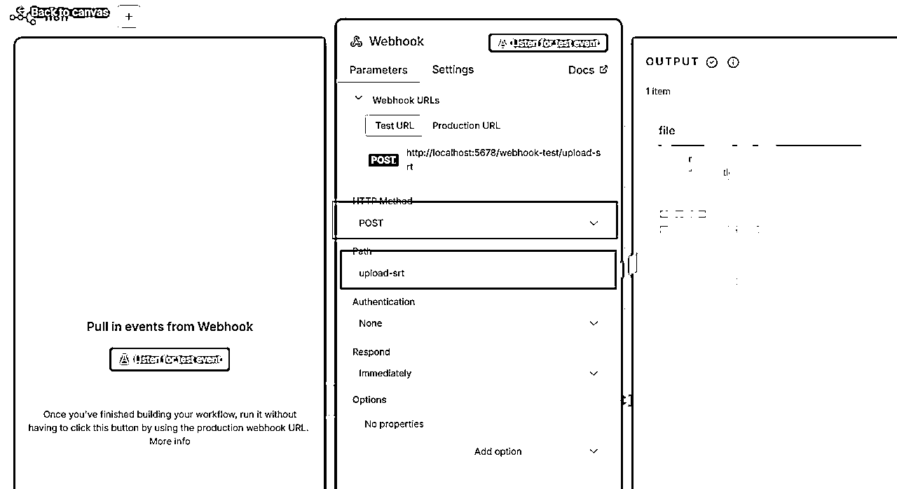

第一处是请求方式。因为要传输文件，文件体积不算小，GET 装不下，必须选用 POST。

第二处是路径。工作流接收文件需要一个明确的入口地址，这里的路径可以自由定义，但后面 HTML 页面里的上传地址必须与之保持一致。

改完之后点击【Back to canvas】返回画布，配置会自动保存。

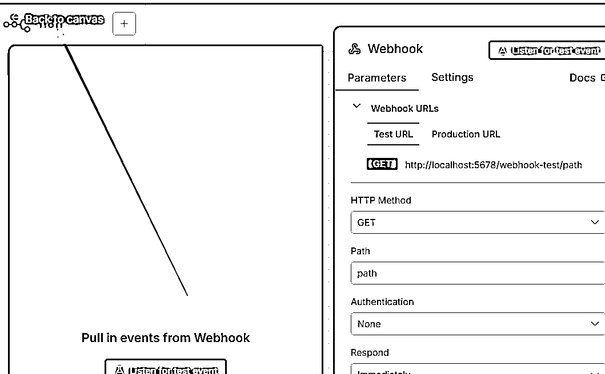

节点一旦启动，就会生成一个专门接收字幕文件的接口。你可以把它理解成工作流的大门，字幕文件必须从这个门进来，才能被后续流程处理。

返回后看到的是这种状态，点击下方的按钮开始监听。

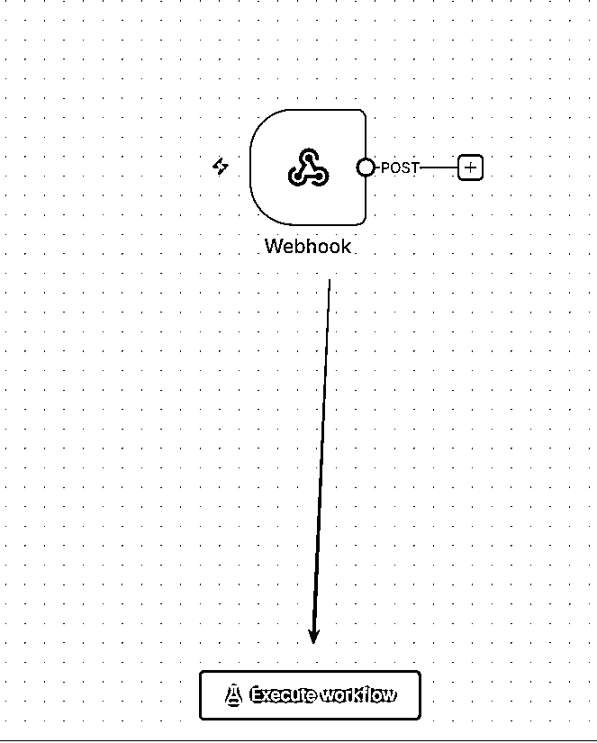

按钮变为【Waiting for trigger event】，它的含义是：“文件我准备好了，就等着你传送过来。”

这时打开你的编辑器，把我提供的 HTML 文件调出来。什么？你还不知道我给了文件？

往回翻！在最前面的部分，我已经把文件放出。

右键点击该文件，选择【打开方式】。有编辑器的用编辑器，没有的用记事本，修改红框中的地址。

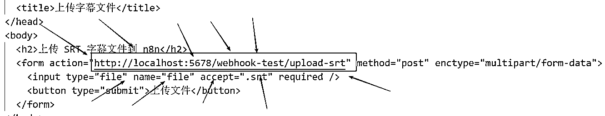

将它替换成刚才工作流第一个节点 webhook 里的那段链接。

务必留意：工作流里所有节点都可以双击打开进行查看和编辑。

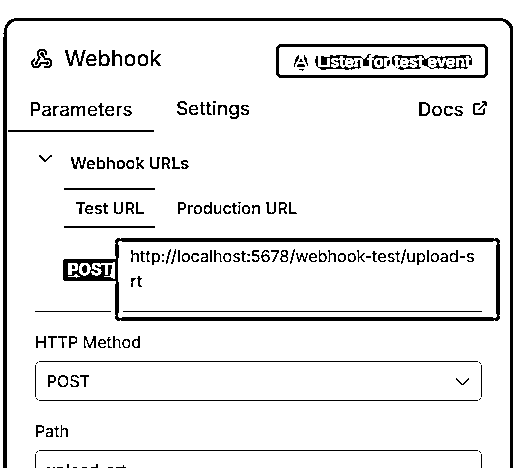

然后在浏览器里打开 HTML 页面，选中你的字幕文件，点击上传。

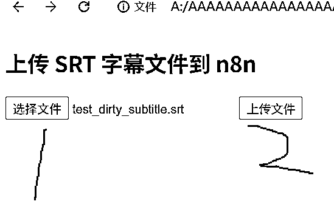

接下来，令人欣喜的画面出现了！工作流有了反应：右下角浮出提示，第一节点边框变绿并出现对勾，表示文件接收成功。

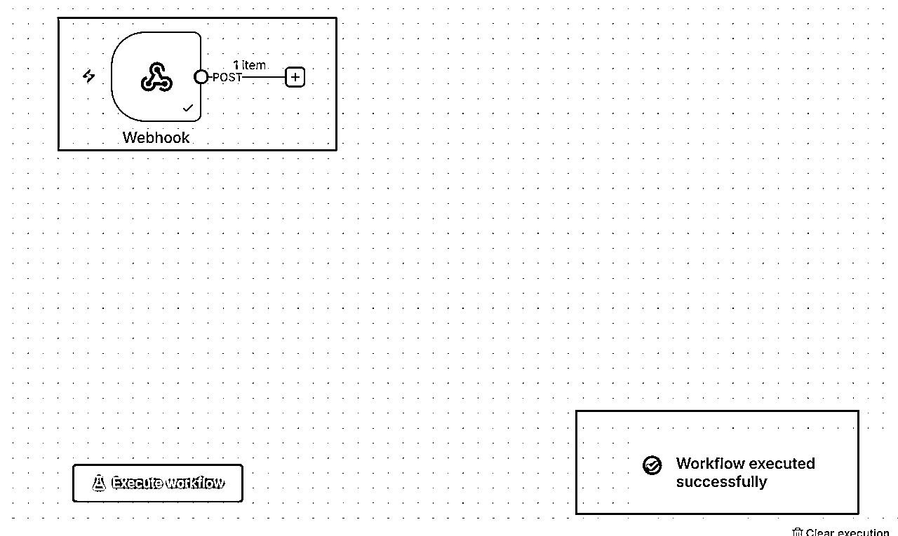

双击打开 webhook 节点，右侧能清楚看到刚刚上传的文件信息。

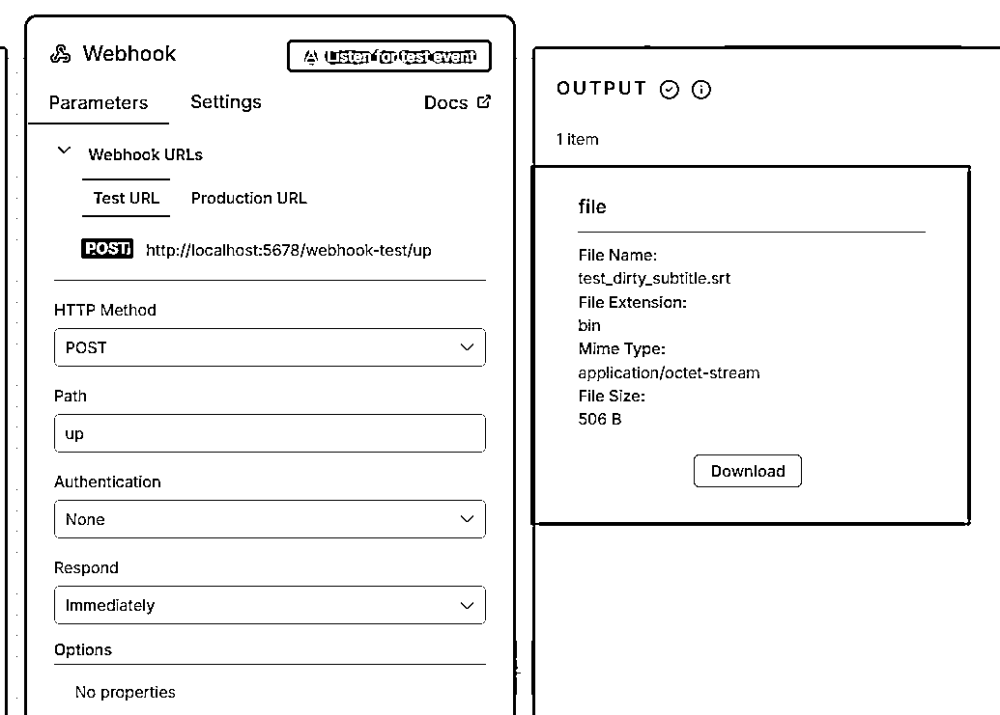

这份数据既是当前节点的终点输出，同时也是下一节点的起始输入。

到这一步，工作流的第一环节已经搞定——字幕文件成功上传！

## 二、把二进制文件转为文本

文件已经到手，下面开始真正意义上的处理。

webhook 接收文件的默认形式是二进制，所以本环节的任务就是把它转换成纯文本，让后续 AI 能够正常读取和优化。

点击 webhook 旁边的加号，在右侧面板搜索【code】，选择第一个 code 节点。

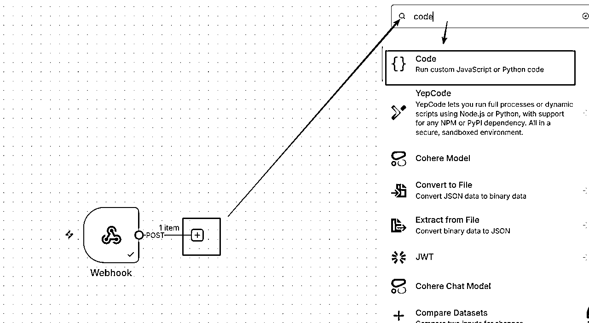

进来之后，你会看到三个区域，从上到下依次是 INPUT、Code 和 OUTPUT。

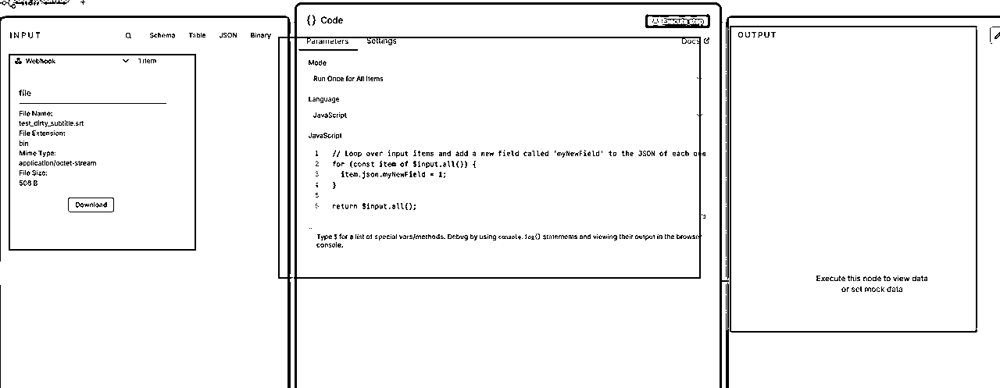

前面说过，出现在 INPUT 里的数据文件，正是上一个节点传过来的那份二进制字幕。

我们要在 Code 区域里写脚本，把它转成文本。OUTPUT 区域不用管，脚本正确跑完，结果就会自动展示在那里。

所以重点放在中间的 Code 区域。

Code 区域需要配置两个东西，mode 保持默认即可，它决定脚本的执行方式。

第一项 Run Once for All ltems：整体只运行一次。
第二项 Run Once for Each ltem：输入项有多少条，就执行多少次。

我们的 INPUT 只有一个文件，所以选第一项。

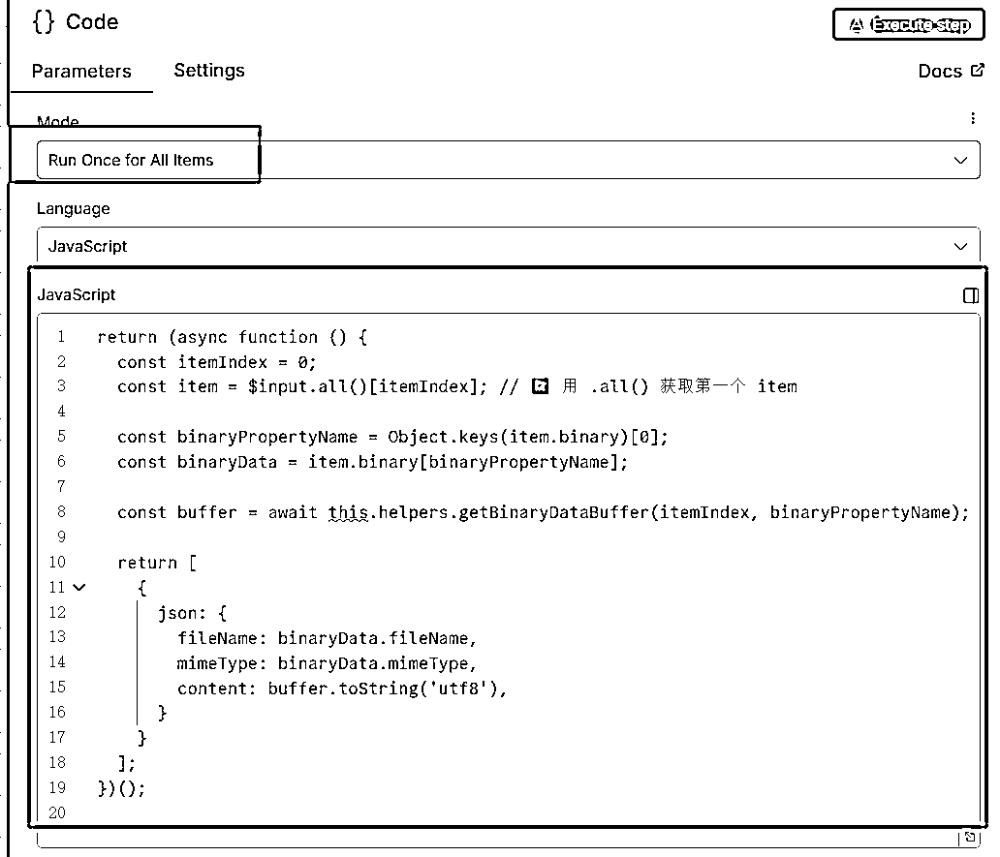

脚本内容：

return (async function () {

const itemIndex = 0;

const item = $input.all()[itemIndex]; // ✅ 用 .all() 获取第一个 item

const binaryPropertyName = Object.keys(item.binary)[0];

const binaryData = item.binary[binaryPropertyName];

const buffer = await this.helpers.getBinaryDataBuffer(itemIndex, binaryPropertyName);

return [

{

json: {

fileName: binaryData.fileName,

mimeType: binaryData.mimeType,

content: buffer.toString('utf8'),

}

}

];

})();

把原有的代码删掉，换上这段。

运行方式：点击【Execute step】按钮执行。

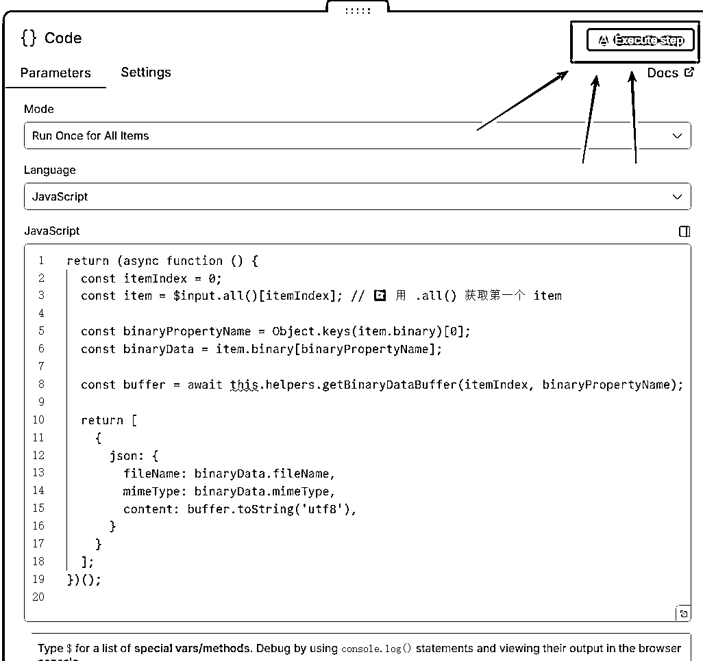

一切正常的话，OUTPUT 区域会出现类似下方的文本信息，同时右下角也会提示执行成功。

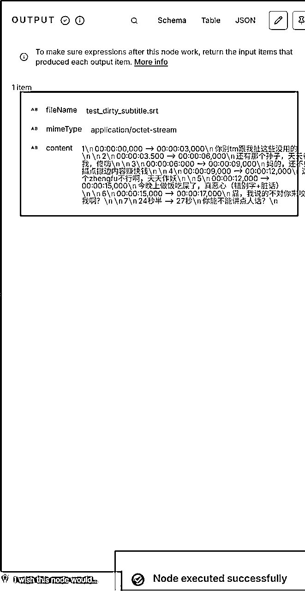

到这里，第二个环节完成——二进制文件成功转成了文本文件。

## 三、调用 AI 处理字幕

点击左上角返回画布，前两个节点已经变绿。现在开始配置 AI 请求。

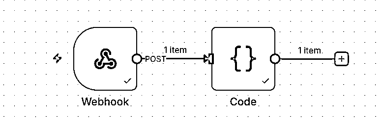

AI 的选型路径很多。如果你的显卡在 RTX 3060 及以上，可以考虑本地部署模型作为处理接口。这个方向涉及的东西不少，本期先不展开，需要的人多的话，后续专门写一篇。

另一种就是在线 API 方案。追求上限，GPT 和 Claude 效果更好；考虑到成本和性价比，我选了阿里的【通义千问】。

获取 API key 入口：大模型服务平台百炼控制台

密钥拿到手之后，下面正式配置。因为要发送请求给大模型，所以第三个节点我们使用 HTTP Request。

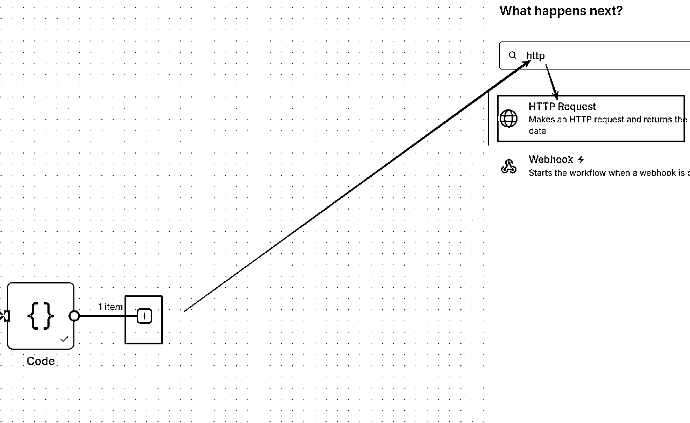

进入节点后，总共要改四个地方：

1. 请求方式：依旧 POST。原因很简单，要发送的数据量非常大，GET 那个“小背包”根本扛不动。
2. 请求地址：这就是大模型服务的调用地址。想让 AI 帮你干活，总得先找到它“住”在哪里。
3. 头部信息：相当于你的身份凭证。系统看到你在有效额度内，才会响应你的请求，否则不予理会。
4. 参数：这里存放字幕内容和提示词。

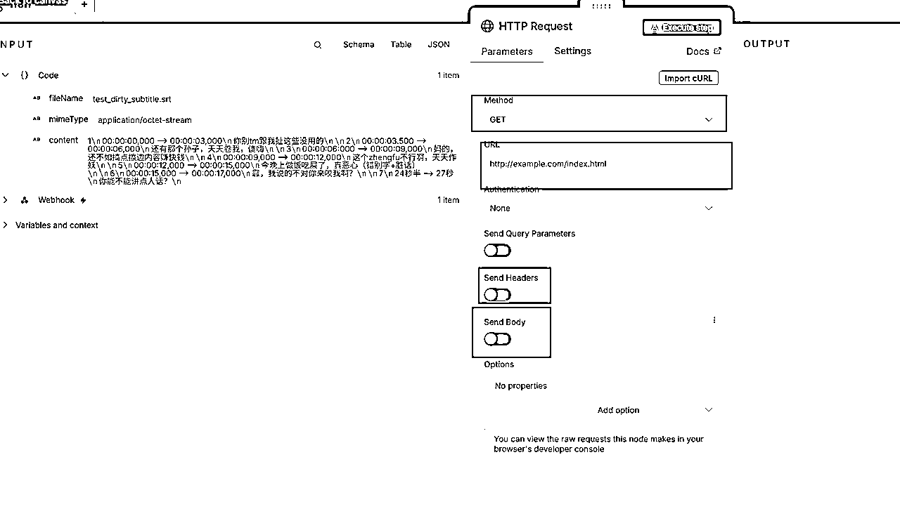

关于前两项和请求头的设置，参考下面的截图：

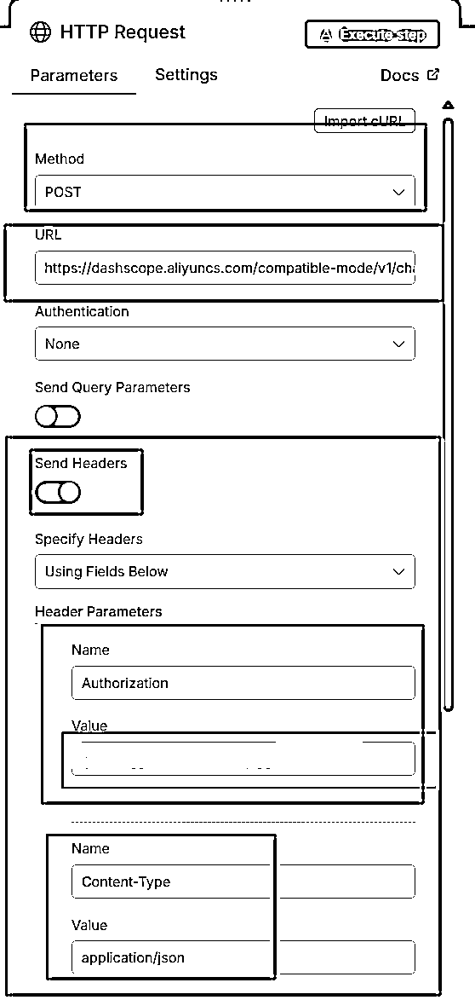

请求地址：https://dashscope.aliyuncs.com/compatible-mode/v1/chat/completions

图中的黄色区域，填入百炼控制台获取的 api key。

send body 参考下图格式：

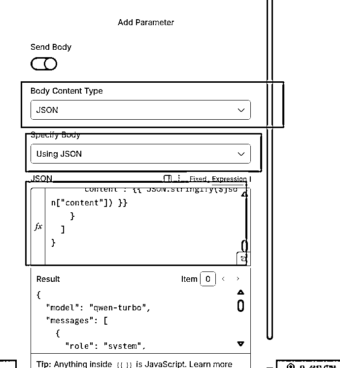

JSON 内容：

{
  "model": "qwen-turbo",
  "messages": [
    {
      "role": "system",
      "content": "你是一名字幕清洗专家，请你对下面的 .srt 字幕内容进行处理：【清洗要求】： 1. 修改所有错别字，使语句通顺； 2. 删除或替换所有低俗语言、脏话； 3. 替换所有涉及违法、敏感、违禁的词句（包括政治敏感、涉黄涉暴等），改为中性表达或删除； 4. 保留时间轴格式（即每条字幕的时间线不变）； 5. 不添加解释或注释，只返回清洗后的字幕内容； 6. 如果某句无需修改，原样保留； 7. 输出必须是标准的 .srt 字幕格式（包括空行、时间、换行等等）。 下面是字幕原文"
    },
    {
      "role": "user",
      "content": {{ JSON.stringify($json["content"]) }}
    }
  ]
}

提示词完全可以根据实际需求做调整。比如你更想让 AI 用 * 号代替敏感词而不是直接替换，后续在剪映里就能快速定位并自行处理。

{
  "model": "qwen-turbo",
  "messages": [
    {
      "role": "system",
      "content": "你是一名字幕清洗专家，请你对下面的 .srt 字幕内容进行处理：【清洗要求】：将所有错别字的具体字替换为 *（不改正为正确字）；将所有低俗语言、脏话替换为 *；将所有涉及违法、敏感、违禁的词句（包括政治敏感、涉黄涉暴等）的相关部分替换为 *；保留时间轴格式（即每条字幕的时间线不变）；不添加解释或注释，只返回清洗后的字幕内容；如果某句无需修改，原样保留；输出必须是标准的 .srt 字幕格式（包括空行、时间、换行等）。下面是字幕原文"
    },
    {
      "role": "user",
      "content": {{ JSON.stringify($json["content"]) }}
    }
  ]
}

最后再强调一次：编辑 content 字段时，里面的提示词必须保持单行，绝不要手动换行，不然脚本会直接报错。

配置完成后，点击【Execute step】按钮把请求发给 AI。稍等几秒，清洗完毕的字幕就会返回到工作流中。

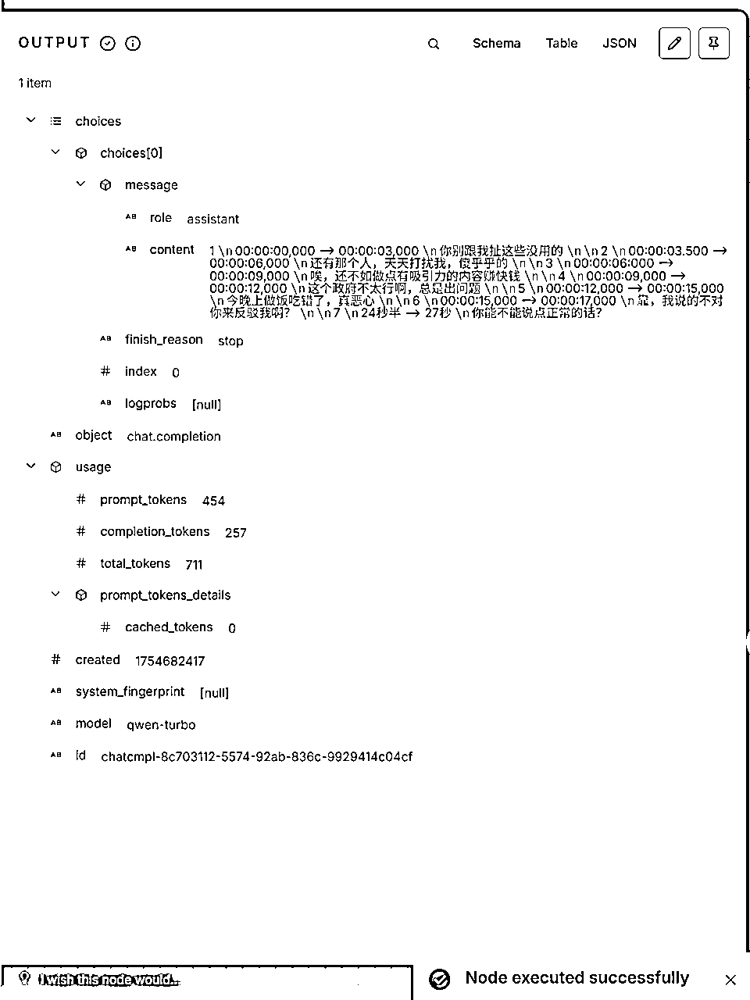

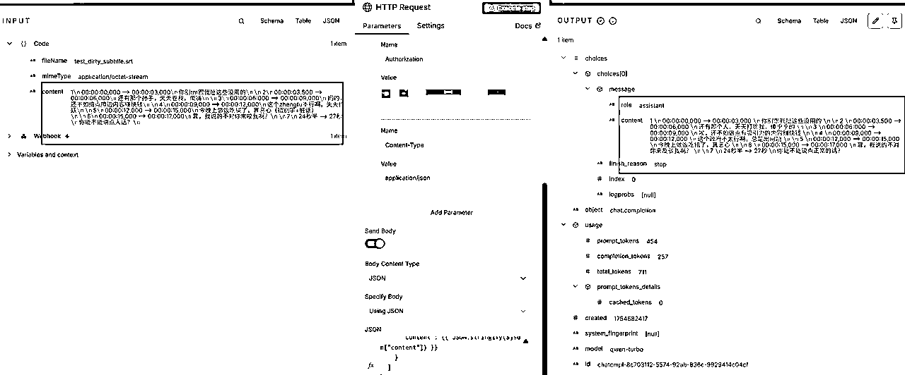

到这一步，字幕的清洗工作就算是完成了。那些敏感词、违禁词、口头脏话之类的内容，都已经被模型替换掉了。

如果出来的效果还不够理想，直接回头改一下提示词就行，多试几次就能调到你满意的版本。

好，到这里离一个可用的完整工作流就只剩最后一步了。

### 四、把AI返回的文本字幕导出为.srt文件

目前AI给我们的是纯文本字幕，但剪映里能直接用的必须是.srt格式，所以需要再做一次格式转换。

先点左上角返回，回到第三个模块的右侧加号，再新建一个【code】模块。

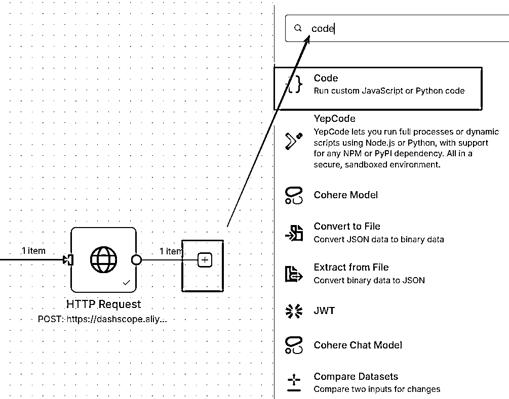

这个模块里主要调整两处配置：

第一处是运行模式，默认模式不行，要改成 Run Once for Each Item。原因是AI返回的结果是一个数组，哪怕里面只有一条字幕，也必须用这个模式处理，这样以后多条字幕也能无缝兼容。

第二处是把文本字幕转成二进制.srt字幕的核心代码逻辑。

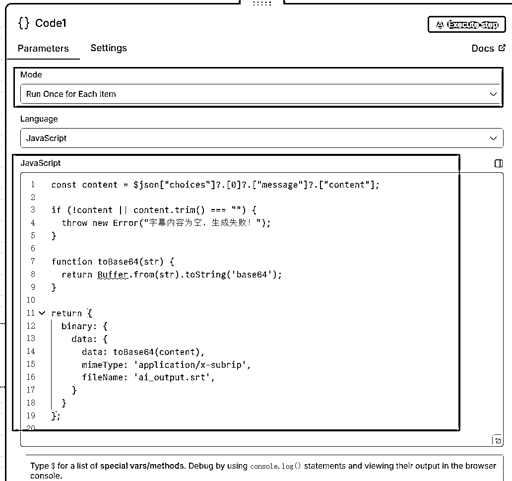

代码：

const content = $json["choices"]?.[0]?.["message"]?.["content"];

if (!content || content.trim() === "") {

throw new Error("字幕内容为空，生成失败！");

}

function toBase64(str) {

return Buffer.from(str).toString('base64');

}

return {

binary: {

data: {

data: toBase64(content),

mimeType: 'application/x-subrip',

fileName: 'ai_output.srt',

}

}

};

设置完成后点一下【Execute step】执行当前步骤，很快右侧的OUTPUT区就会生成一个二进制字幕文件，点击【download】即可把经过AI优化过后的.srt字幕下载到本地。

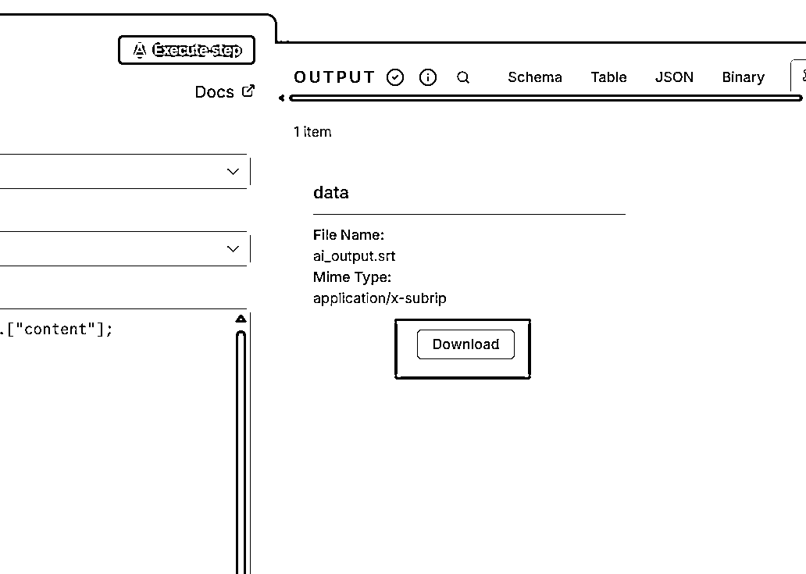

至此，整个工作流的搭建就全部结束了。

下载好的字幕文件直接拖进剪映即可，省去了手动逐字排查修改的麻烦。

最后也说一句，如果这篇文章反响不错，我后续可以考虑做一个在线网站把这个工具封装好给大家用，就不用每个人都自己搭工作流了。

学工作流最有效的方式还是自己动手实操一遍，光看教程远远不够。

如果在使用过程中有新的问题或痛点，欢迎留言，我看到就会整理成解决方案分享给大家一起进步。