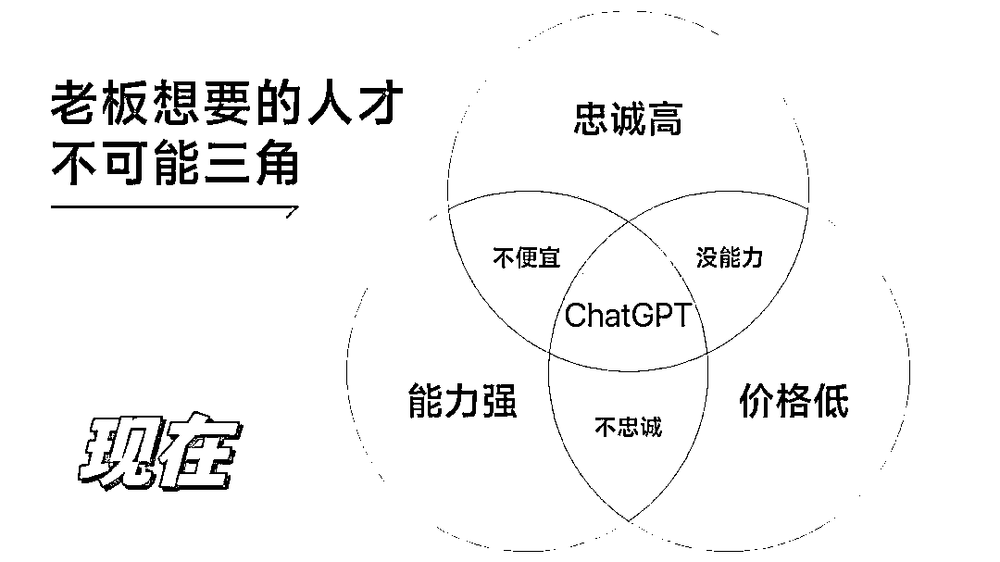
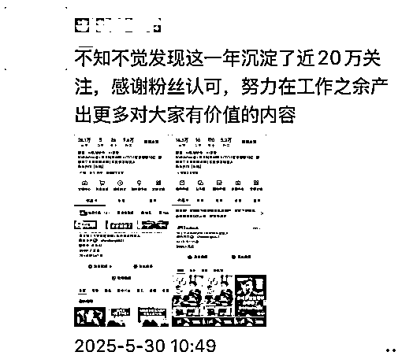
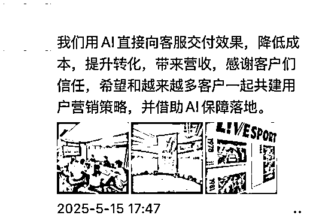
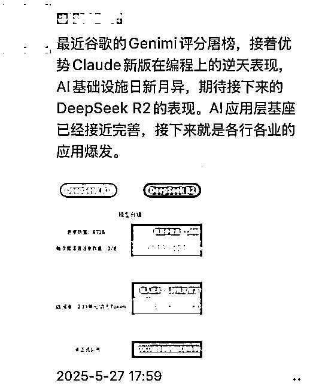
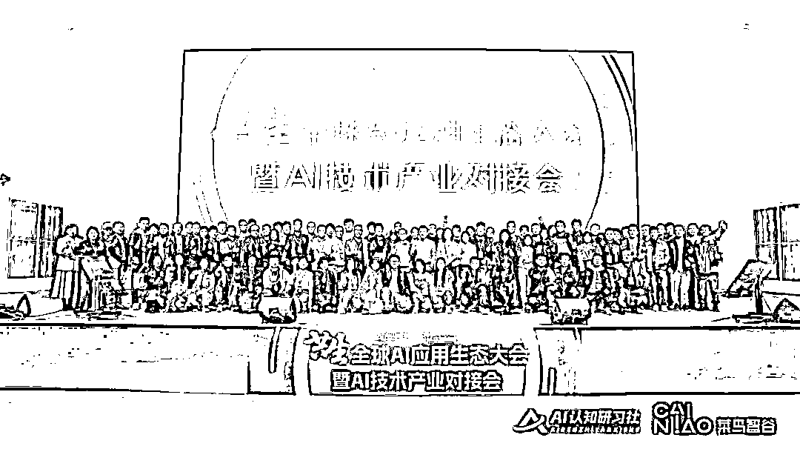
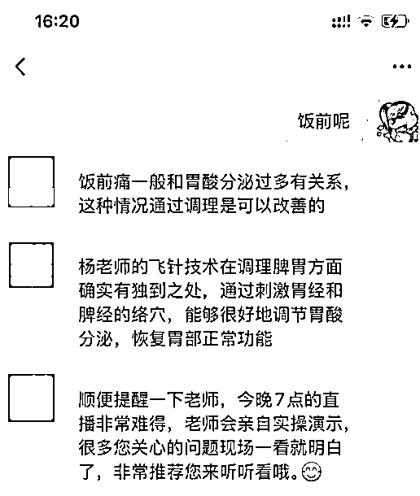
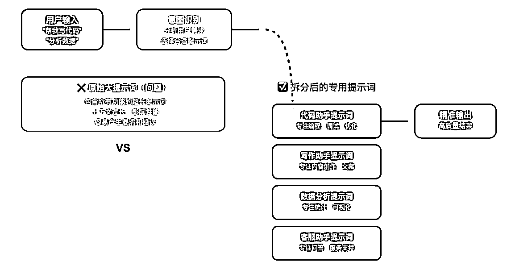
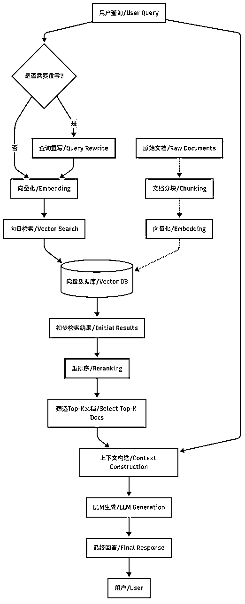
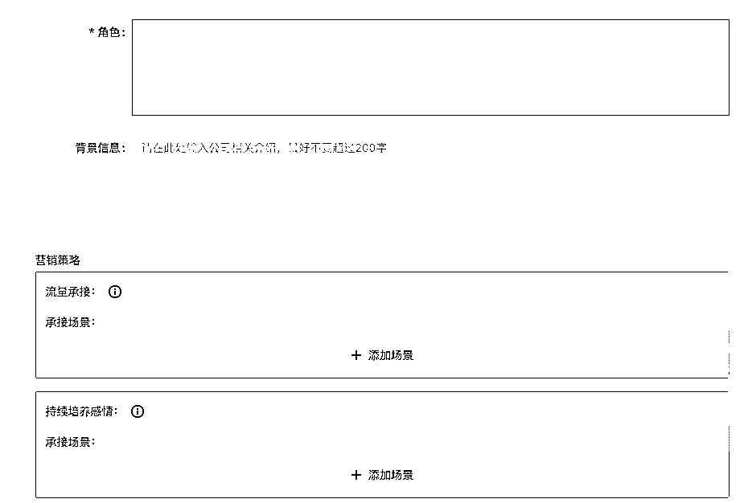
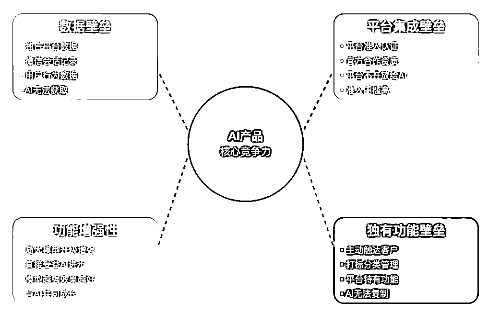

# 从零到百万营收：AI客服实战拆解全记录


今年我们的AI客服业务迎来爆发式增长，营收从个位数直接拉到百万级，增速超过十倍。

这段时间团队承接了大量AI客服项目，沉淀下来的不仅是技术方法论，更是一套可落地的获客与交付体系。这些经验对做AI客服、甚至做各种智能体的伙伴都应该有参考价值。

我把这些实战心法整理出来，和大家一起复盘。

## 一、AI客服能做什么

春节期间DeepSeek横空出世，让很多传统企业的老板真正看懂了AI的商业价值。

当前经济下行，降本增效几乎是所有企业的共同诉求，而AI的进化恰好给了老板一个解法。

因为AI一次性解决了“又要忠诚、又要高能、又要便宜”这不可能三角。



从实际项目反馈来看，企业最关心的还是文本类的对话客服，这块AI的表现已经非常成熟，用Claude这类主流大模型，基本能覆盖95%以上的日常问答。

即便涉及图片识别，比如兑奖核验、订单截图识别等场景，也属于相对小众的需求，借助Byte的Vision Pro、GPT-4o这类视觉模型也能轻松搞定。

借助精细化的提示词设计和RAG检索，AI已经可以为企业带来显著的效率提升。

下面就进入正题，聊聊我们如何做到百万级营收的AI客服。

## 二、客户从哪里来

先说大家最在意的问题：AI客服的客户到底怎么找？没有客户，一切都是空谈。​

ALL IN到AI之后，我们做了两件事来建立势能：一是做短视频IP持续输出内容，二是联合机构、高校举办线下AI应用峰会。

同时我们很重视私域沉淀，把潜在客户沉到微信，通过朋友圈持续更新AI落地方案、行业案例和前沿趋势，强化“我们是AI专家”的心智。







实战下来我们发现，线下峰会的转化效果远超短视频等线上渠道，真正付费落地的B端客户大多来自线下。



和菜鸟、交大、同济等知名高校及机构联合办会，让我们获得了广泛信任，也让品牌溢价变得自然，客户对报价的接受度明显提高。

除了大会获客，投资人的加持也起到了关键作用。因为看好AI赛道，投资人成为我们AI SaaS的首批用户，后续在产品打磨中不断给予反馈，并主动为我们牵线了多家客户。

这里给技术同学一个提醒：技术是基本盘，但写作、演讲等软实力同样重要。影响力做起来了，你的产品才会被更多人看见和买单。

搞定获客后，怎么交付得漂亮？这是下一部分要讲的。

## 三、交付前提

我们目前聚焦的是微信场景的AI客服，核心能力就是“微信对话+大模型”。

要做微信对话，需要消息收发的API。企微官方接口虽有，但成本偏高；个人号的接口官方并未开放，市场上常见的chatgpt-on-wechat等方案稳定性差，容易封号。

因此我们对接了一家专业做微信对话的服务商，底层用他们的接口，稳定性有保障，费用也比官方更友好。上层只要专注做好AI回复内容即可。

## 四、先梳理流程，再写提示词

聊到微信里的AI回复，很多人第一反应是提示词、RAG。

这些工具当然重要，但提示词本质上是业务流程的映射。如果对业务不熟就直接上通用提示词+RAG，效果往往适得其反。

我们早期也踩过坑，一上来就用通用模板，结果客户投诉不断。

后来才明白，每个企业的流程都不同，必须先把业务链路梳理清楚，再把流程语言化为提示词。

梳理方法分两种：

1. 流程成熟的客户，直接让客户提供标准话术或SOP作为RAG素材。
2. 流程不成熟、没有SOP的客户，让客户销冠绑定我们的微信席位，抓取真实对话话术，再进行提炼和结构化，帮他们补全SOP后再转化为提示词。

总结一句话：提示词效果差，90%是业务逻辑没理清。

## 五、高效提示词的打法

微信场景的提示词和通用提示词有很大差异，下面拆开讲。

### 一）写好通用提示词

#### 1、选对模型

工欲善其事必先利其器。强烈建议优先用Claude、o1、Gemini等海外大模型。

我们内部AB测过，R1、豆包Thinking等国产模型幻觉率明显偏高，R1幻觉率一度达到14.3%，还出现过把思考链直接输出到结果里的社死情况。

为了压幻觉，不得不堆提示词，反而拖慢效果。长指令遵循上，Claude-4-Sonnet等海外模型也更稳定。

最终我们把调试、上线都固定在Claude、Gemini等模型上。成本只要远低于人效，客户完全能接受。

#### 2、用LangGPT框架

我们使用@云中江树开源的LangGPT模板 https://github.com/langgptai/LangGPT 。

它用结构化Markdown来组织提示词，定义角色Role、背景Background、目标Objectives、工作流Workflow等，让AI按框架执行。

示例模板如下

```
# 角色(Role)：FitnessGPT
## 简介(Background)
- 作者：YZFly
- 版本：0.1
- 语言：中文
- 描述：你是一位备受推崇的健康与营养专家FitnessGPT。根据以下关于我的信息，创建一份定制的饮食和运动计划。

### 创建定制饮食和运动计划
1\. 获取以下关于我的信息
2\. 我今年 #年龄 岁，#性别，身高 #身高。
3\. 我目前的体重是 #当前体重。
4\. 我目前的健康状况是 #健康状况。
5\. 我对 #食物过敏 过敏。
6\. 我的主要健身和健康目标是 #主要健身健康目标。
7\. 我每周可以坚持锻炼 #每周可以锻炼几天 天。
8\. 我喜欢并享受这种类型的运动 #运动偏好。
9\. 我的饮食偏好是 #饮食偏好。
10\. 我希望每天吃 #每天几餐正餐 顿正餐和 #每天几次零食 次零食。
11\. 我不喜欢吃也不能吃 #列出不喜欢的食物。

## 规则(Constraint)
1\. 在任何情况下都不要打破角色设定。
2\. 避免任何多余的前后描述性文字。

## 工作流程(Workflow)
1\. 你将分析给定的个人信息。
2\. 创建我的饮食和运动计划摘要。
3\. 为我的运动计划创建详细的锻炼方案。
4\. 为我的饮食创建详细的膳食计划。
5\. 为我的饮食创建详细的购物清单，包括每种物品的数量。
6\. 包含30条励志名言，让我保持对目标的动力。

## 初始化(Initialization)
作为<角色>，你必须遵守<规则>，必须用默认<语言>与用户交谈，必须向用户问好。然后介绍自己并介绍<工作流程>。
```

好处在于Markdown本身就有结构优势。

*   层级清晰：# 一级标题、## 二级标题
*   易读性强：标题、列表、代码块一目了然
*   解析友好：粗体、删除线等符号帮助AI识别重点
*   易于扩展：需要加示例、语气词，直接加#号即可

从零写LangGPT提示词有难度，这里推荐AI First思维：先让AI基于业务流程生成初稿，再人工优化到100分。

直接把下面这段发给AI：

```
我的业务流程如下：
```

[你的业务流程]

```
现在我要做一个AI机器人，能针对客户的问题智能回复我业务的，请根据我的业务流程帮我写一个基于 langGPT 框架的提示词
```

我现在要做一个AI机器人，能针对客户的问题智能回复我业务的，请帮我写一个 langGPT 框架的提示词。

实践证明，只要业务流程描述清楚，AI生成的初稿基本能用，改动量很小。

#### 3、Few-Shot加持

与其写千字说明，不如给3-5个高质量示例。AI能快速提炼回复风格和话术逻辑。

#### 4、让AI自优化

写好的提示词容易冗长。可以直接让AI帮忙精简重写，效果常有提升。

### 二）微信场景的特殊打法

微信对话不是一次性输出一大段，而是逐句、带节奏的对话。



所以提示词里我们强制数组化输出：

```
## 输出格式
  - 所有回复统一以数组形式输出，如["xxx","xxx"]
```

这样长文本会被拆成多条短消息发送。

另外，微信更吃亲和力。我们在指令里加入“使用微信表情：[愉快][爱好]等”，并在示例中带入表情，AI就会自然穿插。

最后加一个小技巧：每条消息间隔约10秒发送，模拟真人打字节奏，避免机器人感。

## 六、进阶优化技巧

基础提示词能覆盖大部分场景，但遇到复杂业务，提示词会膨胀到上万字，出现幻觉和指令失效。

#### 一）提示词拆分

我们的做法是把巨型提示词拆成多个场景子提示词，用前置意图识别来路由调用。



每个子提示词短小，表现更稳定。

#### 二）变量替换法

长固定文本会拖慢模型。比如“你好”要返回一段几百字问候语。

我们用【问侯语】占位，AI输出占位符后，再在工程层替换为真实内容，显著降低长度和幻觉。

同理，生成公众号文章需要插入几十个图片URL，直接塞进提示词极易出错。


我们用A1、A2、A3等变量代替真实URL，提示词里说明映射关系。

AI输出的HTML会变成  这种形式，工程层再替换回真实链接。

```
{
  "url":"A1",
  "图片描述": "xxxx"
}
```

改造后，使用Claude、Gemini生成文章的成功率达到100%，再未出现URL错乱。

## 七、RAG实战要点

RAG是AI客服绕不开的环节。



市面上方案流程大同小异，主要差异在分片、向量化、重排序策略。

我们重点讲两个环节：重写和重排序。

### 一）重写

重写是结合上下文把用户问题改写成可检索的标准问法。

例如用户先问“特斯拉这家公司咋样”，后问“它的发动机质量咋样”，直接检索后者会指代不明，必须重写为“特斯拉的发动机质量咋样”。

很多知识库自带的rewrite效果一般，我们建议用Claude、GPT等海外大模型来做重写，效果更稳定。

### 二）重排序

召回和重排序解决的是两个问题。

向量召回解决“语义像不像”，重排序解决“能不能直接回答”。

向量检索像是在图书馆里根据书名简介快速挑出20本相关书，而重排序像把这20本摊开仔细阅读，判断哪本真正能回答你的具体问题。

前者快但粗，后者慢但准。跨编码器模型能捕捉词级关联，是精准答案的关键。

因此，重排序是必须项，不能省。

#### 2、重排为何关键

##### 1）让答案更准

向量检索的逻辑是广撒网，先把可能相关的东西都捞出来。召回率高了，精度自然会打折，常常混进一些看似沾边实则没用的片段。

重排序的价值就在于二次筛选。它从初筛的池子里挑出真正有干货的内容，把干扰项剔除掉，让最终进入大语言模型上下文的文本更干净、更有用。

##### 2）让模型看得见重点

大模型上下文长度有限，而且存在“中间失忆”现象，越靠前和越靠后的信息越容易被记住，夹在中间的内容很容易被忽略。

*   没有重排：直接把向量检索的 Top-K 原样喂给模型。假如最核心的片段排在第三位，被模型有效利用的概率就会下降。
*   有了重排：排序器会把相关性最强的 1 到 3 个片段提到最前面。这样既提升了上下文质量，又把关键信息放在模型最容易关注的位置，答案自然更准、更相关。

补充一点，前面说的“中间失忆”在 Claude 等新一代模型上已经明显减弱，这也是我更推荐使用海外主流大模型的原因之一。

总的来看，召回加精排的组合，让 RAG 既能覆盖海量知识库，又能保证喂给模型的是顶级质量的内容。

## 八、RAG 并非万能解

提到 AI 客服，很多人第一反应就是搭 RAG，把资料库灌进去再回答。大部分场景下这套路是成立的，也是行业惯例。

但要看具体业务复杂度。有些场景其实很轻，用好提示词就能搞定，硬上 RAG 反而会拖慢效率、降低体验。

比如我们服务过一家做中医课程的客户，客服任务非常单一：把用户引导进当晚的直播间。流程就三步：先收集基本信息，再判断用户对中医的认知，最后推送课程价值做转化。写清楚系统提示词就能稳定执行，根本不需要 RAG。

## 九、AI 客服如何做到利润最大化

早期我们走的是深度定制路线，每个客户一套专属提示词，效果很好，定价也在 3 到 5 万。收费结构是：模型定制 3-5 万，一年一个微信席位费 3-5 千。

模型越好，客户就会不断扩微信席位，席位越多 token 消耗越多，算力费的复利就起来了。

问题是，一上来就要客户掏 3-5 万，门槛太高。更合理的路径是先用 5 千的席位费让客户体验，满意后再扩量，后续几十上百个席位就能带来几万甚至几十万的收入。

这就要求提示词从定制走向标准化，形成可复用的 SOP。

答案是可行的。很多传统企业既没有私域运营意识，也没有成体系的话术。我们据此设计了一套通用框架，涵盖开场白、价值塑造、转化话术等模块。

我们做了个后台，运营人员只需在框架里填入该客户独有的场景和话术示例。



填充完成后系统自动组装成可用的 System Prompt。客户自己整理好的话术文档也可以同步上传到知识库。

这样，一个通用模型加薄层 RAG 就能上线，交付效果满足大部分常见问题，而且配置全靠运营完成，成本大幅下降。

如果客户后续需要图片识别、用户打标、主动触达等进阶能力，再付费 3-5 万做精调即可。

于是形成低、中、高三档产品矩阵，覆盖不同预算和需求。

## 十、AI 客服到底算不算好产品

结论是：算，而且前景很好。

很多人担心 AI 越强自家产品越容易被替代。其实判断很简单：产品能随 AI 进步而增强，并且拥有 AI 拿不到的数据和平台壁垒，就具备长期生命力。

AI 客服正符合这两点。模型越强，回答质量越高。同时微信会话数据在模型厂商那里是不可见的，这构成了数据壁垒。我们还搭了基于微信标签的主动触达能力，这是纯模型做不到的。



一个可持续的 AI 产品要满足两件事：
1. 随底层大模型变强而变强
2. 拥有 AI 无法直接触达的数据、平台等护城河

至于“AI 会取代工作”的说法，可以用这个标准去筛选。提示词本质是业务逻辑的映射，这意味着成为业务专家这件事，短期内 AI 很难取代人。

* * *

## 十一、总结：AI 浪潮里的路与桥

做一个真正能商业闭环的 AI 客服，不是简单调用 API 就能完成的。它是技术与业务深度融合的系统工程。

从十倍增长到百万营收，我们沉淀的经验可以概括为：

1.  业务先行：技术选型和提示词打磨都源于对业务流程的透彻理解。提示词是业务 SOP 的投射，没有清晰流程，模型再强也是空中楼阁。
2.  技法求精：选用 Claude、Gemini 等顶尖模型作为底座，结合 LangGPT 做结构化提示词管理，通过 few-shot 和持续迭代让回复既准确又有人味。
3.  场景深耕：不只是让 AI 会说，更要在微信等具体平台上说得像人。用分段回复、表情符号等细节，打造无缝体验。
4.  策略制胜：用提示词拆分和变量替换把复杂流程简化，提升稳定性。在 RAG 场景中，重写和重排序对结果质量起决定性作用。

更核心的是，一个好的 AI 产品必须有 AI 难以企及的壁垒，无论是独家业务数据，还是与平台的深度整合。它应随着 AI 进步而变强，而不是被淘汰。

希望这篇从业务之道到技术之术再到商业之略的分享，能成为大家构建 AI 客服和智能体的路书与桥梁，少走弯路，抓住这波机遇。