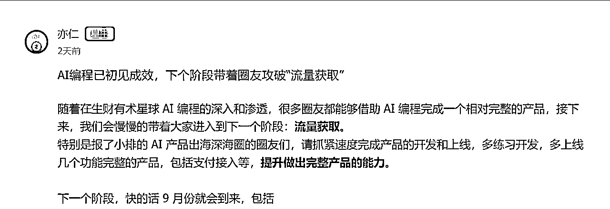
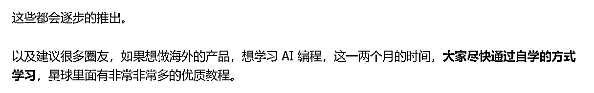
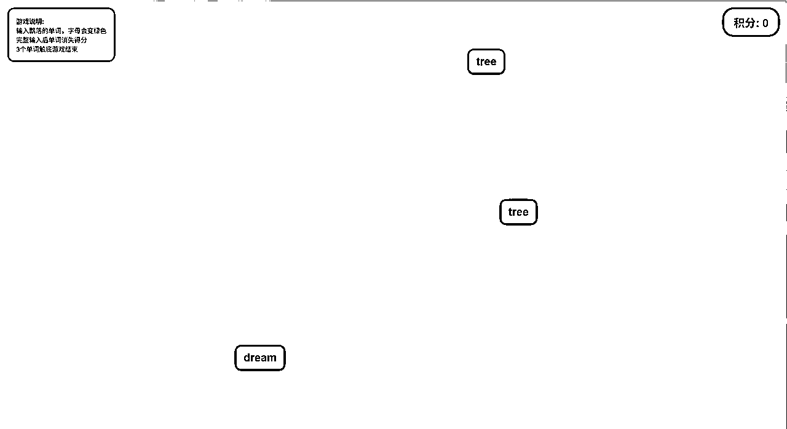
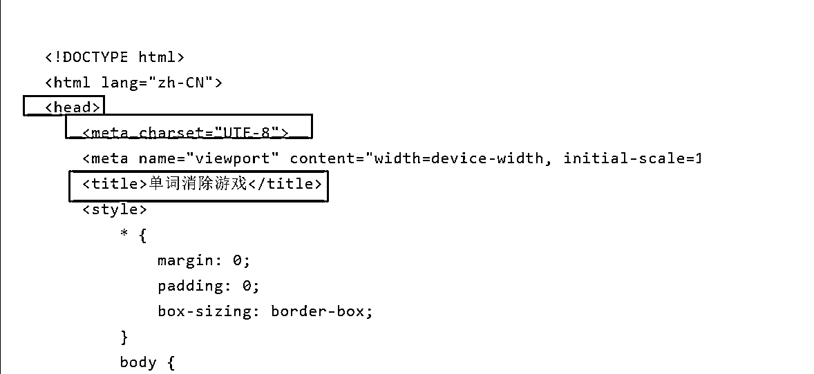
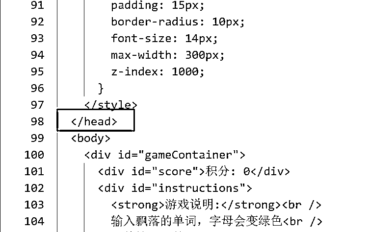
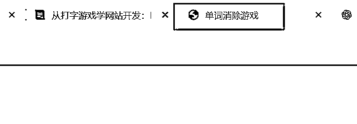
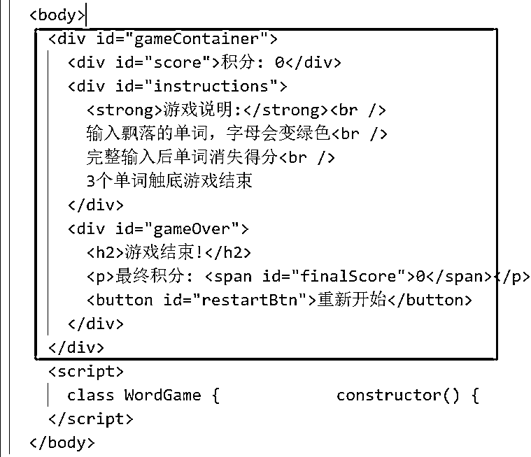
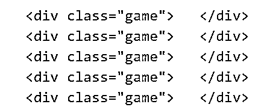
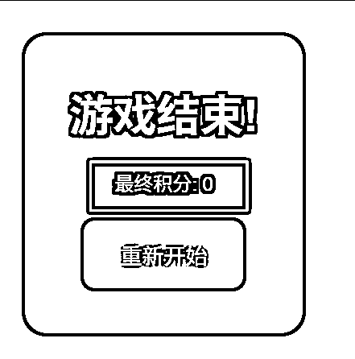

# 用打字小游戏入门网页开发：HTML 零基础第一课
作者：龙哥

市面上教代码的文章实在太多，内容千篇一律，照着念的居多。

我换个思路，每一期都用一个迷你小游戏做主线，带你从零搭建起做网站的完整思路。

这种围绕产品的学习方式，不会让人学着学着就迷路，学完还能照着自己复刻一遍，成果立竿见影。

铺垫就到这里，直接开干。

# 先看效果：

网址：https://game-2xj.pages.dev/

游戏截图：

# 规则说明：

玩法很直白，顶部会随机掉落单词，你要在键盘上快速敲出来，敲对了词就消失，允许三个词掉地，掉满即失败。

# 源码结构：

飞书文档编辑体验一般，建议大家下载到本地用自己顺手的编辑器打开。

推荐编辑器直接用 cursor：https://cursor.com/downloads

整体代码分成三大块：html、css、js，三者拼起来就是一个完整的页面。

今天先只聊 html。

# HTML 到底是什么

先聊本质，html 就是网页的骨架，是承载所有信息的容器。你在浏览器里看到的文字、图片、按钮，全部都要先写进 html 里。打个比方，就像一个素颜的女生，她有头有脚，html 也有头和脚。

示意图如下：

最核心的三件套：

【head】、【mete】、【title】

## 【head】标签

【head】就是前面说的头部，是成对出现的双标签，像一对括号，能包裹其他内容。

你可以把它想象成网页的大脑，里面放的是标题、字符编码、移动端适配等配置信息，而不是给用户直接看的内容。

### 【mete】标签

【mete】是放在【head】里的配置项，属性不同功能就不同。

比如 charset="UTF-8"，就是声明本页用的字符编码是 UTF-8，具体细节可以去查，这个不深究。

【mete】远不止编码这一个作用，还有对 SEO 至关重要的用法：

1、
2、

这两个标签直接影响自然流量，一定要掌握。

第一个的 name 是 description，用来描述网站在做什么。把说明写在 content="这里写描述"。搜索引擎爬虫看到这个，就能明白网站主题。

第二个的 name 是 keywords，即关键词。可以把搜索量大的词填进 content，搜索引擎匹配度高时，你的页面排名会更靠前。

### 【title】标签

就是页面的标题名，相当于文章标题。既让用户知道网站是干嘛的，也被搜索引擎重点抓取，还会显示在浏览器标签页上。

本游戏的写法是：
<title>单词消除游戏</title>
所以标签页上就显示“单词消除游戏”。

头部讲完，来看【body】，【body】负责装载所有可见的内容。

细心的人会发现【div】出现了很多次，足见它有多常用。

## 【div】标签：

可以把【div】看成一个普通盒子，能装文字也能装别的标签，本身几乎没有样式，所以使用频率极高。

举个例子，为什么画布和白衬衫都是白色的？因为白色是最干净的底色，可以染成任何颜色。同样，【div】本身样式干净，后面我们再用 css 给它染色就很自由。

对比【strong】这种自带加粗的标签，如果你不想加粗还要专门写样式去取消，所以【div】这种“白板”标签更灵活。

#### id：

每个【div】上常带 id="XXX"，相当于给标签办身份证，是唯一的。后面写样式或写交互时，可以精准定位到这个元素。

#### class:
class="xxx" 类似给标签起名字，一个名字可以被多个标签共用。需要批量修改一组元素时，就给它们同名 class。

比如：

注意：id 和 class 都是通用属性，任何标签都能用。

## 【h2】标签

用于段落标题，自带加粗放大效果，对 SEO 友好。还有 h1~h6 一家子，数字越小字越大。

## 【p】标签

段落容器，用来放一大段文字。

## 【span】标签

文字级标签，常在段落里单独挑出某个词改样式。

比如游戏里的：
最终积分: 0
这里的 0 用 span 包起来，就可以单独改颜色、大小、字体等。

为什么能这么用？因为 span 是行内元素，不会独占一行。
而前面提到的【div】、【h1~5】、【p】都是块级元素，会独占一行，所以没法在同一行里混排。

## 【button】标签

用于放按钮，交互点击基本都挂在这个标签上，它也是行内元素。

## 【br】标签

强制换行

除了上面这些，游戏里还用到了几个常用标签，这里列出来当作业，自己上手敲代码跑一下感受效果。

标签查询可以去：https://www.runoob.com/html/html-tutorial.html

## 【img】图片标签

## 【a】链接标签

## 【ul】列表标签

*   Coffee

*   Milk

## 【li】标签

*   Coffee*   Milk

学会 html 不需要死记硬背，多动手敲、多刷新预览，手感很快就上来了。