# 学历这件长袍，26岁高校教师先脱了：宿舍楼下卖珠串，5天23小时入账2000+

> 原文来自飞书文档，内容经转述改写。

先补上两件重要的小事：潇墨在发布前帮我逐句核对，提醒我删掉不合规跳转链接，不然这篇文字大概没法面世；李李每次接到我的疑问都耐心拆解，群里的女生朋友也都热情得不行。

上一篇的关键词是：26岁、高校教师、宿舍楼下、珠串、23小时、2000元。和大神相比，这点收入不算什么，但这是我从0到1真正下场赚到的钱，所有弯路和教训都在里面。要是你觉得有用，帮忙点一个赞，我会继续更新。

我以前的习惯是一周写几万字小说，写帖子不算难，只是话多，各位多担待。

下面开始正文。

一、我是谁？

武汉大学法学院毕业生，白天是高校教师，没被名校和职业光环绑住，反而越折腾越来劲。

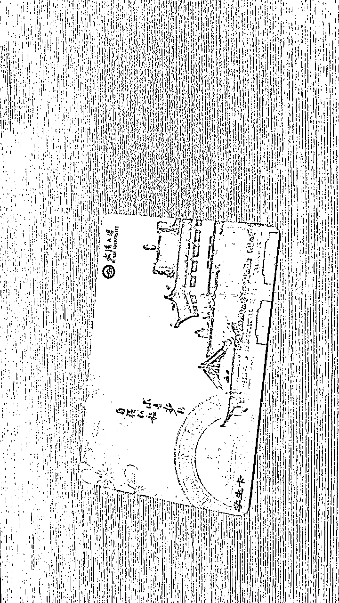

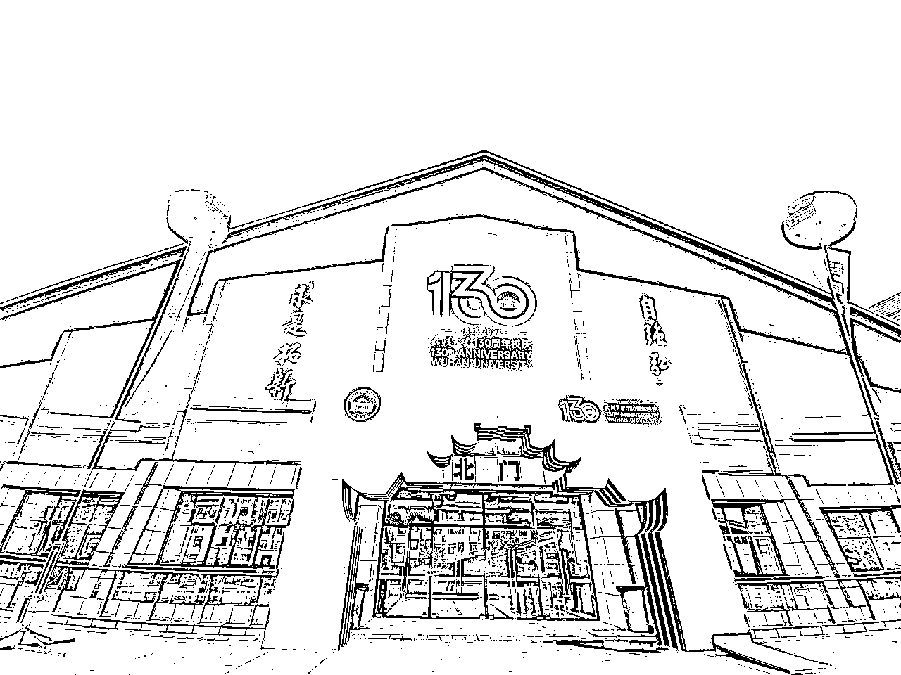

这些年攒下的副业经历，挑几个准备写成长文：

1. 主持一档全网同名的女性向财富内容节目，2024年8月开播，全网播放量三十多万，在一个主流音频平台订阅破万。增长速度大约每35天增加1000订阅，不到一年就破了万订和十万播放，跑通了从内容到变现的闭环。面向企业客户的广告接过，面向消费者的生意也做过，两边都拿到了结果。

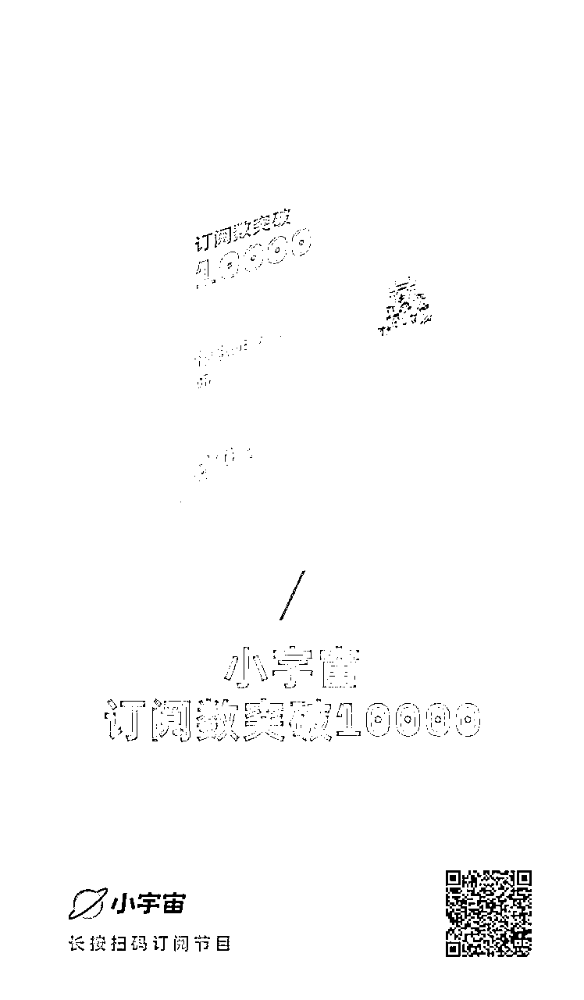

2. 念书时用闲鱼、知乎、小某书等账号，粉丝不多，却靠它们变现了几十万。
3. 毕业后十个月，在小某书上自己写资料、卖资料、做一对一咨询，又是几十万进账。

部分收款记录：

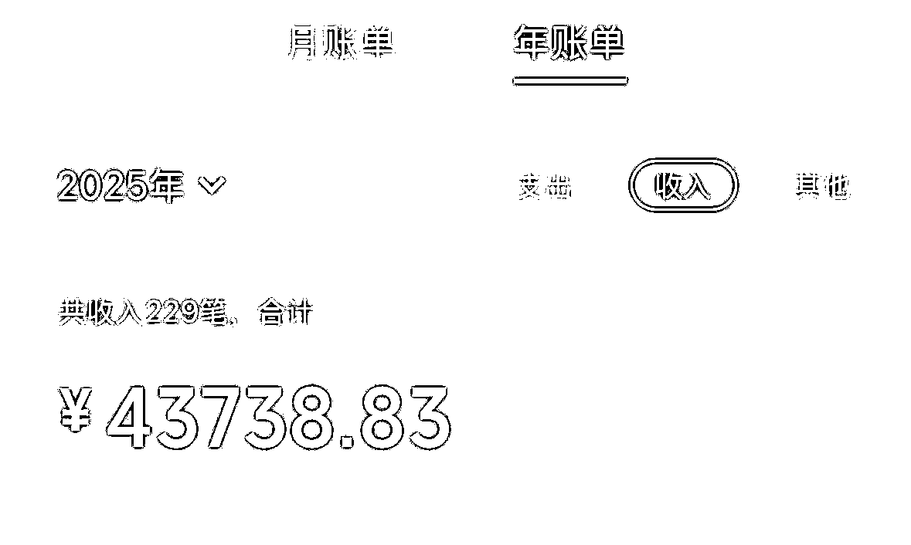
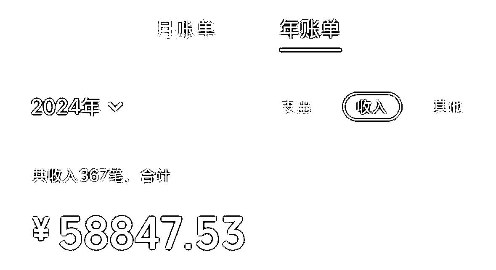

4. 临近毕业时在宿舍楼下卖珠串，5天累计23小时，收入超过2000元。这个经历让我两次被那档女性财富节目请去做嘉宾；小某书号只有几百粉丝时，平台官方就邀我参加台州的选品大会，今年也在继续参与阿里体系的活动。

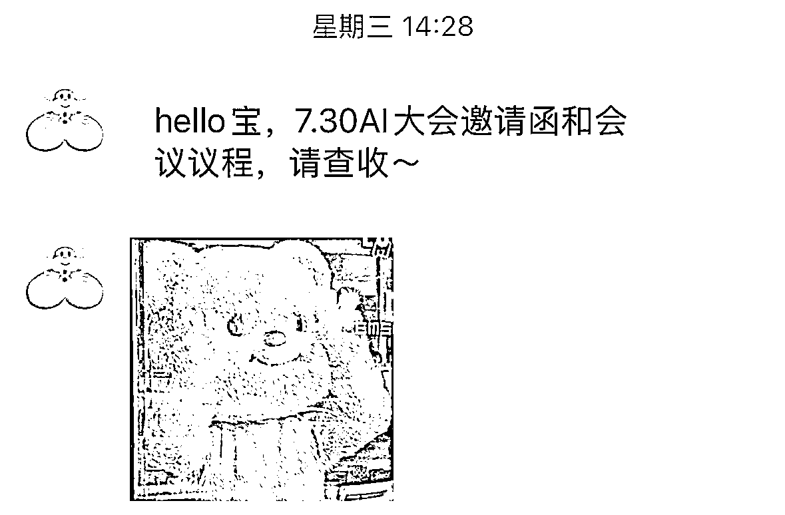

大家可以叫我白白。一个标准的跨界生活家，ENFJ，精力旺盛，做事果断，闲不住，对赚钱有热情，也喜欢认识新朋友，欢迎随时来找我聊天。

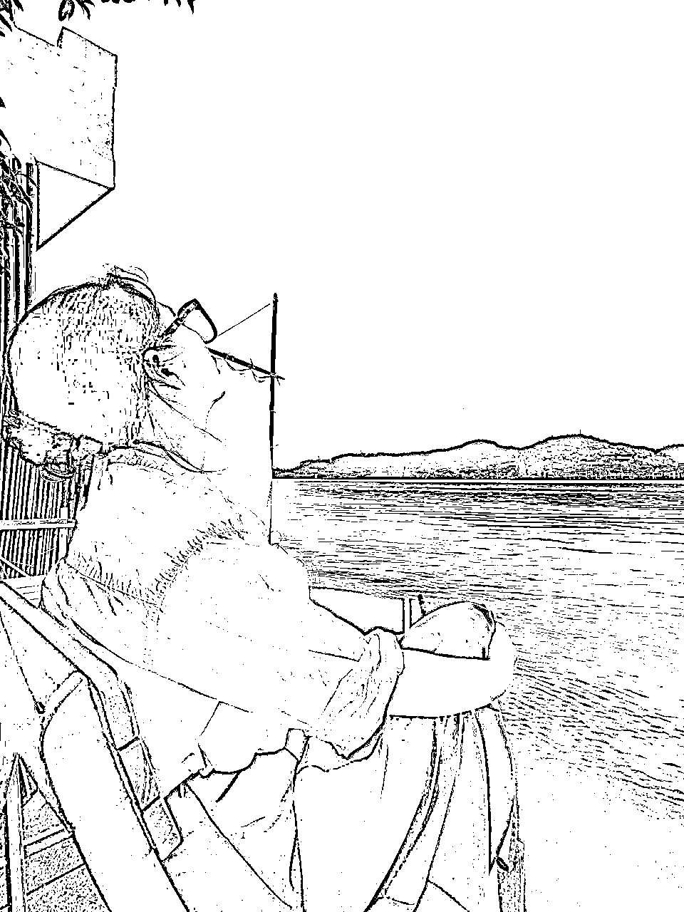

我的音频节目和上面提到的副业同名，欢迎收听。

二、宿舍楼下试水，5天累计23小时赚了2000多

这段经历始于巧合。当时我在金华实习，离义乌货源基地不远。端午假期，朋友们各有安排，我一个人跑到批发市场闲逛，出门前跟8个朋友打招呼：有想买的告诉我，我帮你们带。

市场里的珠串、耳饰多得让人眼花。批发商按整串出货，一串12件，朋友只要8件，剩下11串手链和11副耳环不能丢。我这个向来说话算话的人，只好咬咬牙全买下来。买完就开始发愁：剩下的货要卖给谁？

正巧学校通知回去参加毕业典礼。盯着那包货，我冒出个念头：宿舍楼下能不能出个摊？当晚，我翻出手机连夜看别人的出摊攻略，在多个电商平台之间比价格、看款式；听说摊位上品类多才有人停，我不知不觉下了七八十单，花掉一千多块。当时我还是学生，手头流动资金不够，又找朋友借了一千。囤货的压力一下子顶到了嗓子眼：只能卖完，没有退路。

原本计划去地铁口，后来把可折叠的桌子、桌布、小台灯搬回宿舍，却意外发现宿舍楼门口有片空地。想着出门的人流高峰还得再等，不如先在这里试试。支好桌子，铺上碎花布，按颜色摆开珠串，小灯一开，氛围感立刻来了。

刚摆好，对面宿舍一个女生穿着学士服出来拍毕业照，好奇地问我做什么。我赶紧招呼她来看，说这些是网上少见的款。她看中一条海蓝色琉璃珠，我说这颜色上镜，她一口气买走一百多块钱的东西。第一单就这么成了。

更意外的大客户是保洁大姐。我平时和楼里的保洁大姐关系不错。她路过时，我拉她试一条红色玉石串，夸她肤色亮、配那件衬衫很精神。她戴上舍不得摘，直说比外面便宜一半，自己买了两条，第二天又带了好几个同事过来团购。

就这样，我在宿舍楼下守了五天，加起来约23个小时，净赚两千多元。那几天既要准备答辩又要拍毕业照，全靠见缝插针去盯摊。说完全不累是假的，但一听到收款提示音，心里就美；把借来的钱还清的那一刻，尤其有成就感。

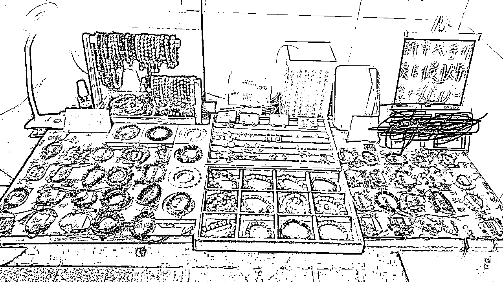
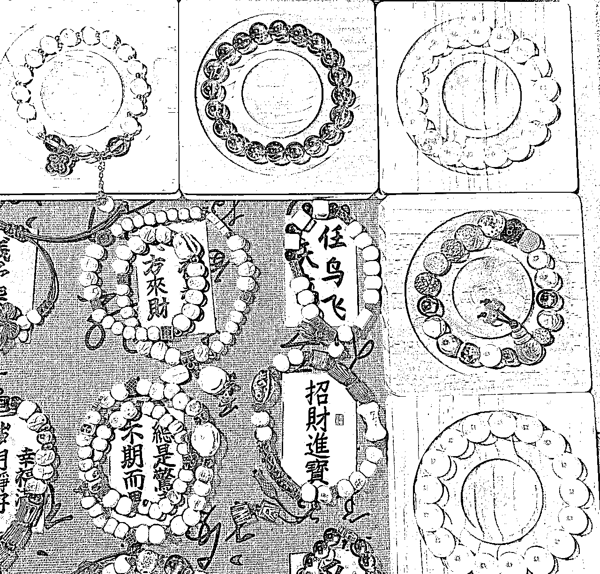
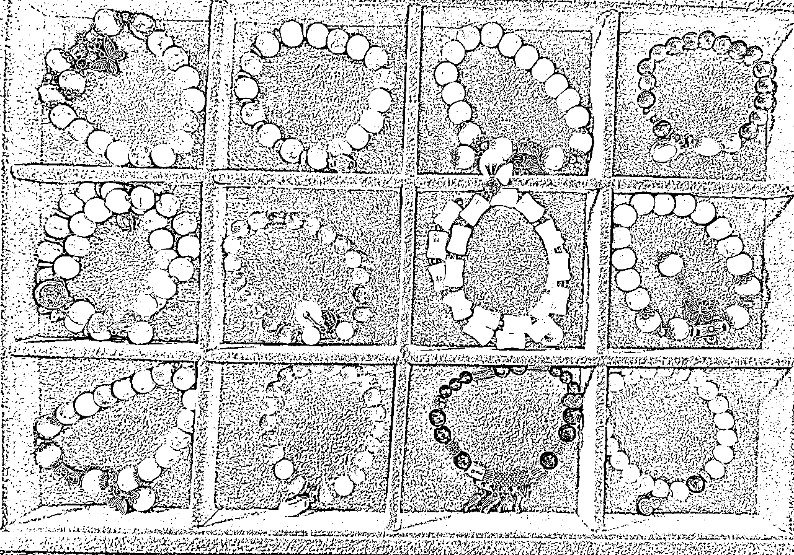
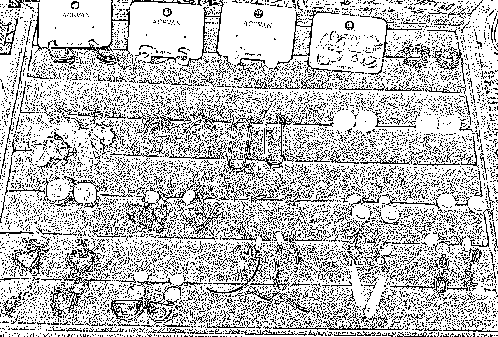
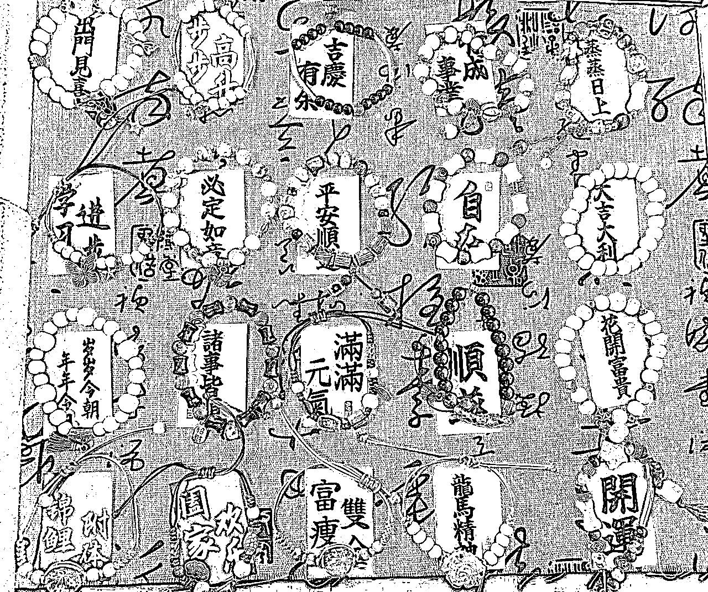

三、选品：方向对了，生意就顺一半

这段经验是我用真金白银换来的，总结成四句话。

第一，借别人的眼睛选货。第一天，我按朋友的喜好拿货，款式太少。第二天，我在一个耳环摊位和年轻女摊主闲聊，请她帮我挑最近年轻人喜欢的款，她挑的几串后来都成了爆款。第三天，我打开小某书搜“地摊爆款珠串”，看哪些款评论多、销量高，再找相似但更便宜的替代。最后，我把照片发进闺蜜群，说挑中哪款就送哪款，她们比我还积极，直接帮我淘汰掉一堆土味设计。

第二，品类要杂而全。前前后后我从义乌带回六十多种珠串，从9.9元的瓷珠款到百元以上的紫晶、月长石都有；耳饰也没落下，特意备了几款免耳洞耳夹，照顾没有耳洞的女生。别小看这个细节，光它就能多带来不少成交。

第三，线上和线下互相补位。在线下市场跑了四天，能摸手感、能和老板砍价；线上则优先挑能无理由退换的店，卖不掉还有退路。但想卖溢价，一定要有线下独有的款。我主打手工制作、全网无同款，顾客买之前就算打开App也比不到价，自然愿意为心动买单。

第四，人群别画得太窄。我的主要客群是学生，但特意进了几串深色木质珠串，结果被保洁大姐们包圆了。她们说戴着喜庆、比金店便宜，还互相安利。有个姑娘挑了粉色晶石串，我顺口说可以再带一条红色串给妈妈，她真的多买了一条。一个顾客变成了两笔生意。

四、定价：让顾客觉得占便宜，自己也赚钱

我的定价分为9.9元、15.9元、19.9元、25.9元、29.9元、35元以及百元以上几个档位，品质和价位一一对应，想随便买和想买好一点的都能找到合适的。

三个技巧很实用：
1. 先找朋友试温度。把货品照片发出去，让大家猜价格，猜中送一条。很多朋友猜琉璃珠值15到20元，我就定15.9元，既在心理预期内，又留了利润。
2. 上线比价“打埋伏”。把同款图片放到电商平台搜索，看别人卖多少钱，我的定价就比线上低3-5元。顾客顺手一查，发现线下更便宜，不用多劝就下单。
3. 引流款加利润款搭配。9.9元瓷珠款放桌上负责把人吸引过来，百元级紫晶、粉色晶石放显眼处。有人先买便宜的，又对高价款好奇，我解释一句“这是天然石，质感完全不一样”，懂的人自然愿意为品质付钱。

五、成交加速：氛围、细节、情绪都算产品

最初以为出摊就是货往桌上一放，后来才发现那些人气摊位都很会营造氛围。

先从装备说起。我买过一张很长的可折叠桌子，能装但搬起来能累死人。后来在横店遇到一个温州摊主，她推荐营地小推车加桌板的组合：下面装货，上面就是摊位，推着就走，方便到不行。

货源也有讲究。有平台支持无理由退换，新手可以拿它保底，但同款太多，顾客一搜就露底。线下批发市场淘来的手工款就不一样，回来后说一句“原创设计，网上找不到”，溢价空间立刻打开。

氛围三件套是桌布、灯光和小道具。中式书法桌布，配展示架和托盘，货品立刻显得高级；灯光要分清主次，9.9元款不用太亮，30元以上的款打上灯，珠子的光泽会全部出来；酒精棉、小镜子、花露水这些小东西，看着细碎，却能让人感到靠谱。

再聊销售技巧。

价格牌上写“9.9元起”，再用收款码挡住“起”字。远处的人只看到9.9元，被吸引过来后，你才有机会说明价格差异。

款式要全到能戳中痛点。珠串六十多种，耳夹也是那种戴一天不痛的免耳洞款。我说自己已经戴了一年多，女生们都愿意信。

千万别坐着玩手机。主动站到摊位前，笑着招呼“来试个新款”，有人停下就递镜子，夸一句“显手白”，人气自然就来了。

服务做到位。夏天递花露水，试戴前用酒精棉擦干净，买9.9元的小串也认真装袋。有个女生夸我比精品店还贴心，说完又多拿了两串。

收摊前制造一点紧迫感。最后一小时我会喊“清货了，两条打九折，再加一块钱送一条”，很多人觉得今天不买就没了，有一次光靠这招就卖掉八条同款，进账一百多。

卖货不如卖情绪。学生说要考试，我推“步步高升”竹节珠串，说寓意考试顺利；阿姨戴深色串，我夸她有气质、配旗袍好看。我很少硬推贵的，有个女生想买19.9元款，我反而推荐9.9元的瓷珠串，说她戴起来更清爽。她后来成了回头客，还拽来整个闺蜜团。

年轻人还吃“好运心理”这一套：紫晶旺桃花，月长石助眠，檀香木挡是非。有位姑娘听完“考试顺遂”的寓意，当场买了两串，说一串自己戴，一串送室友。

说到底，出摊没有高深套路，就是真心把每个路过的人当朋友。你愿意用心，对方就愿意用钱回应。

六、最后想说的话

后来在县城出摊，我观察过一个很有意思的现象：同一条街有四家鲜榨果汁摊，傍晚都在排队，最角落里那家生意最好。老板说橙汁比西瓜汁卖得快多了，新鲜橙子每天二十斤，天黑前就卖完。原来顾客多是带孩子的人，家长怕西瓜性凉，孩子喝了容易不舒服；橙子不一样，“维C多、不凉”是天然卖点。选品切中人群需求，小生意也能盘活。

我也真心建议大家尝试内容创作。它几乎是成本最低的轻创业：不用租门面，不用囤货，投入的不过是刷手机的时间。与其躺着刷视频，不如把浏览时间变成生产时间。进货时拍怎么砍价，出摊时拍怎么和顾客聊天，收摊后拍怎么算账，剪成短视频发出去，慢慢就会有人关注。有了粉丝，卖课程、卖货源、接推广都是顺理成章。就算最后没做起来，你也练了表达和网感，不亏。

尤其是想出摊的人，一定要把过程拍下来。进货的斗智斗勇、摊位前的讨价还价、收摊后的数字复盘，全是好素材。出摊是钩子，内容创作是门槛；别人想学你，就得先关注你。一件事既然做了，就要把价值榨干。

最后想聊聊“面子”。我是985毕业的女生，也蹲在宿舍楼下喂过蚊子、大声吆喝过。你是大学生、研究生，去发传单、做家教、练个小摊又怎么了？这些事看起来不体面，却能教人怎么和陌生人开口、怎么把几分钱利润算明白、怎么在被拒绝后笑着再来一次。这种能力，比面子金贵。

人生没有那么多“必须”。没人规定读过书就一定进大厂、考公考编。我试过十几种副业，踩过无数坑，才摸到合适自己的方向，也攒下了自己的存款。很多时候不是事情难，是我们先吓住了自己，总想着万一失败怎么办、别人会不会笑。

但你冷静算一笔账：试错最多花点时间，不亏钱；万一成了，就打开一扇新门。对普通人来说，敢尝试本来就是一桩稳赚不赔的买卖。反正本来就没什么可失去，不如用力拼一把。

别想太多，先下场。你会发现，那些放不下的身段和怕丢人的顾虑，在赚到第一笔钱的快乐面前，根本不值一提。人生是一片旷野，不是一条轨道，敢折腾的人才能跑出自己的路。

希望这篇长文对你有帮助。欢迎来和我聊副业心得，也欢迎来节目里当嘉宾。播客链接放这里会被拦，想听详细版本，通过鱼丸找我要联系方式就行。