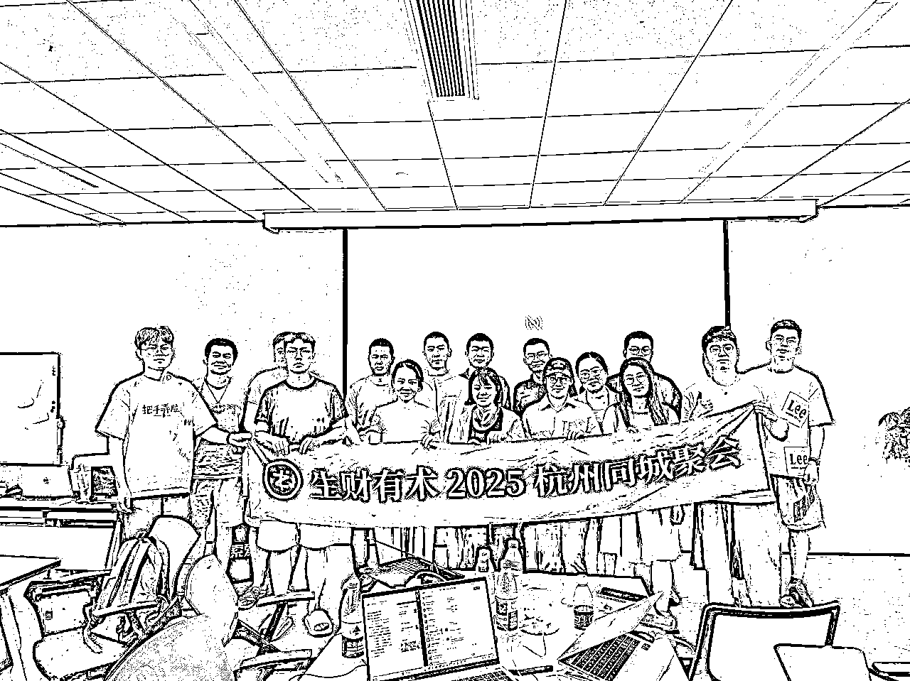
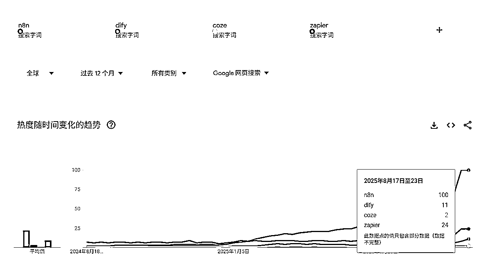
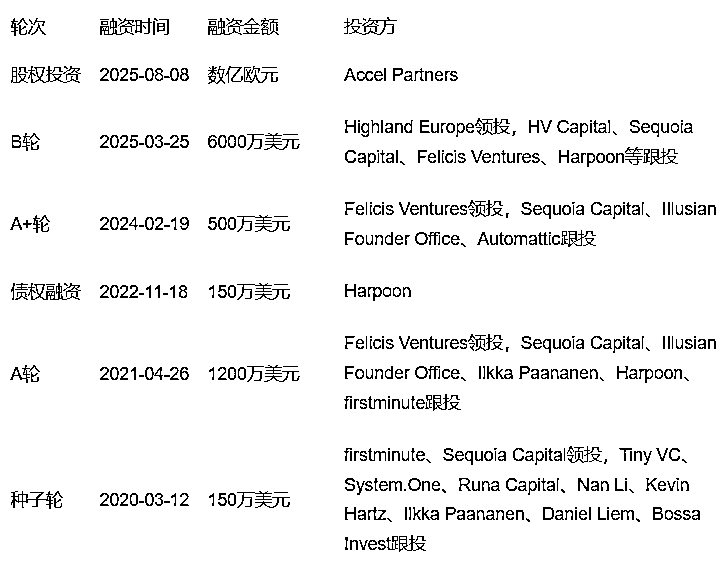

# 从杭州线下小航海到 All in n8n：我为什么押注 AI 后端大脑
作者：龙哥

大家好，我是 龙哥。过去大家认识我，多半是因为我做的海外 AI Web 项目合集。

最近我做了一个明确的转向决定：All in n8n。并不是要放弃 AI 应用，而是我找到了更适合自己的产品打法——只做 AI 应用的“后端逻辑大脑”。

在把 AI 从想法变成可用产品的过程中，我越来越清晰地感受到：用户会为功能买单，前端颜值和流量运营固然能帮产品出圈，但决定留存的是核心功能是否成立。而 n8n，恰好能扛起 AI 产品 80% 的功能实现部分。

更重要的是，这条路正好卡在我擅长的点上。我擅长搭建逻辑和梳理流程，对写代码、做设计、搞流量并不占优。于是我选择做减法，不再追求面面俱到，去做前端和 UI，而是把全部精力压在 n8n 这个“AI 后端大脑”上，只交付最纯粹的功能价值。

这篇文章不讲操作步骤，而是基于上周日在赚钱举办的 n8n mini 航海线下活动复盘，结合新手真实卡点，以及我对 n8n 长期趋势的判断，给后来者一份避坑地图和认知框架。

# 本文目录

第一部分：线下 mini 航海复盘

* 1.1 4 小时野心 vs 1 个勉强跑通的案例
* 1.2 现场新手的集中卡点

第二部分：新手入坑 n8n 的三大难点

* 2.1 部署坑：开源工具怎么用起来
* 2.2 思维坑：从线性思考到节点式数据流
* 2.3 逻辑坑：模板用不活，流程设计才是关键

第三部分：All in n8n 的理由

* 3.1 大势：AI 平权时代，人人都能做开发者
* 3.2 优势：n8n 有什么不同
* 3.3 匹配：为什么这条路适合我

# 第一部分：n8n 线下 mini 航海复盘

## 1.1 4 小时计划 vs 1 个最终成果

上周日我在杭州带了一场赚钱的 n8n mini 航海，现场 15 位圈友。

出发前我的设想很饱满：4 小时内从认识 n8n 入手，逐步攻克 4 个难度递增的实战案例。

现实很直接地扇了我一巴掌。活动结束时，我们只磕磕绊绊跑通了第一个、最基础的案例。这个落差非常说明问题：对绝大多数新手来说，n8n 并不是“拖拖拽拽复制模板”就能上手，它是有学习曲线、有技术门槛的工具。

第一个案例只是调用一个 API，把结果自动化存储到指定位置。听起来简单，现场却接连踩雷：VPN 不通、界面不熟悉、JSON 请求头请求体配错、API Key 没填对、变量名变量值分不清、API 文档看不懂、数据清洗和结构化没概念……

## 1.2 现场观察：新手在哪一步最容易卡住

现场的问题高度集中，归纳下来三类。

第一类是数据流动和表达式的理解缺失。很多人能跟着点点点把流程跑通，但换一个节点就懵了，背后是 JSON 基础和数据流向理解不足。

第二类是 API 官方文档的阅读能力。程序员眼里，MCP 或导入 cURL 能秒配，但小白连 API 是什么都一知半解，更别说去对照文档配置 HTTP 请求，请求头请求体这些基本概念都要现学。

第三类是逻辑设计和流程拆分能力。n8n 模板很多，但没有一个是为你的个性化需求量身定制的。想要做产品级方案，必须先学会把需求拆解，再去匹配合适的节点和 API。简单套模板的场景除外。

# 第二部分：新手入门 n8n 的“三大坑”及解决方案

## 2.1 “部署坑”：n8n 是开源项目，可以免费自托管

新手第一关往往是“怎么用”。目前官网社区节点安装偶尔会出现短期 Bug，自托管也需要一点时间成本。先把部署跑通，大致半小时就能入门。

部署方式主要有：官网云托管、第三方 PaaS 一键部署、VPS 自行 Docker 部署、本地桌面部署。成本、技术门槛、数据主权、稳定性各不相同，官网托管最省心但按量收费，本地部署免费但无法 7x24 小时运行，VPS 性价比最高，适合生产环境。

## 2.2 “思维坑”：理解 n8n 的“节点式数据流”

新手最大的障碍不是技术，而是思维转换。我们习惯线性一步到位，而 n8n 要求把业务拆成独立节点，让数据在节点间流动。

核心比喻是多米诺骨牌。节点就是每块骨牌，触发器是第一块骨牌的推手，执行器是倒下的动作，数据流就是骨牌能量传递的过程。

JSON 是数据载体，表达式 {{ }} 是引用方式，比如 {{$node["获取天气"].json["城市"]}}。看起来吓人，但 n8n 编辑器几乎不用手写，只需要用鼠标拖动引用，上手很快。

## 2.3 “逻辑坑”：模板救不了你，自动化思路才关键

别指望找个模板改改参数就完事。有价值的 AI 流程都高度个性化，模板只能提供思路。

n8n 工作流搭建可以归纳为五步：

第一步，解构需求。先明确最终输出倒推拆解成子步骤。

第二步，寻找积木。为每个子步骤找到对应节点或 API 接口，不重复造轮子。

第三步，连接数据。把积木按逻辑串联，确保上一节点输出能被下一节点正确引用，这是最易卡壳的地方。

第四步，精炼优化。跑通后优化提示词和流程细节，从能用到好用。

第五步，加固测试。考虑空输入、超时等异常，增加错误处理，做压力测试。

# 第三部分：为什么我选择 all in n8n？

## 3.1 宏观 AI 趋势：“AI 平权”时代，人人都是开发者

5 年前谈 AI 的是程序员，今天是普通人。编程相关的 AI 工具层出不穷，0 基础也能做出软件，但学习成本依然高，需要理解前端后端架构服务器数据库支付登录等一整套。

如果不追求大而全，只聚焦核心功能验证，n8n 就成了极快的 MVP 工具。比如一张图片套壳网站的核心逻辑，用几个节点就能搭好。

可以快速验证的想法有很多：自动抓取热点二次创作分发、监控竞品自动分析、批量生成图文视频的生产力工具。用 n8n 先搭发动机和骨架，验证需求后再补前端和推广。n8n 是普通人做 AI MVP 最快成本最低的路径。

## 3.2 n8n 对比竞品的核心优势

n8n、Coze、Dify、Zapier 各有定位。n8n 是通用工作流自动化平台，强在定制和扩展；Coze 更适合国内新手做机器人；Dify 专注 LLM 应用开发；Zapier 生态成熟但 AI 支持弱于 n8n。

n8n 的核心优势在于：完全免费开源自托管、无工作流和节点数量限制；服务器成本低，5-10 美元的 VPS 足够；极度灵活，HTTP 节点可连接任意 API；数据完全自控；还能通过 Webhook 把工作流变成 API 接口，充当产品后端。

资本层面，2025 年 n8n 母公司累计融资数亿欧元，账上资金充足。投资方 Accel Partners 曾是 X 的早期投资人。

市场层面，海外是 n8n 的大本营，YouTube 上相关博主从 2025 年开始增多，头部变现可观。国内生态仍处早期，蓝海明显。相比 Coze 门槛更高，但上限更高，场景更广。

## 3.3 个人选择：契合优势的最佳杠杆

All in n8n 不只是看好赛道，更是个人优势的匹配。我过去的强项是逻辑思维和流程设计，而不是前端审美和流量获取。

验证很清晰：我曾用 7 天上线一个网站，后端核心功能全部用 n8n 搭建，耗时不到 8 小时。上线首日就带来 99 美元订阅收入，因为当时竞品只有前端页面，而我上了真实功能。

对我而言，n8n 正在成为一条可深耕的护城河。随着社区繁荣和 AI 结合，机会只会越来越多。

# 尾声

从杭州线下复盘到这篇思考，我想把 n8n 的全貌描绘清楚：它有门槛，但这道门槛正是普通人的护城河。

龙哥最近点名“n8n”，方向已经很明确：未来的机会在垂直领域的 AI Agent。通用大模型是巨头博弈，细分需求的 Agent 才是蚂蚁雄兵的战场。而通往 Agent 的第一步，就是搞定工作流。AI 给工作流装上大脑，n8n 就是连接 ChatGPT、Claude 等大模型的最佳载体，也是自由调用万物的数字粘合剂。

别让起步阶段的坎坷把你拦住。你所羡慕的每一篇爆款文章、每一个看起来在自动印钱的项目，本质上都藏着一套清晰可拆解、可复用的操作流程。

一旦你学会如何设计并搭建这样的工作流，就等于握住了规模化产出价值的核心密码，从此不再靠单打独斗，而是让系统帮你批量创造。