# 八年深耕公众号，我把个人IP做成稳定现金流的复盘

| 版本 | 更新描述 | 作者 | 更新日期 |
| V1.0 | 新建文档 | 科学羊 | 2025-07-24 |

* * *

大家好，我是科学羊🐑。日更的10W+爆文作者，报社签约写手，海外内容创业实践者，同时也在B站做游戏内容。

很久没见了❤️，今天受@ 七天 老师邀请，结合@龙哥 近期对公众号的观察，来跟大家聊聊我对IP打造和长期变现的真实体感。

先说明，今天不聊平台入门技巧，这类基础资料在赚钱航海非常齐全。我想分享的是航海里少见的实战心路，也是我第一次完整公开公众号运营的思考与商业化路径。欢迎拍砖。

本期能带走的点：

1、如何把公众号打造成可延续的个人IP系统；
2、IP的系统化收钱方法；
3、我走过的实操历程；
4、IP建设的建议与避坑。

为什么听我的？

因为我已经在公众号赛道耕耘八年，并且沉淀出粉丝十万级的稳定IP资产。

大致成绩如下：

1、自然哲学科普方向深耕八年；
2、流量主累计收入超过十万元；
3、周边商业化如带货与商务合作累计超过五万元；

和顶流相比体量不大，但特点是持续且稳定。下面把我的底层方法拆开讲，坦白说没有花哨套路，只有重复做对。

直接进入主体。

# 一、怎么做垂直型公众号IP

## 1.1 对IP的底层认知

对齐认知：

很多人提到公众号就想到流量主，追爆款、追风向、快起号，风停了号就废，下个风口再开号。这是一种打法。我今天讲的是IP型号，它需要时间雕琢。

什么是公众号IP？

就是在单一细分赛道里持续扎根，且垂直度要做到极致。

举例，情感是大盘，里面涵盖个人成长、女性成长、心理学、关系学等等层层细分。你要做的是挑一个极细的赛道死磕到底。

何时可以扩张？

当你在某个细分赛道建立起足够清晰的个人标签后，再向同一母题下延展。我的做法是先花几年只写物理学科普，等IP成型后才拓展到数学科普，但始终锚定科学主题，AI科普、科技新闻我都不碰。

所以第一步就是：定大板块，锁小赛道。

参考结构如下：

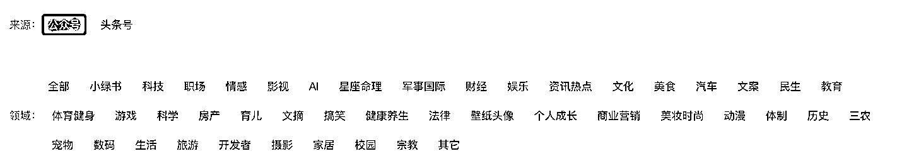

上图是公众号大类的划分，仅作参考，具体细分可自行研究。

常用调研工具：易撰、次幂数据等。

## 1.2 我的起号五段经历

我做的是自然哲学科普，2017年初入局时赚钱刚起步，错过了早期红利。

入行的初衷很简单：兴趣。当时沉迷得到APP，万维钢、李笑来、吴军、梁宁等老师课程几乎全买，累计学习超4890小时，疯狂记笔记。

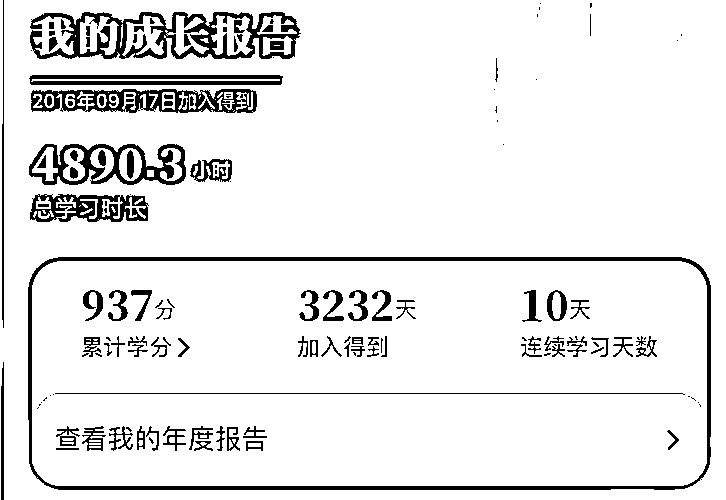

公众号2017年初建，第一阶段就是把学习笔记搬出来。彼时阅读量常年个位数，我也无所谓，本质是自我记录。

第二阶段，我意识到不能大杂烩。加入一个写作打卡群后，开始给自己立边界，聚焦物理学写作。

群里有人问：“你天天写这么晦涩的东西有什么用？”我当时回“就图个兴趣”。说实话内心很迷茫，物理本就小众。但这近两年的枯燥坚持，后来带来了质变，像扫地僧逆袭。

第三阶段，我认识到流量主，开始尝试变现。讽刺的是粉丝破一万时我都没开，纯认知盲区。开通后日收益几块钱，月入百出头。这个阶段让我开始有了用户视角。

我系统学习了粥左罗的写作课，开始做个人日更。

第四阶段，真正进入爆款期。重视用户视角后，陆续写出多篇十万加科普。最意外的是能把数学加物理这种极小众枯燥内容做成十万乃至百万加，公海里几乎无人对标。关键在标题。

第五阶段，如今已是IP化运营，并孵化多个小号。底层方法论通了，复制到其他细分赛道也成立。

总结：方向选对，越细越极致，时间会复利。

接下来讲变现。

# 二、公众号的变现体系

## 2.1 变现认知：系统化是前提

做号，流量主只是其中一环。必须系统化。

### 2.1.1 系统化指什么？

一篇内容不能只服务自己。要想清楚它的最终用途：是导流带货？是提升流量主？还是为视频号、油管测试内容？

我曾画过一张内容流转图：

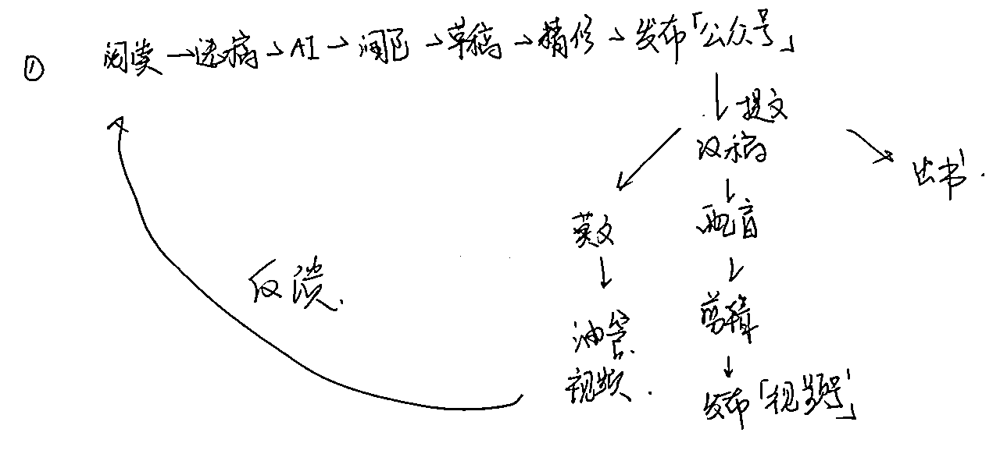

理想状态是让内容像水一样流动。哪怕是AI初稿，经过测试判断是否值得推送到后端。

### 2.1.2 为什么要系统化？

系统化才稳定。刘润《商业洞察力》讲的系统思维完全适用。

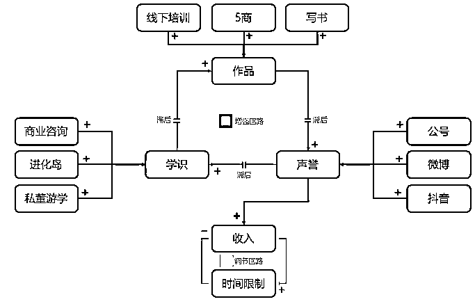

换句话说：以为我在读书？其实我在囤素材。以为我只写公众号？其实我在验证这篇文章能否爆，再改成视频号或油管。以为我在做视频？其实最终目标是打磨成精文出书。

这就是我能坚持七八年的原因：一切被系统化。

## 2.2 流量主

这是基础收入池，部分历史截图：

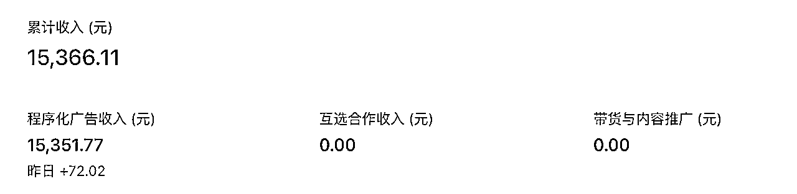

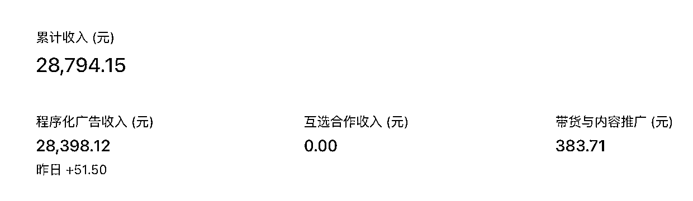

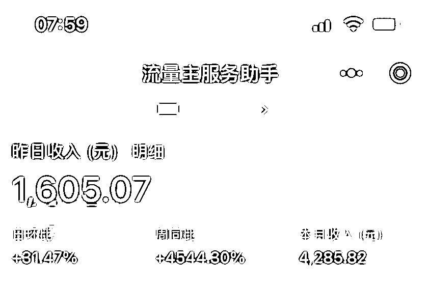

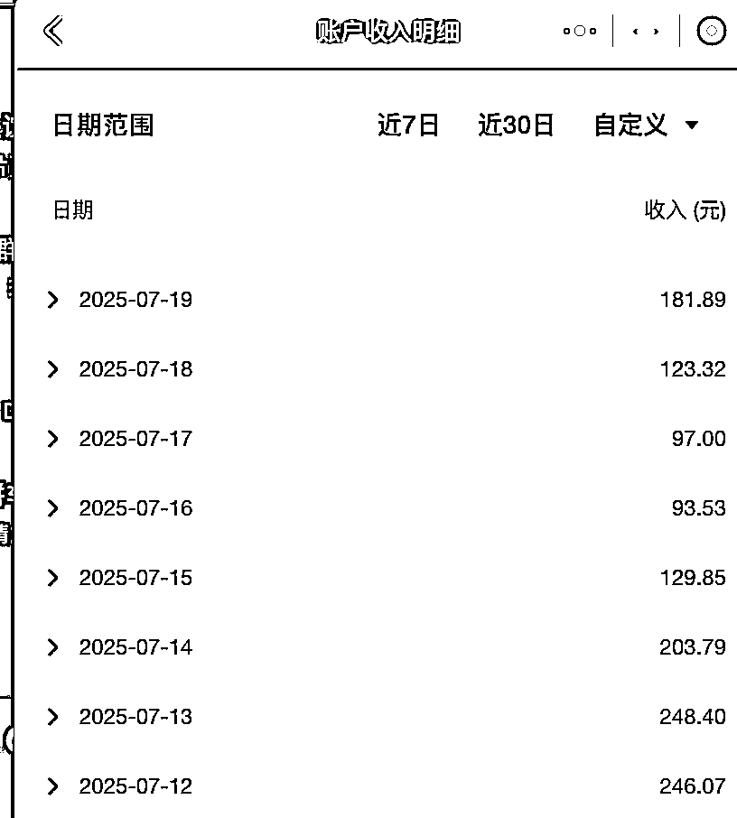

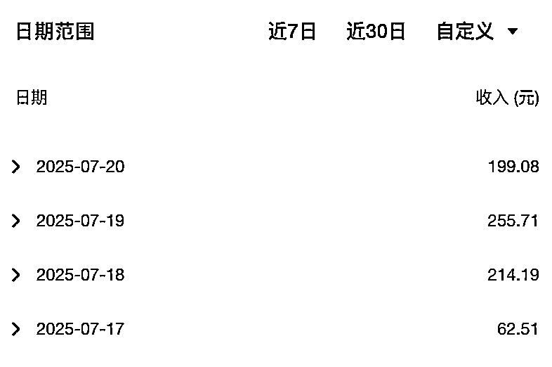

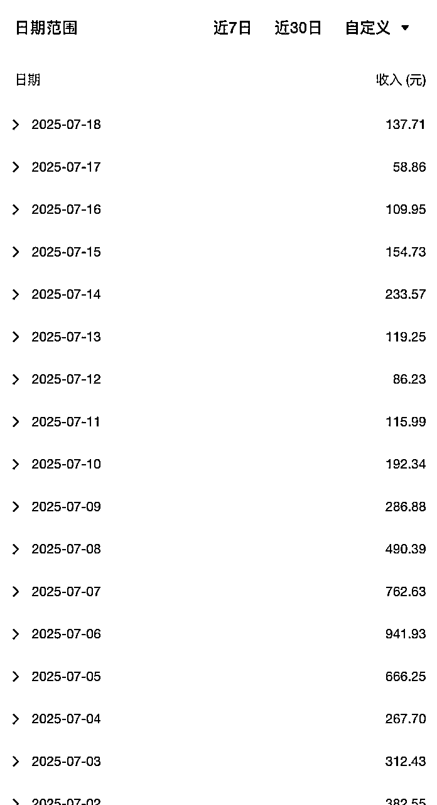

7月单月流量主已达1.5万。细节可看赚钱手册。

## 2.3 商务合作

第二大收入池，主要为出书、代写、置顶软文。

### 2.3.1 出版社出书

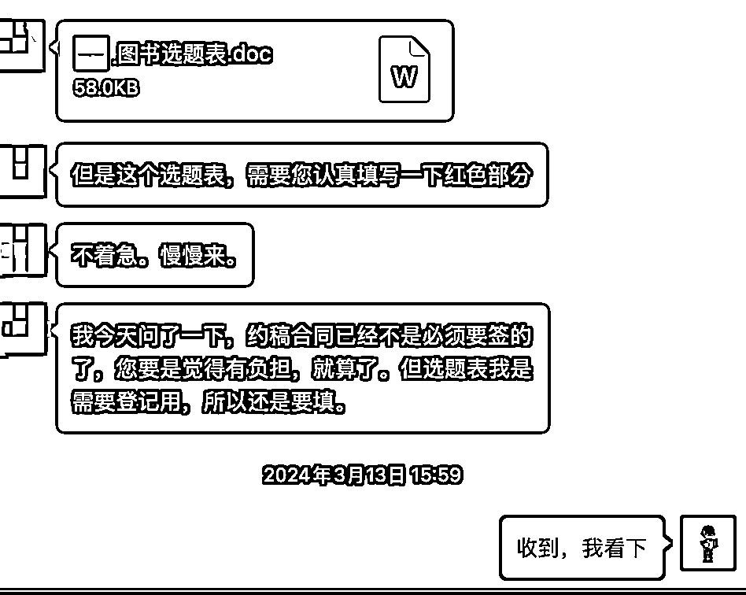

人民邮电出版社主动邀约签约，流程是选题沟通、签约、稿费加尾款。周期长但稳定。

### 2.3.2 报社约稿

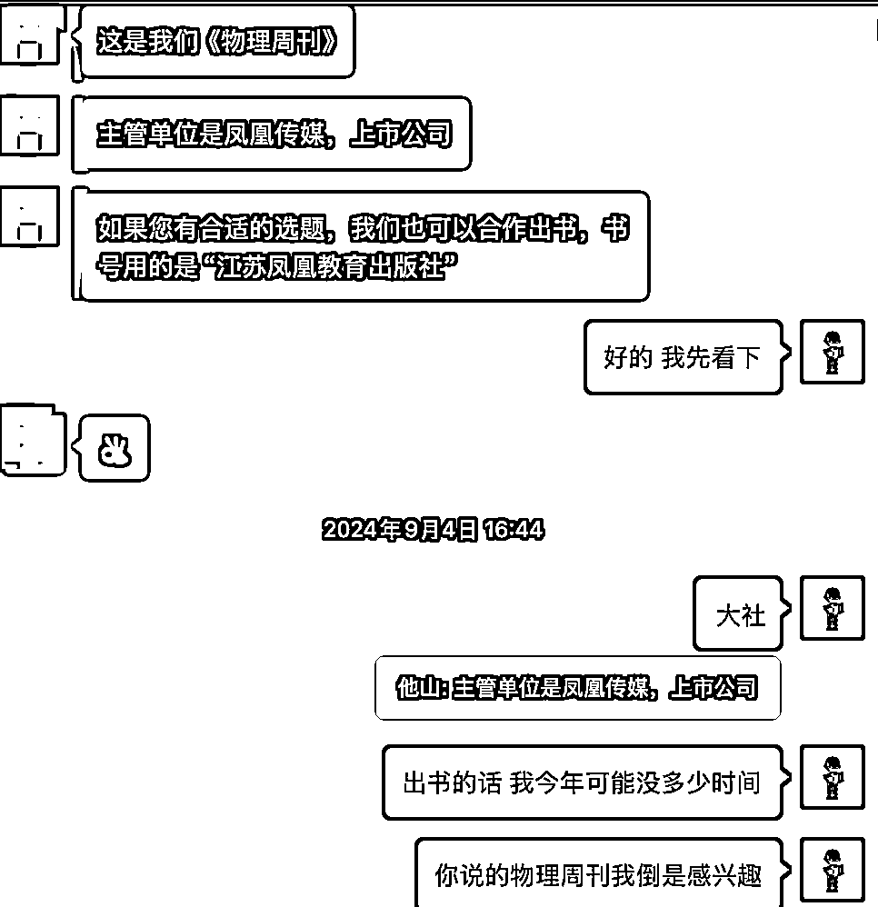

时代学习报【物理周刊】老师邀约约稿，实绩如下：

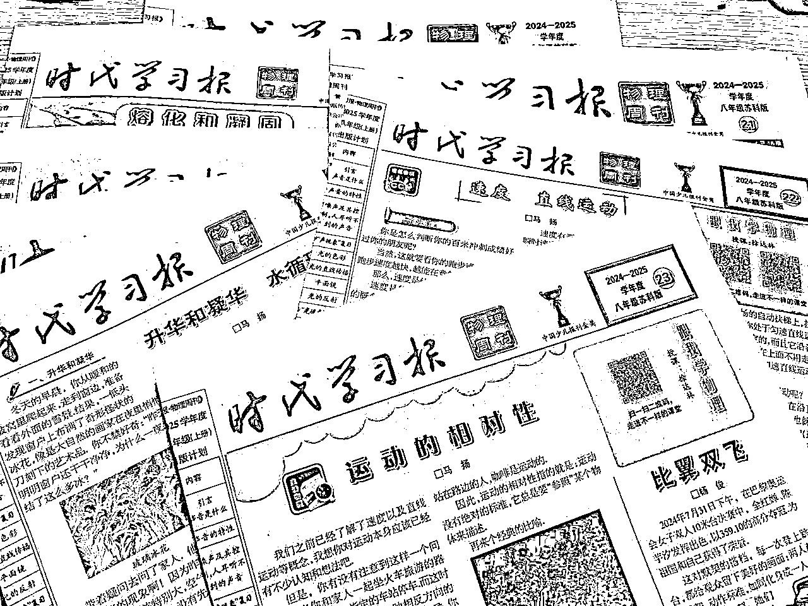

单次合作过万元。

### 2.3.3 广告挂文

一般私信报价200元起。我基本不接，性价比低。

## 2.4 橱窗带货

第三大收入池。出版社常申请定向分销，分成20%-30%，甚至50%专属。

后台申请截图：

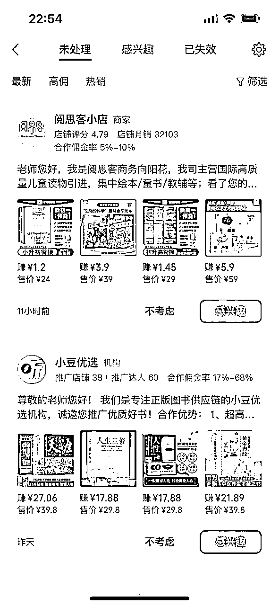

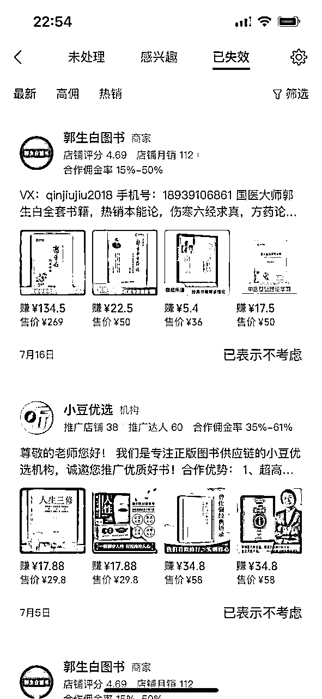

这类图书合作我通常不接，违背IP调性。我只做垂直深耕的带货。

上月靠一本书带货做了一千多，典型的睡后收入。

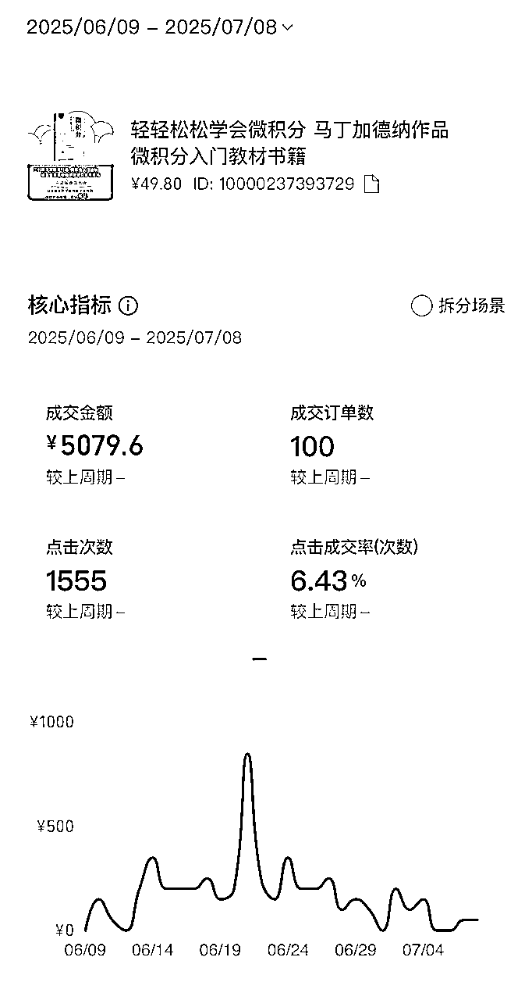

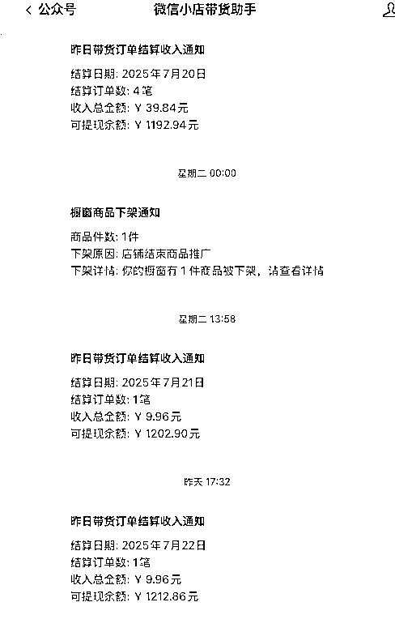

# 三、新人起步与避坑

## 3.1 新人该注意什么

方向确定后，建议前两三周日更，不要急着开流量主。先靠积累。

若前两周推流不错就继续日更，若阅读极低可改为周更三次，但方向必须坚定。

起号关键在标题。去找五万加爆文标题直接使用，不要修改，等有粉丝基础再自行创作。

另外别拿别人的标题去刷旧文，这是红线。

我的起号流程：

第一阶段：抄标题，自写内容。别看原文，防止思维污染。如“三点心法缺一不可”，自己拆解三点，用AI辅助写作后人工润色。

第二阶段：仿标题，等号入池后再微调。此时已有用户容错。

积累到一定程度，平台会自动打标签：稳定更新、有质量、体量够，就会触发推流。

心态建议：佛系更新，忘掉昨天，每天当第一天。文章没流量很正常，把期待放在今天。

反常识点：起号期不要把文章做得太精致。排版和文笔过度追求完美会消耗心力，等粉丝增长、接近入池时再重视呈现。

前期只做三件事：选对赛道、持续积累、数据优化。

## 3.2 合刊的价值

合刊是IP加分项。对读者而言等于精选整合，价值感更强。

公众号自带合集标签不够，合刊能强化赠予感。人们对轻易得到的东西会低估价值。

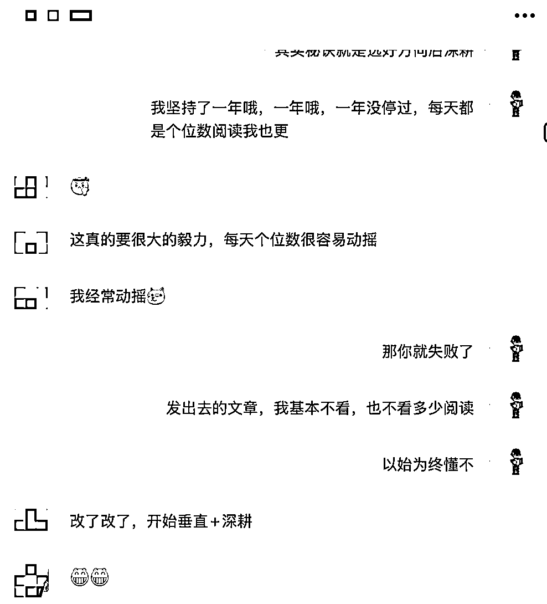

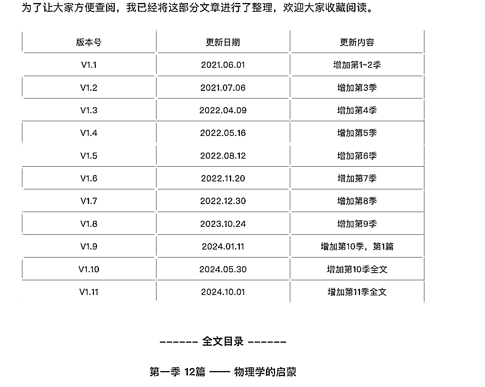

# 四、收尾

有人说公众号是小而美，我认同。它不需要赚爆，但能持续带来惊喜就足够。

以上是我八年的真实拆解，希望有用，也请大佬们多指点。

后续我会持续更新进展。

延伸阅读：

公众号爆文的秘诀究竟是什么？

「干货分享」1天可以跑的60万+的文章是怎么做出来的了？