# 小红书做虚拟店，冷门品才是弯道超车的捷径，这4套打法直接抄

# 一、什么叫真正的冷门虚拟品

很多人理解的冷门只停留在竞争对手少这两个字上，我的判断标准会再加一条：成交顺畅且利润可观。

竞争少很好懂，买家用同一个关键词搜索，整个搜索结果里卖这个东西的店屈指可数，甚至只有你一家，有需求的客户自然只能找你，转化就变得很轻松。

为什么要额外强调利润高？因为冷门的价值就在于稀缺溢价，利润太薄就吃不到这个红利。

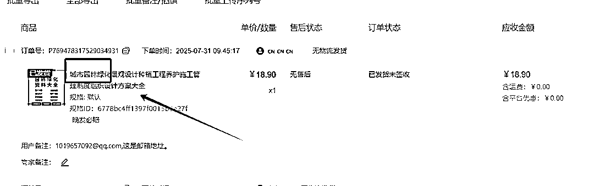

举个我店里的真实案例：城市园林绿化景观设计。这个品类在我筛选冷门品的逻辑里完全符合标准，上架后几乎没怎么特意去推，就一直稳定出单，有一天能出两三单。

换做常规的选品教程教你去找同质化严重的热门款，你几乎不可能挖到它。这就是差距。

竞争对手少，等于买家选择被限定，既然他只能在我这买，为什么不做高价？

有点像买艺术品，孤品之所以值钱就因为全世界就这一件，稀缺性本身就是定价权。

再说平台差异，为什么我主攻小红书虚拟而不是淘宝拼多多虚拟？

拼多多虚拟基本靠付费投放，客单价被压到几毛几块，投放失误一次就把利润亏没了。

淘宝虚拟虽然客单价看起来能做，但同行极多，一个品定价20打出爆款，马上就会冒出一堆10块、5块、几毛的，甚至几分的在抢客户，买家精得很，价格一样谁去买贵的？

小红书就不一样了，同一个货，同样的内容，小红书完全可以卖18.8、28.8，冷门到极致的甚至能做到100+。

# 二、选冷门品，起步更稳更快

一提到小红书虚拟，新手第一反应就是去做学科类、K12、教师资料、公务员资料、幼小衔接等等。

这些赛道能做，但前提是你要能在红海里找到自己的蓝海。

这些大类相当于菜市场大家都在卖萝卜白菜，你这个时候再开个摊卖萝卜白菜，买家为什么要选你？因为个头大？因为便宜？

不如站在用户视角想，买家有特定需求时，他更希望买到的是别人没有的。做一个专门卖淮山的摊位，需求一来第一个想到的就是你，这就是差异化带来的品牌记忆。

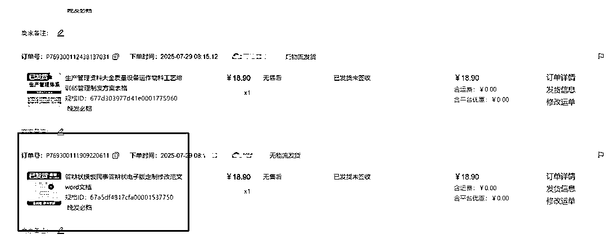

比如我店里在售的一款：答辩状模板。当初选的时候我自己都犹豫了，小红书上真的有人买吗？结果出单数据打了我一巴掌，0销量0评价的情况下卖18.9元的高价，照样持续成交。

这再次验证了我的观点，冷门虚拟本质上就是差异化选品。

另外一个好处是，能更快拿到正反馈建立信心。信心才是能让你坚持下去最核心的燃料。

所以冷门选品就两条路：

第一，一开始就直接选冷门类目、冷门方向；
第二，在热门大类里挖掘冷门分支。

拿我店的一个品举例：标题是对外汉语教学ppt课件HSK标准教程123456课件教师用书。这个品放在我店铺500多个链接里只是其中一个，上完架发了笔记，乘风稍微带一下就立马出单，后面一直保持稳定成交。

# 三、用商机中心找官方标记的稀缺品

刚起步千万别碰教辅、教资这些红得发紫的赛道，大神扎堆，新人进去基本就是被教育然后放弃。

可以换思路去找小众领域的资料类，竞争小，成绩来得快。

我店里很多持续出单的款就是从商机中心挖出来的。

这个入口的逻辑是官方会结合买家搜索需求和现有供给链接数来计算稀缺度，相当于官方帮你标注了哪里缺货。

具体操作：进入小红书店铺后台的商机中心，找到商品成长，点击机会类目查看更多。

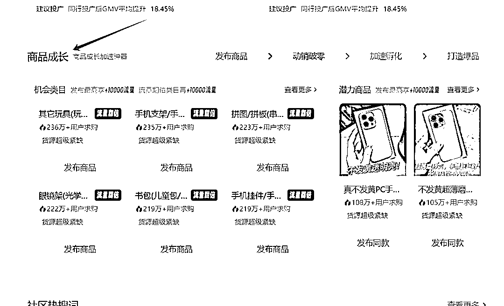

点进潜力商品，商品类目可以先定在成人教育，也可以直接搜商机关键词，就能筛出一批非常稀缺的品。

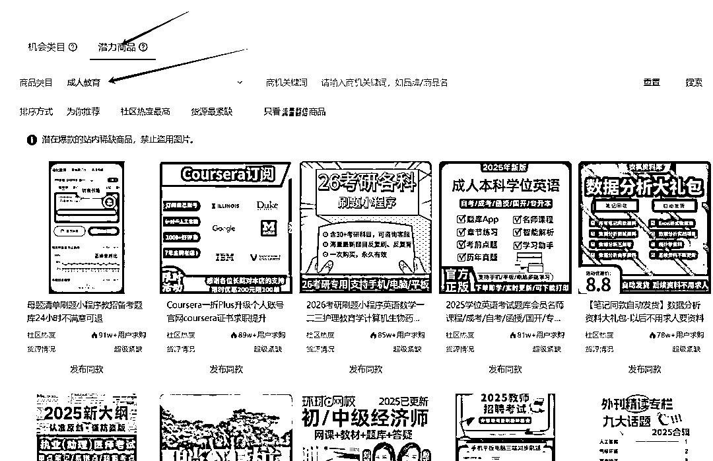

比如教资笔试重点笔记，这个词有68W+用户在找求购需求，页面上还挂着超级紧缺的红标。

看到这样的品，你可以截图去淘宝搜同款拿来上架，或者直接搜关键词找同类型货源。如果你有经验，可以自己做图，把文案吃透再重新排版。

最浅层的做法是直接搬图搬文案，稍微聪明一点就自己重做海报保留原意，更狠的做法是萃取宝贝的核心卖点，标题图文全部翻新成自己的。

# 四、差值法，精细化找冷门机会

方法①：从淘宝找线索

去淘宝搜一批泛关键词，比如模板资料、表格、文档、素材、协议、合同这些。

以“模板资料”举例：

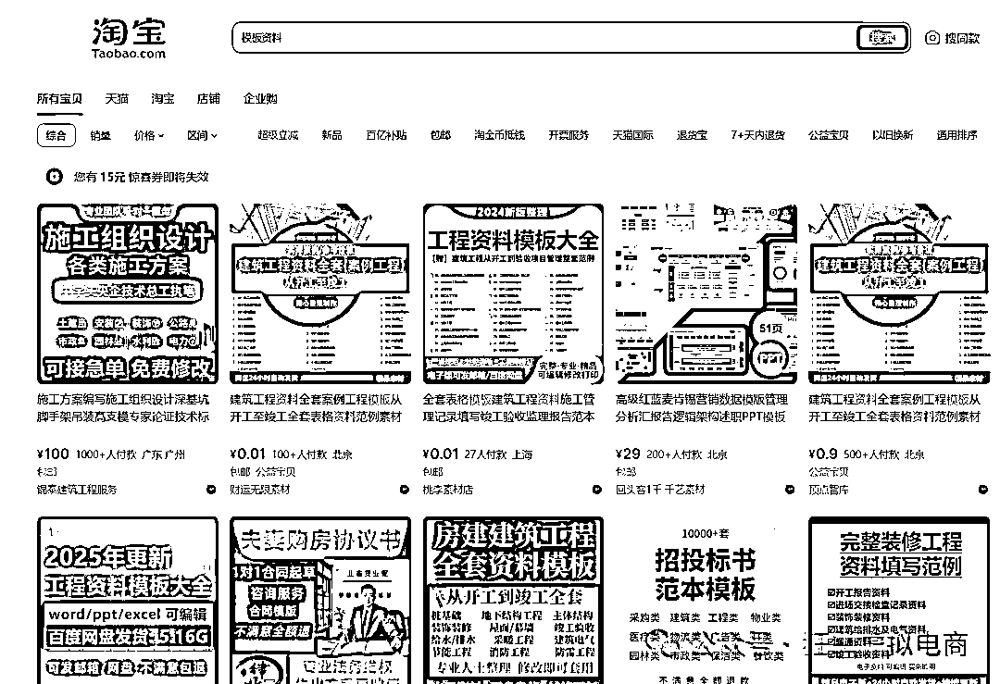

分析的时候要记住，冷门是相对的。小红书上那几个常年被反复讲的K12、教师教辅、考公考研、儿童学生、英语语文等算是高热大类，避开它们，其他的都可以算作相对冷门。

淘宝搜索结果会千人千面，我截图的这些是我长期收藏和点击后的结果，你们去搜可能不一样，但思路是一样的。

方法②：对比淘宝与小红书的销量差值

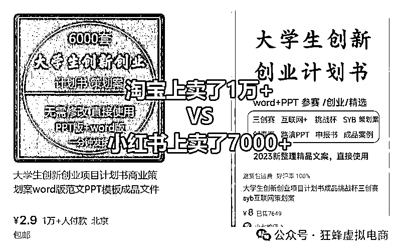

比如大学生创新创业这个品，淘宝上已卖1万+，小红书上也卖了7000+，说明两个平台已高度饱和。你现在0销量0评价去入场，需要投入很大精力也未必能撬动市场红利。

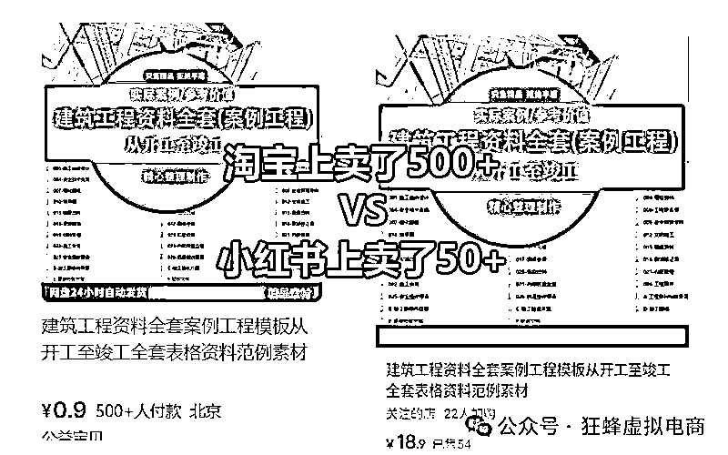

再看建筑工程资料，淘宝上卖了500多，小红书同款才50多，差值非常明显，这就是机会窗口。可以放心上架，小红书定价不必学淘宝走低价。

上架后先把基础销量和评价做起来，再铺笔记持续跟进，基本很快就能起效。

# 五、用选品工具加速挖掘

市面上现在已有专门针对小红书虚拟选品的细分工具，虽然不是我做的，为了避免广告嫌疑我就马赛克处理了。

这个工具能同时懂编程、懂小红书、懂虚拟赛道逻辑，才做得出来，确实值得点赞。

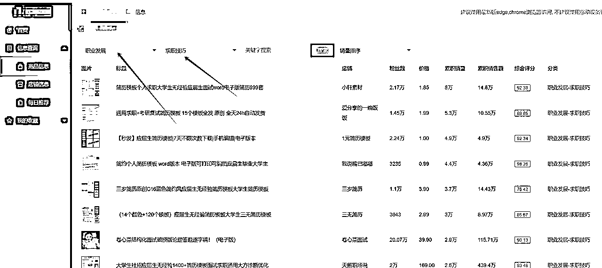

操作大致是先选一级分类，比如职业方向，再进入二级分类如求职技巧，就能看到各店各款的卖价、销量、销售额等维度数据。

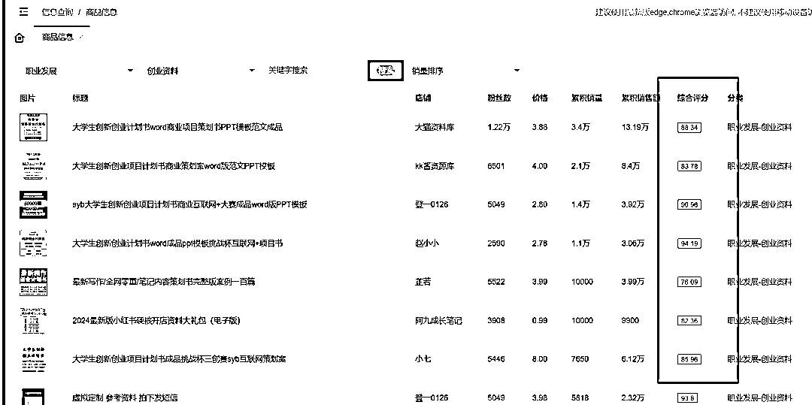

不想看太细可以直接看综合评分，评分越高说明综合优势越大。

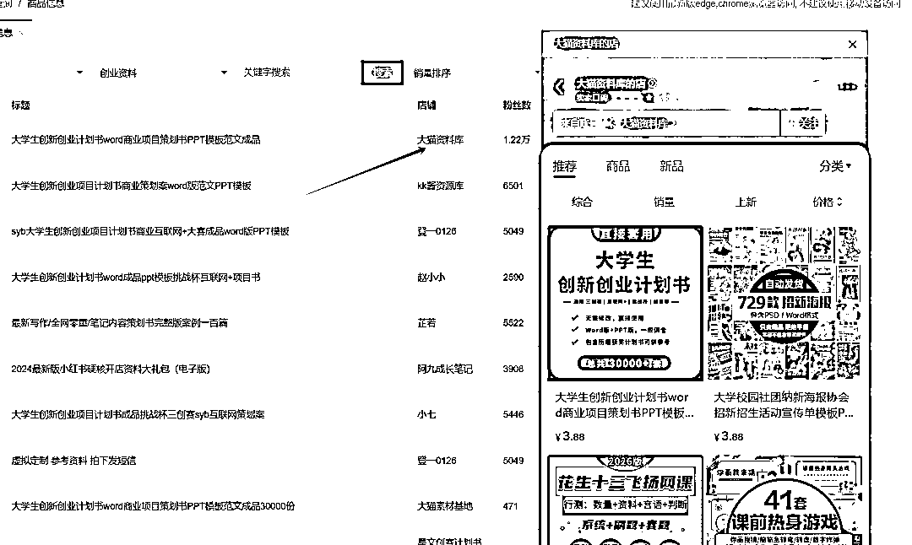

点进店铺名还能直接跳转到店铺，非常方便。

# 六、直接上500个品，解决选品焦虑

实操中大家最大的卡点就是不知道选什么。虽然上面方法都给了，但没有耐心和经验还是会迷茫。

我的做法是直接一个店上300-500个相对冷门的品，用数量换概率。哪怕有一个爆了，也能覆盖整体。

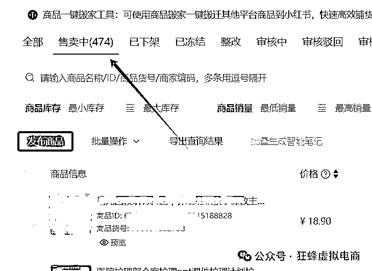

等后期筛出那些0销量0评价也能自然出单、又卖高价的款，就集中资源放大：补销量、补评价、发笔记、用乘风推。

至于500个品怎么搬到小红书店铺、怎么批量选品、一天一店发30篇笔记、如何用自动化软件铺笔记推广优化，这些细节我之前的文章里有完整演示。

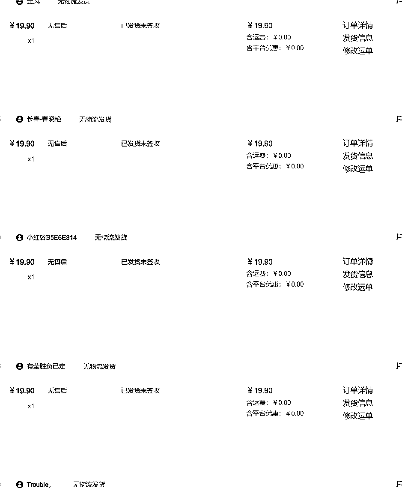

有悟性的朋友看完就会上手。

做小红书虚拟店，核心优势就是能卖高价，而且学会方法后见效很快，比很多副业更适合快速起量。

我是狂蜂，专注虚拟电商的蜂哥。今天的思路就到这里，2025年一起狂怼虚拟电商赛道，搞钱！