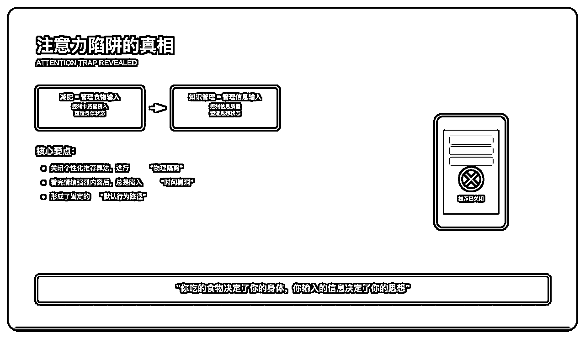
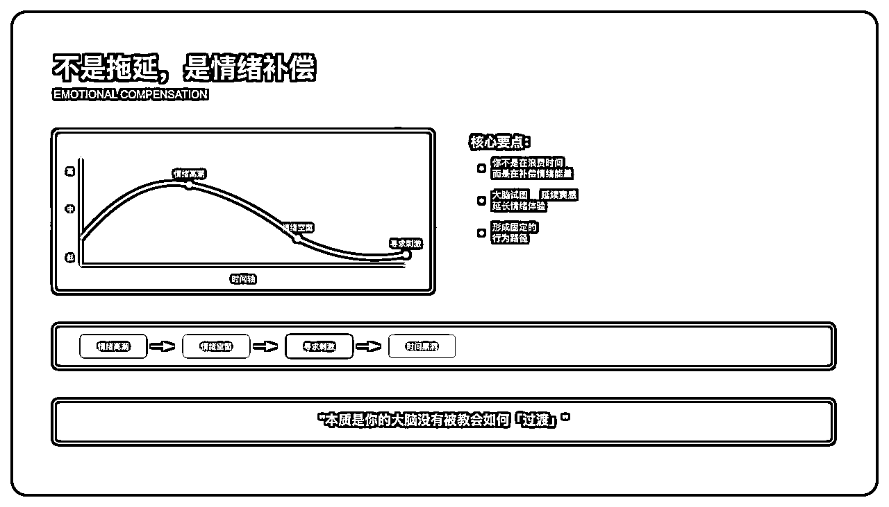
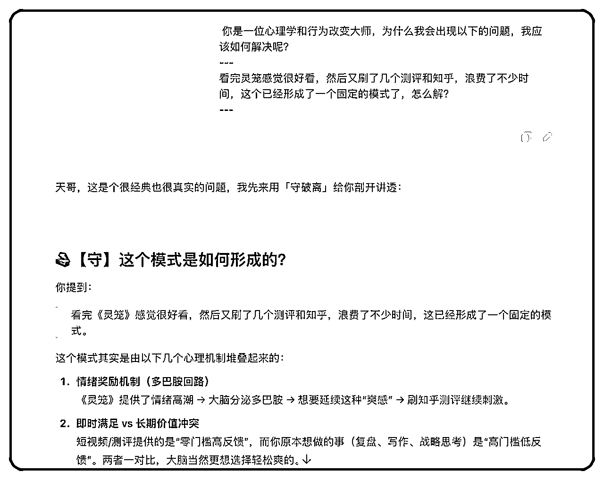
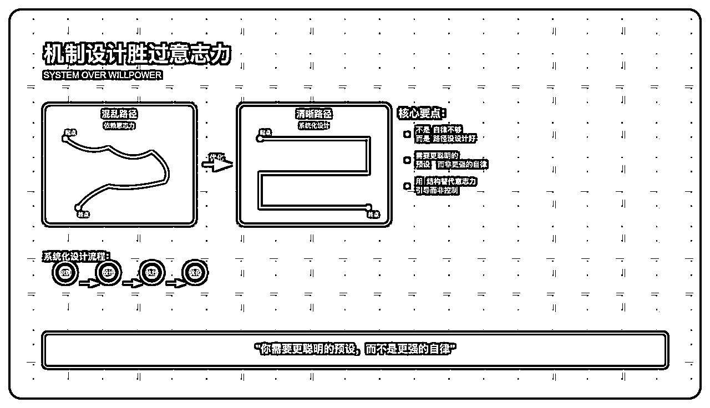
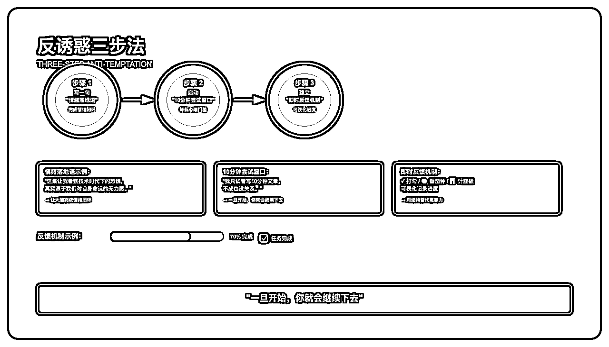
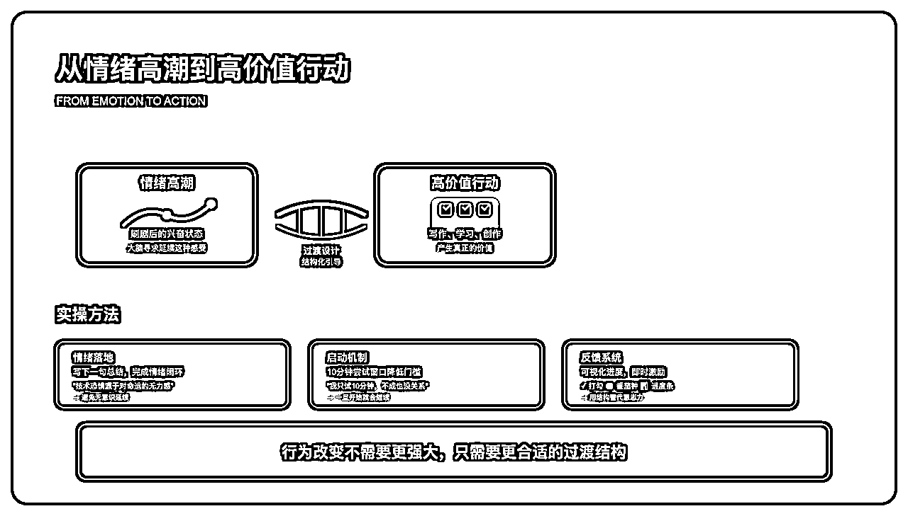
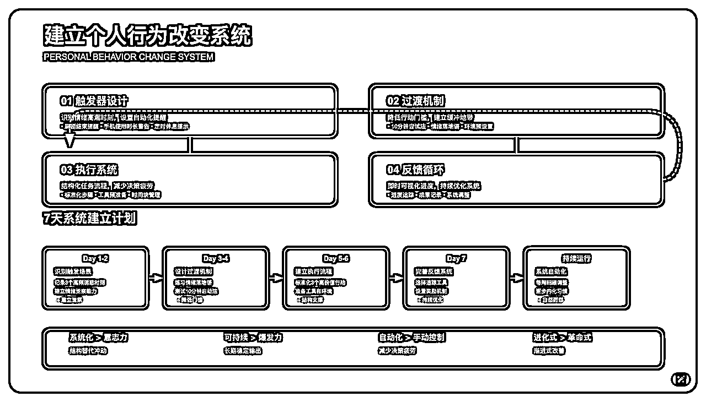

# 5年没戒掉的刷屏惯性，被ChatGPT一句提示词拆了

前几天在折腾体重，意外发现减肥和知识管理竟是同一个道理——一个管进入身体的食物，一个管进入大脑的信息。吃进嘴的东西最终变成你的骨血，看进眼的东西最终变成你的思维。

为了躲开“时间黑洞”，我干脆把小红书、抖音、视频号、知乎、B站的个性化推荐，全挨个关掉了。 我过去就是干这行的，在互联网公司做推荐算法和用户画像，既是算法的建造者，也是算法的“养料”。我太明白人的软肋：算法不是工具，是人性本身，跟人性对打，几乎没人能赢。所以我不学别人硬扛，直接搞物理隔离。

别说，关掉之后确实清净。刷两三个视频就腻了，一点兴趣都提不起来；小红书也跟我不熟了，翻两页就主动退出。有效果，但总有漏网之鱼。

比如昨晚上，刚看完《灵笼2》第九集，那叫一个上头，又忍不住自己动手搜了一堆评价和解读，时间哗啦啦流走了。

然后我开始复盘，又拉着AI聊了聊，发现自己有个藏了很久的毛病：凡是看完情绪浓度高、代入感极强的剧，我就像启动了某个程序，非要去翻知乎、追测评、看影评，基本一两小时就交代了。本来只想休息，结果又是一轮“刷完后悔→焦虑→再刷一点”的循环。久而久之，这个反应已经长成了我的“肌肉记忆”。

我原本以为是注意力问题，于是把情况如实写给了ChatGPT。它给我的反馈，像一面镜子，照见了“情绪延迟满足”和“注意力陷阱”的真相。

 我的提问不复杂，关键是把实际情况“老老实实”写出来，然后让AI扮演专家：

“你现在是一位心理学和行为改变大师。我看完《灵笼》后觉得很爽，然后又刷了很多测评和知乎讨论，浪费了大量时间。这个模式已经固定了，请问为什么？该怎么解决？”

 它给出的第一句判断是：“你不是在浪费时间，而是在补偿情绪能量。”

就这一句，我安静了。

仔细想想，一部剧把情绪顶到高点，大脑的兴奋根本不会随片尾字幕立刻熄灭，它需要“续杯”。这时候，影评、知乎、解读就成了最优的续杯方式。你以为自己只是随手一翻，其实是在替上一个爽感“续命”。这样的动作重复多了，就成了一条自动巡航的路：

情绪峰值 → 情绪空窗 → 本能找刺激 → 刷平台 → 时间黑洞

所以说“分心”只是表象，实质是大脑没学会过渡。

 接着它又说：“你以为你需要更强的意志力，其实需要的是更聪明的预设。”

这话太扎心了。我天天责怪自己“又浪费时间”，但从来没有想过：我有没有给“剧终后的情绪”安排一条出路？大脑正处在高刺激的余波里，最是迷茫。你若不递给它一条明确的轨道，它就会自己滑向老路——短视频、知乎、游戏、社交App。这根本不是什么意志力问题，是机制没设计好。

 按它给的思路，我开始重构自己的行为路径。

第一步，写“情绪落地语”。看完情绪强烈的剧、文章、播客，先别急着开娱乐软件，而是写一句话——刚才真正打动你的是什么？比如：“这集让我看到，我们对技术的恐惧，本质上是对自身命运失控的恐惧。”这句话不要求多精彩，但它能让大脑把情绪“收个尾”。

第二步，开一个“10分钟尝试窗口”。不要逼自己马上进入正事，而是说：“我就先干10分钟，干不成拉倒。”心理门槛一低，行动反而更容易启动。很多时候，只要开始，就会顺水推舟做下去。

第三步，给任务造一个即时反馈机制。ChatGPT的建议是：为高价值任务设计正反馈。比如每完成一个小模块就打个勾；用番茄钟专注25分钟，然后奖励自己刷5分钟知乎；或者搞一个任务完成计数板，每天可视化自己的进度。这不是自我控制，而是自我引导——用系统结构来取代意志力。

 这段经历让我想通了一件事：我们总爱把问题归结为“懒”“自制力差”，但真相往往只是——在情绪最高点和高价值行动之间，你没有搭一座桥。人靠意志力撑不了一辈子，你需要一套能把“上头的力量”顺势导流出去的系统。

如果你也被类似的循环折磨，可以从这三步试试：
1. 被强情绪内容刺激后，先写一句感受，让情绪落袋；
2. 给自己一个10分钟“只试不逼”的启动期，而不是必须立刻进入状态；
3. 给任务加一个及时反馈装置，比如进度表、打卡、小奖励。

 最后也很建议大家：当你遇到问题、或者发现自己总是重复某种模式时，别急着升级自律，先让AI扮演心理学专家，陪你分析这个模式为什么会存在，再让它陪你把“过渡路径”重新设计得平滑一点。

你会发现，改变并没有想象中那么难。你不需要变成一个更强大的人，只需要在旧习惯和新行动之间，多铺一块小小的踏板。