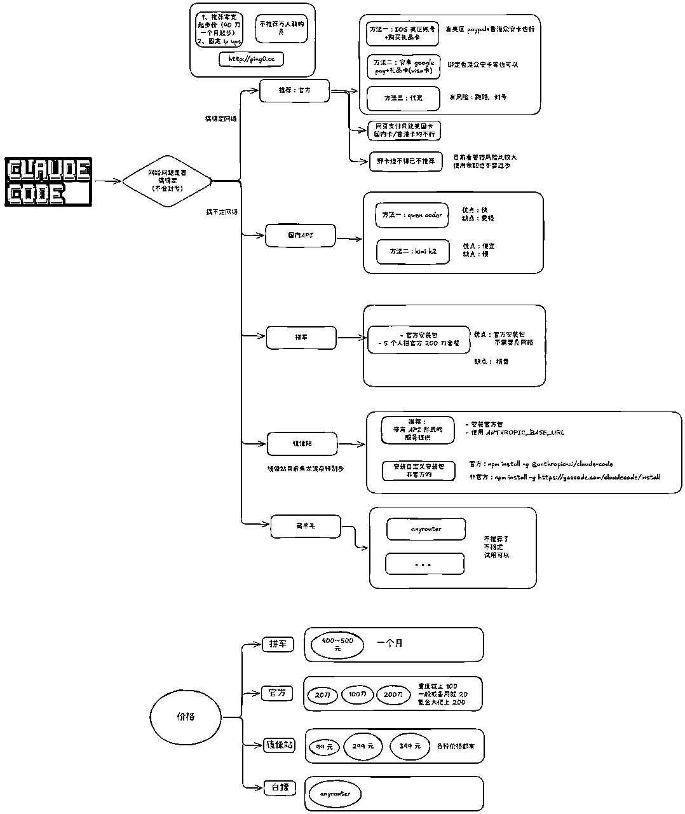
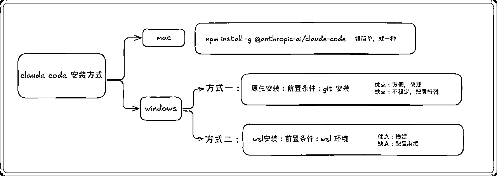
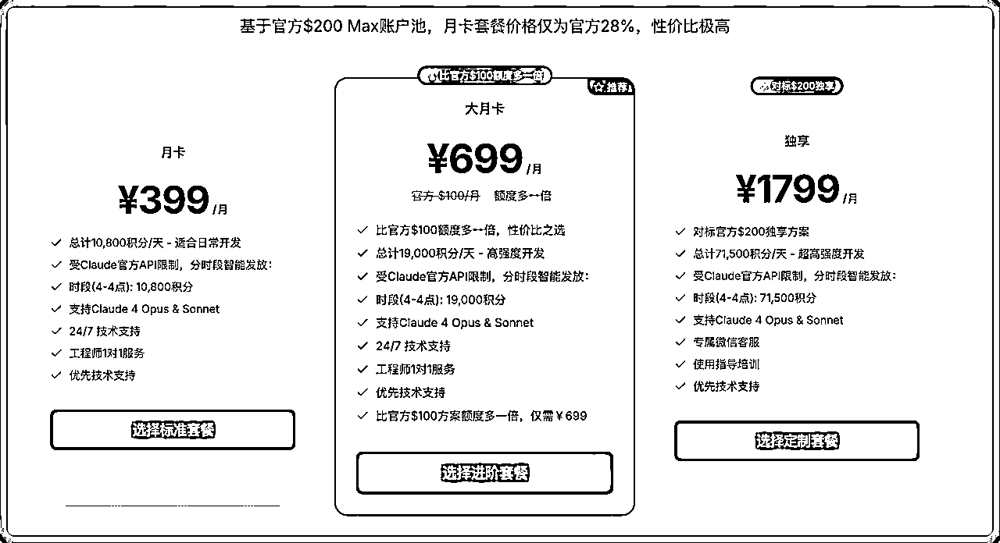
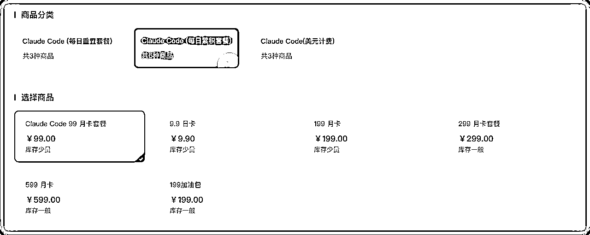
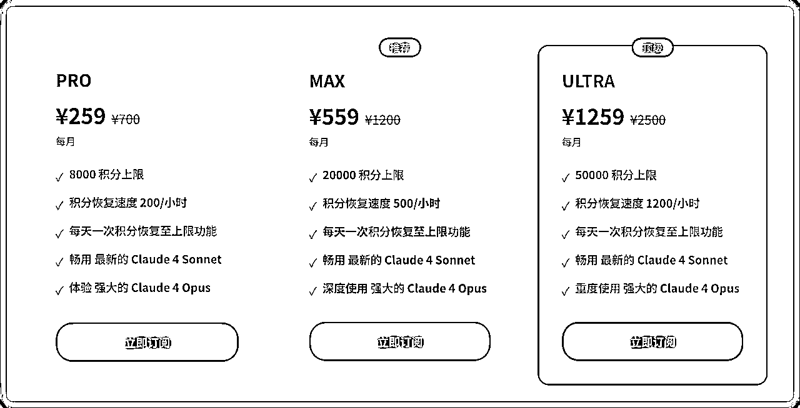
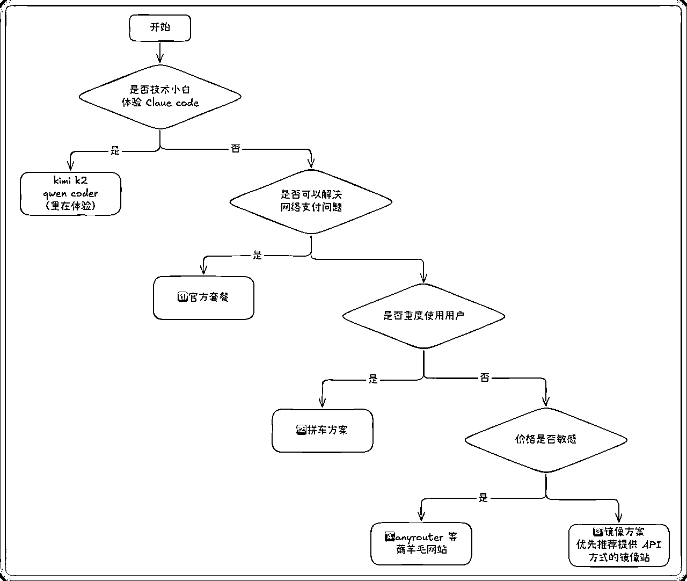

# 别再被教程绕晕了！Claude Code 最全玩法盘点，看完就知道怎么选
作者：龙哥

哈喽，大家好！最近收到好多朋友私信，说想上手 Claude Code，结果一搜教程，满屏都是镜像站、API、代理、自定义安装包……整个人直接懵掉。

今天我就用一篇文章把这些讲清楚：Claude Code 到底有哪几种打开方式、分别适合谁、官方订阅怎么搞、有哪些镜像站能选。不绕弯子，直接上干货。

先看一张总览图，整个使用体系基本就是这样：



## 先搞明白：两种主流方式到底有啥区别

在开始之前，得先给大家科普一个背景：现在市面上的镜像站鱼龙混杂，很多方式看着差不多，其实底层逻辑完全不一样。

### 方式一：自定义安装包

比如你用一条命令装 Claude Code，很多镜像站会在这个环节动手脚。它们会魔改官方安装包，让工具请求镜像站自己的网络服务。

这样做的好处是省事、门槛低，装完就能连；坏处是改过的包可能会带来一些隐性隐患。日常操作可能感觉不出来，但某些场景下就会出问题，比如官方功能没法完整生效，最常见的像“搜索网页”这种能力就可能会失效。

官方原始安装命令是：

npm install -g @anthropic-ai/claude-code

### 方式二：API 方式

官方除了账号登录，也开放了 API 方式。只要你的 API 接口符合官方参数和响应规范，就能直接使用 Claude Code。

这种方式下，你可以接第三方大模型，比如现在比较常见的 Kimi K2、Qwen Coder；也可以用一些镜像站提供的 API 服务。

一句话总结：官方 API 是源头，第三方 API 是分支，包括大厂商提供的、收费镜像站提供的，还有羊毛圈里的 anyrouter 这类中转。

两种方式各有优劣：

| 使用方式 | 优点 | 缺点 |
| --- | --- | --- |
| 自定义安装包 | 安装简单，几乎零配置 | 可能有隐藏问题，比如用不了联网搜索 |
| API 方式 | 官方安装包够稳定，匹配度高，不易出幺蛾子 | 配置上稍微麻烦一点 |

```
# mirror code
npm install -g https://mirror.o3pro.pro/install

# gac
npm install -g https://gaccode.com/claudecode/install

```

## 安装这件事：Windows 用户尤其要注意

Mac 用户比较省心，官方安装直接搞定，没啥可纠结的。

但 Windows 就复杂一些。原因是 Claude Code 本身是个 CLI 工具，早期只针对 Linux 环境设计，因为它依赖 grep 这类 Linux 下的基础工具，而 Windows 系统本身并没有这些。

那后来为什么有原生 Windows 支持了呢？因为 Git 在 Windows 上安装时会顺带装上 MinGW-w64，这个东西相当于在 Windows 里提供了一个 Linux 兼容环境，Claude Code 调用 Linux 工具时就能跑起来了。

不过，我还是推荐大家优先用 WSL 来跑 Claude Code。原因很简单：原生 Windows 支持刚出来不久，稳定性还不够好。而且为啥官方后来又要做原生支持？就是因为 WSL 对不少人来说太难搞定了，配置环境、和 IDE 联动、调用 MCP 等等，光想想就头大。

另外提醒一句：在 Windows 上安装 MCP 命令时，通常需要在命令里加一个特殊关键字，否则装不上。比如下面这个就是加了特殊参数的写法：

claude mcp add playwright -s user -- cmd /c npx @playwright/mcp@latest

```
export ANTHROPIC_BASE_URL=https://api.moonshot.cn/anthropic
export ANTHROPIC_AUTH_TOKEN=your_api_key_here
```

## 推荐先上手：API 集成方式

如果你不是老手，我建议先用 API 方式把 Claude Code 跑起来。它不需要折腾复杂环境，也不会烧太多钱（Qwen Coder 这类除外）。

### K2 的配置方式

Mac 端直接看下图：

```
# 1\. 安装Claude Code
npm install @anthropic-ai/claude-code

# 2\. 配置API endpoint
export ANTHROPIC_BASE_URL=https://api.moonshot.cn/anthropic
export ANTHROPIC_AUTH_TOKEN=your_api_key_here

# 3\. 启动服务
claude
```

Windows 端注意：要用黑色的 cmd，别用蓝色的 PowerShell：

```
set ANTHROPIC_AUTH_TOKEN=your_api_key_here
set ANTHROPIC_BASE_URL=https://api.moonshot.cn/anthropic

```

如果你想直接改配置文件来操作：

```
{
  "env": {
    "ANTHROPIC_BASE_URL": "https://api.moonshot.cn/anthropic",
    "ANTHROPIC_AUTH_TOKEN": "your_api_key_here"
  }
}
```

### Qwen Coder 的配置方式

Mac 端配置示例：

```
# 1\. 安装Claude Code
npm install @anthropic-ai/claude-code

# 2\. 配置API endpoint
export ANTHROPIC_BASE_URL=https://dashscope.aliyuncs.com/api/v2/apps/claude-code-proxy
export ANTHROPIC_AUTH_TOKEN=your_api_key_here

# 3\. 启动服务
claude
```

Windows 端同样提醒：使用黑色 cmd，别开蓝色 PowerShell：

```
set ANTHROPIC_AUTH_TOKEN=your_api_key_here
set ANTHROPIC_BASE_URL=https://dashscope.aliyuncs.com/api/v2/apps/claude-code-proxy

```

改配置文件的话，看这里：

```
{
  "env": {
    "ANTHROPIC_BASE_URL": "https://dashscope.aliyuncs.com/api/v2/apps/claude-code-proxy",
    "ANTHROPIC_AUTH_TOKEN": "sk-e32d40fb8c3b4653a75860667935d760"
  }
}
```

## 官方订阅：怎么才能付成款？

如果你网络条件没问题，接下来最大的难点就是支付了。

先说结论：国内信用卡、Visa、运通卡、香港卡，直接用在 Claude 网页端是不行的，必须用美国或其他地区的卡。

### 方式一：安卓 + Google Pay / 礼品卡

你需要一台安卓手机，最好是 Google Pixel 这类原生谷歌机型。我自己家里的荣耀手机折腾半天不行，最后在二手平台淘了一台 Pixel 2，大概 250 块，用起来完全没问题。也有群友说一加手机亲测可以。

支付上可以绑 Google Pay，我绑的是香港的众安卡、天星银行这类卡片，肉身去香港开通很方便；也有群友绑国内 Visa 或运通卡成功的，支付应该没啥问题。

另一种更省事的方式是买礼品卡，我之前用过的网站是：

https://www.seagm.com

### 方式二：iOS + 礼品卡

需要一台 iOS 手机，以及美区 Apple ID。

美区 Apple Pay 不能直接绑国内卡或香港卡，但有个绕法：美区 Apple 账号可以绑定美区 PayPal，而美区 PayPal 可以验证香港的众安银行卡。需要注意，美区 PayPal 必须要用美国实体电话卡来配合，否则很容易被封号。

礼品卡依然是更推荐的方案，除了前面那个网站，也可以支付宝购买，网上搜一下就有很多渠道。

以上说的都是 Claude App 里的订阅方案，具体价格如下：

- 20 美元套餐无税，实际支付 20 美元
- 100 美元套餐，实际支付 125 美元
- 200 美元套餐，实际支付 250 美元

说句大实话，官方订阅就是比较难。目前 App 端是少数能顺畅走通的支付路径。网页端支付的话，不管是找二手平台代付，还是用虚拟卡，都有跑路风险；最稳的还是找有国外卡的朋友帮忙。

最后再提醒一句：现在 AI 产品迭代实在太快，不太建议一上来就年订阅。除非你预算真的很充足，否则还是按月订更稳妥。最近应该有不少被 Cursor 年费套牢的朋友在后悔吧？



## 镜像站盘点

下面这些是我目前了解到的镜像站，全部不带推荐码，纯个人使用经验。另外提醒一下，每家的积分消耗规则不同，先搞清楚是基于什么来扣费的，再决定要不要上车。

### mirrocode

比较新的镜像站，支持官方 API 方式。价格便宜，可以配合官方安装包使用，性价比目前排在前列。缺点就是刚出来不久，稳定性还有待观察。目前价格是 230，基本 Sonnet 模型足够日常用。

### gaccode

地址：https://gaccode.com/

这家应该不少人知道了，我自己以前也用过。价格有 299 和 399 两个档位。

### aicodewith

地址：https://aicodewith.com/



### sssaicode

地址：https://sssaicode.com/

也支持官方 API 方式，套餐选择相对丰富。



### aicodemirror

地址：https://www.aicodemirror.com/

同样支持官方 API 方式。



## 那么，到底怎么选？

别纠结，按照下面这张流程图来判断就行。选好方式后，再去看对应的具体要求和配置步骤，一步步来就好。



## 写在最后

不管最后选了哪种方式，最关键的是：先跑起来，别光研究不用。

我见过太多人，天天在对比工具、看评测、收藏教程，结果一个都没真正用过。与其纠结半天，不如先随便选一个开干，用着用着，你自然就知道哪个最适合自己了。

好了，今天这篇就到这里。你开始用 Claude Code 了吗？评论区聊聊你的体验！