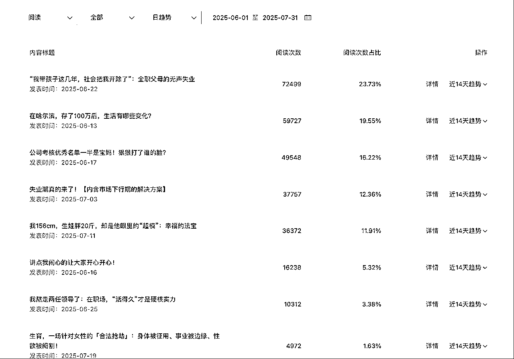
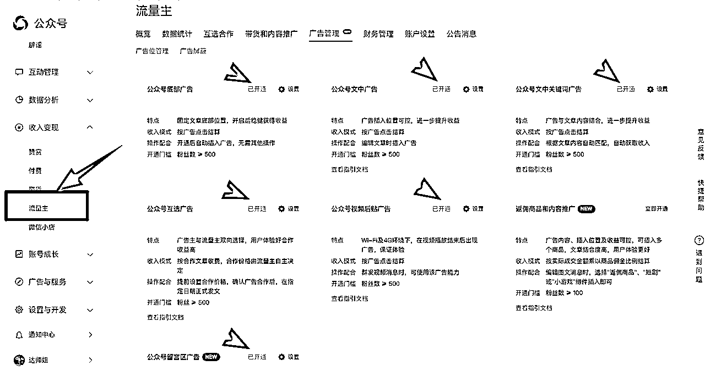
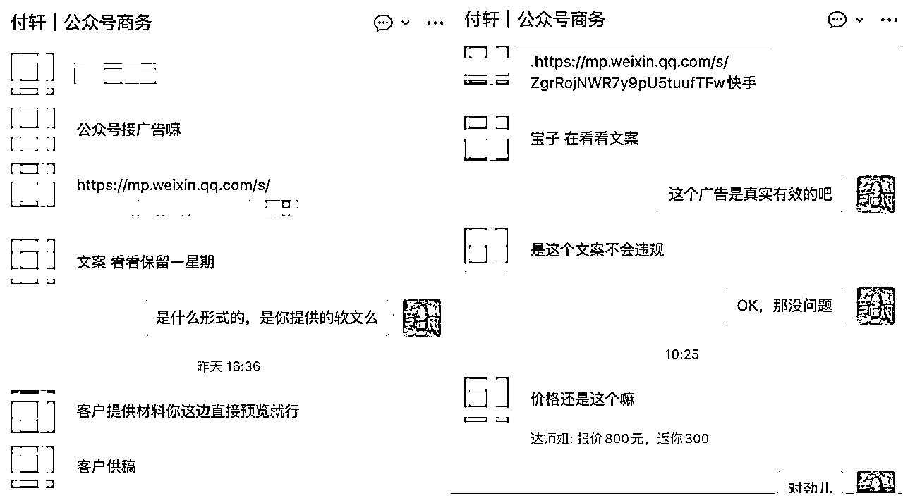
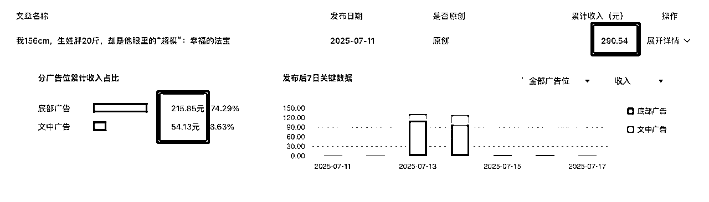
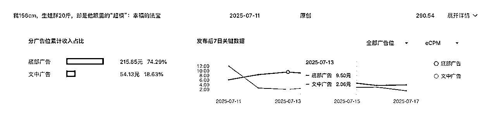
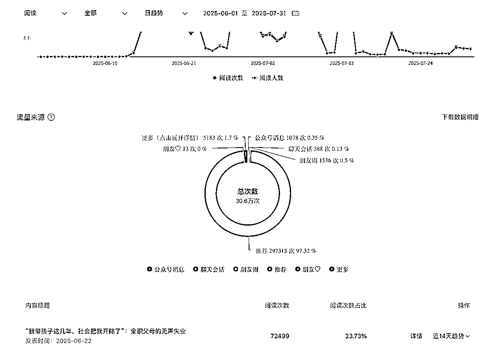
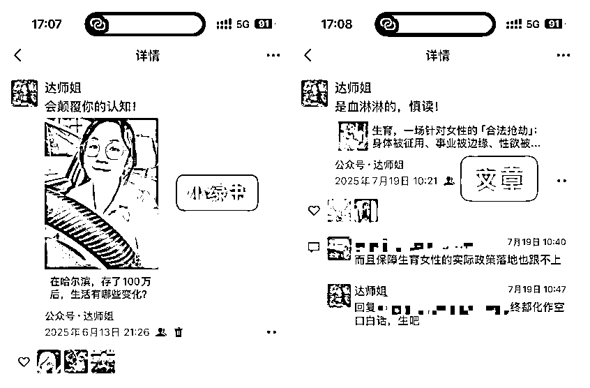
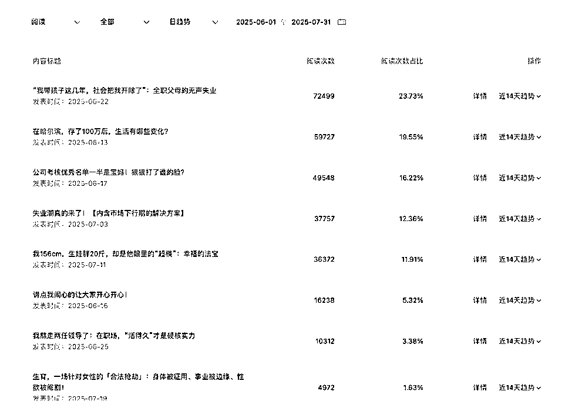
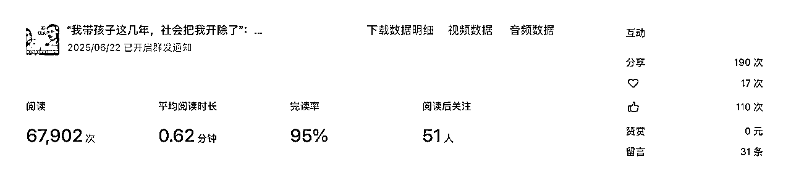
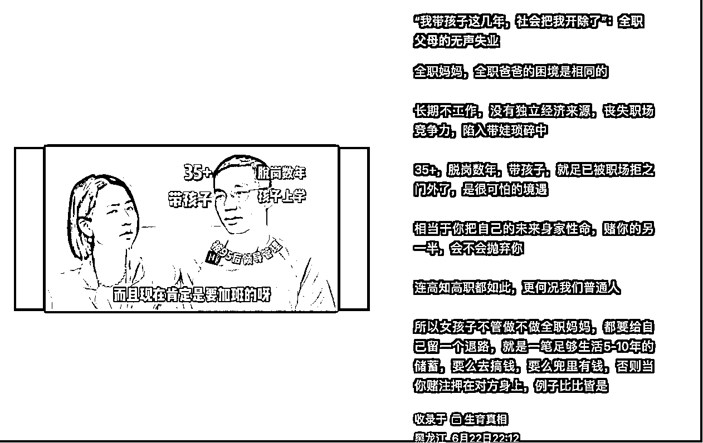

# 👸号没日更，还能写出多篇爆款？她靠“小绿书”赚到钱，还引来PR合作

我是达师姐。今天想跟大伙儿掏心窝子聊聊。

先放个结论：我，一个👸号新人，没团队、没工作室，手底下就一个账号，更新还断断续续，到现在不过66篇。可就是这么一个“没什么排面”的号，跑出了十几篇阅读过万的内容，单篇流量主收入300，还有正规的渠道PR主动来谈合作。听起来是不是有点不可思议？别急，后面全是真实后台数据。

说实话，我一开始完全不敢碰👸号。原因很简单：觉得自己文笔太差，发出去就几十个阅读，多丢人啊。后来朋友一句话把我拉进来了：你平时发在朋友圈的内容，直接搬到小绿书上就行，一秒同步。我想想也是，成本几乎为零，那就试试呗。

但我的执行力真的不行。给大家看看我的更新记录：1月12篇，2月13篇，3月8篇，4月6篇，5月2篇，6月12篇，7月13篇。中间几个月基本属于“三天打鱼两天晒网”，连我自己都看不下去。可即便这样，我还是赚到了钱。这说明什么？说明这事真的是纸老虎，没你想的那么难。

## 👸号到底能靠什么赚钱？

**第一种：流量主。**

粉丝攒到500就能开通。开通之后，文中、文末、评论区都能放广告，平台按照阅读量给分成。阅读越高，收入越多。我的选择是不开“返佣”，因为我觉得自己带不动货，也不想白白占广告位。当然，这可能是我见识不够，仅供大家参考。

很多人会问：500粉丝到底怎么搞？我的态度很明确：能走捷径就走捷径。快速试错，降低时间成本，比慢慢等效率高多了。我自己是老实巴交等来的，1月开始写，直到7月才攒够500。这段时间出了好几篇爆款，但爆款没法插广告，流量只能看着干瞪眼，收益是零。所以如果你想赚流量主的钱，别学我傻等。如果是做纯个人IP，那另说，反而不需要买粉。

**第二种：品牌方和渠道PR来找你发软文。**

我粉丝只有40多的时候，就有好些人私信我要发内容，一眼假，什么足球赛事，我琢磨着十有八九是赌博，这种钱赚了亏心，直接拒绝。后来粉丝到600多，正经渠道PR来谈合作，我报价800返300，对方居然很爽快答应了。我老公问我怎么定的价，我说瞎定的，抱着“成就成，不成拉倒”的心态。这点千万别学我，因为我是有主业和成熟副业收入打底的，👸号做起来不靠它吃饭，心态自然不一样。

**第三种：导流到🛰️，做私域成交。**

这才是真正的大头。我可以分销赚钱，也能给自己的项目导流。个人IP的路径其实是共通的：先持续分享，让人看见你是个有血有肉的人，建立信任之后，再展示自己的项目，成交就水到渠成了。因为读者看到的是一个人，而不是冷冰冰的链接。我也把👸号定义为“大朋友圈”——以前私域朋友圈影响几千人，现在👸号能影响几万人，玩法完全一样。

## 为什么短内容反而更赚钱？

作为职场老打工人，我们最烦的是什么？是领导开会讲一堆又臭又长的废话，全都是正确的空话，根本落不了地。观众不欠你的，👸号读者也一样，没义务被你强迫听完一场“会议”。你的文章太冗长，他们直接关掉，广告根本没机会见光。

这里有个很实在的观察：底部广告的收益比文中广告高好几倍。我那篇阅读量3万+的文章，广告费290元，底部贡献了大头。所以你想靠广告赚钱，就别把文章写得太长，让读者尽快刷到底，才是正事。

## 推荐流量97.32%，为什么说小绿书是机会？

这背后其实是一套流量池机制。就像@龙哥说的，小号也能有大流量。你的文章会先进入一个池子，数据表现好了（点赞、转发、阅读），就会推到更大的池子。我自己根据数据瞎总结了一下：大概0-300是第一个池，300-1000是第二个池，1000-10000是第三个池。不一定对，但大方向应该没跑。

我的推荐流量高达97.32%，说明基本就是靠池子吃饭，自己的私域流量很少。这里有个经验教训：小绿书是真的简单，把朋友圈内容复制粘贴就能发，流量还特别好，我的好几个爆款都是这么来的。但等我有500粉以后，突然发现小绿书不能带广告。无奈之下只能去研究长文章，结果流量掉得厉害，排版也是各种折腾，效果还丑。而且小绿书在页面上的展示面积比文章大很多，这大概也是平台愿意推它的重要原因。

我特意没截掉评论区，这样对比更直观。所以我的建议是：小绿书必须做。流量大、门槛低、不用排版，手机上一按就能发，完全可以当朋友圈用。我打算接下来每月1-2篇长文章，剩下时间尽量刷小绿书。虽然大概率做不到计划里的28篇，但至少这条路是对的。

## 爆款率30%，到底怎么拆解？

先上数据：最近两个月我一共发了25篇，7篇过万、7篇过千。按照过万算，爆款率是30%；如果把过千也算进去，那就是56%。说到底其实就是进了推荐池，小号也能被看见。

我来拆解一下爆款到底靠什么。看那篇完播率95%的文章，别以为是我写得多好，真相只有一个：它足够短。短到读者还没反应过来，就已经读完了。

所以做👸号，真不一定要篇篇长篇大论。只要内容有干货、能共情、戳中读者，短小反而更占便宜。反过来，水平一般还硬写长文，完读率一塌糊涂，平台自然也不会继续给你推流量。

具体来说，爆款通常具备这几个特征：

一是**选题受众广、痛点深**。比如全职爸妈这个话题，几乎人人都听说过，自己不是，身边也有，非常容易引发共鸣和转发，属于典型的社会话题。

二是**评论区最好能“打架”**。我的好几篇高阅读内容，评论区都在吵架，有骂我的，有对骂的。吵得越热闹，推流越猛，本来停掉的流量又被救活了。

三是**文章短，完读率自然高**。95%的完读率真的吓人，不知道的还以为是顶级内容，其实就是短，1秒看完，再刷5秒评论区。

四是**标题和头图绝对不能敷衍**。我见过很多人内容写得真的不错，但因为标题、头图不用心，浏览量惨兮兮。这就好比追女生的时候，你会特别注意穿搭和形象，而不是指望别人透过邋遢的外表去发现你有趣的灵魂。小号阶段尤其要拿出追人的劲头去打磨门面。

标题具体怎么起？要么给解决方案，要么给新知，要么扎痛处。写不出来就让AI帮你写，让它出20个，你从里面挑。比如我写过的：

- 失业潮真的来了！【内含市场下行期的解决方案】
- 我熬走两任领导了：在职场，“活得久”才是硬核实力
- 我156cm，生娃胖20斤，却是他眼里的“超模”：幸福的法宝
- 在哈尔滨，存了100万后，生活有哪些变化？
- “我带孩子这几年，社会把我开除了”：全职父母的无声失业
- 公司考核优秀名单一半是宝妈！狠狠打了谁的脸？

这些标题的共同点：具体、有对象、有冲突，一看就知道讲什么。

## 普通人，先接受自己的普通

你大概率和我一样：早八晚五，偶尔加班，没什么团队，也不懂什么AI工作流，更不会做复杂的对标分析。那就先接受这个事实。第一个月起不来很正常，我当时就是几十个阅读，甚至个位数。7个月才攒够500粉丝，这也是普通人的常态。

那怎么熬？我的方法是：把它当个屁放了。别在新领域的0到1阶段过度审判自己。别急着发到熟人圈，等数据好看了再让人知道，事以密谋。也别因为一个月没出爆款就否定自己，平台跟你也是从陌生到熟悉的关系，需要时间磨合。

而且爆款是有“带动效应”的。某一篇火了之后，你之前的旧文章阅读量可能也会跟着涨。有时一篇文章发出去不温不火，过阵子却莫名其妙爆了，可能因为搜索热度上来了，也可能因为被大爆款联动。数据这东西，一时半会儿真不代表什么，别急着自我怀疑。

## 如果可以，尽量不要断更

普通人想逆袭，总得做点普通人不爱做的事。尽量别断更，这就是一件。当然这很难，所以能坚持的人才少。我说的是有内容的持续输出，不是那种不动脑子的水文。相比憋一篇90分的文章然后躺一个月，更重要的是保持60分的高频输出。高频带来的迭代速度、流量稳定性，绝对比低频更好。

我的流量之所以忽高忽低，很大原因就是更新太随意。想更就更，心情不好就停更。结果每次回来都要重新经历一次冷启动。断更的代价，就是前面积累的东西慢慢凉掉。不如持续做下去，得到一个确切的结果：行就行，不行就换赛道。怎么都不亏。

## 最后说点心里话

我是INFJ，敏感、容易内耗，常常有一种不配得感。别人一句话，我能琢磨一宿。以前我非常讨厌自己这个毛病，但后来通过不断做项目、拿结果，心态越来越稳。敏感这个特质并没有消失，但我开始学会驾驭它，把它变成我做内容的网感和判断力。老天是公平的：给高敏感的人网感，也给钝感的人执行力；给高敏感的人自我怀疑，也给钝感的人埋头苦干。赚钱是最好的修行，我们都在路上打怪升级。

最后想谢谢我的榜样@梁靠谱。她稳定输出、持续营业这件事，本身就给了我特别大的精神力量。