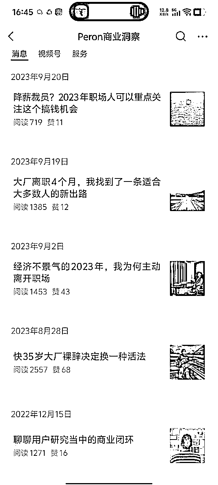
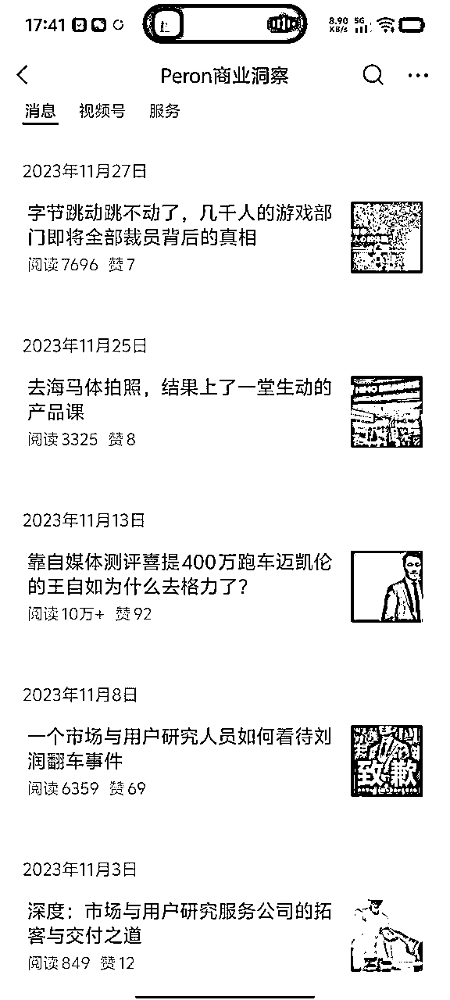
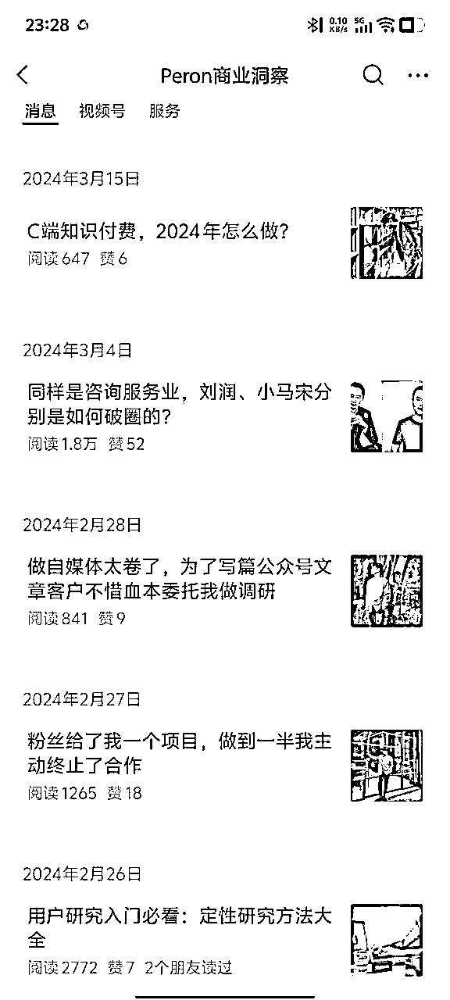
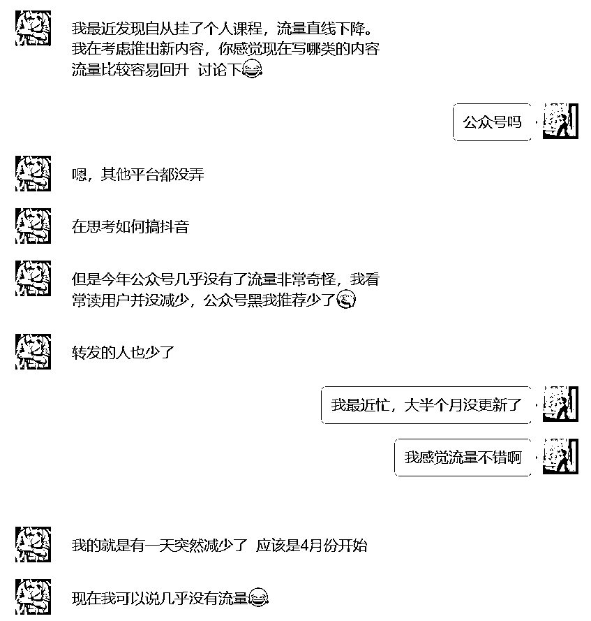
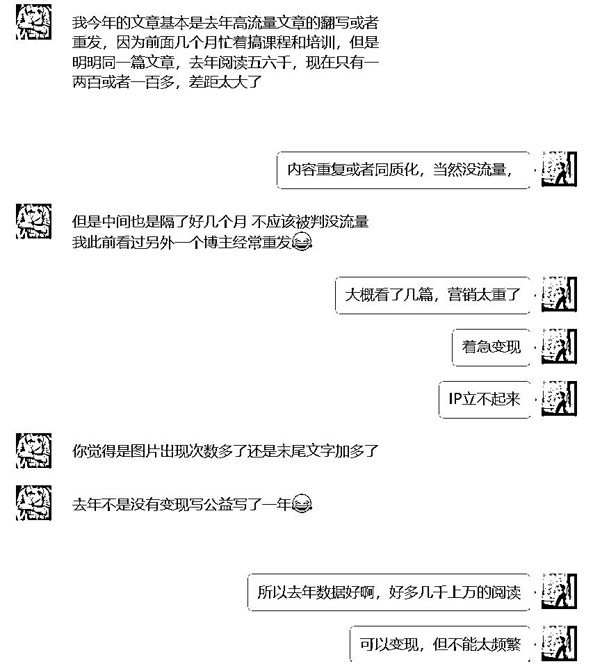
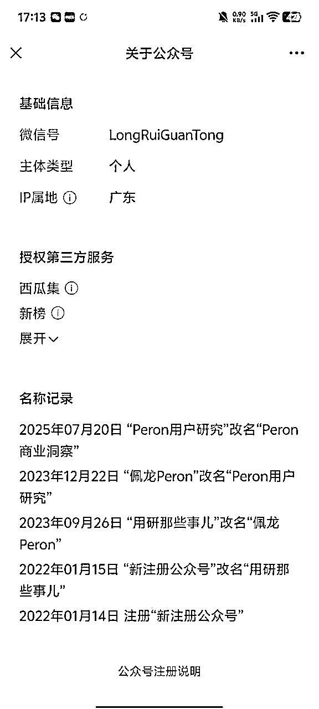
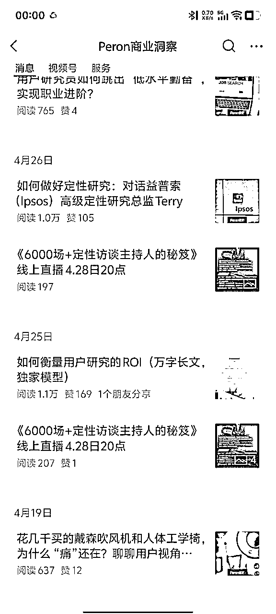
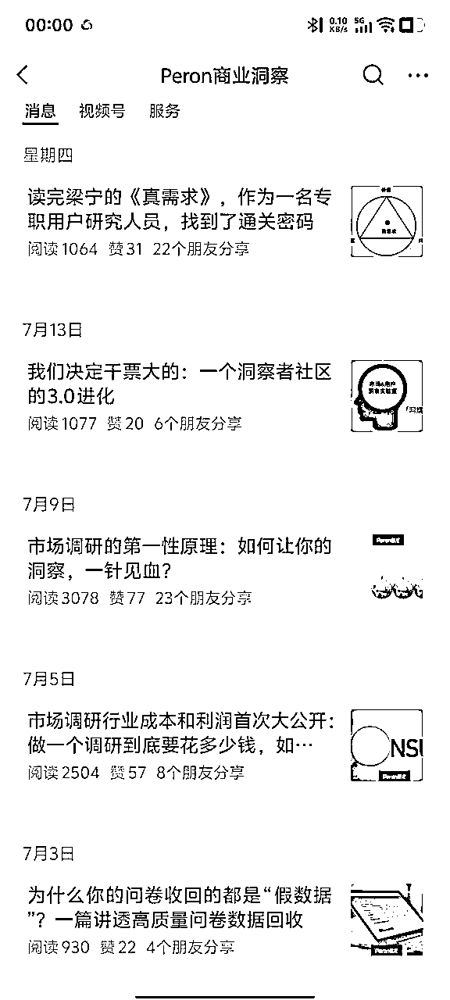
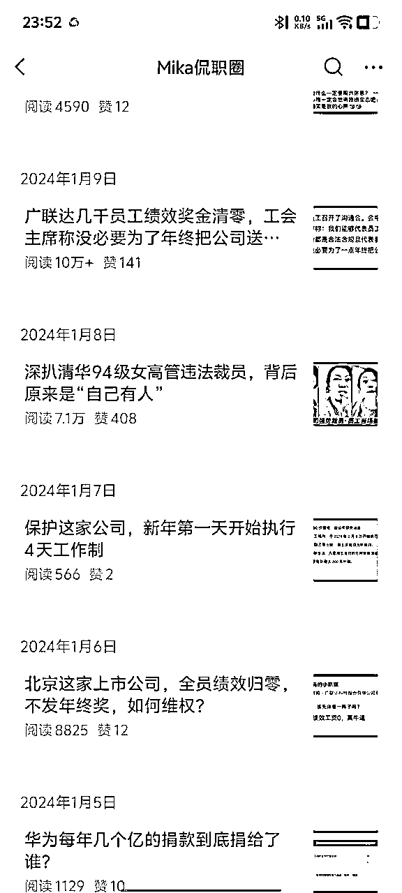
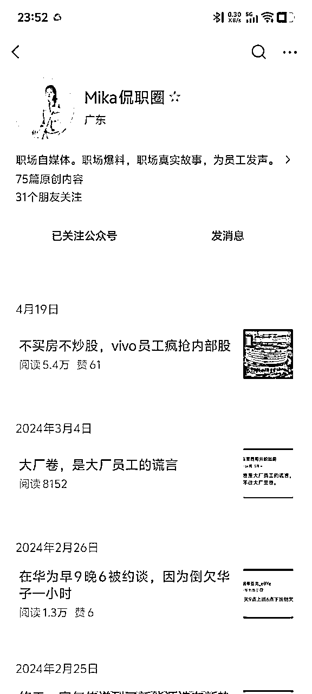

# 从大厂离职到专家IP：一个垂直领域研究人的两年三次转身

龙哥上周刚发了第10条超级标，巧的是这条路我也刚走完一轮。于是我在星巴克坐了一天，手写了这篇接近万字的复盘。

先简单介绍我是谁。

我是Peron佩龙。2011年人大毕业后，我扎进了一个极小众的赛道——市场调研与用户研究。6年里先后在博睿胜伦、Kantar凯度、尼尔森等本土与国际头部机构历练，2017年后转投甲方，在同程艺龙、vivo做用户研究，做了6年。

2023年，我34岁，被行业波动挤出了舒适区，开始找第二曲线。那年我正好卡在中年焦虑期。

起初我以为可以靠兴趣重启，报了健身私教、形象管理课，自学营养学改造饮食，想做男士造型改造。但半年下来一无所获。

转机来自一个老朋友的电话。让我去给一家大公司做用户研究外包，从需求对接、研究设计、数据分析到写报告，一单6万。单子越接越多，我干脆注册了公司，名义上创业了，实际上是回到了自己深耕12年的老本行。

# 一、IP的1.0阶段：摸着石头过河

刚开始做外包，很快撞上两堵墙。

一是单子不稳定。旺季忙死，淡季闲死，难以养团队。不是客户单子少，而是客户为了控制议价权，不会把业务押在一个供应商身上。

二是利润太薄。外包永远在食物链底端，一个月满打满算5万出头，还不如在厂里拿钱，风险和心累却翻倍。

于是我开始扩圈。

TO B端：找更多客户，接一手二手的调研项目。
TO C端：做知识付费。这行全国从业者估计就几千人，普罗大众压根不知道用户研究是啥，所以我不做几百块的课，也不做线下培训，直接做1万/年的一对一陪跑。

可问题是我过去十年职场成绩平平，最高也就是高级研究经理，没带过团队，也没积攸客户资源。

运气好在，2020年起我在人人都是产品经理输出专业内容，攒了点粉。2022年1月我开了👸号“用研那些事儿”，沉淀了2000多个同行粉丝。

2023年8月，我把断更半年的号捡起来。

*   《快35岁大厂裸辞决定换一种活法》，复更文直接破万，后来删改重发也有2500+
*   《经济不景气的2023年，我为何主动离开职场》，深聊离职原因
*   《大厂离职4个月，我找到了一条适合大多数人的新出路》，宣布转型

同年9月，我把👸号更名为“佩龙Peron”。

原因很简单。“用研那些事儿”是个工具号，只能干货输出，不好涨粉变现。而“佩龙Peron”既有专业内容，也有转型创业的故事，是个有血有肉的人设，更容易让信任发生。

从工具人到“用研人35岁逆袭”的个人叙事，这就是1.0的逻辑。

效果有一些：来了几个B端小客户，几千到一两万不等；第一个高客单陪跑学员也来了，TO C可行性被验证。

但投入产出极差。每篇5000字以上，纯手打要好几天，阅读却只有几百到一千。

我以为是流量问题，于是去蹭热点。

*   《一个市场与用户研究人眼，如何看待刘润翻车事件》，破5000
*   《靠自媒体测评喜提400万跑车迈凯伦的王自如为什么去格力了》，破10万+
*   《字节跳动跳不动了，几千人的游戏部门即将全部裁员背后的真相》，7000+

流量上来了，粉丝和客资却没来。来的都是泛粉，不精准。我对流量祛魅了。

# 二、IP的2.0阶段：all in TO C

2023年12月，👸号改名为“Peron用户研究”，明确行业属性。

我清楚自己的资源和产能，撑不起一个大众IP，只能在垂直里做精准获客。继续做泛内容就是两头空。

我开始拆解刘润和小马宋。

内容整理进了一篇《同样是咨询服务业，刘润、小马宋分别是如何破圈的？》，阅读1.8万，小马宋还主动加我。

刘润从微软出来做润米战略咨询。他的号是个人IP，不是机构IP。IP能输出价值观和生活方式，建立信任，降低成交成本。

他经常以“刘润”开头讲个人经历：比如《刘润独家参访圣农：再不好好学习，我连养鸡都不会了》、《刘润：我是个社恐》。

内容分三层：商业观察如《京东，开卷》；职场干货如《你不是没有重点，你是没有结构》；个人成长鸡汤如《所谓自律，就是去对抗那些廉价的快乐》。三层都紧贴热点。

这是一个金字塔：商业粉在顶，人群最值钱；职场粉居中；泛人群在底，盘子最大。

日更之下头条常10万+。核心是团队化+AI助力。他的内容并不直接卖战略咨询，而是先给商业认知，再给职场实用价值，最后给情绪价值。知识付费也做得很重：《5分钟商学院》卖出50万份；年度演讲年年上亿流量；“进化岛”社群1.8万人；多本书籍。

C端反哺B端，B端实践又为内容供养，闭环很漂亮，只是后来年会翻车被质疑数据夸大。

小马宋从广告公司出来做“几件事”。他靠👸号起家，低价做咨询排满，之后出书《朋友圈的尖子生》《营销笔记》抬势能，现在咨询费160万起，只做筛选不比稿。

他的👸号也是个人IP：创业故事《创办一家小公司，并且活下来》、个人感悟《最近对市场的一些感受|小马宋》；破圈的商业评论《热辣滚烫票房破30亿，聊一聊我对减肥的12点认知》；B端导流的案例复盘《小马宋2023年度营销咨询案例大合集》；C端导流的营销方法论《营销的终极难题：回到用户视角》。

小马宋比刘润更聚焦商业营销，阅读量2-3万，但更精准。这是由业务决定的：他以B端咨询为主，刘润以C端知识付费为主。

我从中学到三点：

1. B端C端都要做，C端能帮B端获客。
2. 必须取舍，不能两头兼顾。
3. 内容做1+3法则：1个IP的人设+3类内容：专业干货、破圈热点、个人故事。

2024年3月，我决定主攻TO C。甲方大客户要品牌和背书，小工作室短期难打。

我搭建了产品矩阵：

1. 知识星球“用户研究成长圈”，从50元/年涨到199元/年，入门级。
2. 大厂用户研究训练营，3980元起，涨到4980元，中端。
3. 1V1年度陪跑，9999元起，涨到15999元，高端。
外加与和君商学院合作的“战略用户研究班”15000元/年，和“出海调研VIP会员俱乐部”2980元/人。

全年时间都花在研发课程和交付上。内容全部为转化服务。

推星球时写入门干货：《应届毕业生入门用户研究必看攻略》《10年+专家给0-3年新人的建议》；
推训练营时做3场直播“大厂用户研究职业发展&求职攻略”，转化30个学员和6-8个陪跑，单月15万+；
推和君班时提前铺战略研究内容，拿下5个学员；
推出海俱乐部时做6-8期从业者访谈，拿下十几个付费。

变现要守住利他底线。不能天天硬推，否则账号很快就废。

2024年3月到2025年3月，我的数据是：

*   知识星球435人，约5万
*   训练营60人，25万
*   陪跑15人，15万
*   战略班5人，7.5万
*   出海俱乐部15人，4.5万

全部是我一个人在家办公，执行力大概60-70%，没团队，靠一个👸号和5千人私域做到的。

TO B业务停滞，项目外包给兼职团队，年利润20-30万。

成绩不算差，但没过百万。我意识到0-1闭环跑通了，1-100怎么办？

一年下来，我的👸号粉到11000，人人都是产品经理8500，📕2500，视频号2000。在这个细分领域已是头部。

但我也看清了：用户研究的知识付费天花板很低，赛道窄、势能弱、大环境又对知识付费充满质疑。

反而TO B在2025年5月爆发。几个十几万到20万的一手订单进来，都是中小企业，来自👸号粉丝自来或同行推荐。一次就超过知识付费全年收入。

这验证了一点：做C端能倒流B端，但大钱确实现在在B端。

于是我做第三次战略转向：2025年起全面回归TO B，服务企业。

# 三、IP的3.0阶段：走向TO B

这次转型我做两件事。

首先，借势。我让公司正式加盟一家本土大型管理咨询公司。

有了品牌背书，能跟客户平等对话；能共享北京上海深圳香港的办公室，终于可以把客户请到主场地喝咖啡，给学员一个有质感的线下社区；还能把市场调研和咨询结合，做差异化方案。

其次，IP和内容升级。

### 1. IP升维，做决策者的第二大脑

👸号“Peron用户研究”升维为「Peron商业洞察」。

部分平台保留原名由团队代运营。

我不再输出入门“术”，而是做面向商业决策的“道”。沟通对象从同行变成企业家、产品负责人、投资人。

第一篇转型文章《别在红海里内卷了：这家“健身管理”公司如何找到被资本忽视的蓝海》数据一般，但方向已定。

### 2. 新媒体矩阵，重工业评测

我计划启动“Peron用户说”。不是KOL的主观测评，而是用科学、可量化的一手用户调研去评测智能硬件。

这是一个重工业媒体产品，用数据重塑评测标准。

从工具号到个人IP，再到商业洞察，三年三次转身，终于回到专业本位。专家IP的终点，还是回到服务企业、赋能产业。

「Peron用户说」系列的每一份输出，在我看来同时承担了三个方向的作用。

面向终端消费者，它就是一份真实的避坑参考——让普通人的使用体验告诉你，这件商品是否值得下单；
面向行业从业者，它更像一份竞品拆解手记——把对手的优劣摊开讲，痛点说到根上；
面向我们自己的业务，它是一张对外展示专业能力的凭证——让B端客户一眼看懂我们能交付什么样的一线洞察。

这条打法很重、投入也不小，但换来的是很难被模仿的壁垒。现阶段现金流保持正向，再加上加入的公司给到的资源支持，我有底气继续把这条“难但正确”的路走下去。

关于3.0阶段的组织升级，我其实在年初就有了想法。6月底去广州参加了一场线下赚钱有数聚会，《团队规模化：我是如何3个月做到百万》这场分享彻底把我推动搭建团队的决心点燃了。特别感谢@瑾糖 @阿星。

当前“一人作战”“超级个体”说得很热。我过去两年亲自跑下来，觉得这大概率是陷阱，信了就等于把自己困在卖时间里。创业的逻辑是要敢于加码风险，用团队杠杆把自己复制出去，才能把盘子做大。

全面把重心挪向B端，并不代表我放弃C端。

我对知识付费的认知这两年来经历了彻底的否定与重建。

起初我以为它是个低投入高回报的生意。现实是，在用户研究这个偏小众的赛道里，想靠它快速回本基本不现实，天花板很明显。

但它的意义比我当初设想的要深远。

真正的价值并不在那几千块课程费，而在关系与信任的积累。

看着学员从对行业一无所知的状态，慢慢成长为能独立负责的研究经理；
收到他们拿到理想Offer时第一时间发来的感谢；
线下与陪跑学徒长时间面对面，帮助梳理职业路径到深夜……
这些瞬间带给我的满足感，远超金钱本身。

我逐渐明白，教育是一项回报周期极长，却可能极厚重的事业，需要真正的长期主义。

于是我对To C业务做了重新定位——把它当成半公益属性的存在，同时也是B端获客的入口。

“市场与用户洞察实验室”这个知识星球定价199元/年，我专门配了全职运营，不再追求盈利，目的就是扩大人群覆盖和传播声量；
“大厂用户研究实操课”现在把每期一半课酬让给讲师，我不再亲自带交付，转而聚焦拉新；
“年度陪跑”正式调价到15999元/年，筛选更严，每年只收10位有潜力的学徒，为行业培养人才；
“战略用户研究班”和“出海调研VIP俱乐部”暂时停掉，主动收缩以求聚焦。

我不再指望C端贡献多少营收。

我只想在十年后，这些学生能占据这个行业的主流席位。到那时，桃李遍地，才是真正收获的时刻。

经过一年的沉淀，To C的运作已经标准化，现阶段用很少的人力和精力就能完成过去同样的工作量。

回到这次验证的超级打法：垂直细分+专家人设+方法论分享=小号也能获得大流量，数据已经验证。

今年一月份起，👸号进入一波增长期，几个月里从5000粉涨到了11000粉，且每月更新控制在5到6篇。单篇阅读也明显拉升，很多专业向文章能做到3000到10000阅读，而去年同期平均只有几百到一千。

需要提醒的是，拿到曝光之后，你的商业化路径是什么？是广告还是像我这样用服务化现。

2023年底我参与过赚钱👸号爆款的实验。

没有用同行那种AI批量生成、矩阵养号的路子，而是每天花半小时做选题、半小时亲手写千字左右，再结合AI做适当延展。不到5天就从零起了一个职场号，走人设路线，出了不少10万+。流量不错但波动大，单号月均收益大概3k左右，也跟赛道有关。

这个账号帮我测出了天花板，粗算下来同时运营10个号，每天投入8到10小时，一个月大概也就3到5万的上限。普通人做到这里就很吃力，所以我最终放弃了这个方向。

不过这个号和积累的流量仍有价值，我通过它导流了数千人进入私域社群，目前把这个号重启，用来为B端调研业务赋能，主要是问卷样本的收集。

（停更一年，今年4月复测过一次，依然有流量，核心还是选题和原创性。）

所以先于做流量，要想清楚流量怎么用。

流量的意义不在于规模大小，而在于你有没有匹配的应用场景去接住它。