# 大一，我靠一个圈外人没听过的冷门赛道，赚到了人生第一笔2000+
作者：龙哥

各位好，我是Christina，也可以叫我Tina。去年双十一价格上涨前我入了赚钱，现在人在上海某双一流，大一在读。

这次要分享的是我的一段完整项目复盘。很早之前就想把它写下来，一直拖着没动笔，这次借着赚钱的会员日，终于整理出来了——虽然活动时间已经过了，但还是想把这段从零到一的故事完整记录下来。

在聊项目之前，先把这个神秘群体介绍给你们——梦女。

## 什么是梦女？这波人为什么值得关注

梦女这个词，在二次元、韩娱、饭圈里并不陌生。

简单来说，她们会把自己代入虚构的故事里，想象和喜欢的角色产生羁绊，可能是恋爱，也可能是同伴、搭档一类的亲密关系。

可能有人会问：那有没有“梦男”？有的，只是男性比例小很多。我瞄准的就是女性向市场，所以下文统一用“梦女”来称呼。

有意思的是，我当时在赚钱里搜【梦女】，一篇文章都没有。心里第一反应不是失望，而是兴奋：这会不会是个没人注意的宝藏赛道？

这个圈子最打动我的一点是——付费意愿极高。大家买角色的周边一点不心疼，遇到心动的谷子更是舍得砸钱。

## 我为什么锁定了这个方向

其实理由还挺清晰的：

第一，老话说得好：一个人赚不到自己认知以外的钱。而我恰好很早就泡在梦女圈里，这类故事读得非常熟——认知这块，我先占了一席。

第二，这个赛道本质上是AI+情绪价值，恰逢我参加刀姐在AI探索家组织的新牛马大赛，主题就是AI+情感方向，两头正好接上了。

第三，调研数据很给力。我们当时发现，只有4.6%的人认为自己的陪伴需求被充分满足了，剩下的人多多少少都有社交缺口。与此同时，98%的人对AI陪聊抱有开放态度，愿意用它来弥补现实中的缺失。

第四，龙哥说过，好项目往往踩中多个上升趋势的交汇点，比如我这个就是AI和情感消费的交叉口。

## 变现路径有哪些

传统玩法其实很成熟：

· 写文、画图，图价从几十块到几千块都能成交，通常线上私聊就能约稿；
· 做周边，包括徽章、贴纸、站立牌这类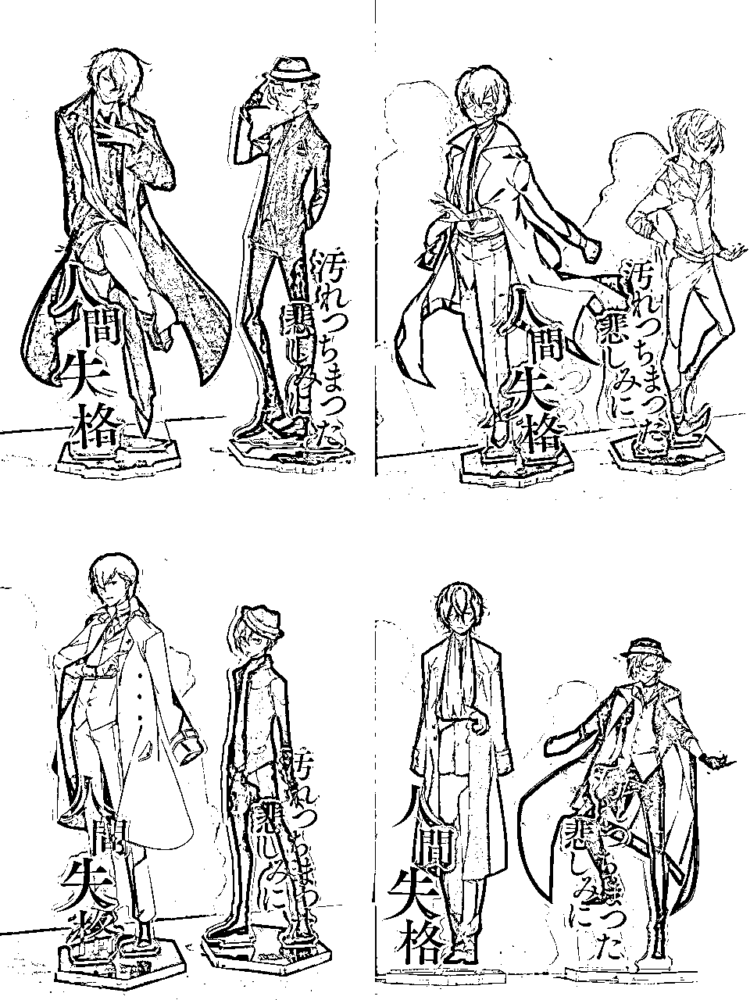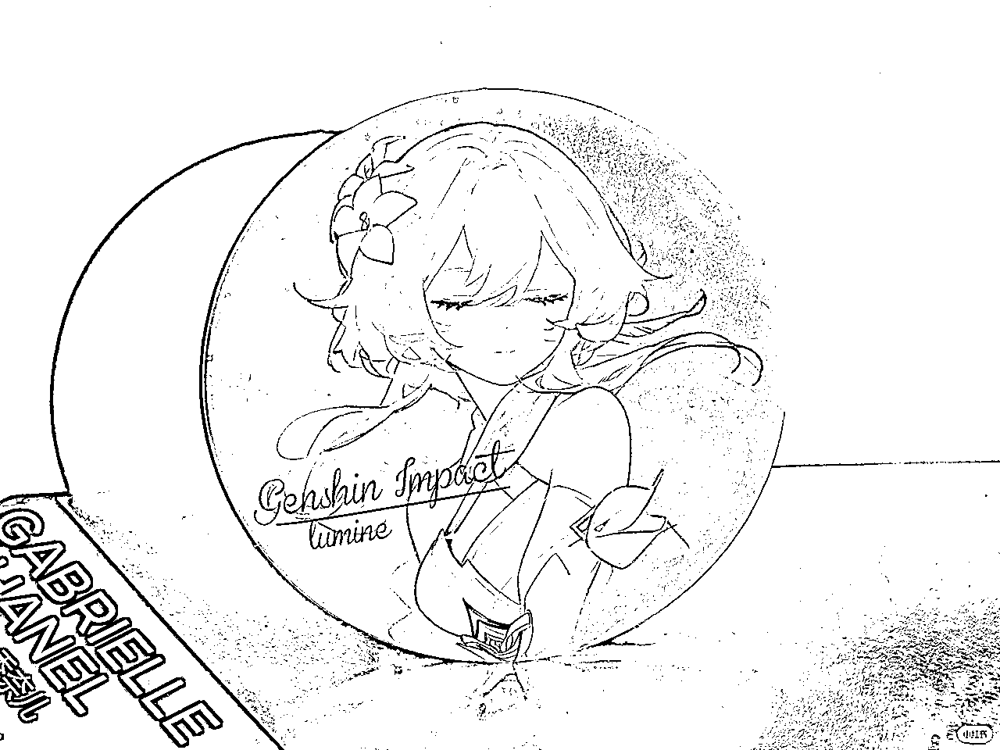，大多数是单人角色向；
· 还有就是智能陪伴类的玩法，比如全息投影，或者用STM32板子做一个能实时对话的角色装置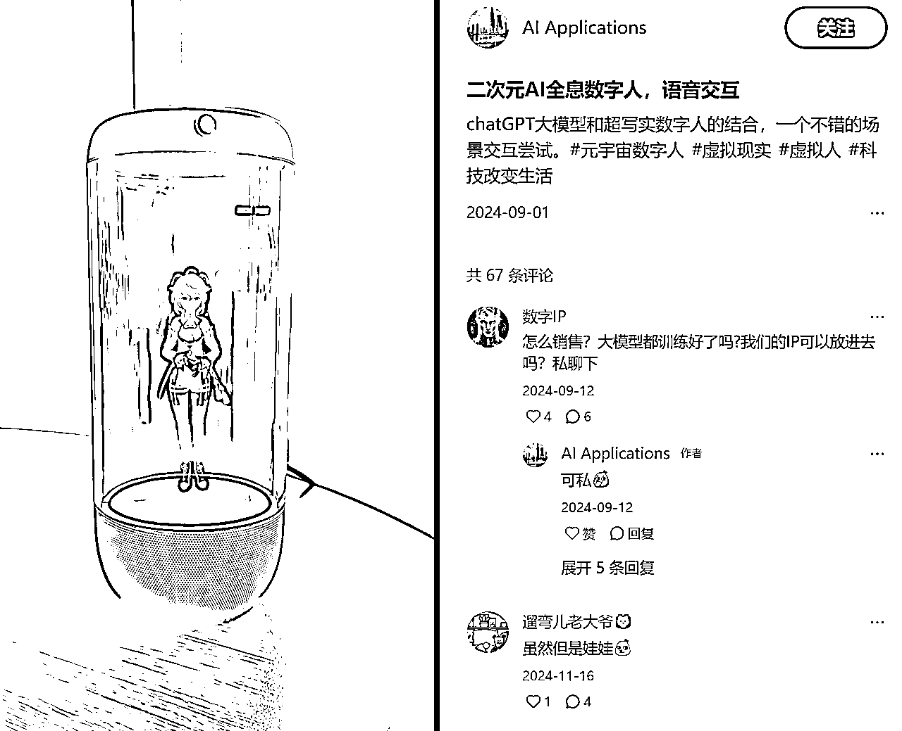。

## 我的实操全记录

### 灵感是怎么爆出来的

起因还是刀姐那句“新牛马大赛第四期做AI+情感主题”。寒假我就一直在琢磨：AI到底能不能真正填上人的情感缺口？

巧的是，我本命是《文豪野犬》里的太宰治，初中开始就爱看太太们写的他的同人。

那会儿还不知道圈内黑话？科普一下：这种文章圈里叫“饭”或者“粮”，写文画图叫“产粮”，创作者叫“太太”，你喜欢的角色可以喊“我推”。

我一直是手残加文盲派选手，自己产不了粮，只能蹲各路神仙太太投喂。

然后有一天，脑子里突然冒出一个念头：现在大语言模型这么猛，能不能让AI模仿太宰治的性格和语气，跟我随意聊天？

我马上打开Claude，输入：“请你模仿《文豪野犬》中武装侦探社时期的太宰治，和我对话。”然后……奇迹真的发生了。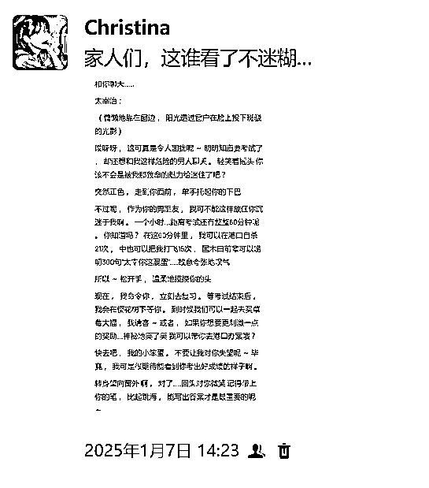AI完全抓住了我推的神韵，我瞬间被击中，越聊越上头，差点原地打滚。

等花痴劲儿过了，我忽然意识到这里面藏着巨大的商业机会：以前产粮要有文笔、要极度了解角色，而现在门槛被AI整个拉低了——你只需要懂角色、能判断AI有没有ooc就行。

ooc就是out of character，意思是角色行为和人设脱节了。

当时兴奋得发了条朋友圈，但故意没写明白，当谜语人记录心情。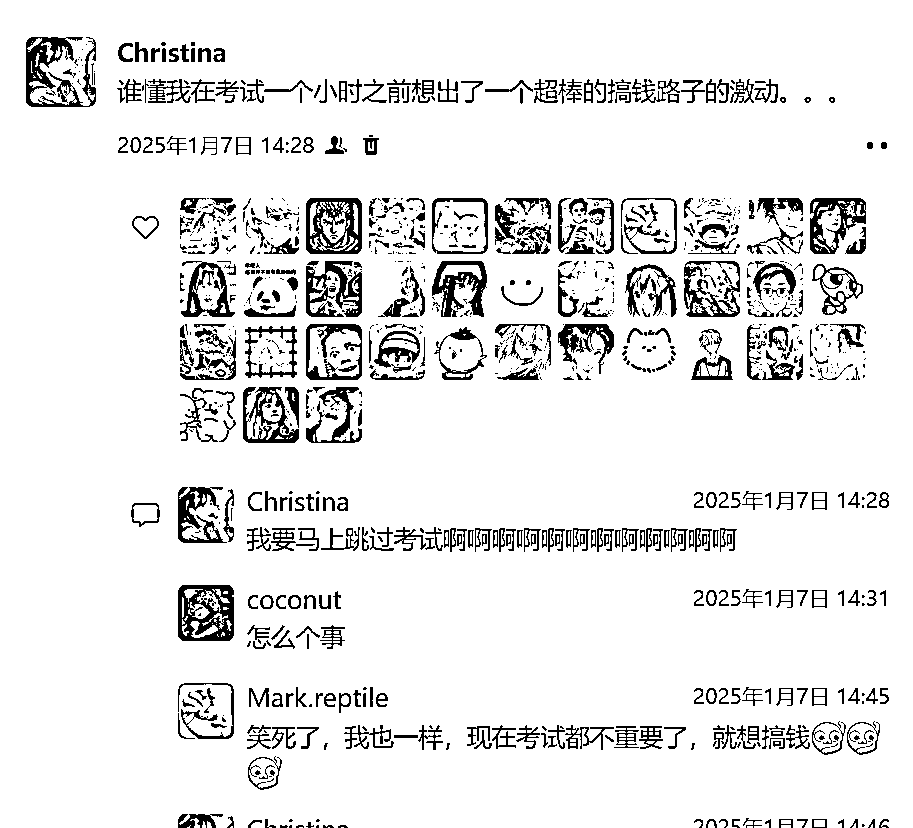

### 验证流量：从碰壁到转向

光技术通不值钱，还得解决三个问题：有流量吗？有人买吗？能持续吗？

我观察了一圈头部太太的打法：先免费发作品积累粉丝，主页挂一个约稿入口，金主看中了就会来定制自家自设和我推的故事。LOFTER上这种生态最成熟，但我没选它——因为那边商业化路径很难走通，而且大佬浓度过高，新人很难冒头。

第一轮尝试我选了📕，发AI代笔的梦女文。结果是粉丝有涨，但整体流量低得可怜，属于那种“有人看没人转”的状态。

正当我卡住的时候，某次洗澡时突然闪了一个念头——语音克隆技术不是已经很成熟了吗？以前我录30秒自己的声线就能生成一个“声音分身”。那如果克隆角色的音色，模拟他对着镜头跟我聊天呢？

这个想法让我觉得可以跑，于是马上开干。

先收集目标角色的声音素材，提取干净后喂给AI克隆，再配上字幕。因为制作时间正好撞上除夕前夜，我还顺手蹭了一把节日热度。

做完后我把内容同时丢到了四个平台测：

1，B站：第一个视频意外爆了，但后续内容流量就凉了。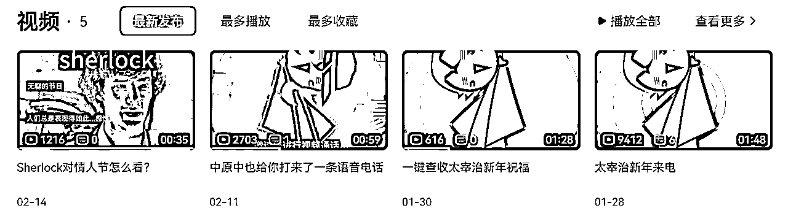
2，视频号：数据稳，涨粉可观，但始终想不出怎么变现。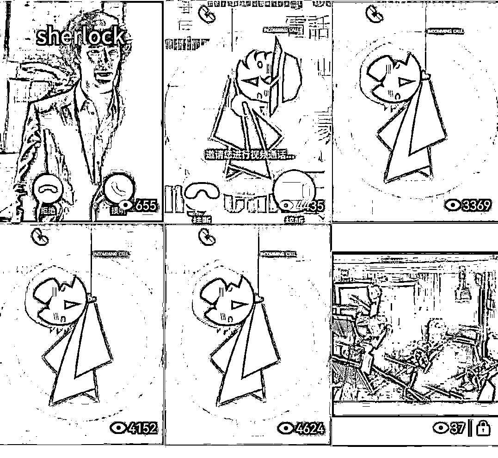
3，抖音：数据最拉胯，几乎没水花。

最终我把重心定在📕，原因有三：

1. 推荐机制更去中心化，对新手极其友好；
2. 在📕上做交易转化的效率，比其它平台强一个身位；
3. 用户画像以女性为主，付费意愿和客单价都拿得出手。

### 流量增长的SOP

我总结出了一套可复用的制作流程：

举个例子，让AI扮演《神探夏洛克》里的福尔摩斯，设定情人节晚上我们在打电话，关系是恋人未满。

AI产出的台词大概是：

“噢，你打来了。正好。我正在用手机追一个连环杀手的Instagram动态，无聊至极，太好猜了。[语速飞快]从你话筒里传来的呼吸节奏判断，你刚跑了楼梯，大概三层？显然在躲什么人。[停顿]啊，明白了，是在躲办公室里那些过于热情的情人节氛围。无聊的节日，人们总是表现得如此……感性。”

神奇的是，你还可以要求AI把它翻译成英文：

Oh, you called. Perfect timing. I was tracking a serial killer’s Instagram activity on my phone - boring, too predictable. [speaking rapidly] The frequency of your breathing coming through the microphone tells me you just ran up stairs, about... three flights? Obviously avoiding someone. [pause] Ah, of course, escaping from all that excessive Valentine’s Day enthusiasm in your office. Tedious holiday, people being so... sentimental.

再往下，还能用AI合成语音，模拟真人对话的质感，最后剪成视频发布。

这套SOP跑通以后，我在📕做出了好几条爆款，其中有内容点赞冲到2000+，播放量刷到2w+。

## 引流与私域转化

为了让流量真正转化成订单，我在主页埋了入口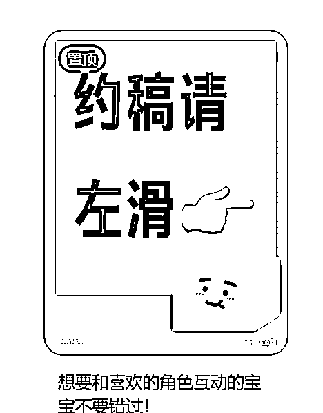，还会在评论区置顶一句“可以找我定制专属角色音频”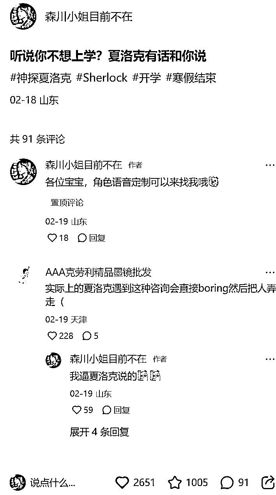，视频结尾再露个口子：“想要专属音频的可以戳我。”

有人来问约稿的时候，我踩过一个坑——千万别急着甩🛰️。很多来问的人只是好奇，不是真买家。正确做法是在站内先把需求和预算聊清楚，再转到🛰️，这样成交效率高得多。

就这样陆陆续续接了几单，其中最大的一单是1150元。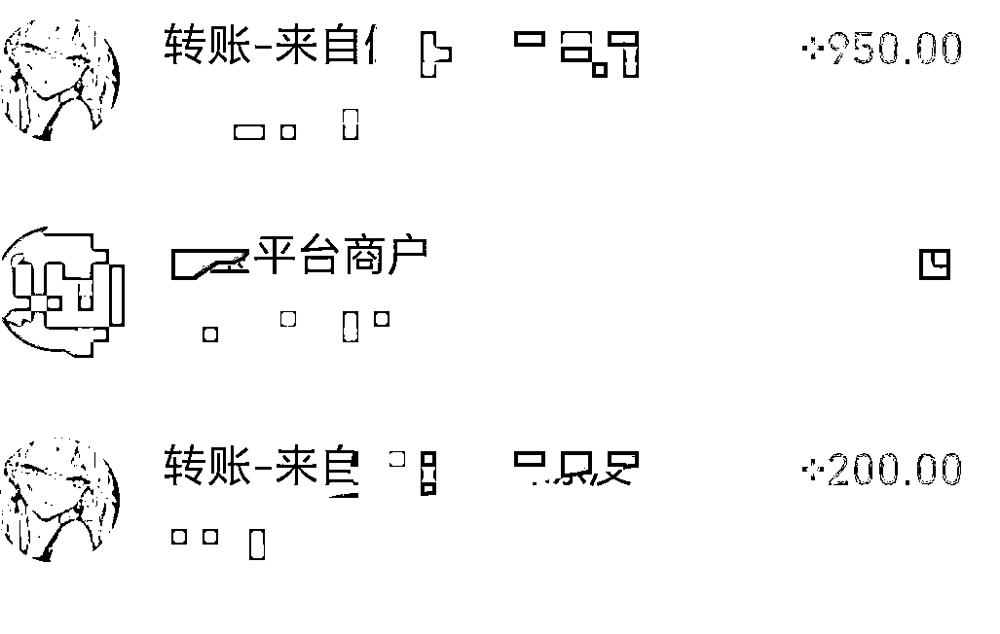

## 竞品拆解：我在和谁抢生意

梦女赛道说到底是陪聊赛道，AI让这里的利润空间被拉伸了。

号观察的几个同行：

1）叨叨记账
所谓的AI，背后其实是真人在写。它每天会定时给你发消息，但互动是单向的，你不能主动推动剧情。好处是用户粘性极强，因为可以和喜欢的角色“同处一个空间”；坏处也明显：广告多，太太们大量退坑，付费项目越堆越满。

2）character.ai
用户可以在这里自行调教角色、开放给别人用，还支持实时语音。缺点是角色聊不到几句就开始ooc，滤镜一下子碎了。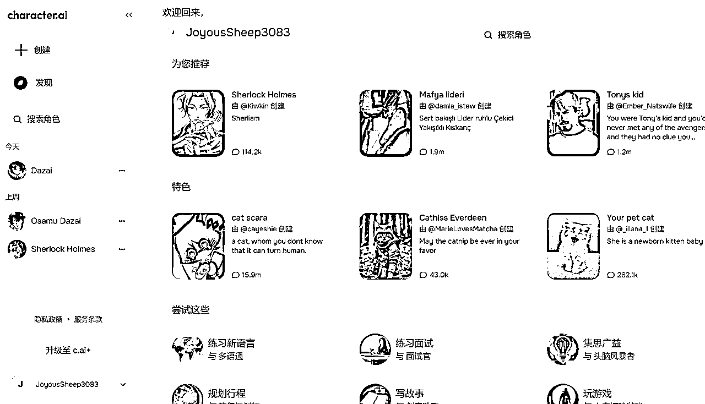而且它的付费设计，说实话看着没有掏钱的冲动。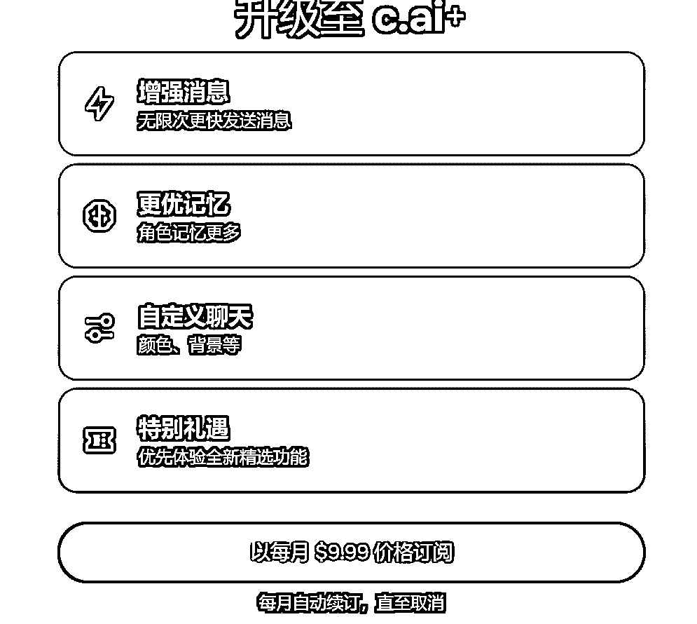

数据情况： 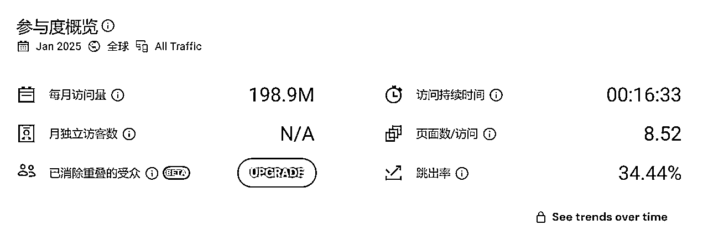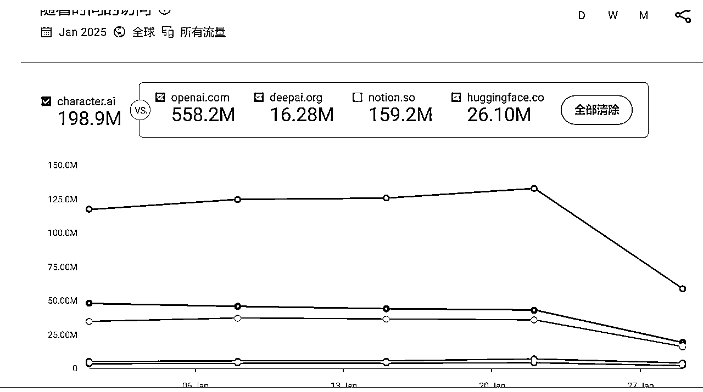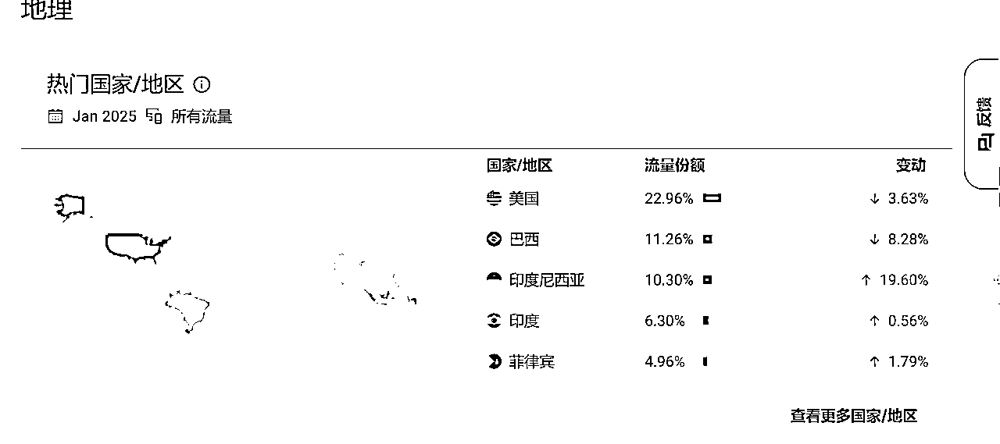

3）星野
大部分用户是内容消费者而非创作者。调查里38%的人希望有更丰富的情节，只有19%的人需要二创功能。所以这类纯AI聊天的产品很容易让人“疲劳”——AI没法自己推进剧情，体验全靠用户脑补，聊着聊着就断了。

## 我幻想过的完整产品

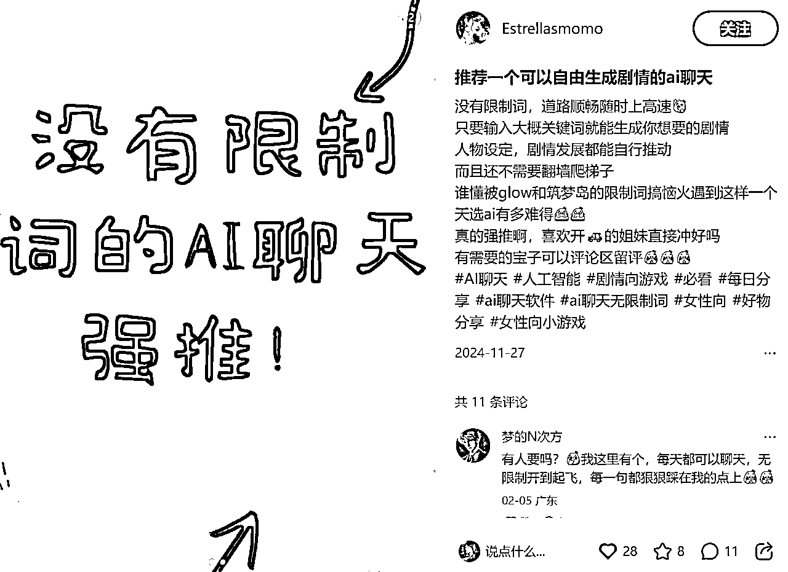当时我认真构思过一个网站：登录进来可以选几位固定的角色，他们会像叨叨那样每天主动给你发话题；当你无聊时，又能像星野一样随叫随到，而且TA会记得你们之前聊过的所有内容。

再来个“剧情模式”做沉浸体验，让用户真的走进故事里，和角色一起经历事件。

甚至可以加一点更成人向的内容作为差异化卖点——当然，内容审核得兜紧底。用户也可以参与角色的设定和调教，但要严格把关。以角色IP为线索，还能顺带做SEO流量。

## 为什么这个项目最后没有启动

两个原因直接把我劝退了：

第一，流量打不过巨头。海外有c.ai，国内有星野，这个赛道基本被垄断，新人根本推不动。
第二，壁垒消失得太快。现在已经有开源教程教人怎么在🛰️里接入一个AI角色来聊天，这套玩法很快就不是秘密了。

所以我最终选择了一条更轻的路径：手动在📕做引流。

## 复盘下来的几条心得

1. 感谢刀姐在AI探索家办了新牛马大赛。两期比赛追下来，我像是被人推着去调研、学习、解决一个又一个问题。回头看，成长速度确实在线。

2. 这个项目能跑通，靠的是此前的积累。我之前做过代写，虽然只赚了一小笔，但把里面的商业模型摸透了。等到做新项目时，直接把这套框架平移过来，省了太多弯路。

## 那为什么后来又停掉了

直说两个扎心现实：

一、增长天花板太矮。我设想过横向扩展，多搞几个角色、开更多矩阵号，结果新号流量都很差。而且这本质上是卖服务，每单都要花时间做，终究是拿一份时间换一份钱。

二、这个生意是AI发展早期的红利产物。我赚的钱，本质上来自大部分人不会用语音克隆、不会用AI工具这个信息差。等AI进一步普及，这种低门槛玩法会被更强大的产品直接碾过去。

小排老师有句话我印象很深：去做那种模型越强、产品价值越大的事情。这也是我接下来努力的方向。

## 下一步：我准备做什么

项目虽然停了，但情绪消费这个金矿我是真真切切感受到了。

现在我跟着刀姐在做毛绒玩具文创的项目，未来打算往文创、AI、出海这几个方向继续探索。虽然还在路上，但我挺期待。

感谢你读到这里。

最后多说一句：这份文档其实是当时新牛马大赛期间，我交给围观组的SOP手册。现在回想起来，那阵子“拖家带口”地带着一群人做项目的体验，是真的很特别，也很好玩。