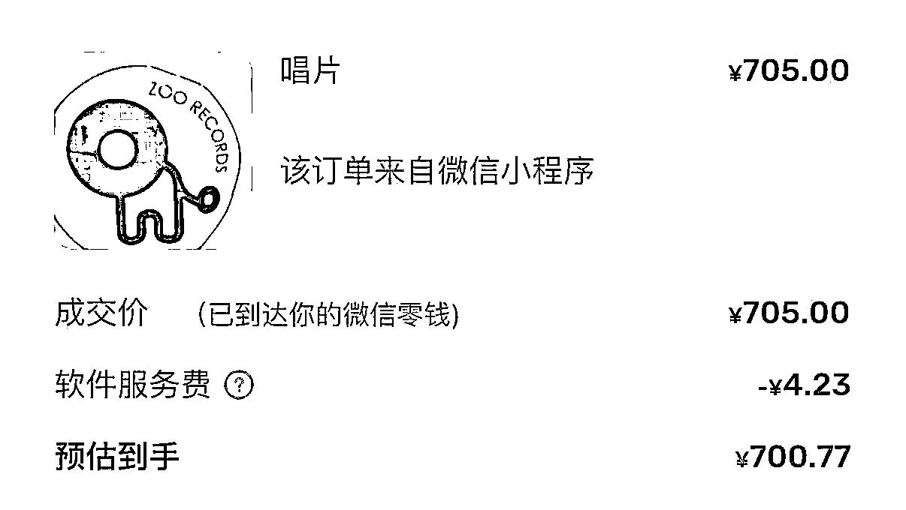
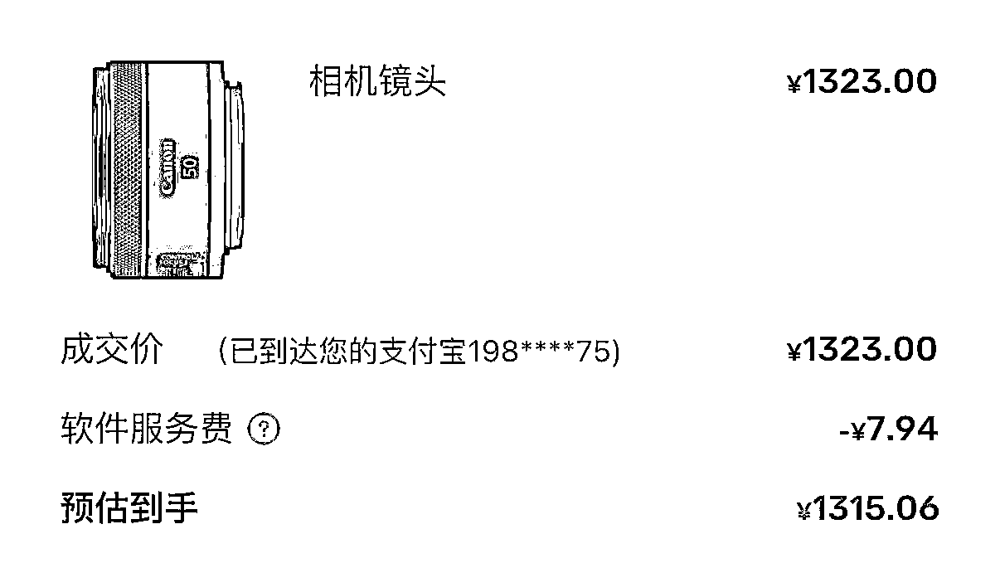
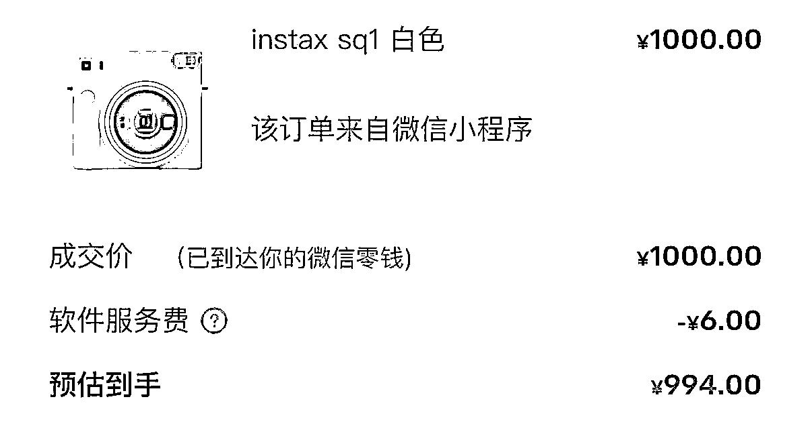
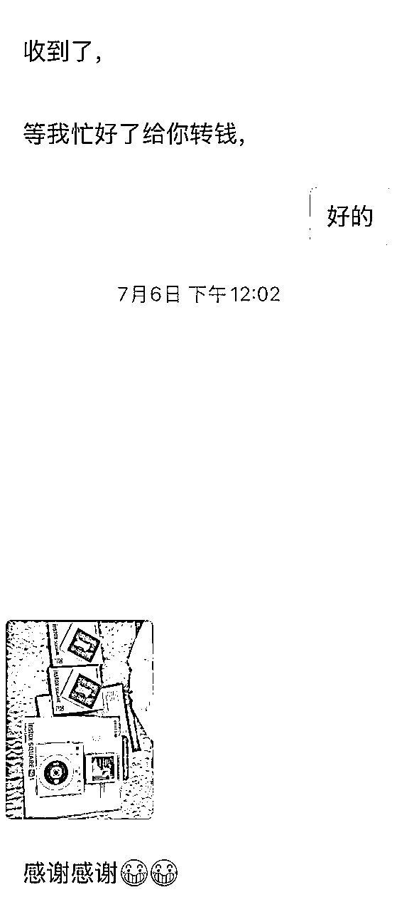
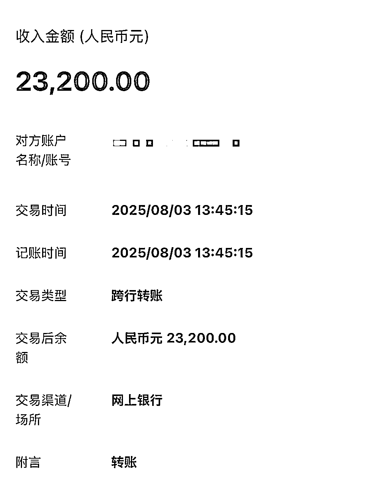
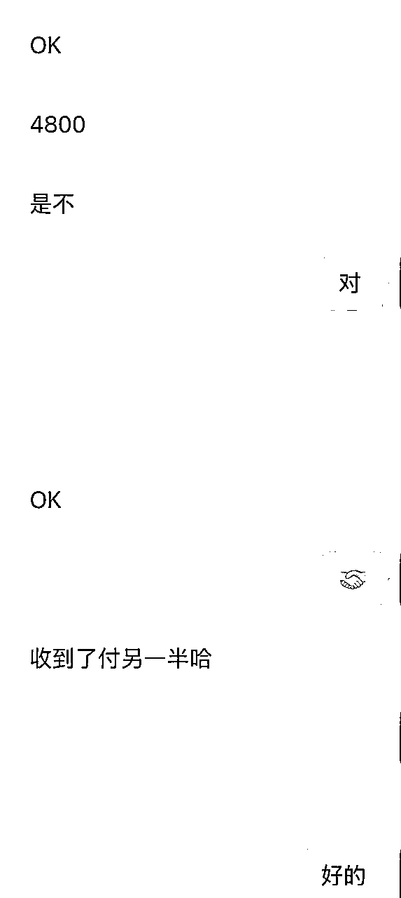
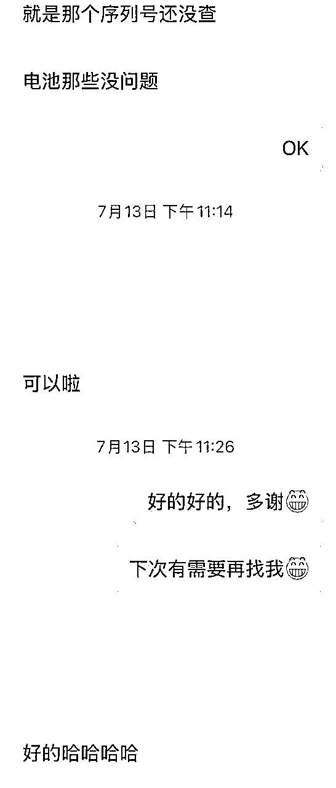

# 2个月、每天2小时，📕香港代购月净赚1.5万+：一个普通人的实操复盘

大家好，我是花岗岩，平时就喜欢琢磨怎么把空闲时间变现，找第二增长曲线。最近跑通的一个小项目，跟大家复盘一下：

1、📕做商单号，从零搭建，12天完成起号，粉丝破2万；
2、📕虚拟产品，一周0到1跑通，现在在矩阵放大，主攻公考上岸；
3、📕挖需求做中介：二手房转租累计佣金5K+，香港代购月均净利稳定在15000+；
4、深圳周末线下组局，搞了一系列爬山、烧烤、骑行交友活动，口碑不错。

【我能分享的资源】
1、普通人做📕商单、📕店铺的起号经验
2、深圳南山大冲周边高端小区租房信息
3、清北复交人等高校优质单身社交圈层

### 一、怎么发现香港代购这个机会

做香港代购纯粹是偶然。朋友在香港上班，经常深港两地跑，一次吃饭聊天时随口说：这来回路费本身就花钱，能不能顺带捞点回来？

我之前正好做过📕商单、虚拟课、帮人转租，对平台的流量逻辑和规则比较熟。当天就去📕搜了“香港代购”“求带Switch”“香港值得买”“港深通勤”这些词。

一搜傻眼了。拍立得相关帖子讨论度极高，首页刷出一堆求代购的笔记，评论区里十几个人在问能不能带。对比价格后发现，香港同款比内地便宜不少，信息差直接就出来了。这不就是典型的二道贩子玩法吗？

吃完饭就定了方案：我负责前端接单引流，朋友负责去香港人肉带回，吃的是两地价差。项目门槛低，上手快，需求稳定。除拍立得外，后来还接了相机、镜头、相纸、唱片等各类商品，甚至帮忙收寄。客户先付定金再采购，零囤货、零启动成本，回头客越来越多。

基本数据：
📱账号：1个📕号
💰月利润：15000+，月均约7500，单价几百到几千不等
📅周期：从6月16日开单至今
🧭平台：📕，留言私信的长尾效应很强，有时小号留言很久后还有人来找
🧧盈利方式：吃香港与内地的差价，朋友带货，客户定金制启动，零库存风险

部分成交截图如下：

### 二、账号怎么起、客户怎么来

准备期：包装+找标杆

开号前先把信任感搭起来。
账号简介我写的是“每周五港深往返，靠谱不赚黑心钱，询价私信”，看起来实在。用小号去刷“香港代购”“深港通勤”相关内容，找同行账号做参考。粉丝不多但评论区求带声不断、笔记风格统一的账号基本就是对标对象。练号1-3天，主页就能被相关内容刷满。

执行期：每天2小时的获客打法

核心就三件事：发笔记、刷帖留言、私信转化。

发笔记保持频率，每天5篇左右。图片组合是：3张香港街景+2张通勤凭证如高铁票/通行证+2张实拍采购+2张客户好评截图，轮换着发，信任感拉满。

刷帖用关键词“求香港代购”“香港能代买什么”，看到求购就跟帖：例如“每周五回深，可带，刚帮人带过同款xxx”“可拍采购视频”。提高可信度。

私信话术直接：发主页截图，说明能带、价格区间、附小票。每天每个号私信10条左右。

第一单是第二天拿下的。有个女生想带一台mini12，确认型号价格后转定金。收到货满意后，咨询量开始稳定在每天2-3条。

### 三、用咸鱼撬动异常值，利润直接破万

前期代购相机、相纸等，月利润大概3000-4000，靠长期客户稳定。

真正破万的是抓到一个异常值。

为了交易安全，我们基本走咸鱼。有一天在外散步接单，上架一个刚到的商品，瞬间来了5个咨询。成交一单马上补一单，后台还在不断来问。过去在赚钱混久了，这种异常信号太明显了。

回家立刻对接客户。当时排队的有13个，其中一个客户直接说有多少收多少。查了📕热度，发现香港正好在做活动，价格远低于国内电商，评论区也在求购。即使对方吃不下全部，我也能自己消化。于是很快定了30台，隔天又下几十台，前后累计约100台，利润稳稳落袋。

### 四、客户运营：做好复盘提升复购

下单后我会先记录好型号、数量、行货水货、售后要求。朋友在香港采购时会拍实物图和小票。通关后当天发出，快递单号同步给客户，并提醒后续问题随时找我。

目前累计客户约30人，核心老客5-6人，会复购也会介绍朋友。

### 五、避坑和可复制SOP

⚠️坑点提醒
海关规定一定要先搞懂。早期一次带拍立得被拦，超过自用数量，货被扣了2小时，差点导致客户退单。不要带违禁品，不要超量。
商品属性要问清。电子产品分港版行货水货，价格不同。护肤包包还涉及正品高仿，目前我还没碰。

可复制流程
主页包装：3街景+2通勤凭证+2采购实拍+2好评截图，简介突出靠谱+定期往返。
获客时间：每天19-21点固定刷帖，关键词“求代购”，留言用“刚带过同款”“可附视频”，私信直接报价。
客户维护：成交后当天发采购图，到货后跟进使用情况，给老客户打标签，提升复购。

沉淀资产
客户🛰️是最值钱的，我按“数码党”“学生党”等打标签。📕模板可复用，比如每周五发“今日过关，可带急单”，配通关现场图，评论区自然有人问。

门槛总结
会刷📕、会打字聊天就能做，不囤货、客户先付定金、每天1-2小时，学生、宝妈、上班族都能兼职。

### 最后说一句

我在赚钱待了段时间，一直在📕上试错。代购这个项目天花板不算高，但正反馈快。反正刷手机也是刷手机，留言几个帖子、私信几个博主，成了就是零花钱，不成也没成本。有想交流的欢迎私聊，我知无不言。

这篇复盘是在赚钱好事分享后被三七鼓励写的，感谢鱼丸、七天、楞楞帮忙审稿。感谢赚钱，帮我找到方向，知道只要在牌桌上，就有机会赢。搞钱没有我想的那么难，也没有想象中那么简单。期待下一阶段的突破。