# 从0到1实现百倍业绩，📕变现实操全拆解！-哈默
作者：龙哥

📕的商业价值正被低估，接广告也好做私域也罢，都能让生意直接起飞！

如果你对📕的底层打法还一知半解，那太多红利正在从指尖溜走！

为什么是我来讲？先做个自我介绍：

我是龙哥，服务过世界500强的新媒体培训导师，已出版3本新媒体著作，自媒体深耕10年，🧣、豆瓣、今日头条、知乎、抖音、📕、视频号全平台都做过，且都拿过结果。比如，2017年度教育头条号、🧣教育头部账号、抖音单条播放量2800万+、📕涨粉榜登顶等等

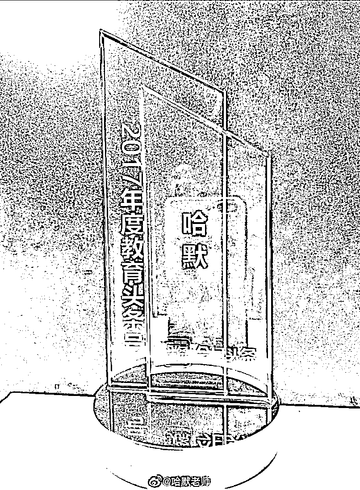

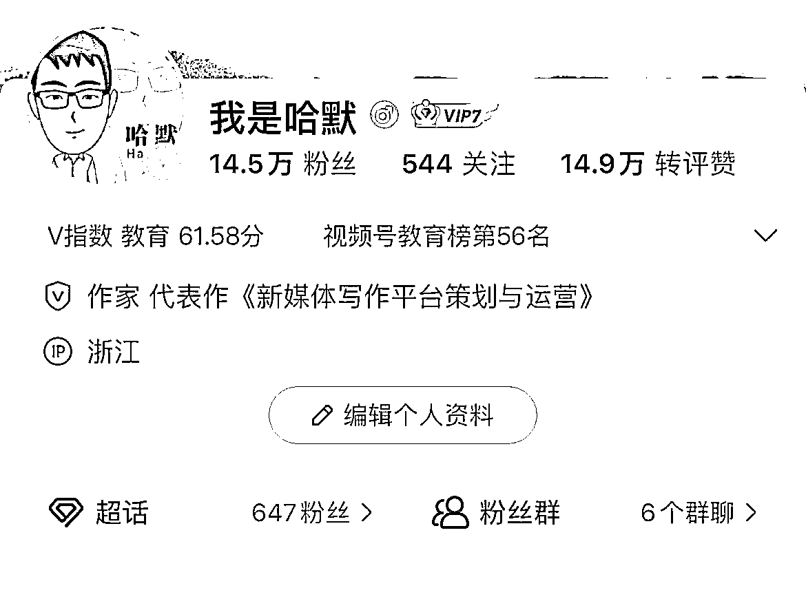

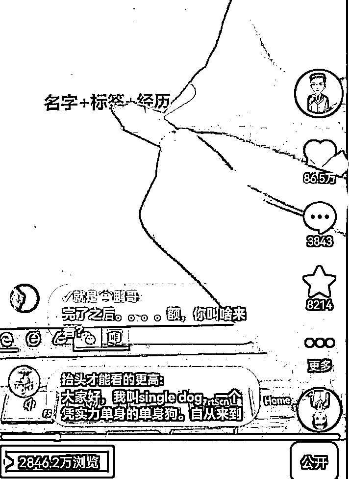

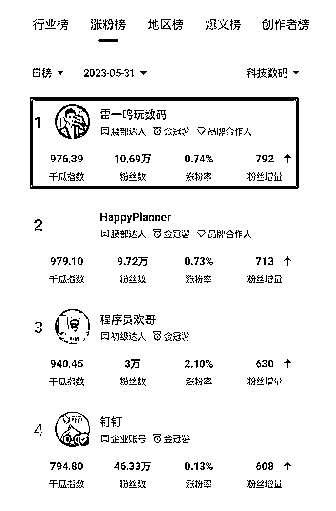

2017年度教育头条号 🧣教育榜56名 抖音单条播放2846万 📕涨粉榜第一

除此之外，我几乎验证过市面上主流的自媒体商业化路径，比如知识付费招募近万人、线下培训单场1200人、首本书加印9次、创办新媒体公司等等

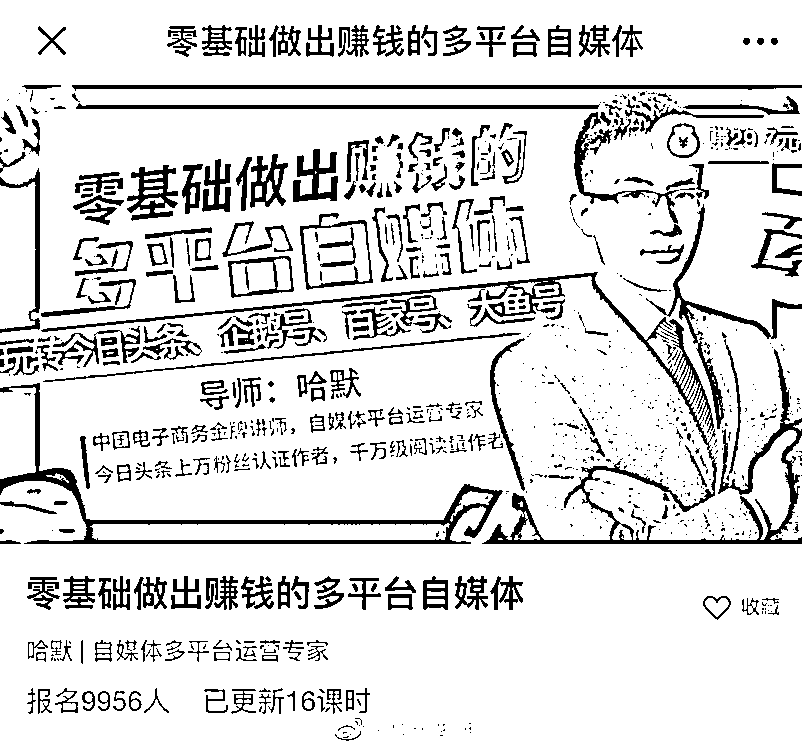

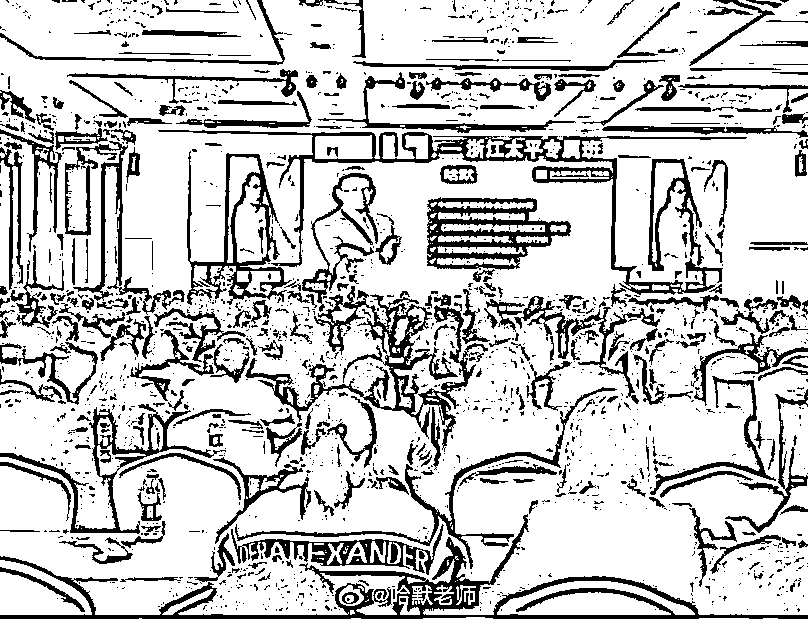

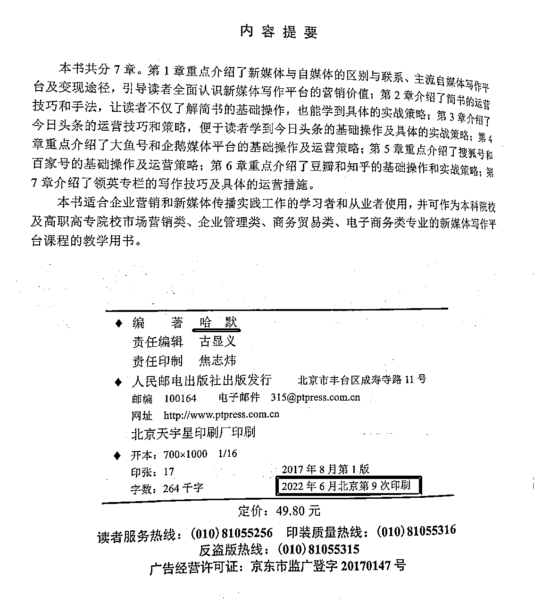

单门课接近1万人报名 线下课单场1200人 第一本加印9次

分享这些不是为了证明什么，而是想告诉你，我用10年实战沉淀下来的经验是负责任的：📕真的处于红利期，是迄今为止最优质的平台，甚至零基础的小白只要肯投入，都能实现盈利！

这次关于📕高效获客的方法，我会围绕4大核心展开：

1.  📕两大主流账号的底层逻辑
2.  从零开始，如何快速搭建📕变现闭环？
3.  📕三位一体模型：产品-流量-转化
4.  📕导流到🛰️的完整路径指南

# 一 📕两大主流玩法的底层逻辑

从账号属性看，📕分个人号和企业号；从功能属性看，主流其实只有两类：广告变现号和引流变现号

## 一）📕和抖音、视频号的本质差异

剥开产品形态和创始人背景不谈，📕与其他平台最大的不同在于：它把最终决策权交给了用户！

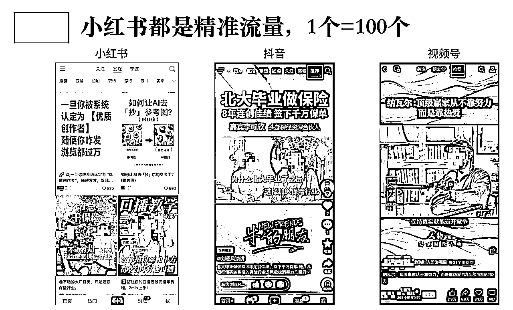

从展示形式就能看出：📕是四宫格瀑布流，无论是推荐还是搜索，都是用户主动点进来的，每一次阅读都是带着明确兴趣和真实需求的精准人群。

抖音靠的是强算法推流，平台主动投喂内容；视频号则是【社交关系+算法推荐】双轮驱动。

各平台的核心壁垒也由此显现：

抖音最强的是算法，能在20条视频内抓住陌生用户兴趣，形成依赖；

视频号最强的是社交，算法加持下更易预测兴趣，让人上瘾；

📕则不同，算法和社交都不占优，它把选择权交给用户，用主动点击投票来反哺算法，让用户主动爱上平台。

所以抖音是算法驱动型，视频号是社交驱动型，📕则是【用户主导的社区型平台】

正因如此，📕的流量都是高品质流量，甚至1个阅读的价值堪比其他平台的100个阅读

## 二）📕流量的两大核心来源

打开任何一个APP看首页布局，就能大致判断流量结构

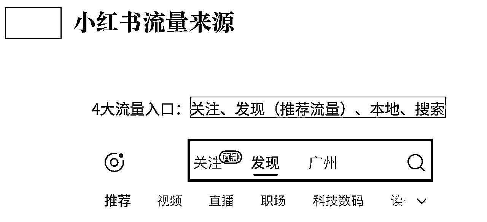

📕表面有4大来源：关注、发现、本地、搜索。而拆解过万阅读笔记后会发现，真正起决定作用的是：推荐流量+搜索流量。

例如左图推荐流量占比95%，单篇阅读7.8万；右图搜索流量占比94%，单篇阅读2.2万；

只要你能稳定拿下其一，笔记爆发的概率就会大大提升。

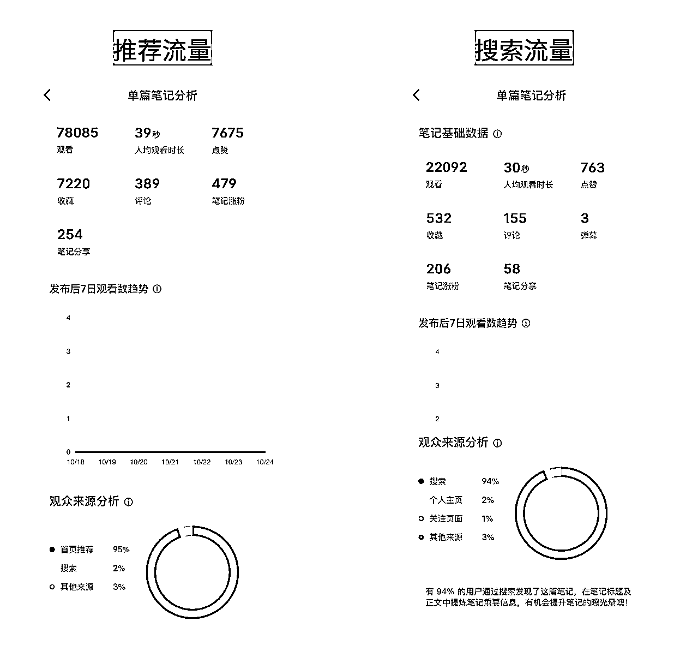

那问题来了，怎么拿下推荐和搜索？

1）推荐流量的本质是【行为设计学】：坊间说📕推荐逻辑是CES评分，官方未公布，但核心是设计用户的【点赞+收藏+评论+转化+关注】行为，用行为反馈告诉平台这条内容值得推。想玩转推荐，建议去看《行为设计学》这套书，如图

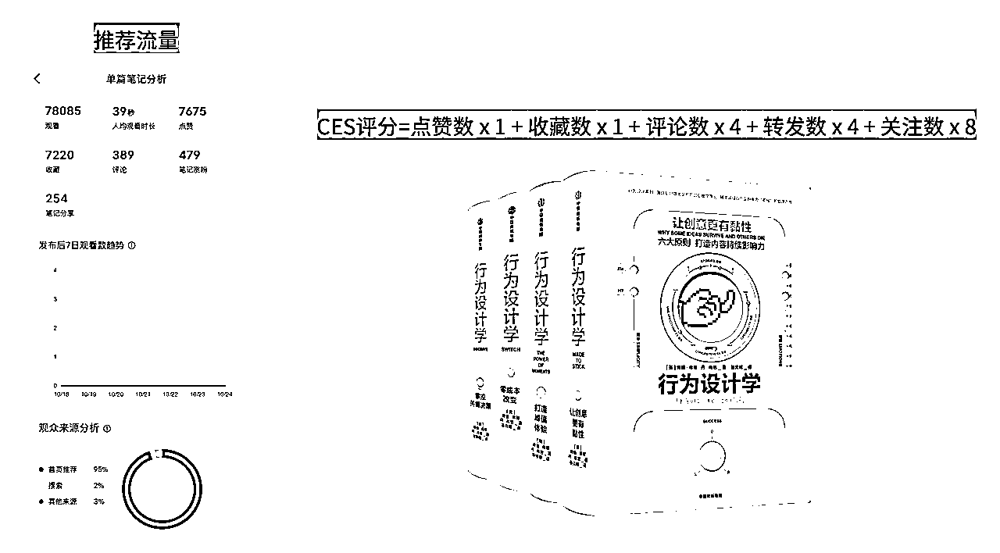

2）搜索流量的本质是【关键词卡位】：可借助官方工具【📕聚光平台】查询关键词搜索指数，从而确定卡位词，如图

（备注：📕聚光平台需认证蓝V企业号，认证费600元。链接：https://ad.xiaohongshu.com/aurora/home）

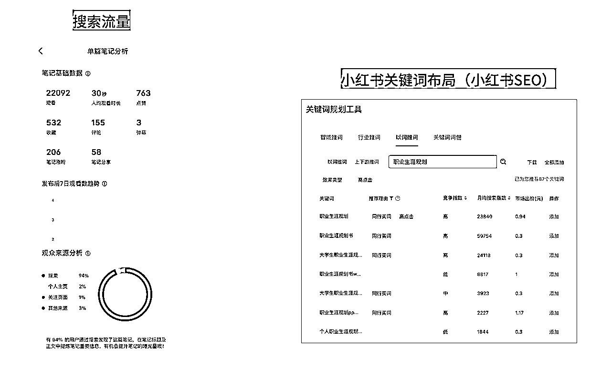

## 三）📕两大主流玩法的底层逻辑

### 广告变现号

我们公司本身是新媒体广告公司，核心服务品类是【数码家电】，服务了国内90%以上的头部数码家电品牌，比如京东、拼多多、天猫、vivo、OPPO、苹果、格力、海尔、美的、TCL、苏宁易购、老板电器、联想、方太、海信等

这些客户资源的来源，都是我们孵化了一批又一批【📕数码家电账号】，如图是2022-2024年的账号矩阵：可复制、可自孵化、可矩阵化

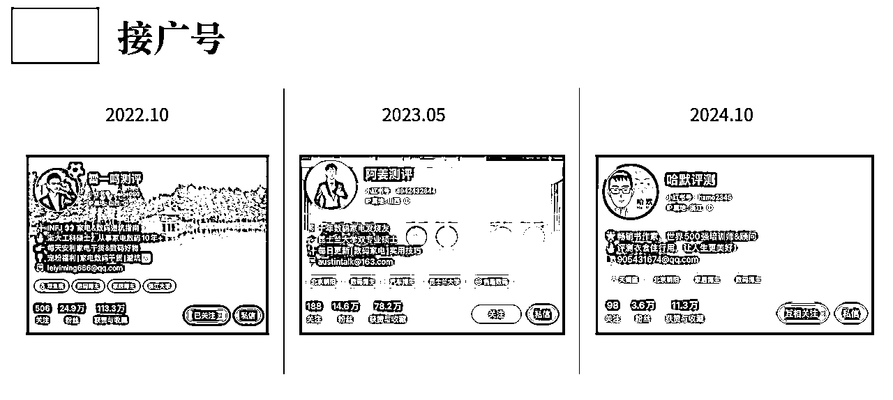

比如2022年10月我们才开始做数码家电账号，就经常霸榜，还受邀参加明星活动

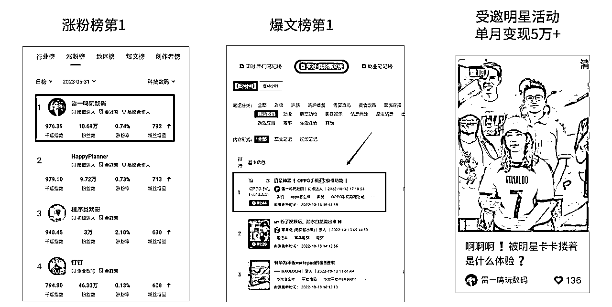

而且变现效率极高：2024年我亲自出镜做的【哈默评测】，起号一个月就开始接广告：单月接16条，单月变现3万+，如图！后面我会详细讲快速接广告的方法！

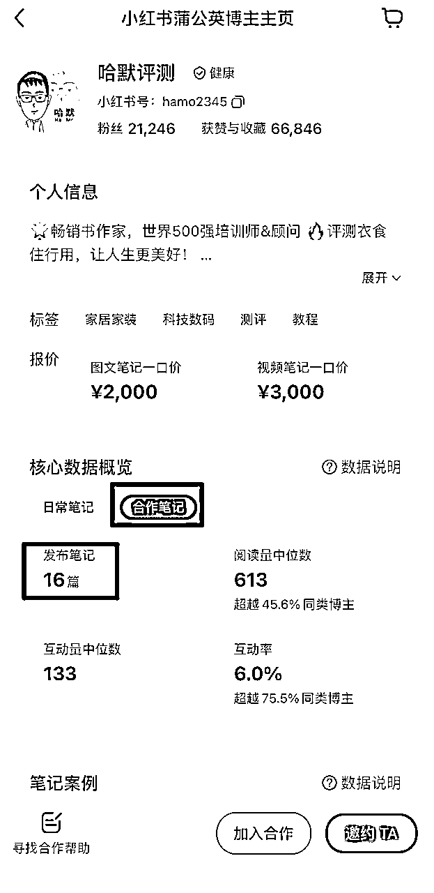

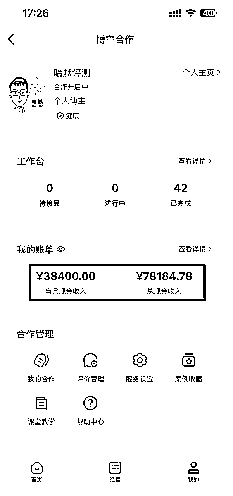

### 引流变现号

引流号就是把用户导到🛰️私域完成成交。如图是我自己和辅导过的案例，引流效果都相当不错，后面我会详细拆解引流玩法和商业路径。

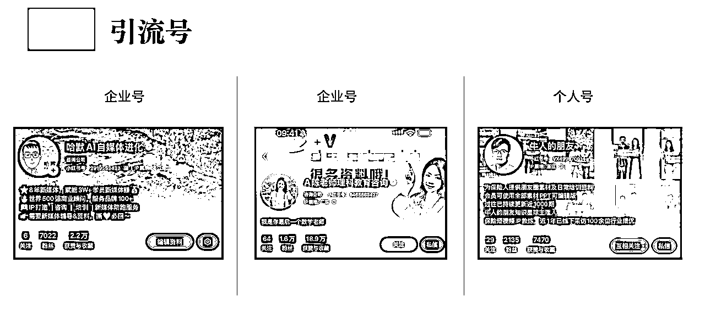

📕用户质量很高：我们曾单篇笔记引流500+到🛰️，并售卖顾问服务，客单价成交10万+！如图。

在📕做引流，必须打磨好产品和内容，才能发挥平台的独特优势！

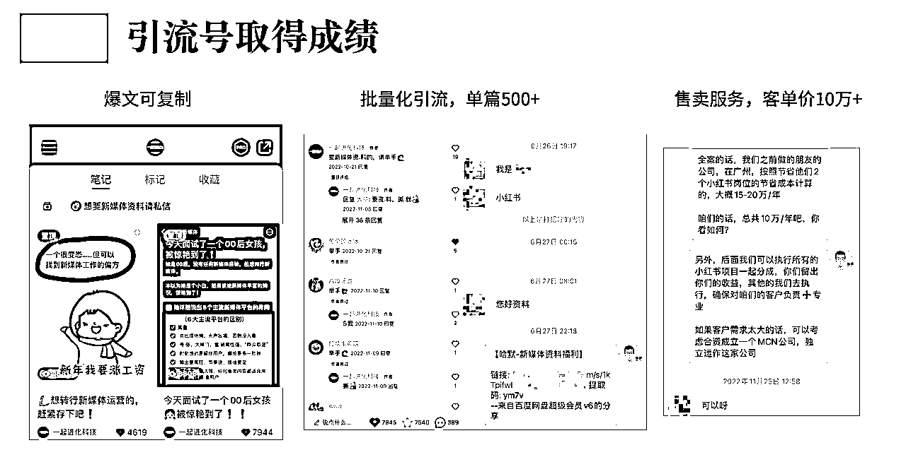

### 广告号和引流号怎么选？

先看2024年下半年我做的【哈默评测】，半年发了82篇笔记，接了53条广告，接广率65%；且客户都是数码家电大牌，如图vivo和老板电器。

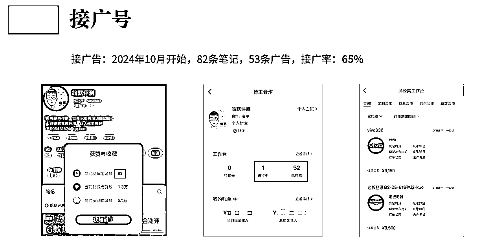

账号粉丝只有3万多，为什么广告这么多？因为📕是种草平台。下图是京东投放博主数据，93.42%的博主粉丝都在5万以下，如图。

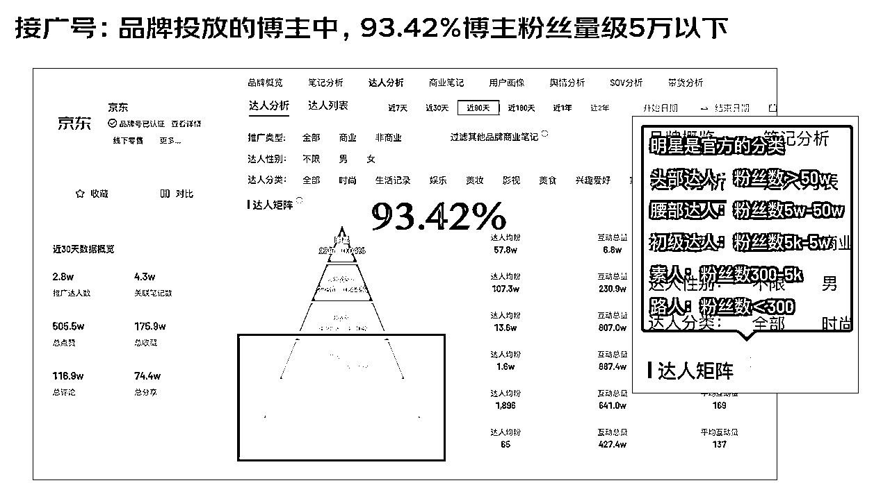

结合我们自身账号和头部品牌项目经验得出：在📕，粉丝1-10万的博主，报价在1000-10000元区间，是品牌最爱接单的体量，且很多账号月接10条以上。

接下来详细拆解两大账号玩法：广告号和引流号

#### 1）广告号：赛道决定生死

看两个账号，如图

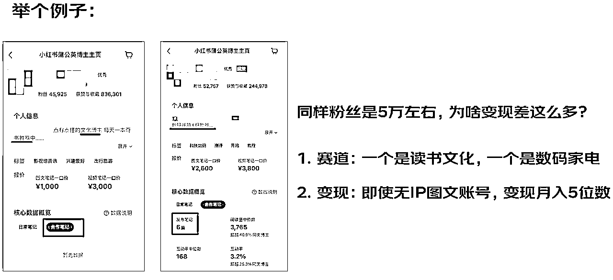

粉丝量都在5万左右：左边是读书文化真人出镜号，右边是图文无IP的数码测评号。左边一个月0广告，右边一个月变现5位数。

是能力问题吗？不是！

我做数码家电前也做过个人成长博主，一年多0广告；转做数码家电测评后，一个月就开始接单。区别就在于赛道，数码家电是接广告的天选池

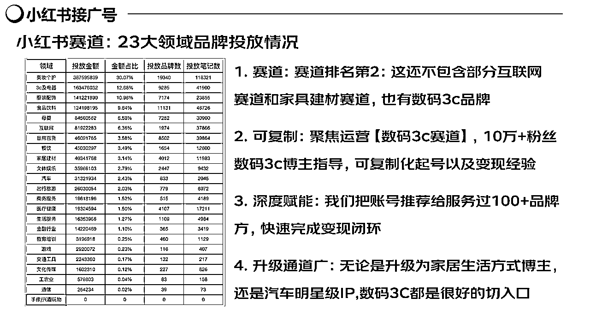

我统计过📕23大赛道的品牌投放情况，如上图：

前5大赛道占据了绝大多数投放预算，选择非头部赛道很难接到广告，因为品牌方没预算。

在23个赛道里，【3C&电器】排第2，都是硬通货品牌；且延展性极强：女生可延展家居生活方式，男生可延展汽车。

所以想接广告不知道选什么？直接选数码家电！

很多人觉得数码家电是男生赛道，其实不是：数码家电包含大家电、小家电、数码手配三大类，在官方月报里都归属【3C行业】，女生完全可以做大家电、小家电。

当然美妆个护是第一赛道，但门槛低竞争激烈、报价低；没有明显偏好就优先从数码家电起步。

如何做到月接10条以上？核心是【以终为始，提前占位】

比如用【📕蒲公英平台】查看同行接单情况，如图，我看到同行最近在接咖啡机、净水器、洗烘套装、按摩椅广告，我就会先拍一条净水器内容，告诉品牌方我擅长这块，欢迎投放。

（备注：开通蓝V企业号后可用该账号扫码登录蒲公英平台查看接单情况。链接：https://pgy.xiaohongshu.com/solar/pre-trade/home）

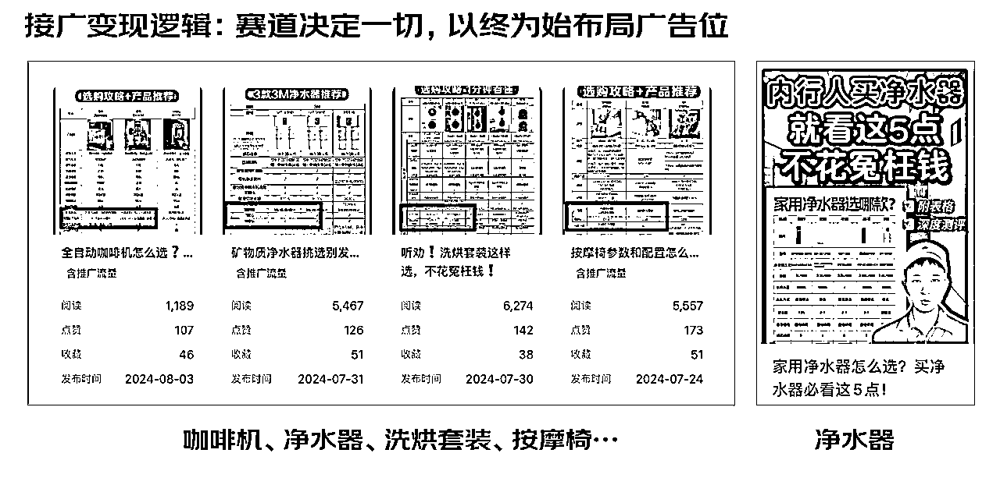

更新频率怎么把握？广告号在广告多时，甚至可以不发日常笔记照样跑。比如图里这个博主一个月发9条全是广告，日常内容几乎为零。

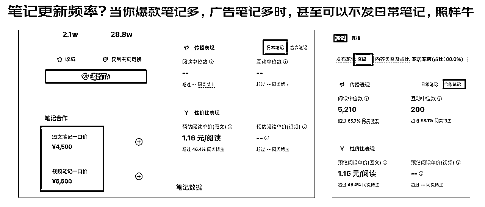

【广告号的核心认知】

1.  选对赛道大于一切，优先头部5大投放赛道
2.  以终为始，提前布局广告位
3.  更新频率不是关键，关键是广告量
4.  爆款是接广告前提：单篇点赞>1000
5.  阅读量>1000，点赞>100为接广告基准
6.  报价参考：粉丝数/10，可因赛道和内容质量溢价

#### 2）引流号：阅读量不重要，精准才重要

看我们自有账号：你难以想象，单篇阅读量常年不过10，店铺商品照样卖得动。单账号卖出知识星球会员220+份，星球总会员已超2000人，如图

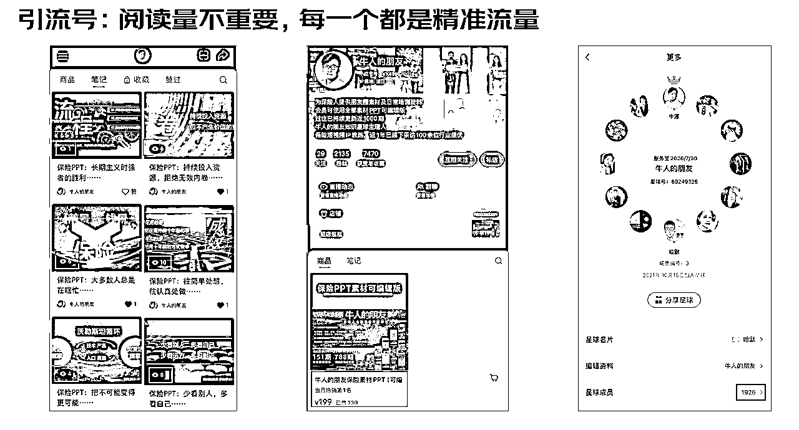

引流号别盯阅读，要看私信、评论和成交。如图我们引流号的评论区，清一色都在要资料

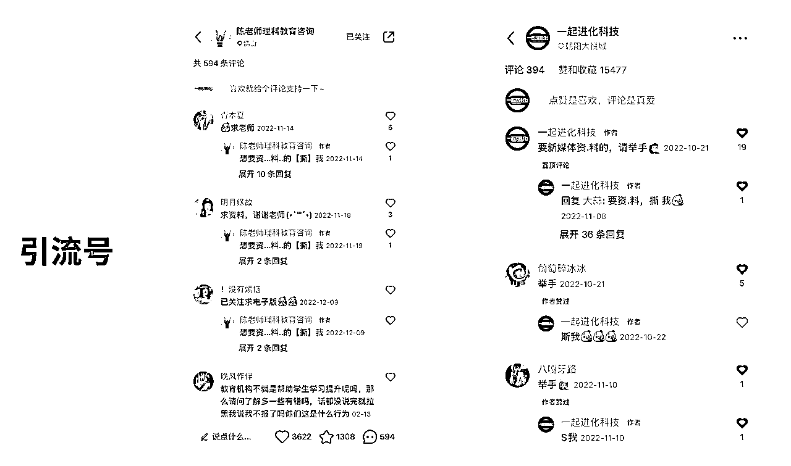

在📕，笔记可分为爆款笔记和引流笔记。如图两条笔记，哪个是爆款哪个是引流？

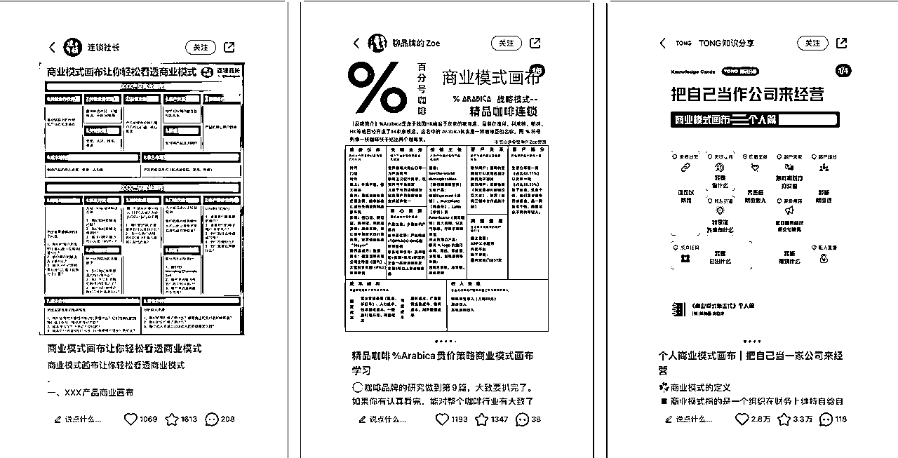

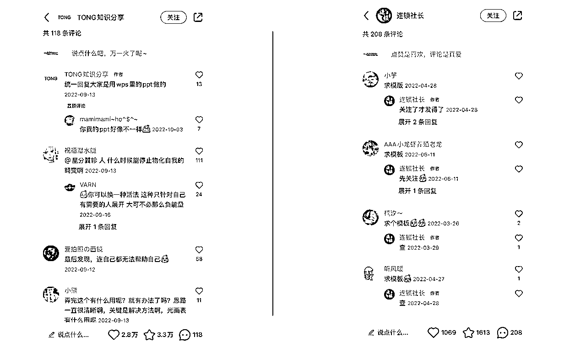

点开评论区看：左边2.8万赞，评论在讨论干货，属于典型爆款；右边仅1000赞，评论数反超，且全是“求模板”，这就是典型的引流笔记

很明显：左边是爆款，右边是引流

为了方便判断，我给两者定了基础数据标准，如图：

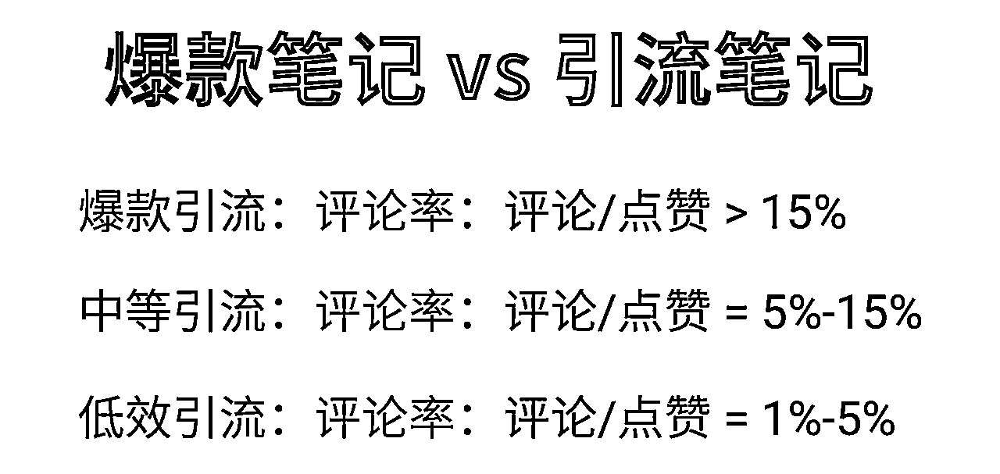

所以，做广告号要盯爆款，做引流号要盯引流笔记

关于【📕两大主流玩法底层逻辑】做个小结，方便查阅！

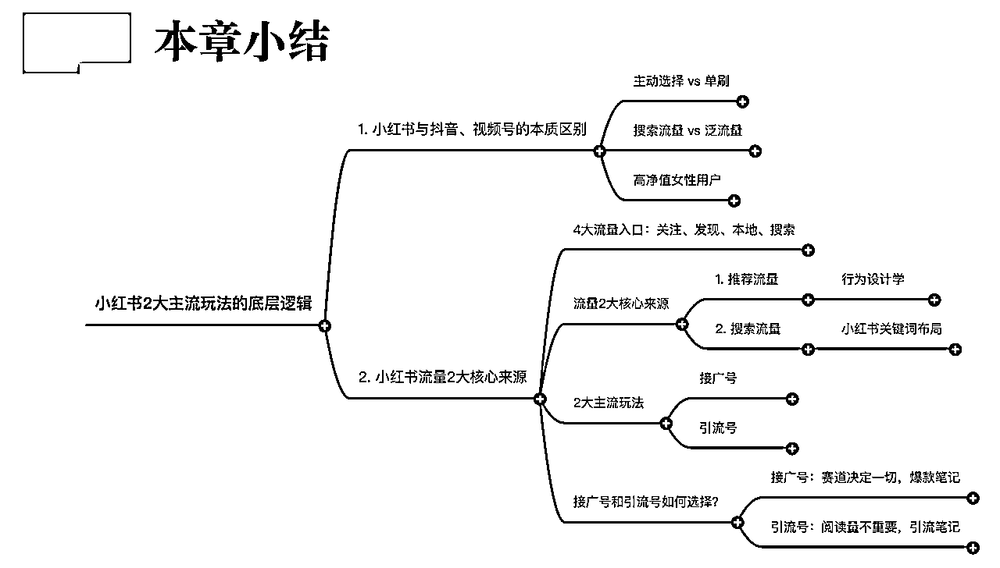

# 二 从0到1，如何快速搭建📕变现体系？

📕高效变现的核心原则：无论广告号还是引流号，都要围绕【业务】做账号！

## 一）广告号

我们做【数码家电广告号】也是围绕业务做的，如图复盘：

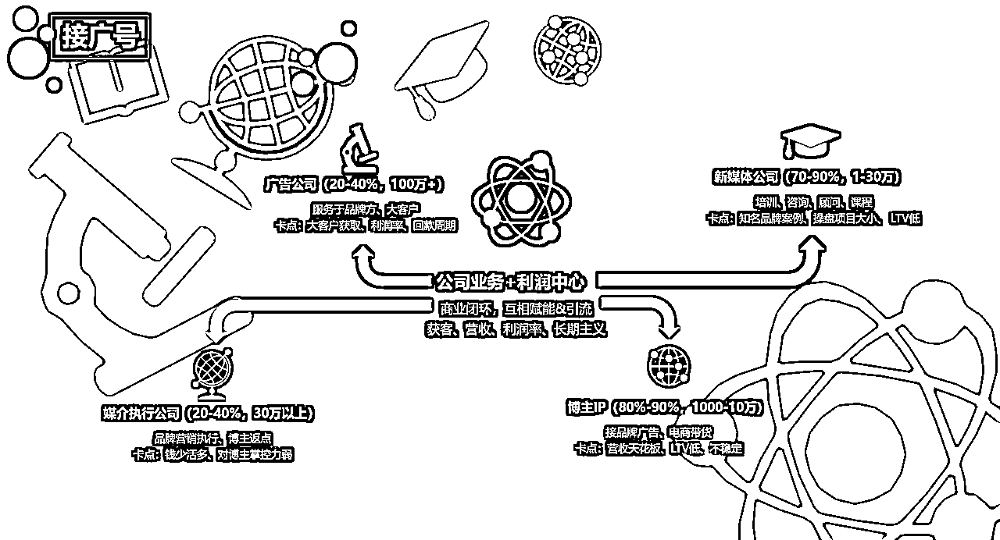

公司目前有4大业务板块：

1.  广告公司：服务头部数码家电品牌做品牌营销全案，单项目100万+
2.  媒介执行公司：服务中头部品牌做媒介投放，单项目30万+
3.  新媒体培训公司：服务中小企业做培训咨询顾问，客单1-30万
4.  博主IP：数码家电账号矩阵，接广告客单1000-10万

2022年前我们只有广告公司，但客户就那么几个，付得起100万/项目的品牌屈指可数，且是存量市场，基本靠老客户续费，增长瓶颈明显。而且广告公司人多、回款慢、利润薄。

2022年很多头部客户开始问：“你们做📕业务吗？”起初我们拒绝，只做TVC品牌全案。但客户越来越多，甚至直接说不接就换公司。于是2022年10月我们正式入局，从📕数码家电博主入手，创始人全员做IP。

当我们开始做数码家电博主后，全部业务被盘活：

1.  广告公司做提案时，对手都是普通团队，而我们比稿人都是万粉博主，信任度瞬间拉满。曾有品牌方现场要求我们做老师直接对接
2.  博主可为其他三块业务引流：品牌方先小额投放几千元广告，进而认识我们；认可执行力后邀请我们去讲课；培训中接触到市场部，继续承接媒介投放；最终升级为品牌营销全案客户，100万+

做到【引流即利润】，数码家电接广号成为我们所有高客单项目的引流品，一切账号都围绕业务搭建。

因此创始人全员做IP后，公司覆盖客单从1000到100万+，利润率从20%提升到40%，获客成本大幅下降，甚至博主接广告收入就能养活团队。

更重要的是：广告公司的核心资产不是项目，而是随时间复利的博主IP，这是竞争对手难以复制的。

总结就是，每个创始人都要做所在领域的IP。我们服务数码家电品牌，做IP的方式就是做📕数码家电博主

## 二）引流号

引流号同样要围绕业务来做，比如我们这个保险引流号

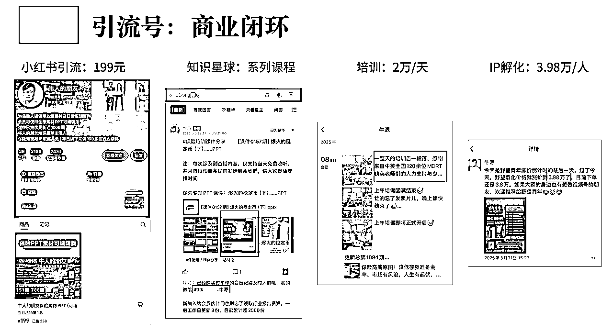

1.  📕店铺卖199元保险从业者素材，单账号卖200+份
2.  导流到知识星球服务，目前2000+用户，继续售卖金融等专业课
3.  2-5万的线下培训服务保险公司及从业者
4.  保险IP孵化，3.98万/人，已有100+人

接下来讲核心的起号流程

## 三）起号流程

起号分4步：账号策划-选题-内容-运营

### 账号策划5件套

1️⃣ 昵称：强关联领域，便于承接搜索流量

2️⃣ 头像：个人号建议真人照，企业号建议漫画化真人，提升信任

3️⃣ 简介：过往经历+现在做的事+关注好处+引流指引

4️⃣ 主页风格：统一风格、系列化，提升涨粉率

5️⃣ 背景图：与定位强相关

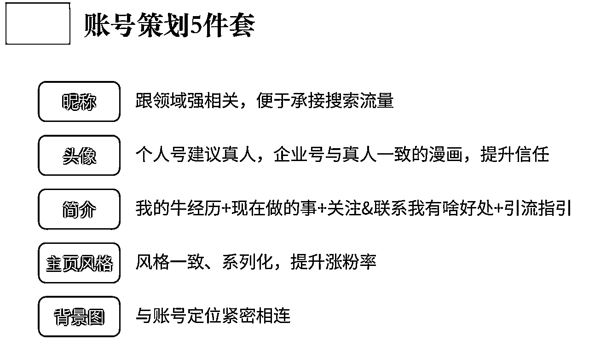

个人号与企业号策划示例：

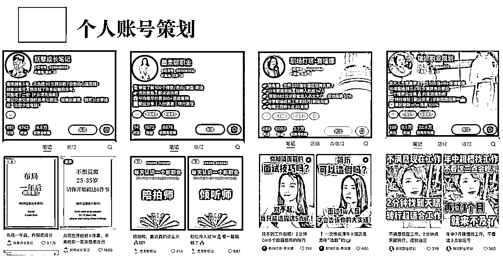

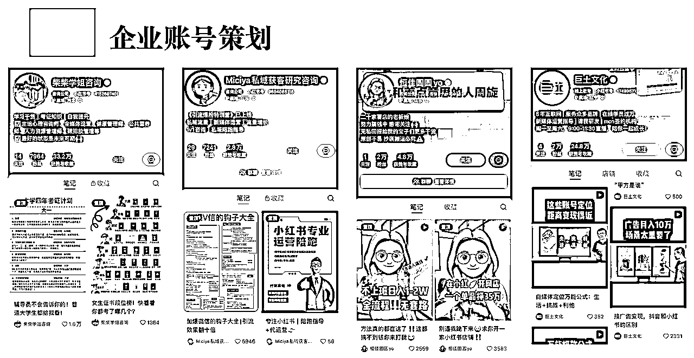

### 选题

#### 1）低粉爆文榜

几乎所有新号都用【低粉爆文】起号，效率最高。

工具可用灰豚、千瓜，如图。若不想付费，可手动找：粉丝<1万，点赞>1000的笔记即为低粉爆文

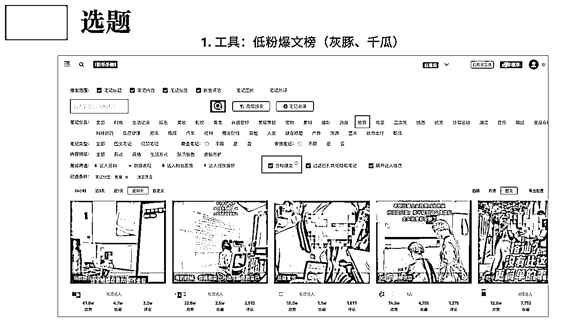

#### 2）站内搜索找选题

直接用📕APP站内搜索，如图

输入关键词筛选最热笔记，看30+篇头部笔记的共性

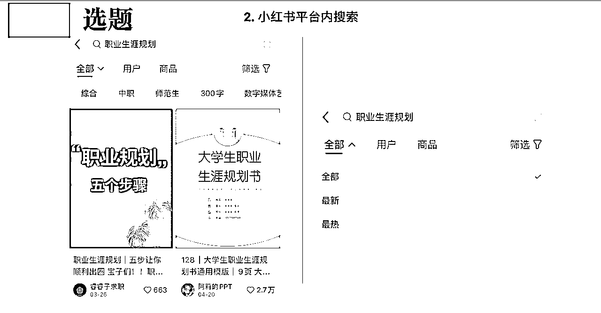

#### 3）📕SEO

做选题时我习惯先去【📕聚光平台】查词，查看各个关键词的搜索热度，从而锁定需求量大的方向，左图就是这种用法。

另外在真实搜索过程中，输入框下方出现的联想词也很值钱，能直接当作选题库来用，参考中间图。

再就是敲入关键词后，右侧会延伸出一串横向相关词，这类词同样是发现内容切口的好地方，看右图。

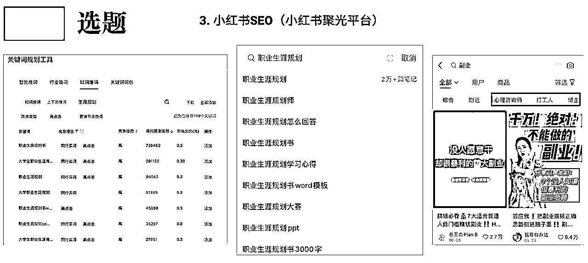

#### 4）刷同行

选题也可以直接抄作业。具体判断一条笔记是否值得拿来对标：

1.  互动数要突破百赞
2.  发布时间在近3个月之内
3.  该条表现比博主平时均值高出5倍到10倍
4.  最好单独养一台设备专刷同领域，把选题来源做宽

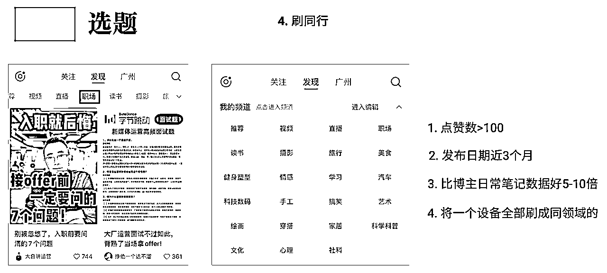

#### 5）选题规划表

附上一张我们内部在用的选题管理表，运营📕的标配工具。表头共6项：选题日期、对标选题、所属分类、核心关键词、选题意图、选题细则，示意图如下。

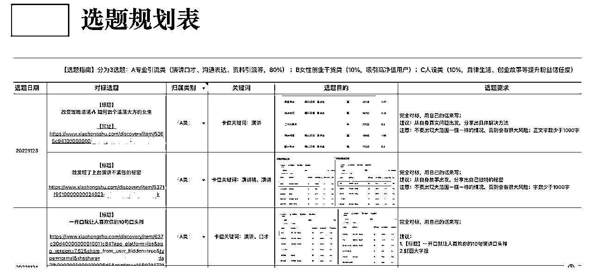

### 内容

内容生产拆成5个环节：封面视觉、封面文案、笔记标题、正文、评论区。

*   封面视觉：要沿用当下爆款的样式，不必局限于本垂类，跨品类借鉴也可以，比例优先3:4
*   封面文案：负责拉高点击，配合封面图一起用
*   笔记标题：承担关键词SEO，建议控制在两行内
*   正文：强调结构化排版、信息浓缩、适度使用平台表情包、关键词合理埋点
*   评论区：用于引导关注提升推荐权重；可做评论区承接，准备3个辅助号做验证

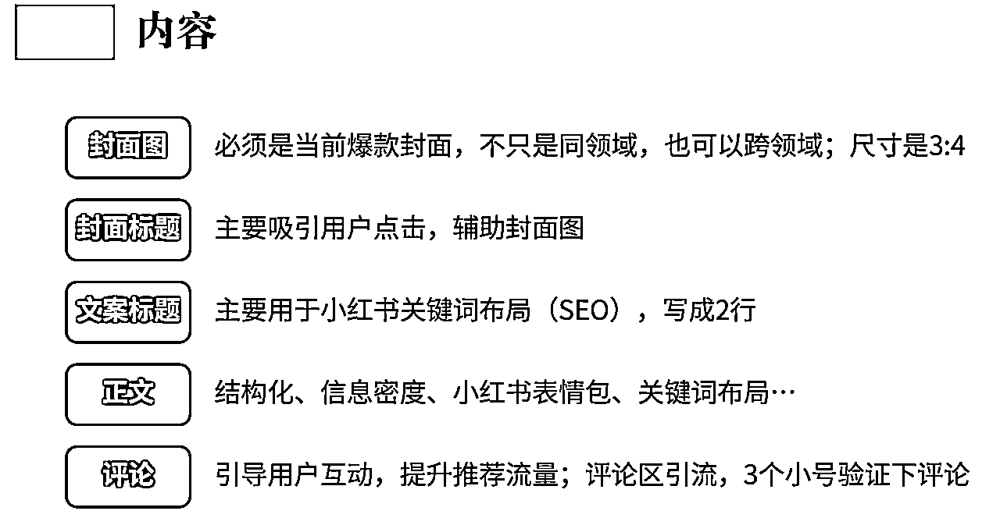

#### 1）封面图

多看爆款封面来锻炼网感，跨赛道对标是常态，尺寸强烈建议用3:4。

我们当前做封面主要用稿定设计：https://www.gaoding.com/

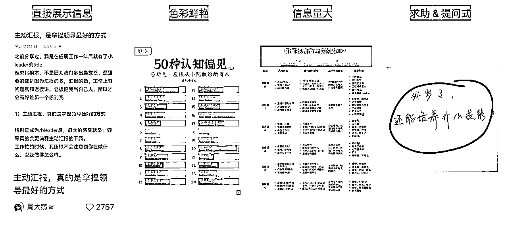

#### 2）封面标题&文案标题

笔记里关键词怎么埋更有效？

1.  想保证笔记被收录，建议先用句易网等工具检测：http://www.ju1.cn/
2.  关键词埋点要完成4个动作：
*   标题：除特殊情况外，标题中必须出现核心词
*   图片：封面图上最好带上目标词
*   正文：开头、中间、结尾各出现一次，走不开的话正文至少出现一次
*   话题：带上包含关键词的话题标签

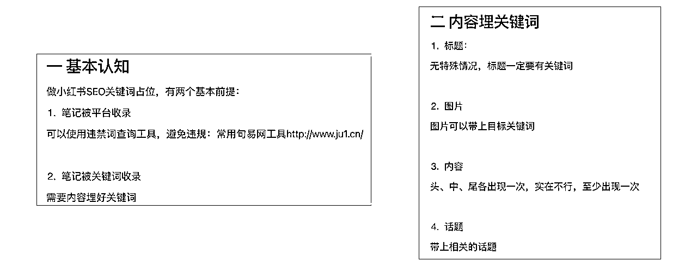

#### 3）正文

正文的核心就5点，如图：

1.  关键词布局到位
2.  结构清晰、逻辑分明、善用断行
3.  信息密度拉满
4.  加入平台表情与彩色符号提升视觉
5.  行为指令：明确提示用户【点赞、收藏、评论、关注】

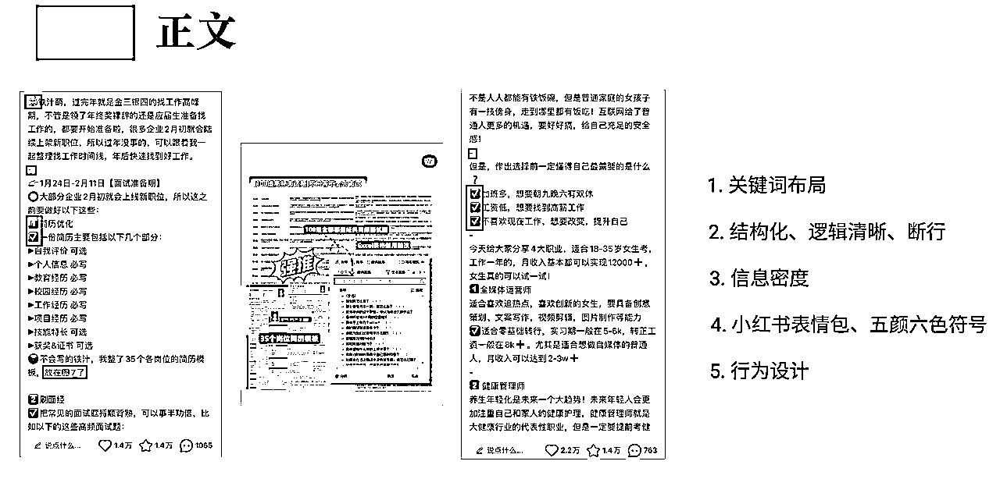

#### 4）评论区

评论区要持续做互动引导。若是引流号，可引导用户私信，适当用谐音规避风险。

如果走📕信息流投放路线，用户能直接私信你，你也可以正常回复。信息流投放官方有免责条款，能降低封号风险。

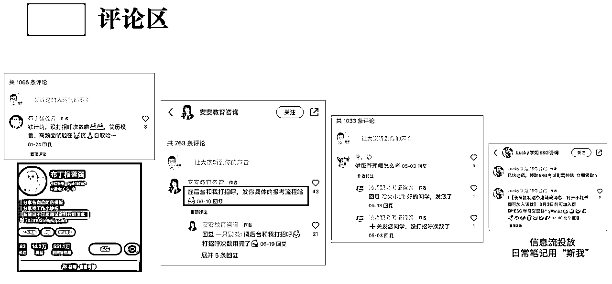

### 运营

接广号关注的核心数据：粉丝规模、爆款数量、点赞与收藏量；

引流号关注的核心数据：评论量、私信量。

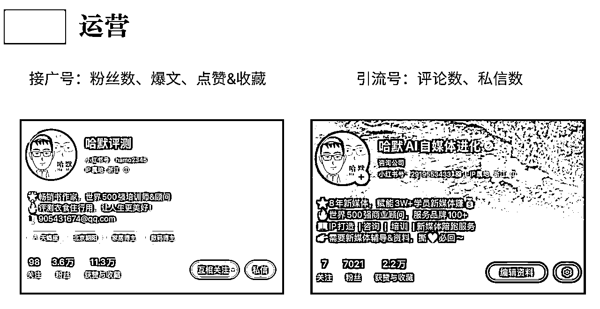

如果你手上或团队里有多个账号，统一维护有6个操作步骤：

*   发布后用小号搜索【笔记标题】找到该笔记，拿搜索流量
*   看完后点赞、收藏并关注博主，提升CES评分
*   关注后，下次发新内容前先去【发现页】下拉3屏，做点赞收藏等互动，拿推荐流量
*   发现页找不到就直接搜笔记关键词补一条搜索路径
*   账号多时，数据维护建议切到【移动网络】，降低被识别风险
*   数据标准：接广号维持10个【点赞&收藏&好】；引流号维持5个【点赞&收藏&引流评论】

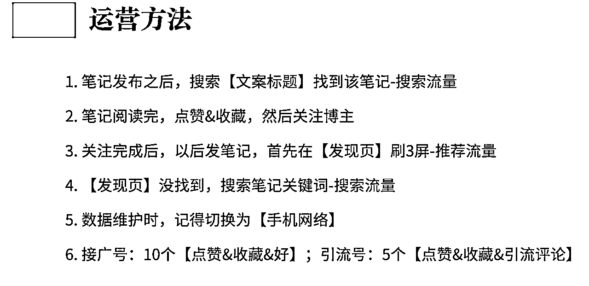

问题思考：📕个人号和企业号怎么选？

*   关键点：个人号和企业号只是属性划分，选号时不该只看这个，而要先问自己是做接广号还是引流号。接广号和引流号才是底层功能划分
*   个人号：更适合在平台内部玩，接广和带货为主，为高客单提供信任背书
*   企业号：更适合把公域导向私域，引流和矩阵为主，为引流变现提供支撑

【本章小结】

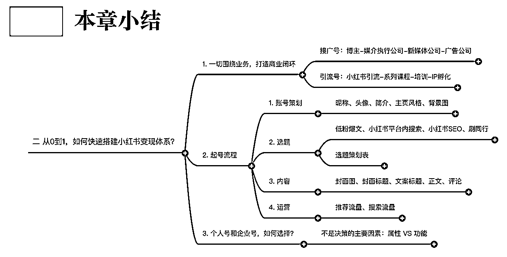

# 三 📕三位一体系统：产品-流量-转化

## 一）产品

在📕找能卖动产品的思路：去平台内找对标，做产品复刻开发。

路径：📕搜索 -> 选关键词 -> 优先看商品销量 -> 锁定卖得动的产品，示意图如下。

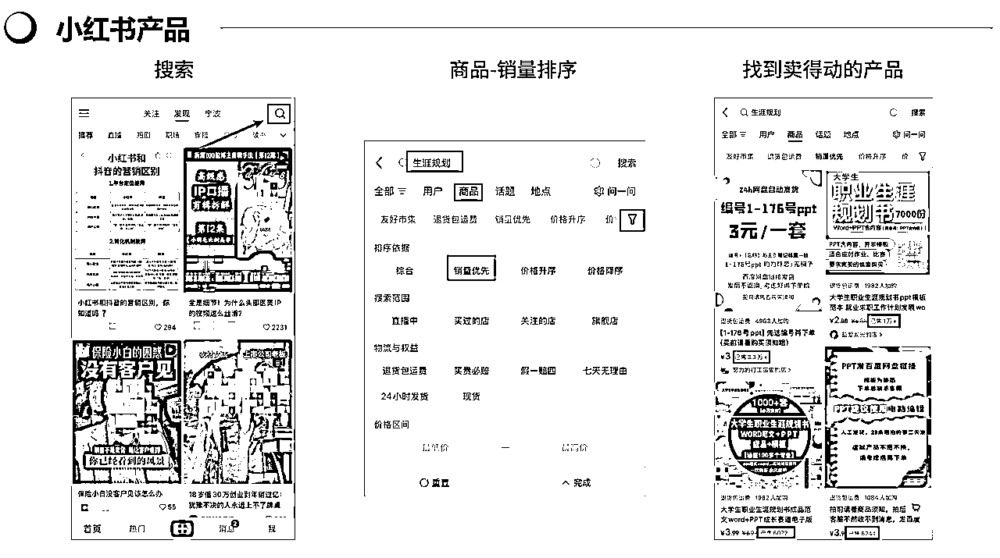

## 二）流量

举个例子：之前有位心理咨询师问我，📕该卖什么产品，流量怎么来。

我直接给了她3张图。

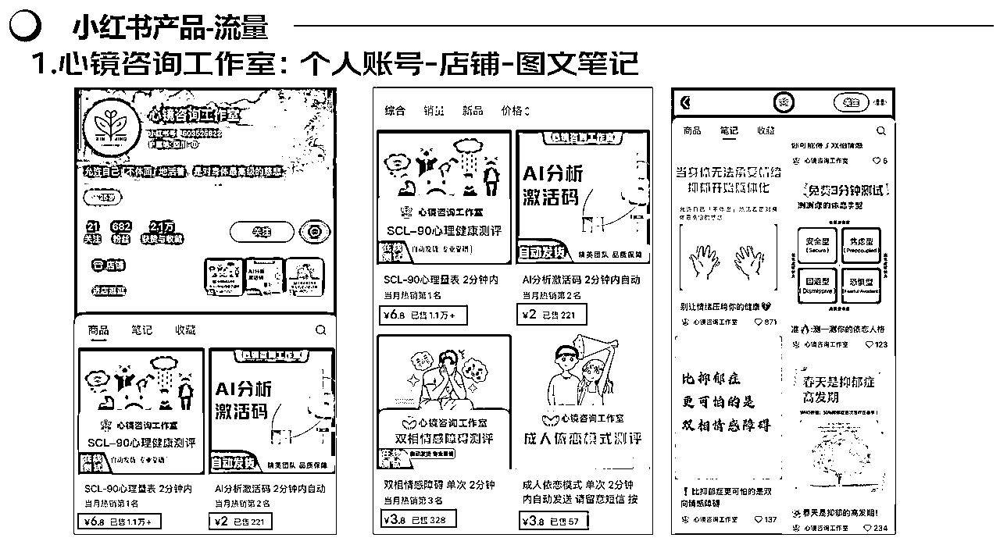

她拿到调研结果后立刻明白了：

*   卖点产品是SCL-90，因为无论粉丝几百还是上千，这个产品都能卖出几千上万份，说明产品本身过硬
*   流量打法：个人号和企业号都可用，先开通📕店铺，用图文笔记获取流量

她照做，第二周就在📕实现变现。

所以想提升📕变现效率，答案都在对手身上。

## 三）转化

📕共有7大转化路径，如图所示：

*   普通笔记
*   商销笔记，即挂购物车的笔记
*   群聊
*   私信
*   直播
*   表单
*   种草外溢，到京东、天猫等平台成交

比如我们自己的保险引流号，就主打商销笔记+群聊，如图所示。

因此，看任何账号，都要用这7个转化路径去拆解，找到最适合自己的组合。

【本章小结】

# 四 📕高效引流🛰️的全套路径指南

## 一）引流路径

我总结了9种引流方式，如图所示，其中安全可用的有5种：社群维护、被动私信、评论引导、账号简介、店铺商品。

按引流效率分三档：低效、中效、高效。

### 效率低：引导用户主动留下联系方式

### 效率中：账号简介、社群维护

### 效率高：评论引导、被动私信、店铺商品

特别推荐：评论引导+被动私信+店铺商品组合。

像保险这种敏感领域，我们安全引流主要靠【店铺商品】：开通📕店铺，笔记挂载商品，用户下单后我们才能获取联系方式加到🛰️。

对敏感或限流类目，建议多尝试商销笔记，用购物车挂载代替私信，降低违规封号风险。

## 二）📕公转私工作流

从公域到私域一共9步，如图所示：选题策划-笔记创作-关键词布局-评论引导-诱饵物料-📕私信-🛰️承接-加微话术-销售转化。

前面选题策划、笔记创作、关键词布局已讲过，加微话术、销售转化属于私域环节。

这里重点拆解【评论引导-诱饵物料-📕私信-🛰️承接】：

评论区先做引导，用户来私信后直接发【诱饵物料】图片。用户提出加🛰️时，可同时加企业🛰️和个人🛰️，先用企微承接再追加个微，实现双通道触达，如图所示。

另外，流程跑通后想放大引流速度，可以用两种方式：矩阵化运营+信息流投放。

【本章小结】

总而言之，📕是优质的经营阵地，能把业绩拉升10到100倍。

无论做接广号还是引流号，都要以业务目标为核心运营📕，让账号真正服务于品牌战略、产品规划和整体商业模式。

祝大家在📕都能拿到理想结果，让好品牌、好产品、好业务在这里持续发光。

我是哈默，欢迎交流，我们一起进化！