# 公众号流量主别再死磕长文了，豆包+剪映就能把AI漫画跑通，日入四位数真不是梦

> 来源：[https://p2tkpuv6qm.feishu.cn/docx/R4rodS884oPwuhxFbFQcfb93nCe](https://p2tkpuv6qm.feishu.cn/docx/R4rodS884oPwuhxFbFQcfb93nCe)

嗨，各位同行大家好，我是格子，自媒体这条路走了三年，公众号流量主变现一直是我的主战场。

今天这篇干货，我自己觉得含金量很高，看你能不能撞上这波红利了。

最近我一直在实测AI漫画这个赛道，并且对比了自己亲手做和用工作流搭智能体批量做两种打法，结果都很香，日入千元完全可复制。

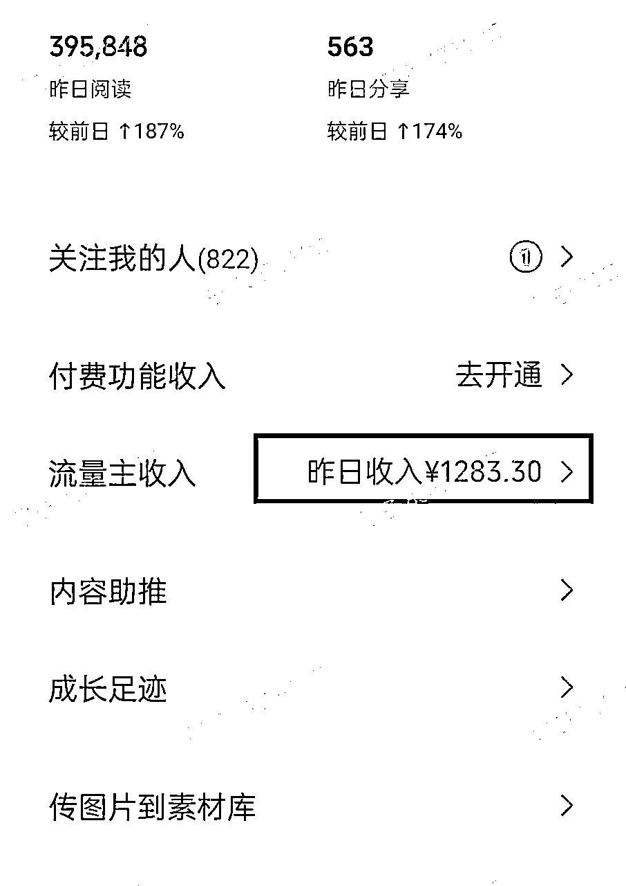

# 一、AI漫画在公众号里到底长什么样

AI漫画现在是真·隐形风口，大多数人还没反应过来，但已经要爆发了。

它不是那种动辄几十页的连载漫画，而是“几张图+几句点睛文案”的轻量漫画。

标题感很强，都是数字盘点类的：比如“这5位明星的逆袭轨迹”、“00后赚钱最猛的10个方向”、“情侣相处要避开的3个雷区”……

更夸张的是，平台现在对这种结构的内容极度友好，流量池在拼命推，有些号每天稳定10w+爆款。

过去靠长文吃饭的赛道，现在正被AI漫画快速替代。

目前被AI漫画重新激活的赛道主要有：明星盘点、职业盘点、体制内、情感等，我都给大家截了部分案例：

### 1、明星领域：

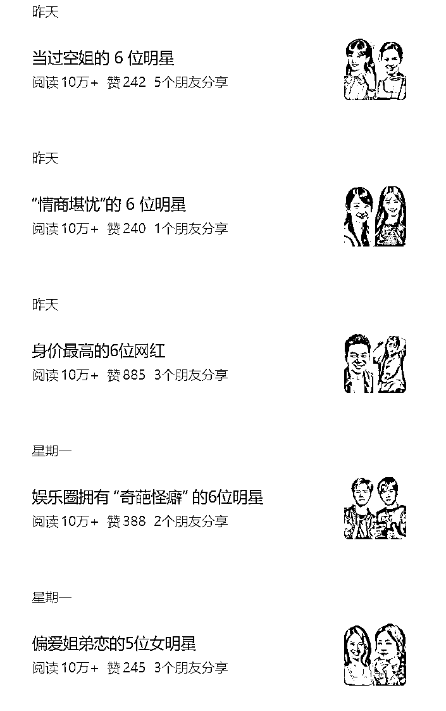

### 2、职业盘点：

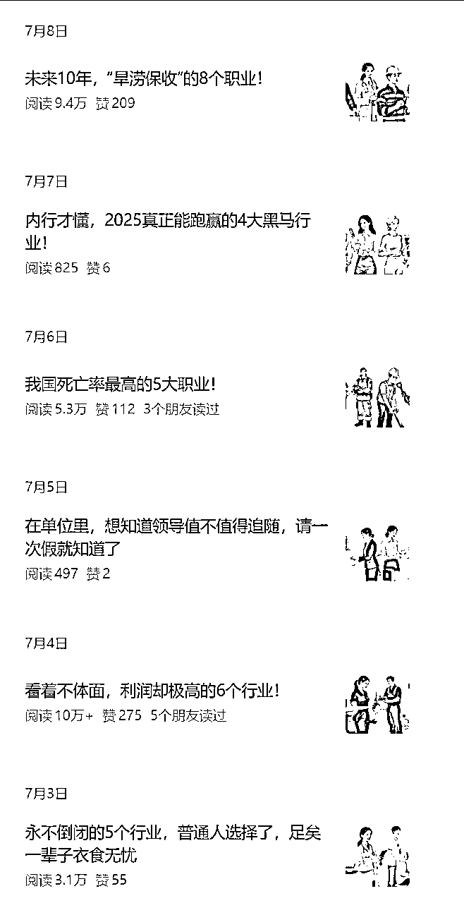

### 3、体制内：

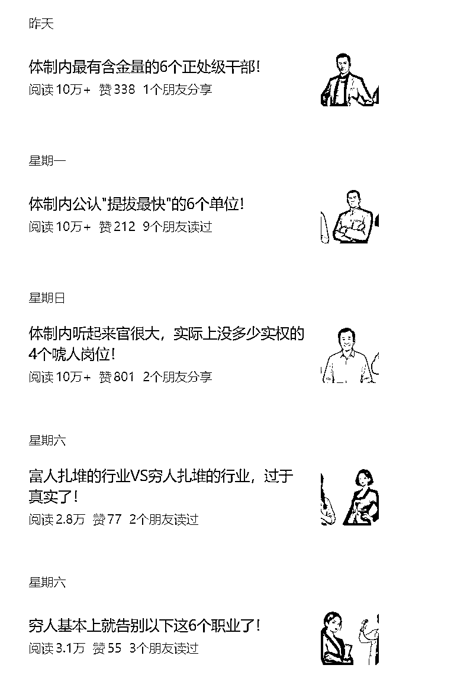

### 4、育儿类：

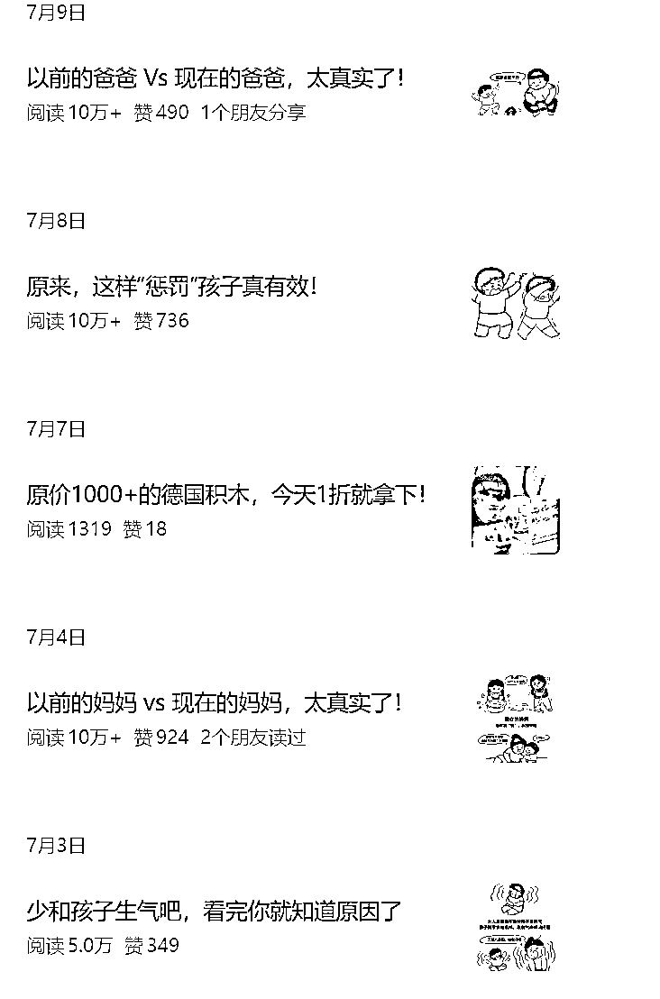

两性情感、反腐类的也同样火爆，这里就不全放了，你去搜下自己感兴趣的关键词就能看到一堆标杆号。

这些爆款文章点进去一看，其实就几张配文图，图上配一段总结性文字，文章末尾再加100字左右的个人感慨，流量主文章就成型了。

我试过好几个方向，基本都能快速起号，普遍一周内就能进流量池。

# 二、AI漫画怎么赚钱，单价能有多少

### 1、单价情况

实测下来，明星类单价是最高的，万次阅读在40-60元区间，而且流量极猛，很多号单日阅读量上几十万，收益轻松破千。但同样的，这个赛道竞争也最激烈，起号难度相对大。

职场、情感类漫画的单价会低一些，万次阅读大概在10-30元，不过卷度小，账号更容易活过来。

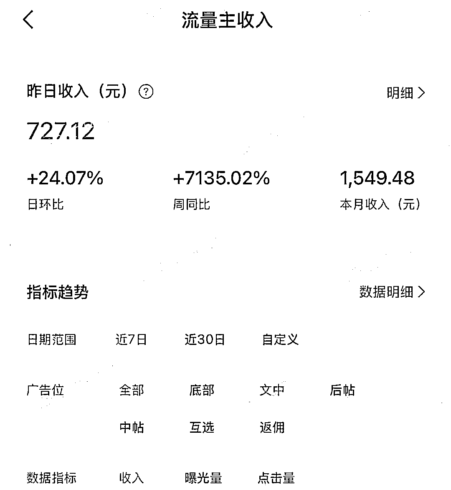

### 2、变现逻辑

做过流量主的都懂，但对新手我还是解释一下。

公众号达到500粉就能开通流量主，后面就靠阅读量赚钱。阅读量越高，收益越高，这就是核心逻辑。

500粉怎么来？行业惯例都是花点小钱搞定，别纠结风险，方法可行大家早就不用了。

开通后，腾讯会自动在文章里插入广告，长文一般是文中2条+底部1条。也就是一篇1000字左右的文章有3个广告位，底部广告单价最高。

而AI漫画属于图文极轻的形式，文字基本只有100字左右，就只有底部一个广告位，赚的就是这个底部广告的钱。

举个例子：100人看了文章，50人读完，则对50人完成了3次有效广告曝光；如果50人只看到第1条广告，那就是1次有效曝光。收益最终跟阅读量和完读率挂钩。

### 3、单价受什么影响

1）领域决定区间。

不同领域单价天差地别，有的万次二三十，有的能到百元左右。同样是AI漫画，明星类收益远高于职场情感类。1万阅读的明星漫画能有50-60元，情感类可能只有二三十。

2）写法决定上限。

这点主要针对千字以上文章。领域只给出一个大致范围，最终单价由个人内容质量决定。

即便是同一个选题、同一个领域，因为完读率、互动率、涨粉率、转发率不同，单价也会差很多。文章1万人看但都滑走，广告曝光不了，收益自然低。

# 三、AI漫画可以把任何领域再做一遍

重点来了。

这个形态起步不久，很多垂类还是空白期。现在完全可以把你过去做过的长文赛道，用AI漫画的方式重启一遍。

养老金、民生、军事、美食、汽车……是不是都能直接漫画化？

今天最核心的一句话就是：任何赛道，都可以用AI漫画重做一遍。

别去硬卷明星、情感这些红海，而是去找别人还没做的潜力垂类。只要你是最早一批入局的人，就能吃到长期稳定收益。

你之前擅长的领域，反而是你的最大壁垒。

五六月份AI漫画多集中在明星和情感，现在已经扩散到段子、育儿、反腐、吃喝等多个方向了，大胆打开思路去试。

流量主这个项目，永远是早入局的人赚大钱，等人挤满了机会就没了。

我们学员群里就有个案例，上个月我们主攻明星漫画，他反其道做职场漫画，现在账号非常稳，每天稳定大几百。

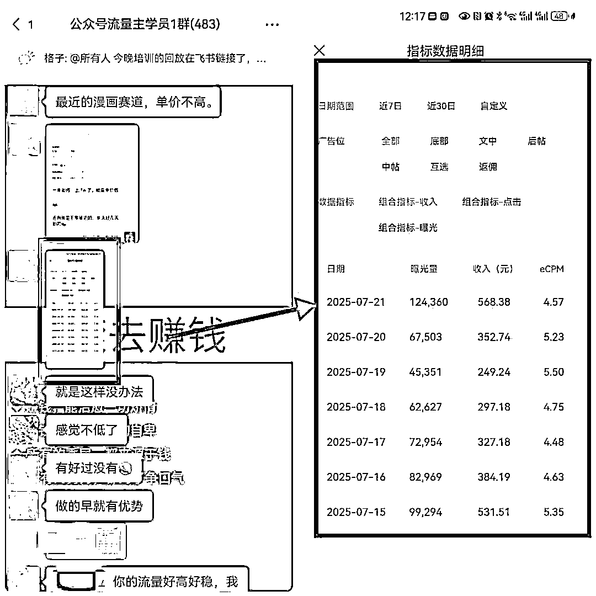

# 四、AI漫画怎么做，真的不需要专业团队

别以为要美术功底，现在AI一分钟搞定。

我用的是豆包的图像生成功能，先选好画幅比例，给一句简单指令就能出图。

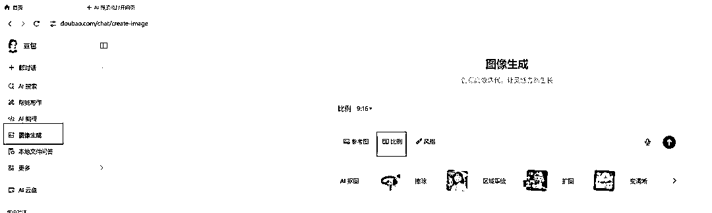

指令不用复杂，说清楚场景就行，风格在豆包里直接选，港风、国风、写实都能调。

比如要画婆媳吵架场景，我选港风风，给的指令就是场景+人物关系即可。

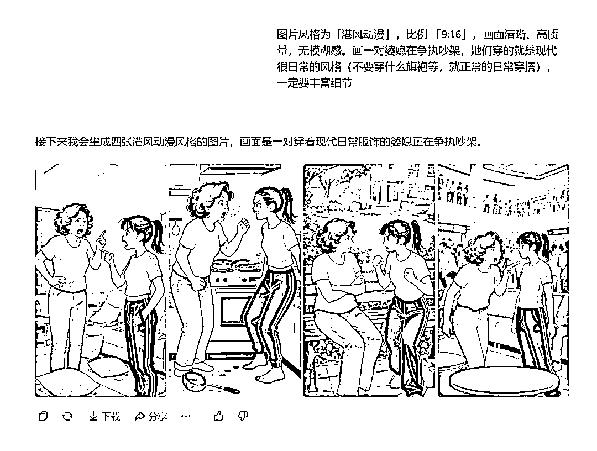

风格确定后就固定下来，后面批量用同一套风格保持统一。

图出来后去修图软件加文字就完事了。我常用剪映，第一张做好模板后，后面直接换图套用，截图发公众号就行。也可以用美图秀秀、醒图，看习惯。

个人做几个号可以一张张画。工作室玩法就用扣子搭建工作流做一个智能体，丢一个文章链接进去，图片和文字全自动生成。我也测过，工作流出来的内容一样能进流量池，2分钟搞定一个，虽然质量不如人工，但矩阵玩法拼的就是概率。

# 五、实操拆解：以明星领域为例

为了让大家更好上手，我以明星类做一次完整演示，其他领域流程基本一致。

### 1、工具清单

1）百度找图 www.baidu.com ，找明星原图用
2）秘塔AI https://metaso.cn/ ，写文案用，务必原创别洗稿
3）豆包绘图 https://www.doubao.com/chat/create-image
4）剪映，电脑端最快，配字+做封面
5）美图秀秀/醒图，手机修图二选一，剪映更方便

### 2、制作流程

1）先在同行里扒最近的爆款标题，越新越好，优先10w+的阅读。明星类10w+标题非常多，拿不到就找上万的。

2）标题可以照抄，改数字即可。比如“娱乐圈9大真千金”可改成8大、6大、10大。

3）标题确定后，去百度搜对应人物，比如“娱乐圈6大真千金”，别管对标号写了谁，直接百度找人。

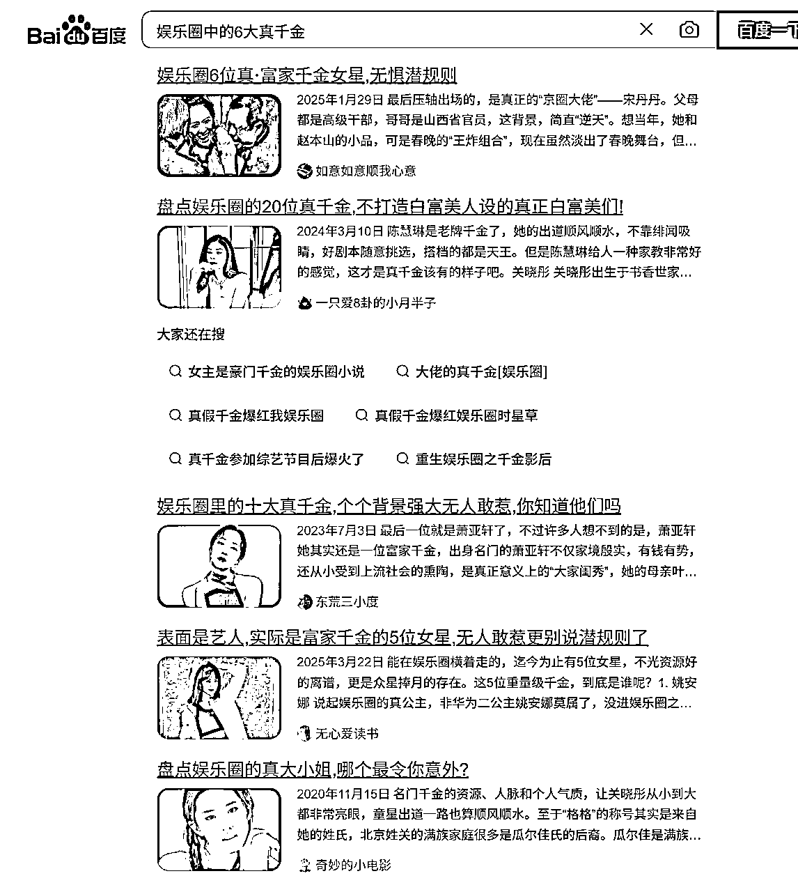

4）根据搜索结果选定6位，有代表性就行。比如我选的是刘亦菲、柯蓝、韩雪、姚安娜、朱珠、许晴、虞书欣这几位。

5）去百度搜明星高清近照，要清晰、背景干净、表情有特点的。模糊图AI画不出神韵，背景杂乱也会影响效果。

6）在百度图片里搜明星名字，挑高清特写。

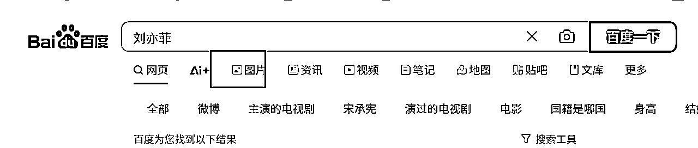

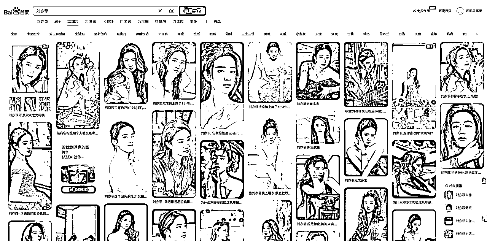

7）保存原图或直接复制到豆包。
8）6个人都按同样标准找齐。
9）打开豆包图像生成，上传原图，输入指令出图。

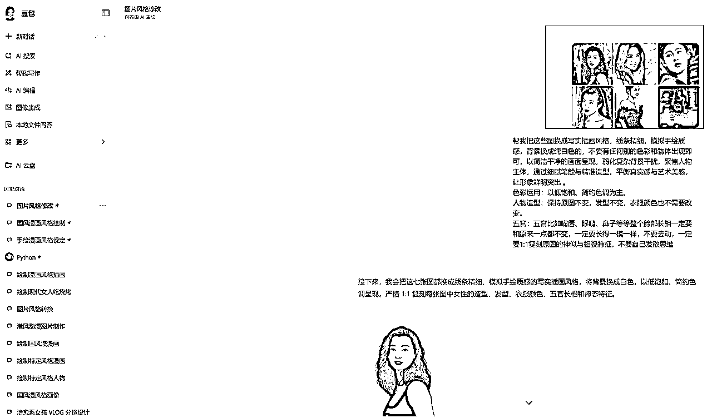

10）我的常用绘图指令示例：

帮我把这些图换成写实插画风格，线条精细，模拟手绘质感，背景换成纯白，不要有其他色彩和物体，画面简洁干净，聚焦人物主体，细腻笔触平衡真实感与艺术美感。色彩低饱和简约。人物造型、发型、衣服颜色保持原图不变。五官长相必须1:1复刻原图，与原图完全一致，不要发散。

11）打开秘塔AI输入指令生成文案，示例：

我现在要总结娱乐圈中的6大真千金！明星分别是刘亦菲、柯蓝、韩雪、姚安娜、朱珠、许晴、虞书欣，请查实信息，确保准确，然后每人用两句话口语化介绍家世亮点，像跟闺蜜八卦一样，结尾100字以内积极向上感慨下。内容要接地气。

指令每次只需改标题、人物、总结方向。

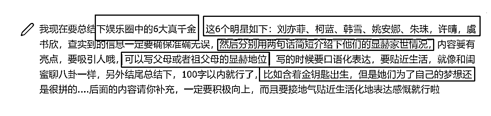

12）用剪映把豆包生成的图和秘塔生成的文案配起来，做个封面，直接发公众号。按这个流程我做过一篇，阅读20多万，单篇收入1000+。

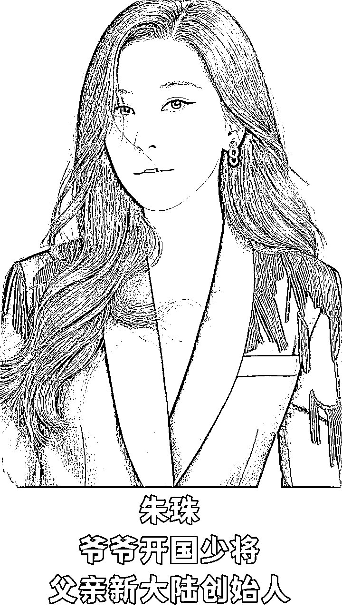

### 3、关键提醒

公众号起号看概率，别发一两篇没数据就否定项目。真正能跑通的人都是多号测试，3个里起1个很正常。

一个领域至少持续更一个月再判断。发三五天就焦虑的，真的不适合流量主。

流量主就是个磨人的长期项目，扛不住的赚不到钱。

# 六、新手从零开始的六步

### 第一步：注册公众号

电脑进 https://mp.weixin.qq.com/ 按流程走，手机更方便，下公众号助手一键注册。

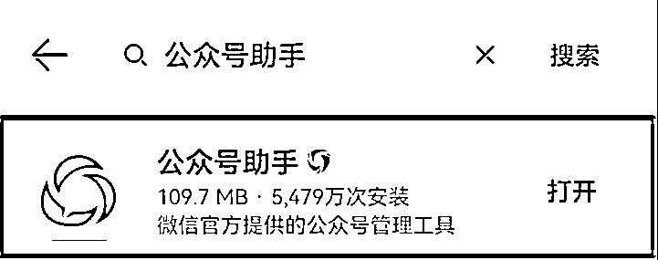

### 第二步：定领域

注册好后先选定要做的漫画垂类。

### 第三步：凑500粉

注册后花钱买500粉开通流量主，市面价几十块。

### 第四步：开通流量主

粉丝到账一周后，在公众平台左栏找到流量主→申请开通→同意协议→财务管理里填身份证和银行卡信息即可。身份证前后两面建议拼成一张图再上传。收款方可以和主体不一致，用委托个人收款方式处理。

### 第五步：找20个对标

在目标领域找20个左右的标杆号，把他们的爆款标题建个库，前期直接拿来用，不会侵权。

### 第六步：日更

提前备稿，定时发布，每天1-2更。按15天为一个周期看数据，长期低迷就换领域，换领域不用改名删文，直接发新方向即可。

差不多就这些干货，能看完并执行的，一定能多赚一笔。

记住：当所有人都在挤明星盘点时，你在冷门领域用AI漫画降维打击的机会才最大。你过去的长文经验，现在就是AI漫画的最大优势，别被旧思维限制，赶紧重做一遍吧！