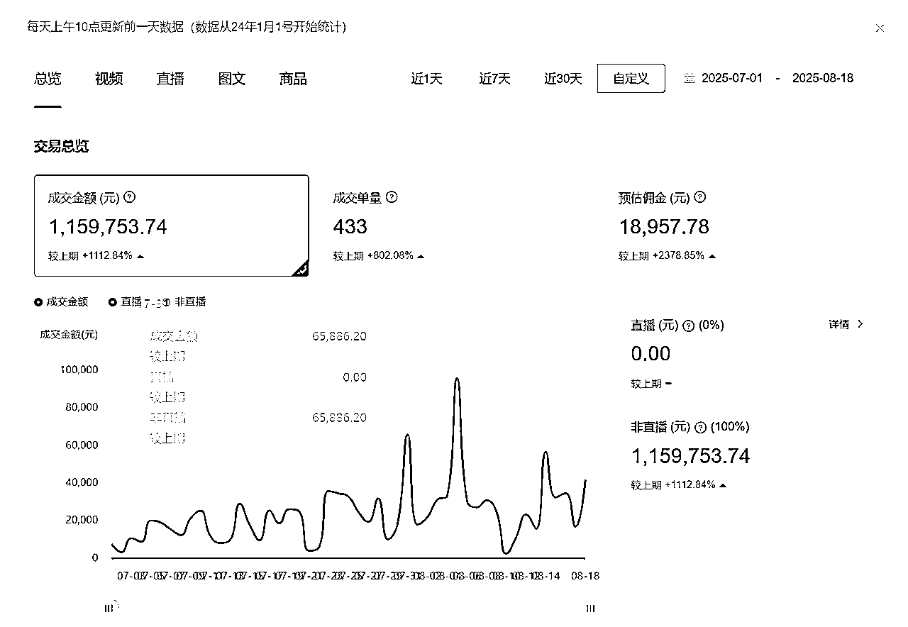
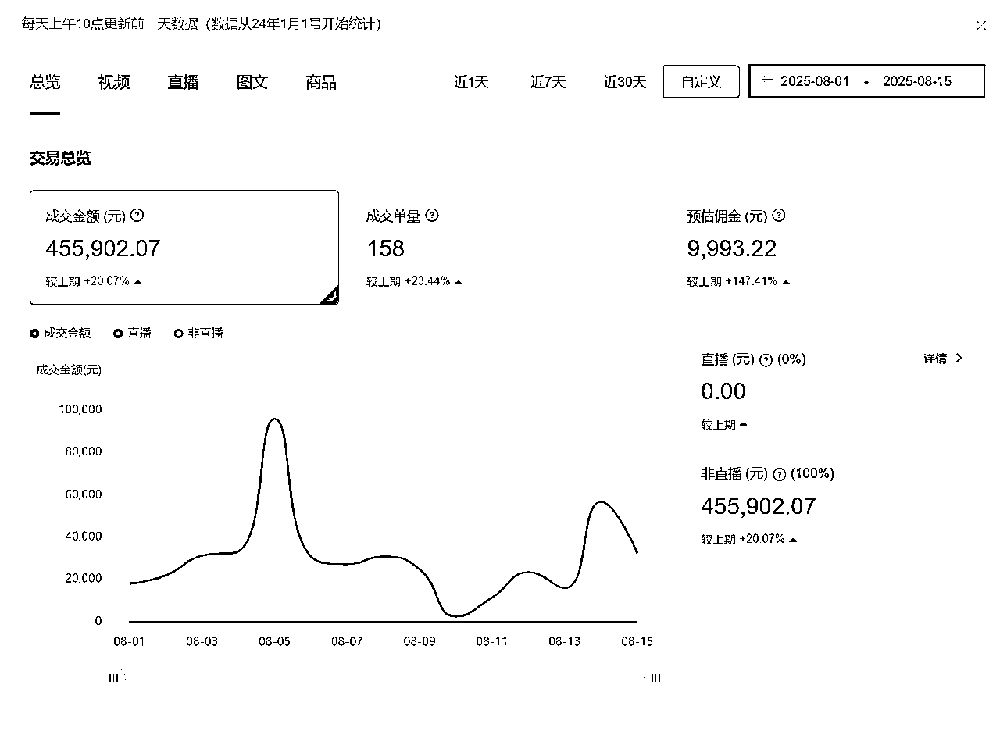
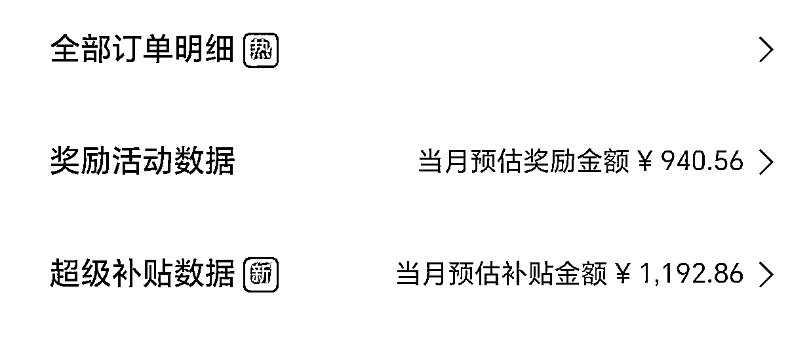
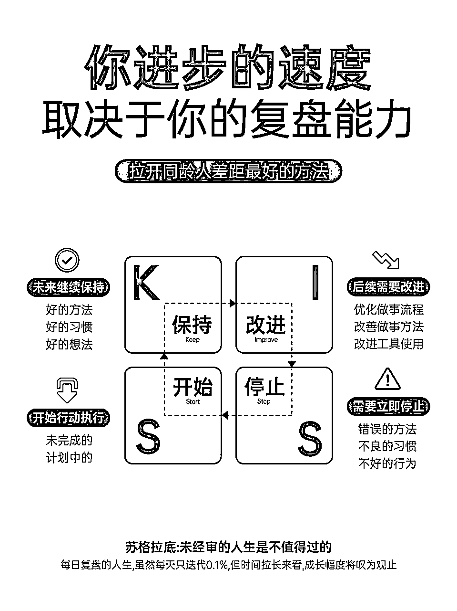
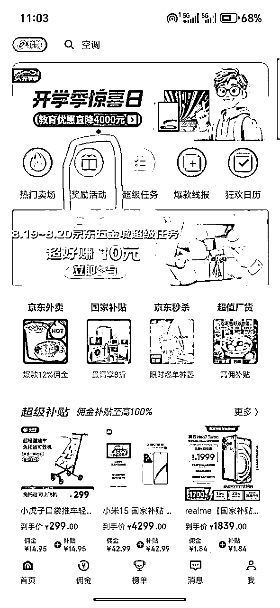

# 从半月700到半月近万，我在B站好物带货上做对了什么？

大家好，我是小源。

7月初的时候，我发过一篇关于B站好物悬赏带货的拆解帖，把项目玩法和新手入门路径梳理了一遍，承蒙大家认可，被评了精华。如果你是刚接触这个项目的小白，建议先翻翻那篇，应该能少走不少弯路。

https://t.zsxq.com/UnhvT

---

今天这篇，重点聊聊我这两个月踩过的坑和拿到的结果。

先亮个数据：6月份我还在摸索起步，半个月佣金只有700块。到了7月和8月，增长开始加速——从7月1号到8月18号，49天累计预估佣金1.89W。其中8月1号到15号，半个月佣金直接冲到了近一万。

除了佣金本身，这两个月在淘宝、京东两个平台拿到的补贴和活动奖励加起来也有3k左右。这笔钱后面我会专门讲，千万别忽略。

从半月700到半月近万，翻超10倍的背后，我到底做对了什么？拆成五点来说。

## 一、把AI配音换成真人配音，视频也改成实拍/录屏

当时拆解这个项目的时候，我横向对比了不少账号，总结出8种主流视频风格，而且基本都试了一遍。

实战下来效果最明显的组合是：真人配音+实拍，其次是真人配音+录屏。AI配音在好价线报类视频里偶尔能跑出不错的转化，但多数情况下后劲不足，很难持续放大。

我的理解是，B站好物带货和之前的知乎好物，本质上都是在帮用户做消费决策。你把专业内容用视频或图文的形式输出，用户看完觉得靠谱，才会下单。这里面最关键的就是信任感——信任感越高，转化率越高。

即便是强调时效性的线报类视频，本质上也是在帮别人做消费决策。账号粉丝慢慢涨起来，其实也是信任感在一点点积累。

那怎么提升信任感？既然内容是视频，那视频的形式就很重要。拆开来看，人的因素和物的因素都很关键。

人的方面就是三种：真人出镜、真人配音、AI配音。按信任度排序的话，我认为是真人出镜 > 真人配音 > AI配音。

物的方面就是实拍和云评测，效果上实拍实测肯定好过纯云评测。

所以信任度最高的组合是真人出镜+实拍实测，转化率自然也是天花板级别。这基本就是头部UP主的标准打法。而且这种视频还有个额外好处：播放量普遍很高，涨粉速度也快，后续容易接到商单。商单收入一般比佣金高不少，这也是把B站好物带货做成穿越周期、长久变现的路径之一。

我的收益能快速增长，核心转折点就是果断弃用AI配音，改成真人配音，同时把手头能实拍的产品尽量实拍——自己没有的，就去实体店拍。用真人配音+实拍，或者真人配音+录屏讲解来制作素材，效果立竿见影。

肯定会有人说：不好意思开口配音怎么办？不敢去线下店里拍怎么办？这时候就问问自己，想不想赚钱。试过几次之后，这些心理障碍基本就消失了。对我来说，除了真人出镜，其他都不算什么真正的挑战。

当然，我并不是否定AI配音这个路线的价值。说实话，AI配音对刚入门的新手非常友好，也有纯靠AI配音做到单月百万甚至千万GMV的账号。

比如最新一期百万UP主榜单里，第37名的“Super好价君”和第62名的“大白讲数码”都是AI配音，这本身就说明AI配音是能跑通的——毕竟总共就80个名额。

但从成功概率、消费决策的本质、商单变现的机会、乃至更长远的职业天花板来看，真人出镜+商品实拍无疑是更优甚至最优的路径。我自己目前也只做到了真人配音+实拍，下一步就是要往真人出镜的方向走，这也是后续需要补上的功课。

从AI配音转到真人配音，从简单放几张图到录屏讲解和尽量实拍实测——这就是我收益翻超10倍的最大秘诀。

## 二、死抓热点，让平台帮你推流

不管做什么内容，播放量都是收益的地基，没有播放量，一切都无从谈起。我不投流，也没用过投流，这里只讲自然流量。

视频类型会影响流量——真人出镜本身就比AI配音更容易获得高播放量，实拍也比云评测更能留住观众。但除了视频类型，热点是一个极其关键的变量。

热点分两种：一种是具体产品带来的热点，另一种是季节性的热点。

产品热点最典型的就是新品发布。越是重磅的产品，发布会流量越夸张。手机品类就不用多说了，9月份的iPhone 17发布会，后面还有小米16、iQOO 15，再到华为Mate 80，都是天然的流量池。笔记本这边有联想拯救者、来酷斗战者的新品，华硕天选6系列也是一个热点。家电类的大疆扫地机器人、格力云佳Pro空调、容声511冰箱，每次发布都是自带流量的话题。抓住这些新品发布时间节点，流量是肉眼可见的涨。

季节性热点也很好理解——夏天就是空调、风扇的旺季，冬天则是加湿器、壁挂炉的主场。服装赛道更是如此，夏天卖羽绒服，销量大概率惨淡。

还有一类是电商大促节点，618、双十一、年货节。但凡标题或封面带上这些关键词，本身就能带来额外播放量的加成。

关键是你要根据自己账号的定位、视频风格和带货品类，判断哪些热点真正属于你，然后快速制作内容去接住这波流量。

我刚开始稳定出单，就是靠抓住一场新品发布会的热点。后面收入能被放大，同样是因为持续踩中了属于自己的热点。

## 三、定期复盘，比闷头做重要得多

复盘是所有项目的基本功，能帮你及时总结经验和避坑。前两天在朋友圈看到潇墨聊复盘，有一句话特别戳我：你进步的速度，取决于你的复盘能力。

说到复盘我自己其实有点惭愧——这块我做得不算好，没有系统的复盘计划。但我一直保持一个习惯：不定时看一眼视频的播放量和互动量，留意哪些内容受欢迎；每天盯订单数据，看哪些品类、哪些型号出单更好。然后针对性地把精力放在受欢迎的内容上，带货也优先推高单量的品；那些表现平平或者几乎不出单的品，暂时放一放。

不断复盘、不断学习、不断优化——这条路会让你的成长速度快很多。与大家共勉，下次更新长文的时候，我会重点把自己复盘的方法系统整理出来。

## 四、平台活动一定要参加，白捡的补贴别扔

文章开头提到的那笔3k左右的额外收入，就是平台给的奖励——这是淘宝、京东官方给的激励，本质是奖励你帮他们平台引流、带动营业额。这笔钱真不是小数目。

拿8月来说，不算佣金，光平台奖励就超过2k。而且618、双十一这种大促期间，奖励力度更大、活动也更多。所以我的建议是：不管品类是不是你在带的，能报名的活动全部报名。因为平台有锁佣机制，有时候订单会出现在你根本没带过的品类里——大促期间发红包的场景下这种情况会更常见。

操作方法很简单：打开京粉APP或者淘宝联盟APP，首页找到奖励活动点进去，能参加的全部参加。有些是默认参加的，有些需要手动报名，千万别漏。

看到这里，现在就拿起手机去APP上把活动全部报名一遍，尤其是那些需要手动报名的，一定要报上。

佣金收入是你用劳动换来的，而奖励收入是平台主动给的红利——有时候这份意外之喜，比想象中还要丰厚。

## 五、坚持，然后尽可能缩短执行差

我把坚持放在最后，因为几乎所有人都在说要坚持，所有人也都知道做项目必须得坚持。但真要做起来，这恰恰是最难的。

我正式加入生财之前，在3天体验卡课程里，从纪中老师那里听到两句话，印象非常深：

1. 普通人赚钱最快的方式是信息差。
2. 信息差+执行差=可能成功。

第一句很好懂，在生财里信息差从来不缺——恰恰相反，信息太多了，这个也想干那个也想干。但最终赚不赚得到钱，取决于你有没有把执行差缩到足够小。

我不敢说自己有多拼，事实上我也并没有全身心扑在这个项目上——我有一份主业工作，还要应付家里的相亲压力。但我每天都至少留给B站好物1个小时。

算了下，这个项目我做了不到70天，已经更新超过150个视频，没有一天断更。哪怕感冒时咳嗽咳到不停，也照样坚持录真人配音+录屏视频——一个三四分钟的视频，因为咳嗽硬生生录了近半个小时才剪出来。今天的成果，确实是用坚持换来的。

如果你是精细化定位的账号，核心在脚本文案和视频质量，不需要追求日更，慢慢打磨内容就行。但除此之外，我都建议日更，每天保持1-3个视频的输出频率。

执行差越小，离成功就越近。

---

总结一下，这五点就是我用两个月时间做到收益翻超10倍的全过程。没有什么高不可攀的技巧，也没有复杂的知识门槛——无非是换了视频类型、抓到了热点、保持了复盘、参与了平台活动，再加上一个“不断更”的自己。

现在B站好物还处在红利期，正好也是备战双十一的绝佳窗口。希望这篇内容对你有帮助，有什么问题随时来找我交流。

苦苦坚持，痴痴等待，艳艳花开。愿我们在B站好物悬赏带货这条路上，都能收获属于自己的果实。