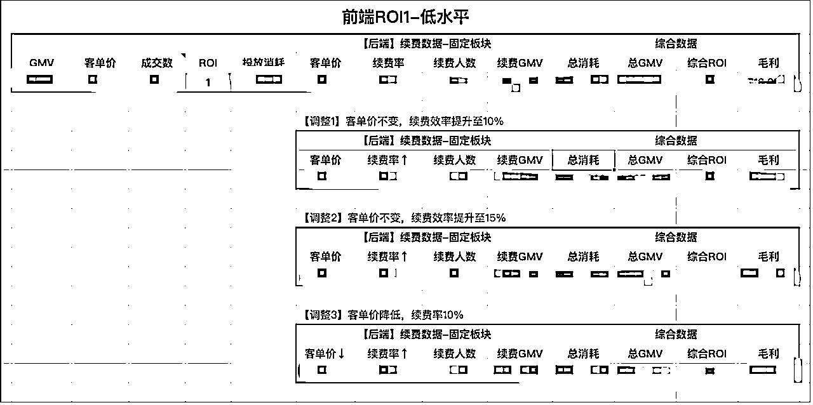

# 公域引流+私域变现，知识付费怎样才能跑出可持续的高利润组合拳？

> 来源：[https://i4avwea6mr.feishu.cn/docx/SwWDdjdcSoDRI0x57cgcR71BnYb](https://i4avwea6mr.feishu.cn/docx/SwWDdjdcSoDRI0x57cgcR71BnYb)

大家好，我是小林。五年来一直在教育一线滚打，从K12到启蒙再到成人赛道，做过社群、销售、直播运营。运营这活就是哪里需要往哪里搬。

我赶上微信裂变的尾巴，吃过私域大班直播课的红利，后来全身心扑进直播，从0做起孵化过雅思头部IP，单月GMV从零干到500万。23年合伙创业了一家小而美的IP公司，两年里从出租屋3个人发展到近50人。作为负责人，主导成人英语赛道在抖音直播一年营收破2000万，公私域联动单年GMV破1亿。

25年我又出发了，加入一家AI教育公司，目前是彻头彻尾的AI小白，正在摸索用矩阵号+批量数字人视频+多平台二创改写来做获客。如果你也想做成小而美的、高人效的团队，或者想把公私域玩明白、做高利润，这篇是我第一次把路走过的坑和框架系统梳理出来，欢迎参考，有疏漏之处请多包涵。

# 一、先问自己：你适合做公私域联动吗？

现在流量成本高到让人头疼。前端直播间砸钱投放，看起来ROI勉强打平，一算退费和各项隐藏成本，一个月等于白给平台打工。我们之前还开玩笑说，今天多干活赚100，下个月多亏200，不如躺平，四舍五入赚100。

这时候市场里谈私域的声音就更响了。那先把概念厘清：为什么非做私域不可？

这个词我入行就听过，可直到现在才真正变刚需。最本质的原因是，公域单独已经很难盈利了。必须靠私域的续费、扩科、转介绍来拉高用户LTV，业务才有活下去的底气。

很多道理大家都懂，但不到真正疼的时候，改变很难。换个角度想，你在推产品时，有没有给用户制造过“必须现在改变”的那一瞬间的痛感？

在前端公域单打独斗越来越难的前提下，越来越多团队挤进公私域联动的赛道。于是私域也不像两年前那么好赚了。就算你在前端曾经大杀四方，进到私域也得放下身段，从零开始投入，才有结果。

那公域获客目前主流有哪几种打法？

1. 0元线索：平台偷流、信息流留资、9块9之类的超低价引流品，后续在私域转化
2. 低价线索：19.9、29.9的书课包为主，仍然靠私域收割
3. 中价课：我定义为99-500元区间。用户在公域买单后顺滑承接到私域，并在私域完成高客单续费
4. 高价课：500元以上，多为2000+。基本靠前端直播直接成交，私域主要做续费

这四种模式，对IP和团队的能力要求完全不同。

## 0元线索获客

走自然流偷流量的，得有极强的选题嗅觉和极高的内容产出量，能接受重数量不重质量，还要能反复翻拍同款爆点。这对很多知识IP是魔咒。

走纯付费拿量的，小公司基本玩不转。必须配大销售团队，线索量不稳定就养不起人。每一期的ROI像过山车，心跳和钱包一起受罪。

## 低价线索

本质是0元线索的付费进化版，对销售团队的要求一样高，这里就不赘述了。

## 中价课

这是我最推荐的打法，也是我们当年跑通的方式。风险比前两种低很多，因为前端本身就能赚钱，后端是纯增益。

举个例子，1、2种模式，一个线索成本100-200，如果后端转化上不去，整体ROI<1就直接亏。

3的模式，我前段卖200-300的课，ROI做到1.5当然好，0.8也能接受。因为花几十块拿到一个比前面更精准的用户，后端续费一算就赚。甚至我能反向算出公域能容忍的最低ROI，按这个ROI放量，就能吃掉那些没做私域的对手。

没做私域的老师，200客单的课，最多只能花200以内去拿量。而我能接受花300、400去拿，因为我有私域兜底。拿量优势自然在我。

我们这套跑下来，线索成本低且质量高，销售人效是行业平均的5倍，不需要堆人。但要求前后端团队都够硬，重质不重量。IP产品力要扛得住前后端两档价格，前端要能打磨出高转化直播间，后端要承接得住并完成转化。

## 高价课

适合不想搭销售团队，只靠前端直播盈利的团队。规模不会太大，要么赛道刚需、产品强，要么团队能力极强，前端能稳定收高客单且有后续续费空间。

# 二、高利润公转私模型的底层逻辑

靠这套进阶打法，我们过去一年做到1亿+营收，ROI也很健康。你可能会问，回报这么高，为什么不人人做？

因为有门槛，而且是真正的护城河。知道模式不等于能复制。

如果你有IP、有内容沉淀，能把知识体系化、通俗化地讲清楚，那你可以直接上这个进阶模式。没有的话，建议先回新手村，把中价课卖得动再说，再去打磨高价课和业务。

如果你具备条件想走第三种模式，我拆成三个阶段来聊。

## 阶段一：测算业务健康度

别被上市的梦冲昏头，先冷静算账。很多人没有对标数据，会乐观高估自己，最后盲目投入。

我们当时调研了竞品的公域数据：中价课平均定价、不同量级老师月销、市场消耗量级和ROI。也调研了和我们玩法相近的老师的几个核心指标，因为同类人对比更准，再结合自身能力差调整。

私域数据要看后端续费课客单价和续费率。

算完就能得出毛利模型：【公域GMV=客单价*销量】+【私域GMV=续费率*公域销量*客单价】-【总消耗=公域GMV/ROI】

多在核心数据上做敏感性测试。

比如前端ROI稳定1，后端续费率10%毛利多少？如果销售能力提升到15%又是多少？如果硬模式卖不动高客单，降价降转化，毛利是否还能接受？

再把前端ROI高一点低一点的情况都跑一遍，你就知道现实目标该定在哪里。

## 阶段二：梳理产品体系

产品要成为丝滑续费的桥梁。

公域课是钩子，要瞬时有收获感，价格亲民，能勾起兴趣，但不一定真正解决问题。有收获感比真的收获更重要。

私域课是深度链接场，要体系完整，真正解决问题，建立信任。

我们公域课程定50节。当时同行卖中价课动辄100节起，追求走量。为了避免用户觉得买了这个课就能毕业而不再续费，或者觉得课太多学不完就不续费，我们有意控制数量。数量上的克制是转化关键。

公私域产品必须有进阶性和差异化，这是减少话术补位的核心。进阶意味着私域课要比公域更精致、更体系、效果更强，但不能是公域的简单放大。

比如公域卖3000单词营，私域再卖10000单词营，用户会觉得没学完。更好的做法是公域卖单词记忆法，私域卖如何深度理解和运用单词进而提升口语的课，互补且进阶。

还有个没落地的玩法，供你参考：在公域课程交付中自然植入私域卖点。用户第一次可能没转化，但每次听课都是一次软性触达。

比如我在讲单词记忆课时可以说：“除了这个方法帮你快速记单词，如果你能在生活中用英语表达出来，记忆效率会提升3倍，我有一门课就是专门带大家在真实场景里用英语。”点到为止，像刷脸熟一样，讲久了用户自然有印象，而且包装进方法讲解里，用户只会觉得你在教方法，而不是在硬卖。

## 阶段三：打磨高成交直播内容

兵马充足就开打。很多人在一端有结果，想复制到另一端时会碰到惯性：“私域这样播很好，为什么公域不行？”

很正常。公域像街边吆喝，人来人往，每个人都有事，你要靠瞬间的视觉冲击把人抓住。私域像电影院，用户是专门买票来的，会坐下来看完整场，除非电影太烂。

明白场景差异，就知道公域需要更强的瞬时收获感、更抓眼的表现形式、更高情绪浓度的表达。

想做好百元课并能放大投放，要找到【最小单元干货闭环+最有收获感的呈现逻辑+你的独特魅力】。

最小单元干货闭环是什么？正式课40分钟讲透一个概念，让用户真会了。公域直播要从中抽出最具代表性的例子，10分钟讲完，让用户感觉“好像会了”。

呈现逻辑上，核心是植入反认知、有意识引导、举一反三逐层递进、反复强调效果。

举个例子：

第一种平铺法：at、cat、fat...问共同点，然后教读at，再练发音，强调跟着学能快速掌握。

第二种反认知引导：大家觉得不学音标能读不认识的单词吗？今天教你不用音标也能读。at会读吧？那c-at、h-at、f-at是不是会读了？m-at、p-at、r-at呢？再进阶ch-at、sp-at、sc-at，像拼音一样拼出来。所以跟着我学，不用音标也能读90%单词，见字能读。

独特魅力是什么？直播的魅力是隔着屏幕的“人味”。不是喊得最大声就好，是你的风格。拽一点、冷一点、热情一点、活泼一点都行，最怕的是像戴面具一样，稿子不差、回答客观、状态稳定但毫无吸引力。

私域直播更像连续剧，2-4天持续进行。本质不是教一个知识点或招式，而是给用户一本看上去很厉害的武功秘籍，心法加全套招式，让用户觉得只要跟着练就能成大师。同时在细节上不断强化专业人设和人与人之间的链接。私域内容比较多，后面我会单独整理，也会在7月底的夜话会分享。

最后说一句，阶段三最耗心力。数据反馈极快，好坏当场见。冷启动或数据下滑时很容易焦虑，形成直播-复盘-焦虑的死循环，最后信心崩溃。

记住，每天把该做的事做完，结果自然来。累的时候允许自己停摆，多在工作外找生活支点，反而会有灵感。状态回来了，结果也就回来了。