# 一条视频成交200w课程：个人/小团队如何入局国学赛道

一个月，一套国学课程，卖出200万销售额，还让一万名用户付费进入私域——这是我们三人小团队从零开始跑出的真实战绩。这篇文章，就复盘我们自2024年9月入局国学赛道的完整经历，包括打法、踩坑和避雷指南。如果你对国学、身心灵方向有兴趣，这篇值得看完。

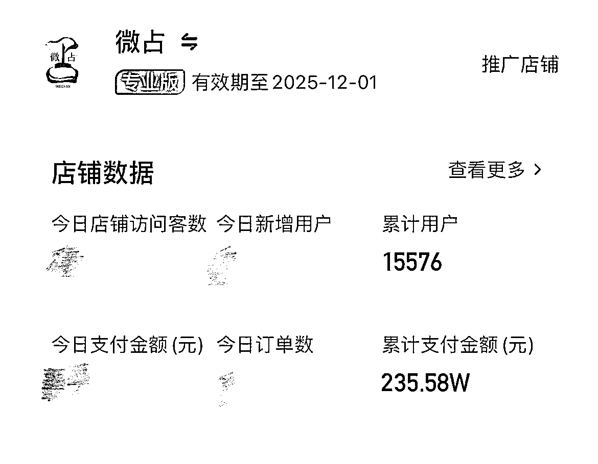
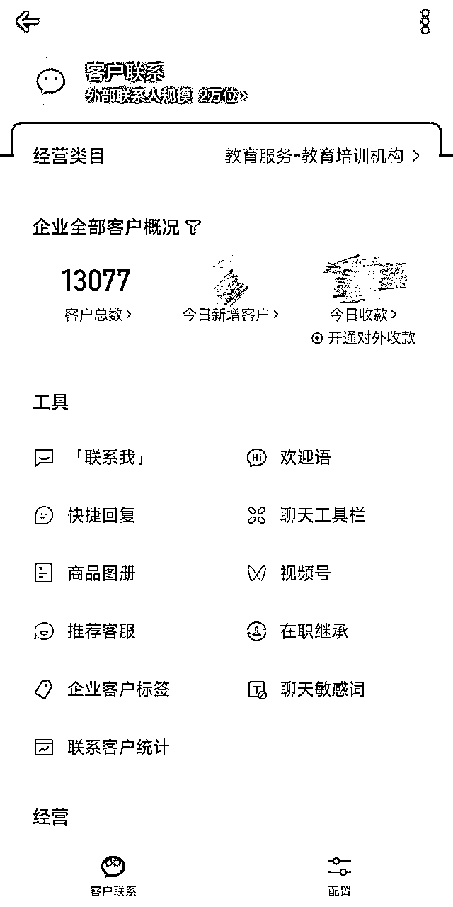
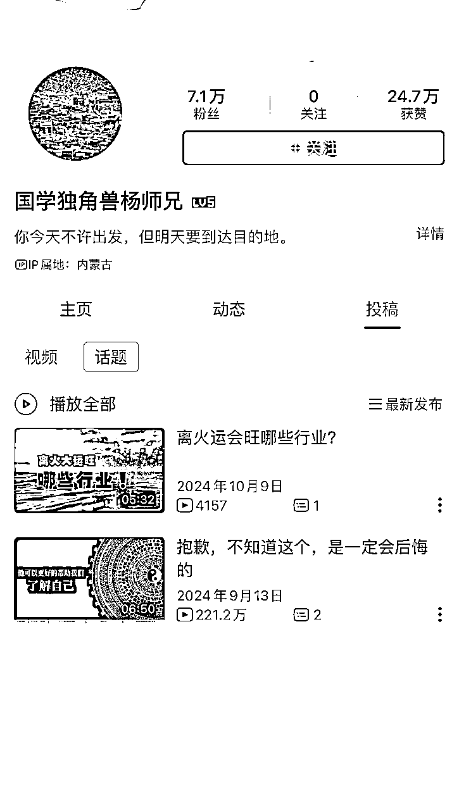
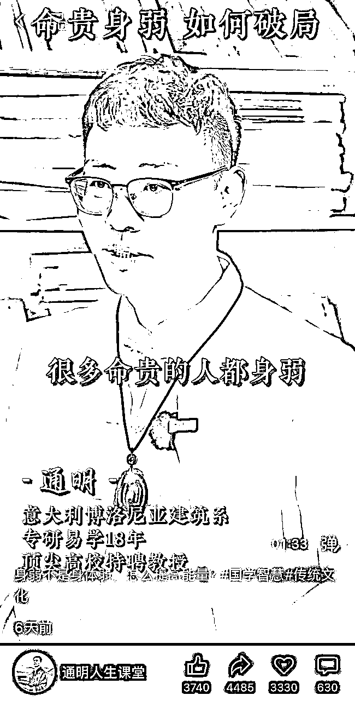

先简单介绍下自己。我是泓瑾，人在杭州。当年一毕业就进了某TOP3美妆公司，负责付费流量投放，前前后后花过上亿预算。常年待在流量圈，让我一直想找一条能长期深耕的赛道。

我挑赛道的标准其实很朴素：第一，流量容不容易拿；第二，毛利空间是否充足，能否用付费放大；第三，用户能不能沉淀到私域，价值不只赚一次。按这个标准，传统电商标品最先被排除——供应链拼不过人家，毛利又被平台压得明明白白，虽然入行门槛低，但如果没有成本优势，个人团队根本玩不转。我的看家本领是懂平台规则、手里有一批合作多年的付费流资源，所以更适合找那种产品体系相对成熟、容易复制、个体起步又不累的领域。想来想去，教育类最合适。课程产品在市场上已经很成熟，无论前端引流还是后端升单，都能找到头部玩家借鉴。加上我本人一直对身心灵有兴趣，大学在美国学数学时参加过很多冥想活动，还自学过西玄占星。所以最后敲定：国学/身心灵。

这个赛道表面上很玄，其实商业闭环就三大块：流量、产品、销售。一个一个说。

先说流量。做这个项目后，我最大的体感就是：流量是这行最核心的胜负手。目前审核相对宽松的平台主要是百度、快手和B站。

先讲讲我自己跑出过成绩的B站。很多人会忽视它，但前期效果很可观。2024年9月，我们在B站发了一篇爆款内容，一个月内全网播放达到1500万，吸粉10万，同时有1万人花了199元进私域，成了我们的种子学员。

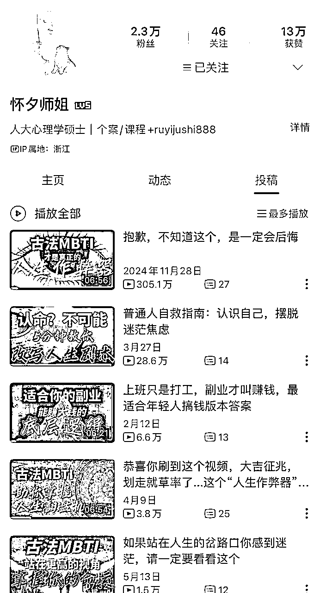

这条视频能爆，关键在于内容打磨和投流转化两手抓。B站对内容的要求在各大平台里算最高的，必须讲逻辑、有干货。当时那篇2000字的商业内容，精准命中了用户最在意的三个问题：我是谁？我凭什么教你？为什么现在要跟我学？有意思的是，爆款里的师傅全程没露面，只凭声音就给人很强的感染力——天津口音、四川口音，天然有记忆点。当然，能出镜更好，信任度会上去。我们从内容上线时就带着转化链接导私域，看到自然流量表现不错，果断加投，把爆款影响力放到最大，那一轮ROI也很漂亮。想知道B站打粉视频怎么做的朋友，可以私信我。

前期不管用什么方式吸粉，想把生意做长久，IP的分量一定比吸粉更重，特别是大国方向。我以前总觉得做IP太难，遇到好苗子、找到好操盘手都是可遇不可求。这轮实战下来才明白，IP成不成其实就是概率：30%靠本人，20%靠操盘，50%靠运气。想提高概率？多找几个种子IP同时试，跑得越多，成的可能性越大。如果有师傅看到这篇文章，欢迎来聊合作，也欢迎推荐身边合适的人。

AI在这个环节能派上很大用场：定人设、选话题、布置账号，连服化道都能快速搞定。选题定了，逐字稿也能让AI代笔，可以多试几个工具，比如豆包、Gemini，比较下哪个文风更合。把AI嵌到各个工作环节，是降本增效的核心，但工具的上限始终在人。我们自己就搭了一套AI工作流，用于内容和私域。

用AI测IP非常快，两周就能看出苗头，主要看数据以及师傅和团队的配合度。我最近签的几个师傅，在视频号发5条以内基本必爆。前前后后我接触了差不多100个师傅，其中有些人专业能力很强，但完全没有用户思维，压根不管用户要解决什么问题，自己讲自己的。加上不会用工具，产出速度有限，还有一些师傅不愿配合演绎我们给的爆款脚本。反过来，有互联网思维的师傅很多自己就能跑通闭环，只要会抄，再用上AI，内容根本不会断。自然流保持更新频率，总会有内容爆出来，而且爆过的内容还会继续爆。师傅嘛，既能接咨询也能教课。不过对大多数师傅来说，真正的坎是执行力和销转能力——你想想，一个人又得更新内容、又得引流接客、又得服务交付，工作量得多大？而且师傅一旦直接面对C端，销转反而容易做砸，因为接触多了就不神秘了，身价也就抬不起来了。

所以，有一定能力的师傅和靠谱机构合作是最理想的：剪辑等杂活交出去，专心做内容和交付，机构还能帮忙放大流量。销转更不用说，中间隔着“师兄”这一层，师傅的神秘感和客单价都能水涨船高，定期出来直播露个面，客户就挺感恩的了。

下面这几位都是从B站起家、闭环做得非常好的IP，大家可以参考他们的人设、选题和服化道。他们同步在视频号的数据也很能打。前期选定一个主平台非常重要，不同平台内容风格确实不一样。比如龙女塔罗，光充电就有13万，大航海一个月3千，还有自己的课程，每年收入保守估计上千万。

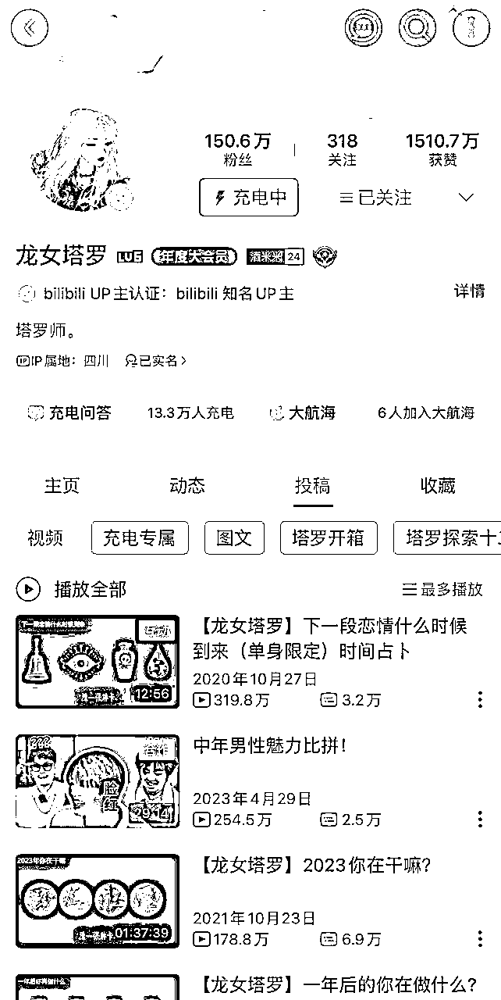
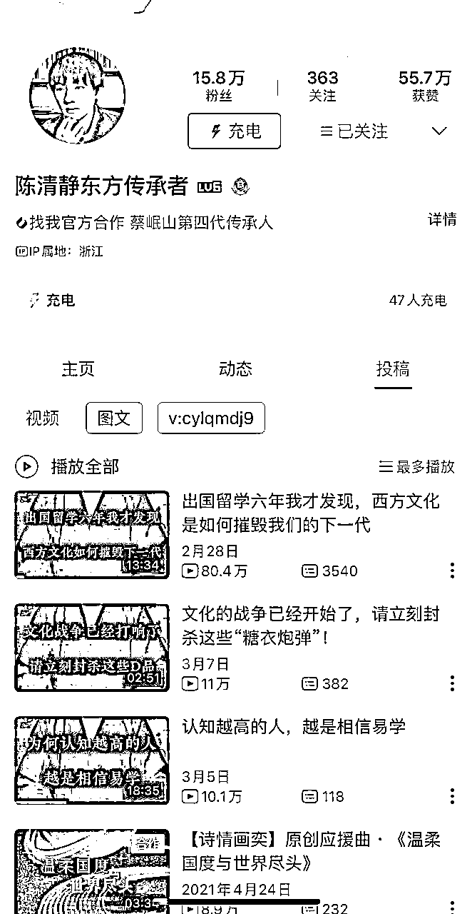
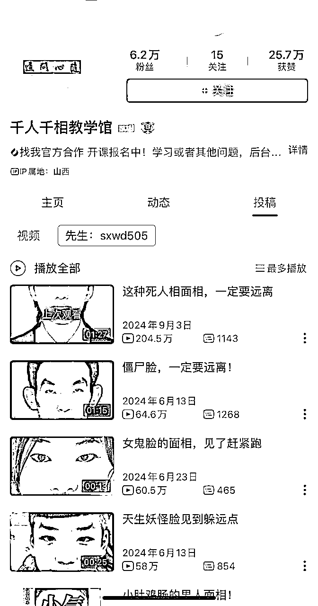

这个阶段的人员分工特别简单：不用单独配销售和店铺运营，也不分一转二转，从接线到升单全是一条龙。我会盯着师傅后续的内容安排，投放和剪辑直接外包。B站非常适合小团队/个人在初期积累种子用户。

再来看百度。传统大国公司主要靠百度AD和搜索拿流量，ROI大致在0.4到0.6，算上平台返点还能更高，人群画像偏中老年。所谓的传统大国公司，像苏州通义缘、大乾门这些。大国和小国的区别从产品端就显现了：大国主打教育，小国主打咨询、手串和法会。

大国除了百度，也会在抖音直播吸粉，但量总会有波动，抖音监管又严。前段时间不少公司出事，根本原因就是前端打不平，可后端销售还养着呢，必须保证进粉量，于是只能去买粉。买粉有三大坑：第一是压资金。大国转化周期比小国长很多，免费线索转3k的第一轮转化要7天，转化率通常只有1.5%到3%。从3k再转2w的第二轮往往要30到45天。要扛住这个周期，很多大国公司得在进粉上压上千万，所以做大国的门槛比小国高多了。像苏州很多大国公司，前端资金压力大，后端又没有容错空间，只能各种逼单、恐吓客户，结果就是投诉举报不断。第二是信任度低。买来的粉只能用强销售硬洗，因为对方不是被你的内容吸引进来的，信任不够，转化自然差。第三是容易被骗。身边这种例子太多了，你想买大国粉，最后到手的是睡眠粉、大健康粉。大国粉比小国粉贵得多，被骗了也没处说理，只能认栽。

回到百度的流量，搜索和信息流的展现一般是这样的——你搜“风水”，出现的大多是大国内容；搜“八字”，出现的大多是小国内容。

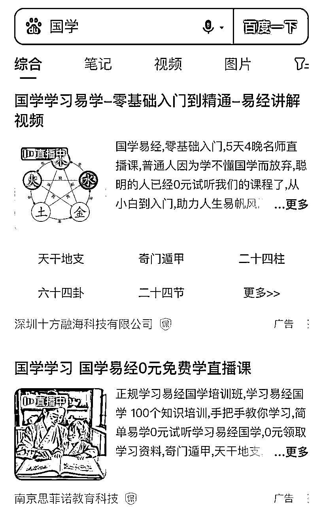
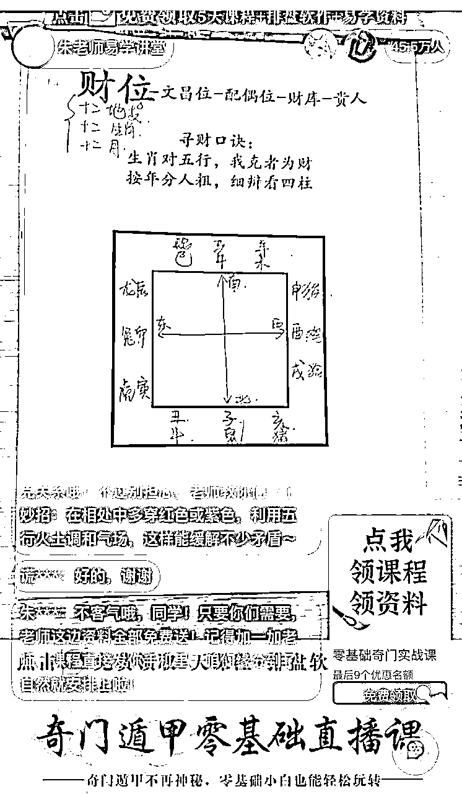
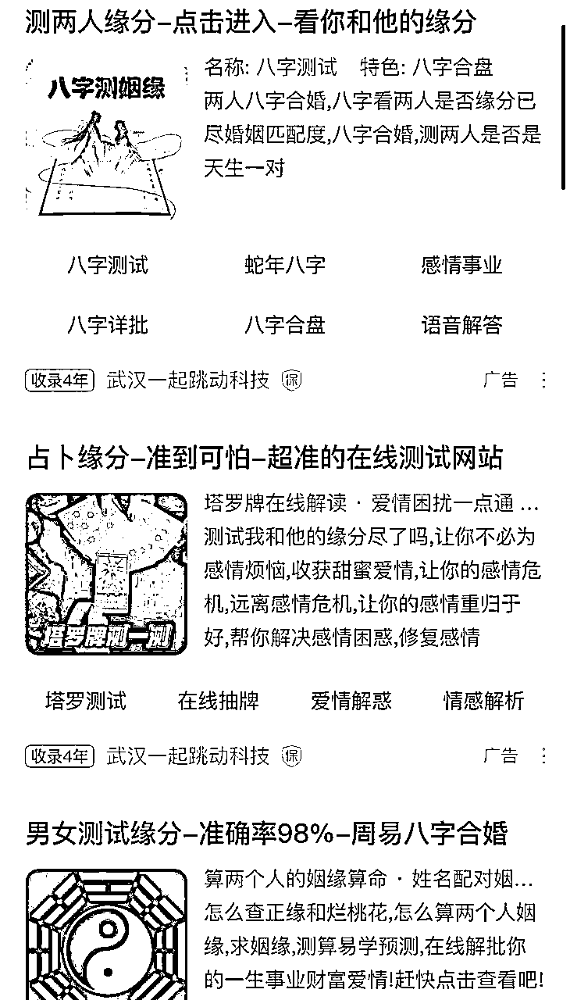
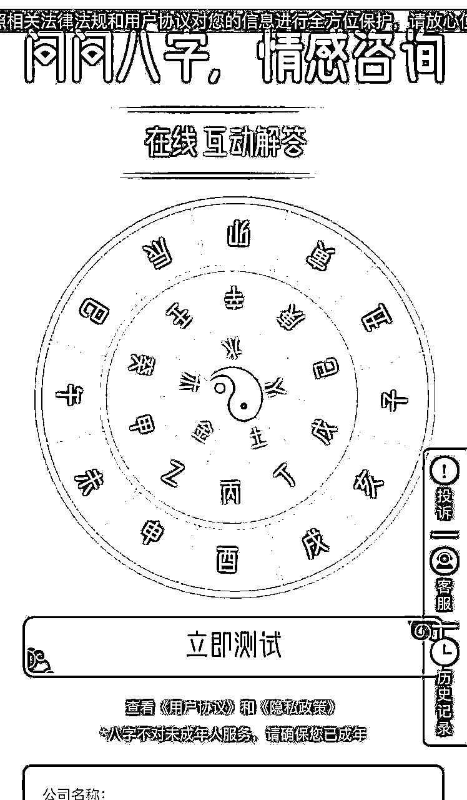

大国0元进线的交付产品一般是5天4夜的直播，包含八字、风水、奇门遁甲等课。百度引流直播间里，大部分在分析户型图，有真人出镜的，也有纯手播的，告诉你财位在哪、该摆什么东西。这类内容能让用户马上行动，掏出自家户型图跟老师互动：“放富贵竹行不行？”直播间还会用免费上课、领资料来吸引人加私域。这种爆款内容市面上到处都是，拿到就能播，不一定要自己写。小国的前端进线则一般是咨询报告，让你加销售解读。

整体来看，百度不太适合个人和小团队入局，无论是流量还是产品还是销售，每个环节都需要不少人力。

然后是微信生态。除了大家熟知的视频号，👸号的粘性也很强，还有那个容易被忽略的KOC分发。视频号最大的问题是卡审，自然流和商业流都躲不过。只要教育大盘的流量目标达标，平台就不会再给国学放量，审核就会卡得很严。说白了，对平台来说，国学只是补流水的小板块。

商业流内容一般是下面这两种形态，ROI只会比百度低，不太可能更高，但人群画像可能会优质一些。

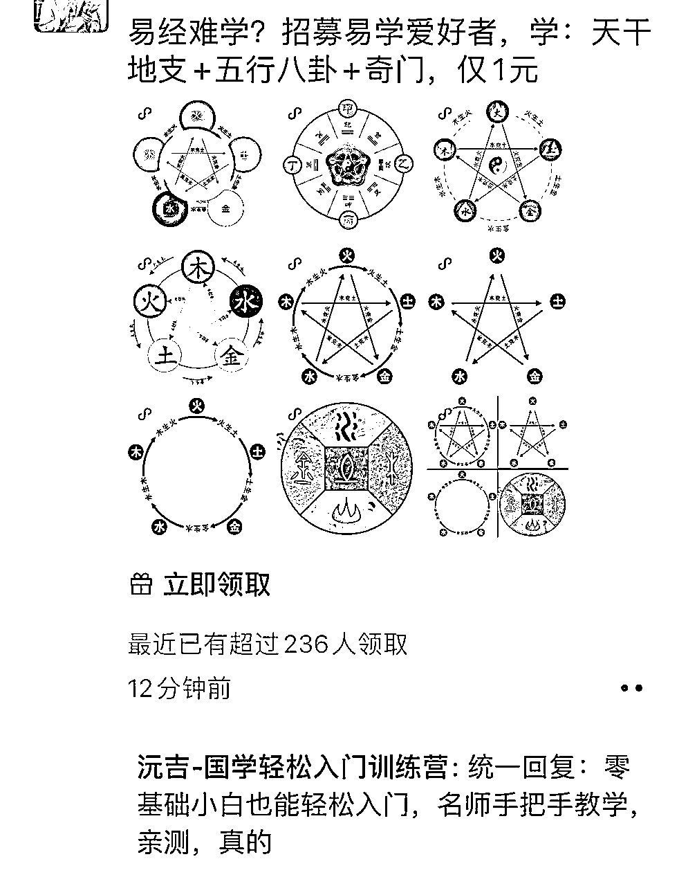
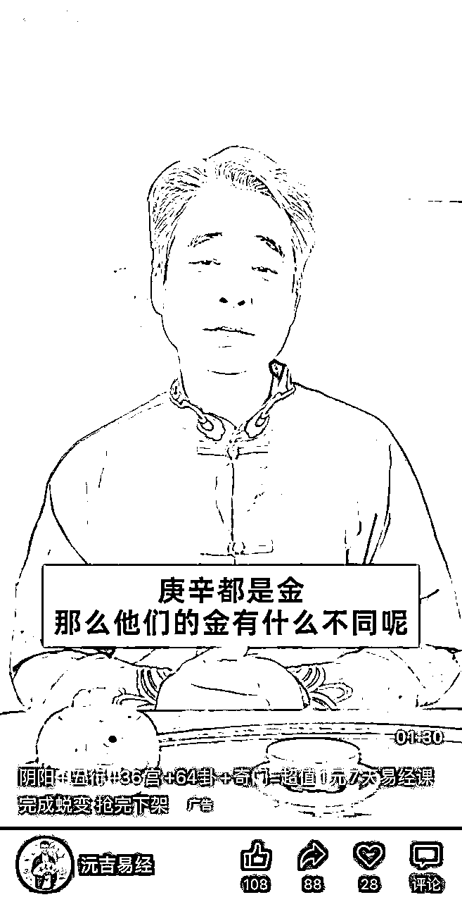

这种方式进线后的交付和百度差不多。如果能搞定开白，微信生态的链路比跨平台顺畅很多，一旦要跳转别的平台，多多少少会有用户流失。

“s智界s”是一个特别好的自然流玩法案例，也很适合内容能力强的个人和小团队。他们的内容风格和我们在B站的爆文很像，门槛不低，有点像半佛仙人那类知识区博主，不靠露脸获取信任，纯用干货吸引人，所以粉丝粘性极强，属于小而美的典型。我记得2018年我自己还不懂行时，就关注了他们的矩阵👸号。当时他们主要做小国服务，收费已经接近4位数，放到今天也远超市场价。这就是干货输出带来的粉丝忠诚度和高客单价。

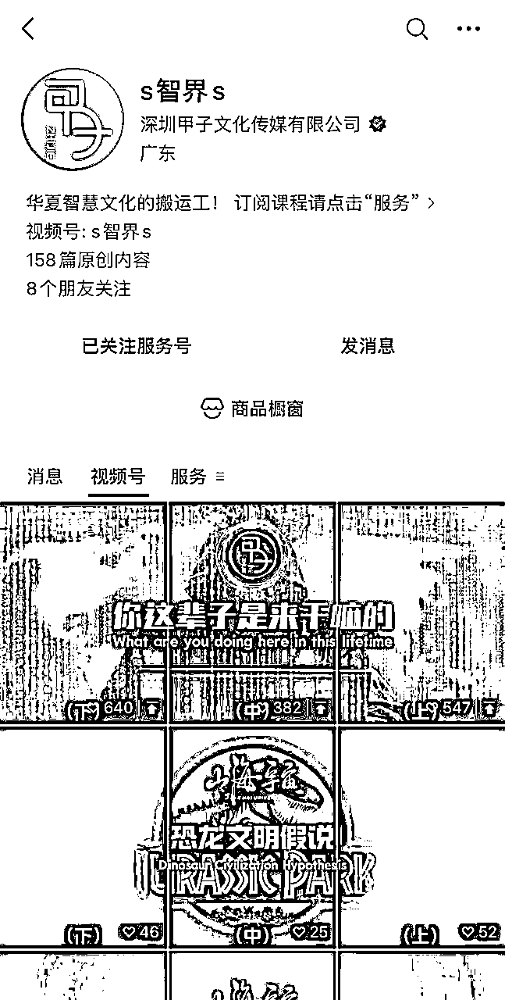
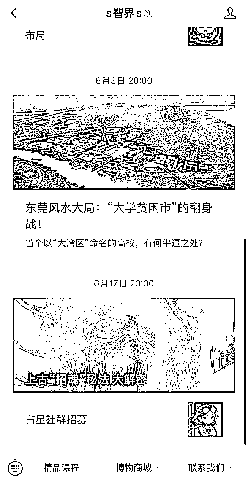
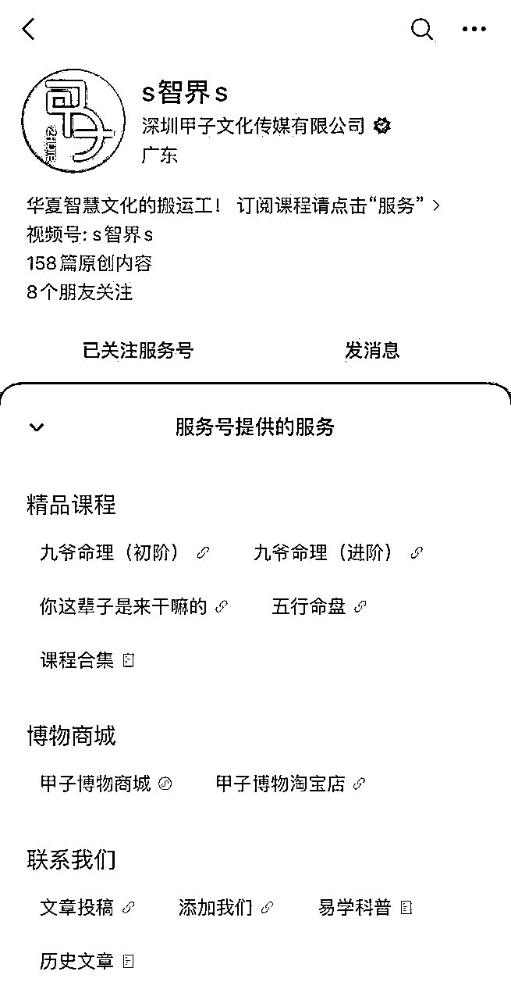
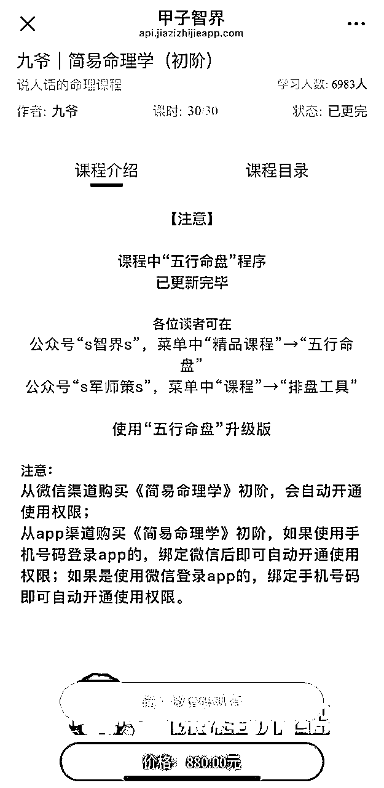

👸号还有一种KOC分发方式，很容易被大家忽略。标题都是“团队准备解散了”“您已关注xxx满一年，可免费领取”这种经典款，可以直接在长文里挂二维码引0元进线，也可以挂低客单的引流课。这个玩法的ROI远超想象。我认识一家做佛学的公司，就用这种方式进线，前端甚至还能赚钱。当然，佛学粉和道家粉差别不小：佛学整体体量小，全国大约3500万左右，而且佛学粉比较随缘，不像道家粉那样带着明确需求进线，可以立刻转化。佛学粉通常需要养一阵子，节奏没那么快。但盈利点在哪儿呢？他们买随喜、祈福服务不是一份一份买，很多100到300的链接都是十份甚至百份地下单。所以佛学产品也会做得更多元。

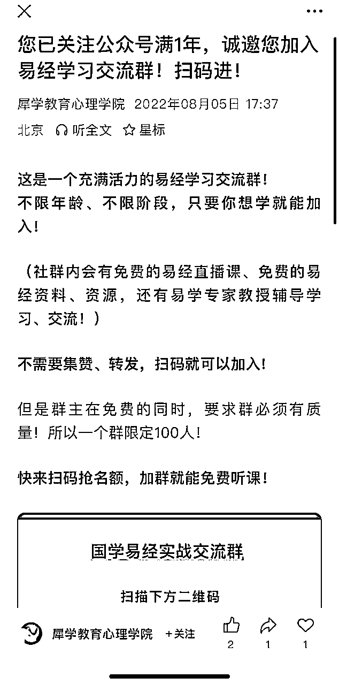
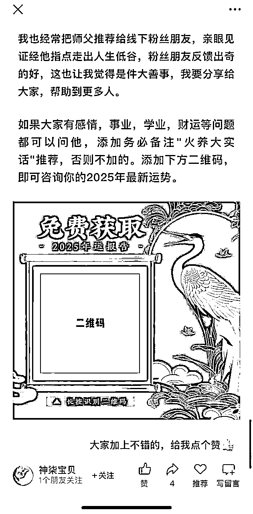
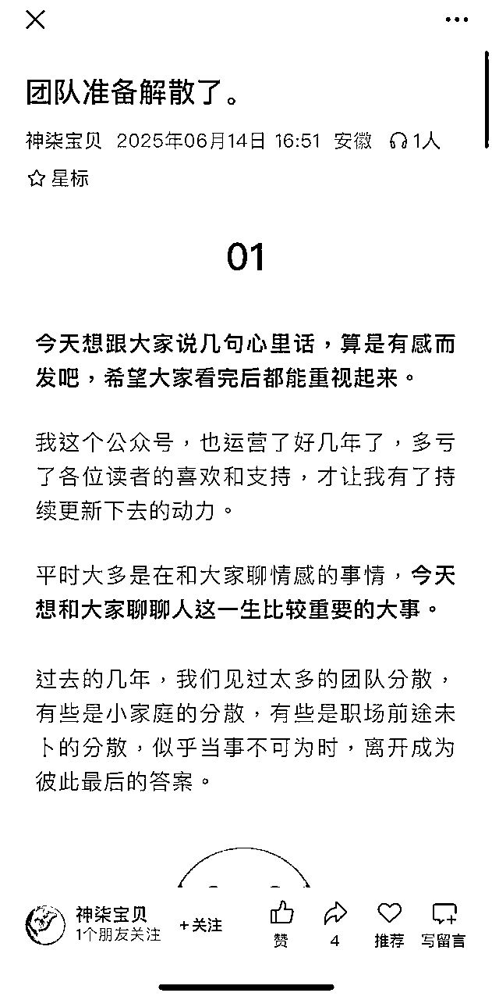
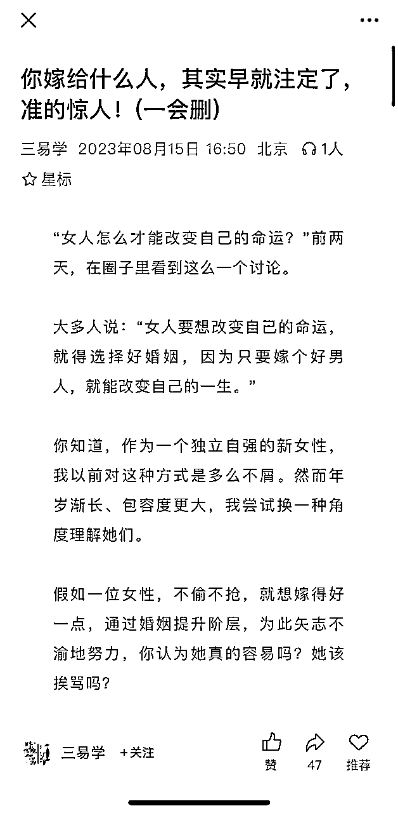

📕和快手我没有亲手实践过，只能分享一些听到的信息。📕商业流审核严格，基本以自然流为主，很多IP是西占方向，比如占星、塔罗。国学在这里除了开店铺账号，主要走“费号流”——批量起号发内容，或者去热门评论区截流。没准备300部手机的话，不建议尝试。

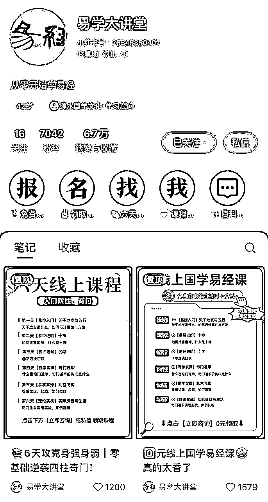
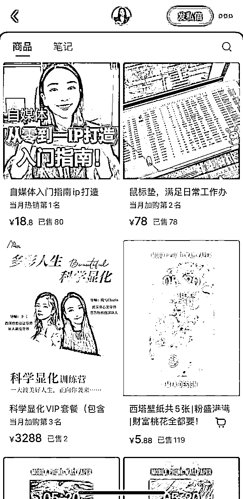
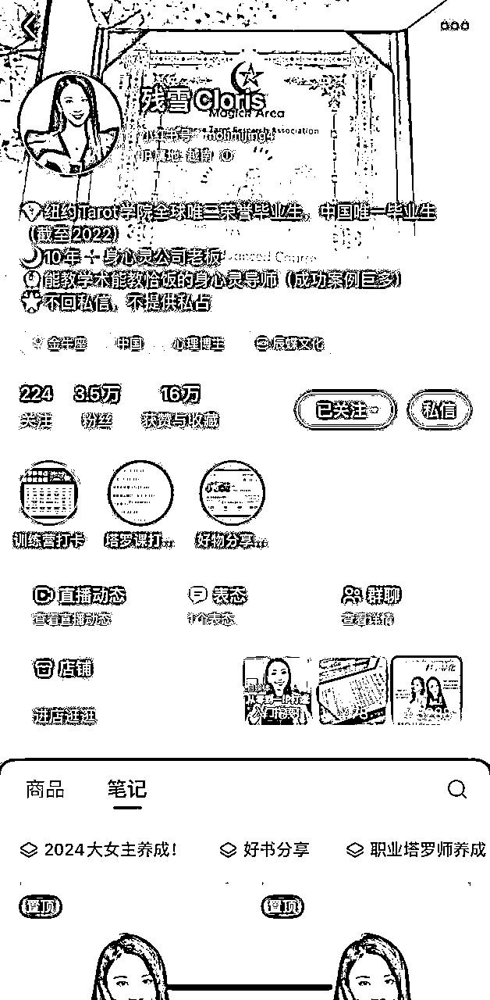
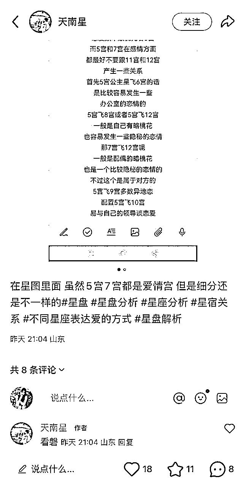

总结一下市面上的流量玩法。刚入局的玩家，选准一个平台并配上高效的打粉方式很重要，我个人推荐B站和微信生态。小国的进线成本比大国低，至于多少算合理，要看后端销售的转化能力。如果销售够强，很多公司能接受进线ROI低一点。综合我接触过的行业公司，赚钱的就两类：要么入局很早、已经形成完整SOP；要么前端就能挣钱，给后端留出容错空间。而前端挣钱这件事，不一定非得大团队才能做到，现阶段反而是个人和小团队更容易。我们自己的项目是付费流起量的，所以前期特别看重付费流。项目走到现在，我的心得是：前端想打平甚至盈利，IP就是最关键的一张牌，比什么都重要；其次是引流品，可以是课也可以是产品。下面重点讲产品+销转。

B站爆款之后，跟第一位师傅就散了，双方对商业的理解差距实在太大。那1万私域用户我直接送给他，然后把重心转向产品设计和私域运营。两个月后，我们复制出一个2万粉丝的IP，实现了100万的课程成交。说它是IP，其实并没有真人出镜，全靠一副有说服力的声音。那段时间我一直在测试IP的方向。

先聊引流品。国学赛道里流量是王道，但差异化的产品和精细的私域运营同样不可缺。市面上课程同质化严重，基本都是“免费进线+5场直播”的套路，内容也集中在八字、风水这些。传统大国公司的进线SOP大概是：每天催着看直播，一共5场，包含八字、风水、姓名学等，每场老师不同。到第三场就开始强营销，私域销售配合直播做跟单。第一道转化的人基本只会照话术念，没什么人味儿，只做筛选不做说服，所以传统大国公司从0到3k的转化率能到1.5%就不错了。

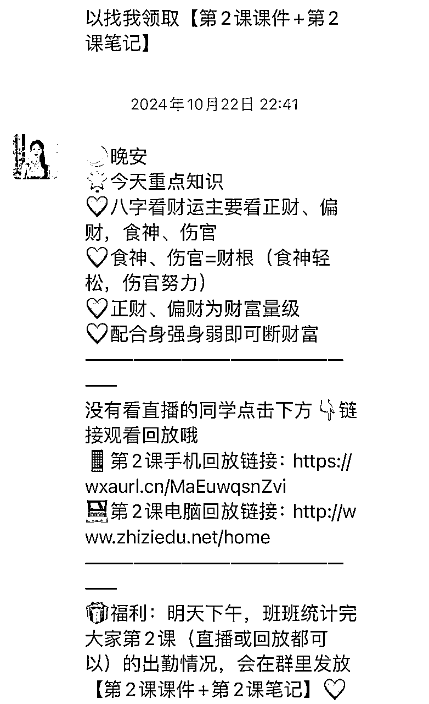
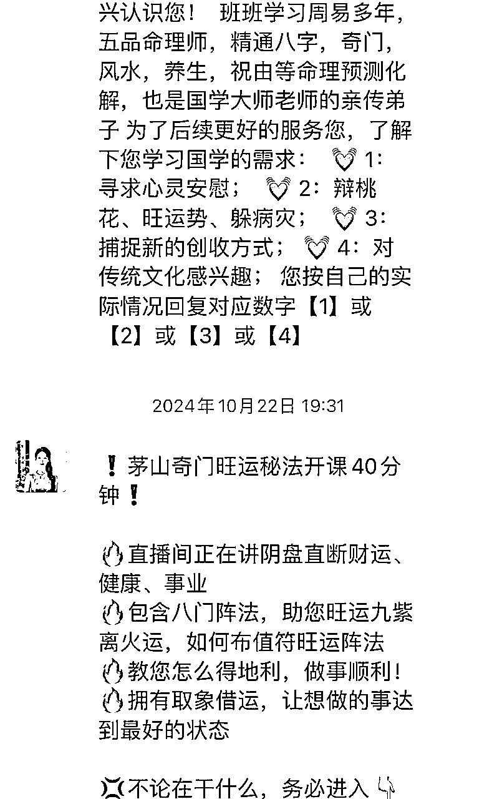
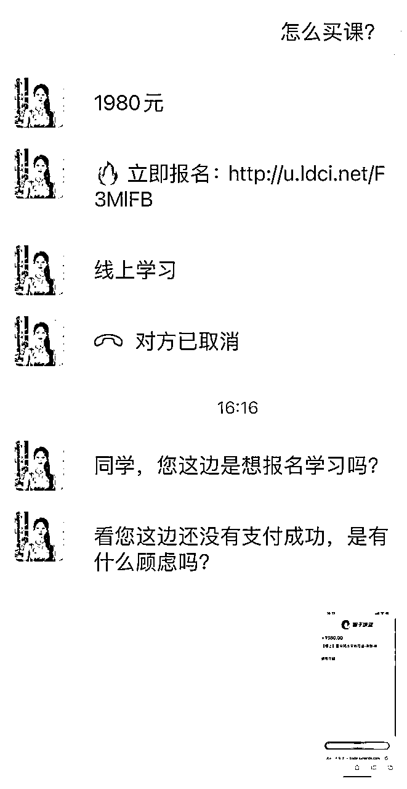
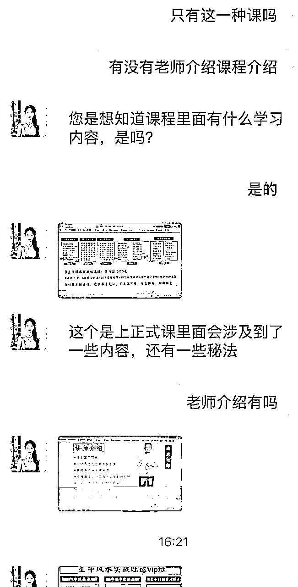
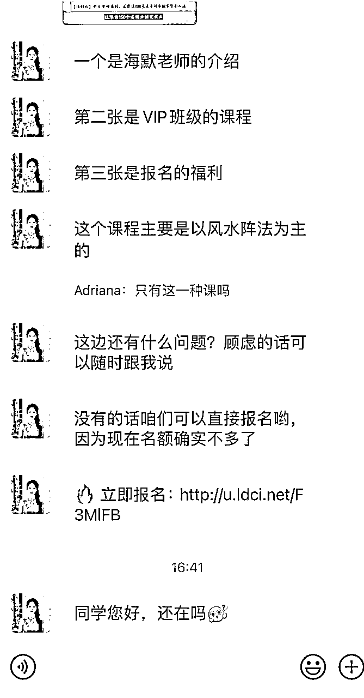

我们的引流品是几十节初阶课，内容由师傅提供，我们则给每节课精心布置作业，并埋好通往进阶课程的“钩子”，让学员学完还想继续学、愿意掏钱。初阶课程的前五天里，我们要求“师兄”和学员深度互动至少五次，高频交流可以有效建立信任。我们把二次转化的周期定成14天，给足学员消化吸收的时间。从用户进来那天起，我们会在第一天、第三天、第五天主动联系一次，第七天用直播做转化。即便很多用户最后没买高客单课程，也能转成咨询或手串这类效果产品。信任怎么建？靠师傅直播、朋友圈打造、1v1答疑、定期分享，让学员持续感受到价值，再慢慢把他们往高阶课程或服务上引。这样做下来，转化周期比传统大国短得多，而且没有退款困扰。

销转这件事，只要流量够，花点时间都能磨出好用的SOP，核心无非是话术和朋友圈。转化率高低和周期长短，取决于产品以及线索质量。但风险一定要盯紧。许多国学公司会给2个销售配1个风控，每天翻聊天记录。我们人手少，前期大部分聊天记录我都是自己每天看。做第一轮转化的人，哪怕对国学一窍不通，只要按流程来也能签单；到了第二轮转化，就必须具备一定的专业知识，一般这个角色能扛起公司七成业绩。反过来，小国公司想升级成大国很难，可大国公司通常都会捎带着把小国业务也做了，毕竟真正想系统学习的人只是少数，小国测算才是刚需。

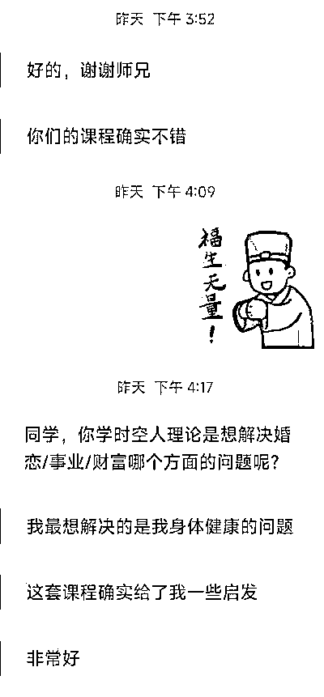
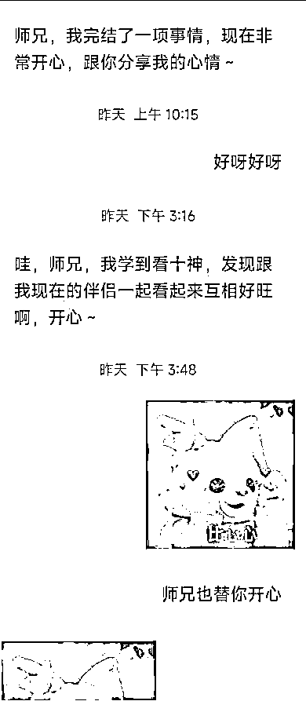
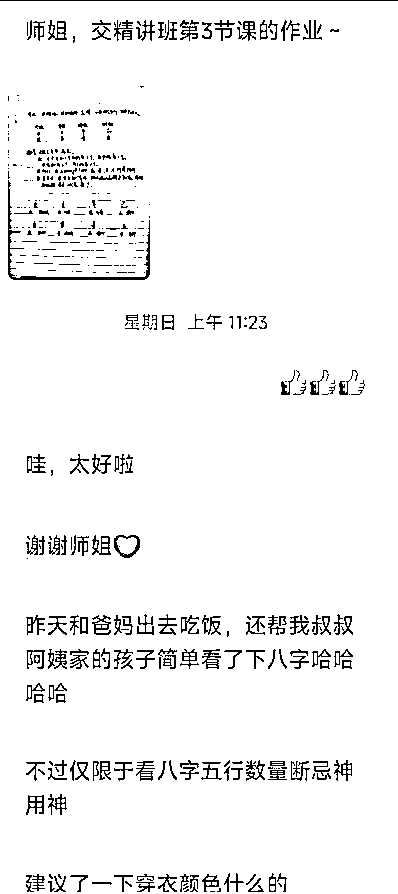
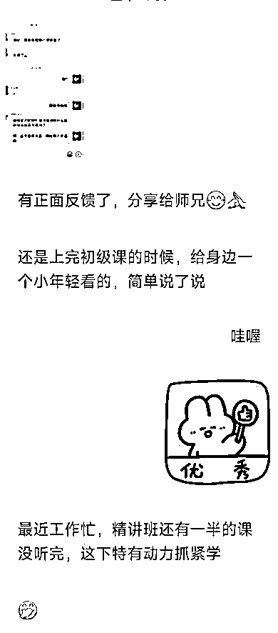
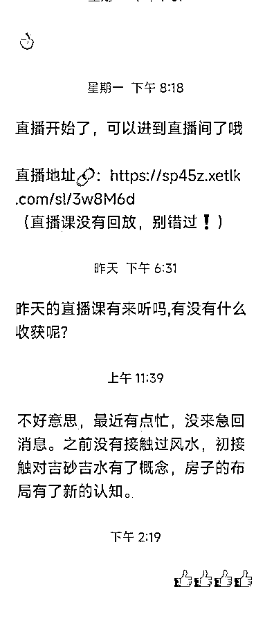
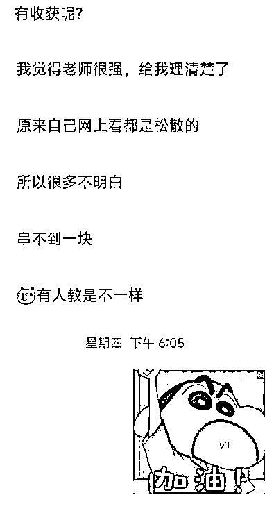

抖音平台最近冒出不少好玩的引流品，比如给负债老板准备的聚宝盆，给学生家长准备的文昌塔。这些产品的本质还是满足情绪需求——焦虑、迷茫。以前刷到的佛学唐卡、道教书籍，客单很难过百；这些新产品客单就高多了，我估计卖1万件问题不大，卖完马上换新，还能顺势沉淀私域。直播间里的老人家都是绿幕，主要是主播在卖。IP合适、品也合适的话，前端想不赚钱都难。

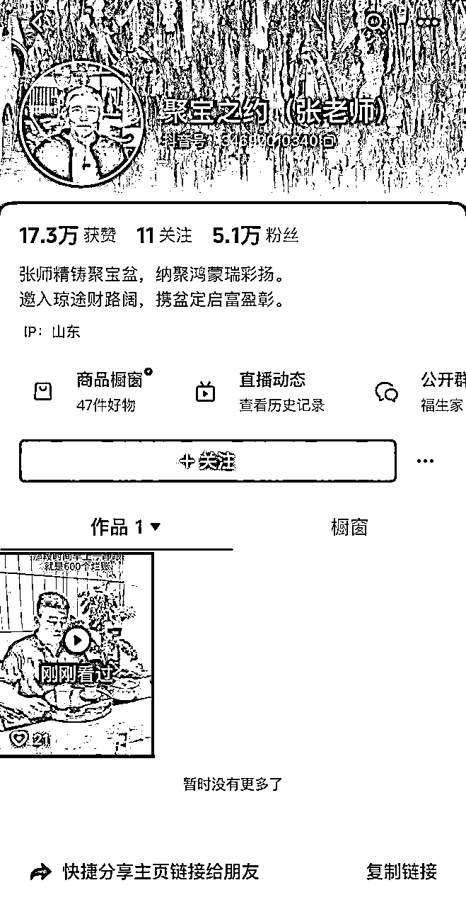
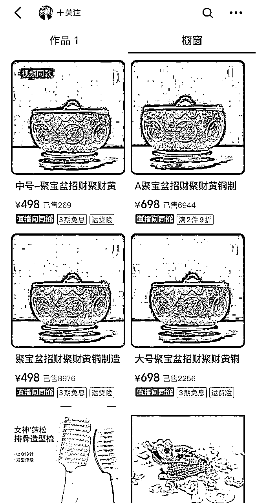
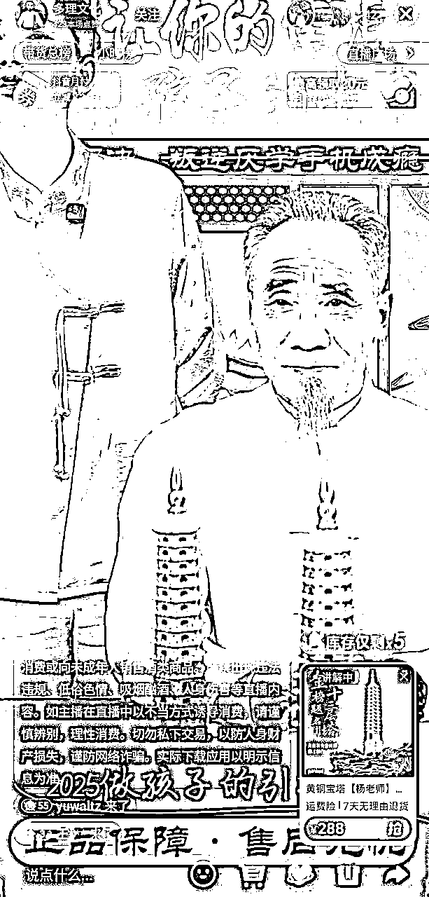
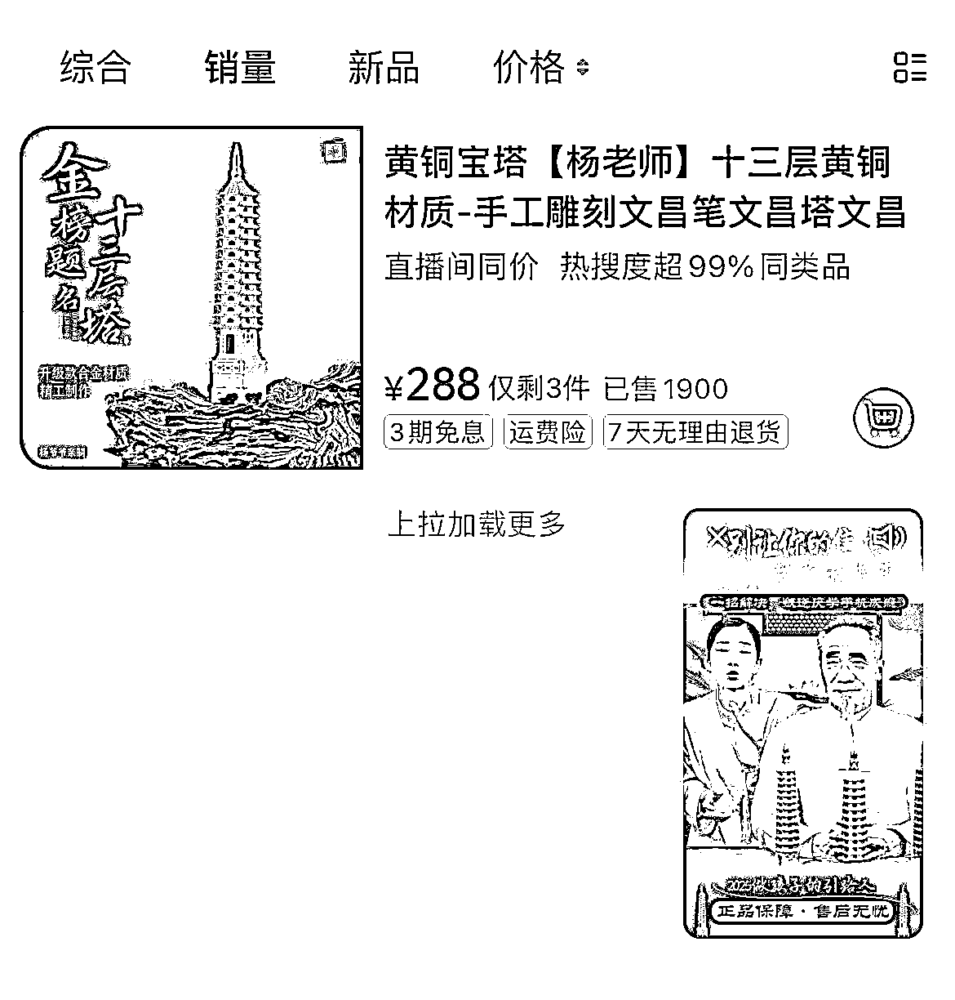

大国的后端靠进阶课和线下课撑场面，交付别出大差错，就不会有硬伤，可以说是整个商业闭环里最不重要的部分了。

最后总结一下什么样的人适合入局国学赛道。一类是懂内容、懂流量的人；另一类是懂产品的人；销转真的没那么重要。如果你懂流量，无论自然流还是商业流，都可以广撒网去做国学IP。如果你本身就是师傅，授课、咨询都拿手，也有出镜口播的能力，欢迎找我合作。但一定要想清楚自己的能力点位和资源点位，手里有什么牌就打什么牌。刚起步时能打出爆款，离不开你熟悉的内容团队和商业流团队的支撑。

本期就先聊到这里了。

这个项目目前还在推进和打磨的阶段，我自己也在持续学习和迭代中。对一些想做内容增量的国学老师，也很期待能有机会携手共创；同时也希望可以认识更多理念相近的伙伴，多聊多碰撞，一起把这条赛道的潜力进一步打开。