# 民生赛道流量主冷启动打法：先用轻内容做信任，再切长文变现

大家好，我是辰风。今天拆解一套我在实操中验证过的起号思路，方向主要放在养老、民生、社会议题上，配合流量主变现，节奏偏快。

这套做法我亲自跑过，体感很猛。适合已经有提示词积累、能做矩阵的团队。个人单号也可以试，但效率会差一些。我会从平台认知、冷启动方式、踩坑记录这三块展开。

我们当时铺了大量号，最终整体回本没达预期，但方法本身是通的。单条最高收益到几千，爆款阅读累计几十万。以下数据为5-6月测试期，最新环境是否仍能用，请自行验证：

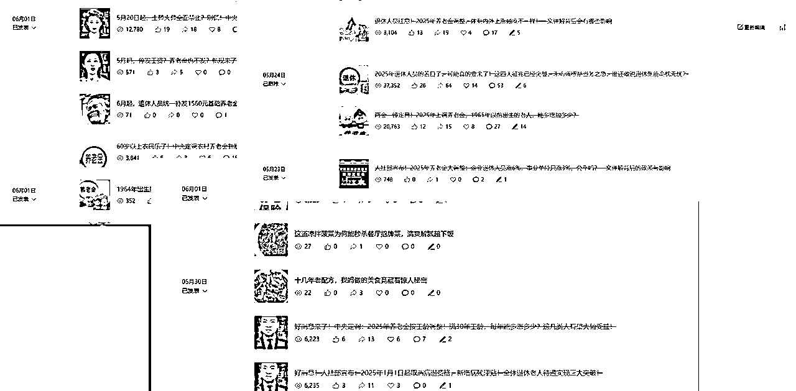

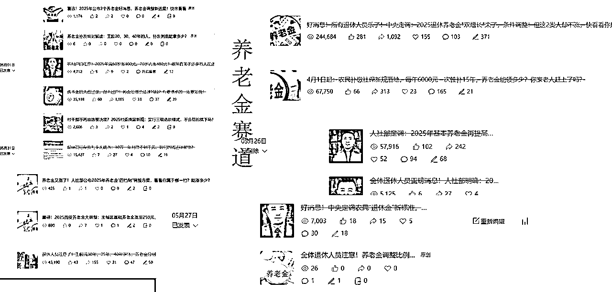

# 01 冷启动期，用轻内容完成信任积累

刚起号时别急着上主线内容，先用轻量图文养号，连续发5-7天。

轻图文指什么？就是偏生活、分享感强的图集类，比如美食、旅行、穿搭、宠物、绿植、美甲、文物科普等。用户接受门槛低，互动也相对友好。

测试里有账号靠这种图集拿到过上万阅读，甚至十万级别。

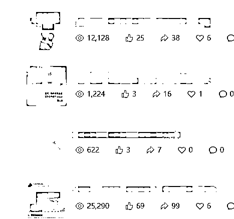

这类内容能帮助新号快速拿到基础流量和关注。👸号对新号有一个初始权重观察期，通过持续输出轻内容，可以让系统建立初步信任。

切入口不需要和后期主线一致。可以先做文物、宠物、绿植等话题，等基础积累完成后再切回民生长文，推送效率会明显提升。粉丝增长速度也会超出预期。

经验点：
刚开始最忌乱发。平台给新号的保护期和权重积累非常重要。轻图文的价值就是平稳过渡，拿第一波曝光和活跃。也有新手保护的意思。

## 同行参考

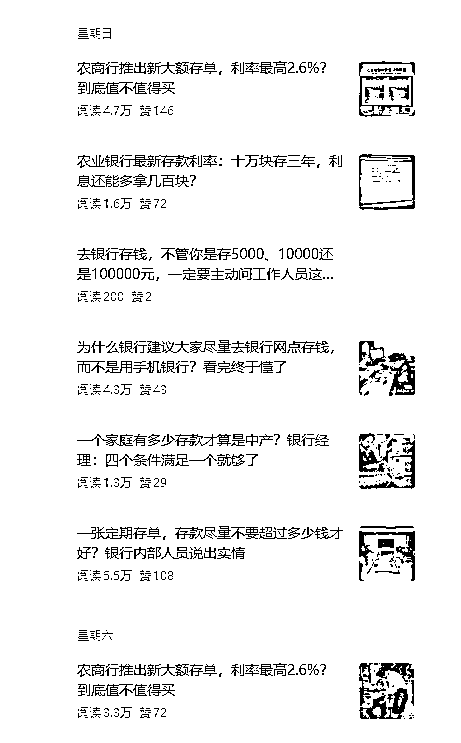

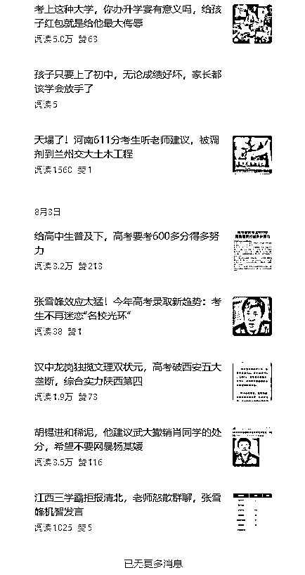

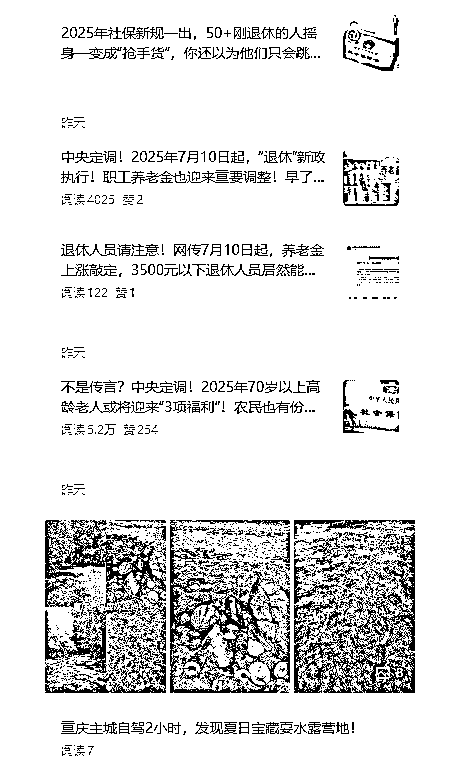

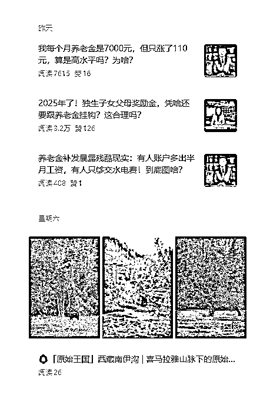

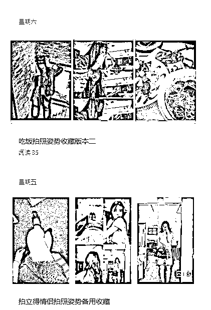

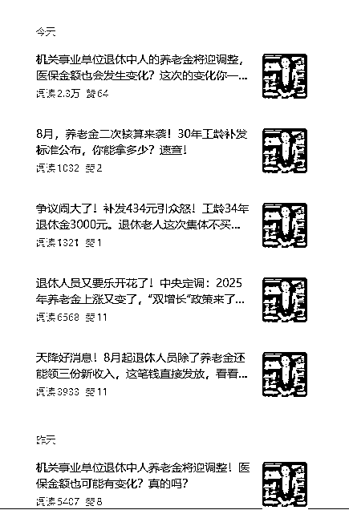

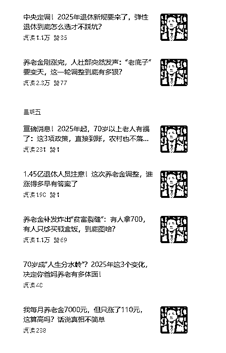

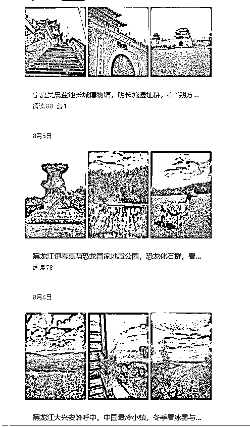

## 冷启动操作要点

内容选取
起号初期可先发美甲、文物、宠物等轻话题图集。这些题材吸粉快，且不限制后续定位。

频率与节奏
建议连续发5-7篇，每天一篇。权重不足可继续补。发布时不要统一群发，错开时间，避免号被判定为营销号。

内容处理
* 标题：要抓眼，有关键词，信息完整。
* 配图：清晰美观，推荐3:4比例，6-8张为宜。可做边框、滤镜、裁剪等二次处理。
* 文案处理：可用Kimi、豆包等工具做改写，提升原创度。

养号周期
一般5-7天，条件允许可压到3-5天完成基础积累，然后立刻转长文。

# 02 切主线后，反而更容易爆

很多人担心转赛道会掉粉。流量主号的核心是单篇收益，对粉丝粘性依赖不高。内容够吸引，爆款自然来，广告收入跟着涨。

我最初也犹豫过，怕前期轻内容和后期民生稿不搭。结果切换后流量稳定，反而因内容更垂直，吸来更多精准用户。

切换当天就出现一篇阅读破十万，流量主到账500+。那一刻能明显感受到平台的推荐红利。

经验：转型期不必纠结掉粉。号没数据就注销重开，矩阵玩法就是滚动开号。

* * *

# 03 写作借助AI，但要做人工校准

AI在信息检索和框架搭建上非常好用。调用知识库、收集资料、搭骨架都可交给它。

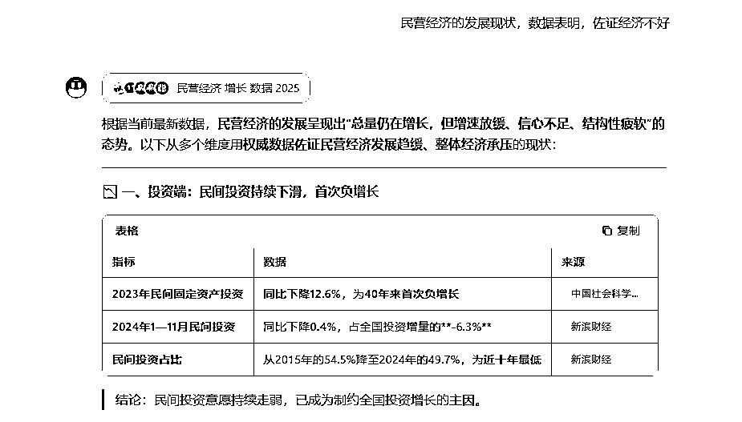

写作时可先让AI输出基础框架，再把对标爆款的素材聚合成小知识库，最后用提示词驱动生成。生成后要自检相似度，控制在20%以内，收录更稳。

效率提升明显，尤其适合批量生产。但AI输出易同质，务必人工润色，否则很容易被判定为低质。

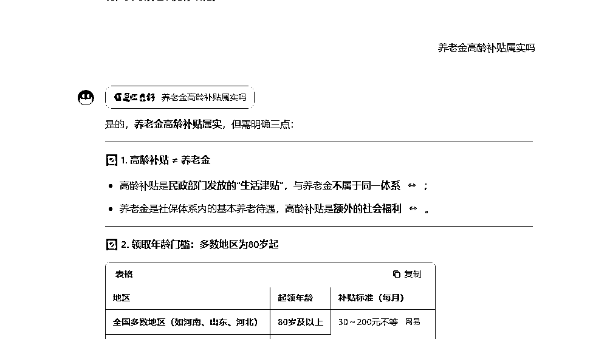

# 04 适合矩阵而非单号

这套打法很吃规模化。轻图文可通过工具批量采集发布，长文也可自动化排版。

本质是一波流：养几天号，快速出量，变现后收割。单号能玩，矩阵能放大收益。

比如同时运营5个号，一个爆款打法复制到其他号，流量会连带拉升。但前提是已有提示词能力和批量经验。新手需要先熟悉节奏。

经验：我做矩阵时常做内容分发，短期内批量吸粉，再通过长文转化。

# 05 实操总结

## 内容为王，防号死亡
阅读、转发、互动都是质量信号。长文若无价值，流量会断，号易死亡。流量主有基础扶持，但用户兴趣才是关键。

## AI审核严，提示词需多测
平台对AI内容审核严格。不要用默认提示词重复生成，要多做模板测试，确保每篇有信息增量，避免模板化。

## 选题对标但要核实
可对标👸号及头条的热榜话题，但民生议题敏感，发布前必须核实真实性。虚假信息会导致封号，无收益。流量起来后随时观察舆情，不对劲就删。

## 结构要创新
AI易产生固定框架。长期创作要打磨结构和切入角度，保持差异化，否则读者疲厌，平台也易判低质。

## 查重只是参考
朱雀查重只能作参考，不能决定价值。真正留住人的仍是创新、共鸣和深度。改变视角和结构就能避开工具检测。

## 热点可反复深挖
社会热点、民生痛点具备持续流量潜力。同一主题可换角度、加新案例再写，但要避免换汤不换药。

## 策略要随赛道调整
娱乐号可直接长文爆款；社会议题号更适合先用轻图文积累。再无万能方法，只有灵活调整。

## 把握推荐机制
起号期平台看互动、阅读、分享。持续输出高质量内容才能拿到更多推荐。结合AI批量积累，缩短冷启动时间。

## 做细分而非泛化
流量主忌泛泛而谈。民生可细化到养老金、退休政策、丧葬补贴、医疗报销、生育津贴等。越细定位越准，单篇价值越高。

最后，感谢看到这里，祝大家都能找到适合自己的变现节奏。