# 素人0投放做小红书，一年做到104万 GMV，4个翻车坑和2个坚持心法

> 来源：[https://uwk2kh7dn8u.feishu.cn/docx/JJjPdocqfoY18DxAxl9clqasntg](https://uwk2kh7dn8u.feishu.cn/docx/JJjPdocqfoY18DxAxl9clqasntg)

## 一、关于我

1.  我的变现历程

大家好，我是木棉。

*   原生财有术的HRD兼投资孵化负责人，2024年4月拿到亦仁老师微天使后开始试探方向。

*   2024年7月正式启动项目，11月拿到首笔现金流，当时还在纠结要不要回去上班。

*   2024年12月底正式all in创业，2025年1月注册公司组建团队。

*   现同步运营两家公司，解决中小企业从0到10的成长阵痛，21个交付团队覆盖全国。

*   内容和流量完全是小白，0基础从小红书起步，坚持12个月，单号最高涨粉3.9W+，零投放私域引流8000+，实现104万GMV转化，合同总额含尾款。矩阵号13个，全网粉丝累计20W+。

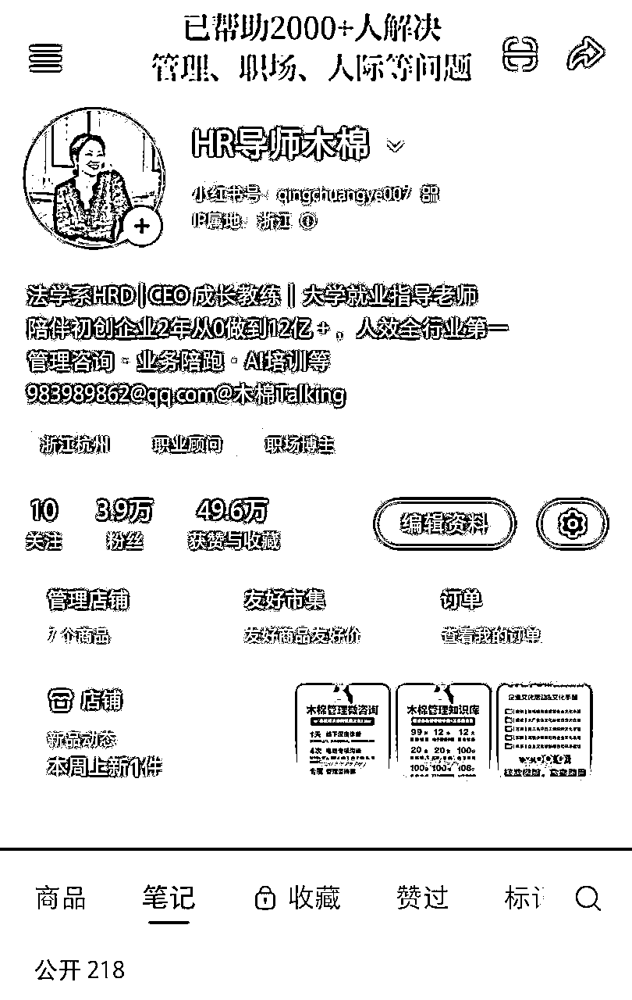

*   笔记层面，个人号累计218篇，3篇破万赞，其中1篇破100万播放、2篇破50万播放；千赞笔记34篇，平均每10篇能出1篇千赞爆款，约3.5万播放，单篇平均赞藏2275。

*   春节期间的「原生家庭」系列引发超过50万人共鸣，被小红书与综艺《一路繁花》联合推广。

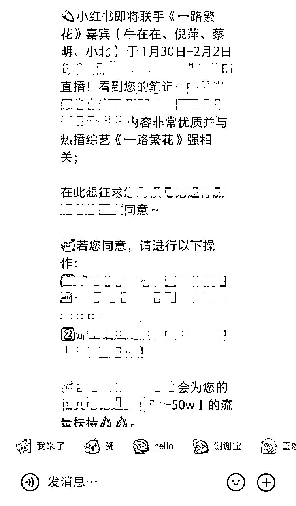

*   过程中也收获了不少同行支持，关注我的博主多在20-40W量级，甚至女子自由式摔跤世界冠军洪雁夫妇也来互动交流合作。

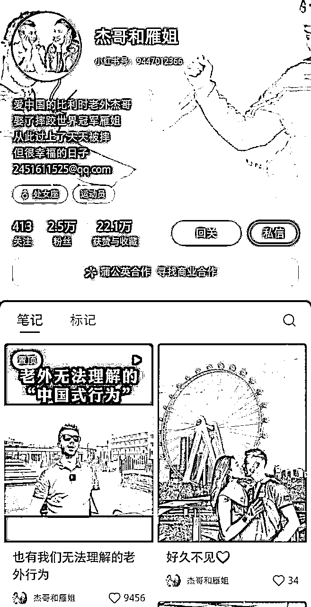

1.  为什么分享

我曾被“3天起号”“月入10万”的案例激励，也被反复打击。作为一个纯新手，我想把真实的路走法告诉你：

*   普通人想在小红书变现，要闯过哪些关卡？
*   高客单IP怎样快速出成绩？
*   用笨办法怎么把90%的对手耗掉？

## 二、项目复盘

1.  当初为什么选它

*   平台处在上升期：从财报和品牌投放变化能看出空间很大，感觉像2021年的抖音，我当时就在抖音亲身经历过那波增长。
*   获客成本低，链路短：一篇笔记的长尾效应能吃三个月，首页直接沉淀到私域成交，精准人群愿意为高客单买单，咨询类服务的案例已经验证。
*   试错门槛低，适合新人：一个人就能开干，一部手机加1000元保证金即可启动。小红书的去头部化与新人扶持给了素人快速起步的机会。

1.  商业逻辑、产品、流量、转化怎么搭

*   产品体系：

1.  引流层 0-99元｜沉淀粉丝
*   爆款笔记同款《劳动合同》《文化手册》《管理干货》引流，引导进私域领取

1.  入门层 19.9-499元｜建立信任
*   《管理工具包》《管理知识库》及线上培训课程
*   交付加码：配套小红书私域答疑

1.  核心层 7999-9800元｜主力变现
*   私域深度种草成交组合：
CEO管理胶囊：4次1v1诊断+工具库
团队管理闭门会：线下+线上复盘

1.  高端层 10万+｜深度绑定
*   定制化服务：
年度顾问：战略会、团队管理等
企业定制：薪酬绩效、股权期权等
CEO成长陪跑：商业、领导力、组织等

我的体会：在小红书，高客单成交=专业内容×信任积累×精准筛选。我现在的做法是先用随喜解决具体问题，再用1个月验证7999元模型，再逐步释放高价服务。

*   流量打法：

小红书流量公式：大字报封面+清单体干货+争议或引导式结尾提问
封面思路：职场干货+管理痛点，人群+痛点+痒点

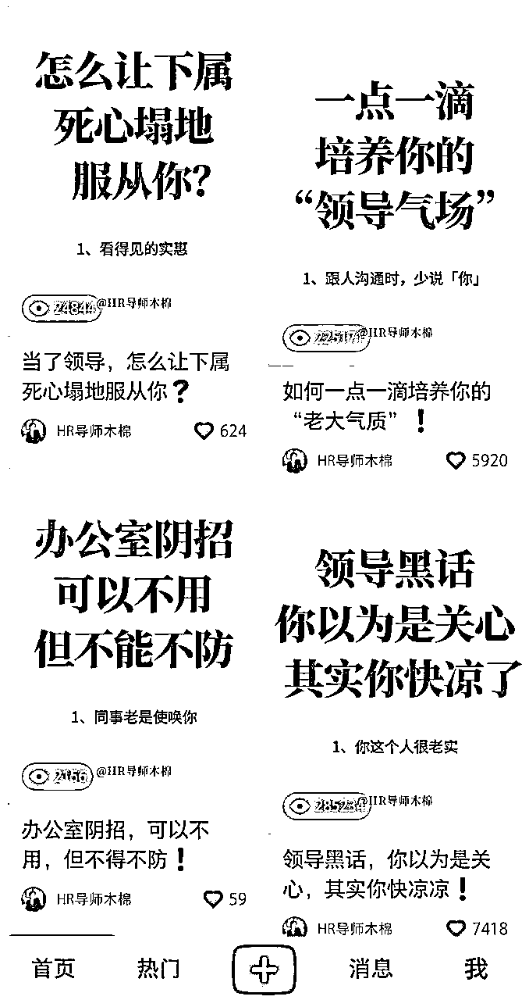

*   转化三板斧：

主页钩子：置顶笔记送《管理避坑手册》/开放免费咨询
朋友圈养信任：每周更新3条，CEO陪跑学员好评+个人觉察感悟+共性问题解答，全部真实素材，主打佛系营销+大活人感，可参考我的朋友圈。

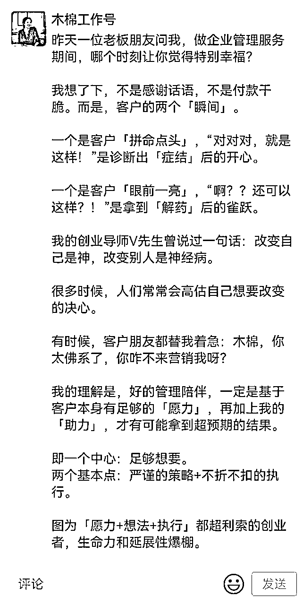

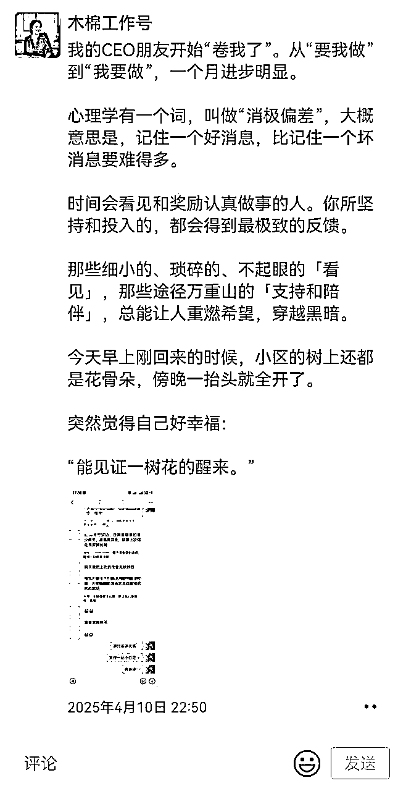

PS：这块我做得并不算精进，主要是我比较佛系且精力有限，只想把心里真实的想法写出来，营销动作做得少，一是不想硬卖，二是不想虚假宣传。

促进成交的细节：

起步期 免费-付费过渡：
*   所有咨询我都认真回，结尾加一句“如果有用，随喜红包即可”，9成以上会发红包
*   把高频问题整理成《读者常问TOP10》，后期做付费素材

高价期：
明确门槛：1v1深度咨询 9800/小时，熟人介绍可随喜

“佛系转化路径”大致如此↓

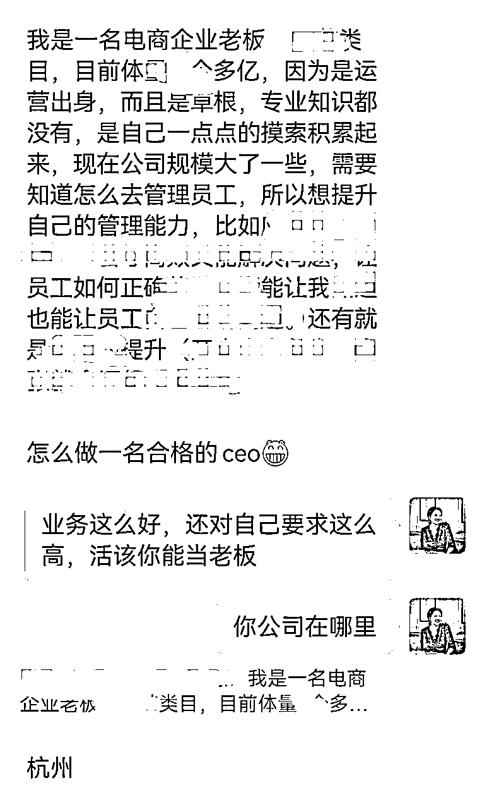

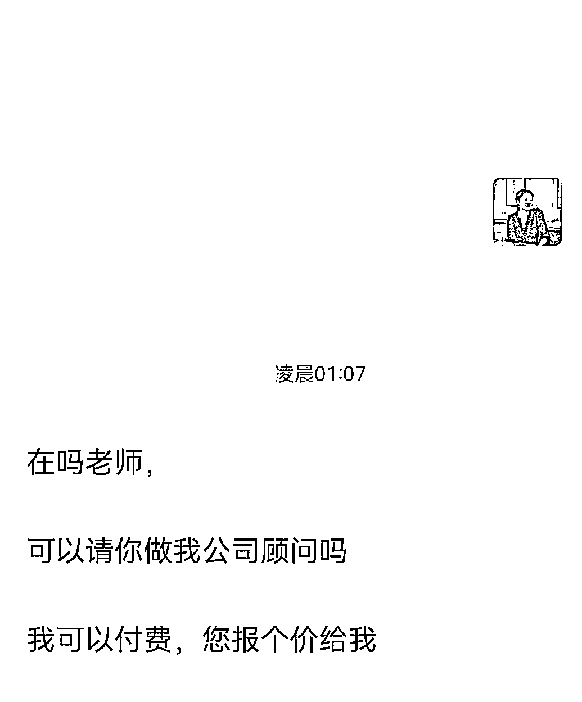

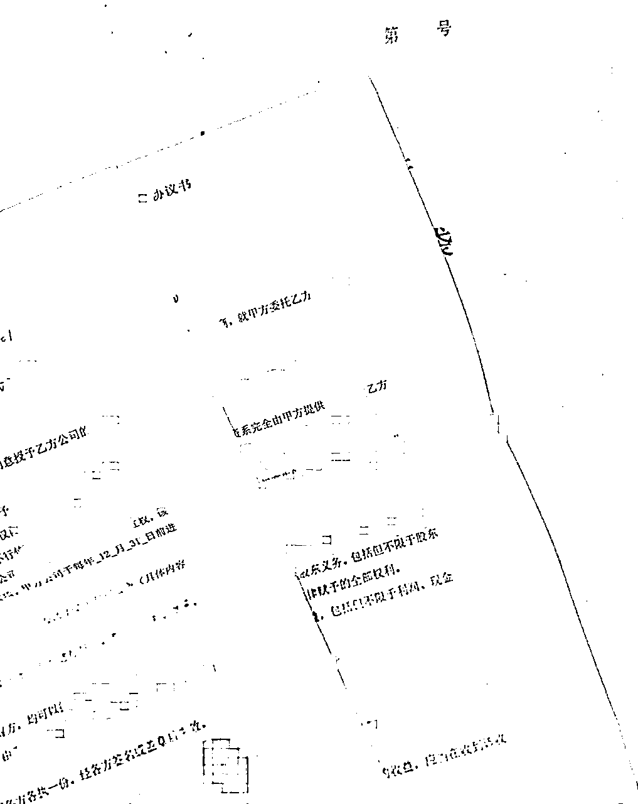

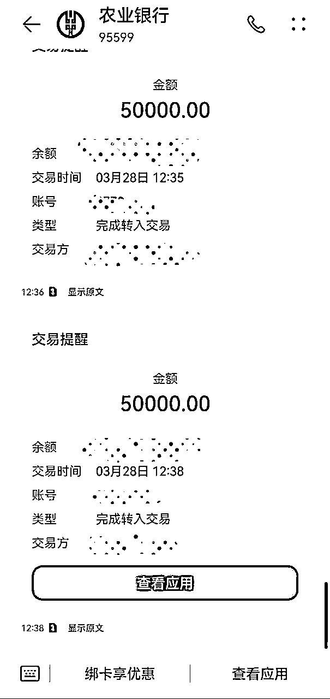

1.  我能走到现在的关键点

*   赛道卡位：

1-小红书职场博主占比小，和我类似背景的人多聚焦HR、企业管理，偏专家感输出。
2-「职场+管理+女性成长」结合「赛道专家+知心姐姐+女性创业者」的人物定位相对稀缺。

我的底牌：小镇出身，双非法学，10年HR，从月薪1900管培生做到年薪百万高管后再创业。10年人力管理经验，带过30+销售团队，管政府关系、新业务投资孵化等。曾助力初创企业两年GMV从0到12亿，登顶国货第一，人效全行业第一。

涉猎面比较广，所以能写的内容层次也比较多，每一段经历都算积累。

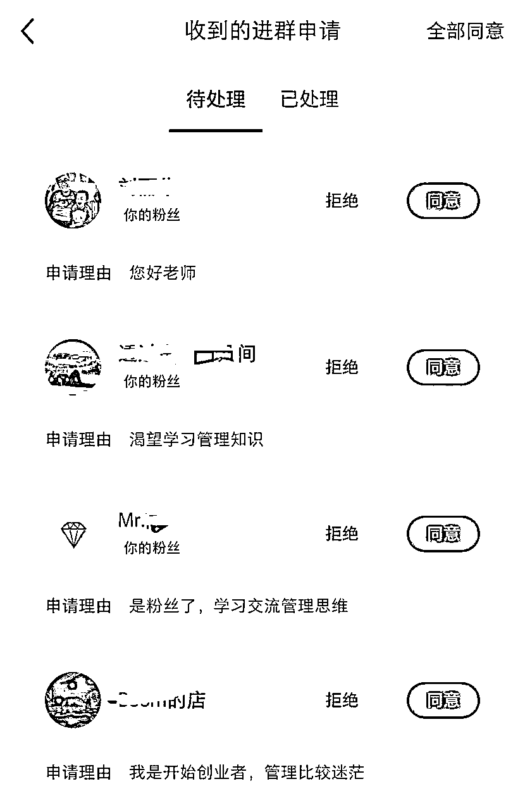

*   长期主义输出：

1-坚持周更4-6篇，周末休1-2天，除非生病或家事。
2-坚持高标准，每日07:30起床写稿，不达标就重写。
3-内容配比：专业40%+有用40%+接地气20%。

执行小技巧：
*   提前建选题库，储备10个话题防空白
*   批量做封面和排版模板，省时间
*   利他设计：真诚分享少说教；有求必应认真回咨询；专业度扎实，获正面反馈。

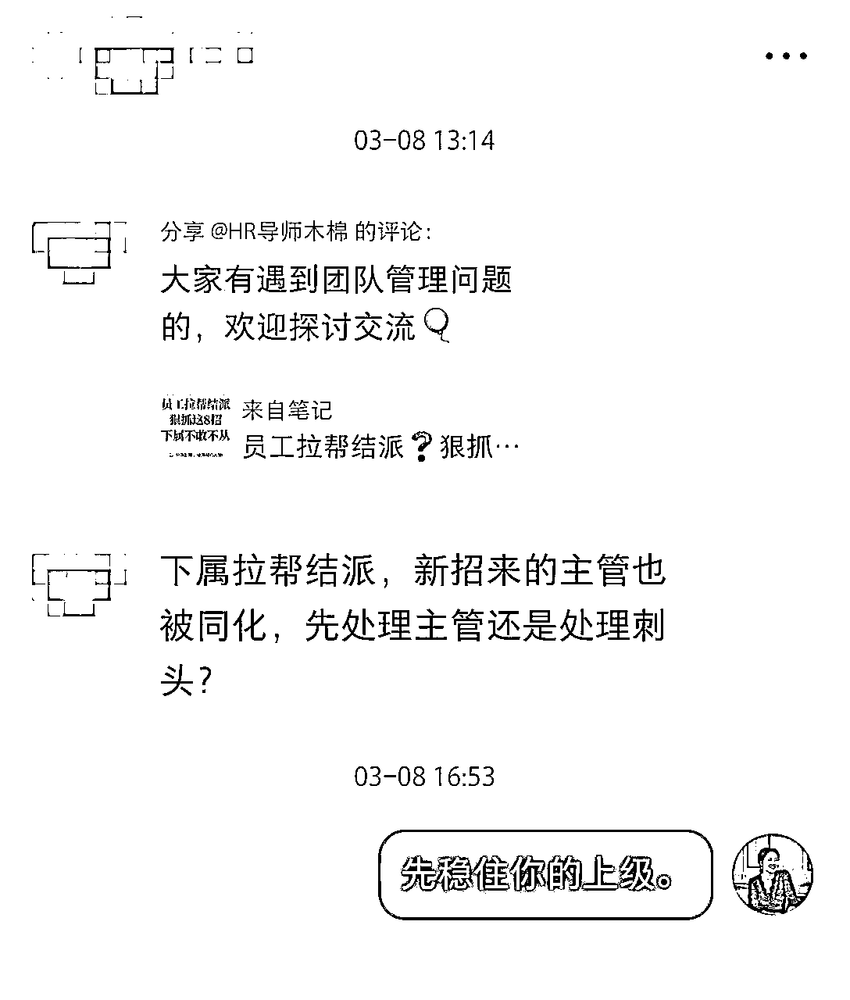

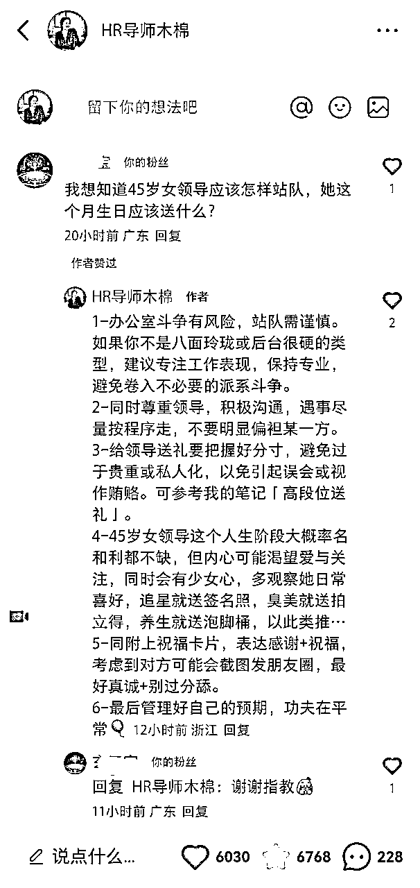

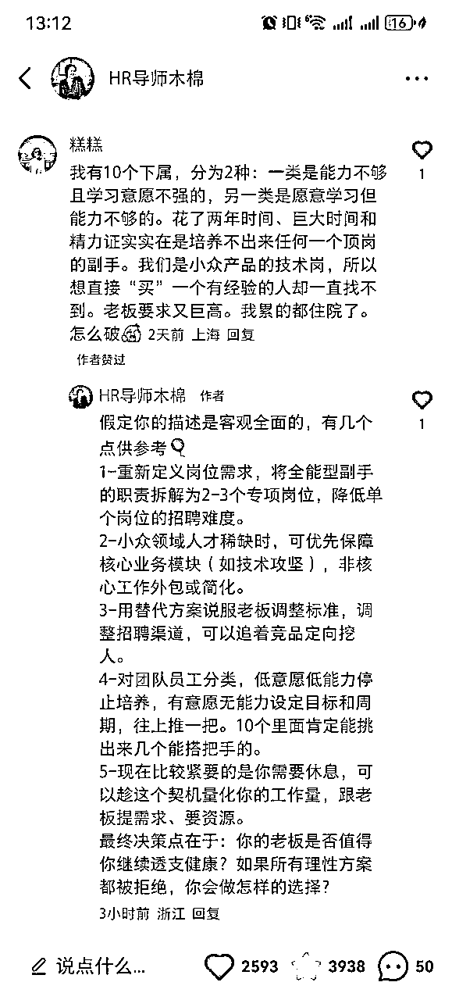

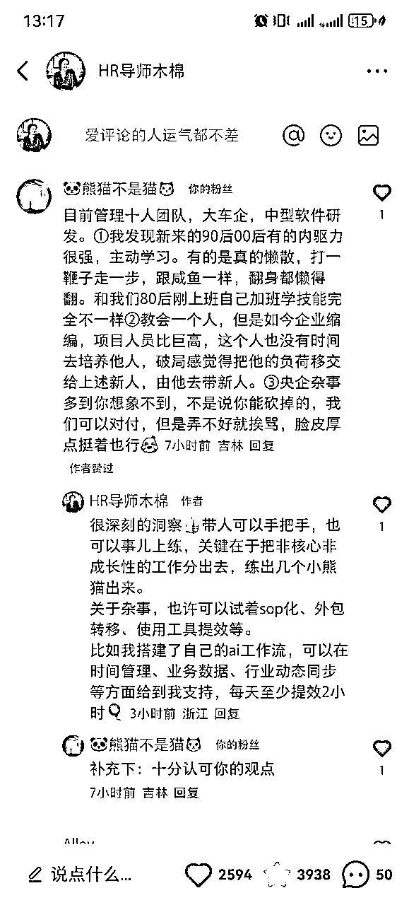

## 三、经验复盘

1.  我的增益点

先把自己搞清楚
我是谁→想去哪→长短板→要注意什么

举例

| 个人特质 | 自我认知 | 行动表现 | 需注意 |
| 成就驱动 | 做成难而正确的事，是内心向往，成长感大于金钱 | 评估后投入，能熬无反馈期 | 别因追求效率而焦虑 |
| 学习力强 | 静下心就能快速出结果，跨行转型的经历证明过 | 花时间啃透新知，困难是常态 | 战略不清会跑偏 |
| 完美主义 | 做事要极致，信任难辜负，能90分绝不60分 | 排优先级稳步推进 | 别陷细节忽略全局 |
| 待人真诚 | …… | …… | …… |

我的盖洛普画像2024年4月版↓

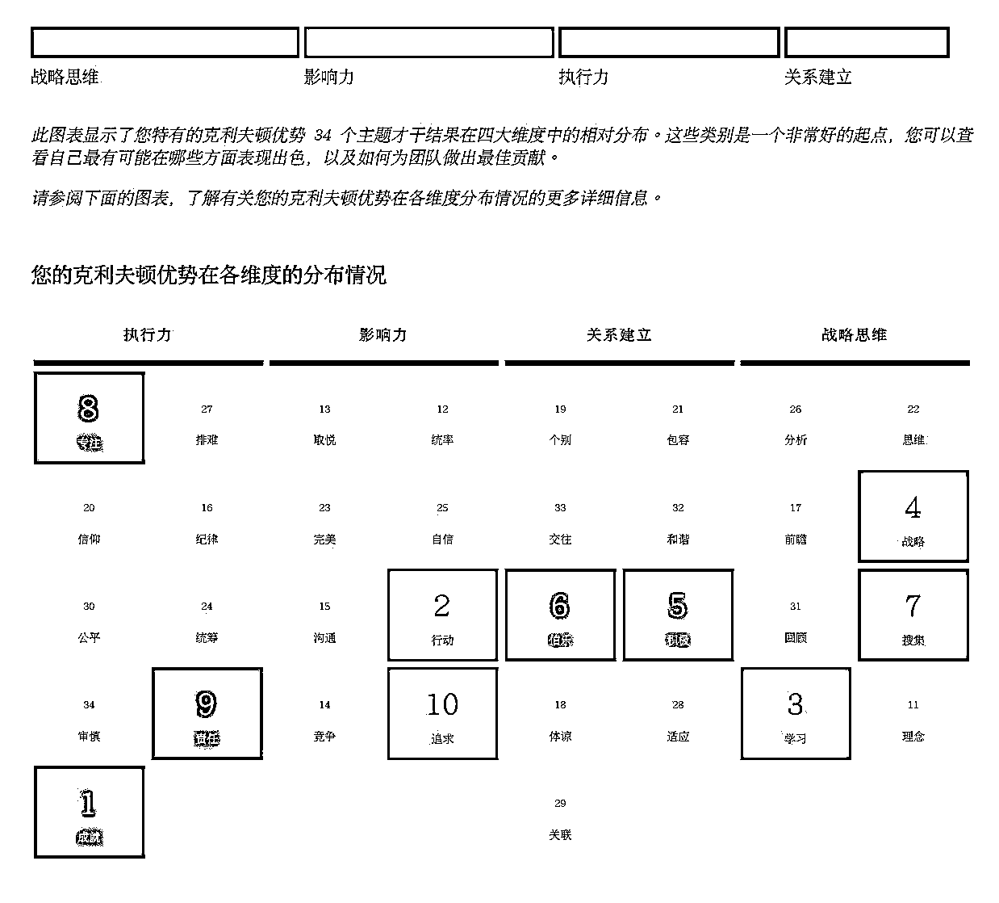

再死磕到底：看一张图

我无数次想放弃，多次差点倒在拐点前。我给自己定的生日目标：阳历1月达到1W粉就算成功，创业也好回职场也好都无憾。

结果很美好，但大部分人在前五个月就退了。方向和人是对的，坚持住就能超过90%的同行。

到4月，对标的10个号里，我单号涨粉速度已超过90%同行，图文视频皆算。

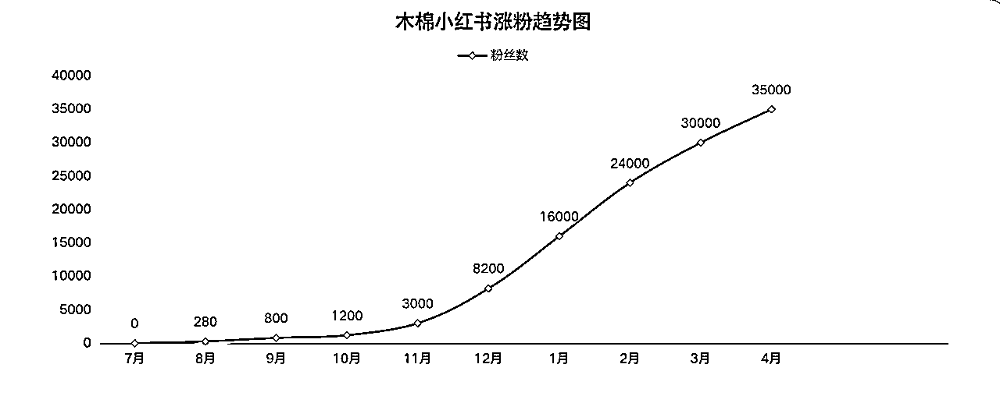

*   和平台建立连接：官方活动是新手弯道超车的关键，必须抓住。

我们是第一次做博主，但不是第一次做员工。要换位思考：平台想拉新促活、运营想完成KPI，我们能提供什么？

方法就是参加活动加官方运营老师，定期同步进度和需求，内容过硬的前提下，后续活动会更照顾你。

案例：一次官方活动笔记爆了，我立刻感谢+反馈痛点+提出需求+表态支持，2周涨粉6000+。

另外，流量扶持期别偷懒，笔记多更，我最高一天原创4篇，流量能吃更多。

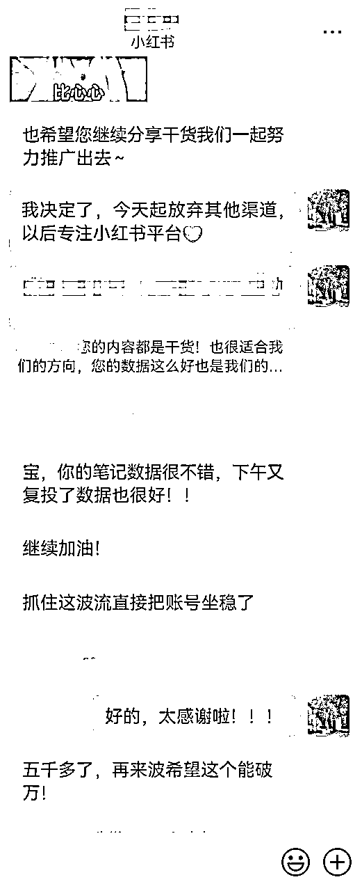

1.  踩过的坑和解决方式

*   流量焦虑导致崩盘
背景：两天一夜没睡写干货，播放只有54。别人水文却高赞，心态炸了。
解决：反思是不是曲高和寡的傲慢？也正是这54个人同时听课，便是有价值。调整策略：先写大家想看的再写自己想写的，发完半小时不刷数据，好就追击，不好就下一篇。

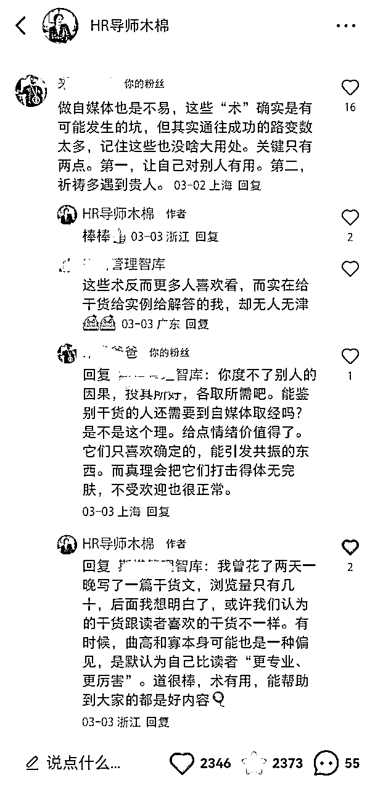

*   账号被封14天的顿悟
背景：高烧误操作被封14天，自我怀疑，能否继续？
解决：对标同行发现大家都是长期沉淀；翻粉丝列表3000+人，只有1人粉丝超3000，意识到自己已是1/3000；重读笔记发现自己写得不错，内容沉淀倒逼成长；身体出问题就该休息，硬扛毁事业。核心收获：短期挫折是沉淀期，用数据校准感受。休整后满血回归。

*   抄袭与恶评
抄袭应对：前期发动读者举报，中期开原创保护，后期矩阵多平台分发。心态上不要气，专注前行。
恶评应对：自省有没有问题，有就改，无就无视或温柔回应。恶评代表影响力在上升，平常心。

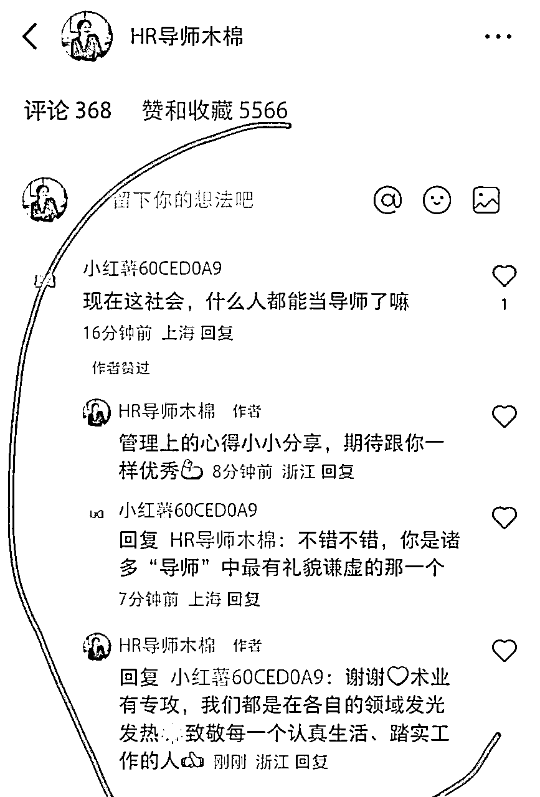

### 怎么打动高客单B端客户？

老板不缺信息，缺的是可信的解决方案，尤其经济下行期，谁能降决策压力谁赢。

1.  核心认知：老板是人
他们也关注成长焦虑、社交圈层、人性洞察、生活平衡等。

2.  策略：问题驱动深度陪伴
少说教，帮他自己找到答案。
第一步：用老板听得懂的话定位痛点，如员工躺平怎么办、怎么低成本优化人员
第二步：拆问题链，如离职背后是薪酬、成长、管理风格等
第三步：给钥匙，不评对错，给案例+方法论引导决策
总结：不卖方案，帮老板想明白，用业务全景拆解，用启发代替说教。

### 把对手变盟友
亦仁老师说：没有永远对手，只有没找到合作点。

关键：找到行业共性痛点，职场博主难在转化，粉丝千到万级变现单一，流量浪费。

合作模式：我提供产品研发+营销转化+内容输出+交付，博主负责引流，我们承接成交，按效果分佣。

绑定三层：情感绑定-深度沟通社群；利益绑定-清晰分佣阶梯；成长赋能-给SOP和内容优化。先拿1-2个正反馈再复制到10-20个。

## 四、保持心力的办法

快乐心法：享受过程、自我圆满、影响他人

享受过程：放下ego，创业一定会失败，那就让每一天被活满，痛苦流经快乐穿越，过程即丰盈。保持专注，多庆功多感恩，开放接收建议但聚焦主线。

自我圆满：上班修身创业修心，撕裂得越多容纳越大。常庆功常感恩，我有贵人录记录一路支持。没有人能定义我，我能创造想要的未来。

影响他人：客户问题被解决拿到正反馈；合作伙伴赚钱持续信任；团队赚钱成长开心。

## 五、下一步规划

行业判断：知识IP赛道专业度成护城河，好内容永远稀缺；短视频>图文但图文仍是引流利器；平台推企业号矩阵，个人IP仍有缝隙。

放大路径：
赛道卡位：从职场博主转「博主孵化器+产品运营池」，卡住职场管理头部生态位。
内容产品化：持续输出优质内容并沉淀成册；丰富B端C端产品，开辟新领域深转化。
多平台联营：小红书引流+视频号直播+矩阵专业号+线下销转+素人孵化。

## 六、给新手的入门建议

抱紧生财：至少精读10篇精华帖，跟航海走一遍少走90%弯路。
先抄再超：找3个对标，像素级模仿前30篇封面标题结构，内容别照搬。
小步快跑：每周迭代1-2个细节，第1周改标题，第2周优化封面，持续优化。

先把东西做出来，再谈做精致。我花了很久才明白，完成永远比等一个完美的版本更值钱，先把十篇六十分的稿子堆出来，市场才会有回声，而不是憋一篇所谓的爆款。

另外，定位从来不是一锤定音的。账号和产品都是在路上被掰弯、被打磨出来的，我自己就换了四次人设：从做知识库，到HR专业号，再到管理专家，最后才沉淀成CEO成长教练加知心大姐的混合形态。产品线也从纯TOC往TOB+TOC一起走。能活下来的，都是会变通的人。

给还在0-1的后来者几句掏心窝子的话：

1. 别在脑子里创业，市场才是唯一的裁判。不要想，要做，业绩出来了，自信才有底气。
2. 厚着脸皮去求助。生财有术这个圈子给了我太多惊喜，大部分人都是真心愿意拉你一把，敞开求助，你才能吃到肉。
3. 别人的声音是噪音，你的成长才是主线。不要为了迎合而扭曲自己，把自己的路走成自己。
4. 健康是所有计划的前提。创业不是百米冲刺，是长跑，比谁能坚持到最后。

六、真心感谢

感谢亦仁老师的微天使支持，感谢生财有术这个平台，它给了我迈出第一步的勇气，也打开了我认知的新世界。近亦仁者富！亦仁老师的建议，大家一定要听话照做，因为真的能出结果！！！

感谢V先生，在我最迷茫的起步阶段，陪我通话两小时开导我，点出方向，还说有什么需要尽管开口。有这样一位引路人，太幸运了。

感谢条形马哥一直以来的答疑，让我下定决心All in小红书。如今我也算及格了，能分辨出靠谱的供应商。

感谢宋大范姐姐从HR老兵的角度帮我拆解了未来可能踩的坑，给我省下了九成弯路。

感谢茄子帮我做自我剖析和盖洛普解读，让我看见原本看不见的自己，完成了和解：我其实是四个矛盾的融合体——父性的理性果断与母性的温柔感性并存，对外精致高标准，对内粗糙钝感大度。

感谢刀姐那句“欢迎你加入冒险岛”，让我第一次具体地想象了快乐创业的女生长什么样。

感谢总裁高在项目方向还没成形时就第一个站出来说愿意投我100万，那份信任是我最硬的底气。

感谢楠姐的真诚批判和托举，她的直球评价帮我打开心结，也让我明白大胆报价、守住底线并不可耻，反而有用。

感谢贝果和Albert一路的无私分享、默默支持和暖心陪伴，有你们在，人间很值得。

感谢比比先森，业内最好的小红书教练，专业温暖又有体温，帮我厘清了早期定位和内容方向。

感谢纪老板和戴巍老师带我见到更多大佬，给我牵线搭桥，用行动给我关怀与鼓励。

感谢涛哥真诚分享并引荐小红书前辈@富贵，那两碗陈八两的情，我可能这辈子都还不清了。

感谢王欣然、陈雪、书豪、大树哥、兰姐等好友们一路的陪伴和支持，感恩在心。

特别致谢生财的黄阿兜，这篇约稿我拖了整整四个月，多次想放弃，是你的信任和鼓励让我最终写完发出。

最后，想对一年前那个迷茫、纠结、找不到方向的自己说：没有绝对正确的选择，让选择变得正确的方法，就是相信当下，坚定地走下去。

当你竭尽全力的时候，神灵才会显现。