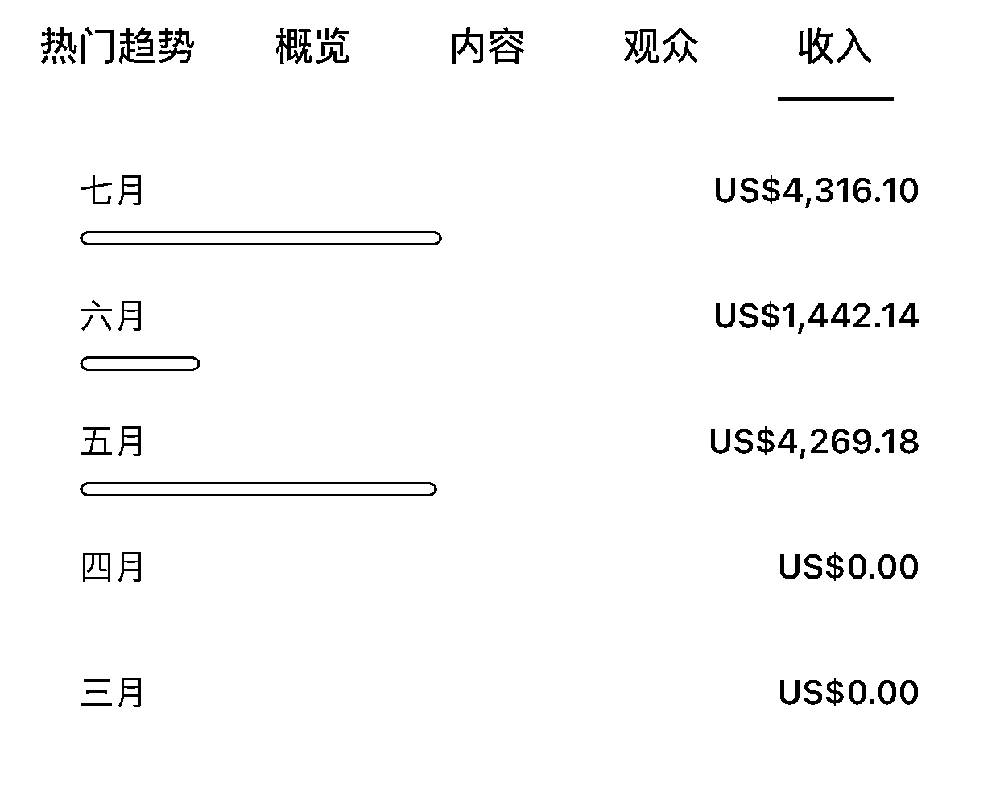
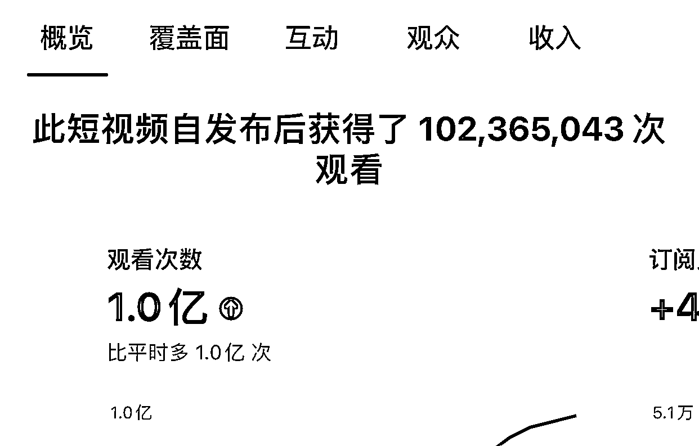
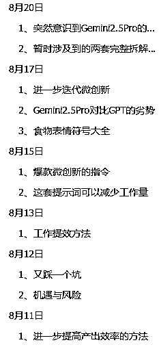
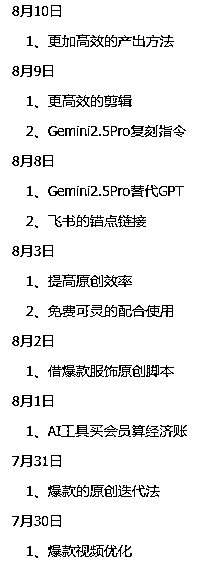
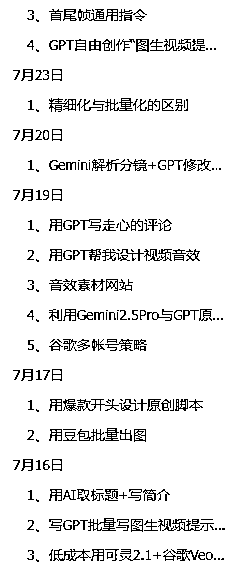

# 一个 Shorts 频道做到月入过万刀，我复盘了这一路

很多人习惯等看到结果之后，才愿意相信一件事真的可行。

这张截图是我在七月底保存的，当时 Shorts 单个频道已经突破一万美金收入。原本那时候就想把过程整理出来，但项目一忙，这件事就一直拖到了现在。

这次写下完整复盘，不是为了展示结果，而是想把一路走来的方法、判断、试错，以及心态变化都讲清楚。

新一轮航海即将开始。如果你刚准备进入 Shorts，希望下面这些经验能帮你少踩一些坑。

## 新频道起步，最需要注意的几件事

大多数新频道，最初都会从研究和复刻爆款开始。

但问题也随之而来：

为什么同样的内容，别人能爆，自己却没有流量？  
怎样找到适合自己的方向？  
怎样更快完成 YPP 考核？  
一个新账号，到底应该先做什么？

下面说说我的做法。

### 一、先把视频做短

Shorts 申请 YPP，核心考核指标是“有效观看次数”，不是视频累计时长。

新号刚开始没有明确的用户画像，系统也还不了解你的内容，因此推荐通常比较随机。这个阶段最重要的任务，是尽快积累足够多的有效观看。

我在复刻爆款时，往往会主动压缩视频长度，同时加快叙事节奏。

别人做 30 秒，我可能会尝试压到 20 秒左右。这样做主要有三个好处。

**第一，完播更容易。**

视频越短，观众越有可能看完。完播率提升后，平台更容易继续扩大推荐。

**第二，观看次数增长更快。**

同样是一分钟的时间，用户看完一条 60 秒的视频，通常只产生一次观看；但如果视频只有 15 秒，理论上就可能完成多次观看。对于正在冲击考核的新账号来说，短内容更容易快速累积数据。

**第三，试错成本更低。**

视频长度缩短后，制作难度和时间投入都会下降。你可以更快测试不同的爆款结构、叙事方式和内容方向，从大量实验中找到适合自己的模型。

### 二、把所有变化都记录下来

我做新号时，有一个一直坚持的习惯：用表格记录运营过程中的各种细节。

不要小看这些微小变化。发布时间、设备、IP、标题、时长，甚至某个画面的调整，都可能对最终数据产生影响。

与其凭印象判断，不如把每一次尝试都留下来，逐渐建立属于自己的数据样本。

记录的价值主要体现在两点。

**一是便于复盘。**

你能知道哪一次调整带来了正向反馈，哪一次尝试没有效果。我除了用表格记录，还会每天写复盘，目前累计已经超过六万字。

**二是帮助你找到自己的规律。**

每个频道的受众都不同，别人的经验只能作为参考。最终真正有用的答案，必须来自你自己的账号数据。

我通常会记录以下信息：

- 发布时间，比较早上、中午和晚上的流量差异；
- 发布设备，分别测试电脑端和手机端；
- IP 变化，观察不同地区 IP 是否会影响推荐；
- 是否调整过标题、描述或缩略图；
- 视频长度、节奏和结构的变化。

通过一段时间的积累，你会逐渐看清楚自己的频道特点，也能对平台机制形成更准确的判断。

比如发布时间，别人的最佳发布时间可以参考，但不能直接照搬。随着账号成长，粉丝画像会不断变化，适合别人的时间，不一定适合你的频道。

再比如 IP。我刚开始很担心频繁更换 IP 会导致流量异常，所以专门做了记录。后来发现，今天使用一个国家的 IP，第二天切换到另一个国家，账号流量并没有出现明显波动。至少从当时的测试结果看，YouTube 在这方面并没有想象中严格。

当然，为了降低潜在风险，后续我还是换成了静态 IP。

### 三、不要因为纠结赛道而迟迟不开始

很多人会说：

“我还没想好要做什么领域。”

甚至航海进行到一半，仍然没有真正确定方向。

为什么选择这么难？很大一部分原因，是大家都希望第一次尝试就成功，第一条视频就获得巨大流量。

但“一上手就爆”，更多依赖运气。对于大多数人来说，运气并没有那么好。如果一直停留在选择阶段，就永远不会知道自己的内容到底有没有机会。

真正重要的不是一开始选得多准确，而是先做起来，再通过数据不断修正。

我的建议是：

1. 先挑一个自己相对感兴趣的方向，把它当作练习场，不要做了两条视频就期待突然迎来巨大流量；
2. 持续刷 Shorts，多进入其他频道，观察他们的爆款内容和频道变化；
3. 不要把第一次选择当成终身赛道，很多账号后来真正爆发的方向，并不是最初开始做的领域；
4. 把前期目标从“马上出大爆款”调整为“持续测试，积累账号权重”。

什么时候应该换方向？

我个人会把 15 条视频作为一个观察节点。

- 如果连续发布 15 条后，大多数视频只有 3 万到 5 万播放，偶尔能达到 10 万到 20 万，但始终没有出现百万级内容，我会考虑换赛道；
- 如果某条视频已经突破百万，甚至达到千万级，说明这个方向具备潜力，可以继续深入；
- 我有一个频道就是这样，前两个方向一直徘徊在 3 万、5 万播放，表现好一点也就是 10 万、20 万。换到第三个方向后，不到 10 条视频就出现了 2000 万+播放。

赛道不是坐在桌前想出来的，而是在一次次发布、测试和复盘中逐渐筛选出来的。

与其反复纠结，不如先开始。不断尝试、记录数据、调整内容，最终总会找到更适合自己的方向。

### 四、先手动拆解，再考虑自动提效

刚进入一个陌生领域时，不建议一开始就追求批量生产和全流程自动化。

先通过手动拆解去理解爆款，是更高效的学习方式。

我的操作流程通常是：

先下载对标视频，导入剪映，用智能功能切分镜头；如果识别不准确，就手动修正。然后截取每个镜头的第一帧，交给 GPT 反推提示词，再用文生图工具生成对应画面。

这样做虽然慢，但你会真正看懂一条爆款是如何构成的：

- 分镜数量如何安排；
- 每个镜头停留多久；
- 情节怎样推进；
- 情绪在哪些节点发生变化；
- 画面之间如何形成对比；
- 哪些技巧被藏在细节里。

我曾经拆过一条爆款视频。表面上看，它有 10 个分镜，但真正使用的图片只有 7 张，其中 3 个镜头其实是重复利用的。

也就是说，创作者并没有为每个分镜都重新制作素材，而是通过重复使用部分画面，降低制作成本，同时仍然保持了很强的戏剧张力。

如果不亲自拆解，很难发现这种细节。

但比画面数量和镜头结构更重要的，是理解视频的情绪走势。

一个真正能留住观众的短视频，通常不会从头到尾平稳推进，而是会让观众的情绪不断发生变化。在几十秒内，观众经历好奇、紧张、担心、惊讶、释放等多次情绪波动，才更容易看完。

常见的情绪安排大致是：

**开场几秒：**  
快速抛出冲突，让观众产生好奇、惊恐或震惊，阻止用户划走。

**中段推进：**  
通过反转、悬念、对照和冲突升级，让观众继续等待结果。

**结尾阶段：**  
用高潮、反转或情绪共鸣完成收束，让观众获得释放，从而更容易点赞、评论和分享。

很多高播放视频，本质上都在遵循这条逻辑。

例如，开头直接呈现掉下悬崖、被推下飞机等高冲突画面，用强烈的负面情绪把用户牢牢吸引住。

真正决定观众是否留下来的，往往不是画面有多复杂，而是情绪是否持续变化。

所以，前期不要急着依赖工具批量生成。先通过手动拆解，理解爆款如何制造情绪起伏；等真正掌握规律之后，再用工具提升效率。

## 我做 Shorts，经历了四个阶段

刚开始做的时候，我会持续寻找近期的高播放视频进行复刻，优先选择 1000 万+播放的案例。

如果一个方向长期没有起色，就换领域，直到找到属于自己的第一个千万播放视频。

### 第一阶段：集中突破，形成势能

当我有了自己的千万播放视频后，就开始围绕它进行延展。

保留原有的情绪节奏和脚本逻辑，只更换人物、衣服、角色、场景、天气以及表现方式，把成功结构不断模板化。

因为一条视频能爆，往往并不是某一个具体角色带来的，而是背后的情绪曲线发挥了作用。

当你围绕一个有效模型持续输出，账号会逐渐形成内容势能，后续视频的播放量也会越来越高。

后来，1000 万+播放的视频开始频繁出现，其中还有两条视频的观看次数超过了 1 亿。

不过，大约在 5 月底到 6 月初，平台因为儿童安全问题集中清理了一批视频，我的频道也收到了一次警告，账号受到影响。

因此，6 月的播放量明显下滑，收入也同步下降。

### 第二阶段：熟练掌握工具，建立别人难以复制的优势

视频制作流程，做得多了自然会熟悉。

真正能把差距拉开的，是你对工具的掌控能力，以及能否在细节层面做出别人不容易复刻的内容。

一条视频如果爆到 5000 万，很快就会出现大量跟随者。如果大家都只是简单复制，内容高度同质化，平台就可能降低推荐，原本的流量也会被迅速分走。

我最初做的内容，同样来自对爆款的研究和模仿。但后来我没有停留在“复制”，而是在原有基础上继续升级，最终完成了反超。

我的频道留下来了，而最初的对标账号后来停止更新。

画质、动作难度、镜头细节、情绪强度，只要其中某些方面明显优于其他人，平台就更有可能继续给你流量。

在足够细分的领域里，只要你能成为某个内容方向、某种剧情表达的领先者，平台自然会把更多曝光倾向你。

头部账号获得主要收益，跟随者只能分到剩余流量。

判断一个环节是否构成壁垒，其实很简单：

当你拆解对标视频时，如果某个镜头无论换哪种工具，都很难做出对方的效果，那么这就是壁垒。

如果对方传递出来的情绪比你的版本更强，也同样说明你还存在差距。

同一组提示词，在工具 A 中效果不好，可以尝试工具 B；B 不行，再换工具 C。不同 AI 工具都有各自擅长的方向，没必要把所有希望寄托在某一个工具上。

真正重要的是熟练使用、灵活切换，并不断提高对细节的控制能力。

### 第三阶段：不断换表现形式，但保留核心逻辑

一条 Shorts 能否爆发，关键通常不在人物、场景或素材本身，而在于情绪曲线是否足够有吸引力。

只要情绪起伏能够持续抓住观众，换一批素材依然有机会获得高播放。

后来，部分题材因为平台规则变化，不能再把儿童放在危险环境中。

面对这种限制，我没有完全放弃原来的内容模型，而是保留原有结构和情绪节奏，把孩子替换成成年人。

一开始我也担心效果会明显下降，但测试之后发现：

- 故事结构没有变，情绪节奏没有变，流量依然表现不错；
- 同时尝试其他爆款结构后，反而发现“把孩子换成成年人”的版本更稳定。

于是方向就明确了：

保留有效的情绪机制，只更换容易触发限制或已经被大量模仿的表层素材。

随着账号积累和持续更新，到了 7 月初，频道流量又重新恢复。

这件事也验证了一个判断：

**真正有效的结构不会因为换了素材就失效，爆过的逻辑仍然可能再次爆发。**

关键是要懂得迭代，而不是机械重复。

上面只是一次比较明显的调整。实际上，很多进步都藏在日常的细节里：一次测试、一个想法、一个失败案例、一处镜头变化、一次工具尝试，都可能成为下一次突破的基础。

所以我建议每天写一些和项目有关的内容，包括：

想法、心得、踩坑、变化、测试结果、观察、总结，以及暂时没有答案的问题。

我已经累计写下六万多字。只要发现新的东西，就会及时记录。

更多过程就不逐一展示了。我做 YouTube 走过的每一步，在那份文档里基本都留下了痕迹。

### 第四阶段：应对 7 月 15 日的新政策

7 月初，YouTube 更新了 YPP 相关政策，明确表示从 7 月 15 日起，将进一步打击批量生产和重复性内容。

刚看到通知时，我也有些担心。

从 7 月 10 日开始，我暂时停止发布原本的爆款模板，转而测试不同的视频结构，也尝试加入原创内容，同时隐藏了一部分可能存在风险的视频。

7 月 15 日之后，平台虽然没有出现大规模清理，但确实有创作者反馈频道被移除。

这释放了一个很明显的信号：

AI 视频已经进入下一个阶段。

平台不再满足于粗糙、重复、批量生成的内容。去年年底，AI 视频还没有那么普遍，简单的图片故事也可能获得大量流量；但现在，AI 内容越来越多，平台自然会提高对质量的要求。

这个变化并不只发生在 YouTube，几乎所有内容平台都会经历类似过程。

因此，后续策略必须从“复制爆款”升级为“保留核心、持续创新”。

我的调整主要有两个方向。

**核心不变：**

继续使用跌宕起伏的情绪曲线，因为它仍然是推动观众观看和互动的根本。

**表达升级：**

让 GPT 协助创作新的脚本，重新设计分镜数量、镜头语言和运镜方式，同时加强背景音乐与音效的变化，避免视频看起来像同一个模板批量生成。

任何爆款都有生命周期。

一个内容模型不可能永远维持高热度，播放量经过一段时间后下降，是正常现象。与其一直纠缠在已经衰退的玩法上，不如及时换角度、换表达，甚至换领域，继续寻找下一次机会。

我观察过很多频道，基本可以分为三种情况：

1. 流量下降后停止更新，通常是因为没有继续迭代，越做越没有信心；
2. 原本流量很好，后来突然停更，可能是受到处罚，或者 YPP 权限被取消；
3. 之前表现不错，流量下滑后主动调整赛道或内容形式，最终又做出新的爆款。

## 最后总结

把整个过程重新梳理一遍，核心规律其实很明确：

- 前期可以借助模仿快速起量，长期必须依靠持续迭代；
- 爆款真正起作用的不是某个具体素材，而是背后的情绪曲线；
- 记录、分析和调整，比单纯照抄更有价值；
- 工具可以提升效率，但理解内容逻辑才是基础；
- 账号遇到流量下滑时，不要急着否定自己，也不要死守旧模板。

YouTube 的规则会变化，平台的竞争环境会变化，用户的审美也会持续提高。

但平台始终需要更有质量的内容，用户也始终愿意为更好的体验停留。

如果你刚开始做 Shorts，不要期待一步到位，也不要把所有希望寄托在一次偶然爆款上。

先开始，持续测试；  
认真记录，及时复盘；  
不断调整，持续升级。

真正能够长期把流量做起来的，从来不是偶尔走运，而是持续迭代的能力。