# 不懂编程也能把网页数据抓到手：AI 爬虫的零代码实操
作者：龙哥


温馨提示：本文篇幅较长，建议预留半小时以上专注阅读，边看边跟着操作效果最好。

前几天有个朋友跟我抱怨：

“每天在 Boss 某聘上刷岗位，信息量太大太乱了，真希望能一次性导出来慢慢筛选。可我不会写代码啊。”

我回他一句：

“现在都 2025 年了，连我妈都会用 AI 工具了，你还在靠手点？”

随后我花不到一小时，从零带他把流程跑通。这个完全零基础的人，最后把整页招聘信息整理成了一份 Excel。


爬取文件如下：

AI 时代最大的意义，就是把过去的技术门槛打平，让普通人也能触碰到原本遥远的能力。所以才有了这篇拆解。

# 用 AI 做爬虫，本质上就五步，而且全程不用敲代码

1、先想清楚要爬哪个网站、要哪些字段。
2、用浏览器开发者工具定位到数据。
3、把数据所在的请求信息找出来。
4、把这些信息喂给 AI。
5、让 AI 跑代码，直接拿到结果。

下面就以手把手的方式，演示如何把想要的数据拿下。

## 第一步：锁定目标网站

就拿 Boss 某聘举例，页面左侧的岗位列表就是我们要的目标。

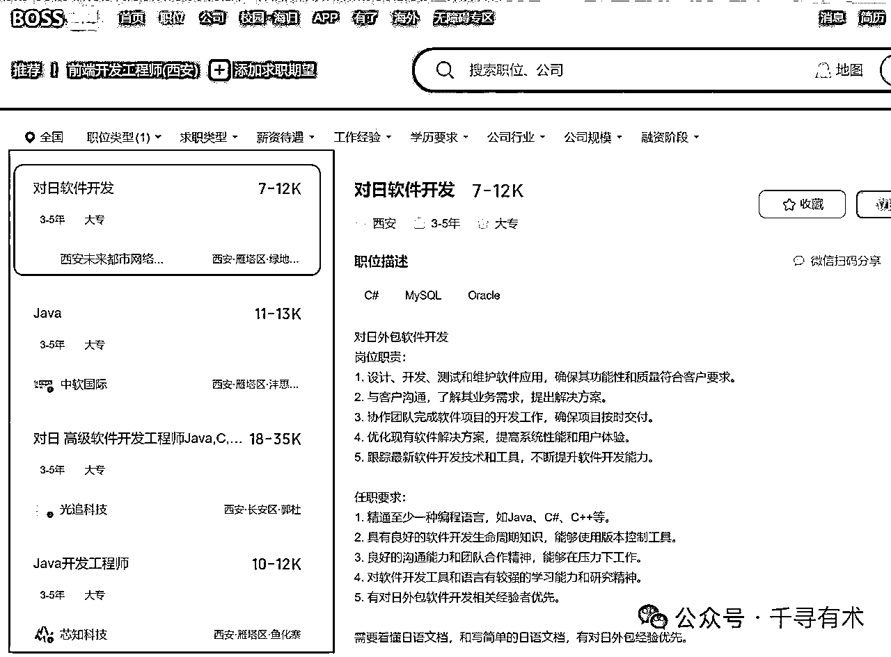

## 第二步：打开开发者控制台

打开方式有两种：
第一种是直接按 F12；
第二种是鼠标右键点击页面，选择【检查】。

以 Chrome 为例，打开后的界面如下：

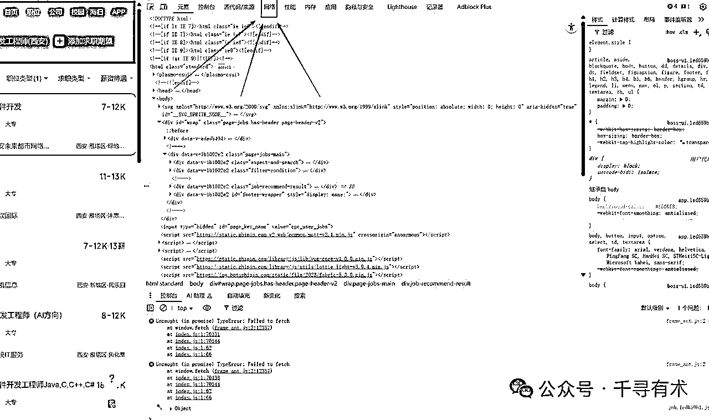

切换到上方【网络】标签，英文界面就是【Network】。

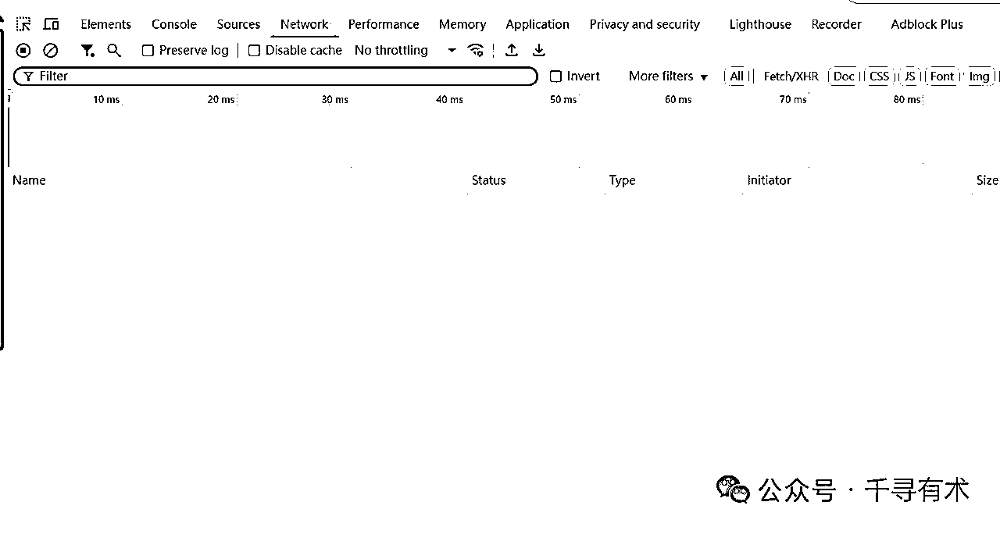

这时候你可能会发现列表是空的，别怀疑自己没点对。因为页面进来时数据早已加载完成，控制台只会拦截新发出的请求。

要让数据重新流动有两个办法：
1、按 F5 刷新页面；
2、向下滚动列表，触发新数据的加载。

这里我们采用第二种，更贴近真实使用场景。把鼠标放在列表上不停滚动，直到【Network】里出现新的请求记录，如下图。

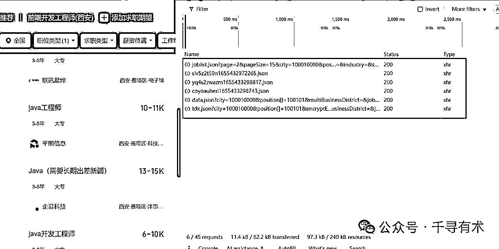

红框里的条目就是我们想要的数据源。左侧看到的招聘信息，其实都藏在右侧的网络请求里。

看到 jobList 这个名字，基本就能判断这是岗位列表的请求。点进去看一下：

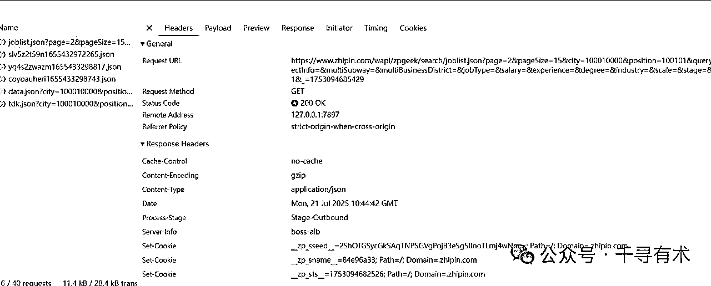

先标记几个关键标签页：
【Headers】：最核心的位置，能看到请求地址、请求头、响应头。
举个例子，假设你是跑运输的，客户让你去四川省乐山市市中区凌云路 2435 号取乐山大佛送到黑龙江。
这个地址就相当于 Headers 里的 Request URL。

## 第三步：整理请求信息

而你要运走的乐山大佛，就相当于我们要抓取的数据。Request URL 就是定位数据源的钥匙，先复制下来：

```
请求路径：https://www.zhipin.com/wapi/zpgeek/search/joblist.json
```

注意别把整串参数都带上，去掉问号及问号后面的部分，保留干净的接口路径：

```
?page=2&pageSize=15&city=100010000&position=100101&query=&expectInfo=&multiSubway=&multiBusinessDistrict=&jobType=&salary=&experience=&degree=&industry=&scale=&stage=&scene=1&_=1753094685429
```

问号后面的内容是什么？继续用拉货的例子解释：到了地址后，发现有好多大佛，大小、材质、颜色各不一样。你得明确告诉对方你要哪一个。
所以问号后面就是筛选条件，作用很重要，但我们不用硬写在地址后，浏览器里专门有【Payload】标签页来承载这些参数，如下图。

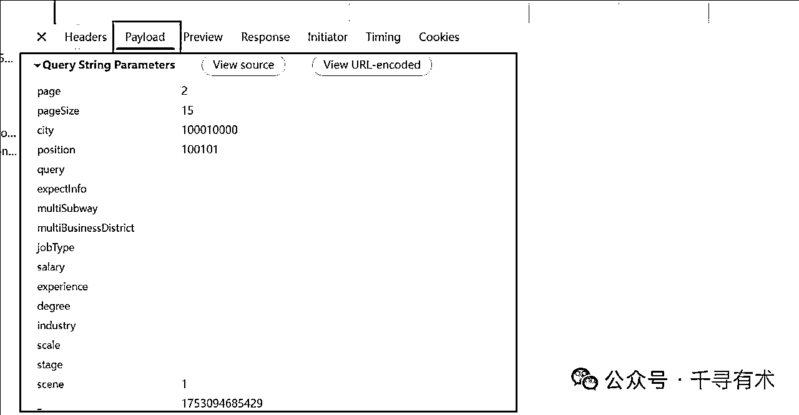

点【view source】把它变成一行，方便复制记录。

再回到【Headers】标签页，第二行是 Request Method：GET。

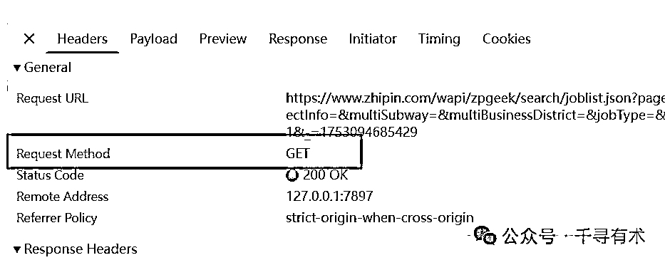

请求方式主要有 GET 和 POST 两种，这里不需要深究，直接记录下来即可。

到这一步，你的笔记里应该有如下内容：

```
请求路径：https://www.zhipin.com/wapi/zpgeek/search/joblist.json
请求参数：page=2&pageSize=15&city=100010000&position=100101&query=&expectInfo=&multiSubway=&multiBusinessDistrict=&jobType=&salary=&experience=&degree=&industry=&scale=&stage=&scene=1&_=1753094685429
请求方式：GET
```

接着说身份验证。拉货需要提供证件，爬数据也一样，登录后权限会大很多。身份凭证就藏在【Headers】的请求头里，如下图。

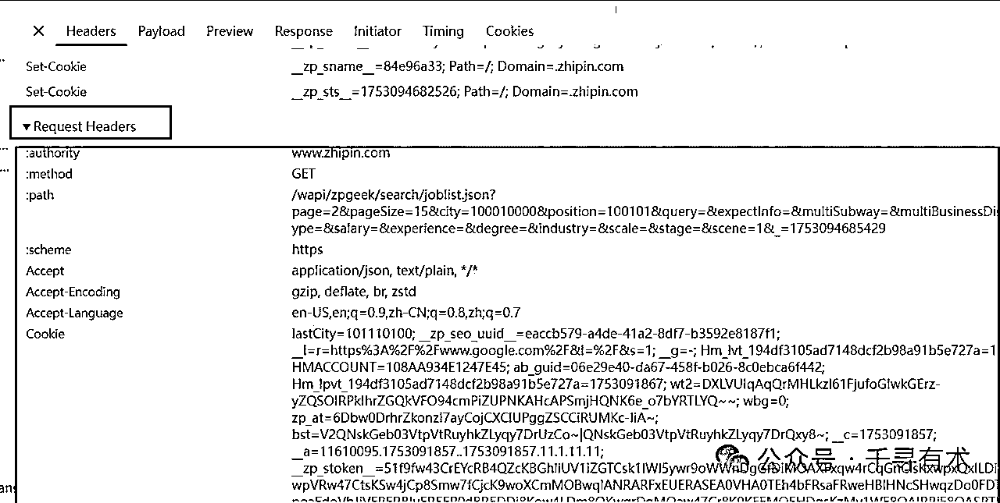

照常记下来。除了请求头，还有响应头，也一并记录，就像收货方的信息一样：

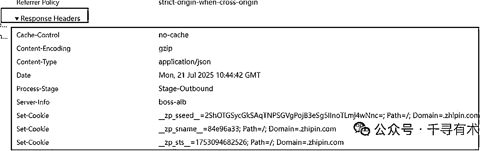

此时你的记录本大致长这样：

```
请求路径：https://www.zhipin.com/wapi/zpgeek/search/joblist.json
请求参数：page=2&pageSize=15&city=100010000&position=100101&query=&expectInfo=&multiSubway=&multiBusinessDistrict=&jobType=&salary=&experience=&degree=&industry=&scale=&stage=&scene=1&_=1753094685429
请求方式：GET
请求头：:authoritywww.zhipin.com:methodGET:path/wapi/zpgeek/search/joblist.json?page=2&pageSize=15&city=100010000&position=100101&query=&expectInfo=&multiSubway=&multiBusinessDistrict=&jobType=&salary=&experience=&degree=&industry=&scale=&stage=&scene=1&_=1753094685429:schemehttpsacceptapplication/json, text/plain, */*accept-encodinggzip, deflate, br, zstdaccept-languageen-US,en;q=0.9,zh-CN;q=0.8,zh;q=0.7cookielastCity=101110100; __zp_seo_uuid__=eaccb579-a4de-41a2-8df7-b3592e8187f1; __l=r=https%3A%2F%2Fwww.google.com%2F&l=%2F&s=1; __g=-; Hm_lvt_194df3105ad7148dcf2b98a91b5e727a=1753091857; HMACCOUNT=108AA934E1247E45; ab_guid=06e29e40-da67-458f-b026-8c0ebca6f442; Hm_lpvt_194df3105ad7148dcf2b98a91b5e727a=1753091867; wt2=DXLVUIqAqQrMHLkzl61FjufoGIwkGErz-yZQSOIRPkIhrZGQkVFO94cmPiZUPNKAHcAPSmjHQNK6e_o7bYRTLYQ~~; wbg=0; zp_at=6Dbw0DrhrZkonzI7ayCojCXClUPggZSCCiRUMKc-IiA~; bst=V2QNskGeb03VtpVtRuyhkZLyqy7DrUzCo~|QNskGeb03VtpVtRuyhkZLyqy7DrQxy8~; __c=1753091857; __a=11610095.1753091857..1753091857.11.1.11.11; __zp_stoken__=51f9fw43CrEYcRB4QZcKBGhliUV1iZGTCsk1lWl5ywr9oWWnDgGfDiMOAXFxqw4rCqGnClsKxwpxQxILDiMKXwrLEicKjwpVRw47CtsKSw4jCp8Smw7fCjcK9woXCmMOBwqlANRARFxEUERASEA0VHA0TEh4bFRsaFRweHBlHNcSHwqzDo0FDTkE2W15cF1poaFdoVhJiVFRERBluER5EP0dBREDDj8Kow4LDm8OKwqrDgMOaw47Cr8K9KEFMQEHDgsKzMy1WE8OAIRRjE8OASRTDgcKsYsOUaMOHNT%2FCvcOuNT1Dw4TFg0xCJ05BQExAPUhAQjc9EMORb8OHOjrDgzMwRCFIQkBKR0BCQEhBTjZATDo2QkE0RRwSGB4YM0nCvcKvw4DDqkJApriorityu=1, irefererhttps://www.zhipin.com/web/geek/jobs?city=100010000&position=100101sec-ch-ua"Not)A;Brand";v="8", "Chromium";v="138", "Google Chrome";v="138"sec-ch-ua-mobile?0sec-ch-ua-platform"Windows"sec-fetch-destemptysec-fetch-modecorssec-fetch-sitesame-origintokenHhZ4dZjz0hc9QkmstraceidF-9602f5gsTRNOSJSEuser-agentMozilla/5.0 (Windows NT 10.0; Win64; x64) AppleWebKit/537.36 (KHTML, like Gecko) Chrome/138.0.0.0 Safari/537.36x-requested-withXMLHttpRequestzp_tokenV2QNskGeb03VtpVtRuyhkZLyqy7DrUzCo~|QNskGeb03VtpVtRuyhkZLyqy7DrQxy8~
响应头：cache-controlno-cachecontent-encodinggzipcontent-typeapplication/jsondateMon, 21 Jul 2025 10:44:42 GMTprocess-stageStage-Outboundserver-infoboss-albset-cookie__zp_sseed__=2ShOTGSycGkSAqTNPSGVgPojB3eSg5lInoTLmj4wNnc=; Path=/; Domain=.zhipin.comset-cookie__zp_sname__=84e96a33; Path=/; Domain=.zhipin.comset-cookie__zp_sts__=1753094682526; Path=/; Domain=.zhipin.com
```

格式混乱不要紧，AI 能识别。

最后还要告诉 AI 我们具体要哪些字段，以及这些字段在数据结构里的位置。切换到【Response】标签页：

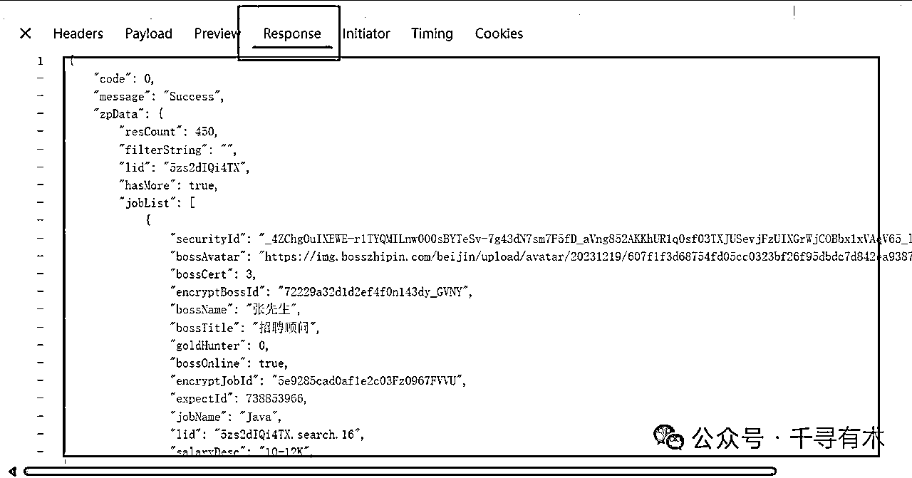

这里是原始数据，我们只取需要的部分。假设只想要岗位名称、公司名称、薪资、发布时间四个字段，就要在数据里找到它们对应的位置，比如下图：

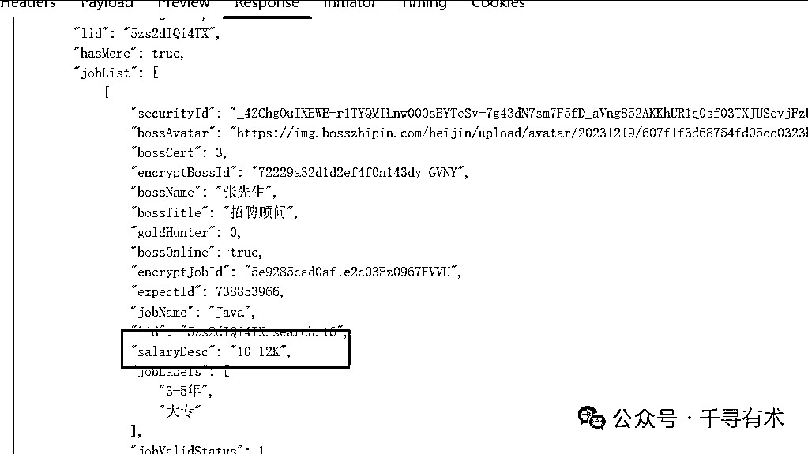

比如 salaryDesc 这个字段就是薪资。我们在笔记里这样写：

```
爬取数据字段：
薪资 ：在zpData下的joblist下的salaryDesc
```

路径要从最外层写起，一层层往内部定位到目标字段，如下图：

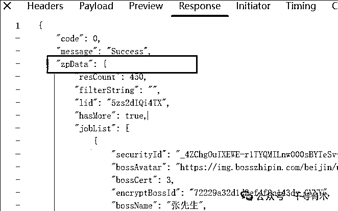

最外层是 zpData，code 和 zpData 平级，salaryDesc 在 zpData 内部，所以根节点是 zpData。

同理把其他字段的路径也整理出来，不确定含义可以直接截图给 AI 看。

整理完成后，笔记应该是：

```
爬取数据字段：
薪资 ：在zpData下的joblist下的salaryDesc
公司名：在zpData下的joblist下的brandName
岗位名称：在zpData下的joblist下的jobName
```

再补上一个完整样本的数据结构，从上到下复制，第一条岗位信息即可：

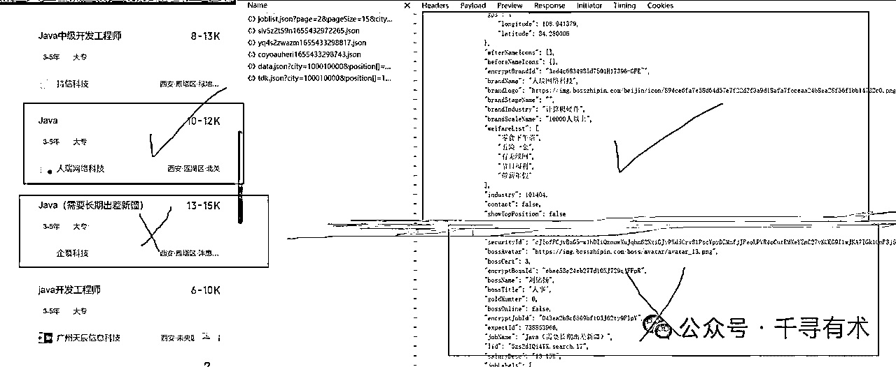

黄线以下不需要，列表数据一般一个括号就是一条。比对左侧页面确认无误后，最终的笔记就齐了。

```
请求路径：https://www.zhipin.com/wapi/zpgeek/search/joblist.json
请求参数：page=2&pageSize=15&city=100010000&position=100101&query=&expectInfo=&multiSubway=&multiBusinessDistrict=&jobType=&salary=&experience=&degree=&industry=&scale=&stage=&scene=1&_=1753094685429
请求方式：GET
请求头：:authoritywww.zhipin.com:methodGET:path/wapi/zpgeek/search/joblist.json?page=2&pageSize=15&city=100010000&position=100101&query=&expectInfo=&multiSubway=&multiBusinessDistrict=&jobType=&salary=&experience=&degree=&industry=&scale=&stage=&scene=1&_=1753094685429:schemehttpsacceptapplication/json, text/plain, */*accept-encodinggzip, deflate, br, zstdaccept-languageen-US,en;q=0.9,zh-CN;q=0.8,zh;q=0.7cookielastCity=101110100; __zp_seo_uuid__=eaccb579-a4de-41a2-8df7-b3592e8187f1; __l=r=https%3A%2F%2Fwww.google.com%2F&l=%2F&s=1; __g=-; Hm_lvt_194df3105ad7148dcf2b98a91b5e727a=1753091857; HMACCOUNT=108AA934E1247E45; ab_guid=06e29e40-da67-458f-b026-8c0ebca6f442; Hm_lpvt_194df3105ad7148dcf2b98a91b5e727a=1753091867; wt2=DXLVUIqAqQrMHLkzl61FjufoGIwkGErz-yZQSOIRPkIhrZGQkVFO94cmPiZUPNKAHcAPSmjHQNK6e_o7bYRTLYQ~~; wbg=0; zp_at=6Dbw0DrhrZkonzI7ayCojCXClUPggZSCCiRUMKc-IiA~; bst=V2QNskGeb03VtpVtRuyhkZLyqy7DrUzCo~|QNskGeb03VtpVtRuyhkZLyqy7DrQxy8~; __c=1753091857; __a=11610095.1753091857..1753091857.11.1.11.11; __zp_stoken__=51f9fw43CrEYcRB4QZcKBGhliUV1iZGTCsk1lWl5ywr9oWWnDgGfDiMOAXFxqw4rCqGnClsKxwpxQxILDiMKXwrLEicKjwpVRw47CtsKSw4jCp8Smw7fCjcK9woXCmMOBwqlANRARFxEUERASEA0VHA0TEh4bFRsaFRweHBlHNcSHwqzDo0FDTkE2W15cF1poaFdoVhJiVFRERBluER5EP0dBREDDj8Kow4LDm8OKwqrDgMOaw47Cr8K9KEFMQEHDgsKzMy1WE8OAIRRjE8OASRTDgcKsYsOUaMOHNT%2FCvcOuNT1Dw4TFg0xCJ05BQExAPUhAQjc9EMORb8OHOjrDgzMwRCFIQkBKR0BCQEhBTjZATDo2QkE0RRwSGB4YM0nCvcKvw4DDqkJApriorityu=1, irefererhttps://www.zhipin.com/web/geek/jobs?city=100010000&position=100101sec-ch-ua"Not)A;Brand";v="8", "Chromium";v="138", "Google Chrome";v="138"sec-ch-ua-mobile?0sec-ch-ua-platform"Windows"sec-fetch-destemptysec-fetch-modecorssec-fetch-sitesame-origintokenHhZ4dZjz0hc9QkmstraceidF-9602f5gsTRNOSJSEuser-agentMozilla/5.0 (Windows NT 10.0; Win64; x64) AppleWebKit/537.36 (KHTML, like Gecko) Chrome/138.0.0.0 Safari/537.36x-requested-withXMLHttpRequestzp_tokenV2QNskGeb03VtpVtRuyhkZLyqy7DrUzCo~|QNskGeb03VtpVtRuyhkZLyqy7DrQxy8~
响应头：cache-controlno-cachecontent-encodinggzipcontent-typeapplication/jsondateMon, 21 Jul 2025 10:44:42 GMTprocess-stageStage-Outboundserver-infoboss-albset-cookie__zp_sseed__=2ShOTGSycGkSAqTNPSGVgPojB3eSg5lInoTLmj4wNnc=; Path=/; Domain=.zhipin.comset-cookie__zp_sname__=84e96a33; Path=/; Domain=.zhipin.comset-cookie__zp_sts__=1753094682526; Path=/; Domain=.zhipin.com
爬取数据字段：
    薪资 ：在zpData下的joblist下的salaryDesc
    公司名：在zpData下的joblist下的brandName
    岗位名称：在zpData下的joblist下的jobName
完整数据结构：{    "code": 0,    "message": "Success",    "zpData": {        "resCount": 450,        "filterString": "",        "lid": "5zs2dIQi4TX",        "hasMore": true,        "jobList": [            {                "securityId": "_4ZChgOuIXEWE-r1TYQMILnw000sBYTeSv-7g43dN7sm7F5fD_aVng852AKKhUR1q0sf03TXJUSevjFzUIXGrWjCOBbx1xVAqV65_lStv7w1kJxlcaB4L_5zCfJ_xgeo1OplENQXh9sQGIehAZ76ii5fyZskYfw1tgVGvlGEEwpWoJJ8EQ~~",                "bossAvatar": "https://img.bosszhipin.com/beijin/upload/avatar/20231219/607f1f3d68754fd05cc0323bf26f95dbdc7d842ea93878ebb173fb84fcab09da89638bf4cb109d62_s.png.webp",                "bossCert": 3,                "encryptBossId": "72229a32d1d2ef4f0n143dy_GVNY",                "bossName": "张先生",                "bossTitle": "招聘顾问",                "goldHunter": 0,                "bossOnline": true,                "encryptJobId": "5e9285cad0af1e2c03Fz0967FVVU",                "expectId": 738853966,                "jobName": "Java",                "lid": "5zs2dIQi4TX.search.16",                "salaryDesc": "10-12K",                "jobLabels": [                    "3-5年",                    "大专"                ],                "jobValidStatus": 1,                "iconWord": "",                "skills": [                    "Java",                    "Hive",                    "SpringCloud",                    "Spark"                ],                "jobExperience": "3-5年",                "daysPerWeekDesc": "",                "leastMonthDesc": "",                "jobDegree": "大专",                "cityName": "西安",                "areaDistrict": "莲湖区",                "businessDistrict": "北关",                "jobType": 0,                "proxyJob": 0,                "proxyType": 0,                "anonymous": 0,                "outland": 0,                "optimal": 0,                "iconFlagList": [],                "itemId": 16,                "city": 101110100,                "isShield": 0,                "atsDirectPost": false,                "gps": {                    "longitude": 108.941379,                    "latitude": 34.280006                },                "afterNameIcons": [],                "beforeNameIcons": [],                "encryptBrandId": "3ed4c6834985d7501H17396-GFE~",                "brandName": "人瑞网络科技",                "brandLogo": "https://img.bosszhipin.com/beijin/icon/894ce6fa7e58d64d57e7f22d2f3a9d18afa7fcceaa24b8ea28f56f1bb14732c0.png",                "brandStageName": "",                "brandIndustry": "计算机硬件",                "brandScaleName": "10000人以上",                "welfareList": [                    "零食下午茶",                    "五险一金",                    "有无线网",                    "节日福利",                    "带薪年假"                ],                "industry": 101404,                "contact": false,                "showTopPosition": false            },
```

到这一步，准备爬数据的环节就算全部搞定了，接下来就交给 AI 去生成代码了。

当然，以上讲的只是最基础的情形。实际操作中会碰到更多变数，比如接口路径是动态生成的、请求方法不是 GET 而是 POST 或 PUT、参数之间存在规律性变化等等。遇到这类复杂情况，就需要你先拆解出背后的逻辑规律。

篇幅关系，这里就不展开讲太多。

## 第四步：把整理好的需求和数据交给 AI

在你的小本本末尾，专门留出一块写 AI 提示词，用来明确告诉模型你要做什么：

```
我想爬取招聘列表的岗位名、公司名、薪资信息，请根据以上数据信息，爬取列表的这三种数据，每个数据存到表格各一列。
```

把小本本里从头到尾记录的内容一次性完整地喂给 AI 即可。

工具选择上，我的排序是：首选 Cursor 或 claude code，其次是 GPT，最后才是国内的 AI 产品。

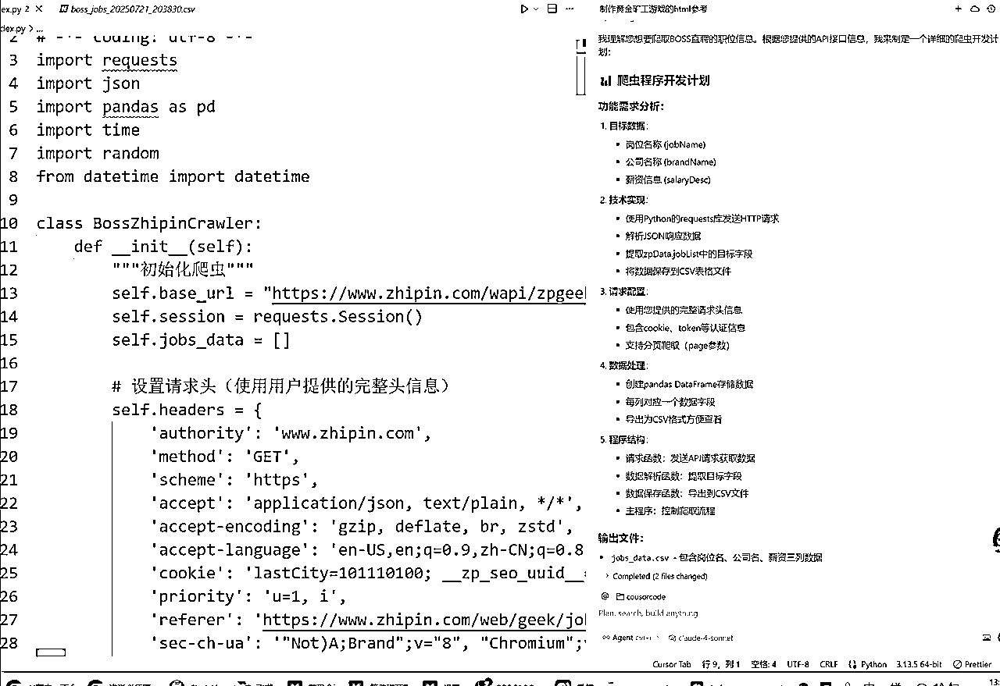

选择 Cursor 的好处是，它不仅能帮你把代码写出来，还能直接在本地跑起来，最后直接把数据表格交付到你手上。

而用 GPT 这类工具，虽然也能产出代码，但你还需要手动把代码复制到编辑器里自己执行。

另外要注意，AI 生成的代码基本都是 Python，所以提前把 Python 运行环境搭好是必须的。不会配置的话，可以去我👸号的相关文章里找教程。

最后附赠一段可直接使用的示例代码。假如运行后出现请求失败的情况，通常就是请求头里的 cookie 过期了，重新抓取一次最新的请求头替换进去即可。

有时候，最吊人胃口的，不是一句惊天动地的话，而是一个没头没尾的开始。

就像现在，摆在我面前的“素材”，干净得像一张白纸，只留下一个孤零零的记号——```
#!/usr/bin/env python3
# -*- coding: utf-8 -*-
import requests
import json
import pandas as pd
import time
import random
from datetime import datetime

class BossZhipinCrawler:
    def __init__(self):
        """初始化爬虫"""
        self.base_url = "https://www.zhipin.com/wapi/zpgeek/search/joblist.json"
        self.session = requests.Session()
        self.jobs_data = []

        # 设置请求头（使用用户提供的完整头信息）
        self.headers = {
            'authority': 'www.zhipin.com',
            'method': 'GET',
            'scheme': 'https',
            'accept': 'application/json, text/plain, */*',
            'accept-encoding': 'gzip, deflate, br, zstd',
            'accept-language': 'en-US,en;q=0.9,zh-CN;q=0.8,zh;q=0.7',
            'cookie': 'lastCity=101110100; __zp_seo_uuid__=eaccb579-a4de-41a2-8df7-b3592e8187f1; __l=r=https%3A%2F%2Fwww.google.com%2F&l=%2F&s=1; __g=-; Hm_lvt_194df3105ad7148dcf2b98a91b5e727a=1753091857; HMACCOUNT=108AA934E1247E45; ab_guid=06e29e40-da67-458f-b026-8c0ebca6f442; Hm_lpvt_194df3105ad7148dcf2b98a91b5e727a=1753091867; wt2=DXLVUIqAqQrMHLkzl61FjufoGIwkGErz-yZQSOIRPkIhrZGQkVFO94cmPiZUPNKAHcAPSmjHQNK6e_o7bYRTLYQ~~; wbg=0; zp_at=6Dbw0DrhrZkonzI7ayCojCXClUPggZSCCiRUMKc-IiA~; bst=V2QNskGeb03VtpVtRuyhkZLyqy7DrUzCo~|QNskGeb03VtpVtRuyhkZLyqy7DrQxy8~; __c=1753091857; __a=11610095.1753091857..1753091857.11.1.11.11; __zp_stoken__=51f9fw43CrEYcRB4QZcKBGhliUV1iZGTCsk1lWl5ywr9oWWnDgGfDiMOAXFxqw4rCqGnClsKxwpxQxILDiMKXwrLEicKjwpVRw47CtsKSw4jCp8Smw7fCjcK9woXCmMOBwqlANRARFxEUERASEA0VHA0TEh4bFRsaFRweHBlHNcSHwqzDo0FDTkE2W15cF1poaFdoVhJiVFRERBluER5EP0dBREDDj8Kow4LDm8OKwqrDgMOaw47Cr8K9KEFMQEHDgsKzMy1WE8OAIRRjE8OASRTDgcKsYsOUaMOHNT%2FCvcOuNT1Dw4TFg0xCJ05BQExAPUhAQjc9EMORb8OHOjrDgzMwRCFIQkBKR0BCQEhBTjZATDo2QkE0RRwSGB4YM0nCvcKvw4DDqkJA',
            'priority': 'u=1, i',
            'referer': 'https://www.zhipin.com/web/geek/jobs?city=100010000&position=100101',
            'sec-ch-ua': '"Not)A;Brand";v="8", "Chromium";v="138", "Google Chrome";v="138"',
            'sec-ch-ua-mobile': '?0',
            'sec-ch-ua-platform': '"Windows"',
            'sec-fetch-dest': 'empty',
            'sec-fetch-mode': 'cors',
            'sec-fetch-site': 'same-origin',
            'token': 'HhZ4dZjz0hc9Qkms',
            'traceid': 'F-9602f5gsTRNOSJSE',
            'user-agent': 'Mozilla/5.0 (Windows NT 10.0; Win64; x64) AppleWebKit/537.36 (KHTML, like Gecko) Chrome/138.0.0.0 Safari/537.36',
            'x-requested-with': 'XMLHttpRequest',
            'zp_token': 'V2QNskGeb03VtpVtRuyhkZLyqy7DrUzCo~|QNskGeb03VtpVtRuyhkZLyqy7DrQxy8~'
        }

        # 基础请求参数
        self.base_params = {
            'pageSize': '15',
            'city': '100010000',      # 北京
            'position': '100101',     # 技术岗位
            'query': '',
            'expectInfo': '',
            'multiSubway': '',
            'multiBusinessDistrict': '',
            'jobType': '',
            'salary': '',
            'experience': '',
            'degree': '',
            'industry': '',
            'scale': '',
            'stage': '',
            'scene': '1'
        }

        print("🚀 BOSS直聘职位信息爬虫初始化完成")
        print("=" * 50)

    def get_job_list(self, page=1):
        """
        获取指定页面的职位列表

        Args:
            page (int): 页码

        Returns:
            dict: API响应数据
        """
        params = self.base_params.copy()
        params['page'] = str(page)
        params['_'] = str(int(time.time() * 1000))  # 添加时间戳

        try:
            print(f"📡 正在获取第 {page} 页数据...")

            response = self.session.get(
                url=self.base_url,
                headers=self.headers,
                params=params,
                timeout=10
            )

            if response.status_code == 200:
                data = response.json()
                if data.get('code') == 0:
                    job_count = len(data.get('zpData', {}).get('jobList', []))
                    print(f"✅ 成功获取 {job_count} 条职位信息")
                    return data
                else:
                    print(f"❌ API返回错误: {data.get('message', '未知错误')}")
                    return None
            else:
                print(f"❌ 请求失败，状态码: {response.status_code}")
                return None

        except requests.RequestException as e:
            print(f"❌ 网络请求异常: {str(e)}")
            return None
        except json.JSONDecodeError as e:
            print(f"❌ JSON解析失败: {str(e)}")
            return None

    def parse_job_data(self, data):
        """
        解析职位数据，提取所需字段

        Args:
            data (dict): API响应数据

        Returns:
            list: 解析后的职位信息列表
        """
        if not data or 'zpData' not in data:
            return []

        job_list = data['zpData'].get('jobList', [])
        parsed_jobs = []

        for job in job_list:
            job_info = {
                '岗位名称': job.get('jobName', ''),
                '公司名称': job.get('brandName', ''),
                '薪资': job.get('salaryDesc', ''),
                '经验要求': job.get('jobExperience', ''),
                '学历要求': job.get('jobDegree', ''),
                '工作地点': f"{job.get('cityName', '')}-{job.get('areaDistrict', '')}-{job.get('businessDistrict', '')}",
                '公司规模': job.get('brandScaleName', ''),
                '公司行业': job.get('brandIndustry', ''),
                '技能标签': ', '.join(job.get('skills', [])),
                '福利待遇': ', '.join(job.get('welfareList', []))
            }
            parsed_jobs.append(job_info)

        return parsed_jobs

    def crawl_jobs(self, max_pages=5):
        """
        爬取多页职位信息

        Args:
            max_pages (int): 最大爬取页数
        """
        print(f"🎯 开始爬取职位信息，计划爬取 {max_pages} 页")
        print("-" * 50)

        for page in range(1, max_pages + 1):
            # 获取数据
            data = self.get_job_list(page)

            if data:
                # 解析数据
                jobs = self.parse_job_data(data)
                self.jobs_data.extend(jobs)

                print(f"📊 第 {page} 页解析完成，累计获取 {len(self.jobs_data)} 条数据")

                # 检查是否还有更多数据
                has_more = data.get('zpData', {}).get('hasMore', False)
                if not has_more:
                    print("ℹ️  已获取所有可用数据")
                    break
            else:
                print(f"⚠️  第 {page} 页数据获取失败，跳过")
                continue

            # 随机延时，避免请求过于频繁
            delay = random.uniform(1, 3)
            print(f"⏳ 等待 {delay:.1f} 秒后继续...")
            time.sleep(delay)

        print("-" * 50)
        print(f"🎉 爬取完成！总共获取 {len(self.jobs_data)} 条职位信息")

    def save_to_csv(self, filename=None):
        """
        保存数据到CSV文件

        Args:
            filename (str): 文件名，默认自动生成
        """
        if not self.jobs_data:
            print("❌ 没有数据可保存")
            return

        if filename is None:
            timestamp = datetime.now().strftime("%Y%m%d_%H%M%S")
            filename = f"boss_jobs_{timestamp}.csv"

        try:
            df = pd.DataFrame(self.jobs_data)
            df.to_csv(filename, index=False, encoding='utf-8-sig')
            print(f"💾 数据已保存到: {filename}")
            print(f"📈 文件包含 {len(df)} 行数据，{len(df.columns)} 列")

            # 显示数据预览
            print("\n📋 数据预览（前5行）:")
            print(df[['岗位名称', '公司名称', '薪资']].head().to_string(index=False))

        except Exception as e:
            print(f"❌ 保存文件失败: {str(e)}")

    def get_statistics(self):
        """获取数据统计信息"""
        if not self.jobs_data:
            print("❌ 没有数据可统计")
            return

        df = pd.DataFrame(self.jobs_data)

        print("\n📊 数据统计信息:")
        print("=" * 50)
        print(f"📝 总职位数量: {len(df)}")
        print(f"🏢 涉及公司数量: {df['公司名称'].nunique()}")
        print(f"💼 不同岗位类型: {df['岗位名称'].nunique()}")

        # 薪资统计
        print("\n💰 薪资分布 (Top 10):")
        salary_counts = df['薪资'].value_counts().head(10)
        for salary, count in salary_counts.items():
            print(f"  {salary}: {count} 个职位")

        # 公司统计
        print("\n🏢 热门公司 (Top 10):")
        company_counts = df['公司名称'].value_counts().head(10)
        for company, count in company_counts.items():
            print(f"  {company}: {count} 个职位")

        # 岗位统计
        print("\n💼 热门岗位 (Top 10):")
        job_counts = df['岗位名称'].value_counts().head(10)
        for job, count in job_counts.items():
            print(f"  {job}: {count} 个职位")

def main():
    """主函数"""
    print("🎯 BOSS直聘职位信息爬虫启动")
    print("=" * 60)

    # 创建爬虫实例
    crawler = BossZhipinCrawler()

    try:
        # 爬取职位信息（默认爬取5页）
        crawler.crawl_jobs(max_pages=5)

        # 显示统计信息
        crawler.get_statistics()

        # 保存到CSV文件
        crawler.save_to_csv()

        print("\n🎊 程序执行完成！")

    except KeyboardInterrupt:
        print("\n⚠️  用户中断程序执行")
    except Exception as e:
        print(f"\n❌ 程序执行出错: {str(e)}")

    print("\n👋 感谢使用BOSS直聘职位信息爬虫!")

if __name__ == "__main__":
    main()

```。

别小看这个记号，它其实是给文案开了一扇门：门后面，什么都有可能发生。可能是金句，可能是数据，也可能是一段戳心故事。真正聪明的文案，从不急着把话说满，而是先铺好轨道，让情绪顺着一个节点自然生长。

老话说得好，留白才是最高的表达。与其堆砌辞藻，不如用一个抓手，把所有注意力都收拢到一个点上。

现在，这枚钩子已经就位。

它就是：```
#!/usr/bin/env python3
# -*- coding: utf-8 -*-
import requests
import json
import pandas as pd
import time
import random
from datetime import datetime

class BossZhipinCrawler:
    def __init__(self):
        """初始化爬虫"""
        self.base_url = "https://www.zhipin.com/wapi/zpgeek/search/joblist.json"
        self.session = requests.Session()
        self.jobs_data = []

        # 设置请求头（使用用户提供的完整头信息）
        self.headers = {
            'authority': 'www.zhipin.com',
            'method': 'GET',
            'scheme': 'https',
            'accept': 'application/json, text/plain, */*',
            'accept-encoding': 'gzip, deflate, br, zstd',
            'accept-language': 'en-US,en;q=0.9,zh-CN;q=0.8,zh;q=0.7',
            'cookie': 'lastCity=101110100; __zp_seo_uuid__=eaccb579-a4de-41a2-8df7-b3592e8187f1; __l=r=https%3A%2F%2Fwww.google.com%2F&l=%2F&s=1; __g=-; Hm_lvt_194df3105ad7148dcf2b98a91b5e727a=1753091857; HMACCOUNT=108AA934E1247E45; ab_guid=06e29e40-da67-458f-b026-8c0ebca6f442; Hm_lpvt_194df3105ad7148dcf2b98a91b5e727a=1753091867; wt2=DXLVUIqAqQrMHLkzl61FjufoGIwkGErz-yZQSOIRPkIhrZGQkVFO94cmPiZUPNKAHcAPSmjHQNK6e_o7bYRTLYQ~~; wbg=0; zp_at=6Dbw0DrhrZkonzI7ayCojCXClUPggZSCCiRUMKc-IiA~; bst=V2QNskGeb03VtpVtRuyhkZLyqy7DrUzCo~|QNskGeb03VtpVtRuyhkZLyqy7DrQxy8~; __c=1753091857; __a=11610095.1753091857..1753091857.11.1.11.11; __zp_stoken__=51f9fw43CrEYcRB4QZcKBGhliUV1iZGTCsk1lWl5ywr9oWWnDgGfDiMOAXFxqw4rCqGnClsKxwpxQxILDiMKXwrLEicKjwpVRw47CtsKSw4jCp8Smw7fCjcK9woXCmMOBwqlANRARFxEUERASEA0VHA0TEh4bFRsaFRweHBlHNcSHwqzDo0FDTkE2W15cF1poaFdoVhJiVFRERBluER5EP0dBREDDj8Kow4LDm8OKwqrDgMOaw47Cr8K9KEFMQEHDgsKzMy1WE8OAIRRjE8OASRTDgcKsYsOUaMOHNT%2FCvcOuNT1Dw4TFg0xCJ05BQExAPUhAQjc9EMORb8OHOjrDgzMwRCFIQkBKR0BCQEhBTjZATDo2QkE0RRwSGB4YM0nCvcKvw4DDqkJA',
            'priority': 'u=1, i',
            'referer': 'https://www.zhipin.com/web/geek/jobs?city=100010000&position=100101',
            'sec-ch-ua': '"Not)A;Brand";v="8", "Chromium";v="138", "Google Chrome";v="138"',
            'sec-ch-ua-mobile': '?0',
            'sec-ch-ua-platform': '"Windows"',
            'sec-fetch-dest': 'empty',
            'sec-fetch-mode': 'cors',
            'sec-fetch-site': 'same-origin',
            'token': 'HhZ4dZjz0hc9Qkms',
            'traceid': 'F-9602f5gsTRNOSJSE',
            'user-agent': 'Mozilla/5.0 (Windows NT 10.0; Win64; x64) AppleWebKit/537.36 (KHTML, like Gecko) Chrome/138.0.0.0 Safari/537.36',
            'x-requested-with': 'XMLHttpRequest',
            'zp_token': 'V2QNskGeb03VtpVtRuyhkZLyqy7DrUzCo~|QNskGeb03VtpVtRuyhkZLyqy7DrQxy8~'
        }

        # 基础请求参数
        self.base_params = {
            'pageSize': '15',
            'city': '100010000',      # 北京
            'position': '100101',     # 技术岗位
            'query': '',
            'expectInfo': '',
            'multiSubway': '',
            'multiBusinessDistrict': '',
            'jobType': '',
            'salary': '',
            'experience': '',
            'degree': '',
            'industry': '',
            'scale': '',
            'stage': '',
            'scene': '1'
        }

        print("🚀 BOSS直聘职位信息爬虫初始化完成")
        print("=" * 50)

    def get_job_list(self, page=1):
        """
        获取指定页面的职位列表

        Args:
            page (int): 页码

        Returns:
            dict: API响应数据
        """
        params = self.base_params.copy()
        params['page'] = str(page)
        params['_'] = str(int(time.time() * 1000))  # 添加时间戳

        try:
            print(f"📡 正在获取第 {page} 页数据...")

            response = self.session.get(
                url=self.base_url,
                headers=self.headers,
                params=params,
                timeout=10
            )

            if response.status_code == 200:
                data = response.json()
                if data.get('code') == 0:
                    job_count = len(data.get('zpData', {}).get('jobList', []))
                    print(f"✅ 成功获取 {job_count} 条职位信息")
                    return data
                else:
                    print(f"❌ API返回错误: {data.get('message', '未知错误')}")
                    return None
            else:
                print(f"❌ 请求失败，状态码: {response.status_code}")
                return None

        except requests.RequestException as e:
            print(f"❌ 网络请求异常: {str(e)}")
            return None
        except json.JSONDecodeError as e:
            print(f"❌ JSON解析失败: {str(e)}")
            return None

    def parse_job_data(self, data):
        """
        解析职位数据，提取所需字段

        Args:
            data (dict): API响应数据

        Returns:
            list: 解析后的职位信息列表
        """
        if not data or 'zpData' not in data:
            return []

        job_list = data['zpData'].get('jobList', [])
        parsed_jobs = []

        for job in job_list:
            job_info = {
                '岗位名称': job.get('jobName', ''),
                '公司名称': job.get('brandName', ''),
                '薪资': job.get('salaryDesc', ''),
                '经验要求': job.get('jobExperience', ''),
                '学历要求': job.get('jobDegree', ''),
                '工作地点': f"{job.get('cityName', '')}-{job.get('areaDistrict', '')}-{job.get('businessDistrict', '')}",
                '公司规模': job.get('brandScaleName', ''),
                '公司行业': job.get('brandIndustry', ''),
                '技能标签': ', '.join(job.get('skills', [])),
                '福利待遇': ', '.join(job.get('welfareList', []))
            }
            parsed_jobs.append(job_info)

        return parsed_jobs

    def crawl_jobs(self, max_pages=5):
        """
        爬取多页职位信息

        Args:
            max_pages (int): 最大爬取页数
        """
        print(f"🎯 开始爬取职位信息，计划爬取 {max_pages} 页")
        print("-" * 50)

        for page in range(1, max_pages + 1):
            # 获取数据
            data = self.get_job_list(page)

            if data:
                # 解析数据
                jobs = self.parse_job_data(data)
                self.jobs_data.extend(jobs)

                print(f"📊 第 {page} 页解析完成，累计获取 {len(self.jobs_data)} 条数据")

                # 检查是否还有更多数据
                has_more = data.get('zpData', {}).get('hasMore', False)
                if not has_more:
                    print("ℹ️  已获取所有可用数据")
                    break
            else:
                print(f"⚠️  第 {page} 页数据获取失败，跳过")
                continue

            # 随机延时，避免请求过于频繁
            delay = random.uniform(1, 3)
            print(f"⏳ 等待 {delay:.1f} 秒后继续...")
            time.sleep(delay)

        print("-" * 50)
        print(f"🎉 爬取完成！总共获取 {len(self.jobs_data)} 条职位信息")

    def save_to_csv(self, filename=None):
        """
        保存数据到CSV文件

        Args:
            filename (str): 文件名，默认自动生成
        """
        if not self.jobs_data:
            print("❌ 没有数据可保存")
            return

        if filename is None:
            timestamp = datetime.now().strftime("%Y%m%d_%H%M%S")
            filename = f"boss_jobs_{timestamp}.csv"

        try:
            df = pd.DataFrame(self.jobs_data)
            df.to_csv(filename, index=False, encoding='utf-8-sig')
            print(f"💾 数据已保存到: {filename}")
            print(f"📈 文件包含 {len(df)} 行数据，{len(df.columns)} 列")

            # 显示数据预览
            print("\n📋 数据预览（前5行）:")
            print(df[['岗位名称', '公司名称', '薪资']].head().to_string(index=False))

        except Exception as e:
            print(f"❌ 保存文件失败: {str(e)}")

    def get_statistics(self):
        """获取数据统计信息"""
        if not self.jobs_data:
            print("❌ 没有数据可统计")
            return

        df = pd.DataFrame(self.jobs_data)

        print("\n📊 数据统计信息:")
        print("=" * 50)
        print(f"📝 总职位数量: {len(df)}")
        print(f"🏢 涉及公司数量: {df['公司名称'].nunique()}")
        print(f"💼 不同岗位类型: {df['岗位名称'].nunique()}")

        # 薪资统计
        print("\n💰 薪资分布 (Top 10):")
        salary_counts = df['薪资'].value_counts().head(10)
        for salary, count in salary_counts.items():
            print(f"  {salary}: {count} 个职位")

        # 公司统计
        print("\n🏢 热门公司 (Top 10):")
        company_counts = df['公司名称'].value_counts().head(10)
        for company, count in company_counts.items():
            print(f"  {company}: {count} 个职位")

        # 岗位统计
        print("\n💼 热门岗位 (Top 10):")
        job_counts = df['岗位名称'].value_counts().head(10)
        for job, count in job_counts.items():
            print(f"  {job}: {count} 个职位")

def main():
    """主函数"""
    print("🎯 BOSS直聘职位信息爬虫启动")
    print("=" * 60)

    # 创建爬虫实例
    crawler = BossZhipinCrawler()

    try:
        # 爬取职位信息（默认爬取5页）
        crawler.crawl_jobs(max_pages=5)

        # 显示统计信息
        crawler.get_statistics()

        # 保存到CSV文件
        crawler.save_to_csv()

        print("\n🎊 程序执行完成！")

    except KeyboardInterrupt:
        print("\n⚠️  用户中断程序执行")
    except Exception as e:
        print(f"\n❌ 程序执行出错: {str(e)}")

    print("\n👋 感谢使用BOSS直聘职位信息爬虫!")

if __name__ == "__main__":
    main()

```。

接下来要做的，就是接住它，然后，把故事讲下去。

看别人的演示再精彩，也远不如自己上手跑一遍代码。真正理解AI爬虫的乐趣，是从你亲手尝试那一刻开始的。如果你在实操中碰到了别的难题，或者有特别想解决的痛点，也欢迎在评论区留言告诉我。任何想法和建议，尽管提出来，我们一起交流。别忘了，学习的捷径就是动手去做，别让教程只停在收藏夹里。