# 三十万学费换来的一个答案：直到遇见它，我才真正觉得这钱没白花

> 一个电商老兵的真心话：为什么今年只花了3365元，却让我觉得比过去十年花掉的三十万都值？

## 动笔之前，说说我心里的话

先交代一下背景。

过去十年，我在各类付费社群里前前后后投了三十多万。对一直做小生意、多数时间还在念书的我来说，这笔钱真的不算轻。

可能有人会觉得：花这么多钱进群，是不是有点冲动？

但我自己的想法一直很明确——为了认知提升花钱，我愿意。

只是这十年走下来，我心里也有不少落差：

有的社群把重心放在线下聚会上，结果一年到头也见不了几次面，能吸收的东西有限。

还有的社群内容倒是很多，但散得不成体系，和我的业务搭不上边。

不能说一点收获都没有，但从投入产出的角度来看，确实很难让我由衷地说一声"值"。

直到两个月前，我走进了龙哥盟。

为什么我如此愿意专门写一篇长文来复盘它？

原因很简单——在这十年花过的所有学费里，这是第一个让我发自内心感叹"太值了、太适合我了"的圈子。

它打动我的三个点：

1. 资料丰富、更新极快。几乎任何我想查的东西都能立刻搜到。不管是副业玩法、从0到1的冷启动项目，还是别人整理好的SOP流程，都有现成的分享。

2. 信息虽然零散，但能被我拼出体系来。表面上看起来东一点西一点的内容，借助我自己的知识结构，我就能把它们重新排列组合，变成可执行的方案。不瞒你说，这件事我既拿手又享受。

3. 对"内向型创业者"非常友好。我不是那种爱到处social的性格。在别的社群，不参加线下活动基本就等于白进；但在赚钱，我哪怕不开口说话，也能在社群里找到我需要的思路和答案。

所以结论对我来说很清楚：

花掉三十多万的学费之后，我终于找到了一个和自己最合拍的圈子。

这篇文章，是用我两个月的切身体验写给所有新人的：

加入赚钱的这两个月，我究竟获得了什么？你又能从我的分享中看到什么？

大家好，我是晴子，感谢七天老师的邀请。

这篇新人复盘其实拖了很久。前几天晚上我一时兴起，写了一万多字关于新人如何用好赚钱的内容，但写完回头一看，我自己也还是个新人啊，那篇就跑题了。

那篇更像是讲新人怎么发掘自己的优势、怎么找到适合自己又能长期经营的产品、怎么做21天习惯养成计划、怎么利用赚钱的信息差……这些东西我以后再好好打磨，等想透了再发出来跟大家一起探讨。

8月16日晚上9点半到家，我静下心开始写这篇1.3万字的内容。

分享一个小窍门：我是用语音转文字来写的。打字实在太慢了，所以我录了30多分钟音频，再转成文字。效率出奇地高。

为什么挑这一天动笔？因为下午参加了戴哥的组局，晚上又跟4位圈友一起吃饭。聊完之后，我真切地感受到了大家的真实状态，也更坚定了记录这两个月复盘的想法。希望我的收获和思考能分享出来，也能给刚进圈的新人一些借鉴。

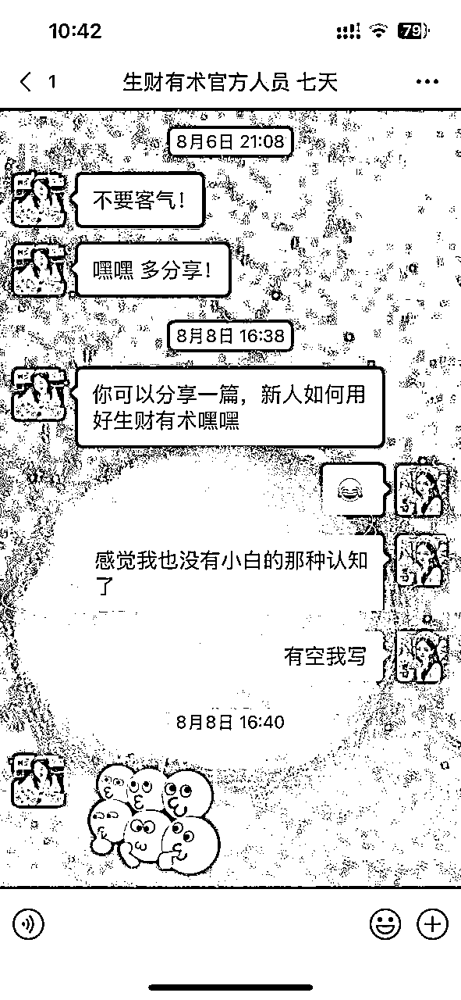

## 先认识一下我——超级术作者晴子

先亮一个我特别自豪的身份：超级术作者。

这是我第一篇文章的链接：https://scys.com/articleDetail/xq_topic/5125812545148544（电商卖货保姆级实战手册，个人玩法/团队玩法0-1/1-10必看）

简单做个自我介绍，方便不认识我的圈友快速了解：

我出生于1997年，今年28岁，有13年的赚钱经历。公众号：晴子bosss

我的盖洛普前五标签：分析、战略、理念、排难、行动。

用一句话来概括：战略型实干家。我擅长拆解商业的本质，快速嗅到市场中的机会，然后马上执行落地拿到结果，再归纳成可复用的方法带着别人赚钱，帮大家少走弯路。

我的商业经历：

2012年（初中）：在贴吧倒卖手机流量卡，赚到了人生第一桶金，也一路看着互联网从2G走到3G再到4G。

2013年：开始接触淘宝刷单，从普通会员做到主持，后来又自己开团招主持和会员，团队做到了20位主持、几百号会员的规模。

2014-2016年：转做微商，卖美甲贴纸，由此开始攒微信私域客户，为后面的创业打了底子。

2016年底：因为很早就有了为知识付费的意识，所以摸到了穿戴美甲这个赛道。

2017年：靠快手、抖音短视频引流，私域加满了10多个微信号，作为万人团队的操盘手，带着上千名直属代理赚钱，也靠自己的努力让家里实现了财富跃迁。

2018年：快手直播单月纯利润50万+；抖音直播单天纯利润10万+，而且这样的情况持续了一阵子。到现在直播也还在做。

2019-2020年：留学期间接触外贸与跨境出口，做TikTok海外账号，单天涨粉1万，一个月积累到18万粉丝。

2021-2022年底：疫情时期投资70万开穿戴甲工厂，经历过封控风险，开放之后果断做了业务分流，最后清仓离场，全身而退。

2023年：接手一家实体门店，第二个月就转了出去，亏了5万。这次的教训让我更加确认：轻资产才是适合我的路线。

2018至今：一直在投资外包客服团队，给各类电商平台商家提供服务，保持着长期稳定盈利。有电商外包客服需求的圈友可以找鱼丸联系我。

2025年：除了主业，8月开始布局个人IP和疗愈相关的方向，探索新的长期增长空间。

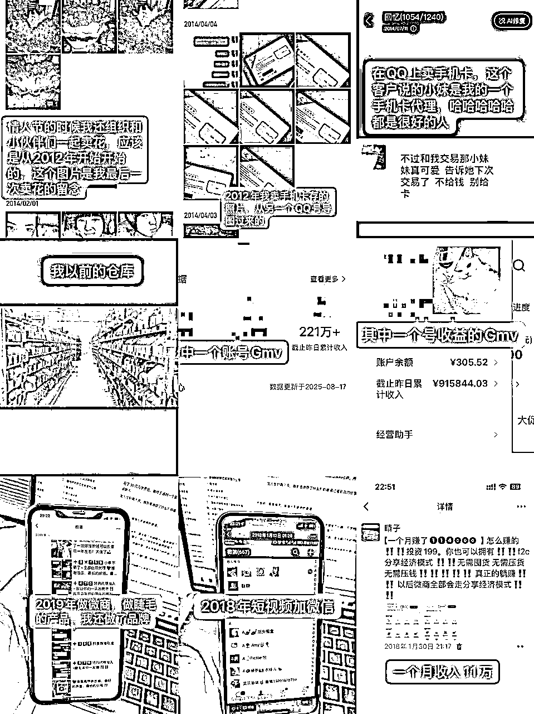

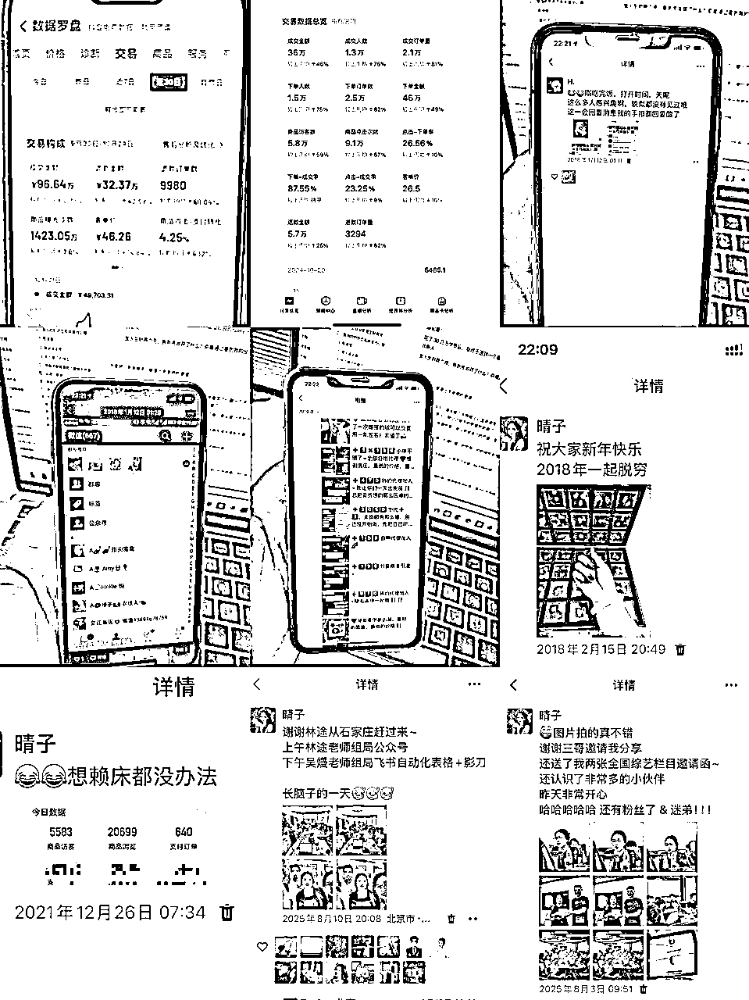

我平时不怎么爱拍照，翻了些QQ空间和微信朋友圈的旧图来凑数。

下面是干货满满的正文。希望我这一路的经历，也能给一部分认可我想法的人提供一些方向和参考。

## 一、我如何与龙哥盟结缘

我跟赚钱的故事，回想起来还挺戏剧化的。

最初是2023年10月29号，深圳一个叫豆芽的女生跟我提起了它。我当时还有截图。

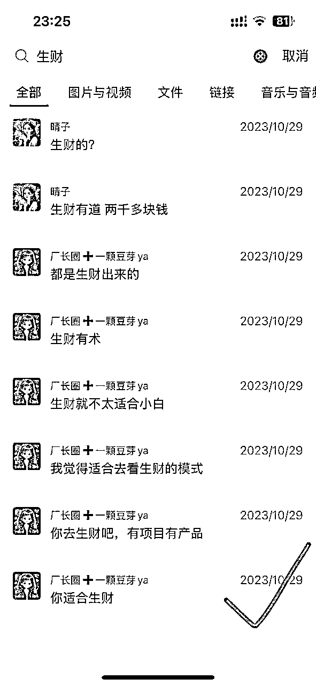

但那时我在网上搜了一圈，感觉这社群的门道我看不太懂。

后来是2024年，不知道什么时候领了一张三天的体验卡，但依然没有付费。那三天，我好像也没打卡学什么。

不过，就在那三天里，我在赚钱搜到了北京本地的群。忘了加的是谁的微信，总之被拉进了群。进了群我也一直潜水，没冒过泡。

——这就是我和赚钱的两次"擦肩而过"。

今年5月之后，我开始满北京找合适的办公场地，但一直没找到称心的。

后来在北京群里看到戴哥组织共享办公的组局。第一次看到消息时，因为我还没付费，连话都不敢接。我私下看了两位老板的头像——王子冯老师一看就是气场很强的类型，戴哥的头像则有种投资人大佬的味道。因为是筛选制，我潜意识里觉得自己肯定选不上。

第二次又看到戴哥在群里发组局的通告，我鼓起勇气加了他微信。6月18号，有图为证。

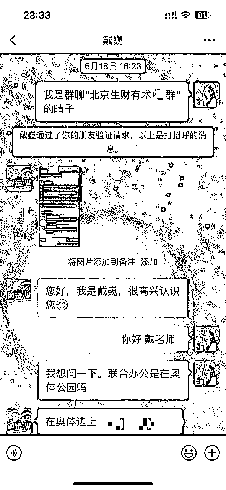

当晚我就付费了。对，我没好意思向戴哥要推荐码，因为他title太响亮了，我怕自己还没成为赚钱用户就先被踢出群😂。

后来是通过吴泽承学长的推荐付的费。大概这就是缘分吧。

顺便提一句：学长真的超拼，人也超厉害。那天他刚做完义工回家，一到家就给我打电话，还专门开视频演示他怎么做小红书获客。其实我想了解的早就了解完了，电话那头的他还在热情输出，我也不好意思打断，最后只好说"我要睡觉了"才挂掉哈哈哈哈！！！！

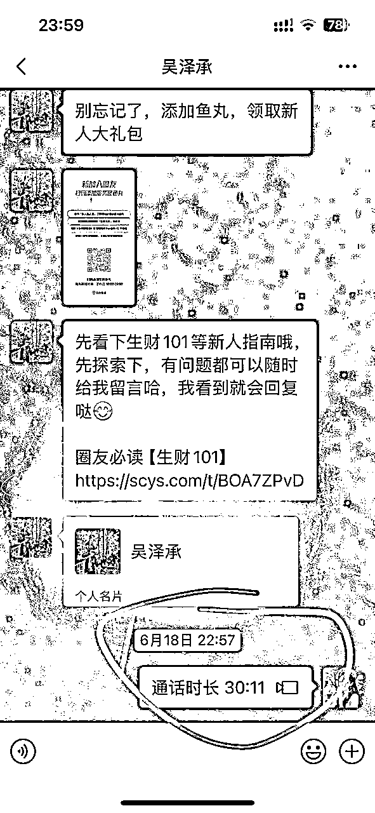

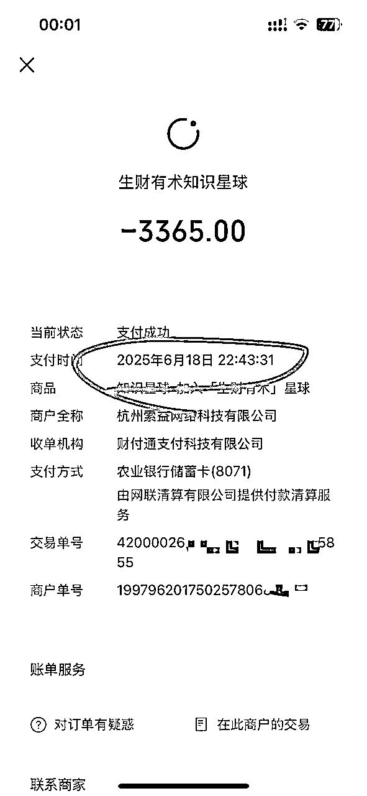

6月19号去参加了线下组局，这是我们的合影。为了保护大家的隐私，做成了AI卡通风格，很有纪念价值。

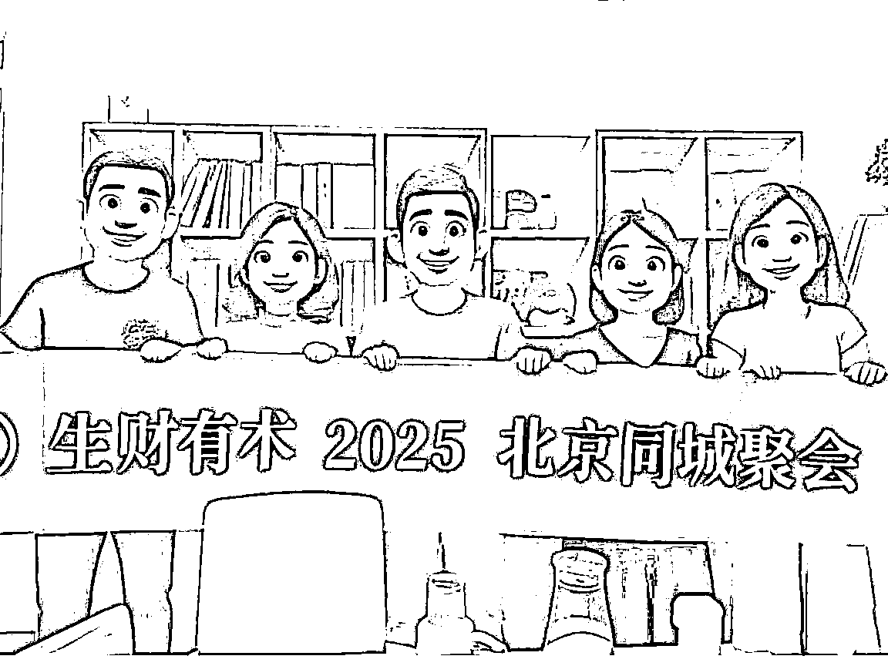

我平时都是居家办公，极少出门，日常接触的都是互联网上的朋友，客户也都是网友，所以对线下应酬社交这种事，我其实有点抵触。

但那次线下局聊得意外地开心。我讲到自己的经历时，大家都善意地夸了我一顿😂。说实话，我一直没觉得自己有多厉害，谈不上自卑，但确实也没那么自信。

位置离我家不算近，通勤一个半小时，来回就要3小时，当时也有过犹豫。但后来一起参加聚会的小伙伴们都搬进去了，就剩我这个"落后分子"。我也拿不太准，可心里有个声音特别坚定：不加入我一定会后悔，这可能是我事业上的一个重要转折点。

所以第二天我就跟王子冯老师说，我先试着坚持一个月。姐说，好，欢迎你。

是的，我真的坚持下来了哦，眼看就要续第三个月了。

我平时下班骑共享单车回家，单程有20公里。半路会听杨涛老师的播客，完全不觉得孤单，顺便把运动量也给补上了。圈友们，记得动起来！

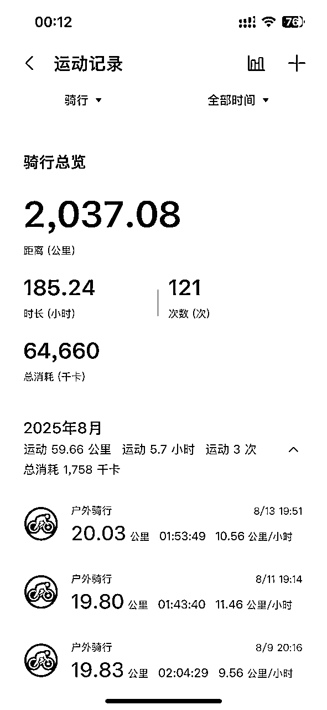

## 二、我当时的状态和共享办公的收获

说实话，那阵子我整个人都处在一种纠结的状态里。

一方面，5月起我就在物色合适的办公场所。天天把自己关在家里，效率真的很低。做自由职业的人尤其容易踩这个坑——没有外力监督，意志力很容易崩。

那种状态让我觉得自己在空耗时间。我心里始终在等一个转机，并且告诉自己：机会要是来了，我一定毫不犹豫地抓住。

这里也要多说一句：我始终坚信，机会和转机不会提前打招呼，它们往往是突然砸到眼前的。风口也好，赚钱的路子也罢，都是如此。正因为一直抱着这种想法，所以我每次都不敢松懈。

第一次看到戴哥发组局信息时，由于我还不是赚钱会员，没法报名参加。那种"想去却去不了"的遗憾，我一直记到今天。

所以当第二次机会摆在我面前时，我毫不犹豫地参加了。虽然来回通勤确实折腾，但我不能放任自己错过——我很清楚，一旦错过，我可能就永远躲在自己的舒适区里出不来了。

如今我已经坚持了两个月，马上要进入第三个月。

只要还没到需要自己组建团队的地步，我就会继续在这里待下去。

那共享办公到底带给了我什么？

### 规律感

我从来没有上过班，以前每天真正有效率的工作时间只有2-3小时。算下来，一周实际推进的事情连四成都不到。

我一直不太懂上班族那种"规矩感"从哪里来的——为什么非要早起？为什么非要打卡？为什么一定要在某个点坐在工位上？

但当我进入共享办公的第三天，我突然体会到了那种感觉。每天按时起床、收拾、出发、到工位、开工。就这么循环了几天，我整个人像是被重新校准了。

这是我感受最深的第一个变化。工作效率从每天2-3小时提到了4-5小时，实际推进的工作量也飙到了八成以上。

### 被动逼迫感

这个词听着有点怪，但感受非常真实。

在家办公的时候，拖延的借口要多少有多少，反正没人监督。在共享办公空间里，周围全是闷头干活的人，你一个人捧着手机刷，自己都会觉得尴尬。于是只能硬着头皮进入状态，把手头的事做了。

渐渐地，这种"被动逼迫感"反而成了我维持高效输出的助推器。

### 社交圈的搭建

这也是我后面越来越愿意去的原因。

我以前是个标准的宅人，不爱社交。但在共享空间里，大家抬头不见低头见，聊着聊着，关系就自然建立起来了。

比如我跟"王子冯老师"就成了一顿饭搭子，经常骑着她的小电驴载她去食堂。她说过一句话我一直记在脑子里："不是每一份钱都要赚，还要筛选客户。"

这句话给我的冲击特别大。

以前我的想法很简单：有单就接，客户找上门就答应。但她的意思是：要做筛选，要学会拒绝。真正有价值的客户，从来不是靠数量堆出来的，而是靠质量筛出来的。

## 三、写帖让我意外成了超级术作者

进入赚钱的第23天，我产出了第一篇内容。

结果：拿下了人生中第一篇精华帖，还被贴上了"超级术"的标签，由龙哥老大亲自推荐给全圈友学习，还收到了666.66元的奖励。

更让我意外的是，这篇帖子还帮我在线下认识了100+的人。

说实话，最开始我压根没想过自己会动笔写内容。

在我当时的概念里，写帖是"高手们"才做的事，跟我这种小透明没什么关系。我顶多就是在群里边潜水边看，偶尔冒个泡聊几句。后来的发展完全超出了我的预想。

进圈20来天的时候，我一个做小红书、收入极高的朋友，竟然转过头来问我后端的问题。为了帮她，我临时起意写了那篇文章。

第一篇帖子链接：https://scys.com/articleDetail/xq_topic/5125812545148544（电商卖货保姆级实战手册，个人玩法/团队玩法0-1/1-10必看）

我写得特别随意，没套什么花哨的框架，想到哪就写到哪，写的时候还忐忑：发出去会不会压根没人看？

结果让我懵了——没过多久，帖子就被加精了。

再往后，龙哥老大直接给帖子上贴了"超级术"标签，推给整个圈子的人读，还发了我666.66元的奖金。说真的，那种被"看见"的感觉，让我心里热了一下。

我一直觉得自己不过是圈里一个普通的新人，身上没什么值得说的亮点。可没想到，我用最朴素的表述、最真实的亲身经历，反而让不少人读出了价值。

那一刻我才反应过来：

原来写内容，并不需要你有多亮眼的成绩，也不需要你用多精致的辞藻。

只要你写下的是真实的、能击中别人共鸣点的经历，它就有了意义。

那一刻我心里特别感慨——这意味着，我不再只是一个"围观者"，我已经成了一个"贡献者"。

这件事也彻底扭转了我对自己的认知，从"不敢写"变成了"还想写更多"。

因为我知道，哪怕我记录的只是一些平常的心得，也可能照亮别人，帮到某个正在困惑的人。

所以看到这里的你，可以做点什么呢？

1. 在加入赚钱的第n天，试着写第一篇帖子（哪怕只是最普通的一点体会），写的过程会推着你变得更强大。

2. 坚持真实的表达，别追求"专业感"，把你亲历的困境、解法、感受写出来就好。

3. 每个月写1篇，至少能让10~50个圈友记住你的名字，无形之中就会形成你的个人IP。

## 四、靠线下组局认识了一百多号人

进圈两个月，我参加了7次组局，见了一百多位圈友。其中有20+人跟我深入聊过，我也给了他们一些副业赚钱的建议。

我真正觉得自己"入圈"了，是从频繁跑线下开始的。

戴哥每周六都会组织副业卡点问题局，只要我在，就会去蹭一蹭。戴哥每次都要夸我一通😂，真的是那种"自家的孩子怎么夸都不够"的感觉。

局上的朋友们都在聊自己做副业踩了什么坑、接下来想试什么方向。这些问题我自己也经历过，所以多少能给出点建议。

戴哥在我眼里就是一座移动的知识库。我还专门问过王子冯老师：戴哥是怎么做到复盘时记住每一个人的问题，还给出那么一堆建议的？实在太强了。

后来在王子冯老师的鼓励下，我也开始尝试组局。平时有时间我也会去参加别人的局，比如吴熳老师的，她更偏实操导向，讲课的交付质量很高，我只要时间允许就会报名。

这里的"认识"不是加个微信就算数，而是真的坐下来聊过天、一起吃过饭、一起讨论过项目。

慢慢地，我的心态有了细微的变化。

"人挪活，树挪死"这句话确实不假。往外走的人，很少是灰头土脸回来的。至少在赚钱这个圈子里，有大量的信息流经过你，你的认知早就被悄悄刷新了，多折腾折腾，没准机会就来了。当然，也要看自己实际情况，别瞎折腾。

## 五、环境真的会重塑一个人

你所在的环境，决定了你的思维方式。人，说到底是被环境泡出来的。

多出去走动，才有可能撞见属于自己的机缘。

因为我主业还算稳定，所以出来办公最大的动力就是学AI。后来这边的伙伴们开始琢磨一起做点事，戴哥也过来给建议，我们6个人第一次正儿八经开了个项目会。会上每个人都给出了自己的角度和补充，与其说是闲聊，不如说是在跟几位"智囊团"做头脑风暴。

有照片为证，这些闪光的瞬间我都一一留了记录。

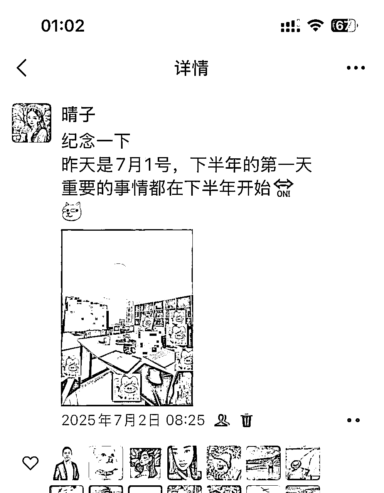

当你愿意迈出那一步，机会和灵感会纷至沓来。

在这个空间里，大家的共同点是：都在认真地折腾，都在想方设法突破自己的天花板。

道理还是那个道理：你身处的环境，会塑造你的思考方式，人就是环境的产物。

以前在家办公，我动不动就跑神，做着做着就去摸手机。但在这里，旁边的人都在埋头干活，你根本不好意思偷懒。

每次有人要推项目，大家就会围坐在一起聊，两位老板负责给出核心意见。我的疗愈项目，前后改了两版演讲稿才过关。

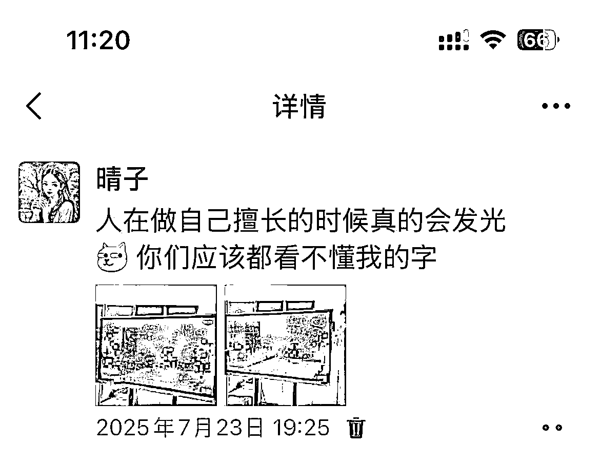

更重要的是，这里有源源不断的新信息涌进来。我的心态也随之发生了变化。

从单打独斗，变成了跟一群人并肩走。

从碰到问题就卡壳，变成了遇到卡点随时有人帮你解开。

从害怕麻烦别人，变成了主动分享自己的收获，反而链接到了更多同频的人。

## 六、我对"赚钱、副业、成长"这件事的重新理解

认知升级：赚钱不必死磕人力和时间，可以学会借助工具+外包/兼职+AI来放大产出。

进赚钱之前，我对赚钱和副业的认知还是比较单一的。

我过去的公式是：钱=人+时间。钱是靠劳动力换来的，这话听起来似乎没什么毛病。

打个比方，一个员工每天能剪10个视频，想产出更多内容，就得招更多人手。

但进了赚钱之后，我看到了另一种可能：钱，不一定非要靠堆人力来赚。

同样一笔人力开销，完全可以撬动更高的产出：

1. 过去1个员工一天剪10个视频；现在通过优化流程+SOP，他一天能做15个，效率直接涨了50%。

2. 用兼职替代全职，成本明显降低。全职一个月6000元，产出还是固定那点；兼职按件计费，一条视频10-20元，支出灵活，反而能省下30-50%的固定成本。

3. 引入AI辅助，产量可以指数级上涨，流量数据还稳得住。以前人工剪1条视频要1小时；现在AI批量出稿，2小时能整出30条初稿，人工只需要做二次精修。

再举一个例子。我认识一个专门做"自动化内容矩阵"的朋友。他每天根本不用自己动手写，全靠AI工具和自动化流程生成内容，再用工具分发到各个平台。一个人就能盯着几十上百个号转。

以前我觉得这事儿"不可能"，但看了他后台的数据之后，我才真正信了：

这就是"系统/AI工具替你赚钱"的活生生的样本。

这个案例让我开始重新思考：副业的本质不是拼体力，而是找到一个能长期滚雪球的模式。

同样是赚到100万：有人是熬夜硬拼出来的，一松手就归零；有人是靠系统、资产、作品赚的，哪怕休着假，钱也在进账。

进赚钱之后，我越来越倾向于后者。

我开始研究：哪些副业既能低成本上手，又具备长期复利效应？

我开始思考：我做的每一件事，能不能沉淀成资产，而不是一次性消费？

这是我身上发生的最根本的变化。

## 七、我经历的"第一次们"

每个人进赚钱，都会遇上属于自己的"第一次"。

这些第一次像一个个小里程碑。单看好像不起眼，但事后回想，它们往往决定着你到底能不能留下来、能不能真的融进这个圈子。

我也有几个印象极其深刻的第一次。

### 第一次写帖：从忐忑到被推荐

刚进来的那阵子，我每天守着群看戴哥分享的精华帖。那些帖子动辄几千字，案例一个比一个抓人。

说实话，我当时心里想的是：我这点成绩，哪里拿得出手啊。但后来——也就是我写下第一篇帖子之后——我才发现，原来真实，就是最好的武器。你在群里看一百篇精华，不如自己动手写一篇真实的心得。写帖不是"高手"的特权，而是每个愿意真诚分享的人都能做的事。

从花三十万学费一路试错，到终于遇见一个让我觉得"钱花得最值"的圈子，我最大的体会是：不是所有社群都值得付费，但一个真正适合你的社群，一定会重塑你的认知，推动你行动。

如果你也是个新人，别怕，试着写下你的第一个帖子。哪怕只有几百字，哪怕只是你踩过的一个坑的记录——相信我，你会收到意想不到的回应。

因为在这里，每一个真实的声音，都会被大家看见。

[PRE*]

以上就是晴子加入龙哥盟两个月的复盘，希望对你有一点点启发。

如果你也在寻找一个能让自己真正成长的环境，不如给自己一个尝试的机会。毕竟，有些机会的出现，真的就是一瞬间的事。

两个月前，我根本没预料到，一个社群会让我在如此短的时间里长出新的根系。当时许多朋友鼓励我写点内容，于是我的第一篇“超级术”精华帖问世了。也是从那时起我彻底明白：新人刚开始分享的时候，比的可从来不是谁的结果更耀眼，而是谁更真诚。毕竟这个世界的运行方式，有时候真的像搭起来的草台班子，信息不对称几乎无处不在。你写的文字，不可能取悦所有人，只要能帮到那些愿意相信你的人，就足够了。

那一次发帖还教会我一件事：不要因为自己没成绩就不敢开口。你的思考、你的观察、你的反思，同样可以成为别人的光。而且只要你发出来，同频的人自然会被吸引过来。

第一次去参加线下聚会，对我这种慢热型的人来说，其实是挺大的挑战。我不习惯在一群人里主动表现自己，但多去了几次之后，大家慢慢熟络起来，甚至还有朋友主动说，以后需要帮忙可以随时找我。从那一刻我意识到：敢迈出脚步，资源自己会跑来靠近你。

后来，我的一篇帖子被加精推荐，那是入圈以来最开心的时刻之一。那不只是对内容的认可，更像一个信号：我被人看到了，我的分享正在创造价值。那是我第一次实实在在感受到“影响力”，原来普通人也能靠表达把思考传给更多人，并因此收获新的链接。带着这份鼓励，我才有勇气把这篇复盘写出来。所以我也想对你说：别怕表达，尽管分享自己的真实感受。

帖子被推荐后，参加线下活动时，开始有圈友主动来链接我、向我请教。那一刻我明白：你不需要等自己功成名就再分享，你现在的经验，足以帮别人省下很多弯路。这些“第一次”叠加在一起，就是我在赚钱真正扎根的过程。

如果你是新人，真的不用慌。哪怕写下一段简单的思考，哪怕参加一次线下聚会，哪怕认真回答一个陌生人的问题——它们都可能成为你未来的转折点。没有一步路会白走。

接下来，说一说新人最常见的几个坑，以及我自己的破解方法。

第一，只看不做。有人天天刷帖，收藏夹存了上百篇，甚至建了“赚钱资料夹”，却迟迟不动手。我更建议先定一个方向，对照航海手册把0-1的流程跑通，再去打磨细节。别等“准备好”才开始，因为“准备好”永远不存在。

第二，盲目跟风。今天看AI副业火就追AI，明天看小红书虚拟资料赚钱就转去做小红书，后天又盯上出海项目。这背后是缺乏自我认知，不清楚自己的优势，也没有自己的产品。一旦确定方向，比如就做小红书，那未来一两个月内，只看小红书相关的内容，不相关的先屏蔽，避免信息过载。每个赛道都有自己的一套框架，以小红书电商为例，无非是产品（选品、定价、差异化）、流量（自然流、搜索流、直播流、短视频分发）、后台（客服、发货、供应链、复购）。把框架搭出来，你就清楚该关注什么、忽略什么。刷到别人的帖子时，问问自己：这东西能放进我的框架里吗？能就记下来，不能就放过。久而久之，你会沉淀出一套非常完整的SOP，做1-10时就不再需要考虑怎么做，而是做好管理和找大方向。

第三，急于求成。很多人刚进来就问“什么项目赚钱快”。越是看上去速成的项目，生命周期通常越短，最终只会让你反复试错、什么也留不下。不妨看看精华帖，70%以上真正赚到钱的人，都在一个领域里积累了很多年，从不轻易换赛道。他们晒出的成果，背后是无数次试错和长期复利的累积。想减少焦虑，就把时间可视化：每天给自己定1-3个小目标，比如做三个视频、读半小时书、运动一小时，坚持一段时间，习惯会替你自动运转。另外，花时间认清自己的优势，再据此选择方向，这条路才不容易半途而废。80%的人其实并不了解自己，可以多看看赚钱的优势航海手册，或者搜索相关内容。优势挖得越早，后面的路就越亮。

第四，信息焦虑。赚钱每天的信息量太大，越看越容易觉得自己什么都不会。我的做法不是把精华帖都翻一遍，而是“需要的时候才去搜”。当然，我身边有王子冯老师、戴哥，还有一群伙伴，遇到问题能很快被解决。所以你也可以考虑融入线下，慢慢找到适合自己的圈子。

第五，孤军奋战。有人进来后不敢说话，不敢参加局，一个人闷头摸索。其实圈子里的人都很愿意交流，只要你真诚提问，或者主动给出一点帮助，对方基本都会回应。一个人走得慢，还容易走偏，多交流就能少踩坑。

第六，忽视复盘。很多人做完一个项目就搁置，几个月后连当初为什么失败都想不起来。我的建议是：每完成一个小项目，就写一份复盘贴——做了什么、结果怎样、学到什么、下次怎么改。复盘是把“失败”转成“经验”的过程。就拿我自己来说，一开始也不知道写什么，跑去问学长“我该写啥”，还附上截图。我不是什么都会的人，但身边总有老师。写着写着就超过一万字了，回头看全是成长的轨迹。我也没参考别人的帖子，因为学长一句话就帮我打开了方向。

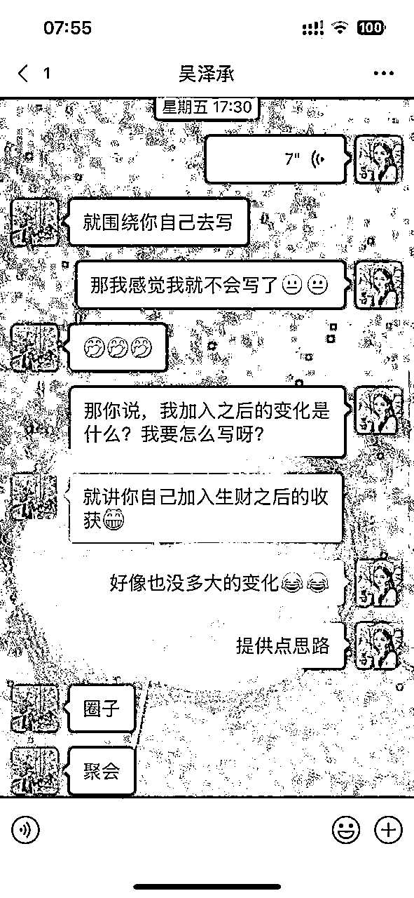
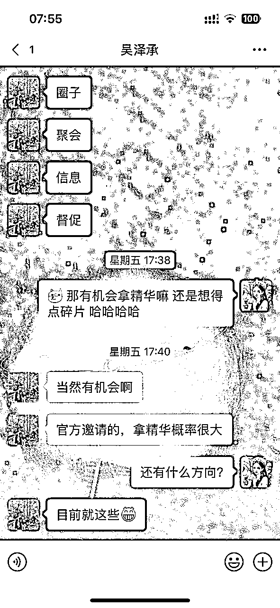

第七，轻视心态。有人说副业赚钱靠方法，我却觉得更靠心态。你能不能在没结果时依然坚持？能不能接受不确定性？能不能忍受孤独？有姐妹在线下跟我聊过，说连续一个月没客户，整个人开始怀疑人生，觉得自己根本不适合做副业。我给的建议很简单：坚持复盘、坚持交流，那些没能击垮你的，最后都会成为你变强的养分。提前为自己设定好心理预期：副业不是一蹴而就的，可能要半年甚至一年才能看到明显成果。低谷时多复盘、多聊天，别一个人扛着。请记住，结果只是过程的附带品，只要过程在，结果早晚会来。

这两个月下来，我的收获早已超出预期。我得到的不只是方法论，而是人脉、思维和机会的叠加。

在人脉上，我从一个线下对谁都不熟的新人，变成了拥有一群能交心的朋友的人。老话说得对，线上聊再多次，都不如线下碰一面，这话真的只有体验过才会懂。帖子加精后，线下认识我的人明显多了起来。重要的是，这些人不是客套关系，而是真的能互助——有人答疑，有人介绍客户。这种氛围，在外面很少见。对了，如果你在北京，自己有项目又缺一个办公环境，可以联系戴哥或王子冯老师，问问是否适合加入我们的共享空间；虽然是筛选制，但不妨先聊聊。

在思维上，我打破了挺多老观念。王子冯老师说过“不是每一分钱都要赚”，我最初很诧异，给钱还要筛？后来才明白，真正有价值的客户是靠质量筛出来的，不是靠数量堆出来的。对广告，我也从“烧钱”变成“投资”。以前觉得投流就是打水漂，试过没结果就放弃了。但在这里，我第一次看见了流量跑出来的真实数据：有的人投1000元能卖出3000元货，ROI=3；有的人投1000元只卖出800元，ROI<1。所以广告不是亏钱，而是需要修炼投放能力。不同的流量有不同逻辑：截流型广告能在爆款旁边分一杯羹；搜索精准型广告能直接命中高意向用户；泛流量广告适合测款。过去我靠自然流量每天只有几十个访客，现在加上广告能冲到5000+，订单翻了5到10倍。认知的成长不是“知道”，而是走完“看到→尝试→内化”的闭环。跑过三次闭环，这套认知就成了你真正的财富。

对赚钱路径的理解，我也有了更深层次的认识。很多新人卡住，不是因为不够努力，而是用错了阶段的思维。0-1阶段需要试错和跑通，1-10阶段做复制和迭代，10-100阶段才谈团队化和放大。假如还在0-1就跑去做10-100的事，比如项目还没跑通就琢磨股权分配，当然会原地打转。另外，不是每一分钱都要赚到你口袋里。做老板的人都只做自己最擅长的那一小块，然后把这块无限放大，其他部分交给更合适的人。看见什么风口都扑上去，就像撒出一堆网，却没有一张能收得回来。学会放弃，也是成长的关键一步。

我也更加确信长期主义的价值。我虽然换过不少平台，但产品始终没有变过，所有动作都围绕核心展开。你看那些做得好的圈友，共同点都是只做一件事，然后把它放大。你愿不愿意做一件看上去很慢，但未来有复利的事？能不能忍住短期诱惑，把一个方向做深？短期或许不太赚钱，但放到复利的坐标里，意义完全不同。

机会也在主动靠拢。我经营着一家七年的外包客服公司，本没打算在社群里冒泡。可发帖之后，有圈友通过鱼丸找到我，说需要服务。我从来不想刻意推销，只想安顿好服务本身，但有人找来，我一定会认真陪伴。学习机会同样丰富，这里高手如云，每次交流都像一次低成本进修；放在外面，想请这些人吃一顿饭请教问题，可能要花很多钱。被看见的机会也一直在发生，当我的电商帖被推荐给圈友时，那种被认可的感觉无以言表——原来我的经验真的能帮到别人，而这种被看见，又带来了更多连接和合作。这些收获叠加起来，让我更有自信，也更有方向了。

聊到这里，也说说我为什么决定做个人IP。以前我总觉得自己的帮助很有限，样本量也不够。2024年2月，我做过一次知识付费直播课，朋友圈发出去当天就有三十多人报名，第二天我就把朋友圈藏起来了，因为人太多照顾不过来。后来有十几个同学拿到了不错的结果，也有一些人付了钱却不好好学习，甚至拿到结果后不再坚持。所以我只开过那一期。倒不是我不愿做，而是大家的问题太细碎，时间被占满，还很消耗自己。

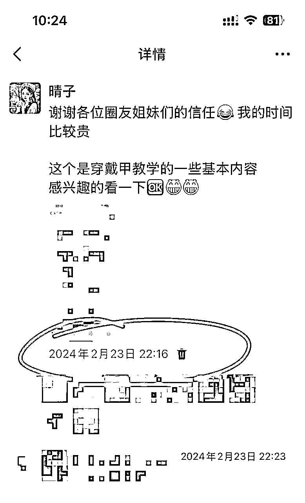

直到最近，我开始在公域平台发布创业感受，微博、公众号、小红书都有写。我是微博老用户，有七万多粉丝，之前一直没运营，现在重新拾了起来。让我意外的是，许多人主动来加我，提的问题几乎都是我踩过的坑。他们就像当初的我。有粉丝问我：晴子，你有没有付费产品，我想买来学习？我说我不做知识付费。还有人问：你有没有线上平台，我想在上面买东西，你选的东西肯定靠谱，就当是回报你。我也说暂时没有，但以后可能会有。那些瞬间我被触动了。我对红包和打赏一向不太在意，基本不领，但这些问题让我发现，也许我真的可以做一个小程序微店，用自己的经验和资源去帮助别人，把它们真正变成产品。

认真盘了盘手头的资源，才发现这些年我积累了近一千个源头工厂，其中至少两三百人是我在线下或广交会里真实见过的。他们时不时也会问我：能不能带我的货？过去我从没想过这件事，但那一次“被点醒”后，我决定做一个小程序微店。资源加经验，这两样叠加起来本身就是宝贵的资产，也能带给我成就感。

更巧的是，一个认识许久的、某百万大V的合伙人朋友对我说：“你可以先试着跟我合作，带我的货，再慢慢做细节。”这句话一下子点醒了我，于是我立刻注册了公众号“晴子bosss”。个人IP不一定非得从成熟产品开始，可以先帮别人带货，从0到1跑起来，之后再沉淀出自己的产品与品牌。这正是我喜欢的长期主义路径。我最在意的是，这件事在五年、十年后还能不能持续创造回报？前期的用户或许不多，但只要有人信任你、愿意跟着你，就是一个漂亮的开始。坚持到第三年，复利效应会显现，IP才开始具备真正的价值。所以，我做的并不只是一门赚钱的生意，而是在建造一套长期体系。选品我会严格把关，对用户负责；带的货我会反复筛选，对合作伙伴负责。个人IP的价值从来不在于今天赚了多少钱，而在于三五年后，你身边站着一群信任你的人，以及一套能够持续产生复利的系统。

最后，作为过来人，想给刚进来的新人几句实在话。先别急着问“什么项目能赚钱”，项目永远干不完，真正决定你走多远的是方法和心态。有人整天追新风口，结果一个都没跑通；有人盯着一个小副业，靠着复盘和迭代做到月入几万。所以我的建议是：先学会如何学习。多看项目提升认知，同时挖掘自己的优势，写出2-3个可能的方向，再动手去做，看哪个方向能跑出成绩，那大概率就是你的长期赛道。第二，别追风口，先练复盘。第三，别想着一步到位，从一个小目标开始。正如龙哥说的：找到一件适合自己的事，坚持做，跑通它，再放大。

还要记得冒泡，别做隐形人。我刚开始也潜水，是被吴泽承学长一句话点醒：如果你一直不冒泡，没人知道你是谁，在做什么。而一旦你勇敢发言，哪怕只分享一点经验、写一段感悟，都会有人看见。所以新人们，至少每个月写一篇复盘或学习笔记吧。在赚钱，表达本身就是机会。

加入社群的第一周，我其实偷偷焦虑过。

看到别人晒出成绩单、项目复盘、月入截图，再低头看看自己手里空空的成绩表，一度觉得：我这种“零成果”的人，是不是不该来凑热闹？

但后来我慢慢想通了一件事——复盘这件事，写的是思考，而不是成绩单。

哪怕你只写出来两三百字，只要它是真实发生的，就值得被记录下来。你以为没人看？不，评论区里可能有人在帮你点破盲区。你以为坚持没用？写到第10篇、第20篇的时候，你会发现自己说话更有条理，写东西更顺手，思路开始自成体系。

所以，别等自己“有成果了”再写，而是要靠写，去逼出成果来。

再说说线下聚会。说实话，第一次去之前，我在门口徘徊了很久，满脑子都是“我这么菜，会不会没人搭理我”。

结果坐下来聊了半小时，紧张感全消了。有人和我一样也在摸索期，有人分享自己的踩坑经历，而我居然还能给别人的问题出出主意。那种感觉，不是“我多厉害”，而是“大家都挺真实”。

那个和你同桌吃饭的人，说不定哪天就成了你的引路人。所以有机会，别躲。

还有一个特别普遍的焦虑，就是：我什么时候能赚到钱？

我懂，谁都有过这个阶段。但你回头看会发现——焦虑本身不产生任何收益。赚钱是结果，不是过程。过程是什么？是学习、复盘、表达、链接。你把这四件事做好，结果自然会来敲门。与其盯着“这个月赚了多少”，不如问自己：“这周我学了什么？我分享了什么？我认识了谁？”心态一稳，路反而顺了。

另外一个特别容易浪费的资源，就是社群里那帮“圈友”。一个人闷头搞副业，最痛苦的就是卡住了没人问。但在社群里，你完全不用当独行侠。遇到问题，发到群里；走到死胡同，翻别人的复盘找思路；想开新项目，直接找个做过的人聊一顿。提问、借鉴、求助——这套组合拳打好了，等于你身后站了一支智囊团。

心态上，也给自己松点绑。大目标可以想，但小目标天天都要有。

我自己的习惯是：每天安排三个任务，写在待办清单上——不大不小，刚好是那种踮踮脚就能完成的。比如先学半小时，比如这周写一篇复盘，比如主动认识一个新朋友。目标小了，完成的频率高了，成就感一点一点积起来，人就愿意接着往前走。

还有就是，别跟人比。

在社群里，总有人月入十万、几十万，你也别慌。你拿自己的第一个月，去比人家的第十年，这不公平。每个人的节奏不同，有人快有人慢，只要你不撒手，就不会原地踏步。现在没成果，不丢人；真正亏的是——明明有机会成长，却自己主动放弃了。

写这些话的时候，我也在想，如果这份感受能传到刚进来、或者还在观望的你心里，会不会让你少几个辗转反侧的夜晚？

我回想了一下，我最大的变化，不过是因为想通了一件事：

所谓“赚钱”，并不是一个给你发钱的聚宝盆，而是一个放大器——你动手，它就给你推资源、给方向；你只是看，它就静静待着，什么都不发生。你投进去多少心力，它就给你映射多少回响。

我并不是什么厉害的人。我只是愿意试，愿意把自己擅长的事情多做一点，做深一点。至于不擅长的，我也不内耗，不去盯着自己的短板折磨自己。

说起来，我特别想借用许半夏的一句话：“人不都是从无到有的吗？”正好刷到这段视频，觉得太贴切了，就放在这里分享给大家。

现在没方向也没关系，先允许自己慢慢走。等你找到了那个想长期做的产品，后面所有动作都会围着它展开，路自然就清晰了。

愿你在社群的每一天，都能捕捉到一个值得记录的瞬间；愿你在这里，不仅收获钱包的厚度，也收获伙伴、成长，还有那个慢慢变得更笃定的自己。

记得把故事写下来，未来你也可以成为给新人指路的那个人。

最后，由衷感谢这个平台，让我遇到了王子冯老师和戴巍老师。也感谢吴泽承学长带我进门，感谢七天姐妹的邀请。

往前走，你也能从“从无到有”，走到“从有到好”。