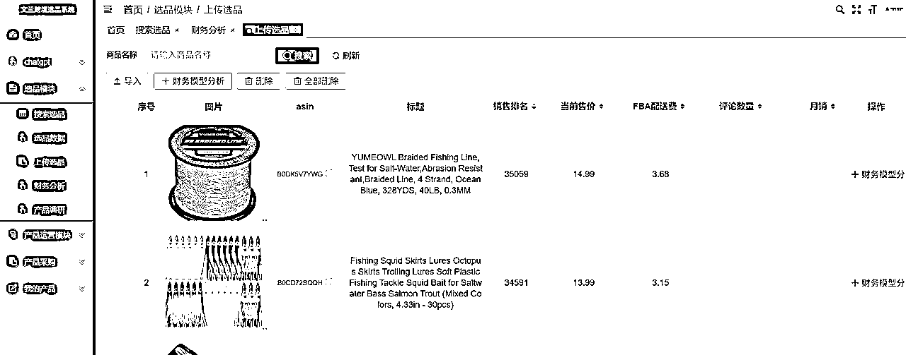
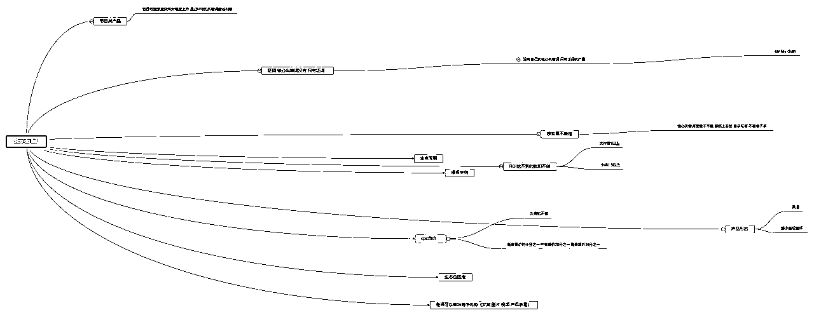
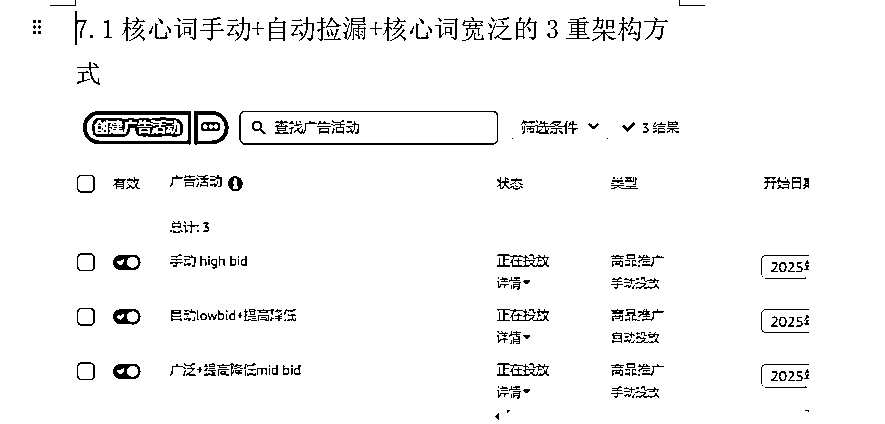

# 亚马逊的六大核心难点问题和对应解决方案

我在Amazon踩过的六个大坑，和爬坑的姿势

先交代背景：我叫张子卿，一九九七年出生，正儿八经学编程出身。

疫情那一年，我才算真正走进跨境电商。之前在一家国字头企业的二级公司带外贸线，管着十几个人，做的是老牌B2B平台。后来不愿意一直待在体系里，就出来自己折腾：先做独立站，死磕SEO和反向链接建设。当时搞了一个给在美国念书的中国学生代购国内商品的站，运气不错，做到了细分赛道头部，每个月能赚两三万。那会儿最大的心得是——选对赛道，中文内容做到Google首页第一，真的可以带来稳定订单。

再后来觉得B2C的盘子更大，就转到了Amazon。从零开第一家店，到现在五年多，杭州这边的盘子年流水差不多200万美元，团队五六个人，同时管着四家店。中间做过一次百万美金的实盘资金跟踪，记录发在微信订阅号“张子卿”上，也会写一些日常管理的思考。

今天不说空话，就讲我这些年真金白银买来的教训。六个大坑，每个都疼。

**第一个坑：挑款**

挑款这件事，没有一劳永逸的答案，也从来不是套公式。你只能一次次下场试、一次次修正，最后才知道自己的手适合端哪碗饭。说白了，它是伴随整个卖家生涯的持续校准。

我自己的路线就变过好几轮：早期做价格高、体积大的冷门货；中间做自己有货源优势的品类；现在跑的是小而轻的标品。绕了一大圈才明白，挑款的核心只有一句：找到一个“自己能赢”的位置。你得清楚自己的能力边界在哪，哪些钱赚得了、哪些钱跟自己没关系。巨头能做的赛道，不代表小玩家也能进；操盘能力强的人能碰的品，换个人可能就是火坑。

刚入行那阵，我也追过搜索量飙升、涨得飞快的爆款。后来发现这类货大多是昙花一现：竞争极其惨烈，还随时会踩到侵权、专利这些暗雷，更没有积累效应——就算运气好做起来了，风光一小段，后面就是利润越来越薄、对手越来越多的消耗战。

痛过几次之后，我给自己定了一张“不要做什么”的清单（Stop doing list），每月固定去Amazon平台抓数据、做清洗和二次过滤。说白了，这就是一套选品数据筛选机制，市面上很多付费软件也能实现类似效果。

一个赛道到底碰不碰，我会看三件事：

第一，商业账算不算得过来。投入产出比至少两倍以上，商品能卖得久，搜索量是实打实的——这是一门好生意的底盘。

第二，牌桌上还有没有空位。市场格局没有彻底固化，巨头还没把路全堵死，我们这种小体量玩家才有机会挤进去。

第三，用户还有没有没被填上的槽点。只要明确的痛点还在，我就能做出一条更有竞争力的listing，而不是靠低价硬拼。

三条全过，再筛掉一些特殊品类：大而空的泛词、节日属性太强的、搜索量忽高忽低的、CPC贵得离谱的。最后剩下的，就是自己够得着的范围。

怎么判断够不够得着？我们会给自己整体打一个综合分——文案、视觉、操盘、货源、物流这些全算进去，假如总分75，那就只找平均实力在75以下的赛道。

把范围框定以后，再用上面那套系统或者外部工具把匹配的商品捞出来，继续取样、做深度调研，确认能做出一条能打的listing，再决定动不动工。随着团队的功力增长，能力半径会慢慢变大，能碰的品类也会越来越多——所以挑款这件事，永远没有“完成”的那一天。

**第二个坑：资金链**

精品模式有一个反常识的真相：卖得越好，越要警惕。货全压在美国本土仓，平台上的暗算又从来没停过——恶意投诉、跟卖、灰产手段，还有TRO、加州第65号提案、美国能源部条例这些意想不到的政策风险。

抗风险能力差，是很多走白帽路线的店共同的软肋。尤其是那种靠一条listing撑起八成业绩的店，脆弱得不堪一击。没有多余的店铺去做授权分摊，钱全部绑在单一listing上，旺季只要被人阴一把，损失可能就是致命的。

我自己就交过不少学费。有一款ICE BATH，定价129.99美元，旺季前备了近百万元的货，结果Prime Day那天遭了黑手，产品直接卖不动，最后只能挂39.99割肉，亏得心疼。还有一款融蜡灯，圣诞旺季被平台二次审核把店给冻了，等解封出来节日早过了，一堆库存又是大放血。

另一个坑藏在算账里：纸面投产比和实际到手差距极大。举个例子，一款品投产比是2倍，理论上一年能翻12倍。但现实是，你至少得压三批货——一批漂在海上，一批堆在库房，一批正在产线上。资金周转被拖慢到原来的三成，再算上各种授信——那些口子最后都要真金白银填回去——真实的年化回报基本只有3到5倍。你拿100万本金进场，一年后连货带钱，大概率是300万到500万。

我的解法是：做能走空运的轻巧品类，把资金转速拉起来。具体操作是，把一条年GMV百万美金的listing，拆成二三十条每天只出一百美金的listing。就算某一条没了，后面还有二十几条在卖。钱分散了，风险也就散了，整体回报反而更健康。

代价是节奏变慢，人力投入更大。这要看公司处在什么阶段。我们现在的思路是，内部培养能打的商品主理人，先用小件练手，跑顺了再往上够高价位的精品。理想状态是：一家店里有二三十条每天卖100美金的listing打底，再加两三根每天能卖1000美金的柱子。

说到底，资金链问题不是缝缝补补就能解决的，它逼你在生意底层逻辑上做取舍：要么铺更多店，要么挂更多listing，要么多布几个平台。同时挑赛道的时候，把资金转速和每投入一块钱的真实回报当成硬指标。

**第三个坑：过度依赖某个“神人”**

白帽打法的本质靠商品本身说话，所以团队会高度依赖一个关键的商品开发负责人——开模、差异化、调研、货源，全得他拍板。这就像饭店里那位头牌大厨，客人全是奔着他来的。可问题是，大厨不能批发，真正能扛事的商品开发极难复制，而且能力到了那个份上，大概率早就自己创业了。

所以当你想把盘子做大，流程和机制就会卡在大厨这一步。

我的做法是：不做太难的品，不碰特别考验手艺的活儿。把一件简单的小事翻来覆去做透，到那些大团队看不上、小玩家又啃不动的边角赛道里找饭吃。说白了，就是把生意做成预制菜——不需要名厨掌勺，靠流程和标准去复制。

落到执行，我们团队把开发和销售并成一条线。因为品本身不难，操盘也不需要太多花活，对大厨的依赖一下子就弱了。大多数时候是拿现成货源做微改：改包装、加配件、换个组合，人效反而更高。本质上，就是把一个复杂项目拆成二十来步简单动作，每一步都按标准做。

商品主理人只管提需求、盯优化；文案、图片、视频、包装设计全部交给外部专业团队配合，内部用飞书做协同。包括前期立项、下单采购、图文素材、发货配送、库存补充这些节点，全都沉淀了现成的SOP文档。

目标只有一个：脑子灵光的年轻人，先集中学习四周，再实操一段时间，就能把这条线跑起来。

**第四个坑：招不到人，也留不住人**

招人和留人，是两种完全不同的能力。

招人这件事，指望在社招市场上捡到宝，概率太低。所以我们的思路是：把业务做简单，把上手门槛降低，自己从零开始带人。团队里有一整套内训机制，图文教程加实操录像，直接去大学找大三的在校生来实习，先学录好的课，再上手一些低难度、低单价的品。半年之后，表现好并且理念一致的才转正留下。本质是赛马，不是相马。

留人方面，我琢磨过年轻人上班最在意什么，无非三件事：一是赚得够不够，二是干得爽不爽，三是有没有奔头。

收入上，杭州正式岗位的起步价在一万五以上，前提是通过前面半年的筛选。氛围上，靠的是日积月累的企业文化——不搞糟心事、不内耗，福利也得拿得出手。至于奔头，就靠HR和部门负责人留心每个人的成长节奏，及时调岗、调薪、安排新挑战。

考核制度我们还在摸索。团队还小，就先按年中、年末各一次的节奏打绩效，平时靠周报看进度。

**第五个坑：运营还在靠感觉**

以前做小而轻的标品，运营特别简单：上架开三组自动投放，跟着推荐出价慢慢调就完事了。但今年起新链接明显变难了，平台对综合能力的要求高了不少，过去那套粗放打法渐渐失灵。

我们正在试一套新的玩法，专门针对低单价、小体积品类的固定冷启动流程。目标很明确：每一条新品都按同一套路线走，一切看数据做调整，任何负责操盘的人都能一眼看出，这个品有没有进入良性循环、值不值得继续加预算。

下面这张图是目前还在调整中的架构草稿：

等跑通了，再展开细说。

**第六个坑：内功不够深**

如果投放理顺了，下一步要解决的是全模块的能力升级：图片、文案、视频、挑款、操盘、货源、商品设计、市场研究……说白了，就是持续找到更好的资源、更好的手法，把整门生意像切蛋糕一样分成十几二十块，每一块每次只优化5%。

单看5%很不起眼，可一旦所有短板都被磨平、每个步骤都压过对手半寸，累计起来的优势是压倒性的。这种系统思考加颗粒式精进，才是跨境团队真正的竞争壁垒——看不见、摸不着，别人想抄也抄不走。

再往深一步想：一条listing的壁垒，到底是什么？是商品本身吗？是定价够低吗？都不是。没有哪款商品是抄不走的——你验证出来的款，义乌的厂子，用不了三十天就能给你翻出来。所以别指望做没有对手的生意，要天天琢磨的是：我凭什么赢过所有做同款的人？

商品一样的情况下，真正的差距来自评论厚度、listing成色、关键词卡位、先发红利。而这些背后支撑的，是你自己的文字、内容、视觉、视频、投放词库、货源把控、品质管理……这些幕后功夫，谁也拿不走。

不纠结大而全的战场，去那些格局还没定死的赛道、巨头不稀罕的角落里死磕。把事做对，把基础打牢，一步步积累评论。剩下的，让时间去兑现。而创业这条路上，相信本身就是一种很稀缺的燃料。

希望这些踩坑心得对你有用。

May the force be with you！