# 快手好物全站微投流挂车：一个正反馈快、长效稳的新流量变现打法

## 开篇说一下背景

大家好，我是龙哥。上次更新已经是好久之前了。毕业后手里的启动资金基本来自大学时期接的项目，加上之前累积的📕业务和直播带货，分了一部分精力跟大哥在广州搞了个小工作室，主攻直播和带货。

快手好物全站投流挂车这个方向是六月中旬了解到的。那会儿我和大哥还在测试📕和视频号的直播，精力还没完全放过来。认识的一个合伙人跟我说快手这块能做，还直接把他跑出来的成交数据发我看：一个号每天能稳定起来三百多单。

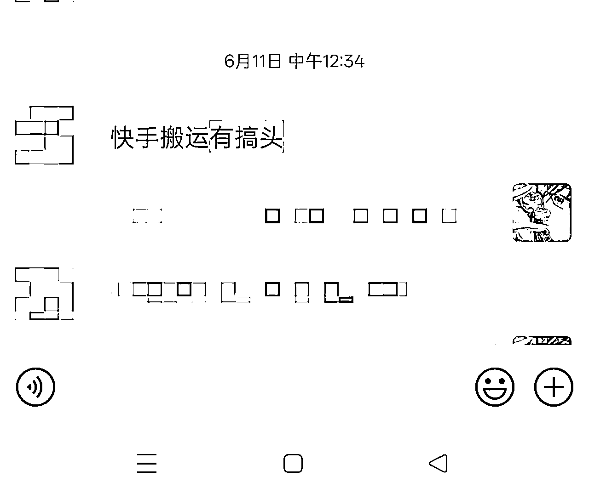

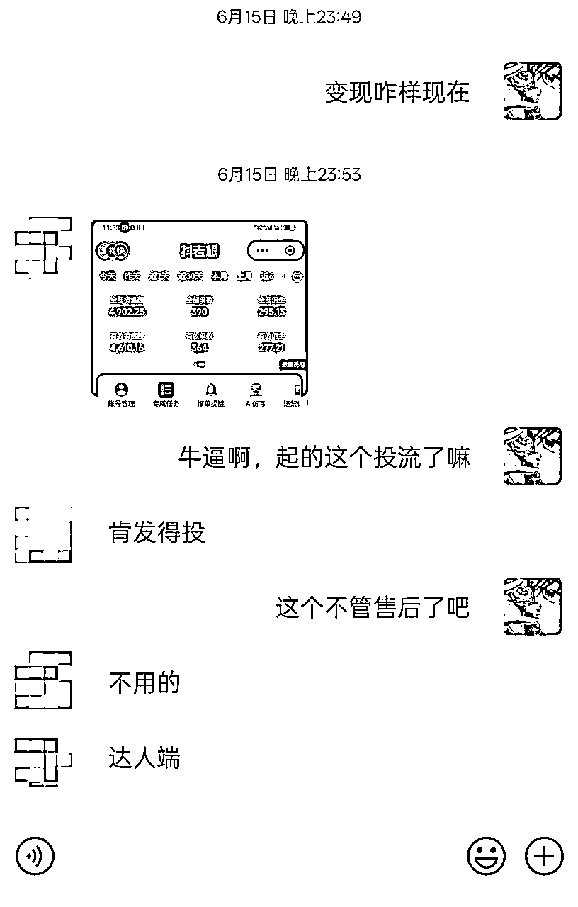

起号跑通后，每天的工作就是微付费微调，把投产比拧到合适。基本拧到一比一的利润回本，账号就能一直稳稳出利。想要拿更大的自然流量、更高的投产比，就要多维度上下调试，找到这个号系统匹配到的最佳性价比ROI【值域】，锁定后自然流就会一直稳定地往外推。

这就是现在快手全站直播投流挂车的玩法，转化和正反馈来得很快。工作室这边拿到的号，只要发作品就接微付费全站投流，普遍三四天就能看到订单，最慢也就六七天能见到正反馈。

## 一、能赚多少钱

看到朋友的单量后，我简单理了下逻辑，觉得门槛不高、见效快。手上还有其他业务在跑，就让工作室的一个兄弟先上手实操，我给思路他去跑。

6月28号从零开始，0基础上手，新号先剪了十条视频发出去，然后开启日更：

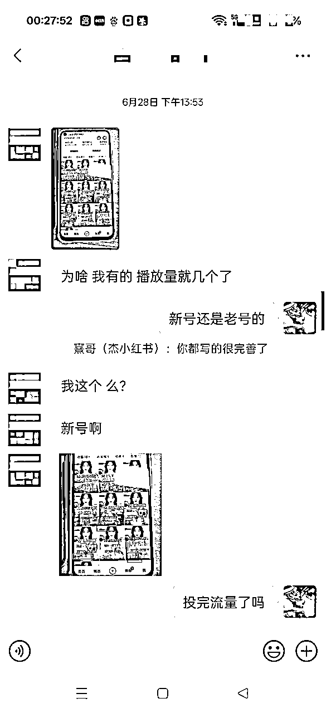

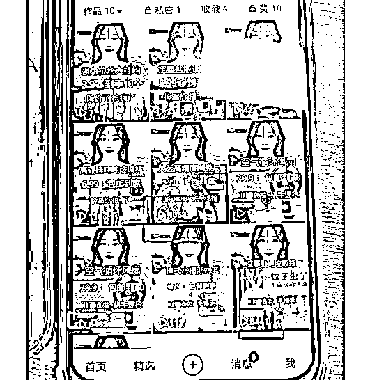

日更的同时给账号选品投8块钱粉条做加热，第二天就开始出单、正反馈来了：

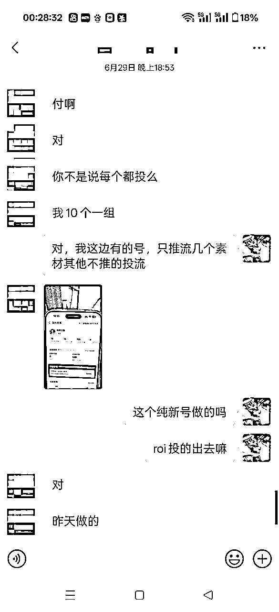

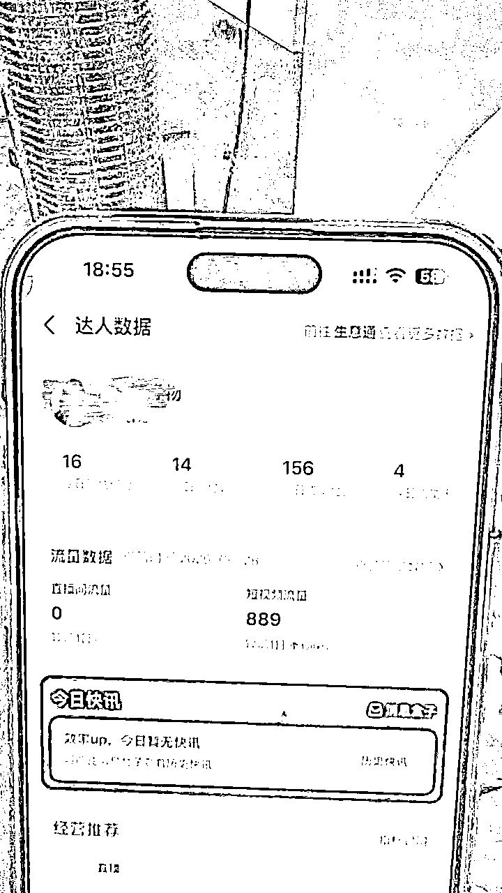

方法验证通了之后，就是坚持日更不断产出，大概日更半个月左右，账号的作品流量开始起量、出单：

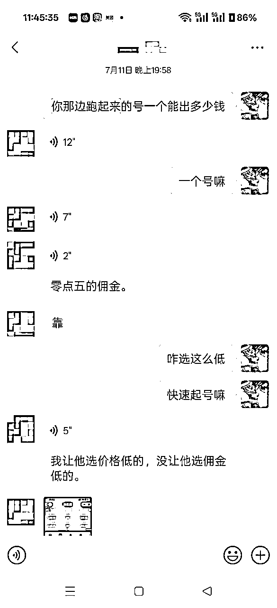

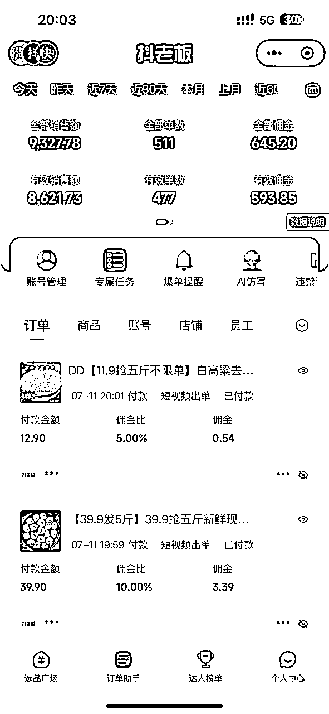

账号一旦爆过一次选品素材，标签权重就被打上了，后面同类选品的人群会更精准，推流也更稳定。流量开始持续增长。

当视频素材的ROI稳定后，基本能做到投入10块付费产出10块利润。之后可以继续往上探，探索快手全站直播最优的性价比数值，用更低的推广消耗撬动更精准人群，拿到更高的ROI数值点。

朋友那边开始变现后，七月我们就矩阵开号。互联网项目都有流量概率机制，数据高低正常，跑通方法论后多号矩阵自然能把均值拉起来。下面是七月十多个号的整体产值截图，每个图都是一个号的数据：

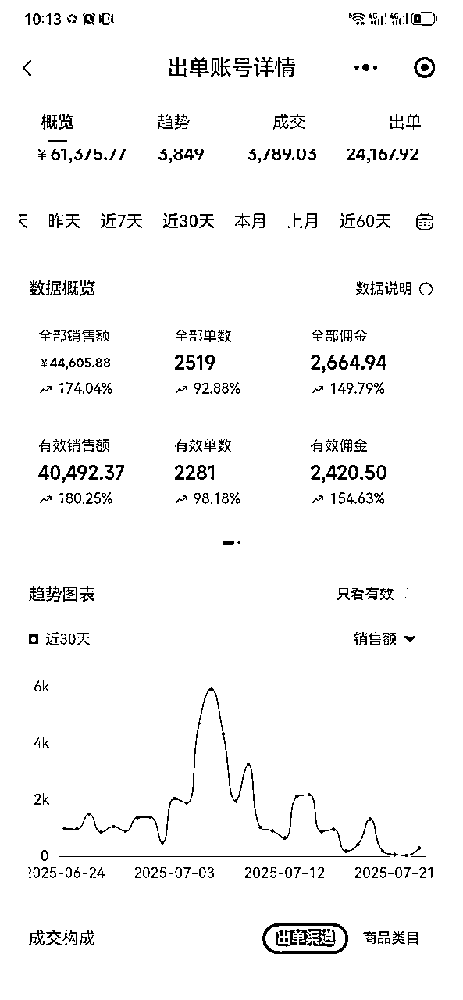

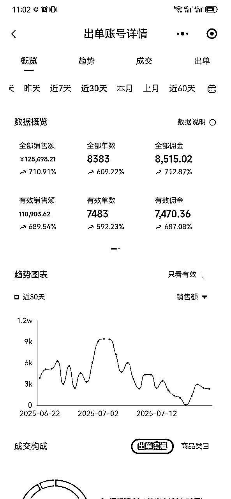

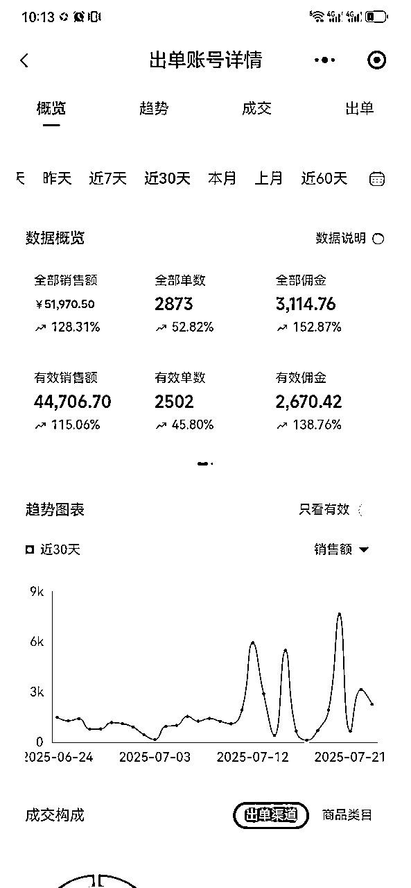

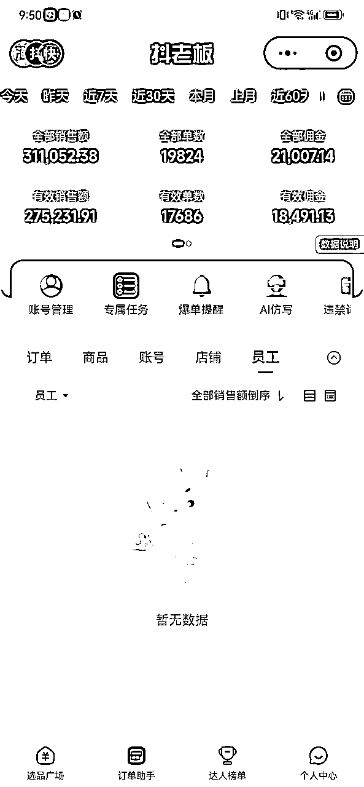

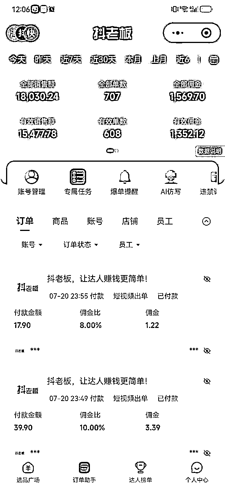

以上是产值，还要扣除微付费投流成本。我们主要做的品类是美食，跑顺后全站消耗基本能做到1比3的利润产值，也就是花10块推广能带来30块佣金产值，退货率控制在三成左右。

## 二、玩法拆解

#### 1. 快手全站推广流量入口是什么

全站推广是快手电商新推出的全域智能投放产品，以“目标投产比ROI”为核心，通过系统算法在快手全站场景【推荐、搜索、关注、同城等】自动找高转化人群，在保证投放效率的前提下持续拉升GMV。这个入口是今年才正式放开的，平台对商家有扶持和流量倾斜。

##### 1.优化机制
商家设定目标ROI，系统自动优化投放策略向目标靠拢。
核心逻辑：目标ROI设得越低，系统拿量能力越强；目标ROI设得越高，流量越精准。

##### 2.流量覆盖
覆盖快手全域：推荐页信息流、搜索结果页、关注动态流、同城页，打破单一场景限制，实现深度曝光。

##### 3.核心价值
ROI可控：投放效果稳定在设定区间；
增量可持续：达标后持续提升GMV；
智能省心：自动匹配高意向人群，无需人工频繁调价。

##### 4.投放效果
稳定ROI：达成设定投产比同时保障稳定性；
长效增长：持续拉动GMV；
智能调控：实时优化人群和出价。

##### 5.参数设置逻辑
目标ROI越低：拿量越强，适合冲销量拓人群；
目标ROI越高：精准度越高，适合保利润提效率。

##### 官方适配场景
新品冷启动：快速拿全域曝光测潜力用户；
爆款放量：在ROI可控下规模化提升成交；
店铺经营：平衡全店投产与销售额增长。

“全站推广通过智能预算分配和实时竞价，在保障目标ROI前提下挖掘全站高转化流量，实现长效增长。”

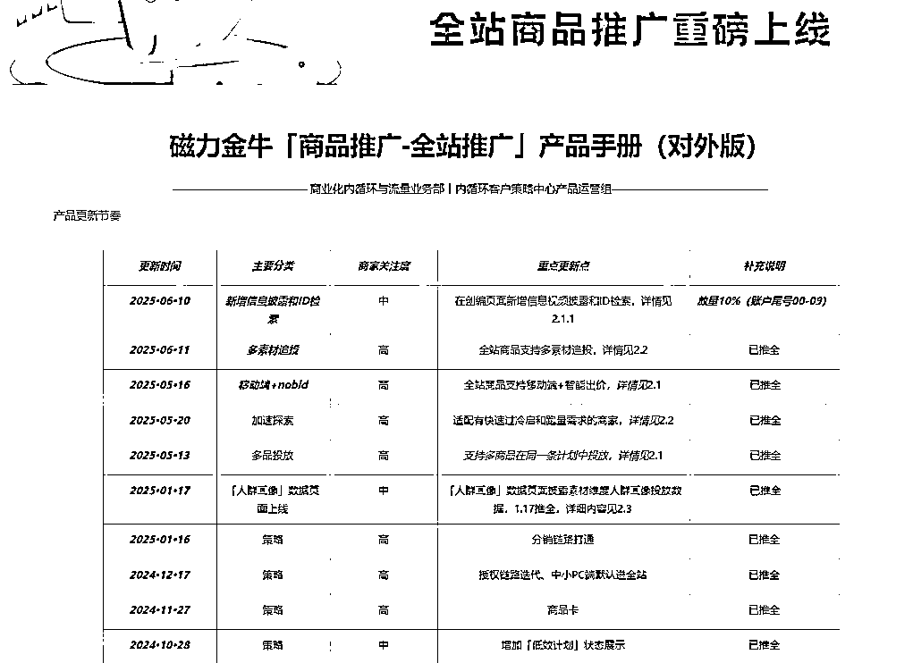

从产品手册能看出，全站推广这个付费入口上线时间不长，真正落地方案也才一两个月。快手的商品素材流量现在基本都会在这个付费入口获得推荐和扶持，所以我们测试的几个号才能这么快变现出单、拿到正反馈。

#### 2. 0基础上手实操流程

##### 注册测试号
直接注册新快手号，拍几条风景实拍视频发出去，观察第二天数据。第二天能有千把到两千流量就说明号正常，没起量就再发两三条，过千流量就可以开始发带货作品。

##### 实名+开通橱窗达人端
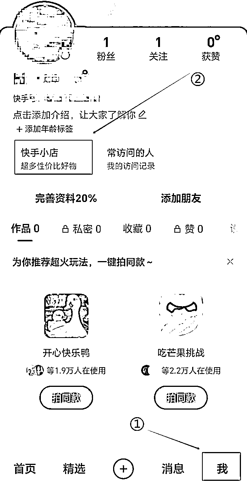

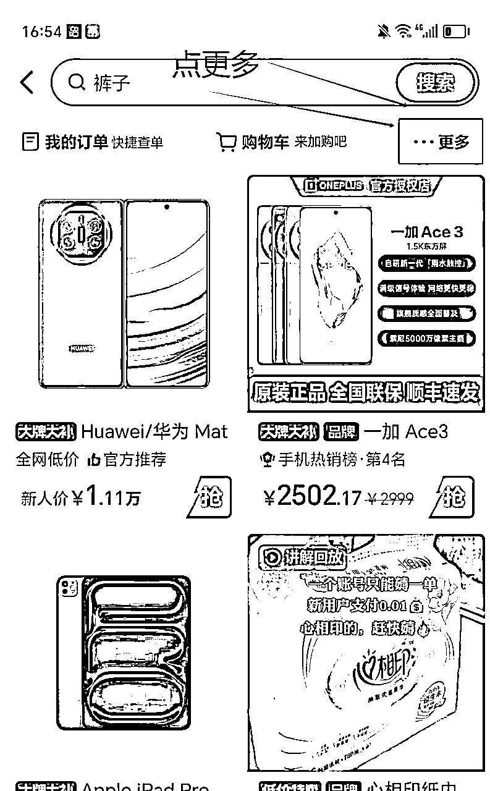

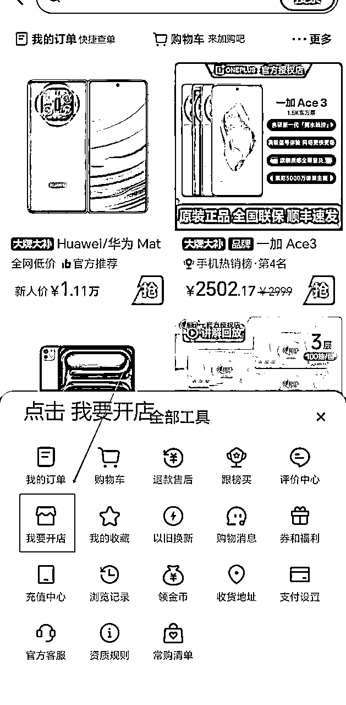

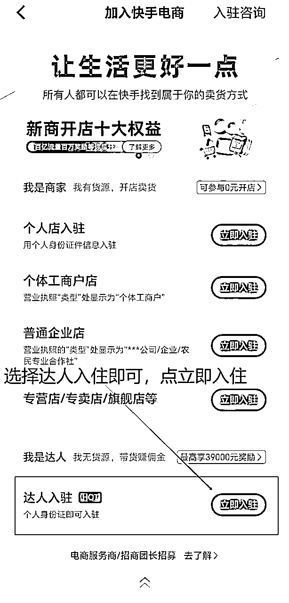

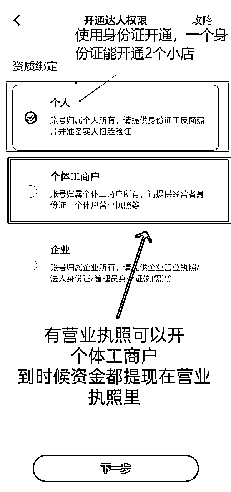

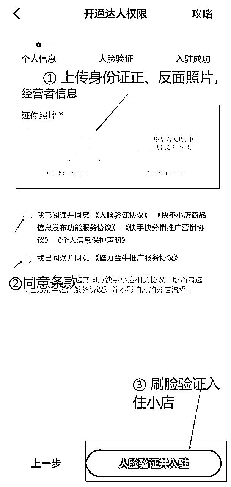

做矩阵建议办营业执照，开通达人分销统一挂在个体工商户下，提现佣金不会受个人实名限制。也可以注册一个MCN，把旗下分销号都归到一个人名下提现，避免错乱：

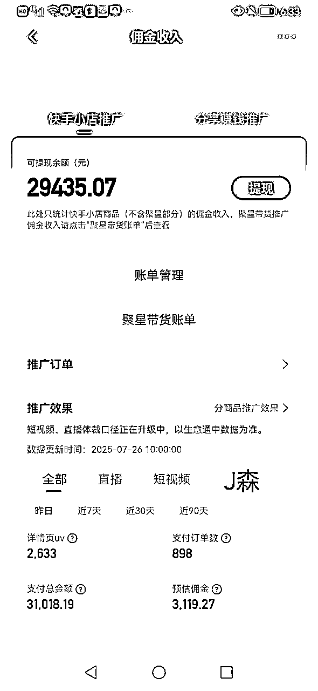

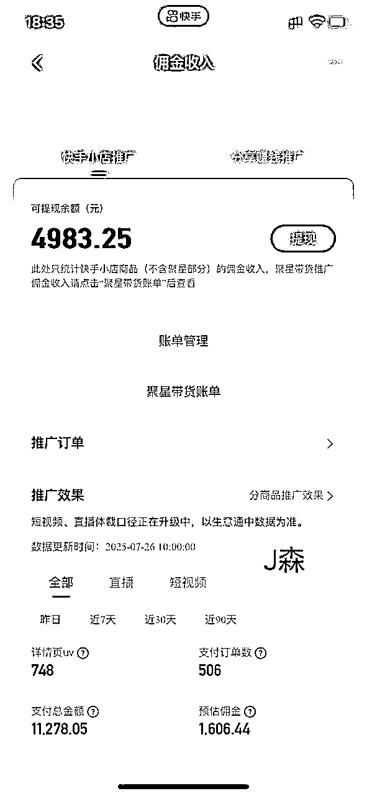

##### 养号
就是刷对标内容给账号打标签。要做美食就多刷美食，大数据才会给你推同类内容，后续选品更直观。

##### 运营节奏与素材量
第一天：10条素材
第二天：10条素材
第三天：10条素材
三天后账号正常推流，每天可发20条。

搬运爆款素材要做替换去重，注意不要带同框原创标识。手机端可用MT管理器做素材替换，具体教程见下方。

素材制作和发布也能用批量去重混剪软件和自动发布工具去重、定时发，目前用的素材自动去重混剪软件月卡大概100左右。

前三天用粉条给作品预热：一般投10块钱选10个作品，12小时投点赞评论加热。前三天保持。

三天后根据流量情况再调整粉条加热策略。

##### 5. 全站微付费直播推广
电脑端打开磁力金牛进入后台：

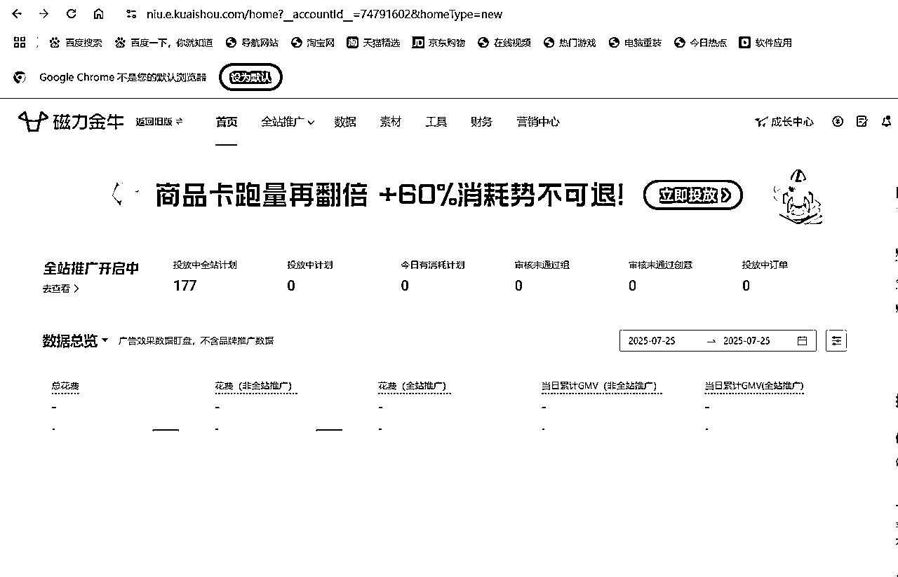

点击全站直播推广：

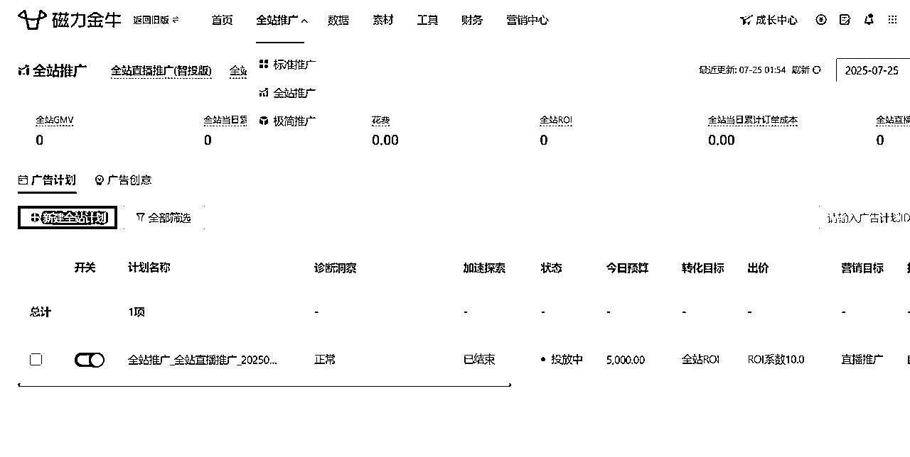

有自定义出价和智能出价。智能出价是交给系统自动烧，省心但ROI不如人工操作。

自定义出价可以自己调ROI，找到最高性价比点，用最小出价换最大流量和利润：

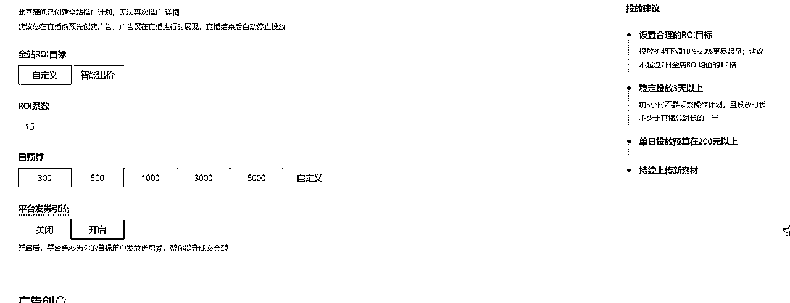

一般从15开始试，前期充10块钱，把ROI出价调低让全站跑起来。账号不消耗或消耗慢就微调2个点，消耗太快就往上调。只要全站烧起来，视频流量才会被带起来，后续自然流会持续推转化。这时你要把ROI从1:1利润出价开始，投一块钱带来一块钱利润后，让全站持续消耗一段时间，系统会探索匹配人群，进入学习期，说明人群匹配上了，后续自然流会稳定推。

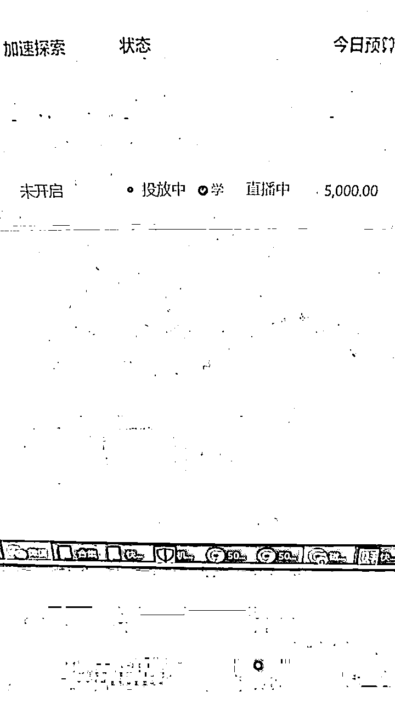

学习期结束后，可以把ROI调高，用更低出价持续拿流量，达到高ROI、低成本持续推流转化的效果。

期间如果出现不消耗，基本是选品或素材不行，需要多发优质爆款素材配合粉条刺激。

##### 6. 选品思路
养号能发作品后先定一个基础类目，比如女鞋、美食、百货。先用9.9-15元的低价高佣品起号，前期低价上权重快。

品和素材可从快手爆款榜单找，产品下方有趋势曲线，曲线能看出近期需求和市场。优先找上升趋势的品：

选品中心找品：

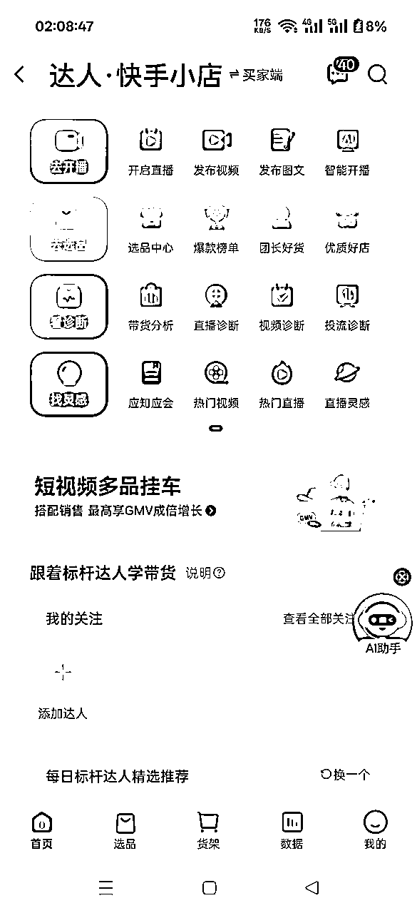

按趋势曲线找品和素材测试，像下面这种上升曲线就是比较理想的，也可以找趋势好竞争小的类目：

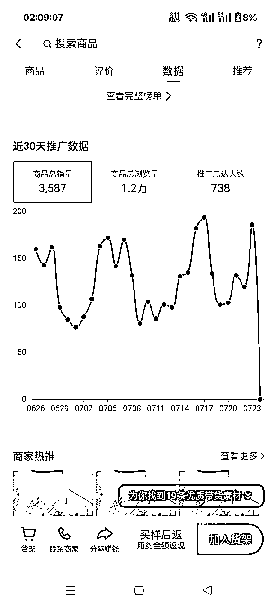

持续更新作品并不断调试全站直播ROI，找到账号最具性价比的产出量，账号就会稳定推流、稳定出利。

全站挂播操作：需要账号开播，手机端直接开直播放映厅放电影或音乐挂播即可。

## 三、项目稳定性

正反馈快，且能持久稳定

全站推广入口刚上线没多久，真正被商家大规模应用也就这几个月，正处于平台扶持期。付费推广本身就顺应平台节奏，跟上平台策略就能长久。

只要你会做全站消耗，平台就会给流量扶持，起号出单闭环很快。而且随着作品数量累积，长尾收益会越来越明显。

哪怕现在发的素材没爆，之前的老作品也会被全站微付费带起来，持续推流不断带来订单。比如下面这个号基本不怎么更新：

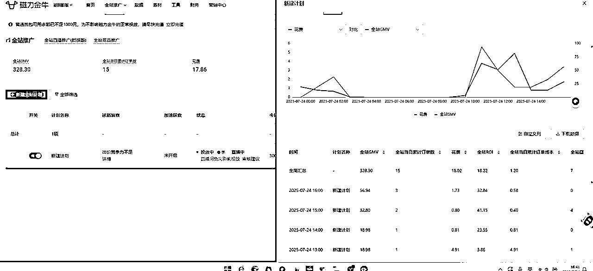

但作品堆到一定数量后，每天只调好ROI比值，达到最佳投产比让全站消耗，老作品依旧源源不断带来流量出单。

## 四、踩坑与注意事项

跑项目一定会遇到卡点，个人一个多月实操总结几个核心坑：

1. 素材和品的爆发期判断困难。大爆款出来后跟的人太多，容易同质化，ROI会变差需要更低出价去竞争。不是完全不能跟，而是要挑发布时间近、流量大且还没被泛滥抄的品素材去跟。上手阶段可以用低价高佣品快速拿正反馈起权重，低价是流量密码，高佣保证利润空间。也可以看趋势品跨平台找素材，用📕、抖音的优质素材避开快手内部竞争。换品换素材后可适当降低ROI刺激消耗。

2. 选品要做好品控。上家店铺评分最好4.7以上，商品评分90%以上。注意上家是否预收款，否则容易退款导致售前失败，增加投流成本亏损风险。

3. 调试全站ROI常见问题：
前期测试不要充太多钱，一般充10块左右测体感。常见两个卡点：空耗跑飞和不消耗消耗慢。

空耗：前期系统还没探索到精准人群，计划没过学习期，消耗快但不出单。解决方法是前期余额控制在可控范围。持续空耗的话说明人群权重不准，需要发垂直素材、投粉条点赞评论、磁力金牛极简投流去打精准人群。每次粉条和极简投10块钱即可。

ROI不动：原因有几种。
1.素材选品竞争力不足或出价过高，降低出价、更新素材、投粉条刺激。
2.全站自定义频繁调试，一天调3次以内，间隔几个小时以上，频繁调会触发系统敏感导致不消耗。
3.余额耗尽后重新充值会有延迟反应，建议保持一定余额。
4.账号异常，正常号每小时都有几毛到几块的消耗动作，排查完以上因素仍不烧，可换号测试。
5.计划衰退老化，消耗一段时间后转化下降，可新建计划重新跑。

## 五、总结

目前对新手很友好，实操简单，前期容易拿到正反馈赚到第一笔钱。

需要准备：
1.一台能用剪映和去重混剪软件的电脑，一个能选品发作品挂播的手机；
2.每天1-2小时做素材；
3.前期几十块粉条投入+后续全站ROI调试的微付费成本；
4.坚持日更的心。

个人玩家可以提前做半个月到一个月的作品，用创作者服务中心定时自动发布，调试好全站ROI让账号自然流出单。工作室可用软件批量矩阵操作。

项目现在属于红利期，全站推广入口刚出来没几个月，是快手给商家推的付费入口，顺应平台趋势操作即可。目前搬运混剪基本不受管，起号起权重后可转原创实拍或出镜IP。

人是环境的产物，多交流才能走得更远。以上祝大家发财，内容有用就点个赞给我正反馈，有问题评论区聊，感谢阅读。