# 只用一部手机，我在🛰️问一问跑通副业闭环，日入200+实测分享

一部手机、一个🛰️号，我在🛰️“问一问”里把副业跑通了。现在每天稳定入账200+，而且是用碎片时间换来的。可能有人觉得夸张，但我和队友都亲自验证过了，这个项目确实适合普通人从零起步。

先说说我自己的情况：我是麦几，本职是央企HR，同时也是生涯规划、就业指导和盖洛普优势教练，这行已经做了近八年。平时还会以特聘就业导师的身份，参与广西区和桂林市的人才服务活动，每年线下招聘会、讲座、评委工作十几场。累计服务过600多位一对一客户，以及30多家高校和企业。听起来挺忙的，但“问一问”这个副业，只占用我每天20分钟。

🛰️“问一问”是🛰️在2023年推出的问答社区，挂在搜一搜下面。用户提问、大家回答，创作者能靠内容获得流量的同时，还有机会参与分成计划。我第一次接触是2023年，那时只能用🛰️号直接答，没做起来就放下了。到了2024年，听说能开通分成计划、有实际收益，就又捡起来了。

为什么推荐它？因为开线下店要本金，跑滴滴送外卖没有复利，而“问一问”只需要一部手机和一个账号，随时随地都能开始输出。对想尝试副业又不知道从哪下手的人来说，这是成本极低、反馈极快的起步项目。手快的人10天就能申请开通分成计划，而且背靠🛰️这个大生态，哪怕只是练练手，也很值。

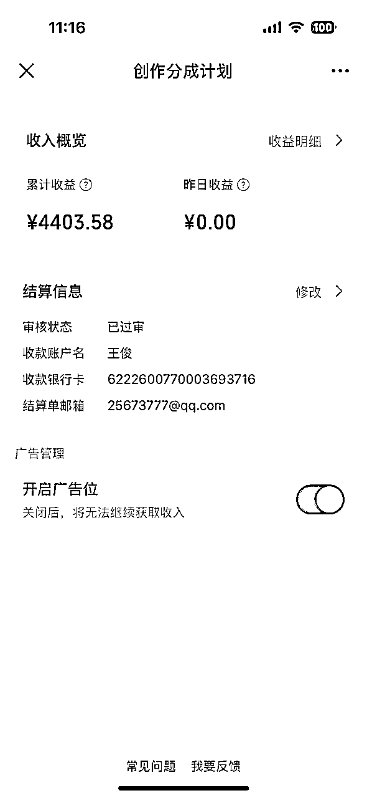

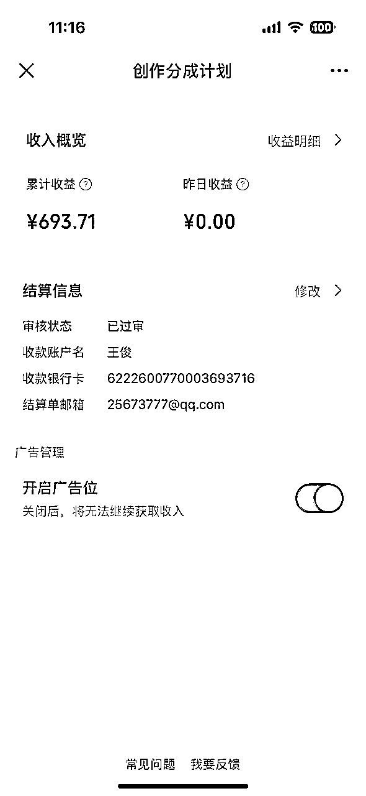

我的成绩不算猛，但很稳。一个账号去年11月开通分成计划，中间没怎么更新，收益也一般。直到今年1月16日有一条内容爆了，才开始日更。现在两个账号都开通了分成计划，每个账号每天回答一条，总共花20分钟。到目前为止，流量主收入累计5000多，平均每个月1000元。如果你愿意日更5到10条，收入肯定比我高，这项目就是多劳多得。

顺便一提，因为持续输出，我的👸号涨了近700关注，视频号涨了200多，总曝光量过了百万。

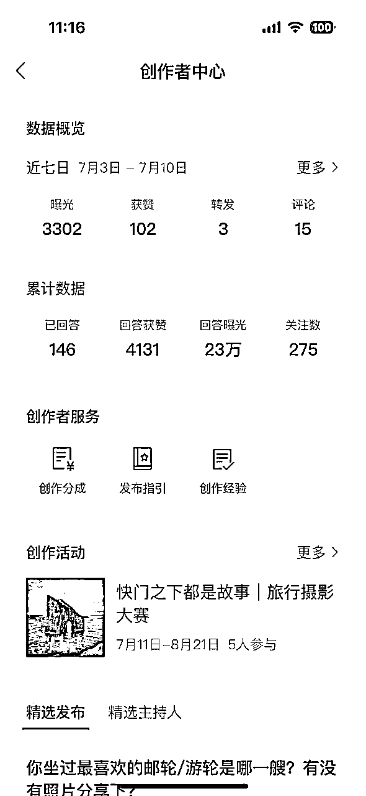

更有意思的是，我队友一个完全没写作经验的人，也跑通了。他不到一个月就开通了分成计划，然后立刻开了第二个账号，两个号加起来收入近7000。他每天认真答题，遇到不懂的就查资料，很快拿到了正反馈，单日最高曝光2万+，单日最高收益200+。而且“问一问”的收益比👸号稳定，虽然不是大钱，但天天有流水，特别鼓舞人。

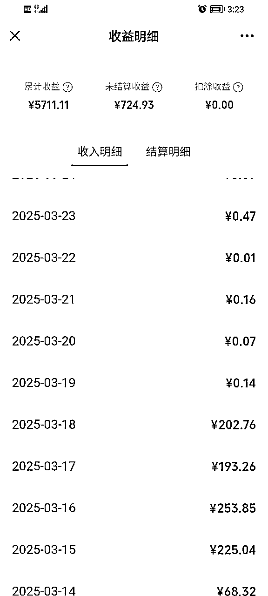

我写这篇文章，是想告诉那些想搞副业、却卡在第一步的人：有这么一个零成本、反馈快、谁都能复制的项目存在。我自己和队友的真实经历，就能证明“写点小东西也能赚钱”不是鸡汤。你可以先靠它跑通0到1，建立信心，同时锻炼输出能力。它还能反向给👸号、视频号引流，甚至能把流量引到私域，成交自己的产品。最近就有一位写作者通过问一问链接到我，完成了一次采访。

这项目的优点很明确：不用花钱、碎片时间就能做、每天都有收入、能积累信心，还能为以后做IP打底。如果你正想找个项目试试水，它真的值得。

还有一点额外的收获——因为要积累素材，我和队友开始有意识地探索本地景点、餐厅，把原本躺平的周末变成了家庭出游。所有消费都变成生产力了，这点特别划算。孩子看到我们拍照答题，也会主动说“先让爸爸妈妈拍”，还说自己长大也要做问一问。写作能力也提升了，我目前回答了570道题，按每题300字算，已经写了15万字，够一本书了。

下面说说这个项目怎么玩。

“问一问”是🛰️搜一搜里的问答平台，和百度知道、知乎不太一样，它把单个回答限制在500字以内，所以不需要长篇大论。平台对内容的要求是：优质、真实、实用、有个人特色。只要按这几个维度去回答，就有机会获得曝光。我5月份发过一篇内容，6月份开始跑量，最终曝光2.7万，点赞1700多，评论22条。

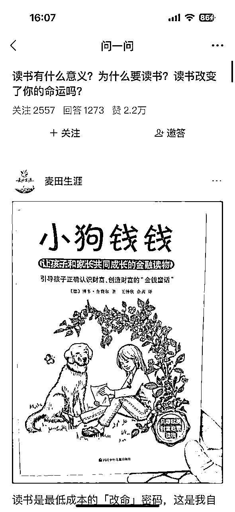

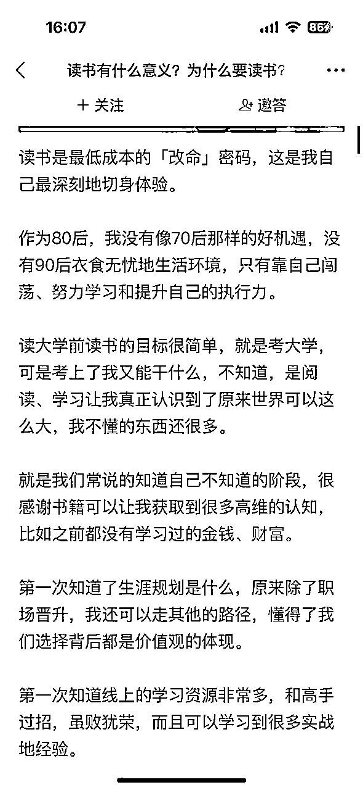

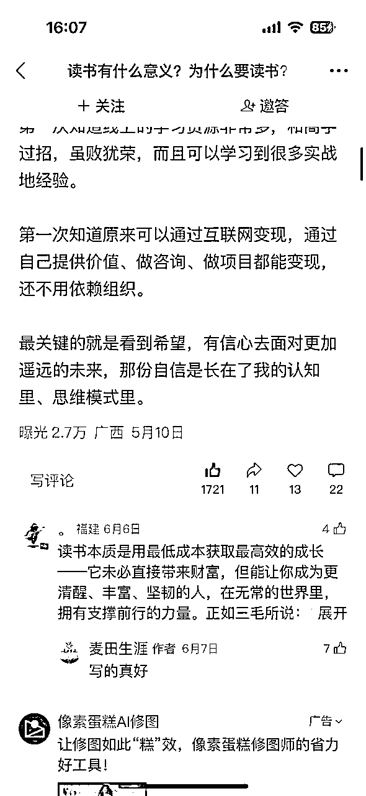

怎么进？两个方法：一是🛰️主界面 → 底部“发现” → “搜一搜” → “前往问一问”；二是关注“🛰️问一问”👸号，从底部菜单的“创作活动”或“问一问”入口进去。

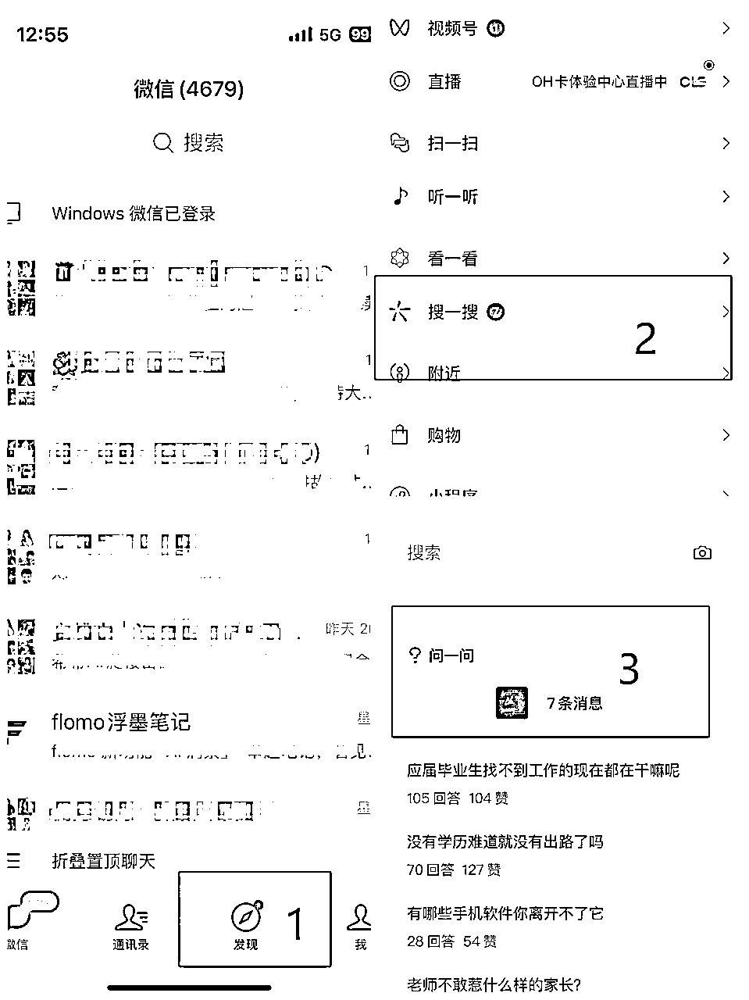

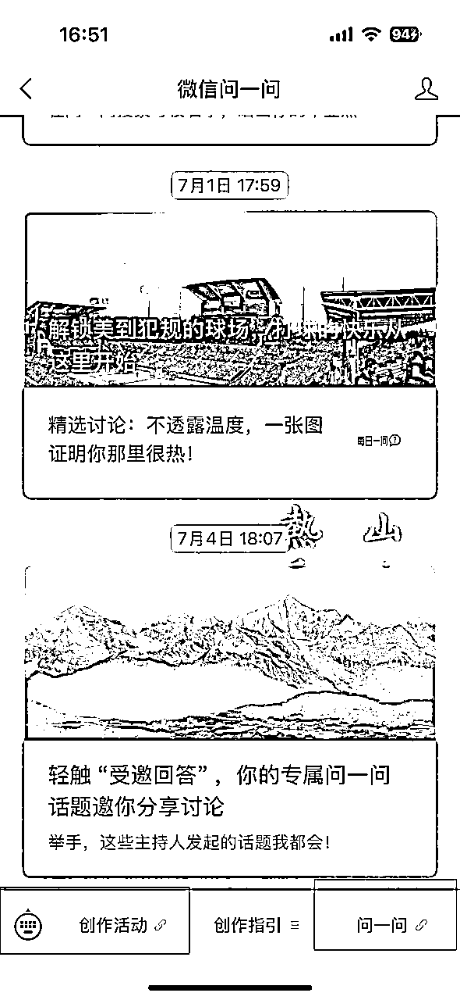

开通分成计划的条件：近90天内发布超过30条内容，并且有效关注人数大于100人——这里的关注必须是通过问一问平台来的。同时要满足官方内容质量要求，简单说就是：真实分享、贴近生活、专业但不装、简明扼要。如果符合要求，就可以申请开通。

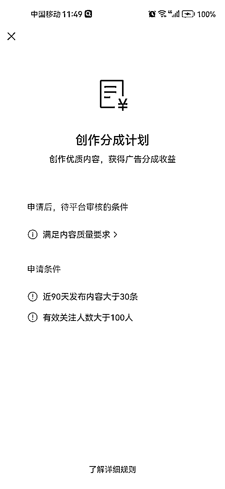

注意，90天是指在这个周期内完成30条，不是非要等90天。比如你10天就发了30条，也能直接申请。

收益方面，通过审核后绑定个人信息，平台每半个月结算一次，会发邮件通知，收入会并入个税，但不需要自己额外去交税，很方便。

接下来是重点，具体怎么实操。

先准备账号：注册👸号或视频号，注册方法自己搜一下就有。然后想清楚要输出什么方向。平台里有很多分类，选你感兴趣、有积累的领域更容易起号。没开通分成之前，建议走相对专业的路线，聚焦一个方向，这样更容易被官方运营看到。优秀的创作者会被拉进领域群，群里会分享话题、给到一定指导，不过这部分服务和流量、收入不是同一个部门管的。从赚钱角度看，目前流量比较高的内容集中在生活类和相对稀缺、有独特性的领域，这个得自己挖掘，平台风向也在变，之前有一阵子育儿、旅游很火。

你可以从问题广场点进去，上方滑动能看到不同领域，挑一个适合你的点进去查看。内容要突出“真人、实感、实用、有价值”，别被定位框死，你的职业、身份、兴趣，都是内容素材。

怎样快速达标？就是定位+输出，最好日更。30条内容建议在10到30天内集中发完。100个关注可以通过回答高热度问题、发原创动态来吸引，注意关注必须走问一问入口。也可以让家人朋友帮忙关注，但最好是靠内容吸引自然流量，爆一条可能几天就达标了。满足条件后提交申请，如果第一次没通过，要等10天再申请；第二次再不通过，就得等30天了，所以期间要保持优质内容更新。

日常运营，初期投入时间多一些，每天半小时到一小时。具体做法：每天发布1到2条你擅长的内容，秀出个人特色；把高热度问题（关注多、回答少）收藏到草稿箱，没思路时就去答；平时多拍真实照片备用，千万别用网图或AI图，问一问审核非常严格，这是官方反复提醒的。

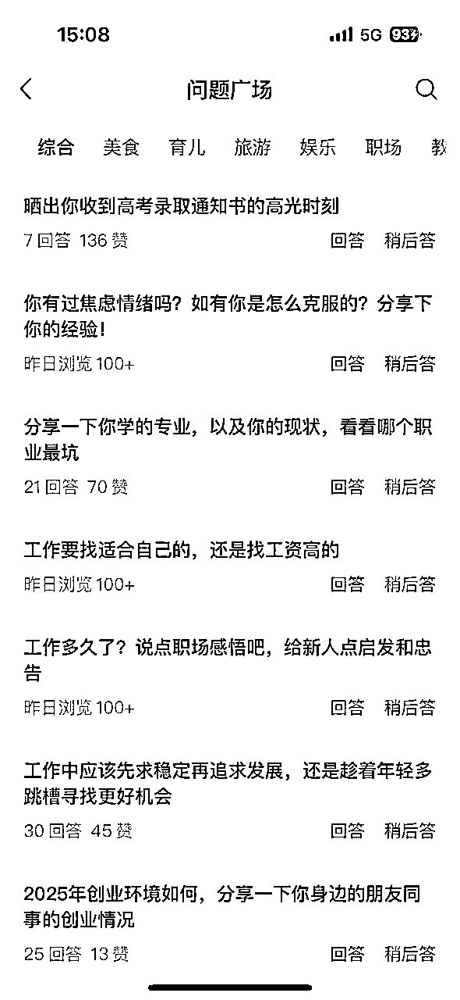

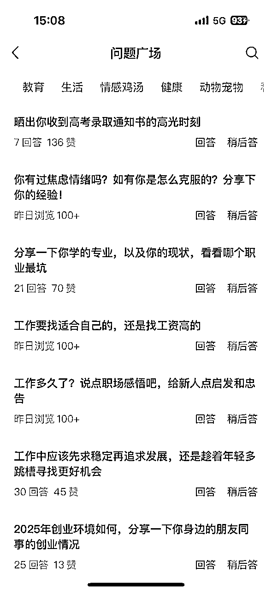

我还有个提速技巧：用语音输入结合笔记工具，比如“get笔记”，随时随地讲一段，软件会自动去掉语气词、整理成文字，稍微改一下就能发出去，效率很高。

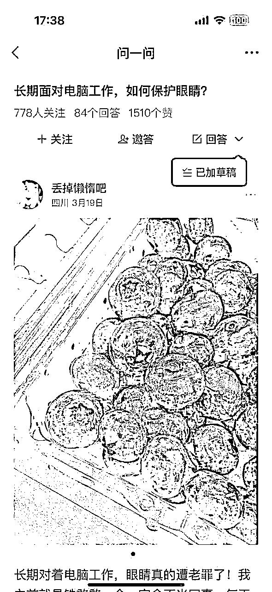

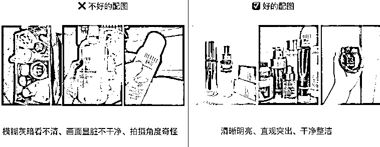

想拿到更多曝光，可以从几个方面下功夫。一是找对标账号，学习同领域优质创作者的回答方式和内容结构。二是多参与官方活动，问一问右上角头像点进去，你的账号下方就有很多“创作活动”，积极参与回答，抢占好位置，能获得额外曝光。三是标题要亮眼，简单明了，能引发情绪共鸣。举个好例子：“满园‘金’色关不住，春日限定大赏——黄花风铃木”，比“扎心了！千万别再XX”强得多。还有“成都周边古路村徒步一日游攻略——四川版悬崖绝壁虎跳峡”，就比“90%的人都不知道”这种套路有用多了。四是配图要有质感，不用像📕那么夸张，稍微修饰过的真实美图最合适。五是内容本身要有价值，能帮到别人，让人愿意转发、点赞、评论。可以分段落展示，分类整理，让信息一目了然。

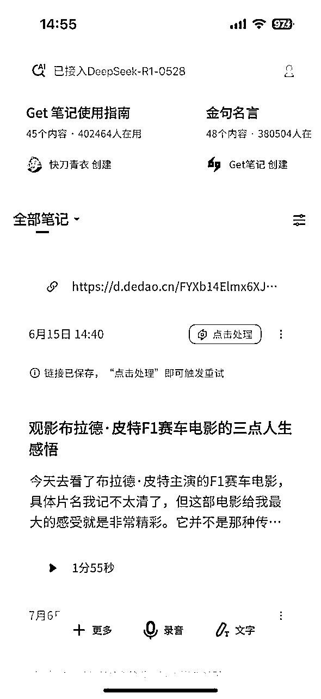

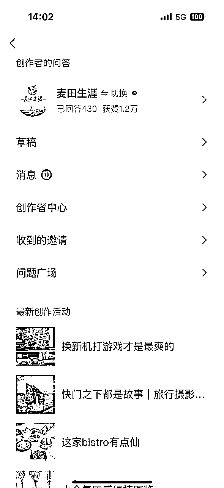

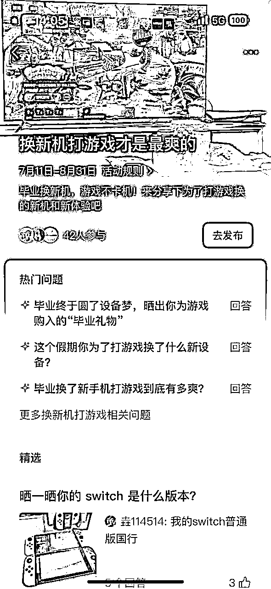

还有评论区——收入跟评论区的广告展示有关，所以评论要有价值，别水。评论质量决定广告展现量。

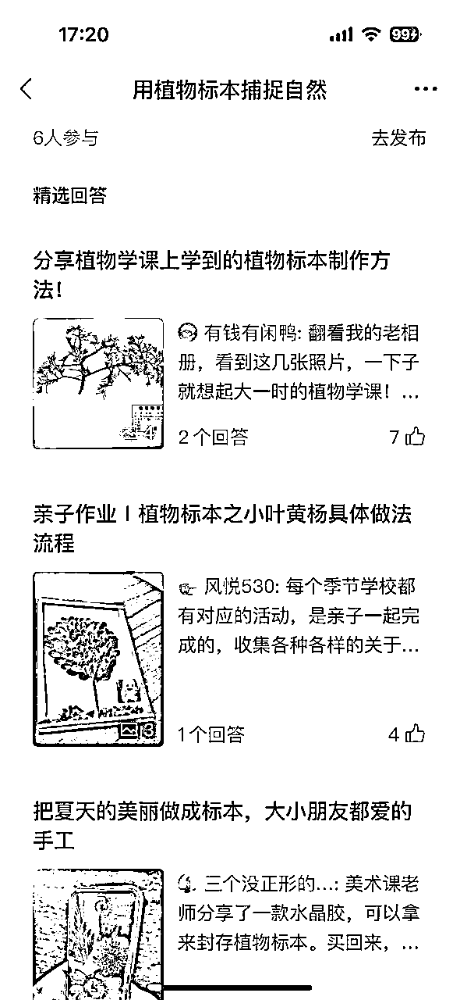

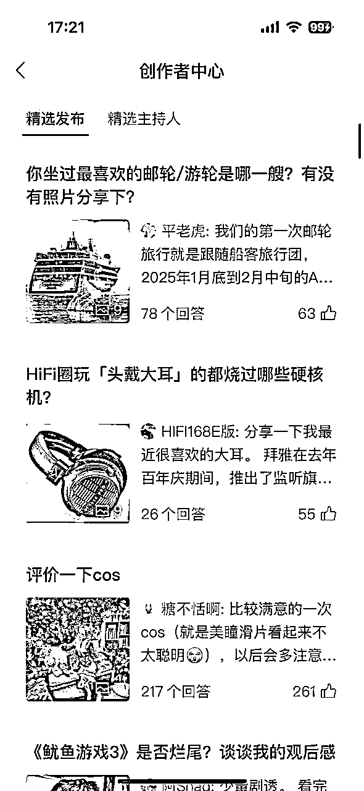

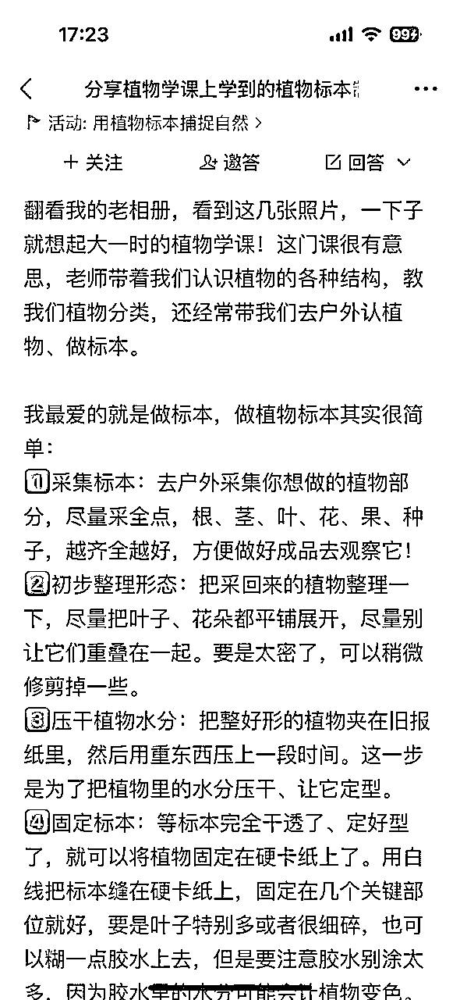

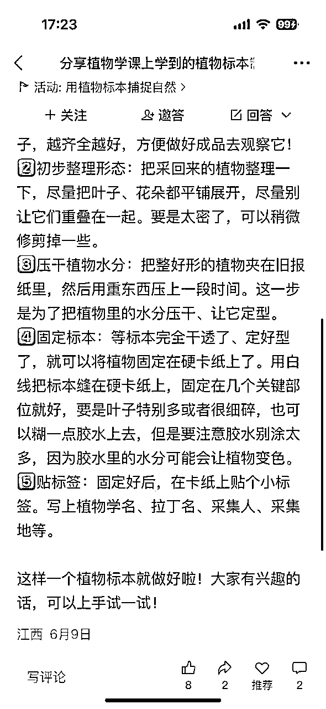

说完方法，说说我们踩过的坑。第一，不要为了刷流量大量回答没营养的内容，很容易被限流。我队友就经历过两次无预警断流，每次都是刚赚到200多的时候流量突然断掉，每天只剩几分钱，要到第10天才恢复。虽然之后会慢慢回来，但流量大不如前。第二，封号大多是因为蹭热搜、发水内容，尽量以实用经验分享为主。第三，那些特别简单的攻略贴不要再跟风了，很容易被限流。第四，绝对不要用纯AI生成内容和图片，这是平台的红线。当然，如果内容被误判，可以去申诉，我自己就申诉通过过。

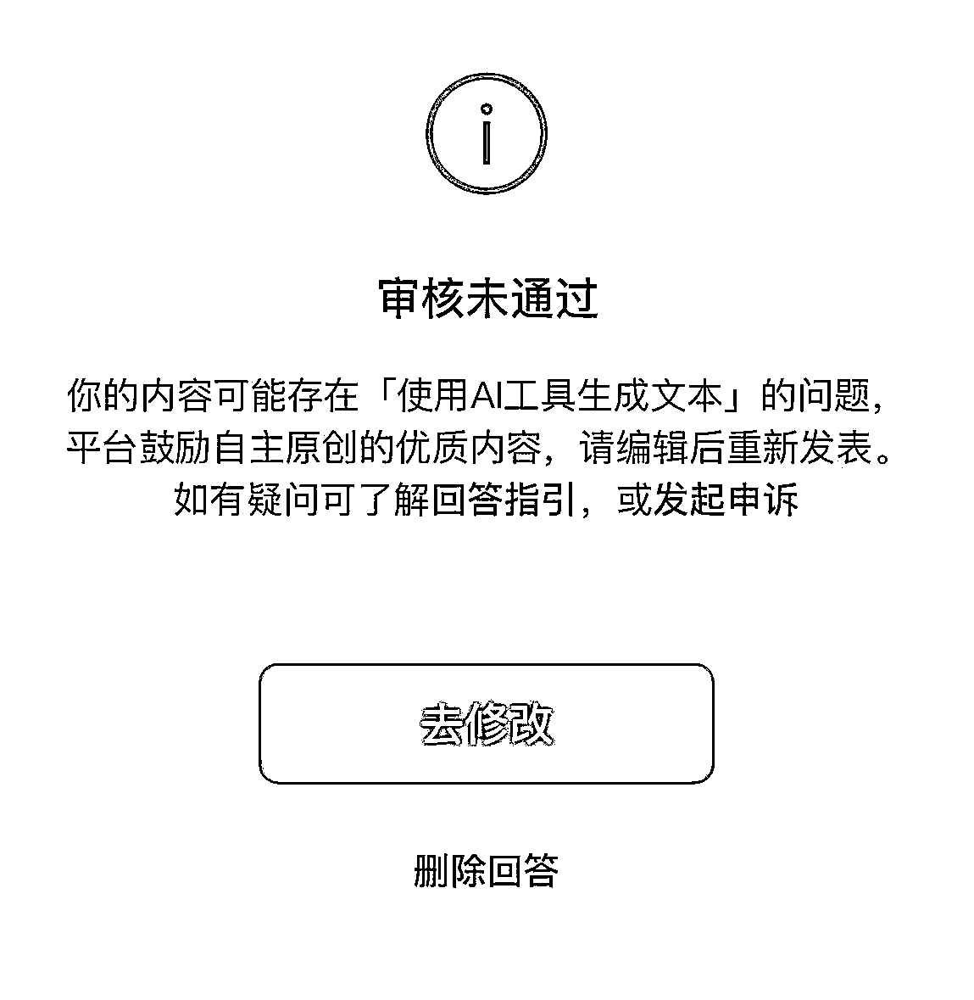

总结一下：内容坚持原创或深度改写，禁止纯AI生成；少蹭热点，多做干货；每天固定频次发布，坚持更新，关注和收益都会稳定增长。

为什么我建议新手做这个？因为我把“问一问”叫作“公域朋友圈”。如果你有些内容不方便发在朋友圈，完全可以发到这里，展示真实的自己。人生体验、经验、吃喝玩乐、美妆、汽车……只要你想分享，都能展示。它不需要额外成本，只要手机和零碎时间，就能帮你拿到第一笔副业正反馈。更重要的是，它能锻炼你的持续输出能力。以后无论是做👸号爆文、视频号还是IP，它都是一个非常好的渠道补充，还能反向增加流量。

最后，别抱着“做号”的心态去输出，那样很容易被流量和收入绑架。做真实的自己，才是最容易持续的。

作为优势教练，我真心希望大家能找到自己的优势，用擅长且喜欢的方式，做热爱的事，同时赚到钱。坚持记录本身就有巨大的意义，等你回过头看自己的输出，全是美好的回忆。

这次能写出这篇内容，特别感谢赚钱官方运营@黄阿兜🧡的指导，她专门花时间帮我列框架、梳理大纲，真的非常用心。比起赚钱平台上拿到大结果的伙伴，这个项目确实很小，但恰恰因为它小，所以快、所以容易成功。无论你是职场人还是小白，只要愿意真诚分享，问一问都欢迎你。祝每位伙伴都能拿到结果，一起龙哥盟。