# 从3个月亏50万的电商小白，到单店月销184万的老油条｜保姆级抖音商品卡复盘

大家好，我是子贤，广州人，加入生财正好117天。目前我主要深耕抖音电商，类目覆盖家具、女装、百货。平时在圈子里很少看到有人系统讲抖音电商，今天干脆自己写一篇保姆级攻略，把踩过的坑、跑通的路、正在用的方法一次说清楚。全文会从我的真实经历讲起，再给到对当下抖音电商的思考、商品卡项目分析、开店全流程，以及第一个月做到184万GMV的落地细节。

先直接上近期数据：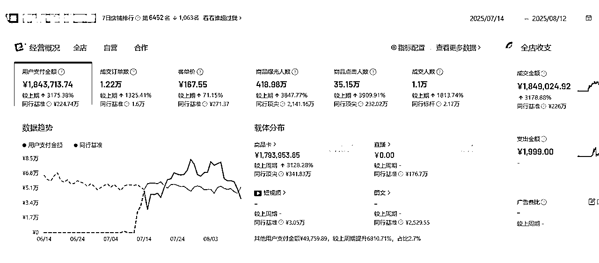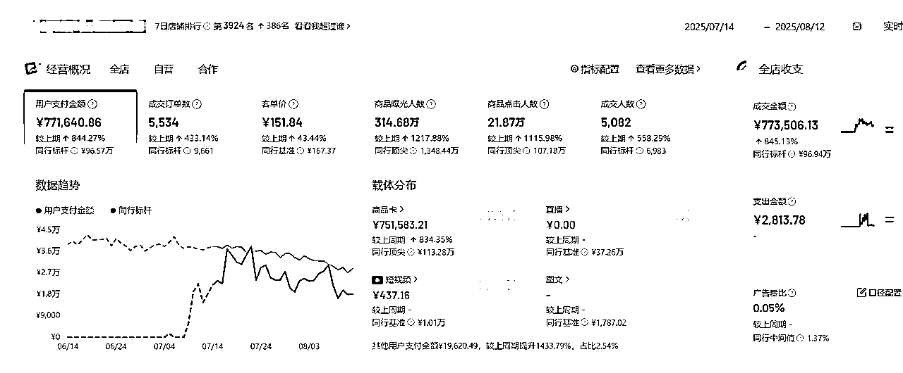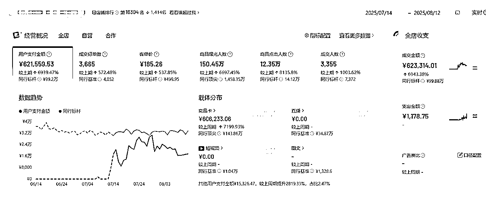 七月份起店，截止到8月12号，表现最好的一家店营业额冲到184万，关键是这些成交里没有一分钱来自短视频、直播或付费广告；另外两家店也做到了60万以上。整套操作全部由运营助理按SOP流程完成。亦仁大佬说过一句话让我印象很深：数据可以默认是假的，但流程是通的。

## 我的弯路：从另一个行业裸辞，一头扎进抖音

2020年大学毕业后，我通过校招进入深圳一家继电保护行业的龙头企业。公司前身是国企，后来改制被集团收购，主要给国家电网提供继电保护装置。我在研发中心写代码，一写就是两年，996熬到怀疑人生，头发也快保不住。日子看得见尽头，实在太想要自由，于是2022年年中我果断辞职。

2023年年初，一位做进口红酒的大哥拉了我一把。在此之前，我从没想过做电商，结果一脚踏进抖音直播赛道，从那一刻起，人生轨迹被彻底改写。

刚入行，我跟所有小白一样，每天像只无头苍蝇到处乱撞。看着别人直播间一场卖出几十万甚至上百万，我也做着一月卖100万的美梦。白天在抖音上学怎么搭直播团队、怎么开播、怎么付费投流，晚上就风风火火开始招人、租场地、买设备。当时我对行业架构和薪资体系完全没有概念，运营面试时开口要1.5万月薪，我想都没想就答应了。

于是这支“烧钱”团队就这么搭了起来：400多平方米的场地，月租3.4万，押二付一；设备、电脑、直播相机一共7.5万；运营月薪1.5万；3个主播每人月薪1万；拍摄剪辑6000。第一个月20万就没了，之后每个月运营成本还要10万左右。

直播了一个月，几乎没效果，亏本卖都卖不出去。每天下播回家，我是靠刷知识博主的直播睡着的。后来还到处跑线下课，学付费投流、学培训主播、学抖音小店、学短视频。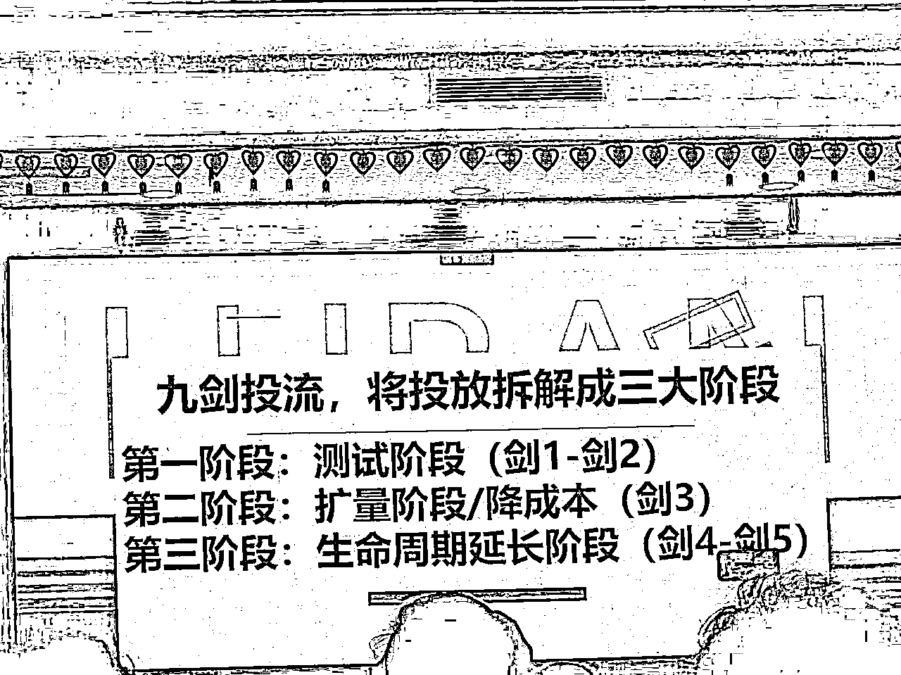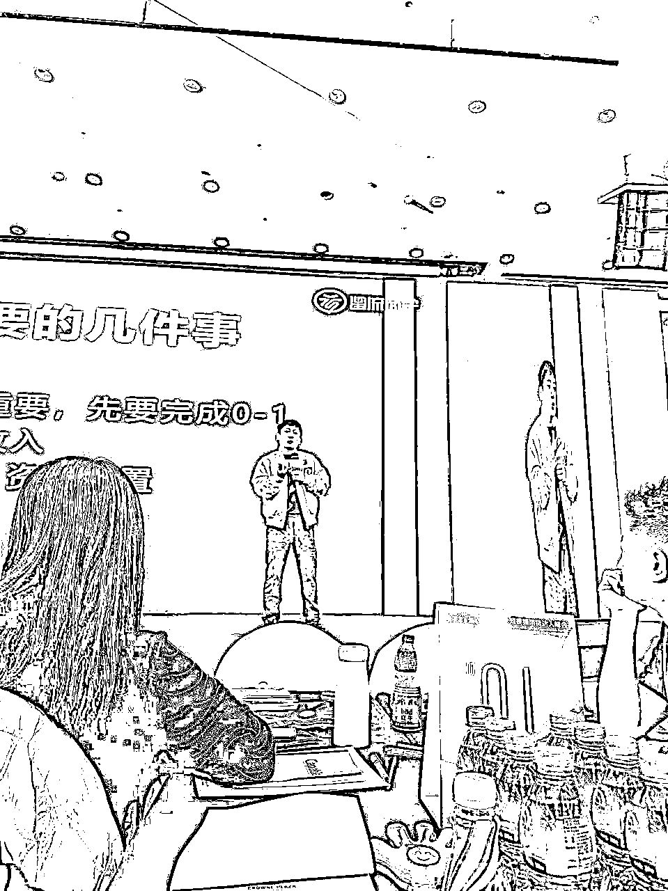

知识付费前前后后花了十几万，三个月下来总共亏掉50万，却没有一丁点产出。大哥看到这个情况开始喊停，但我始终相信：只要还坐在牌桌上，就总有机会翻盘。

于是退掉场地、关掉公司，自己躲在家里继续钻研。期间做过达人短视频带货、抖音小店商品卡，什么都学，缺什么补什么。这里也提醒一下小白：没有行业经验时，尽量选试错成本很低甚至为零的项目，这样失败了还能重来。创业成功率不足3%，很多人一上来就砸几十万，一旦失败，后半生可能都在还债。

真正的转折点出现在8月。抖音开始重点扶持货架电商，还推出商品卡免佣政策。我立刻意识到机会来了：跟着平台政策走，大概率不会错。于是迅速切入家具类目——同行还在直播里卷生卷死的时候，我在做商品卡；同行还不知道商品卡能投放的时候，我已经通投拉满。那时候根本没什么技巧，新建计划直接开跑，投产十几倍是常事。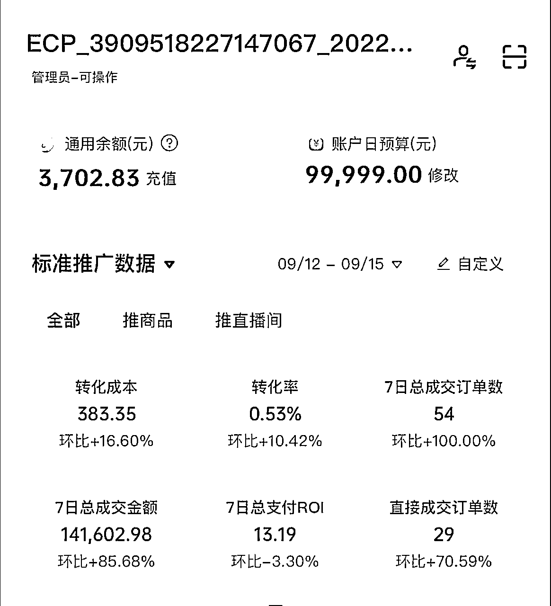

看到模式能跑通，我马上整合团队，搬到江西产业带，也认识了现在的合作伙伴。他负责后端供应链、发货、售后、客服，我负责前端运营和流量。从9月份开始，业绩几乎是翻倍增长。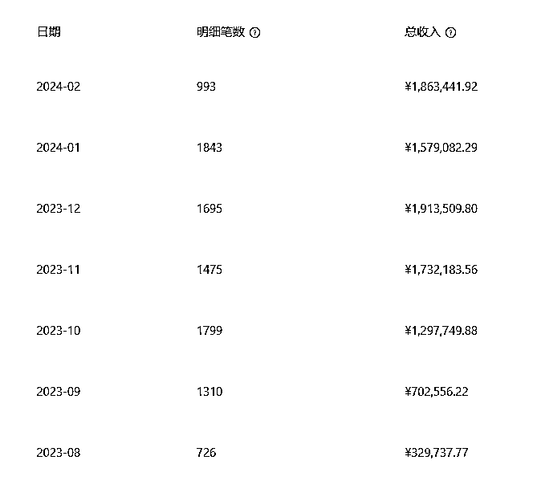

项目稳定后，我一直没停止测试新类目，男装、女装、百货都试过。因为我太清楚：平台红利期不会一直持续。修屋顶要趁阳光好的时候，别等到下雨了才手忙脚乱。

直到今年5月，抖音商品卡规则突然调整：不再支持标准计划投放，所有账户只能投全域计划。我测试了一圈，发现耐消品掉量极其严重，投产怎么都打不正，还频繁出现空耗、秒拍秒退。以前靠投放技术还能稳住投产，现在广告计划只剩一个开关按钮，想操作都没有空间。那一刻我彻底明白：依托平台政策红利的生意，政策一变，跟行业黑天鹅没什么两样。不过好在同期我一直布局的女装、百货等快消品，反而因为这次改动吃到巨大红利，我还开发出几套效果不错的打法，以后有机会再细讲。

## 我对当下抖音的几点思考

先说结论：抖音到今天依然是巨大的变现平台，很多细分领域的红利依旧很大。做细分领域的产品，远比做大众型产品容易出头。

在抖音，光有流量没有用，项目本身占99%。一定要先有变现模型，再去找流量。顺序不能反。

“抖音+私域+社群”直到今天依然是变现王炸组合。

一个项目能不能成，不是想出来的，是调研出来的。要投多少钱、能赚多少、有没有成功案例、能不能复制、执行难度多大，这些都要综合评估。

每个项目都要反复问自己：现在是不是风口？是不是起飞的时间点？太早进场容易成炮灰，太晚进场就是十倍努力、一倍结果。要善于借助平台红利，只有在平台爆发期，才更容易拿到大结果。

## 抖音商品卡项目分析

什么是抖音商品卡？简单说，它是抖音推出的货架场。你可以把它理解成抖音版的淘宝/拼多多——不用直播，不用拍短视频，操作门槛很低，把商品链接挂上去就能出单。

为什么值得做？因为运营成本极低：一张营业执照、一个人、一台电脑、500元保证金就能开店。不像直播那样，还需要主播、运营、中控一堆配置。

流量大，增速快。2024年双11期间，商品卡GMV同比增长64%，说明平台正在把大量流量往这个场景倾斜。

2025年平台补贴继续加码：全年免佣补贴金额达到135亿，面向全量商家开放，每月只需要完成2-3项小任务，就能拿到免佣资格。

渠道多，新手友好。抖音商城可以分成“兴趣场+货架场”。有能力做直播或短视频的，可以去做兴趣场；没有经验的，可以直接做货架场。商品卡上架就能出单，单量慢慢积累起来，还会有达人主动找你带货，有点躺赚的味道。

商品卡的主要流量来源，就是“猜你喜欢”和“搜索”。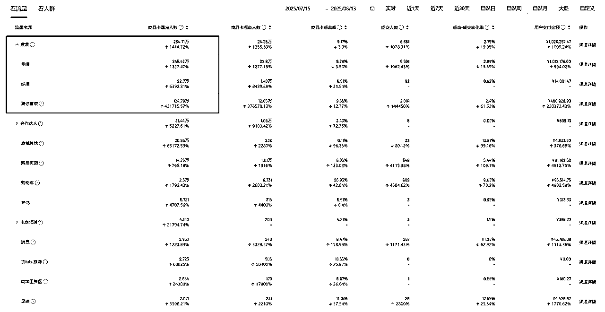

总结一句话：商品卡是现阶段做抖音电商必做的方向——流量大、增速快、扶持猛、操作简单、开店成本低，还能做店群，也能完全SOP化运作。

## 保姆级开店流程：从0到1搭建店铺

下面进入手把手环节。

### 1. 入驻店铺
店铺主体分三种：个人店、个体店、企业店。企业店还能开出企业店、专卖店、专营店、旗舰店。

- 个人店：准备身份证、银行卡。
- 个体店：准备个体工商户营业执照、法人身份证正反面、法人银行卡、法人微信商户号。
- 企业店：准备个人独资或合资的公司营业执照、法人身份证正反面、对公账户、法人微信商户号。
- 专卖店：需1个或多个普通授权品牌，且多个品牌要属于同一商标所有人。
- 专营店：需授权2个及以上自有品牌或授权品牌。
- 旗舰店/官方旗舰店：可经营1个或多个一级独占授权品牌，多个品牌同样要属于同一商标所有人。

### 2. 缴纳保证金
常规类目基本都支持0元入驻，新手可以先不交，等累计到100单之后再去补交。目前除特殊类目外，常规类目基础保证金是500元。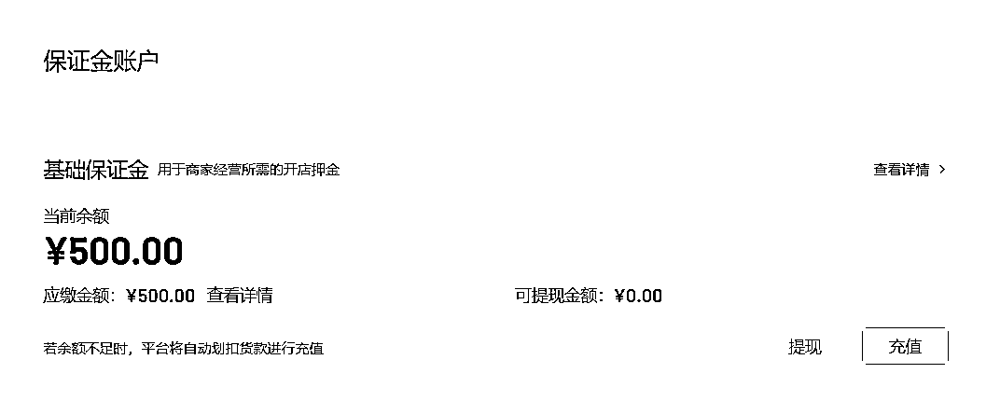

### 3. 开通聚合账户
绑定法人收款银行卡；开通微信支付，并完成后还需要二次签约。如果不开通微信支付，客户就没法用微信付款，转化率会受影响。企业店还要绑定法人对公账户或企业网商银行。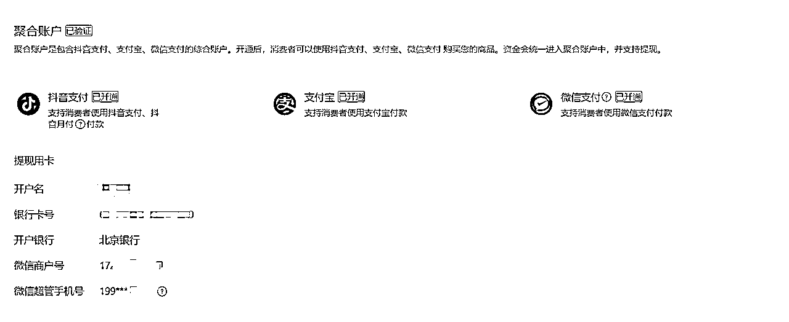

### 4. 开通子账号
先注册一个网易邮箱，用邮箱注册子账号，然后开通全部权限。这么做既方便运营管理，又有一定概率规避关联。

### 5. 新建运费模板
利润款常规偏远地区限售：香港、澳门、台湾、内蒙古、新疆、西藏、甘肃、青海、宁夏、海南。
福利款要防羊毛党，限售“两河两山一黑”：河南、河北、山东、山西、黑龙江。

### 6. 设置地址库
店铺默认发货地址和退货地址都要设置，否则会影响厂家打单发货。默认退货地址如果上家不固定或者有多家，可以卡一个座机售后地址，来卡住平台的“闪电退”。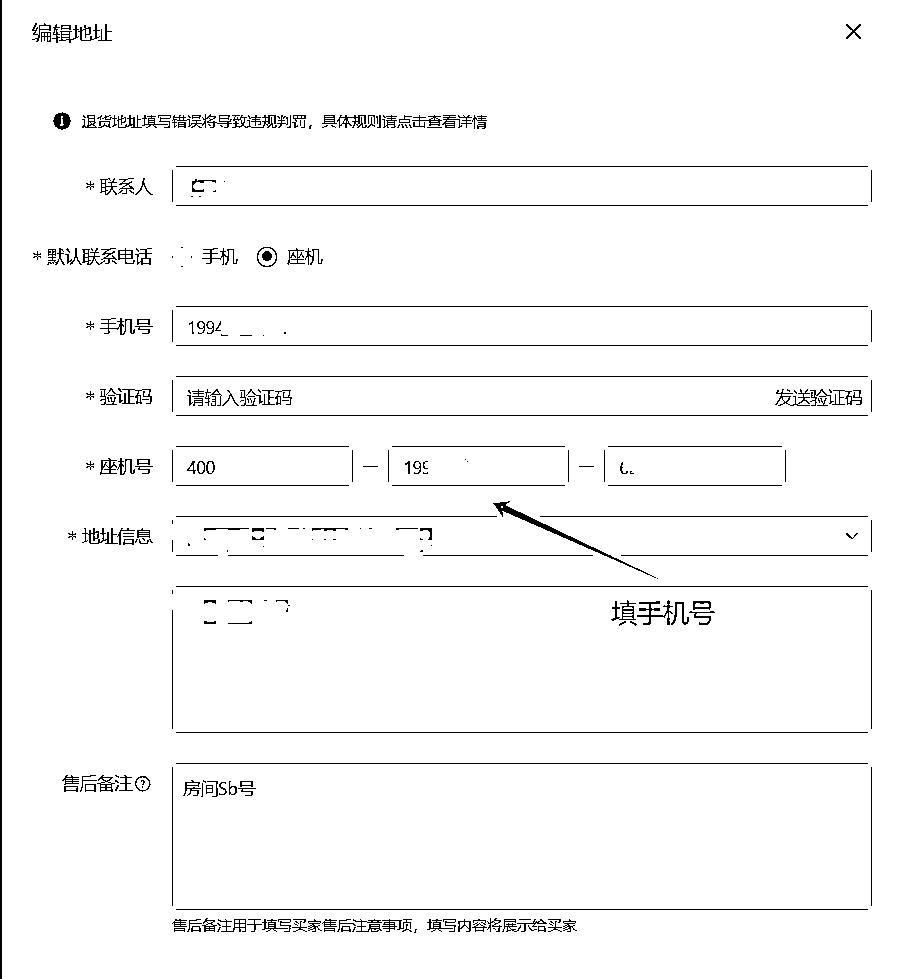

这些都完成后，直接上架产品就可以。每个类目的具体运营方法和思路，后面我再单独写一篇。

## 开店第一个月，我是怎么做到184万的

我的做法是女装无货源铺货。

为什么选女装？因为女装是抖音乃至全平台流量最大的类目，竞争的激烈程度当然也是顶级的。但女装属于非标品，价格定高一点也不用担心卖不掉，还能杜绝比价问题。我的操作就是无货源铺货——通过软件选3到5万个链接，只要链接数量足够多，就能出单，完全不需要什么高深运营技巧。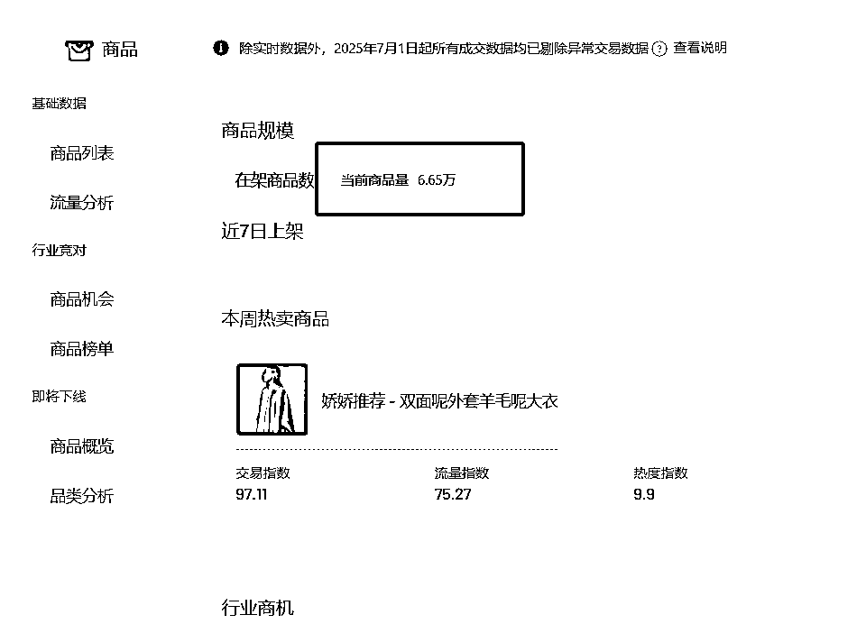

店铺基础搭好之后，第一步不是猛上架，而是先出体验分。新店没有体验分，基本上就没有流量，所以我先把体验分拉到90分以上。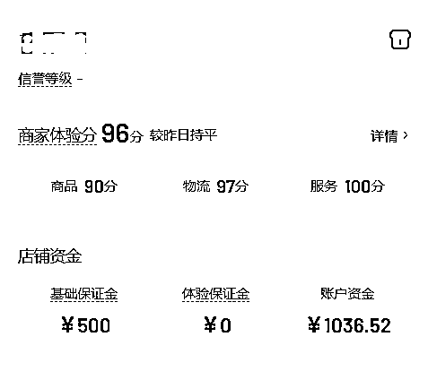

怎么快速出体验分？我会选择10元以内的福利商品来累计订单，这个客单特别容易出单，只要累计出够30单，就能有70分体验分。这些年前前后后攒了一个货盘，里面有好几百个低价福利品，上架就能出单，有需要的兄弟可以在评论区告诉我。当时我为了快速拉爆店铺，没有选择慢慢耗，而是直接一天拉了500单，把体验分冲了出来。大家可以看这条流量曲线：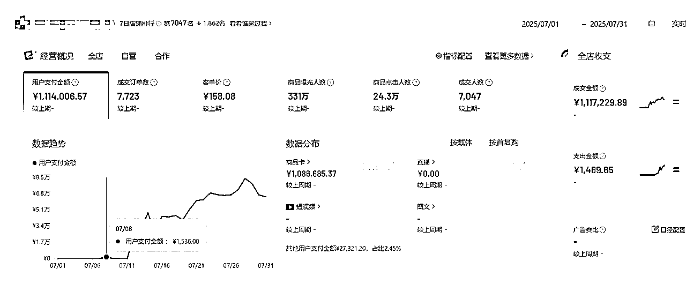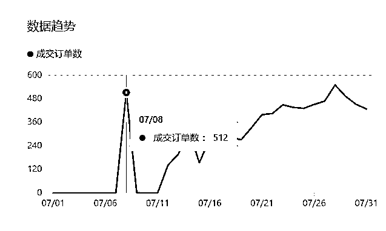

大概两天后，订单陆续有了评价，我就开始上架提前准备好的利润款。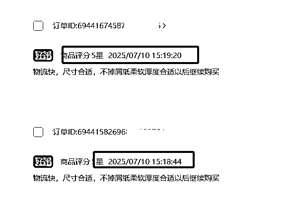

利润款我是提前放进仓库的，统一在同一天一键上架，再设置好全店优惠券，坐等出单，毛利控制在50%左右。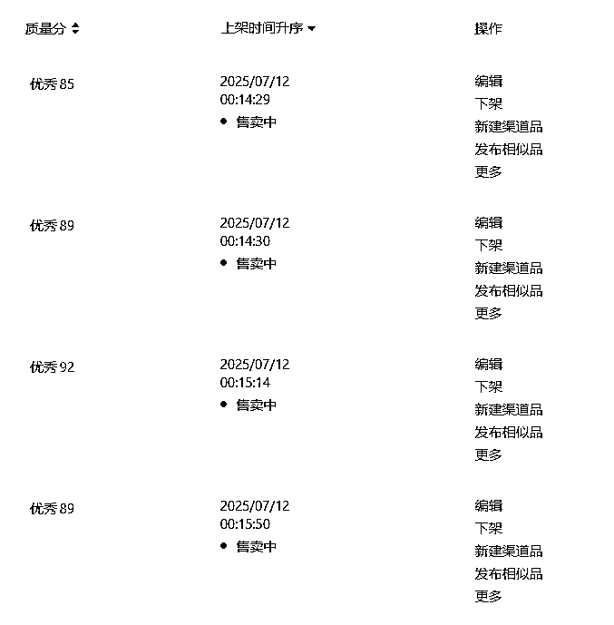

出单之后，我去淘宝用“以图搜款”找到对应商家，直接拍单。当天早上就开始出单，利润也确实在50%左右。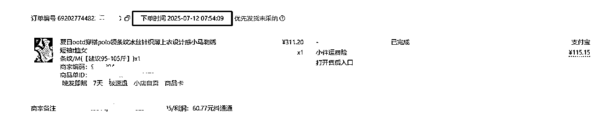

第一天就卖了2万多，最高峰的时候一天冲到8.4万。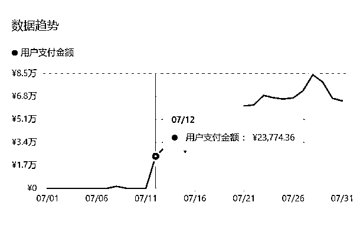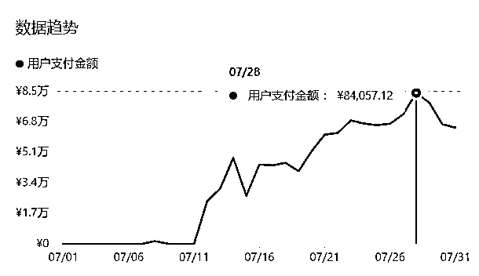

整体思路就是这么简单：采集好链接，直接上架就能出单。同一批链接还能复制给多个店铺用，所有操作全部由运营助理按SOP流程执行。项目细节问题，欢迎评论区留言。

## 项目总结：财务视角拆解真实利润

很多人说，女装退货率这么高，狗都不做。确实，狗都不做，我做。

下面用财务视角来拆一下这个店一个月的真实利润。

人力配置：运营助理2名+售后客服1名。这个配置可以同时运营3家店。
- 运营助理：负责上架链接、维护店铺、接待客户、拍单。
- 售后客服：负责退货管理、接待客户、给客户打电话等。

运营助理月薪：3500×2；售后客服月薪：5000。这里我愿意多花钱选有经验的人，因为能减少大量售后损耗。每多做一个店，再额外给1000提成。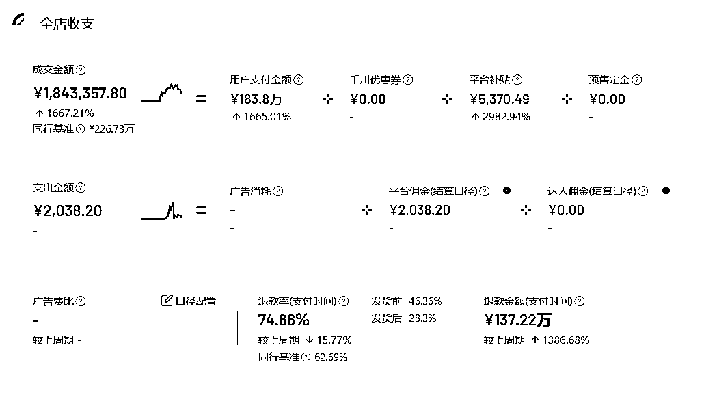

再看这个店一个月的财务数据：
总成交GMV：184万，退货率74%。我按更保守的80%退货率来算，实际签收大约36万。平均毛利50%，36万的一半就是18万毛利。

减去人工成本：3500×2+5000=1.2万。
场地开支：我本身就有现成场地，这部分忽略不计。
运费险成本：平均一单4元，保障6280单，成本约2.51万。
实际发货单均损耗：按5元一单算，同样是6280单，约3.14万。

营收粗算：18-1.2-2.5-3.14=11.16万。再扣除一些隐性成本，这个店一个月大概有10万左右的净利润。

执行难度分析：
可复制性极强，操作难度很低，新招来的小白运营助理只要按SOP流程就能完成所有工作。一组团队可以独立运营3家店。

希望这篇实战分享对大家有帮助，也欢迎在评论区跟我交流！