# 35岁被裁后，我用这套组合拳把 TikTok 流量变成站点订单

这篇文章是从卖家的角度，把 TikTok 从入门到完成成交的整条链路做了梳理，尤其适合中小商家照着落地；走达人方向的朋友也可以参考。目标只有一个：让更多人在这上面赚到钱。

内容持续更新，系作者原创，未经授权不得商用或搬运，如有需求请找鱼丸联系本人。

## 0 写在前面

今年3月，我在一家大厂干了7年之后被优化。35岁这个节点上，回家带娃当然是一条安全的路，但我不甘心把自己积累的技能扔进家务堆里。于是开始一边带娃一边折腾：社区电商、珠宝私域、直播、小店、自建站等都有试过。眼下最优潜力的还是“店铺模式 + 不开店直接播”这两条，目前它们不是我最挣钱的业务，但长期空间很大。

先汇报一下进度：6月26日站正式上线，7月2日功能才算跑顺。直播只开了两场，一场17分钟，另一场大约半小时。站点放在主页上，没投一分钱广告，纯自然流量累计来了209个人。7月19日00:21终于拿下首单，今天已经把货发走了。

流量数据：

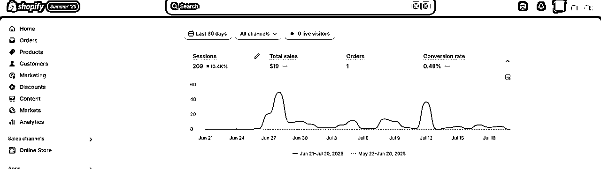

建站时间：

集中花了两天搭完，后续零零散散补了一些信息，比如 PayPal 被风控之类，整体不算费劲。

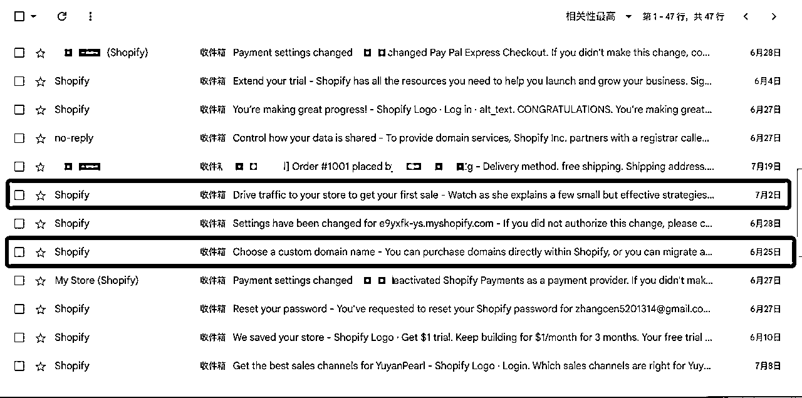

发货成功：

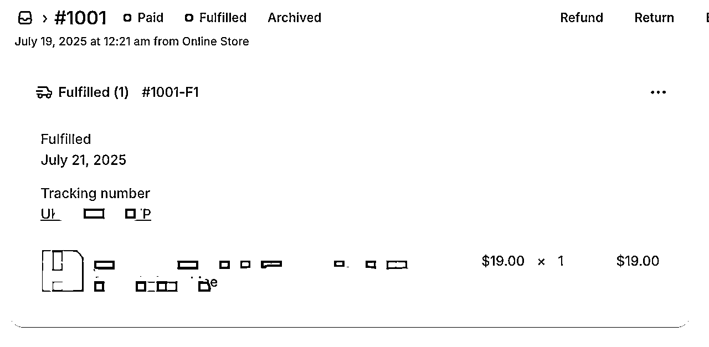

### 0.1 为什么押注 TikTok

这方面估计星球里的大佬能讲得更深，我直接放一段 DeepSeek 关于 TikTok 与抖音发展时间差的对比结论，看完你就明白。

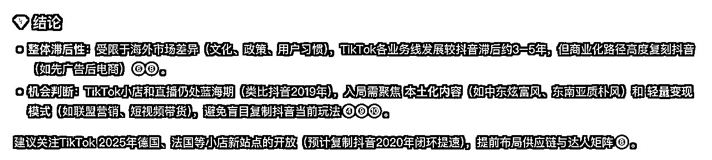

## 一、从零创建账号

先说个现实：绝大多数人连门都进不去，这个比例我认为有80%。以下步骤以美区为例；如果你瞄准的是东南亚或日本等方向，只要把语言和对应区域的账号换掉即可。

### 1.1 需要准备什么

直接给结果：苹果手机（安卓只推荐谷歌原生机型）、邮箱、代理工具。

#### 1.1.1 设备怎么挑

手机需要满足：iPhone 8 及以上、可拔卡、每台机器只跑一个账号、恢复到原厂状态。

购买渠道方面，京东和闲鱼都有，500到700元就能搞定。提醒一句：不少二手机不支持刷机，下单前一定问清楚，我之前在拼多多买的一台就翻车了。

另外补充一个设计师才知道的点：预算够的话优先考虑 iPhone 11，它拍出来的色调最舒服。iPhone 12 之后加入了计算摄影，我个人反而觉得颜色没有11耐看；11还自带微距能力，拍饰品这类小件很实用。预算紧张的话，iPhone 8 也够用。

#### 1.1.2 手机配置清单

刷完机之后，按下面的流程操作：

① 拔卡:任何 SIM 卡都别插，尤其国内卡。能拿到海外卡当然更好，弄不到就算了。

② 刷机路径：设置 → 通用 → 还原 → 抹掉全部内容和设置。

③ 关定位:去 设置 → 隐私 → 定位服务 → 关掉，避免暴露国内位置。

④ 限制广告追踪:在 设置 → 隐私 → 广告 里开启“限制广告追踪”。

⑤ 设时区:把手机本地时间改成目标国家的时区：设置 → 通用 → 日期与时间 → 关掉自动设定，手动选到对应城市。

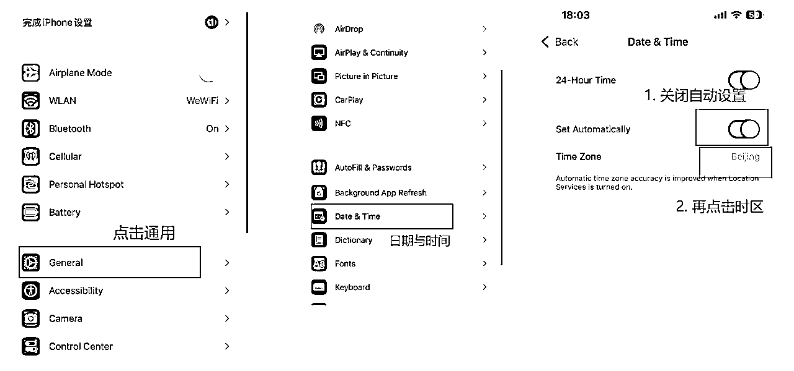

⑥ 切换语言:在系统语言设置中添加 English。

注意：切成英文后不能再改回去，一旦改动，平台就会识别到语言异常，严重时号码直接没法用。

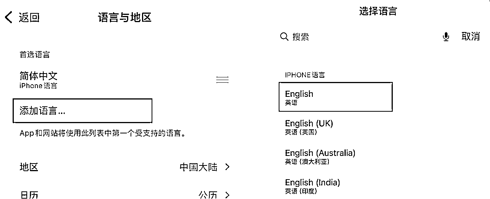

⑦ 登录美区 Apple ID:去淘宝购买相应区域的账号，几十块钱就能解决。

先连上网络（英文系统下的路径是 Setting-WLAN），打开 App Store 切到美区，把 TikTok 和代理客户端 Shadowrocket 都装好，具体见图。

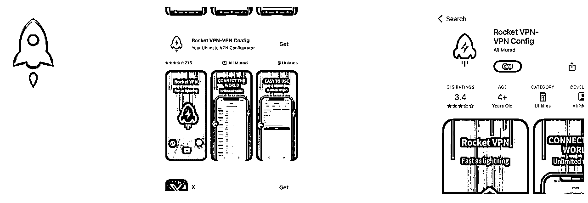

#### 1.1.3 邮箱怎么选

注册支持海外号码、邮箱和第三方登录。我更推荐邮箱，因为它封号成本最低，操作也最方便。

国内邮箱一概不要碰。体验最好的是老 Gmail，权重稳、流量好，被封的概率也更低。手里没有的话，闲鱼几十块可以买一个。实在不行，Outlook 也可以注册，不需要绑定手机、不需要实名，数量不限，适合前期反复试错。

我自己注册了两个账号：一个老 Gmail，一个新 Outlook。实测之后，Gmail 号的流量明显更优；当然内容也会影响数据，后面我打算继续把 Outlook 号的内容质量拉上来，看能不能把差距缩小。

放出来供大家参考：

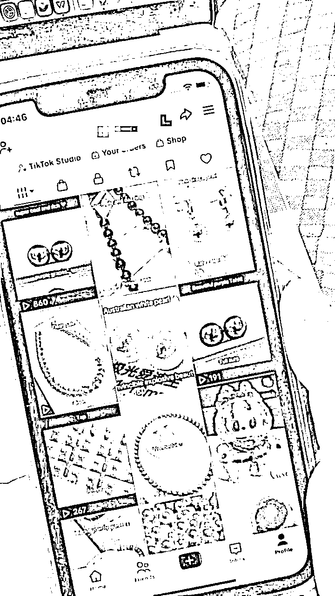

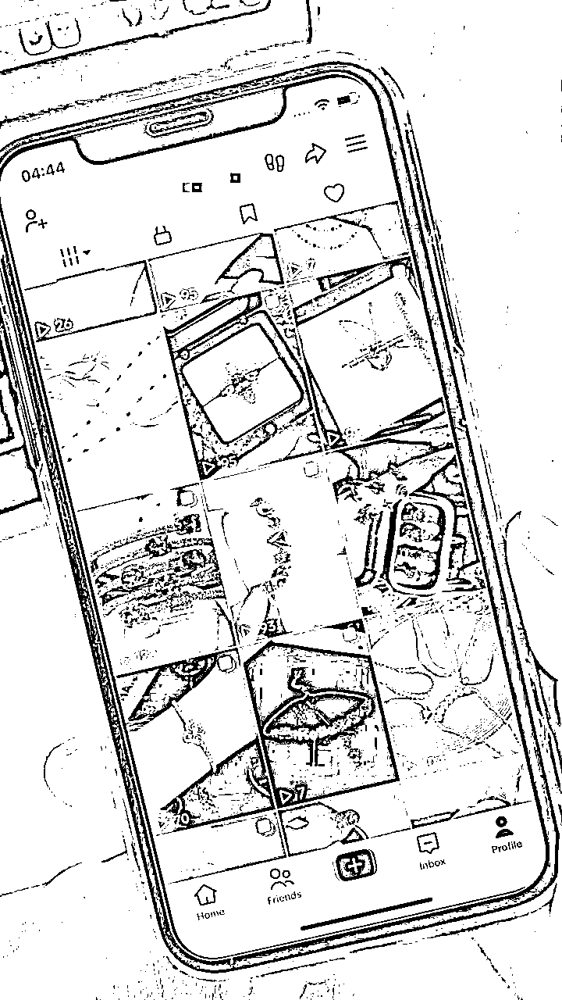

#### 1.1.4 网络环境怎么验

代理部分不便展开，自己想办法解决。这里只讲验证环节：

打开 whoer.net 检查本机环境，页面会给环境伪装水平打分，达标线是80%以上，最好能到100%。

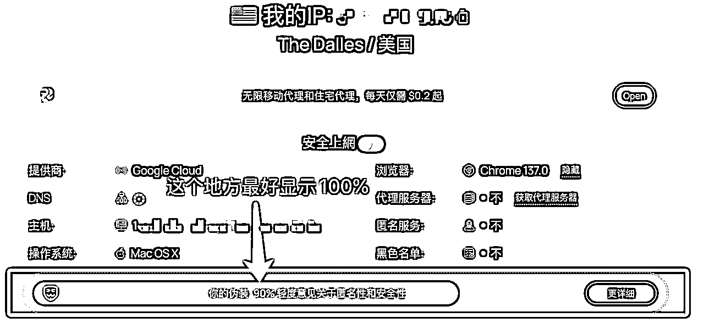

再到 en.ipip.net 确认出口 IP 的归属地，必须和你代理节点所在位置一致。节点选在哪，检测结果就必须显示在哪，不能有偏差。

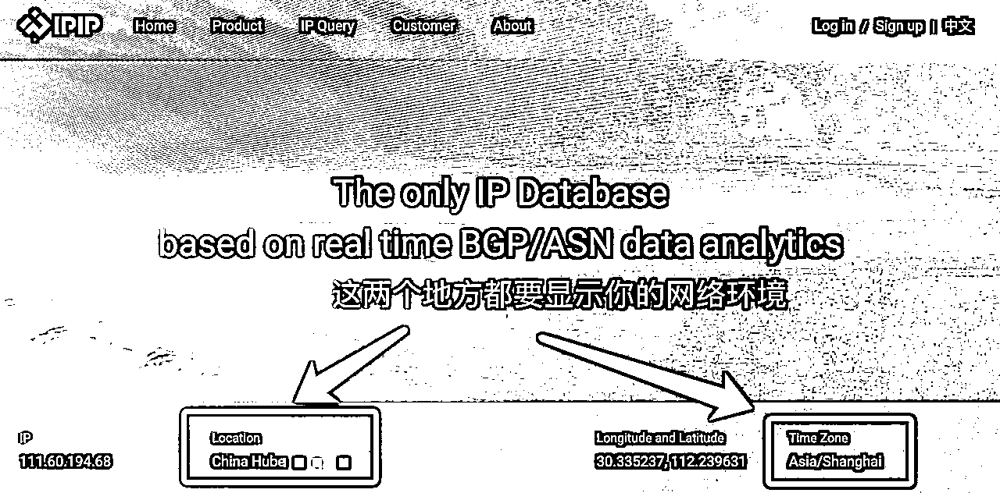

检查无误后，后续登录就把网络固定在海外。多说一句：每次开播前记得瞧一眼代理客户端是否在线，手机一旦没电重启，它经常会自动退出。

走完这套流程，恭喜你，已经赢了一半！🎉

## 二、养号阶段

养号的本质，就是把自己伪装成一个普通的美国用户。如果是自己发视频，就踩准定位、选题、拍摄、剪辑这套常规动作。

会混剪的话，推进速度能快不少：原创比例能到40%，或者把混剪素材的查重率压住，跑出爆款的概率很高。

我自己有原创内容，所以走了一条更难但正确的路。这个账号先后经历过三种状态：

### 2.1 播放量只有几次

注册后的头几天，我发的一水儿都是原创，播放量低到让我怀疑号被监控了。推荐页里刷到的全是“教你配代理”之类的视频，看着特别无语。

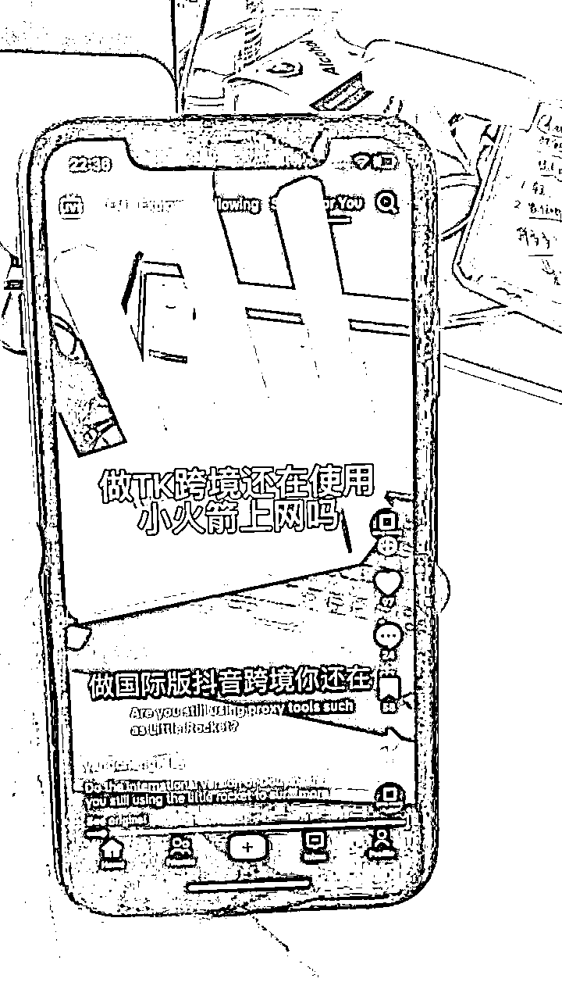

后来找原因，发现了三个容易忽略的细节：

① TikTok 的实时活动权限必须关，后台 App 刷新也一起关掉；

② 屏幕使用时间设置里，只留下照片、麦克风这两个权限，其余全去掉；

③ 系统自带天气应用一直显示北京天气，直接删掉。

这三步做完，播放量从寥寥几次、十几个，慢慢爬到了100多、200多。之前那些“教你搭网络”的视频也没再出现，号正式步入正轨。

### 2.2 播放量冲到500

持续更新之后，数据一直卡在几十到两百来次之间。我也不搬运、不混剪，就硬发原创。大约坚持了一到两周，流量偶尔能上300。我问了下行内人，他说这只是及格线。

中间因为耐不住性子，断更了差不多一周。回来再发，数据又跌到几次点击。这打击挺大，但我只能继续干。保持日更三条，没多久就有视频破500了。

这个500，我当成是对“不放弃”的奖励。

### 2.3 播放量过千，账号稳定

破500之后我开始复盘：那条视频到底赢在哪？我的品类是轻奢饰品，那件单品恰好是紫色系。于是我又拍了一条同样的紫色款，数据直接翻倍。

后来发现，同样的方法套到别的紫色上不一定灵。我开始试其他颜色，结论是：彩色比白色更吃香，至少在珠宝这一类里如此。

到这一步，我学会了延续爆款元素。账号也稳定下来了——播放量能过1000，基本说明权重没问题。

养号经验三条：

① 给自己一到两周的耐心，坚持更新别急着看反馈；

② 每一条数据都要复盘，把验证过的元素沉淀下来；

③ 每天抽半小时刷同类内容培养网感，看到对口的视频刻意多看一会儿，再进主页逛逛，像一个普通用户那样互动。

## 三、直播怎么做

账号稳下来后，我第一件事不是开通小店，而是先开播。小店要500美元押金，前期不太想花这笔钱。直播的好处是能把人引到自己的站点去成交，也可以慢慢沉淀进海外私域——这和国内的🛰️生态玩法很像。我先把直播讲透，再说站点和私域。

### 3.1 开播门槛

#### 3.1.1 个人号怎么开播

普通账号现阶段要1000粉。出过爆款的话，凑粉很快；没有爆款也没关系，可以直接买粉。闲鱼上现在15到50元就能买1000粉，非常便宜，能快速解决门槛问题。

#### 3.1.2 企业号怎么开播

企业号完成认证之后，0粉就能开播。

申请企业号需要企业类型的主体资质，个体户不符合条件。没有执照的话，可以找代办服务，价格视地区而定，几百到两千都算正常。像我在武汉，第一年花了1500，地址费用免掉，供参考。

### 3.2 直播前的准备

#### 3.2.1 需要哪些设备

拿到开播权限后，入口和抖音平台差不多：点中间+号，右下角就能看到 LIVE。可以先简单试播几秒，让系统确认你有播的意向，过几天正式权限就放开了。

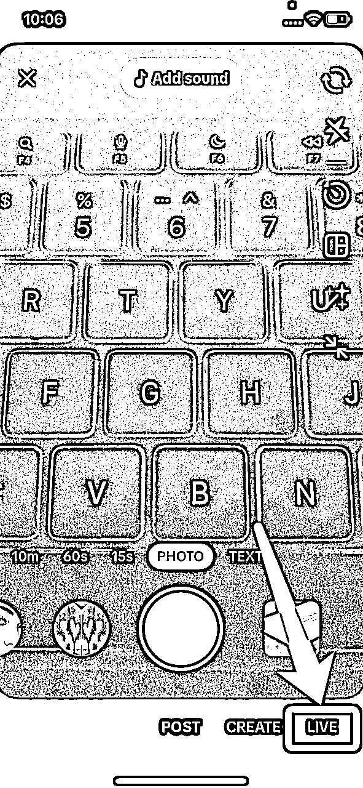

设备清单很轻：一个手机支架、要卖的东西、一盏补光灯（几十到几百都有）。

有人在直播间问怎么买，就让他去主页看——主页提前放好 WhatsApp 联系方式和你自己的站点链接。整个成交链路几乎零成本，如下图所示。

#### 3.2.2 英语不好能播吗

先说结论：英语流利确实有优势，但不会英语也有办法开局。

我刷直播间的时候发现，里面至少一半主播是咱们国内老乡，带着中文口音的英文照样能和观众交流。还有印度面孔、美国老人等，什么风格都有。美国本来就是不同族裔混着生活的地方，别太担心口音问题，关键是你敢开口。

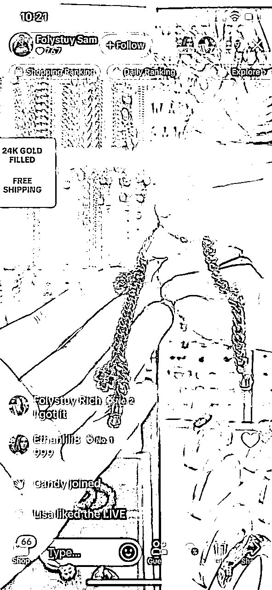

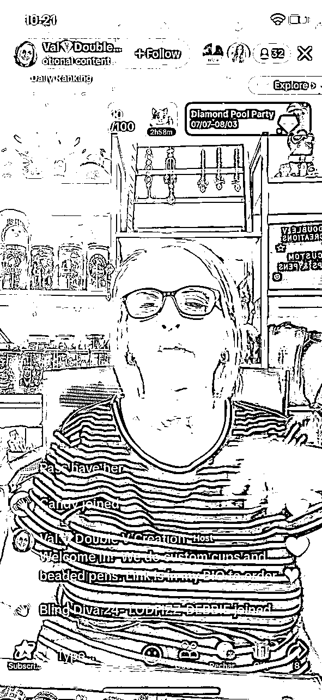

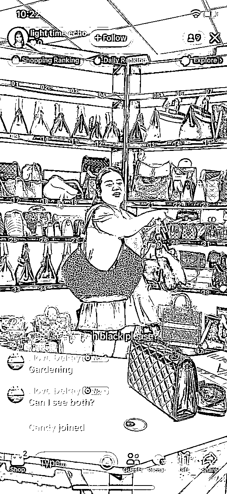

我英语撑死也就是四级水平，照样开了第一场。首场只播了17分钟，开场没多久说了一个词，被限流了10分钟。那一场总共进15个人、留下3条评论。这至少说明观众听懂了我在说什么，流量也没有想象中那么寒酸。于是我又播了第二场，虽然时间也不长。

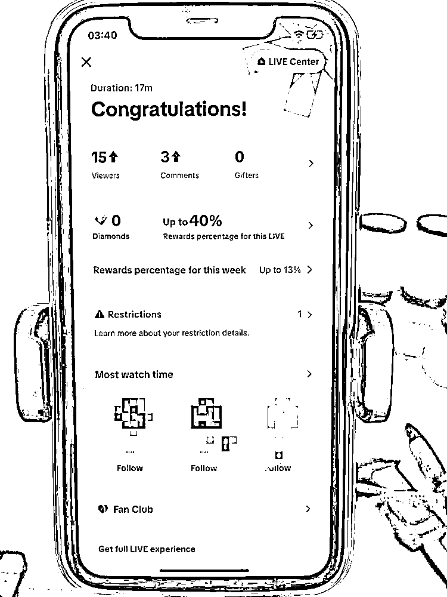

### 3.3 直播如何变现

#### 3.3.1 快速搭一个自己的站

直播间里，我引导用户去自建站下单。为什么不用别的承接方式？

刚开始我只是在 TikTok 发产品视频，结果有天真的有人问“这个怎么买”，可我当时连小店都还没开。于是我临时起意，用一个晚上搭好了独立站点给他看。那人最终没买，但“不靠店铺也能完成卖货”这条链路，从那时起算是验证通过了。

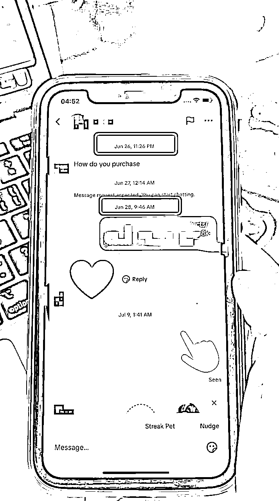

建站选 Shopify 还是 WordPress？这位“AI顾问”给出了对比，见下。

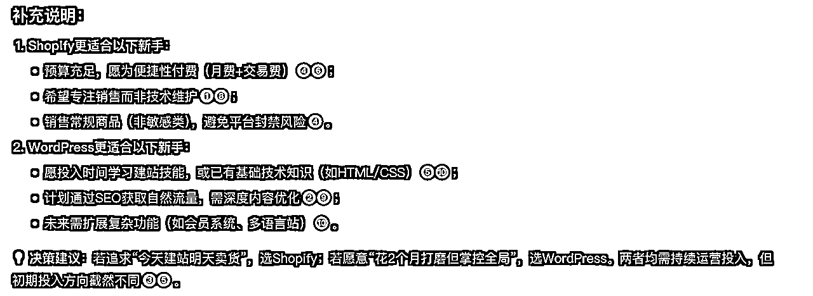

我自己用的 Shopify，核心原因就是省事：像填表一样写完所有信息就上线了。我一个设计师，两天就把雏形搭好，普通玩家只会更快。具体教程花几块钱就能买到，我就不展开讲了，重点分享实际心得。

#### 3.3.2 把海外用户接进私域

国外私域跟国内类似，主要是 WhatsApp、自建站、邮件订阅、Facebook 群组这些渠道。我在 TikTok 主页把站和 WhatsApp 都挂上了，这是目前最常见的一套组合。

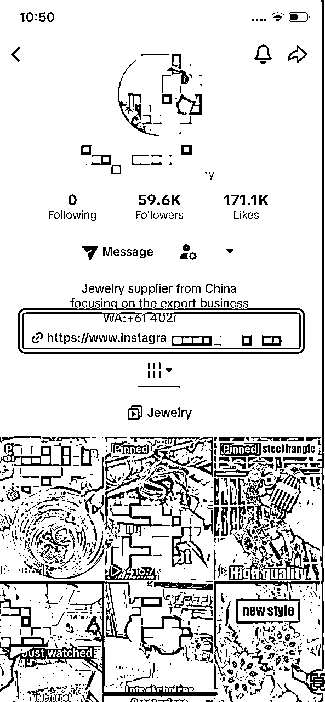

现阶段 TikTok 对私域导流不像国内那么严防，但个人简介里放链接有一个硬条件——账号要满1000粉，和直播门槛是一样的。

#### 3.3.3 两种直播玩法

① 店铺直播：开通小店、上架货品、挂上购物车，直播时直接开卖，这是大部分商家在用的方式。

② 裸播：不依赖小店，也不挂购物车（有时候挂车只是为了吃平台给的流量加权）。有人问怎么买，就回一句“see my bio”，让他们去主页自己下单。

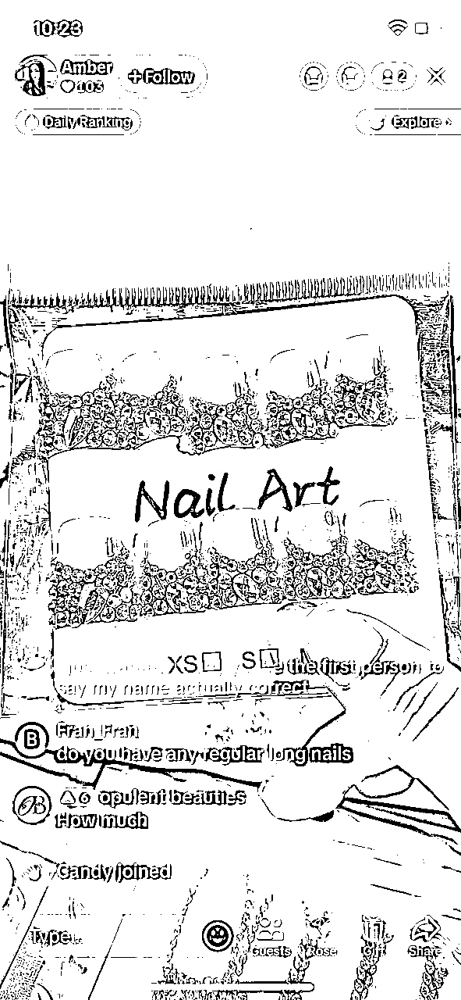

裸播还能配合手写纸板做营销，比如写“$30 free shipping”，说明满30美元包邮，这类玩法很多。

我就是用这套打法，在7月19日凌晨00:21拿下了首单。

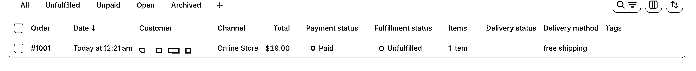

至于天花板，完全看自己。我认识一个全职带娃的姐妹，裸播了一个多月才开张，三个月后每月的利润已经到一万多元人民币了。一边带娃一边赚这个数，相当可以。我也在设想，三个月后能不能做到她这个水平。

#### 3.3.4 自发货的物流怎么做

裸播需要自己搞定物流，所以要对接货代。顺丰能做国际件，但价格太吓人——一条饰品寄出去要500多人民币。刚起步的小体量玩家，更适合找专门做跨境运输的服务商，很多还能上门收货。DeepSeek 给新人的建议，我放在下面：

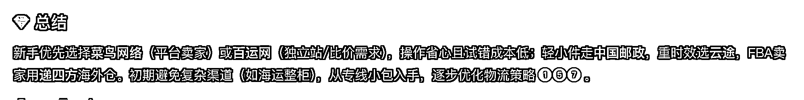

也可以主动问问身边的人，有没有合作过靠谱的物流资源。

关于丢件：跨境运输出现包裹遗失的概率是存在的，通常货代会按货值赔付；同时也可以和买家协商补寄。这块经验是我从货代那里问到的。

关于退货：我的建议是前期尽量不接受退换。提前把规则写明，比如站点政策里注明：下单后5天内发出，预计15到21天送达，非质量问题不退换。如果你有海外库存的条件，能做到3天到货，订单转化自然会更好。

#### 3.3.5 钱怎么提现

最省事的方案就是注册 PayPal：https://www.paypal.com

Shopify 默认用 PayPal 收款，手续费约2%。注册时需要提交工商资质，个人或公司主体都可以，收到的款项能转回自己的私人银行账户。审核周期大概一周，记得预留时间。截图如下。

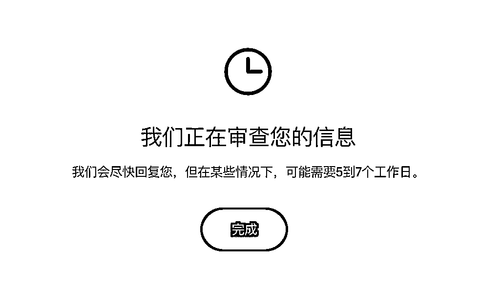

审核通过会有短信提醒，见下。

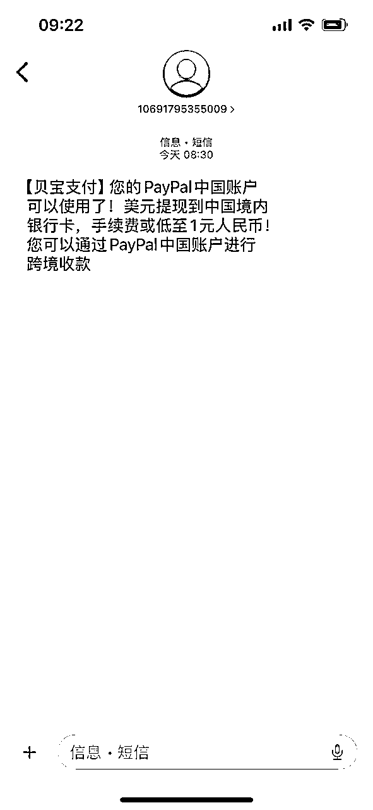

再补充一个小插曲：我的新账号注册完没几天，就被系统误判并永久封禁。反正号里也没钱，所以并不慌。联系客服后确认是系统误判，可以走人工申诉。只要你自身没有违规行为，大概率都能找回。没过几天，客服就给我恢复了。

## 四、小店模式能带来什么

### 4.1 为什么值得开一家小店

很多人关心：用国内账号做TikTok，到底值不值得？先说好处——账号不容易出问题，平台还会给到一定的流量倾斜。如果你本来就有自己的产品，那闭环会非常短，从展示到成交的转化率也更高。

当然，门槛也很明确：入驻需要缴纳500美金的押金，如果你用支付宝，会额外收手续费，实际支付约505美金。我个人建议是，新手还没搞懂TikTok的玩法和节奏之前，不必急着开小店；但如果你有供应链优势、资金也充足，直接开也没问题。

那怎么开通TikTok小店？直接访问官网 https://seller.tiktokglobalshop.com 注册就行。注意，后续运营一定要用电脑，手机操作不起来。

有几个提醒很重要：

第一，先想清楚你要做的店铺类型和大方向，然后把对应的资质材料提前备好。

第二，材料齐了也别马上去注册。先做两件事：一是认真学选品，二是把具体的产品和价格体系定下来。之后再开店。

为什么不建议一上来就注册？因为店铺开好之后，如果长期不运营、不上架商品，会触发平台的风控，轻则限流，重则封店。到时候申诉解封流程特别麻烦，得不偿失。

注册需要准备的东西如下：

① 一个国内手机号（注意，不能绑定过任何TK店铺）；

② 一个邮箱（同样，之前没注册过店铺的那种）；

③ 公司主体资料：要么是中国大陆的企业营业执照（注册满14天），要么是香港公司的商业登记证或注册证书；

④ 法人的身份证件，身份证或护照都行；

⑤ 法人本人还要做人脸识别验证。

注册时用国内网络就可以搞定，但通过审核之后，要“🪜”去美区操作。

接下来是货源问题。小店卖货有两种方式：一种是找海外一件代发平台，另一种是自己租海外仓。

先说说代发平台，市面上选择很多。比如专注美妆品类的西之月（https://westmonth.com/）。使用逻辑很简单：把你店铺授权绑定到代发平台系统，然后可以去它的网站上选品，出单后由它们直接代发。你只需要专心做TikTok视频，或者找达人合作带货就行了。

除了西之月，还有优速卖（https://www.ushopfy.cn/）这类平台，大家完全可以自己慢慢找，找到适合自己的货盘就好。目前这些海外代发平台的服务水平，也在不断向国内看齐。

至于自有海外仓，玩起来就重了：要海关备案、租仓库、部署系统、头程发货……这一套操作基本是大卖家的专属，新手就别碰了，坦白讲风险不小。

还有朋友问：能不能直接从国内发货？问题是TikTok小店有发货时效限制——跨境店铺要求3个工作日内发货，7个工作日内要揽收。从国内发，时间很容易卡不住。所以最稳妥的办法，还是从美国本土发货。

最后做个总结。我这次用“略微有自媒体经验”的视角，完整走了一遍从0到1的跨境生意，核心就是：把已有的内容能力，嫁接到海外TikTok的变现链路里。

对新手最友好的低成本玩法，其实就两条：

1. 做TikTok自然流直播，用独立站承接成交；有了订单再从国内发货，完全不用囤货。哪怕这种玩法可能活不长，也没关系。

2. 找海外代发平台，挑TikTok上的爆款，通过直播或者发带货笔记去推广，也是零库存模式，出单就能赚。

底层逻辑说白了，就是吃平台红利。

如果文章里有哪些地方没讲透，大家可以联系鱼丸找到我，或者在帖子里留言，我会慢慢补上。目前关于TikTok还有两块我在持续研究：一是直播效果怎么优化，二是达人该怎么建联。我自己越做越觉得，达人合作本质上就是在帮自己搭建分销网络，简直太值了。先干起来，再一点点完善吧☺️！