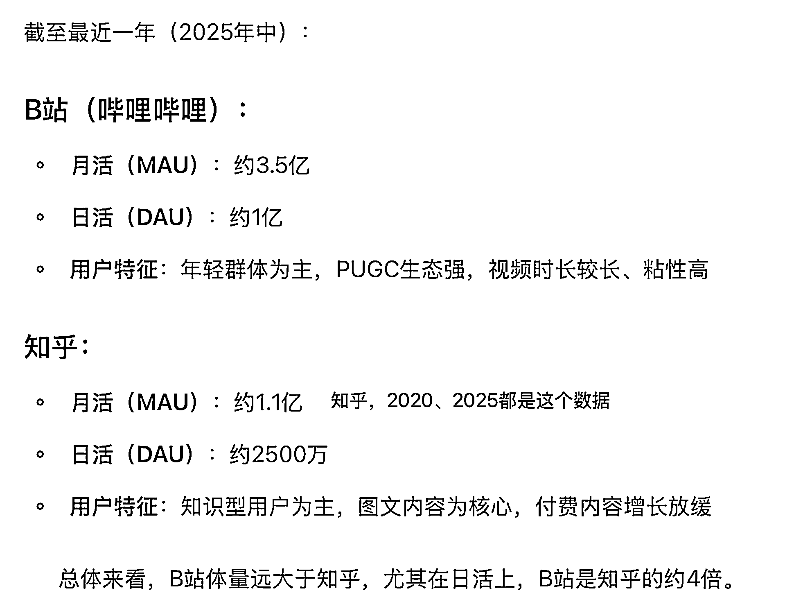
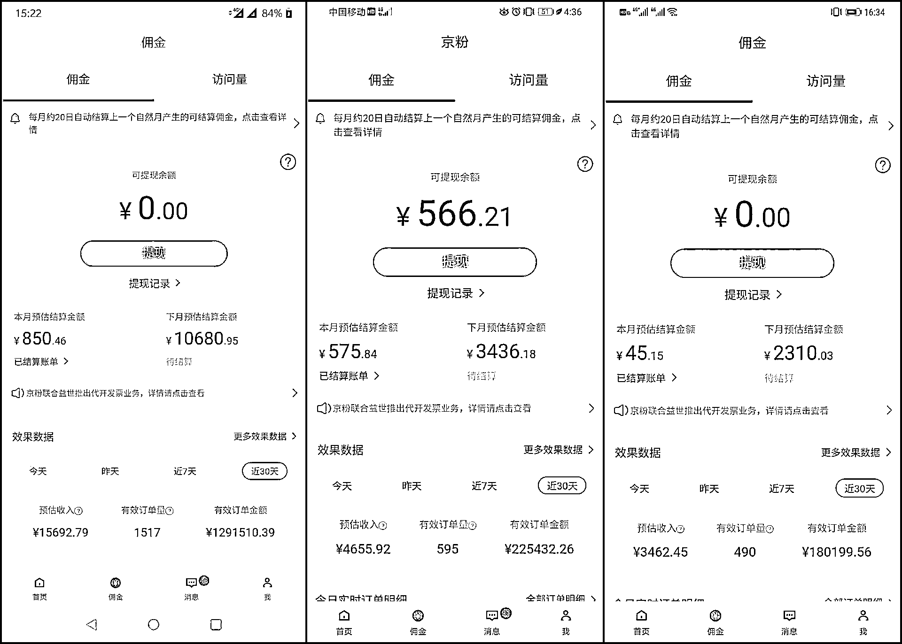
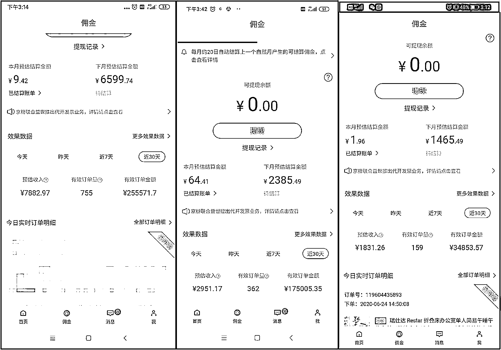
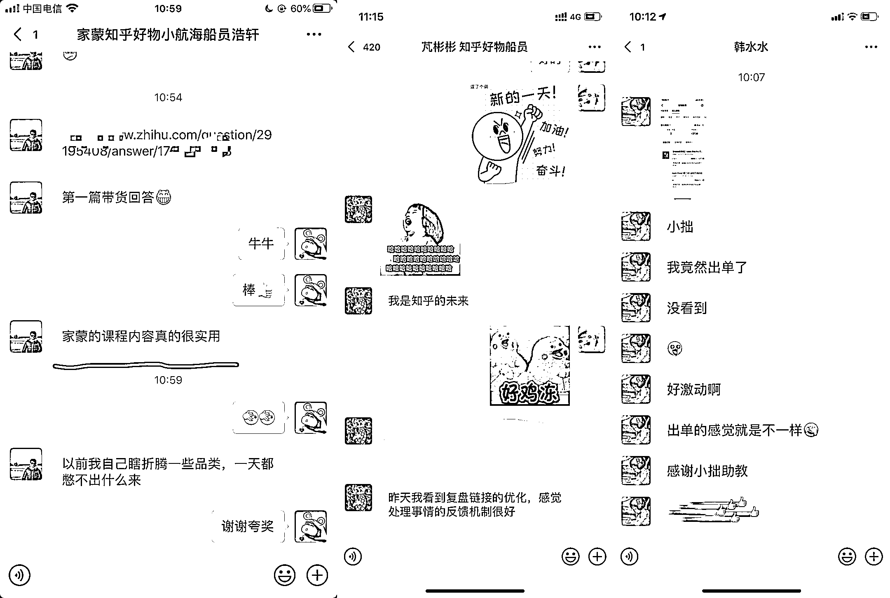
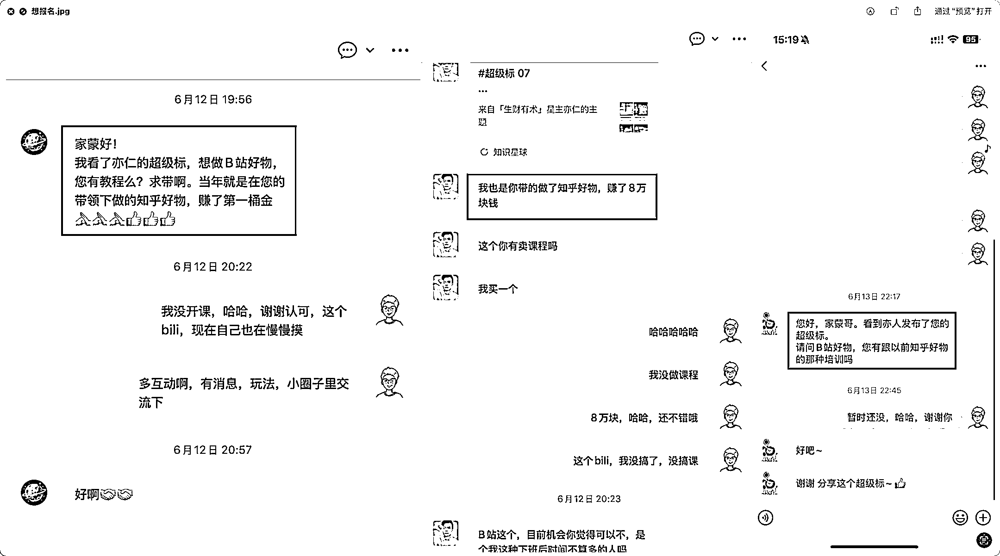

# ('(精华帖)(246 赞)B 站好物能挣多少钱？项目机会拆解', (2, 31))

聊个实在话题：B站好物带货，到底能赚多少？

最近风向标一出，后台涌来好多朋友的提问。有人觉得这项目门槛高，不知从哪下手；也有人已经下场，陆续拿到了小正反馈。视频带货听着不稀奇，但它凭什么值得关注？我结合自己的实操经验，跟大家掏心窝子聊聊。

先看一组平台数据。B站官方带货榜每月大约有150人上榜，门槛是带货金额破百万；其中前15到20名，能冲到千万级别。别被数字唬住——大额带货的佣金比例其实不高，千万规模大概只有1%到1.5%，也就是10到15万；百万规模能拿到3%到5%，折算下来3到5万。

注意，这只是佣金。账号做成熟后，每个月还有广告商单的收入，也就是大家常说的“恰饭”。报价从几千到几万不等，看制作水平。按我们的经验，广告收入往往比佣金还高。

但这里面有个关键点：这些钱是营收，不是利润。团队作战要发工资、租场地，十万块能不能覆盖成本，真不好说。一个人干的话，几乎没成本，到手基本就是纯赚。我身边靠带货佣金月入1到2万的朋友，真不少。更高的也有，一个月十几二十万的见过，团队做到百万月营收的也听说过。

说这些不是为了劝退，而是想告诉大家四个字：这行有戏。新手别把目标定太高，普通人每个月多赚两三千，就已经非常棒了。

再说平台容量。拿五年前的知乎好物做参照吧。

那时候知乎项目火到什么程度？培训班开了一期又一期，光学员保守估计就有5000到8000人。我自己的第一个一百万净利润，就是知乎给的。而现在呢？B站体量是知乎的四倍，但市面上做B站带货培训的社群少得可怜。一个大得多的池子，游进来的鱼却不多——你说这是不是红利？

接下来聊聊真实性。五年前我和赚钱有术合作开过知乎培训班，成绩不错，帮不少朋友赚到了钱。截图我还留着。

夸我的截图能装满一整个文件夹，就不放出来害羞了。

所以当赚钱发布B站超级风向标后，很多老朋友直接来问我：家蒙，有没有像当年知乎那样的B站课？我第一反应是——没打算开课。

后来跟赚钱的伙伴深聊，他们把专业的事接过去，我专注业务和教学本身。有了他们的支持，课程才一步步打磨出来。B站好物和知乎好物的底层逻辑没变，变的是平台和内容形态。一点点小门槛，挡掉了很多竞争者，也就释放了竞争压力——红利就是这么来的。

所以，【深海圈｜B站好物】课程来了。8月14日正式发售，具体信息看赚钱官方帖。

很多人问：为什么是现在？

因为我们是第一批把B站带货信息分享出来的人，自己实操了快一年，拿到了真实结果。用一线经验判断，B站带货正处在红利释放期，非常适合新人入场。时机对，这是最重要的理由。

我自己是去年双十一刚结束那天入场的——11月15日，糟糕透顶的时机。前期真的很苦，努力半天收效甚微。我当时给自己定了策略：先埋头干半年，等618收获。半年听起来长，做着做着就过去了，618确实拿到了不错的结果。

现在开始学习，一个月后正好九月中旬，是双十一备战的黄金期。很多人以为双十一是11月1日开始，但品牌方和创作者，至少提前一个月准备，到10月30日基本收尾等庆祝了。谈业务、做对接，都是9月和10月的事。现在学完，正好赶上第一波小高峰，正反馈来得快。

所以，我们懂业务，有成绩，也一直在公开表达。课程的系统性和教学能力，我们确实有底气，不是吹牛。你看我这篇文章能顺顺畅畅读下来，听我讲业务，也不会卡壳。

还有朋友问：B站有现成榜单，我照着模仿不就完了？为什么还要报课？

因为“知道”和“做到”之间，隔着一道巨大的执行鸿沟。榜单上的玩家，背后可能有团队、有多年经验、有专业设备和制作成本，甚至还有资方和对赌协议。你直接去模仿，很容易陷入自我怀疑：“怎么我怎么做都不像？”“做出来的东西像垃圾一样？”“成本这么高，这玩意真能赚钱吗？”

模仿和找对标，本身是有门道的。我们的课程主打真人露脸风格，这套系统的教学方法目前市面上没人做，是我们首创自研的。实在不想露脸，也有替代方案。

更重要的是，我们课件里的案例，大部分不是榜单上的高手账号。而是我们日常搜罗来的“小而美”账号，甚至有些做得很粗糙、水准一般，但成绩照样不错。这种案例对新手才真正有参考价值，上手成本低，反馈来得快。我们帮你筛好了适合新人的对标，让你避开坑，少走弯路。这些用时间换来的经验资产，就是课程的含金量。

我们不做花哨的PPT，也没有天天哄你的客服小助理，但不影响课程的含金量。准备课件时我们常说：学会做视频，是这堂课里最不值钱的部分。但做视频确实有门槛，持续做下去也很孤独。所以我们设计了一个月集中学习期，帮你一口气跨过门槛；再加五个月陪跑期，让大家随时交流。

B站UP主都很有个性，几乎没人把大家聚在一起交流，都是各自闷头做。希望赚钱的伙伴能抱团，一起开发工具、探索新思路，讨论平台规则和玩法，共享商单资源，把这里变成B站带货交流最专业、最有氛围的地方。

最后补充一点：我是一个公司的老板，同时也亲自上班。业务是主业，培训不是。集中培训的第一个月，我提前暂停了业务，腾出全部精力服务大家。结束后，我会和你们一样，继续回到业务第一线。

这门课由赚钱有术官方组织，只对圈友开放，首期限400人。我没有自己单独开班的打算，非赚钱圈友报不了名。想报名，得先加入赚钱有术社群。直接付费插班？关系再好也不行。

今天就聊到这儿。我是家蒙，下次见。