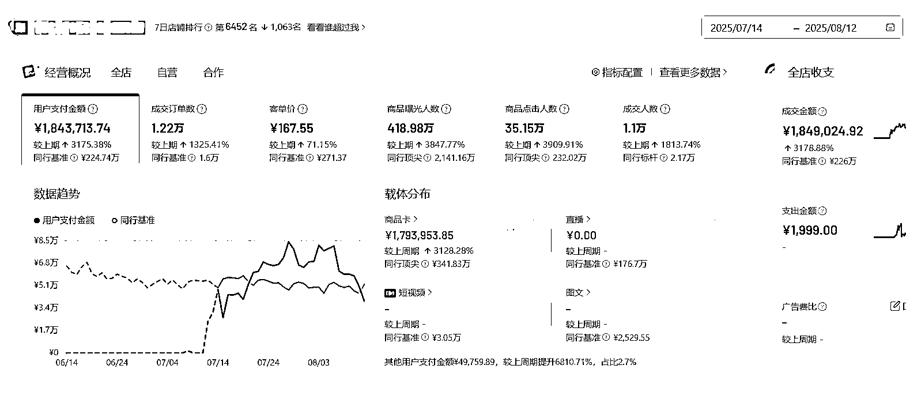
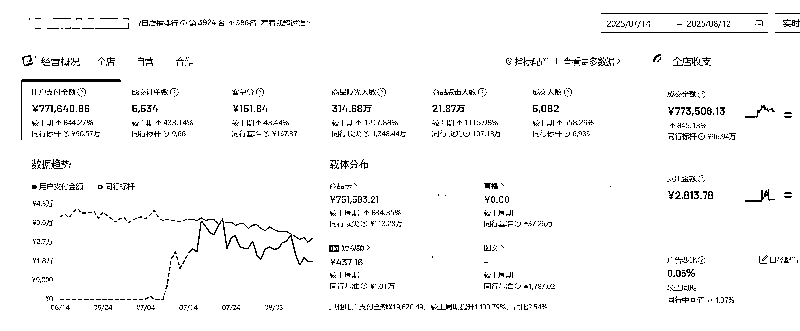
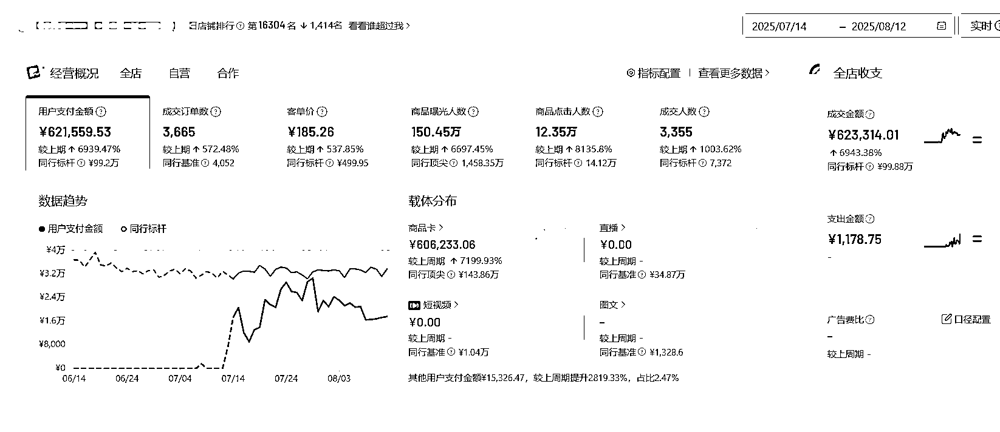

# 从亏掉 50 万到月销 184 万：一个抖音电商新人到熟手的真实翻身账本

> 原文：[`www.yuque.com/for_lazy/zhoubao/rumenwgh5h1fzigf`](https://www.yuque.com/for_lazy/zhoubao/rumenwgh5h1fzigf)

大家好，我是子贤，广州人。加入赚钱到现在正好 117 天，近期的重心全部放在抖音电商上，目前在做的品类主要是家居家具、女装以及百货杂货。

赚钱里关于抖音电商的干货分享其实不多，所以这次我把自己的踩坑经历整理成一篇尽量细的实操复盘。内容会围绕我个人从完全不懂的新手，三个月亏掉 50 万，到新店上线第一个月就冲到 180 万+ 营业额的整个过程展开，也会聊聊我对当下抖音电商的看法，最后附上一个可直接上手的基础开店方法论。

先上近期店铺的真实跑分情况，数据说话：

1 号店铺：

2 号店铺：

3 号店铺：

从截图能看出，这三家店都是七月才开始启动，截止到 8 月 12 日，表现最好的那家**月度营业额已经达到 184 万**，而且**短视频、直播、广告这三块的成交贡献为 0**。另外两家也都稳定在 60 万以上。值得一提的是，后续的日常运营全是运营助理按照我定的 SOP 在执行，并没有我亲自盯盘。

拿龙哥大佬的一句话概括：**数字可以存疑，但方法论是通的。**

这次复盘我拆成了 6 个板块：
1. 我是怎么入局抖音电商的，从小白到能上手的老手的心路变化
2. 关于当下流量天花板平台抖音的几个观察
3. 抖音商品卡这条路线的模式拆解
4. 新手开店的基础搭建及保姆级步骤
5. 开店首月是如何做到 184 万营业额的
6. 项目收尾总结与风险点

全文约 4.2k 字，完整版已整理在飞书文档：
[`mq5iejby4xc.feishu.cn/wiki/ZIR6wEHmui1KTDk28V7c7BU7nSb?from=from_copylink`](https://mq5iejby4xc.feishu.cn/wiki/ZIR6wEHmui1KTDk28V7c7BU7nSb?from=from_copylink)

* * *

评论区互动补充：

百哥 : 投放成本有算进去吗？
子贤 : 这家店是完全零投放的。

百哥 : 那利润空间确实很可观

智沁💧 : 一次性上架这么多品，用的是什么工具啊[流泪]
H.Y.C : 货源是走中转仓吗？
子贤 : 用的主要是智能店长、一刻工具箱这类。
子贤 : 中转仓现在已经不用了，费用太高而且超时赔付压力很大。

大雷 : 如果是去别的平台采集下单，物流单号是怎么回填上去的呢？