# 从零起步学AI的公开养成记：无代码背景，我是怎么一路实操把AI变现、做产品的？

> 来源：[https://shengcaiyoushu01.feishu.cn/docx/Gbj5dHks7oUcoxxzX3RcDHIYnig](https://shengcaiyoushu01.feishu.cn/docx/Gbj5dHks7oUcoxxzX3RcDHIYnig)

大家好，我是赚钱内容负责人七天，也给自己起了个外号叫学习AI练习生七天可AI多。很久没有复盘自己的AI学习日常了。

最近整理从4月份开始操盘AI传术师俱乐部的经历，回头一看，这一路正好就是我从AI小白到能动手做东西的成长线。接下这个活的时候我挺忐忑的，怕自己水平不够，站不到和一帮AI高手对话的台面上。

直到上周二，我亲手跑出了第一个网页，那是html。朋友圈一发出，点赞炸了，说实话那种成就感真的太强烈了。

先放一下效果给大家看看：

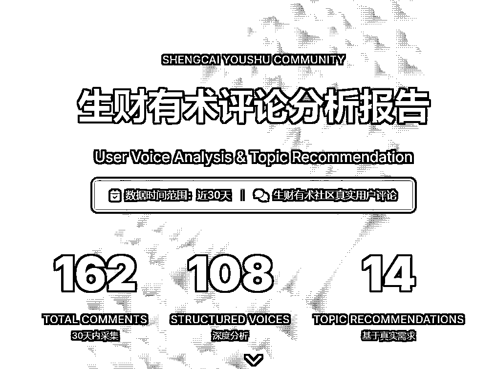

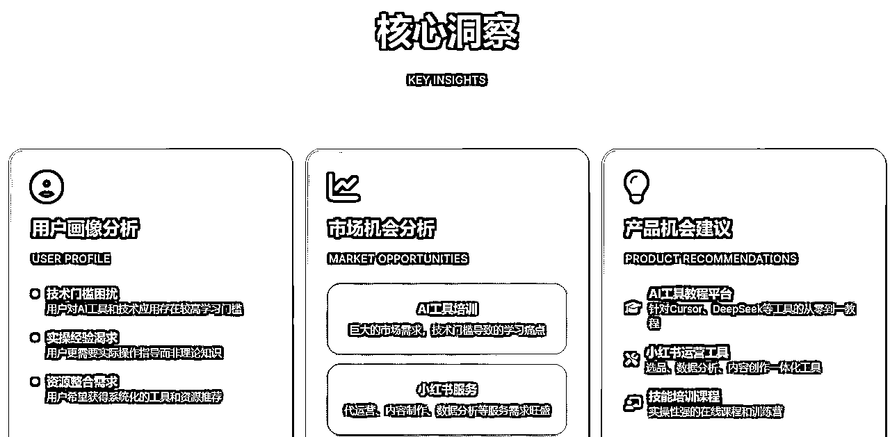

当然现在还有很多AI名词我压根没搞明白。下载cursor的时候我就问IDE到底是什么，dhj只回我一句别管定义，你只要知道里面能跑claude code就行。

所以我的学习方式很粗暴：边学边问边上手边懵。一边怀疑一边推进。

实践下来发现，你真的不需要全盘吃透，有啥不会直接丢给AI问就行了。

我问技术怎么部署网站，回答是去问AI，然后就在gpt窗口里一步步演示怎么问。

我问社群伙伴怎么搭个页面，他说直接让AI给你做。

这一路最大的认知转变是：AI不是你手里的工具，它是你的老师。正如小排老师说的，不是遇到难题才问AI，而是凡事都问AI。

我的学习套路也很简单：找个师傅抱大腿。办公室的知行和瓜斯，SCAI实验室的dhj、大潘，都是我常找的人。实在找不到线下人，赚钱线上资源也很多。

下面把我的时间线摊开，给同样零基础的人一个从不懂到产出第一件作品的参考。

核心前提我先说在前面：心力卡点一旦冲破，后面技术问题基本都能被解决。

*   2月初开始琢磨个人业务怎么和AI结合，自己没技术没产品背景，看到盖哥在做AI赋能IP，就萌生了做一个养成系社群的想法，把自己看到的AI信息差公开分享出来。当时能提供的价值也就是赚钱的AI情报差。

*   2月中旬上线了一个AI+IP成长社群，150人加入，19.9/月，199/年，首个AI相关业务变现7000+。

*   3月份这份文档被欢欢和龙哥看到并放大，我也顺势拿到了航海教练的身份。

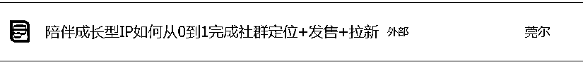

*   3月31日参加航海家大会，包子老师的AI+IP案例给我很大冲击，也在会上分享了我对AI的思考：https://scys.com/articleDetail/xq_topic/5125212112141854

*   4月2日正式启动AI传术师俱乐部的招募，在即刻和公众号拉了几十位AI高手进群。

*   5月18日上了包子老师两天的课，第一次用RPA抓取小红书资讯，也第一次用coze搭出了一个工作流。

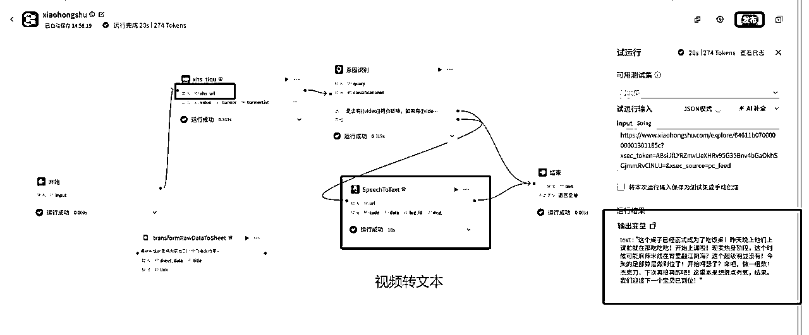

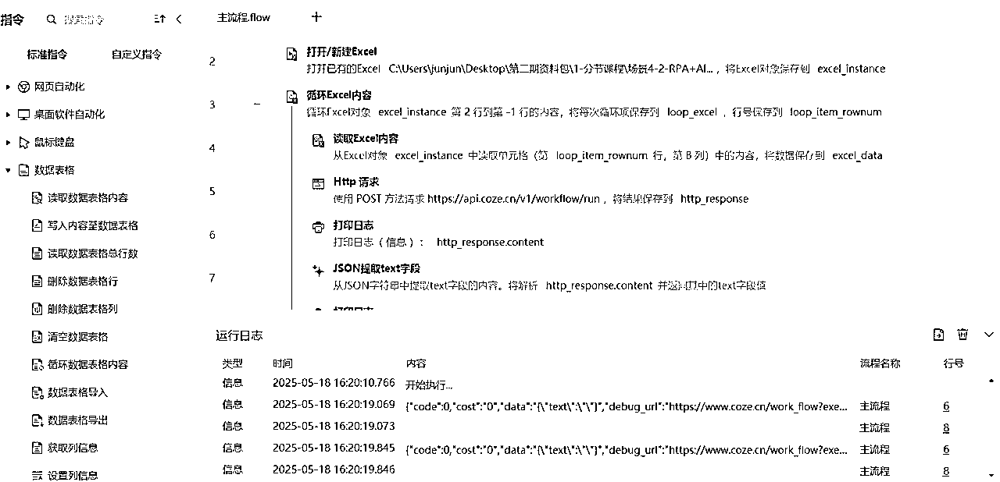

*   5月到6月主要在做赚钱内容的评选标准沉淀，梳理了公众号、精华帖、朋友圈的评选规范，并在gpt上跑通了精华帖筛选流程。团队现在也用这套文档给gpt投喂做辅助评选了。

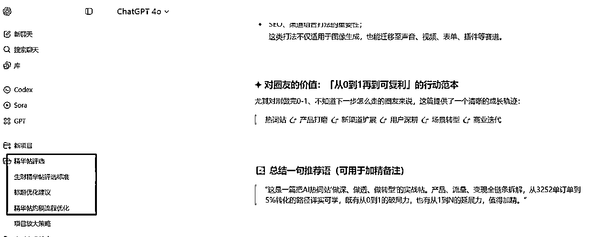

*   7月5日参加大树组局，miniko分享线下AI自媒体实操航海，我跟着复现了飞书多维表格+monica做批量文案生成，再投喂到monica做智能体。

*   7月7日看了公司社群的10分钟编程，用自然语言试做了一款内容分发系统，做出来效果还不错。

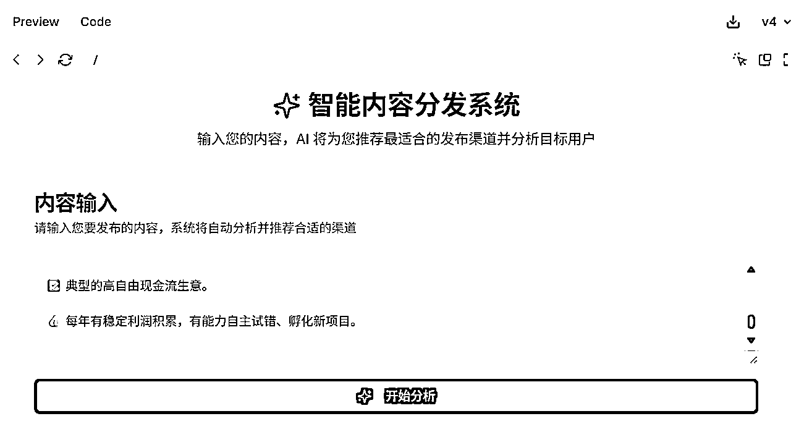

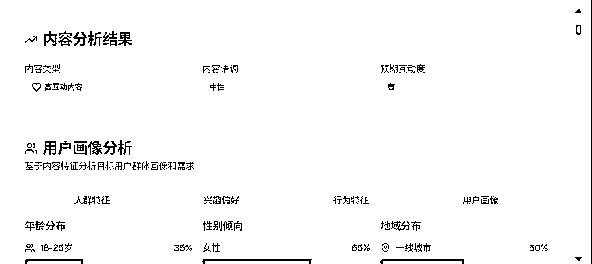

*   周末尝试装cursor，完全不会装，一个圈友远程教我用终端启动claude code，完全看不懂指令，让我复制啥就复制啥，最后觉得太复杂放弃了。

*   上周也就是7月15日前后，AI传术师社群里claude code的分享刷屏，加上小排老师的内容，我才鼓起勇气注册谷歌账号、注册cursor、注册claude，在野卡的几天里连着付费，开始在cursor里用claude。公司刚好开放API接口，我就试着抓取评论区有效内容生成用户原声和洞察。

*   在瓜斯、知行以及SCAI实验室@dhj @大潘 的协助下，我完成了第一个页面的生成，成果如下：

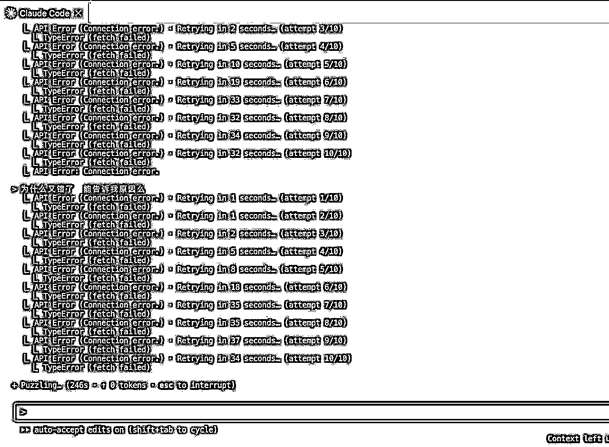

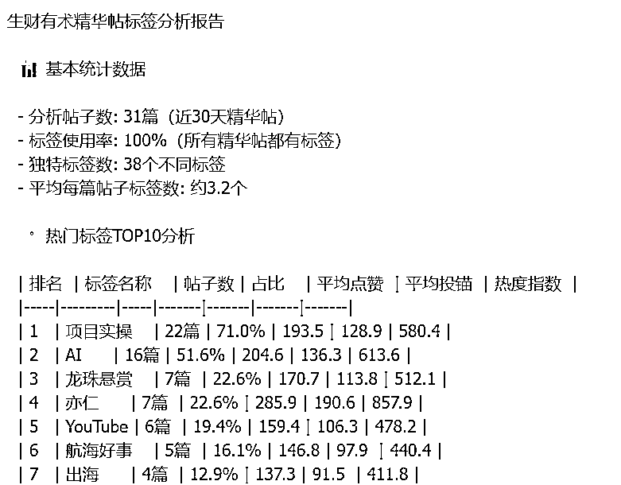

再看下一步的进展对比：

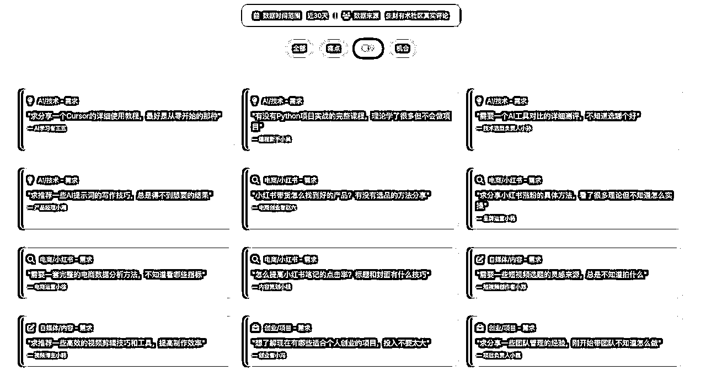

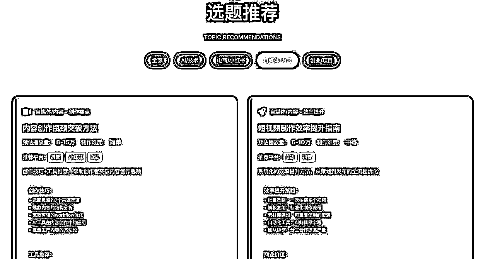

这次网页生成的代码是同事瓜斯给我的：

```
1\. 使用Bento Grid风格的视觉设计，纯黑色底配合亮橙色颜色作为高亮
2.强调超大字体或数字突出核心要点，点，与小元素的比例形成反差
3\. 中英文混用，中文大字体粗体，英文小字作为点缀
4.简洁的勾线图形化作为数据可视化或者配图元素
5.运用高亮色自身透明度渐变制造科技感，但是不同高亮色不要互相渐变
6.模仿 apple 官网的动效，向下滚动鼠标配合动效
7.数据可以引用在线的图表组件，样式需要跟主题一致
8.使用 Framer Motion (通过CDN引入)
9.使用HTML5、Tailwindcss 3.0+(通过CDN引入)和必要的JavaScript
10.使用专业图标库如Font Awesome或Material Icons(通过CDN引入)
11.避免使用emoji作为主要图标
12.不要省略内容要点
```

## 怎么破学AI的心力卡点

1. 最容易卡在装梯子和装软件。第一次一个人装梯子花了2小时，有教程也繁琐。但只要迈过这一步，后面会顺很多。

2. 心魔是第一道坎。难的不是能力不足，而是你不相信自己能行。

3. 想快速获得正反馈，就要轻量化启动，比如用vo或者same.new先生成一个网页。需要教程可以找我要。

4. 找个学习搭子。我学AI期间同时开过十几个聊天窗口，专门记录卡点和求助问题，搭子多一份坚持的动力。

5. 找榜样。身边长出来的榜样最有力量。我有三个。
第一个是龙哥，他大概演示过4.5次用gpt做策略、用claude code呈现功能页面。亲眼看到用“说人话”就能解决问题，反差感极强。老板一旦看清AI边界，你要么快速学习，要么被AI渗透率淘汰。

第二个是林悦己。去年传术师见面会认识她，到她加入SCAI的三个月里几乎没约过饭，因为她一直在debug写内容优化。后来聊了她的三个月编程历程，我才意识到，连一个零基础的女生都能做到，我为什么不能试试。不是非要做到，但我想知道“我可以”是什么感觉。

第三个是大树。他从零做AI访谈，采访对象里有好多和我一样没资源没技术的人，大家抓住了AI红利，敢下场弄脏手，反复试错优化，最终拿到正反馈。

他在采访gary的文章里说过：每次聊AI我们都特别亢奋，这是我们这一代人遇到的最大机会。旧秩序被重构，“必须名校必须资源必须大厂背书”的路径正在被AI打破。过去十年打怪才能拿到的结果，现在几个月就能触到。从零开始，只要跑得快一点抓得准一点，结果就能出来。这不是我们多厉害，是时代给了普通人一次弯道超车的机会。

看到身边这么多0到1，你内心只会想：我做了肯定也行。

## 如何在学AI的过程中顺便build in public

Build in public这个思路是我从花生那里学到的。做AI社群时我就持续把社群里的优质信息同步到朋友圈和即刻。核心逻辑是：你做产品的全过程向公众开放，让大家关注甚至参与，这样过程透明的同时也在积累关注度和信任，为产品上线积累种子用户。

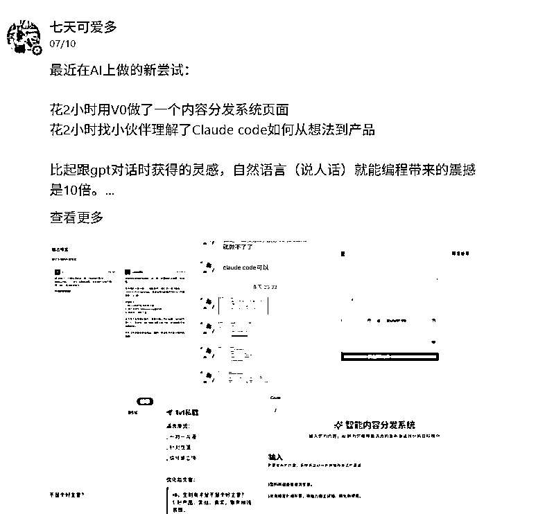

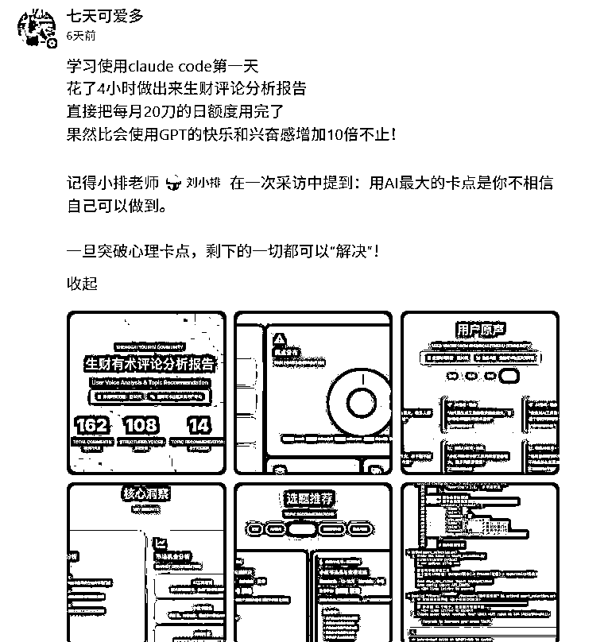

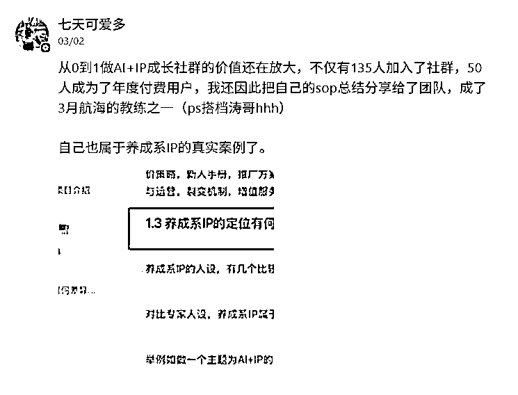

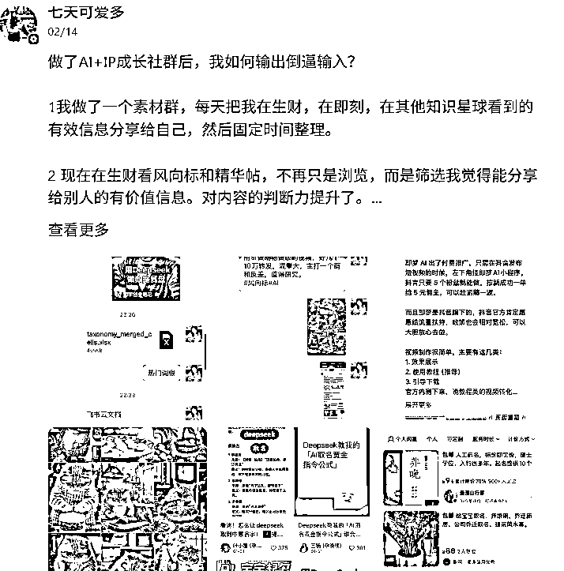

我总结的几个心得：

1. 持续输出经验。让大家感受到你一边做业务一边复盘心得，并邀请他们当你的“云股东”。

2. 公开业务进展。让围观的人看到你被认可、做出成果的过程，撬动观望者加入社群或关注你的内容，他们会相信“七天确实在认真研究AI”。

3. Build in public的本质不是炫耀，而是保持开放，遇见同路人。

4. 对帮助过你的人公开致谢，这也侧面证明了对方对你的认可。

写这些不是为了证明我多努力，而是想告诉你：一个完全不懂技术的人，只要愿意试，就能把AI用起来、把产品做出来、打开自己的可能性。

我不是准备好了才出发，而是出发了才准备好。

下一个从0到1的，可能就是你。

你不需要一次性掌握所有AI技能，只需要迈出第一步。

要不要试试做出你人生第一个网页，或者生成你第一个AI小工具？

如果你也想试，欢迎在评论区留言。

我不是专家，但我清楚从“什么都不懂”到“做出第一个东西”这条路怎么走。