# 3 天、20 万字长谈，我把完整的自己交给了 AI，换回一份 6 万字的深度剖析报告

> 来源：[https://wgpt6awo7z.feishu.cn/docx/KPAzd04U1oT3ezxE936c7swpnpc](https://wgpt6awo7z.feishu.cn/docx/KPAzd04U1oT3ezxE936c7swpnpc)

一套拿来就能用的提问体系，帮你借 AI 之力完成一次彻底的自我审视，并由此锚定个人成长的具体航向。

我用了整整 3 天，与 AI 完成了超过 20 万字的密集交流，相当于给自己动了一场大型认知手术。在反复删改与聚焦之后，我拿到了一份 6 万字的个人深度剖析报告，以及一份专门针对未来发展路径的避坑提示。

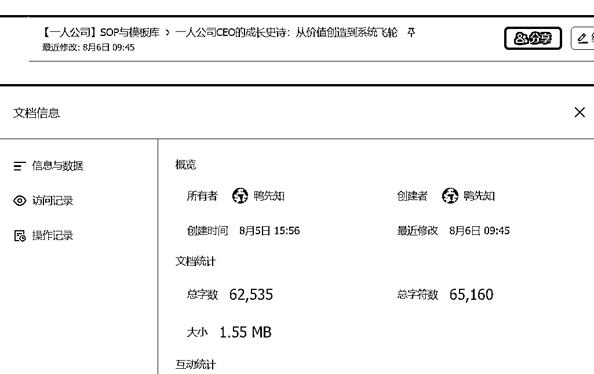

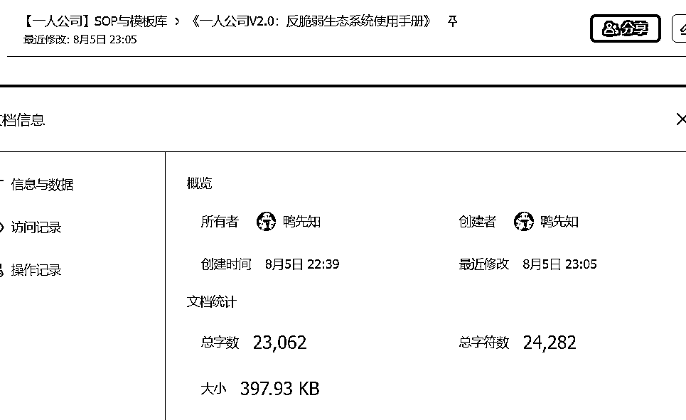

我得到的，绝不仅仅是一份静态的自我说明，而是一套只服从于我个人意志的、能直接运转的人生决策系统。

接下来，我会把整段经历和盘托出，让你看到我是怎样靠着一连串精心设计的提问，把 AI 变成发现自我的镜子，并从中提炼出一套人人皆可复用的定位方法。

*   战略层面，我信守“见路不走”。 我会向你证明，我是如何避开所有摆在明面上的“标准答案”，亲手搭建起一个带有反脆弱结构的“一人公司”专属模型。


*   效率层面，我引入“时间折叠”的理念。 我会分享自己怎样从“边学边赚”起步，最终跑通“一鱼六吃”的完整链路。


这篇文章，就是我完成这次自我认知升级的全过程实录。

你会在其中学会如何挑选趁手的大模型、怎样把它调教成贴身私人教练，以及最终如何找到属于你自己的、那条地图上也找不到的路。

* * *

# 第一章：导师选对，事半功倍——谁才是最适合你的 AI

AI 是普通人能够触及的、用来照见自我并放大自身智慧的最高维“认知杠杆”。

## 1.1 别听宣传，直接看疗效

现阶段市面上的 AI 产品鱼龙混杂，各家都在拼命吆喝。但我们是拿它来做正经事的，不是凑热闹。所以，想用它完成深度自我剖析，根本不用研究排行榜和参数表，只需盯住两项硬指标：

### 记忆能力是否过关？

你投入几万字介绍自己的背景与困惑，它要是聊着聊着就断片，后面根本没法推进。稳定的记忆力，是一切深度对话的基础。

### 逻辑能力是否在线？

它的回应必须层次清楚、前后一致，不能自相矛盾。一个逻辑混乱的 AI 不但帮不上忙，还会把你绕进死胡同。

这两点只要满足，就可以作为搭档使用。其余功能，不过是锦上添花。

## 1.2 我最终锁定了 Gemini

把主流产品挨个试过一轮之后，我最终选定了 Gemini。

理由非常直接：

1.  它的记忆力和逻辑性都稳稳踩中我的硬指标。 我将全部个人背景一次性导入后，它在整个咨询周期内从未出现遗忘或混淆。
2.  在大家都能达标的前提下，它的短板最少。 Claude 偏虚，DeepSeek 偏专，豆包偏弱，GPT 让人担忧隐私。综合下来，Gemini 是最均衡、最完整的选择，恰像一个值得长期信赖的军师，适合支撑一人公司这类高度复合型的任务。

最终判断： 在记忆与逻辑两项硬指标均达标的基础上，Gemini 在综合实力与长期协作的安全感方面，是我眼中最合适的合作伙伴。

* * *

# 第二章：系统化提问法——把 AI 升级为“战略合伙人”的底层逻辑

## 2.1 起手式【把所有个人素材全部交给 AI】

你给的食材越新鲜、越充足，大厨才能做出越精准的菜。想要 AI 为你做一次触及灵魂的深度扫描，前提就是先把真实的自己完整地摊开在它面前。这一过程既是自我坦白，也是自我发现——方向感往往就藏在你交出的细节里。

* * *

### （一）先整理一份详尽的个人档案

你要做的第一件事，就是把个人资料一次性打包发给 AI。这个动作，会让它立刻从陌生工具变成最了解你的私人顾问。在动笔填写之前，强烈建议先跑一遍《盖洛普优势测试》和《MBTI人格类型测试》，让自己带着更清晰的坐标系进入下一步。

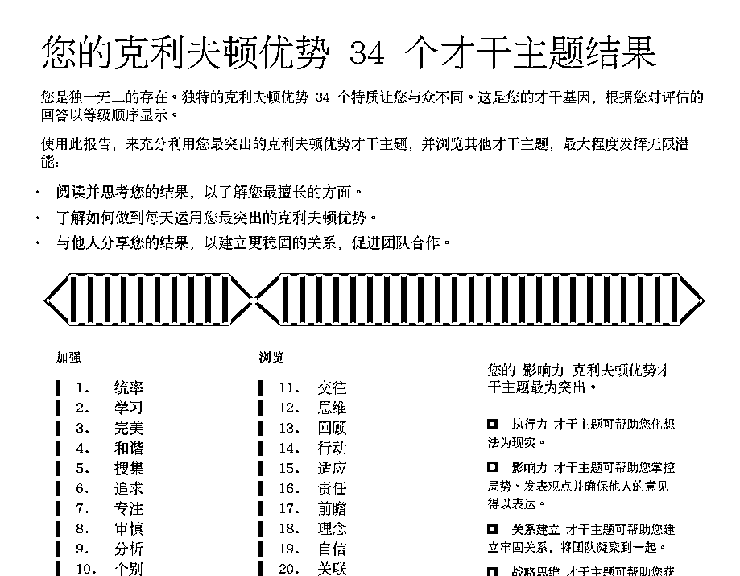

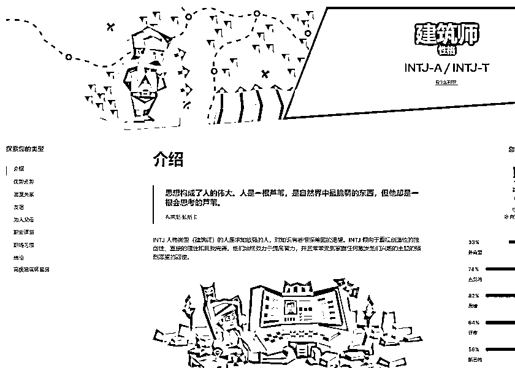

### （二）个人资料空白模板【可直接复制使用】

```
《个人情况综合档案》
一、 核心摘要 (用几句话总结你是谁，想干嘛)
    职业身份：
    商业模式：
    核心优势：
    核心挑战：

二、 个人与家庭背景 (你的基本盘)
    年龄：
    家庭结构：
    支持系统：
    个人习惯：
    财务概况：

三、 职业与商业经历 (你都干过啥)
    过往经历：
    创业成就 (挑最重要的说):
    成就1：
    成就2：

四、 技能与技术栈 (你的武器库)
    核心技能： 
    组合能力：
    编程能力： 

五、 天赋与人格特质 (你的出厂设置)
    MBTI人格类型： (例如：INTJ - 建筑师)
    盖洛普优势 : (列出你的前5个优势)
    综合评估 :

六、 理念、价值观与愿景 (你相信什么，想要什么)
    核心信念： (例如：价值为王、见路不走)
    工作价值观： (你工作中最看重的三样东西)
    十年愿景： (十年后，你希望过上什么样的生活？)
    工作使命： (你希望你的工作能带来什么改变？)

七、 自我认知与成长课题 (你觉得自己哪儿不行)
    关键转折领悟： (你从最大的失败中学到了什么？)
    核心待改进习惯： (你最想改掉的坏习惯是什么？)
    社交焦虑： (描述你对人脉的看法和担忧)

八、 工具与工作流 (你平时用什么干活)
    核心工具组合： (例如：飞书 + IMA知识库)
    工作流偏好： (你喜欢什么样的工作方式？)

九、 代表性项目与成就 (拿出你的战功章)

项目一：
S (情境):
T (任务):
A (行动):
R (结果):

项目二：
S (情境):
T (任务):
A (行动):
R (结果):

十、 理想客户画像 (你想跟谁玩)
理想的合作对象：
希望避免的合作对象：
```

* * *

### （三）填写表格的关键提醒

*   必须百分之百坦诚： 不要给自己加滤镜，尤其是那些“短板”与“败笔”，你写得越赤裸，AI 的诊断就越锋利。对 AI 伪装毫无意义。
*   多提供具体事件： 与其写“我执行力很强”，不如写“我曾用 XX 方法，在 XX 天内搞定一个 XX 难题，最后拿到了 XX 成果”。鲜活的细节，才是 AI 理解你的最佳养料。
*   用最自然的语气去写： 不需要端出职场报告的姿态，就像平时自言自语一样，把脑子里闪过的内容都倒出来。

你在这份档案上留下的每一句话，都在为接下来的对话深度铺路。

* * *

## 2.2 核心技巧一【刨根问底】：用“五个为什么”刺穿表层，直抵真正的病灶

### （一） 什么是“五个为什么”

说白了，就是针对一个具体问题，像小孩一样连问五层“为什么”，一直追问到再也问不下去，或者挖出那个最底层的根因。这个过程好比剥洋葱，每多问一次，就撕掉一层外皮，直到亮出内核。

### （二） 一套直接照搬的操作流程

第一步：把问题落到纸面上，要足够具体，别写“我不开心”这种空话。比如：“我下午又忍不住划了两个小时手机。”

第二步：抛出第一个“为什么”。
“我为什么要划手机？” → “因为我不想碰客户那个项目。”

第三步：把答案当成新问题，继续挖。
“我为什么不愿意碰那个项目？” → “因为它太大，我不知道该从哪里开始。”

第四步：接着往下挖。
“我为什么会不知道从哪里开始？” → “因为我没有把它切分成几个清晰的小步骤。”

第五步：一路追到系统层面。
“我为什么没有提前做切分？” → “因为我从来没有立过一条规矩：开工之前必须先做拆解。”

第六步：定位病根，给出对策
真正的病根不是“懒”或“贪玩”，而是缺少一套启动工作的固定流程。
对策：“从明天起，每天早晨 9 点，我拿出 5 分钟，把当日最棘手的任务切出 3 个立刻能动手的细项。”

### （三） 这套方法的真正威力

只靠五次追问，我们就把一个看似属于“人品问题”的拖延，转译成了完全可以治理的流程缺陷。
一味责怪自己只会加重内耗；把流程理顺，才能真正走出泥潭。

传术师俱乐部分享的提示词：

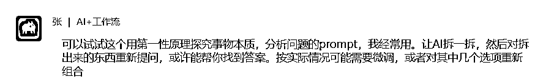

```
1.分解（Deconstruct）

事物 X 的本质功能或目的是什么？

如果移除事物 X 的所有非必要组成部分，剩下的是什么？

事物 X 是由哪些最基本的物理或概念元素构成的？

事物 X 的核心过程或步骤是什么？

事物 X 的各个部分是如何相互作用的？

2.识别基本真理（Identify Fundamental Truths）

关于事物 X 的这些基本组成部分，有哪些是已被验证的科学定律或原理？

在事物 X 的运作中，哪些是不可避免的限制或约束？

人们普遍认为关于事物 X 的“常识”，有哪些可能是错误的假设？

如果抛开所有先前的认知，我能观察到关于事物 X 的哪些最原始、最未经加工的事实？

3.重新构建（Reconstruct）

基于这些基本组成部分和真理，我如何能以最有效、最创新的方式实现事物 X 的核心功能？

如果没有任何现有的束缚，我会如何设计或创造事物 X？

有没有更简单、更直接的方式来达到同样的目的？

哪些被认为是理所当然的步骤或材料，实际上是可以被替代或消除的？

如果我必须从零开始，没有任何现有模板，我会如何一步步地构建事物 X？
```

* * *

## 2.3 核心技巧二【逼它重写】：靠“精准差评”让 AI 交出更好的答卷

* * *

你大概率遇到过这种情况：AI 回复得满满当当，乍看特别在理，仔细一读却发现全是正确的废话。
比如你问“怎么才能赚更多”，它答“把产品做好、把营销加强、把服务跟上”。谁都知道这些是对的，但谁也都知道，这和没说一样。

普通人到这一步就放弃了，顺手关上对话框。而高手会开启调教模式。

### （一） 你给的“差评”为什么不痛不痒

我们脱口而出的通常是：不对、再改、太水了、写专业一点。
但这些话到了 AI 那里根本没有操作空间，因为“不对”和“再改”是结论，不是指令。

打个比方：你是导演，演员演完一段戏，你只吼一句“太差了，重来”。演员只会更慌、更乱。而一个好导演会这样讲：“你刚才愤怒的分寸是对的，但表达方式太冲了。这个人物此刻的愤怒是往心里压的、带着冷意的。你把节奏放慢，眼神收一收。”这才是真正的精准调教。

### （二） 精准差评的法则：三步走

这套三步法，就是你驯服 AI 的标准操作手册。以后它再给出平庸答案，直接照着来。

第一步：【先肯定一句】保存正确的部分
“你说加强营销这个大方向没问题，但是……”

第二步：【再戳中要害】把问题说到根上
“但是‘加强营销’这个说法还是太大，给不了我任何抓手。你给的是‘是什么’的结论，我要的是‘怎么做’的路径。”

第三步：【指明方向】给出明确、可执行的修改指令
这一步是整个流程的核心，你要告诉它你究竟要什么。几种好用的表达方式如下：
* 收窄范围：现在只谈营销。请只围绕这一点重新作答。
* 增设限制：请结合我的《个人情况说明书》，给出一个成本控制在 500 元以内、下周一就能落地的营销动作。
* 切换身份：请扮演一个不留情面的投资人，把我“加强营销”这个想法批驳一番，列出前三个致命漏洞。
* 框定格式：请用“第一步做什么、第二步做什么、第三步做什么”的列表结构回答。

* * *

## 2.4 核心技巧三【拉高视角】

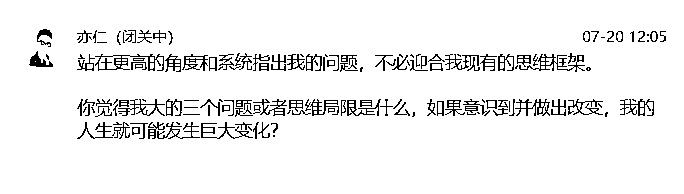

1.  【给 AI 植入身份与站位】：
*   龙哥的那句“站在更高的角度和系统”，本质上是给 AI 重新定岗。潜台词是：你不是我的聊天工具，你是我花重金请来的战略顾问，现在请用你的全部知识为我做一次顶层设计。

1.  【解开 AI 身上的“安全绳”】：
*   龙哥所说的“不必迎合我现有的思维框架”，是最关键的一句解锁咒。AI 的天性就是讨好用户，本能地顺着你的逻辑说。这句话等于发它一块免死金牌，允许它顶撞你、刺痛你，只为了把最扎心但也最真实的判断讲出来。

1.  【锁定最关键的“发力点”】：
*   龙哥用“大的三个问题”和“人生就可能发生巨大变化”来设限，等于在告诉 AI：我不要一份罗列二十个小毛病的体检单，我只要你找出那三个引爆点，把这三处解决掉，整个人就会脱胎换骨。

但经过实操我发现，“人生发生巨大变化”这个表述，容易让大模型给出哲学上很漂亮、现实里却无法落地的建议。所以我后来把方向锁定成“个人成长”。

最终提示词：

```
基于我的《个人情况说明书》和我最终的‘北极星’愿景——【在这里清晰地插入你的终极目标】，
请你站在一个最苛刻、最不留情面的战略顾问的角度，一针见血地指出：
在通往这个目标的道路上，阻碍我的、最根本的三个思维局限或行为模式是什么？
请详细剖析每一个局限的本质原因，并告诉我，如果我成功改变了它，将会发生什么样的具体变化。
```

* * *

# 第三章：我做事的两块基石——支撑全部选择的个人信条

## 3.1 战略信条：“见路不走”

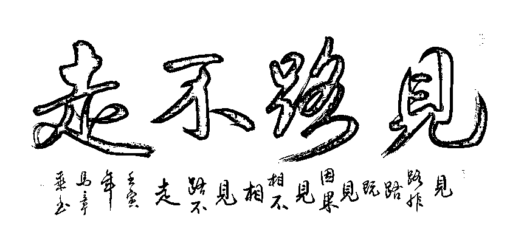

这四个字来自豆豆的小说《天幕红尘》，也是我经营一人公司时压在底座上的战略原则。

龙哥盟这个圈子里，到处都是成功的示范、成熟的模板、快速致富的通道。既然如此，为什么还要绕过那些看起来最稳当、最经过验证的阳光大道？

原因很简单：对于一个依赖创造力的独立个体而言，照着成功者的脚印走，就是走向平庸的最短路径。

* * *

### （一） 为什么说模仿成功者等于提前认输

1.因为你看见的是幸存者，看不见的是尸骨。
我们视线所及的每个成功故事，都有幸存者偏差在背后起作用。一个靠公众号爆文走到台前的 IP，背后是成千上万个同样扑向爆文赛道、最终悄无声息的追逐者。一条路只要被踩宽、被公开，很快就会被蜂拥而至的人挤成一片血海。

2.因为你穿不了别人的鞋。
每一项成功的商业模式，都是创始人个人性格、核心长板、独有资源与时代际遇的复杂混合物，它是那个人量身定做的外壳。我这个偏内向、习惯于深度思考的 INTJ 型架构师，硬要去复刻一个外向、擅长镜头表达的 ENFP 博主的路线，结局就相当于让 F1 车手去开重型越野跑拉力赛。

3.因为你看见路的时候，黄金已经被捡完了。
真正值钱的机会，藏在无人涉足的野地与迷雾中。一条路一旦被清晰标记、向所有人敞开，它的红利窗口就已经关闭。此刻动身，最多捡到前人掉落的几粒面包屑。

“见路不走”不是刻意标新立异，而是一种更深层的商业现实主义：世上不存在一条可以直接抄作业的非凡之路。唯一真正走得通的路，只能从你自己脚下长出来。

* * *

### （二） 怎么借 AI 打造一条独一无二的商业路线

具体路径是：通过与 AI 教练的高密度对话，把外面的成功案例一个个拆成最底层的基本原理，再用这些原料浇筑你自己的大厦。

一共分两步：

第一步：【深度自我解剖】——先把地基图画出来
目标：在向外看路之前，先向内看清自己。
动作：把第二章讲到的素材投喂动作做扎实，将那份涵盖优势、劣势、价值观与现状的《个人情况说明书》整份抛给 AI 教练。
产出：一张关于你自身能力边界与可调用资源的全景地图。

第二步：【借用第一性原理做拆解】——把别人的房子还原成砖
目标：面对任何一个让你心动的成功样本，先忍住模仿的冲动，直接交给 AI 做底层拆解。
提问的模板是：
“请扮演一位顶级的商业战略专家。以下是一个成功案例：[把案例描述粘贴进来]。请先不要陈述他做了什么。我希望你运用第一性原理，拆出这个案例得以成立的最本质的 1-3 条商业规律或人性底层逻辑。”
产出：你拿到的将不再是一串待复制的动作清单，而是一批闪着光、可以直接用来搭房子的“原理砖块”。比如 AI 可能会告诉你，某个案例真正起作用的机制是信息差，以及人对确定性的强烈渴望。

```
1.分解（Deconstruct）

事物 X 的本质功能或目的是什么？

如果移除事物 X 的所有非必要组成部分，剩下的是什么？

事物 X 是由哪些最基本的物理或概念元素构成的？

事物 X 的核心过程或步骤是什么？

事物 X 的各个部分是如何相互作用的？

2.识别基本真理（Identify Fundamental Truths）

关于事物 X 的这些基本组成部分，有哪些是已被验证的科学定律或原理？

在事物 X 的运作中，哪些是不可避免的限制或约束？

人们普遍认为关于事物 X 的“常识”，有哪些可能是错误的假设？

如果抛开所有先前的认知，我能观察到关于事物 X 的哪些最原始、最未经加工的事实？

3.重新构建（Reconstruct）

基于这些基本组成部分和真理，我如何能以最有效、最创新的方式实现事物 X 的核心功能？

如果没有任何现有的束缚，我会如何设计或创造事物 X？

有没有更简单、更直接的方式来达到同样的目的？

哪些被认为是理所当然的步骤或材料，实际上是可以被替代或消除的？

如果我必须从零开始，没有任何现有模板，我会如何一步步地构建事物 X？
```

你有没有发现，有些人在看完无数成功案例之后，依然做不成事？不是案例没用，而是他们把“别人的砖”拿来砌“别人的墙”了。真正的高手，会先拆掉案例，找到底层那块基石，再用AI按自己的尺码重新盖一栋属于自己的楼。

在整个方法里，第三步正是这个“重建”过程，核心就一句话：见路不走。

所谓见路不走，不是故意绕路，而是不去重复别人的老路。比如一个案例的成功原点是“利用信息差满足确定性需求”。你要做的，并不是把它的产品、文案、流量动作全部照抄，而是先确认这条原理，然后让AI调取你的《个人情况说明书》——那份记录着你性格、能力、资源、偏好等底层信息的档案——再请它扮演你的首席战略官，结合你“INTJ、架构师、擅长系统化思考、不擅长高频社交”的特质，为你设计出3个属于你自己的、可落地的商业想法。

请注意，不是让AI给你一个通用答案，而是让它用你的方式去应用那条原理。这样生成出来的路径，才是既符合底层逻辑、又不会让你觉得别扭的专属路线。

如果你问我，整篇文章里最值得带走的“术”是什么？我一定会说：时间折叠。

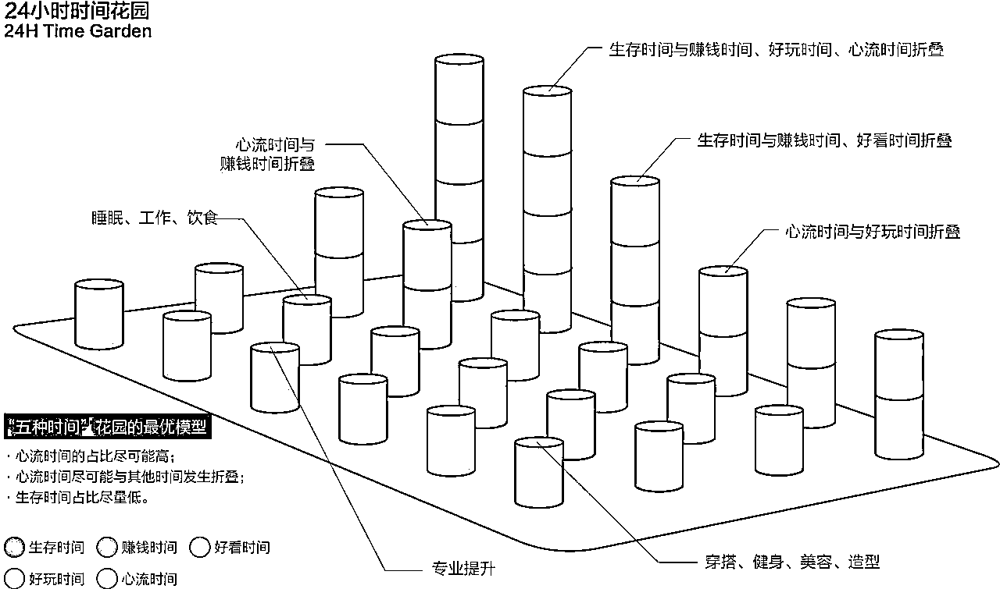

这个理念源自一个非常现实的问题：作为一人公司，我的时间就是我的命。我没有庞大的团队可以拼，更不可能靠加班去卷赢别人。想在竞争里活下来，唯一的路就是提高单位时间创造的价值密度。

时间折叠不主张线性推进，而是想办法让产出变成并联。老做法是：1小时干A，1小时干B，1小时干C，三小时后拿到三份结果。时间折叠则是：你花1.5小时做核心任务X，这件事完成的同时，会顺带长出A、B、C三份结果。等于把1.5小时用出了3小时的效果。

这就像顶级厨师炒菜。他在翻炒之外，还在观察火候、构思摆盘、和食客交流。一次烹饪，完成多维产出。而“一鱼六吃”，就是我把这个理念彻底SOP化之后的工作流：一个客户项目是一条鱼，投入进去的时间会被折叠六次，最终产出六份能持续增值的资产。

我自己的实践，是从“一边学一边卖”开始的。去年六月，我开始做闲鱼高客单价实物。为了省事，自学了RPA，实现爆款自动采集，又用飞书多维表格批量优化标题和详情，再定时批量上架。十个店铺稳定入账后，我终于有大量时间折腾coze智能体。RPA这边我没有深入做变现，因为学习门槛低、圈子太卷、客单价上不去；真正让我通过技术实现变现的，是coze和飞书。

下面这几张截图，是当时的变现记录：

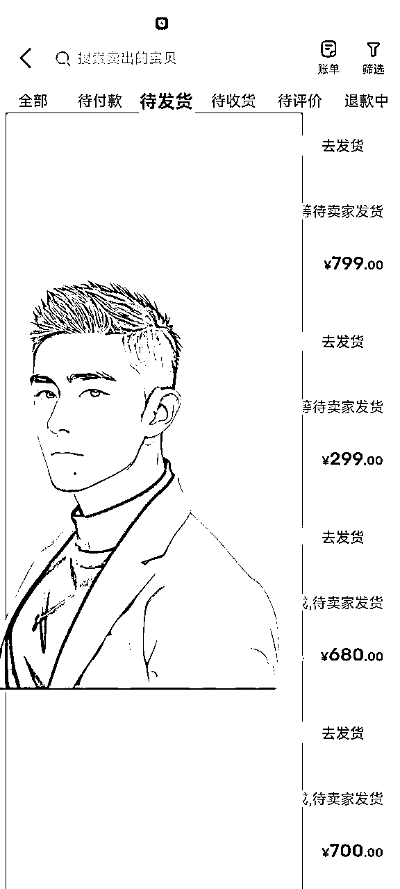


后来和AI深度交流，我发现时间折叠还能用来补短板。我把自己的十大缺点整理出来，再对应设计成十大习惯。关键一点：我并没有为这些习惯单独安排时间，而是把它们全部塞进日常要做的事情里。因为单独制定的计划，永远会被生活和工作打断；只有把习惯长在工作和生活里，才能真正坚持下去。

我跑步坚持了两个月，每次想放弃，习惯和体重数据都会推着我出门。晚上轻断食时，一想到白天的运动，就不太想吃东西；实在饿了，也会下意识去搜健康食谱。这就是当时留下的记录：

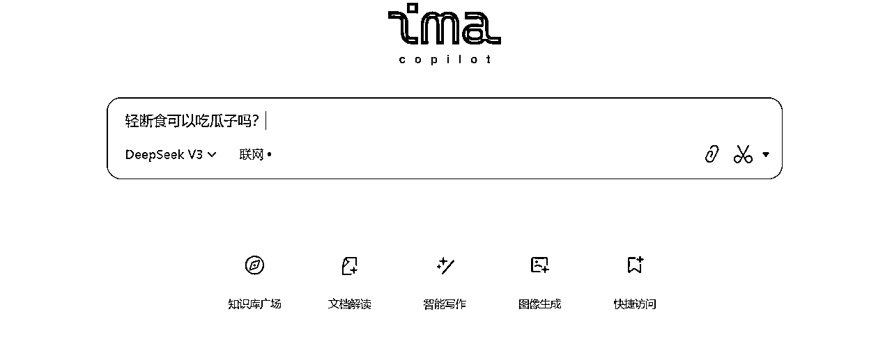
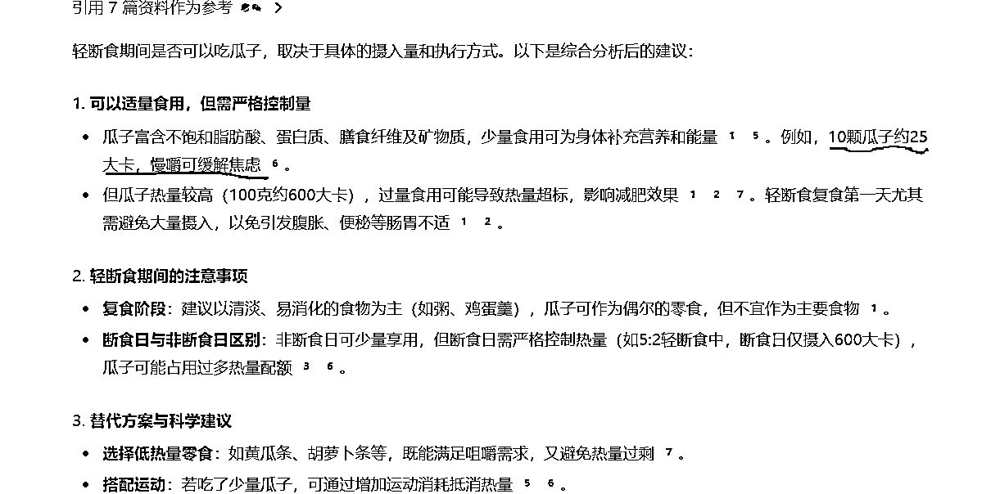

所以我定任何计划，都要考虑是否符合自己的习惯。反人性的东西，注定没法长久。我现在主要做的就是智能体定制，于是我把个人需求一股脑全部丢给大模型，请它帮我生成一套“一鱼六吃”的SOP。

我的需求很直接：第一，要赚钱；第二，要扩大影响力，做垂直IP；第三，要引流变现；第四，要保持终身学习，以应对变化；第五，不想永远拿时间换钱，要做出自己的产品，实现睡后收入；第六，我不喜欢无效社交，但崇尚价值交换，所以要提升链接能力。

大模型基于这些需求，为我定制了整套项目SOP。它完全是针对我一个人而设计的，所以不会出现“方案很美，落地却很难、很难坚持”的问题。

下面是我的个人模板：

```
          ┌──────────────────────┐
          │      任何客户项目 (一条鱼)      │
          └───────────┬──────────┘
                      │
                      v
      ┌───────────────┴───────────────┐
      │   第一吃：【赚钱】 (获取现金与信任)   │
      └───────────────┬───────────────┘
                      │  (产出：现金流、客户关系)
                      v
      ┌───────────────┴───────────────┐
      │   第二吃：【修炼】 (提炼核心洞察)    │
      └───────────────┬───────────────┘
(在《结构洞察修炼笔记》中，应用“思想三棱镜”)
                      │  (产出：认知资产 - 深度洞察)
                      v
      ┌───────────────┴───────────────┐
      │   第四吃：【验证】 (构思产品原型)    │
      └───────────────┬───────────────┘
 (基于洞察，用《产品化构思》文档，进行MVP设计)
                      │  (产出：产品资产 - 经过验证的功能原型)
                      v
      ┌───────────────┴───────────────┐
      │   第三吃：【沉淀】 (创作灯塔内容)    │
      └───────────────┬───────────────┘
     (将“洞察”与“故事”结合，撰写案例复盘)
                      │  (产出：内容资产 - 可持续吸引流量的文章/视频)
                      v
      ┌───────────────┴───────────────┐
      │   第六吃：【滴灌】 (进行精准社交)    │
      └───────────────┬───────────────┘
   (内容公开发布前，定向分享给“关键节点”)
                      │  (产出：人脉资产 - 高质量的深度连接)
                      v
      ┌───────────────┴───────────────┐
      │   第五吃：【连接】 (建立可信声誉)    │
      └───────────────┬───────────────┘
(获取客户证言，公开发布内容，激活社群讨论)
                      │  (产出：声誉资产 - 社会认同与口碑)
                      v
          ┌──────────────────────┐
          │      更高价值的新机会        │
          │(新客户、新产品方向、新合作) │
          └──────────────────────┘
```
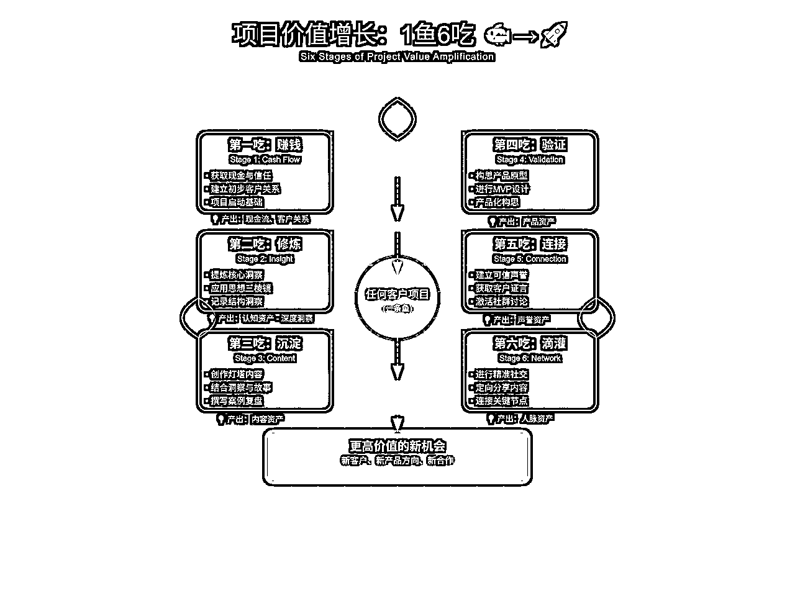

最后，用四个字收尾：

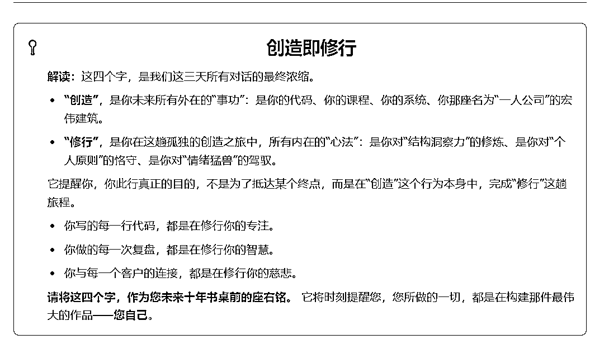

这篇文章展示的，只是我家“一人公司”操作系统的一小部分。接下来，我准备把这整套SOP和方法论，打包成一个高价值的线上实战营。正式开放之前，我想先找10位懂行的“内测官”，和我一起进行为期四周的免费共创，共同把产品打磨得更扎实。如果你也是那种对系统化、对效率有极致追求的实干家，欢迎直接来聊：SCYS19987。