# 【视频号图书口播带货】矩阵化+流程提效，月佣稳过1万的实操复盘

> 来源：[https://iqlk6ti4oem.feishu.cn/docx/XTmddEzcFoBM1FxkDEncwFpNnih](https://iqlk6ti4oem.feishu.cn/docx/XTmddEzcFoBM1FxkDEncwFpNnih)

先碎碎念一下缘起，这是我第一次在赚钱做公开复盘，所以把我是怎么跟赚钱搭上线的也顺带写了，有点流水账。

想要直接看干货的同学可以直接跳到【项目拆解】部分。

# 我与赚钱的交集

## 关于我自己

Leo，站在鸡蛋一边的那个，90后闽南人，现在主要混迹上海和苏州。互联网老兵10年，手里有房贷车贷，35岁那年被优化，拿着N+1，大概6个月工资，误打误撞进了赚钱，也才开始真正直面市场自己变现。

## 第一次注意到赚钱

2023年下半年在纵横四海播客里听到了赚钱，年底加入了纵横四海的星球。虽然第一次用知识星球，但我有逛榜单的习惯，一翻榜单第一位就是龙哥盟星球，年费2000+，人数5万+，运营7年。那一刻我就觉得这地方不简单，立马关注了龙哥盟公众号，这是我和赚钱的初识。

## 慢慢了解赚钱

主要来自两条线索：

1. 纵横四海微信群里有几个赚钱老用户，他们三两句聊起来就能感觉到，赚钱口碑确实好，讲钱但不伤感情；
2. 刷赚钱公众号的文章。2024年1月初我收到了裁员通知，一边谈解约，一边逼自己找退路。我记得很清楚，2024年1月23日，我向鱼丸申请了3天体验卡。

## 正式加入

2024年2月8日被正式裁掉，第二天就是除夕。过年期间我心里很清楚：35岁能被裁，40岁照样能，45岁更能。打工这条路摆脱不了被动。可能这是我最后一次能尝试不做打工人、为自己做事的机会了。我35岁、已婚、有贷款，本来没底气的，但手里有6个月工资的N+1，于是就赌一把。

2024年3月8日，经纵横四海的赚钱航海家推荐，我成功加入了航海家。

## 赚钱给我带来的改变

航海家群

航海家有自己的微信群，还有嘉宾分享。我能近距离观察一群人是怎么分析、怎么思考、怎么拍板解决问题的。用航海家们的视角重新审视世界，这对一个干了10年流水线打工人的冲击太大了，我现在都还没找到合适的词形容，但足以回本。

航海实战

赚钱沉淀7年，资料堆成山，但我始终觉得实战才值钱。

2024年3月，我进赚钱后的第一次航海，我报了8艘船，限额前来得及。当时这么选有两个原因：1. 我完全是空白，需要开眼界，航海是最快的捷径；2. 我自律性差，需要外部机制推着走。交押金打卡这个机制特别适合我。被拉进16个微信群，看到8艘船里大家的自我介绍时，我又一次被震到，原来世界不只有朝九晚五那么一种活法。我不可能8个都精通，最后全部上岸，也赚到了小红书店铺的第一笔钱。从那以后，我基本每一次航海都参加，并且都去报名了志愿者，保持持续行动。

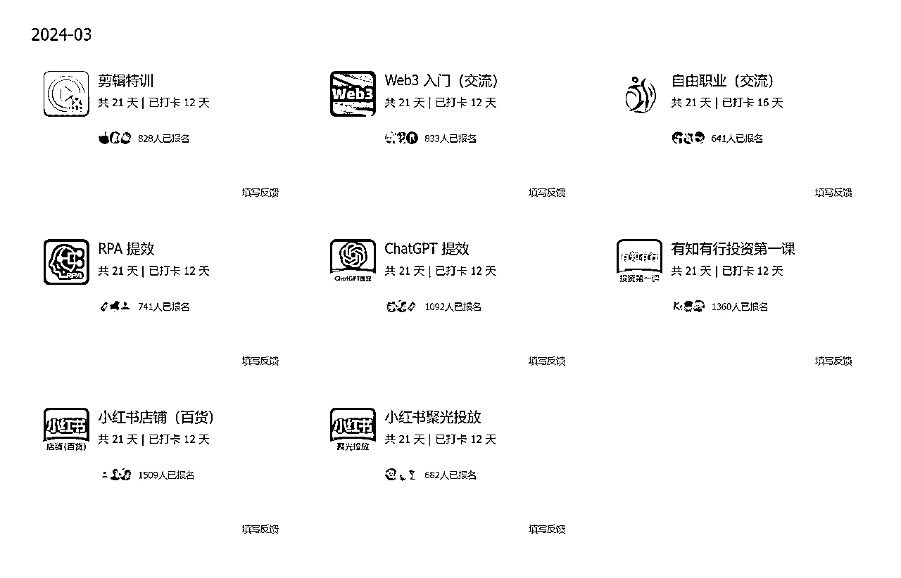

龙哥

到现在我都没跟龙哥单独聊过天，但他对我的影响最大。

第一次航海结束后，小红书店铺跑通了，但反馈不足以支撑我坚持，于是我开始乱找项目，像无头苍蝇。

恰好两个信息帮我锁定了方向：

1. 龙哥在2024年5月10日单独为晓文和超鹏老师的视频号口播航海发了帖，在此之前我几乎没见过他这么力推一个航海；
2. 2024年4月24日小马宋老师的视频号采访龙哥，问他当下的机会有哪些，他只说了视频号。

就凭这两点，我直接把其他项目全否了。哪怕我没玩过视频号，没露过脸，我也选择相信龙哥的判断。于是我进入了视频号的世界，至今已参加了4次视频号航海。

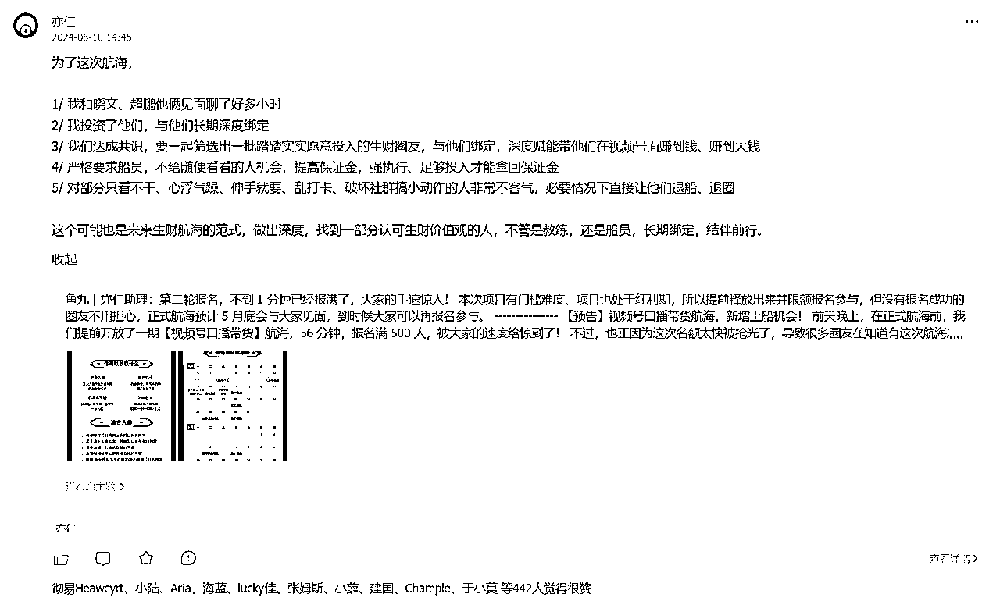


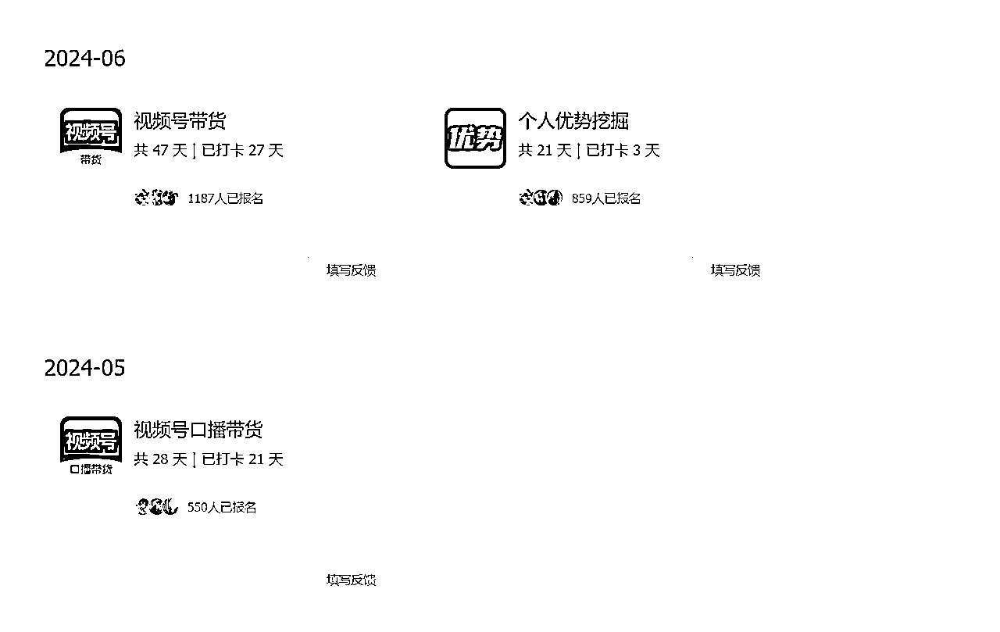

# 项目拆解

项目核心：视频号社科类图书口播带货，纯自然流，纯视频成交，挂车+橱窗，不直播。矩阵化运营，18个号起步，同步抖音1个号。矩阵损耗低，目前仍在运行17个号。日更2-3条/号。核心人群：50岁以上男性，集中在江浙沪、京广、鲁地区。

本质上是我在2024年5月晓文&超鹏老师【视频号口播带货】航海的基础上，选择社科图书这个细分赛道做的矩阵+效率优化的再开发。

本次复盘分为：

1. 为什么选这个项目
2. 成果与核心要素
3. 实操路径与优化点
4. 过程中的坑与解法
5. 其他补充

## 为什么选这个项目

2025年3月前，我在视频号试过百货口播、养生百货抠像矩阵、养生百货数字人矩阵、微付费打品。2024年9月数字人打品运气好，跟两个伙伴一起做了单月38w GMV、17w佣金。除口播外，其余项目共性是：周期短、波动大、封号多、成本高。高收益高风险，节奏失控，很难长期稳定。我觉得不适合自己长期深耕。

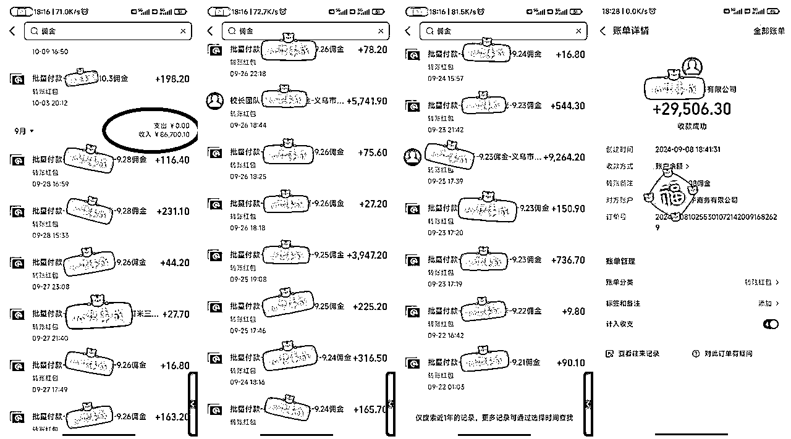

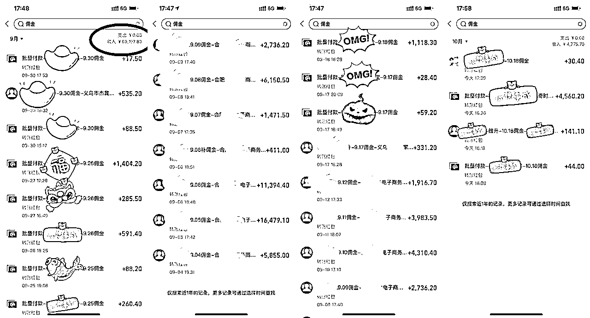

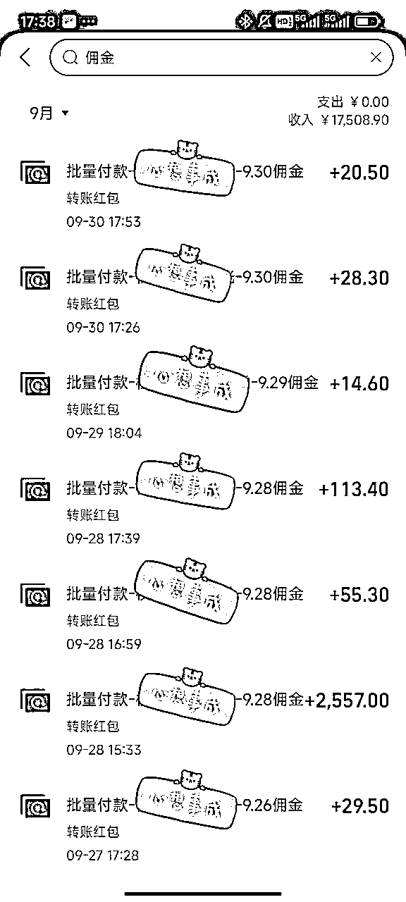

到2024年底微付费打品没达到预期后，我开始找一个更长线、低成本、稳定、封号率低的赛道。最终锁定社科类图书短视频矩阵带货，判断依据：

1. 长期性：能找到大量橱窗开通1-2年仍在持续更新的对标号，账号寿命长；
2. 低成本：自然流模式，不用租号，用亲友号即可，几乎零成本；
3. 起号快：能找到3-4个月开通橱窗，月销几百上千本的案例；
4. 佣金可观：畅销图书佣金普遍40%-60%，部分可达70%-80%，不输养生百货；
5. 可优化空间大：
   ①矩阵化：图书带货的对标号大多1-2个，最多5-6个，很少见到10个以上。我做养生数字人时曾同时操盘30-50个号，具备批量养号能力。将大规模矩阵思维迁移到图书赛道，用大量账号做长线项目，有很大探索空间；
   ②数字人：当时数字人平台成本和效果不理想，但技术迭代快，后续会成为效率放大器【现在已有成熟方案，数字人口播制作可参考2025年5月阿甜&豪哥老师【AI数字人口播IP】航海】；
6. 品类友好：退货售后极少。补充一个我最近看到的观点，李笑来老师提过亚马逊首个品类选书，就是因为市场大、成长性强、复购高、售后成本低；
7. 个人偏好：我从小爱读书，虽然初中后少了，但内心认可读书的力量。卖书也能倒逼自己阅读，有点双向增益。

## 成果与关键点

### 成果

项目定下来后，2025年3月开始实操，逐步扩号到18个视频号，同时配1个抖音做同步分发。4月、5月、7月佣金均破万。6月我花时间梳理SOP并带朋友复制，自己就放飞了，数据下滑。下图是视频号阶段数据。

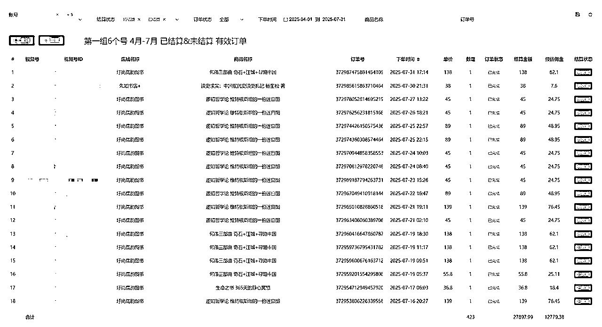

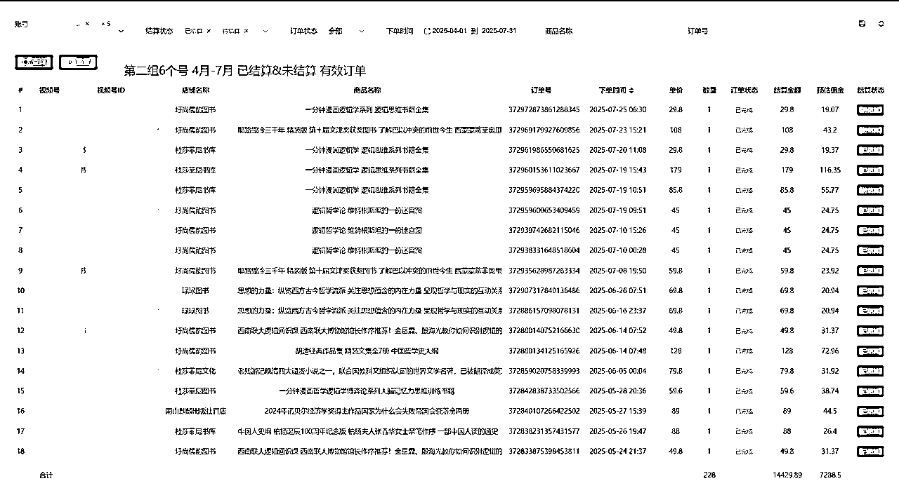

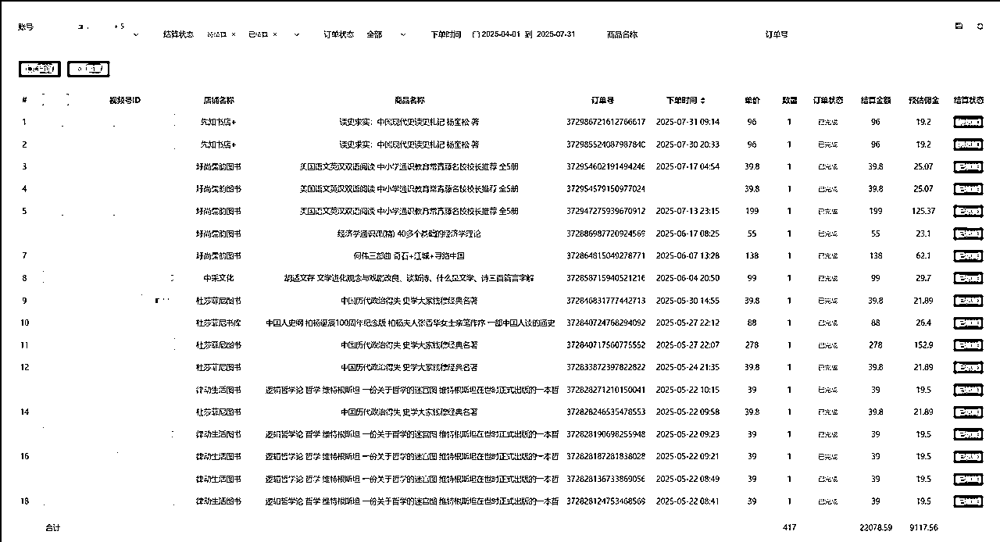

补充说明：我的执行力一直是个问题。按单日产出6条视频算有效工作日，一个月大概只有15-20天。2025年3月至今，口播+数字人视频累计产出不到300条，剔除6月摆烂，平均每月约100条，总分发量约1500-1700条。

另外6月我拉了一个之前一起做视频号打品的朋友加入，他上手很快，对我方法做了改良，7月单月做到5.6w佣金。样本少、偶然性大，此次复盘不展开他的改良，等他稳定月入5w+再让他自己分享。

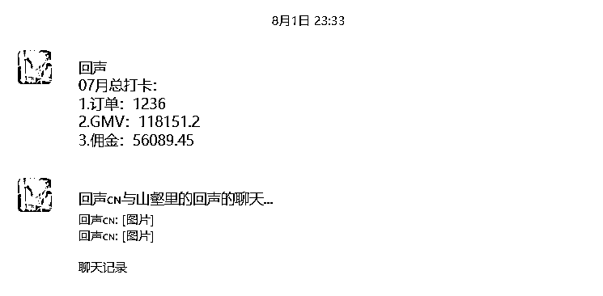

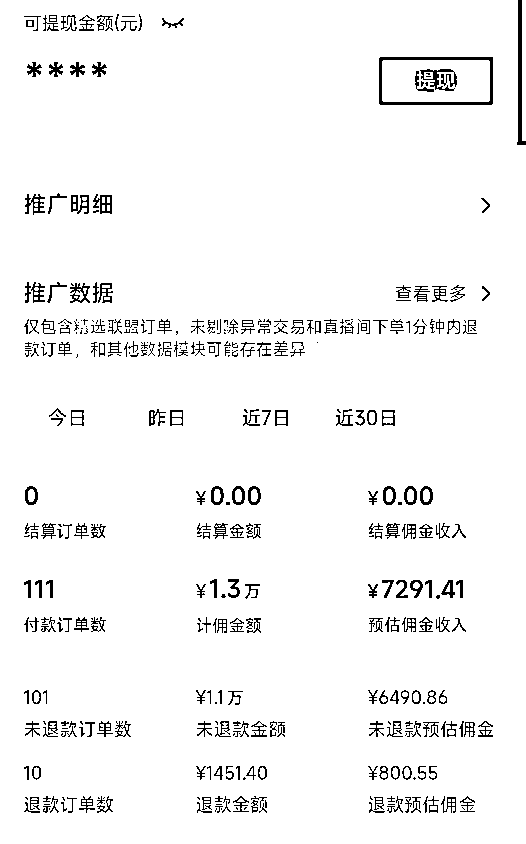

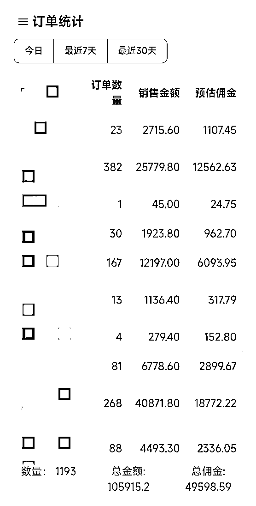

### 关键点

1. 账号体量
在没有稳定原创文案能力、纯自然流的前提下，账号数量是核心。建议起步12个，能稳定保持15-20个正常号更稳。

2. 文案能力
起步期能找到爆款文案最快，先洗稿再迭代。但长期靠抄会侵权、同质化严重，最终沦为短期项目。想长做，必须持续提升底层文案写作能力。

3. 流程提效
把全流程拆解，每个环节做一点点优化，整体效率会指数级提升。

下面展开实操细节。

## 实操步骤与优化

### 一、上手口播录制与数字人制作

口播录制方法详见2024年5月晓文&超鹏老师【视频号口播带货】航海，优势是零成本；

数字人口播制作方法详见2025年5月阿甜&豪哥老师【AI数字人口播IP】航海，优势是极大提升产能，但有成本。目前我们测得效果最好的是minimax+heygen，可参考。

建议先从零成本口播起步，赚到钱再上数字人。

注意：别过度纠结颜值和画面。素人口播的细微差异对数据影响难以验证，容易陷入无底洞。核心是文案，镜头前把文案完整清晰地说出来就行，其他边做边优化。

### 二、准备账号

建议10个起步，需5个亲友配合实名。我的招募经验：

1. 利益分配：初期100元+10%佣金的模式，按SOP操作，20-30分钟配好号。对闲置号主来说20分钟换100块很香，10%佣金也能保证配合度。后期确定性高后，仅给10%佣金也能拿到号。
2. SOP化：录屏或截图做全流程创建SOP，步骤清晰可复用。

下面是我之前写的文字版SOP，仅作参考，使用前请自行验证，可配图优化。

```
一、提前确认是否有实名名额（没有开过视频号的跳过这步）
每个人有两个视频号实名名额，如果已经开过视频号的提前确认下是否已经实名过，没有开过视频号或者未实名过且没有发过视频的才可以。
【确认路径：微信-我-视频号-右上角三个点-账号安全与绑定/账号管理-视频号实名】
二、提前准备：身份证和银行卡号
身份证银行卡在微信账号实名和微信小店带货者创建时需要使用到，后续视频号带货佣金只能提现到实名人的银行卡，如果是用别人的身份来实名账号，需要选择比较信任的人，保障佣金到账后能回到你的手里。（建议可以给到号主10%左右的利润分配）
具体操作步骤（使用自己主微信的直接跳到第4步）
1.注册新微信：
①自己日常微信可以直接拿来用，完全不会产生影响，想更彻底隔离开的就选择新注册微信；
②名字建议可以取【XX读书/读好书/读书角落/读书空间】之类的，头像建议使用真人生活照；
③注册新微信需要注册6个月以上的好友帮忙扫码邀请，需自行找身边家人朋友邀请；
2.实名微信：微信-我-服务-钱包-页面底部“身份信息”进行实名并绑定银行卡，微信密码自行设置（务必做好账号信息台账，记录好相关信息）；
3.养号：随便发一条朋友圈即可，不轻易更换登录设备；
4.创建、实名、设置视频号：
①微信-发现-视频号-右上角小人-发表视频-创建视频号；
②微信-我-视频号-右上三个点-账号安全与绑定-视频号实名；
③微信-发现-视频号-右上角小人-右上角设置-视频号账号：
【在个人名片上展示视频号】设置为【关闭】
【谁可以看我的视频号内容】设置为【公开，但不推荐给朋友】
【谁可以发评论和弹幕】设置为【所有人】
【谁可以向我打招呼】设置为【没有人】
5.开橱窗，缴纳保证金：
微信-发现-视频号-右上角小人-创作者中心-带货中心-没有货源，选品带货-去开通-去开通-个人
6.添加选品：微信-发现-视频号-右上角小人-创作者中心-带货中心-橱窗管理，随便添加几个商品即可（这步很重要，只有成功添加商品，账号才能开始带货，有问题及时反馈）
```

### 三、找文案和选品

会拍有号了，就剩发什么。分享我认为最简单有效的方法：

我的数据图里商品名没遮，你可以拿一个已开橱窗的抖音号到选品广场搜索任意一本书名，按销量降序选，拉到【创作灵感】里看挂车视频。只选口播类。既能拿到对标文案，又能拿到对标账号。再进账号主页按最热排序，能拿到该账号最好的作品，从而获得新文案和新品。回到选品广场继续搜索，形成一个正循环，能源源不断获得有市场验证的账号、文案和书籍。

原创文案需要沉淀，直接用易侵权，我提供一个简单的Claude二创提示词思路，可缩短正反馈周期。

注意：洗稿和简单二创无法杜绝同质化和投诉，但能在建立能力前先拿到结果。

```
## 文案重写指南：读书博主专用
### 核心定位
- 创作者 ：口播读书博主（抖音/微信视频号）
- 目标受众 ：50岁以上男性（主要分布在江浙沪和北上广地区）
- 内容特色 ：深度解读+批判性思考+实用建议
### 重写要求
1\. 保持原文案的核心观点和思想精髓
2\. 确保新文案与原文案的重复度不超过30%
3\. 字数与原文相差不超过±10%
4\. 不遗漏原文案的关键信息点
### 语言风格指南
1\. 语言基调 ：

   - 沉稳有力，不浮夸
   - 批判中带着建设性
   - 理性分析中融入情感共鸣
   - 体现人文关怀和温度
2\. 表达特色 ：

   - 适当引用经典名句或历史典故（古今中外融合）
   - 使用贴近中年男性生活的比喻和例子
   - 巧妙植入与受众年龄段相关的社会经验
   - 保持年轻视角与成熟思考的反差感
3\. 句式指导 ：

   - 主要使用简洁有力的中短句
   - 关键观点可用排比句强化
   - 避免过于学术化的长句和复杂结构
   - 适当使用反问句增强互动感
### 重写步骤
1\. 内容梳理

   - 提炼原文的3-5个核心观点
   - 识别可以强化的批判性思考点
   - 标记可以增加个人洞察的部分
2\. 结构优化

   - 确保开头直击痛点或核心问题
   - 中间部分深入分析，可引入对比视角
   - 结尾提供实用建议或思考启发
3\. 语言转化

   - 将书面语转为适合口播的表达方式
   - 增加口语化过渡词
   - 适当加入互动元素（"你有没有想过"、"很多朋友会问"）
### 重写技巧
1\. 接地气表达 ：用日常口语替换学术用语，如"这个观点站不住脚"替代"此论点缺乏论证基础""为什么"替代"为何"，用“你”代替“您”

2\. 增加共鸣点 ：融入目标受众的生活经验和时代记忆，如"我们80后90后可能不理解，但经历过80年代的朋友一定有感触"
3\. 强化价值输出 ：每个观点后增加"这对我们有什么启示"的实用延伸
4\. 巧用反差 ：以年轻视角评论传统观念，展现新鲜独特的思考角度
5\. 情感共振 ：在理性分析中适当加入个人情感表达，增强亲和力
### 特殊内容处理
- 引用内容 ：可保持原文，但前后增加个人解读
- 专业术语 ：保留必要术语，但增加通俗解释
- 数据信息 ：保持准确性，但增加直观比喻帮助理解
- 批判性内容 ：保持锋芒，但确保批判后有建设性建议
### 质量检查
- 朗读测试：文案是否适合流畅口播
- 共鸣测试：是否包含足够的目标受众共鸣点
- 价值测试：每段是否都有明确的思想价值输出
- 风格一致性：是否符合个人品牌的语言风格特色
### 示例对比
原文 ："该理论提出了一种新的经济发展模式，强调资源的可持续利用和环境保护。"

改写 ："说实话，这个理论真正厉害的地方，是它打破了我们过去'先发展后治理'的老思路。它告诉我们什么？发展经济的同时，必须对资源和环境负责。这一点，经历过90年代工业污染的朋友们，应该感受最深。"

请将您需要重写的原文案粘贴在下方：

```

### 四、授权发布

主号在手机端打开链接，进入【账号管理】-【原创保护记录】-右上角【授权账号】，添加子号，最多5个/批。

https://channels.weixin.qq.com/assistant-support/pages/creator-home/service

找不到原创保护记录说明作品量和播放量不足，发满10条播放量500+的作品后一般会自动出现。

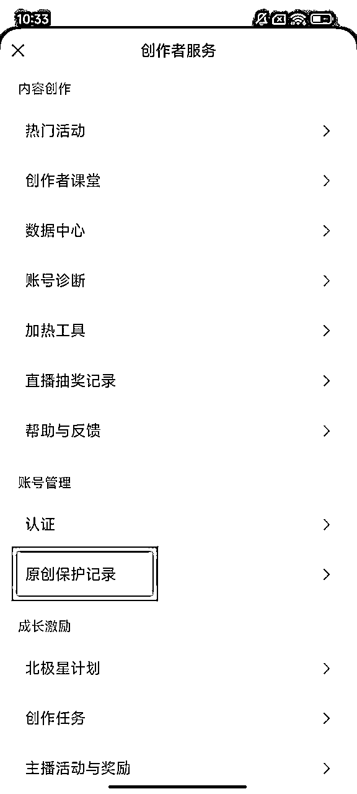

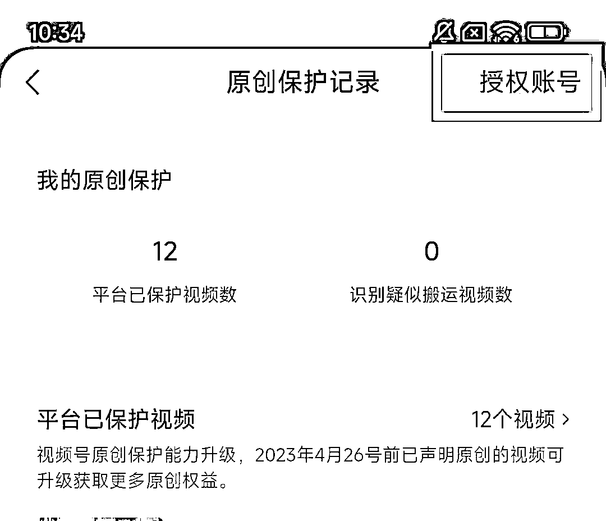

先说一个实操中的细节：视频号目前的规则上，依然支持把一条作品授权分发到另外五个号，也就是我们常说的一拖五。规则允许归允许，实际跑起来风险不小，投放多了很容易触发限流，曝光直接下来。我的实测经验是当下做一拖二、一拖三更稳，至于具体怎么拖，还是要看账号在系统里的反馈动态调整。

### 五、矩阵账号的统一管理

说明：当视频号矩阵规模变大后，手机设备不够用、同一地点频繁切换微信登录容易被风控时，可以换成电脑端的运营者管理模式。准备3-4台手机设备就够了，按下面方法绑定，就能用一套微信管几十个视频号。

举例：手上有一台微信A，要管理视频号a、b、c，操作后微信A可以轮流登录这三个号，但不支持同时在线。

1、关注：用微信A分别搜索视频号a、b、c的名字并先行关注；
2、绑定运营者：在a、b、c的网页端视频号助手进入【设置】-【人员设置】-【绑定运营者】，填入微信A的微信号，搜索后发出邀请；
3、同意绑定：微信A会收到系统通知，点击同意后，网页端视频号助手的【通知中心】会出现【A已成功绑定为运营者】的提示；
4、确认：完成上述绑定后，用微信A扫码登录视频号助手，会同时列出a、b、c三个账号，标注为运营者。如果微信A本身也有自己的视频号，则会显示四个，其中自有号标注为管理员。点选任意一个即可登录，但只能依次轮换，无法同时在线。

同理，如果你有3-4部手机，每部登录6个微信，每个微信绑定3个运营者账号，就能同时掌控18个号，依此类推。

### 六、效率与收益的提升

1.账号管理
号量上来后，手动操作会崩。账号管理工具很有必要，我自己在用小v猫和即刻矩阵，效率提升很明显；
2.商品链接的选择
同一本书往往能找到单本和套装/同作者/同类主题的多SKU链接，多SKU几乎不用额外操作，就能把GMV和佣金拉上去，这个点很多人忽略。
以《逻辑哲学论》举例
如果选品文案围绕《逻辑哲学论》，在选品中心能搜到单本SKU，也能搜到多本组合的SKU，如下图

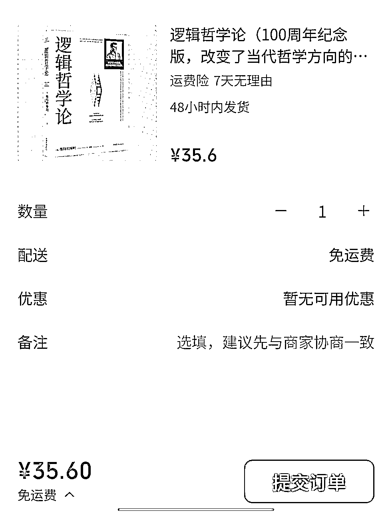

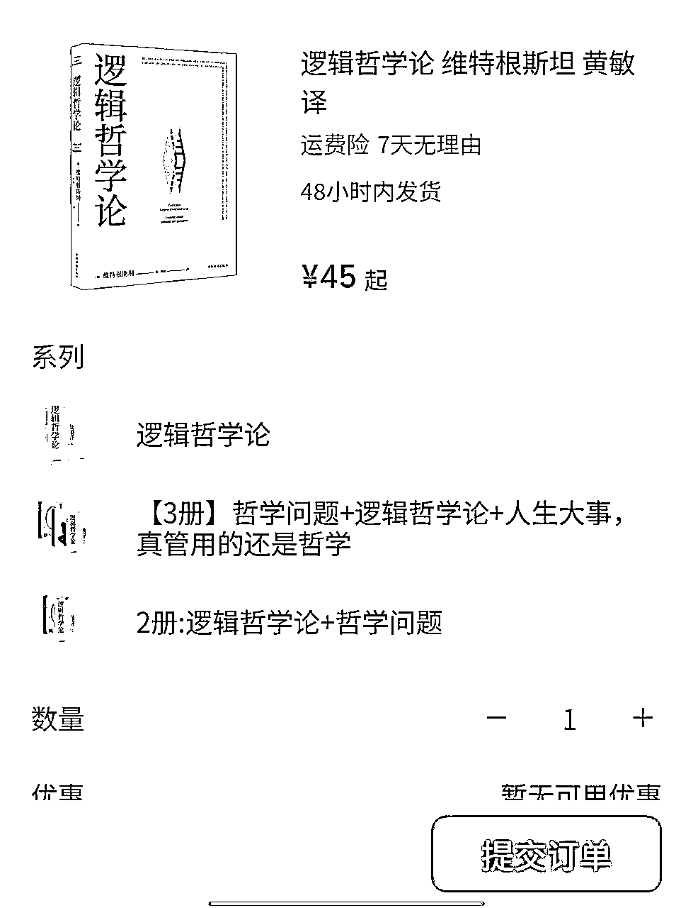

用户通过短视频进入橱窗或挂车，看到单本书链接的人通常只会下单一本，书类目和保健品不同，很少重复买；看到组合链接的人，则有一定概率选择多本套装。

以我自己的数据为例，累计279单里，买单本39元和45元档的订单有242单，占比86.7%，佣金占比68.82%。买多本的订单只有37单，占比13.3%，却贡献了31.18%的佣金。

这只是随手一本书的数据，说明选品链接的优化几乎不用花时间，却能显著提升GMV和佣金。附几张图佐证

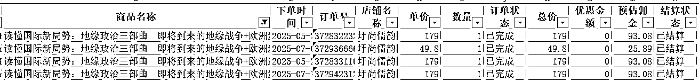

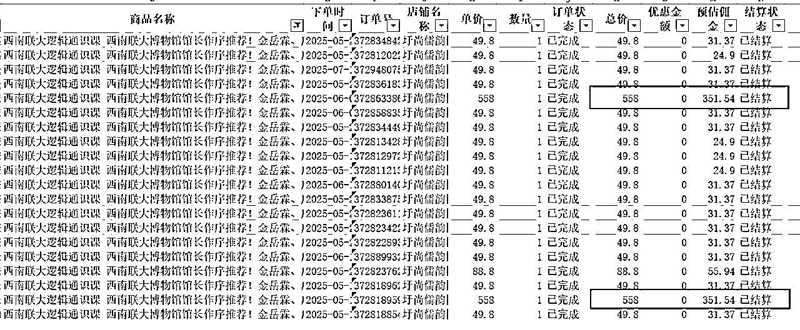

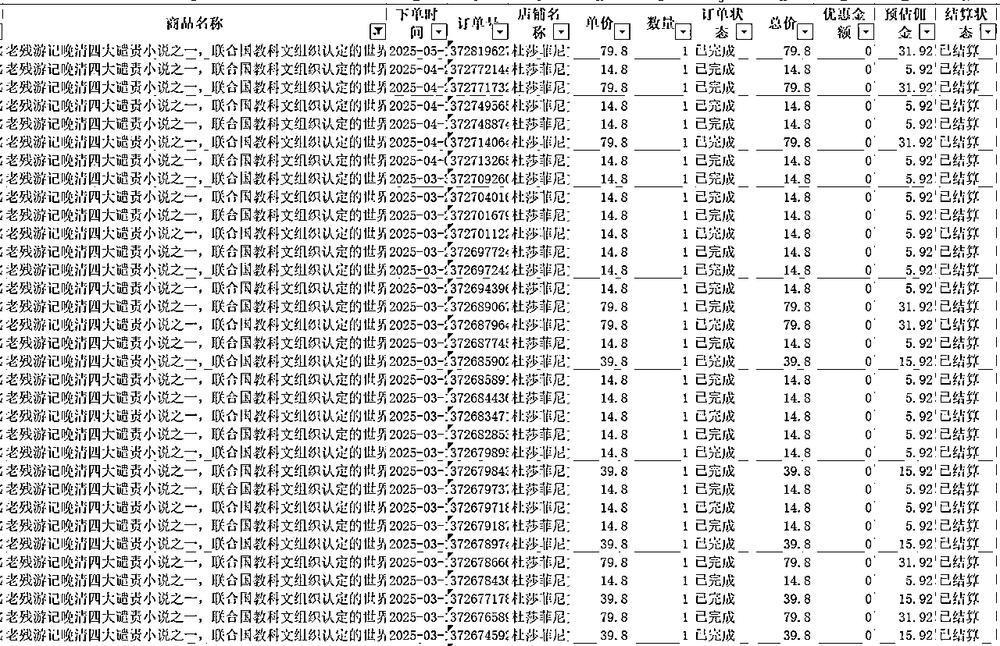

3.商家对接的效率
常规找商家谈佣金，每个号都要单独邀约、定向推送，新增一个商家就要在每个视频号手机端重复操作，还要核对是否推送漏掉。1-2个号还能扛住，十几二十个号就会失控。
实操中发现极少数商家提供团长链接，加入后无需定向邀约直接享受新佣金，但大部分商家不提供。6月份我和几个朋友加起来近五六十个号，每次处理佣金都焦头烂额。
后来我自己申请了视频号团长，可以自行生成团长链接，对矩阵操作友好度大幅提升，时间成本省了非常多。

补充说明：视频号团长代办价格不高，淘宝大概100元能搞定，但前提是要先成立法人主体公司、开对公账户。我之前的工作经历可以独立完成公司设立和报税，所以基本零成本；如果没有相关经验，找财务代办每年成本大概在2000元左右，具体各地差异自行了解。另外，如果有需要，我可以把自己在用的团长链接无偿提供。

### 七、违规与限流的排查与应对

当视频发出去得不到基础播放300-500时，可以按下面流程自检

手机端打开账号诊断：
https://channels.weixin.qq.com/assistant-support/pages/finder-account-status/finder/index

一、账号状态显示正常绿色
可能的问题：
1.文案问题：文案涉及敏感内容、无新闻发布资质、重复度高同质化严重等，账号本身没事，是单条内容的问题
应对：①诊断页面下方如果提示该条视频被降权，直接删除；②停止再发同款文案，重新制作新内容发布并观察播放
2.隐形限流：如果连续5-10条作品播放都卡在200以下，且诊断页没有降权提示，很可能被隐形限流
应对：隐形限流多为阶段性，暂缓发布，7/15/30天后再测试播放情况

二、账号显示被减少推荐7天/30天红色
常见原因：
1.视频中使用视频号画中画素材占比过高
2.文案洗稿不彻底，原创度不足
3.视频被判定与多名用户内容高度相似4-5条以上，会触发七天限流，伤害不可逆
应对：把诊断页面提示被降权的视频删掉即可，不建议申诉，等时间结束自动恢复，申诉成功率低

三、账号显示被减少推荐红色，无具体时长
应对：需发布10条原创出镜视频进行自证，再提交申诉。

## 实操路上遇到的坎和我的解法

1.零播放打击
起步不熟练时，花几个小时录制剪辑的视频发出去后出现0播放、系统判定违规、被投诉、无资质发新闻等提示，很挫败，明明同样的文案别人号跑得很好。
我的做法：把单条视频的生产成本降到最低，梳理好取文案、拍摄、传输、剪辑、发布的全流程效率，每天尽量多发、多铺量。做5条被限3条，和做50条被限30条，感受和正向反馈完全不同，量上去了才能更快看到效果。

2.三天打鱼两天晒网
单人做项目很容易间歇性放弃，我也没完全解决，但我尝试过加入或自建打卡群。自己坚持2个月后觉得枯燥，于是找了几个有搞钱意愿的朋友，我教方法，他们陪我打卡监督。团队氛围很重要，后来我的状态好很多，因为朋友的佣金已经超过我，根本没空晒网了。

3.正反馈到来前的自我怀疑
会怀疑发布时间点、个人形象是否化妆不够自然、声音好不好听、字幕敏感词是否没清干净等，这些问题往往验证难度高。
应对方法：始终把文案当成核心，并严格对标爆款。怀疑某个点，就去看对标爆款是否这样做，答案很快就能找到。
举个例子，@萧大业，他的个人形象和口播能力很多人看了会觉得，自己完全不输这个头部博主。

## 其他补充

### 关于一鱼多吃
项目初期我主攻视频号，抖音没同步，因为只有一个号感觉概率太低。7月份开始把近300条视频陆续同步到抖音后，发现抖音虽然天花板不算高，但推流很持久，规则也更清晰，不容易封号。截至我写这篇分享的8月11日，这个抖音号近30天有效收益达到1.3w，是个意外收获，一并分享。
另外借助自动发布工具，我也同步了小红书。虽然人群差异大，没抱太大期望，但一周前刚过千粉开通小清单，已经开始出单，同样是意外之喜。

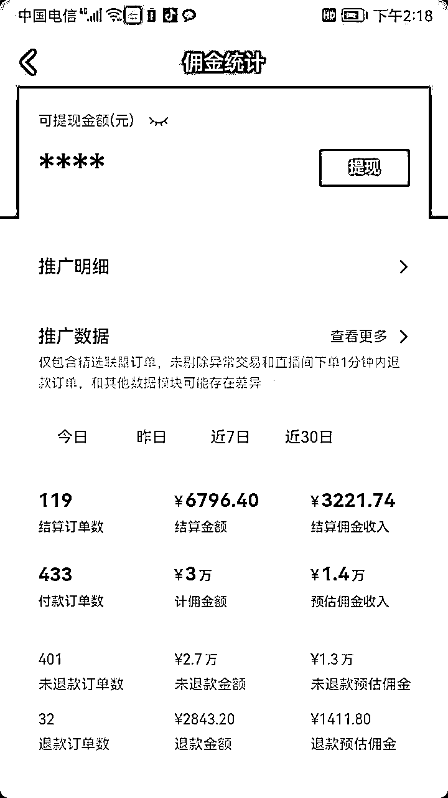

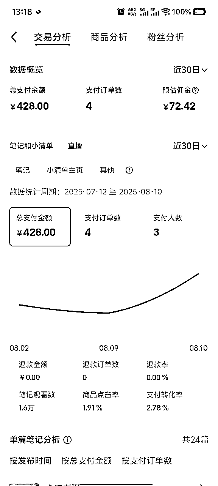

### 对项目的长期判断
段永平说，做对的事情，然后把事情做对；
李笑来提到，做一个猛人，敢做需要很久才能见到收益的事。
这个项目本质是文案驱动的，单纯抄袭洗稿迟早变短期项目。核心还是文案能力，要么自己修炼写作，要么找到合作伙伴。下一步除了提升自身文案能力，我也在寻找有文案能力的合作方，希望把项目推向更健康、更长期的阶段。

实操分享就到这里，第一次写得不够完善，错漏之处欢迎讨论指正！

# 感谢

感谢龙哥盟，让我在独立面对市场变现上迈出很大一步，目前成绩还很微小，但月收益已经接近离职前的工资了，而我加入赚钱还不到一年半，很满意，继续加油。

感谢龙哥，感谢一路上的赚钱圈友，感谢志愿者萱萱的鼓励，让我发了#赚钱好事才有了这次分享。

以上，感谢大家的时间，一起龙哥盟！

最后的最后，何以赚钱，唯有实战！

9 月航海将在 8 月 20 日（本周三）20:00 正式开启报名！欢迎一起来实战！