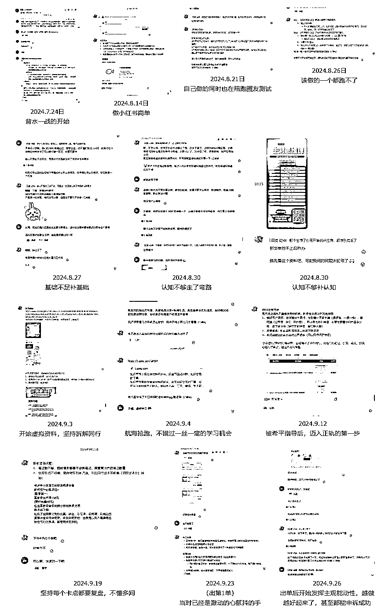
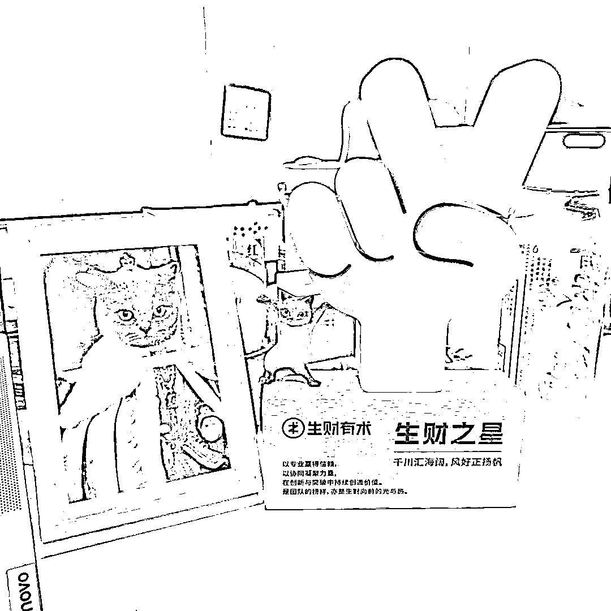
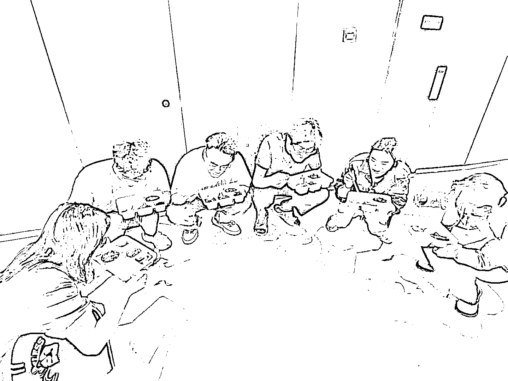

# (精华帖)(227 赞)1 年，从转岗到副业跑通，再到教练和 IP：我找到的不只是赚钱，还有生活的意义
作者：龙哥

最近在小灯塔社群里刷帖，看到好多圈友在分享自己的人生轨迹。那些文字朴实又滚烫，一下子戳中了我。我也忍不住回头看了看自己走过的路，决定把这些年的经历也讲给你听。

大家好，我是龙哥。也许你听过我，也许这是咱俩第一次“见面”，先交代一下我的大致情况。你肯定有不少疑问，别急，下面的故事里我都会慢慢讲清楚。但提前说一句，我写这些不是为了晒什么“成功模板”，只是想让你明白——没有那些跌跌撞撞的尝试和坚持，就不会有今天站在你面前的我。

说实话，我的故事没那么戏剧化，也不是要证明我有多牛，我更想通过自己的真实经历告诉大家：普通人也能在看似不起眼的轨迹里，找到属于自己的光亮和方向。

* * *

这条分享发出来后，没想到评论区先“炸”了：

纪钟说：时隔这么久再回头看这段来时的路，还是会感动到不行，尤其那些照片和聊天记录，感觉时间一下子被拉回去了。潇墨愿意把这些故事摊开讲出来，真的太珍贵了，因为这正是很多圈友此刻正在经历的日常。现在这个时代，好多人选择躺平、抱怨环境、嘲讽努力，觉得风口没了、行业凉了，干脆就认命，躲进娱乐和奶头乐里麻痹自己。但龙哥盟就像暗夜里的灯塔，聚起了一群不甘心被定义、不屈服于现状、依然相信靠自己双手能改写人生的人。龙哥把这盏灯点亮，我接着点亮你，你的分享又变成新的光源，去照亮更多圈友——这就像一场光的接力，让黑暗里的灯一盏接一盏地亮起来。也许再过几年，十几年，世界的角落里到处都是曾被这束光照亮过的人，那时候再回望今天，会发现我们存在的意义，就是做黑暗中的那一抹微光，做迷航者看到的那座灯塔。“有幸被照亮，也想成为光。”

麦子摇摆：精华预定中～

Looker：优秀！

李李：优秀🏅

睡老师：紫紫好棒

潇墨：[可怜]

潇墨：[社会社会]

潇墨：[社会社会]

潇墨：gege 也很棒[旺柴]