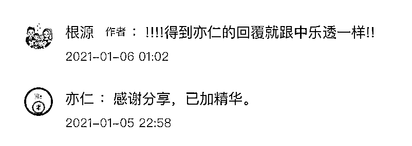
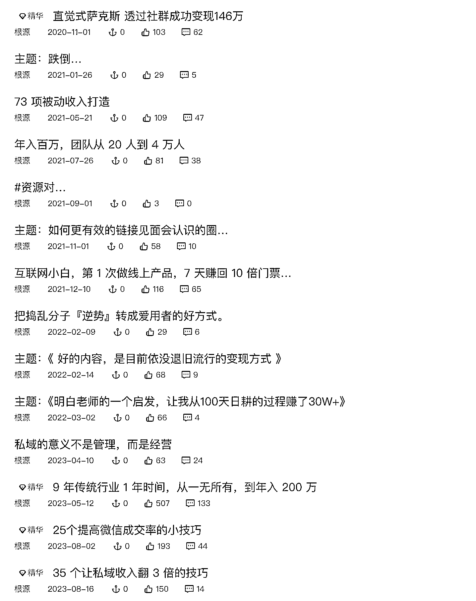
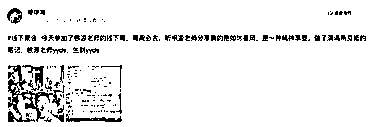
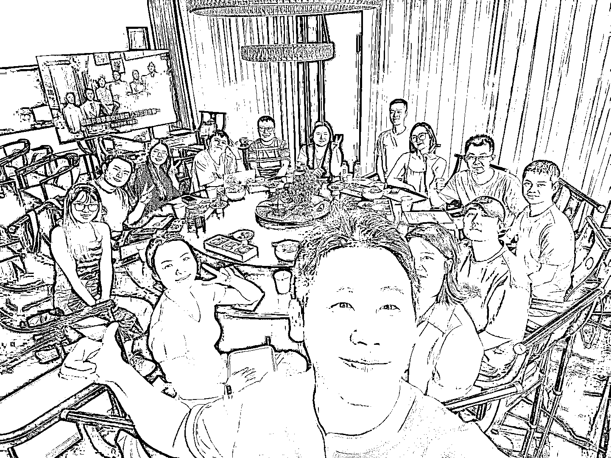
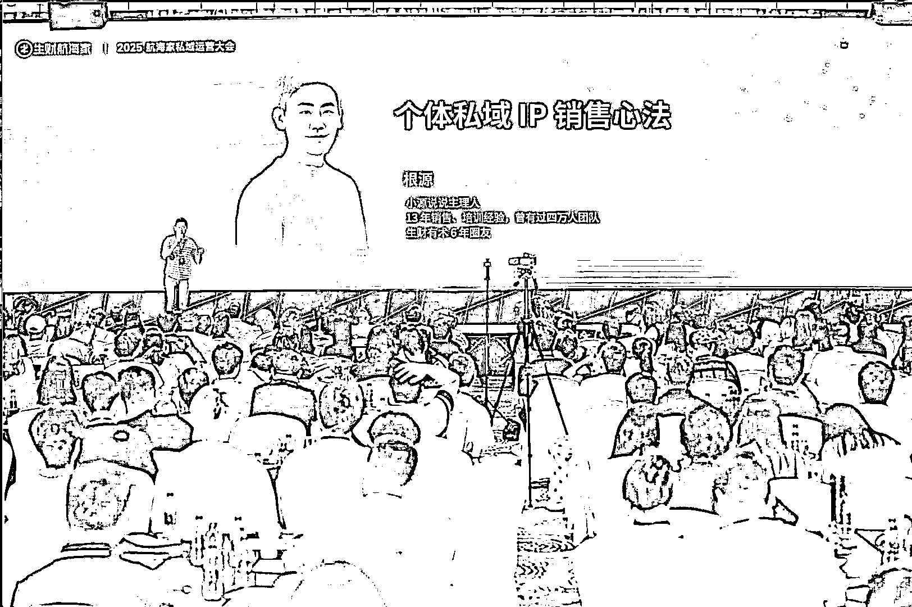
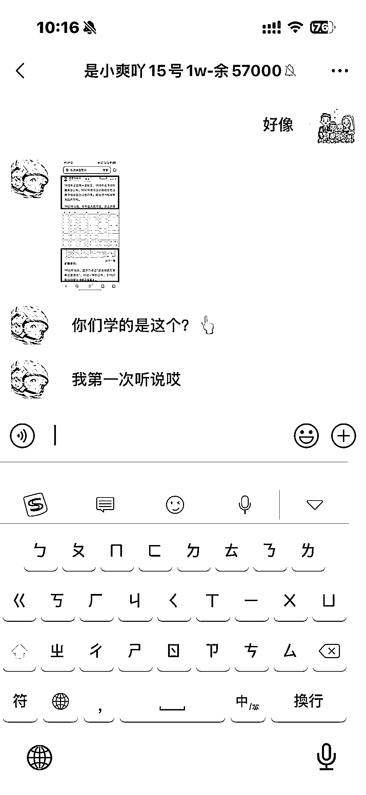

# ('(精华帖)(113 赞)主动社交的力量，让我从负债百万到稳定变现，迎来喜欢的生活', (2, 42))

如果说，有什么能把我从负债百万的坑里拉出来，并让我此后稳定变现、过上喜欢的生活，那一定是“主动社交”。

你见过这样一个男人吗？在陌生的城市，背着上百万的债务，身边还躺着刚出生的儿子。我见过，因为那个人就是我。

我是根源。2020年4月，我加入生财。五年多过去，我拿到了20篇精华帖，成为资深传术师，组局7场，也当过时间管理航海教练。现在主攻知识付费，自己做了一个小品牌，叫“小源说说”。

不少圈友问我，一个欠着百万外债、连下一顿饭都要精打细算的人，后来是怎么活的？说实话，这段路一点儿也不励志，更不鸡汤，甚至有点笨。但转机，就是从主动社交开始的。

当初大儿子出生，我在一个完全陌生的地方，熟人一个没有，过去所有引以为傲的经验仿佛一键清零。那一刻，我选择把做了13年的销售、培训本事全部打碎，用最笨、最扎实的方式重新起步。而主动社交，就是我这套新活法里的第一根支柱。

主动去连接、去分享、去组局、去帮忙，不怕没回应，也不怕被拒绝。就是凭着这股子笨劲，我这个曾经的“小透明”，在生财这样高手云集的社群里，一步一步被看见，又一点一点积累起自己的影响力。

接下来这篇东西，不只是我翻盘的经历，更是一套我自己走通的“脱困方法论”：心态怎么调整，目标怎么设立，每一步怎么小步快跑地修正，以及普通人怎么在社群里把存在感变成影响力。

如果你此刻也在迷茫和低谷里，希望我这些踩过坑、熬过夜的经历，能给你一点启发，也给你一点劲。我们一起去换自己喜欢的生活。

想舒服点阅读，可以点这个飞书链接：https://oee5lr7gsk.feishu.cn/wiki/YkdbwQuxWiwARwk2Ko1cVChCnCe

那么，正文开始。

