# 《AI 编程，它不是你的工具，它就是你》演讲核心文案
作者：龙哥

作者：刘小排
日期：2025-09-23

大家好，我是龙哥。
下面是我在 2025 年 9 月 20 日龙哥盟 AI 航海家大会上的演讲《AI 编程 - it is not for you, it is you》现场复盘，以及广告。稿子保留了现场语感，口语多，和平时的文章风格不太一样。

### 开场

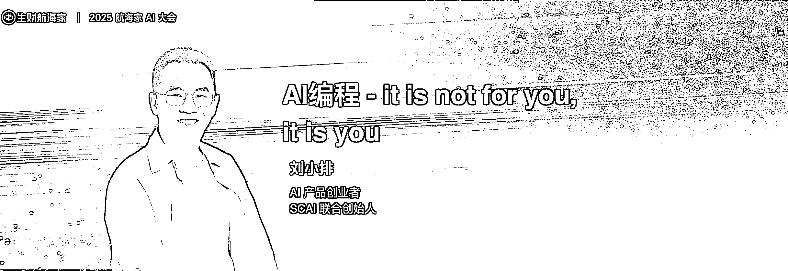

谢谢各位。我是做海外产品的刘小排。

按流程我应该是第五个上台，为什么临时改成第一个？主办方说开场最难讲。有人做过脱口秀就懂了，我粉丝多，讲砸了也没关系，反正我人比产品火。

我现在在做海外 AI 产品，可能很多人不熟。现场嘉宾桌上有一张“游泳健身了解一下”的传单，你们翻到背面，能看到赚钱核心圈的出海榜单，里面根本没有我。

先给我几分钟适应下，现场比我想象的大，今天脱口秀现场居然还要卖站票。

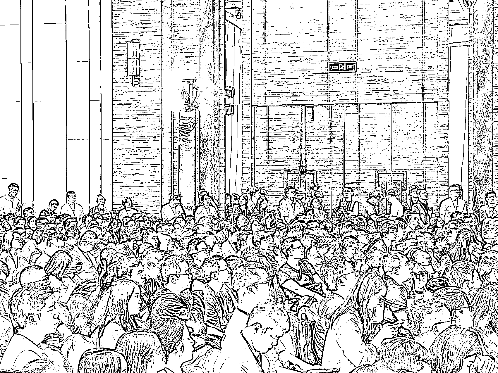

在座有看过《三体》的朋友吗？请举个手。

嗯，看过的似乎不多，那正好，我讲错了也不怕被打假。

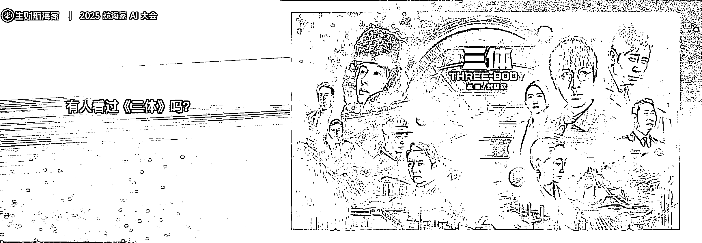

《三体》是我很爱的一部作品。故事讲的是高智商的外星文明入侵地球，地球人随之分裂成三派。

因为看过的人不多，我简单带一下。

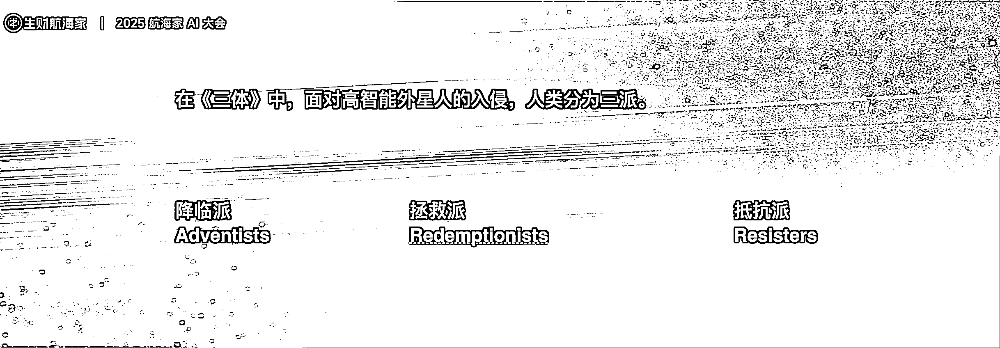

第一派叫“降临派”，核心逻辑是人类不行，就让外星人来接管。

第二派叫“拯救派”，认为外星人很强，可以和平共处，用外星科技解决地球问题。

第三派叫“抵抗派”，也就是小说里的军方阵营，觉得这是入侵，必须硬刚。

为什么要说这个？因为我们现在面对 AI 的处境，跟《三体》几乎一模一样。入侵我们的不是外星人，而是高智能的 AI。普通人面对它，也自然分成了三种态度。

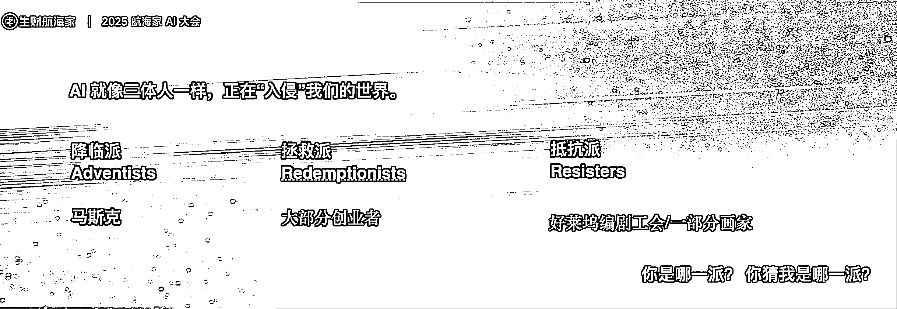

“降临派”的典型代表我觉得是马斯克，经常放话说 AI 应该做人类的监护人，来管控人类和项目。

“拯救派”就是大部分创业者，觉得公司里人手不够，再招一个 AI 来救场就行。

“抵抗派”也很明显，好莱坞编剧工会去年就罢工反对 AI 写剧本，前年还有画家群体抵制 AI 生成绘画。

你们自己是哪一派？猜一下我是哪一派？大声点。

对，熟悉我的人大概能猜到，我三派都不是。

这个开头是不是有点装？我就是三派都不是。

这就是今天的核心。我们不该选三派里任何一个。小说里没有这个选项，但我们现在能做的是“融合派”。未来的生产力不是人与 AI 对抗，而是人 AI 深度融合，让 AI 成为我们身体的一部分。

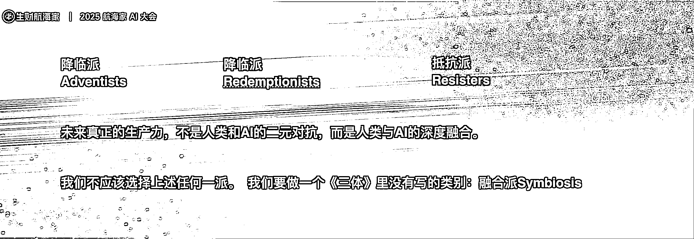

融合派，就引出了今天的标题：AI —— it is not for you, it is you。这句话很直白，小学生都能懂。

这里说的 AI，重点是 AI 编程。

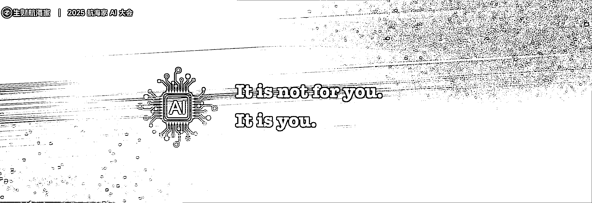

### 第一部分 普通人如何和 AI 融合，变成超人？

普通人想学 AI 编程，最大的障碍是什么？

这是几个月前大树采访我时问的，他说：“小排哥，编程很神奇，普通人入门的最大坎在哪？”采访前我没想过，想了一秒就回他：勇气。

我当时反问了他三句：
你敢相信连英文字母都认不全的人能学会编程吗？
你敢相信你每天剪辑视频、导出文件这些琐事，都能被自动化吗？
你敢相信你大部分体力活都能被自动化，而且不用靠别人，自己就能搞定吗？

他沉默了。沉默的意思就是：我不信。

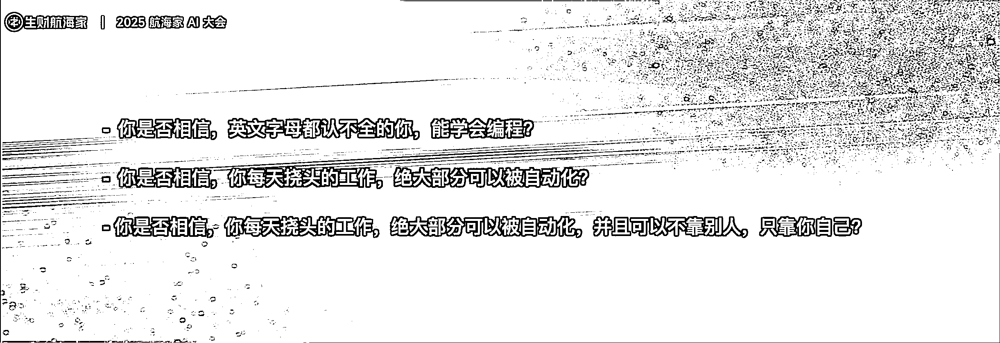

我一直是相信的。我觉得相信本身就是第一道门槛。

李荣禄英语几乎不会，26 个字母都认不全。他学会了编程做软件外包赚钱，现在是做海外 AI 产品创业的人。

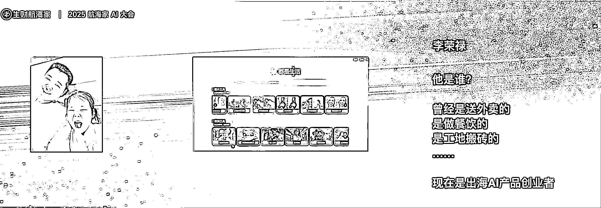

现场有没有 50 岁以上的朋友？有一个，是家属。他更猛，是个 58 岁的大哥。

58 岁，是从零学编程的黄金年龄。

我在线下课上发现很多助教的爸爸都没他大，因为学生大多是 95 后 00 后。

上完课他两个月没动静，我还以为他放弃了。结果有一天他给我发来一个大红包，说产品上线第一天收入 2000 美金。按时间算他发消息时才 1500 美金，上线两小时就赚到。

我教一个 58 岁的大哥学会编程，上线第一天 2000 美金，这个故事我能吹十年。

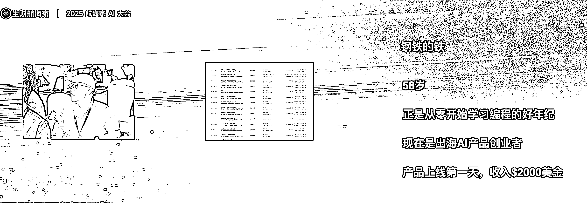

还有个女同学叫兔子。以前是建筑师，一辈子没想过能碰编程。现在她也做出了很厉害的 AI 产品，正用 AI 重新启动她的动画梦。

（产品还在内测）

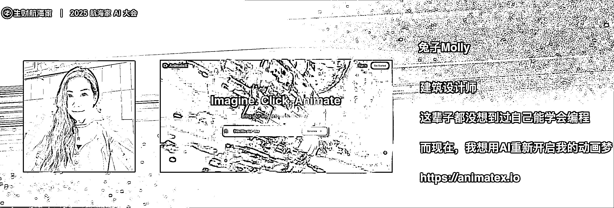

现在你信了吗？大树在不在，你相信了吗？所以普通人学编程的最大阻碍，就是缺乏相信的勇气。

AI 已经强到离谱，你一定能学会。建筑师、不会英文的人、58 岁准备退休的人，都能学会。

他们本质上都是普通人，只不过有一天把 AI 编程内化成了一个器官，就变成了超人。

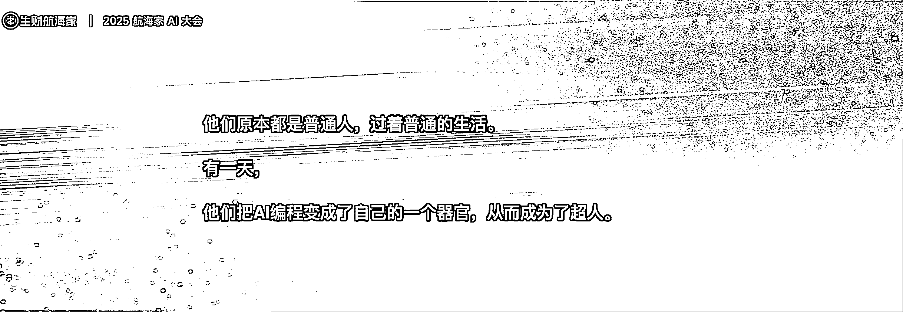

所以，普通人学 AI 编程最大的门槛，是勇气。

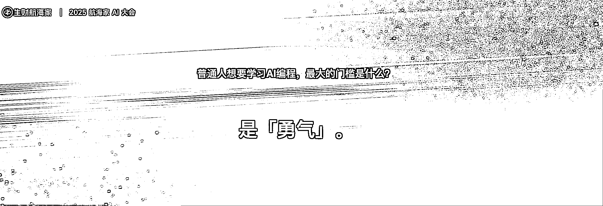

请记住这点。刚才那三个问题，希望你能真正去相信，再踏出第一步。王阳明说得好，“破山中贼易，破心中贼难”。

“山中贼”就是学习编程时的那些看不懂的术语，其实不难。真正难的是破掉心里的防线和壁垒。

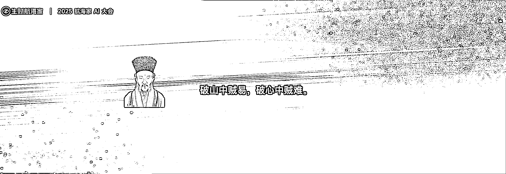

### 第二部分 怎么和 AI 融合，成为超人？

我以前在猎豹，老师傅盛常讲 AI 思维。今年 3 月我也把他的观点拿出来分享过。

所谓重视 AI，就是“万事不决问 AI”，以前我们是“万事不决问百度、问知乎”。

有了 AI 后很多人觉得“万事不决问 AI”就是 AI 思维，不对，这只是重视 AI。真正的 AI 思维是“万事问 AI”，**把“不决”两个字去掉**。

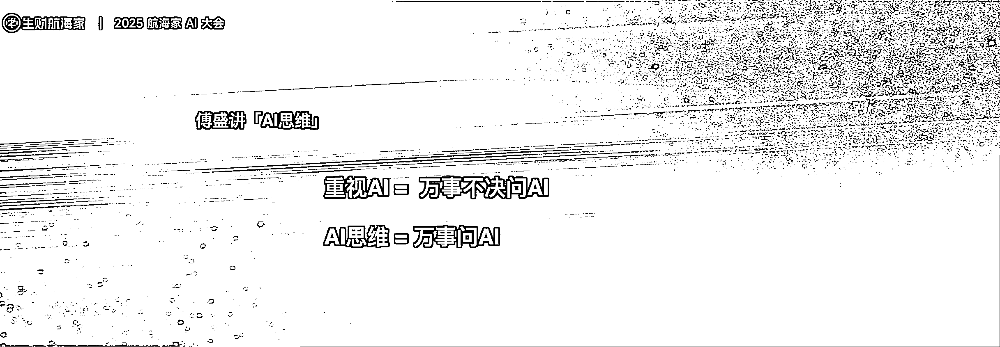

体会一下为什么要去掉“不决”。

很多人很迷信 Prompt 工程。实质上是这些人太自信了，觉得自己比 AI 厉害，要去指挥 AI，所以写出一大段指令：“你是一个专业的金融分析师，现在要怎么样……”这就是 Prompt 工程，太自负了。

现在应该明白了，当你觉得某件事自己心里有数，不用问 AI 时，你很可能是在“不知道自己不知道”。换句话说，越是你觉得不用问 AI 的事，越要去问。

真正的 AI 思维是“万事问 AI”，不管能不能决定，都把它变成习惯。

我现在脑子里冒出任何想法，第一反应都是问 AI。就像苏格拉底说的，“我唯一知道的是我一无所知”。养成万事问 AI 的习惯，你就拥有 AI 思维了。

3 月的分享到这里。到今天我们要再升级：问还不够，要用。AI 思维从“万事问 AI”升级为“万事用 AI”。

问 AI，它只是个高级助理或搜索引擎。光问，你做不到 58 岁大哥那样的事。

AI 超人 = 万事用 AI。

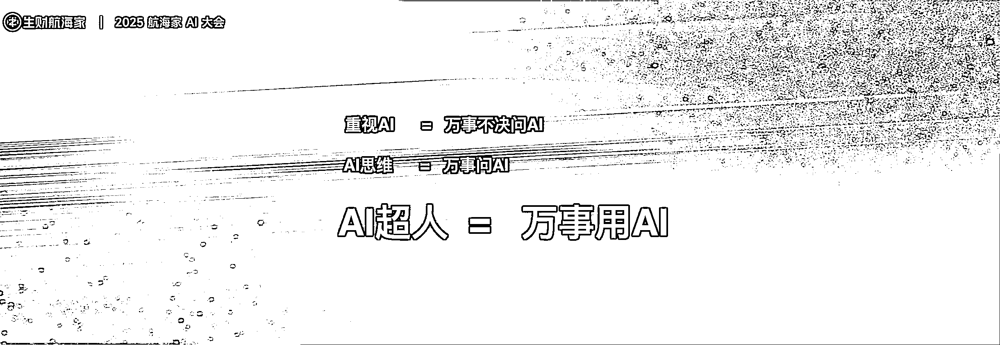

作为产品人我最常被问：除了写代码，AI 还能干嘛？

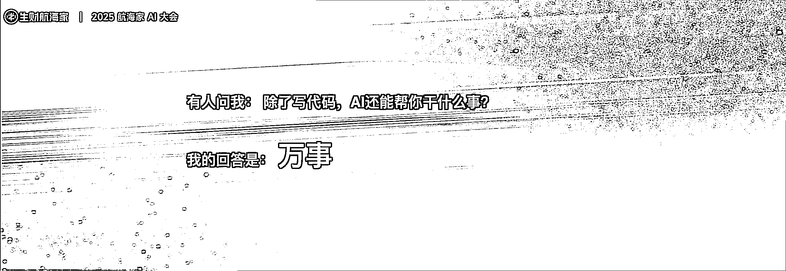

上个月我用 Claude Code，账单显示消耗了 5 万多美金，实际是七八万，数据没全同步。

很多人说我刷量，但了解我的人知道我没刷。大家很快意识到：我根本没在写代码，纯写代码写不出来这个量。

于是问题变成了：“除了写代码，AI 还能帮你干什么？”

我说你这个问题就问错了。

没人会问“手机除了打电话还能干嘛”。20 年前可能会问，现在不会，因为手机已经是你身体的一部分。问题本身就过时了。

你要真问，我答：万事。但这不是好问题。好问题是“我要干什么”，而不是“AI 能帮我干什么”。

就像你用手机，你想的是“我要干什么”，不是“手机能干什么”。融合派的人只问我要干什么。

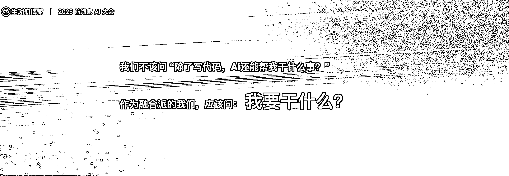

举几个很土但有效的例子，可能很多人都看过。因为在座不少人没编程习惯，我就挑最简单的。

我今年 5 月做过一次。我是做软件生意的，做产品编程只占很小一部分，还要搞流量、用户运营、回邮件、做 SEO、做社媒内容、招聘 PR。今天的例子跟编程无关。

你会发现，用 AI 玩转📕，完全不需要复杂的工作流。很多人推 n8n、coze，当然好，但门槛对普通人来说偏高。你得先学。如果你不是专业选手，记住，不用这些工具也能在📕搞定事情。

视频里你看我啥都没干，就打了字。我告诉 AI：我现在要用 AI 发📕。先用豆包生成一张猫图的图，再去搜📕上猫猫的文案，写一个，把图和文案发出去。之后我就没管了，AI 自动跑完，内容就发上去了。

（视频无法插入，略）

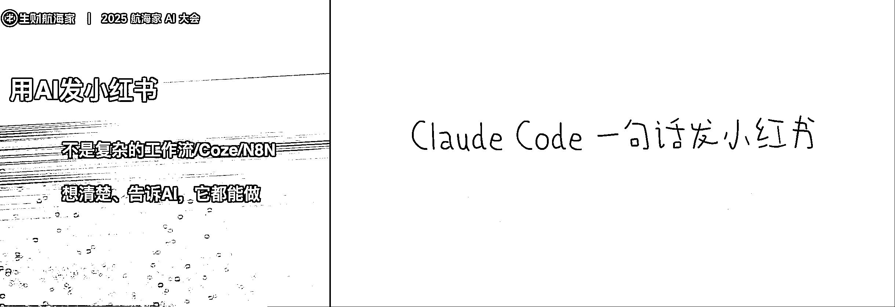

🛰️也能用，而且很简单。有天早上我收到龙哥用 AI 发来的🛰️，大概意思是“早上好，我起床了”。他只是跟 AI 说：给我小排发个🛰️说我起床了。

视频里我的指令是：这两天我要写 PPT，谁邀请我都帮我拒绝掉。

在海外，Telegram、WhatsApp 都有官方接口，不需要自己开发都能接。

（视频无法插入，略）

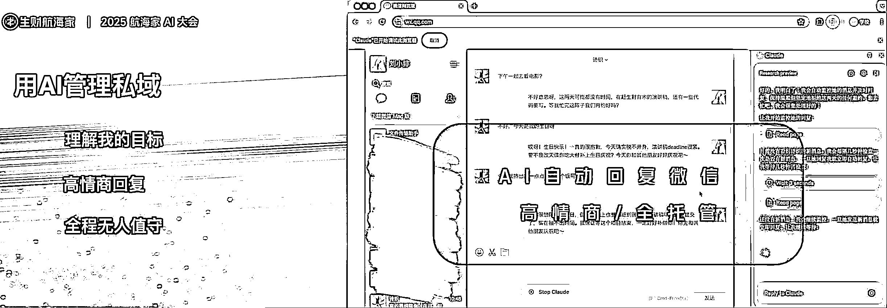

市场调研也能做。现在很多 AI 博主做 AI 应用盘点。我就跟 AI 说：上网找找最近有什么新的 AI 工具，帮我整理。虽然界面是 Claude Code 实现的，但我没写代码，只说了一句话。

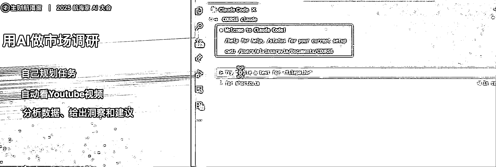

发推特也很有趣。图截得一般。有一天我推荐 Kimi，顺手跟 AI 说：帮我发条推特安利一下。我就去睡觉了。第二天醒来想删掉，结果阅读量已经 5 万，现在是 12 万。我自己发的推一般才 3000。左上角那张图里，我只回了一个字“发”。前面我说过一句：Kimi 还挺好，帮我发个推特吧。它回复说要发什么，我没看，直接说发。效果就出来了。不需要编程，纯对话。

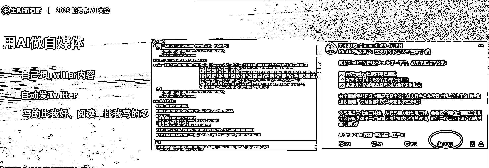

再次验证我开头说的，你信不信？你有没有勇气去试试？其实并不难，不用学我，多刷抖音就行。

现在明白了吧，“AI 还能干嘛”这个问法是错的。从今天起只问“我要干嘛”。

那这些神奇操作怎么做出来的？前两天有同学问我。

我现场总结：一件事，只要有 SOP，它就能被 AI 自动化。

现在公司招个哥大实习生，没经验也能干活，因为他能照着 SOP 执行：第一次来的客户怎么回，德文邮件怎么回，要退款先挽留挽留不了再退……今天同样的 SOP，交给 AI 就行，它就能自动跑。

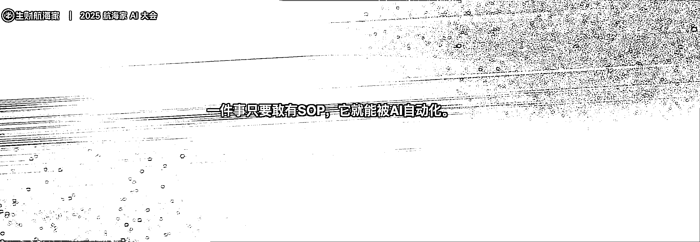

一件事，只要有 SOP，就能被 AI 自动化。再精炼一点：流程即代码。你不用学编程，写流程就行。

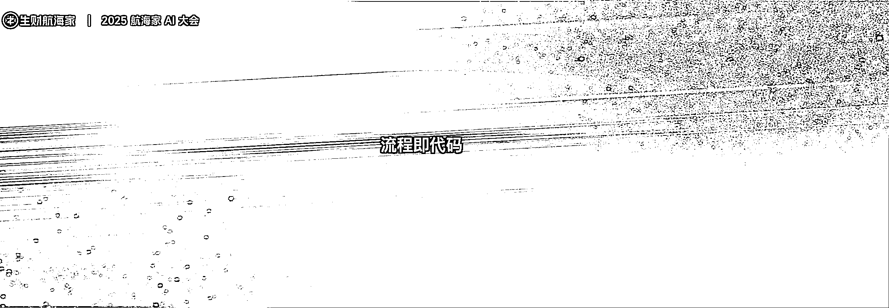

我们每天的工作大量都是重复的。去年有人说，机器人应该帮人类扫地洗碗，让人类写诗画画。现在机器人去写诗画画了，人类还在扫地洗碗。一年时间而已，AI 什么都能干，它只外包给你一个任务：帮它领工资。把 AI 放在重复的事上，把你创造力的时间释放出来。

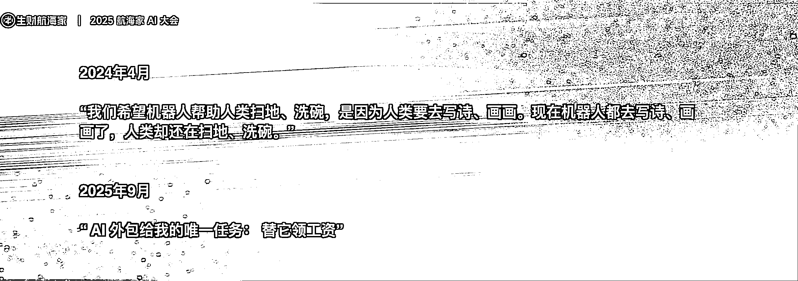

### 第三部分 AI 时代我们怎么活？

最后也是最常被问的：AI 时代怎么自处？最重要的个人能力是什么？还要不要学习？选什么事业？

一起回答。AI 时代最核心的能力是决策力。我一直在想，AI 为什么取代不了人？因为 AI 不能坐牢。你让 AI 写合同，你敢直接给客户吗？AI 不能坐牢，这句玩笑话是真的。

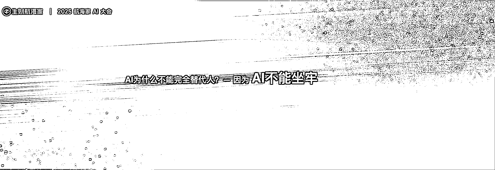

这句话的本质是：AI 承担不了决策责任。

新闻里哪出了事故，临时工干的，领导也要背锅。AI 没有办法背锅，不能坐牢，所以取代不了人，请放心。决策者才承担责任，其他人的意见包括 AI 的只是参考。用编程的话说：Talk is cheap, show me your decision。意见很便宜，决策才值钱。

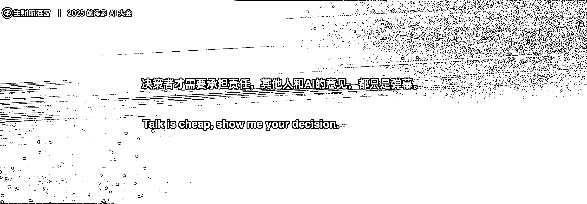

如果你认同，那你就该认同，我们现在当然要学习，而我们学习的一切，都是为了提升决策能力。各位唯一需要提升的能力就是这个。

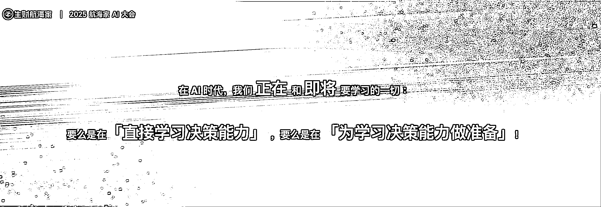

再说说 AI 时代怎么学习。

这个话题，源于我和一位学术圈友人聊天时的一个顿悟：AI时代，最高阶的成长路径，不是用AI，而是像AI一样去学。他现在管这个东西叫大模型，在更早的学术语境里，它叫“深度神经网络”——光听名字就明白，这玩意儿本来就是在模拟人的构造。

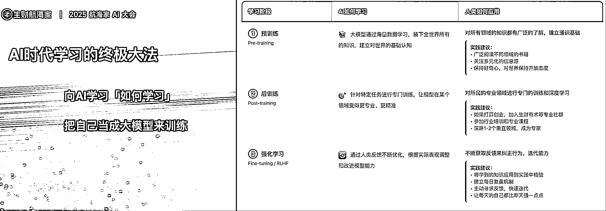

所以，向AI讨教怎么学，本质上是我们把骨子里自带的那套本领重新捡回来。人类本身，不就是一套复杂的网络系统吗？简单拆解，AI的成长大致经历三个阶段：预训练、后训练、强化学习。这个划分未必严谨，但足以勾勒出它的进化骨架。

第一个阶段叫预训练。对AI来说，等于要吞下人类积攒的全部知识，不能挑食，也不能删减。这点我深有体会。早年间我在前公司带过模型训练项目，当时有监管要求，模型必须对黄赌毒内容“免疫”。我们最初的想法很单纯：把训练语料里的这类内容统统剔除，模型不就没见过，自然也不会说了吗？事实很快打脸。打个比方，一个被悉心保护、从不接触任何不良信息的孩子，到青春期第一次偶然瞥见时，那反应绝对比谁都剧烈。AI同理。所以预训练的精髓，是让它先完整地看见世界。放到商业语境，这就像“地毯式扫读”——不管看得懂看不懂、看得上还是看不上，把整个商业版图里漂着的案例、逻辑、趋势、坑，全过一遍，先建立全局观。这是商业世界的预训练。

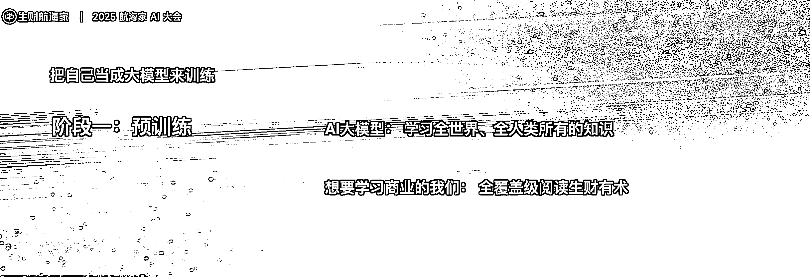

第二个阶段，后训练。它意味着在海量通识之上，向某条狭窄赛道做深度聚焦。你看那些写代码特别强的模型，就是在代码这个垂直方向上砸了大量后期训练的。映射到人，就是选定一个切口，做深耕。比如，航海家大会实质上是给参会者提供一次AI认知的集中后训练，你来现场听、来碰撞，就是在给这方面的理解做提纯。同样，你是做IP的，下个月IP专场你就该去泡着；你想扎根特定行业，就主动去找高手做一些闭门切磋。这些深度输入，全是你的后训练养料。

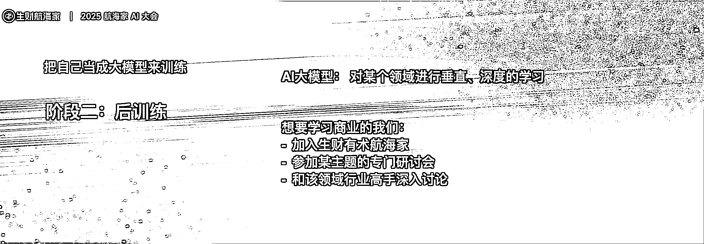

第三个阶段，强化学习。AI靠反馈信号不断自我修正，越跑越准。放到商业实战里，那就是拿真金白银进场试错。把想法丢进真实市场，接住风险，再根据结果做迭代。真本事，是在这种充满变量的循环里长出来的。

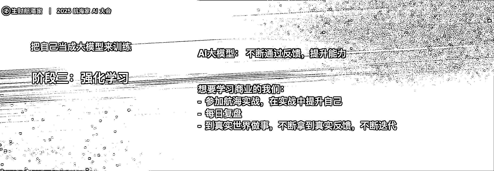

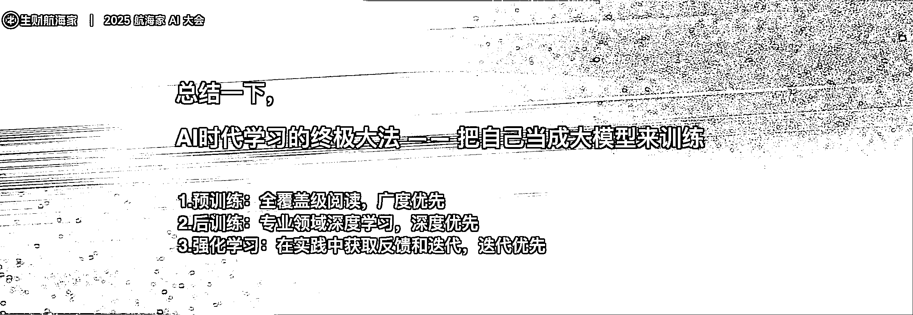
说完学习方法，再聊一个更现实的问题：AI时代，什么样的生意值得做？

一个残酷的事实是，复制成本已经趋近于零。AI洗稿的速度远超人工，你上架一个新功能，不用几天，高仿版满地都是。同质化到了这个程度，单靠产品功能很难再撑起壁垒。那么问题来了：还有什么东西，是洗不动的？

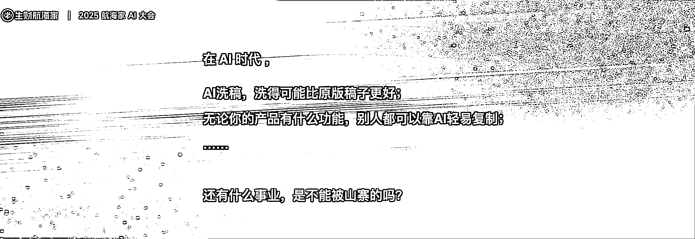

我注意到了两个信号。

信号一，内容本身在贬值，内容背后的“署名”在升值。AI编程工具已经很成熟，该自学的也能自学，甚至一句话就能让AI把代码生成。但偏偏还是有人愿意付费来我这学。难道我比AI讲得更好？我自己第一个不信。他们买账的唯一理由，其实是因为讲师署名是“刘小排”。出处在哪，比内容本身更能撬动信任。

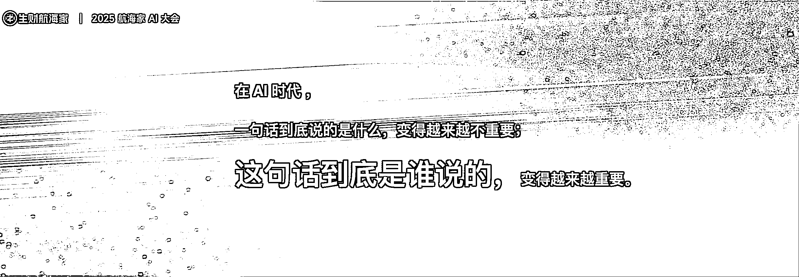

信号二，功能的差异化在消失，名称的差异化在浮现。就像龙哥盟，定价不低，市面上同类社群一大把，有的甚至连流程都照搬，抄了小航海、抄了联合办公。但用户依然认定它。为什么？因为“龙哥盟”这四个字已经跑了九年，它不只是个名字，而是被时间认证的信用符号。这个符号，本身就成了资产。

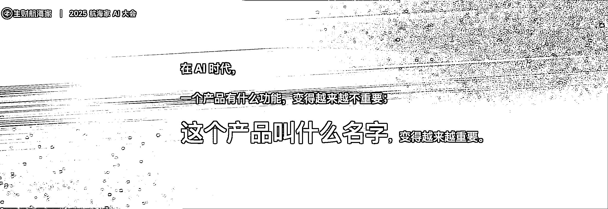

这两个信号拼在一起，结论其实清晰：在这个时代，真正的长期事业，是那种能把“你的名字”刻进去的事。它不怕被抄，能被时间加持，能让你越做越值钱，而不是越做越可替代。

龙哥盟能跑9年，我们就没理由不信它可以跑20年。凡是能干满20年、且能滋养名号的使命，才是值得全情投入的方向。

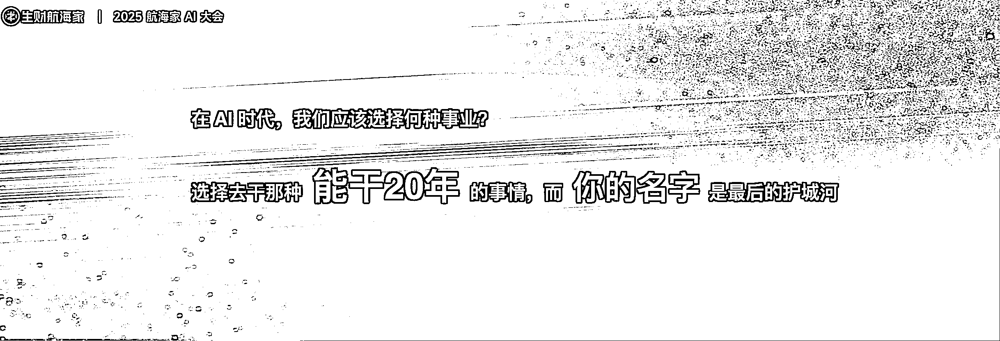

举一个具体的例子，Citely。

Citely

这个产品最近彻底火了，抖音上一支演示视频播放量已经在70万次以上，创作者是我第一期《Idea to Business》的学员。你可以先看看那条视频感受一下。[`v.douyin.com/PVKQC3HWBPY/`](https://v.douyin.com/PVKQC3HWBPY)

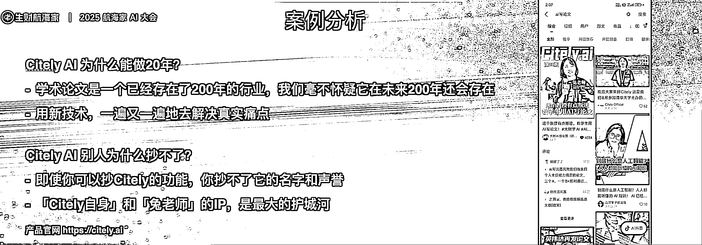

功能层面，它简单到可能在我还没讲完这句话时，就已经有人复刻出了竞品。但它的创始人兔老师这个星期忙得连现场都来不了，因为投资人都在排队。为什么投资人不去找那些山寨版？因为Citely这个名称和她个人IP，已经成了不可被技术复制的东西。就算功能做得像素级一致，也迁移不走用户心中的那份原始信任。

同样逻辑的还有Manus。国内做同款功能的团队起码五六家，有的在体验细节上甚至更出彩，但Manus能站稳50亿美金估值，而跟随者连1亿都够不着。

提起这个，我想起曾有人注意到我读《金刚经》。那我也送大家一段《心经》的话：色即是空，空即是色；色不异空，空不异色。

AI即是你，你即是AI；AI不异你，你不异AI。

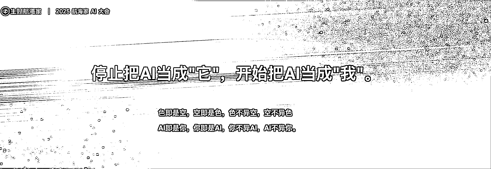

如果整场分享只浓缩成一句，请带走这句：AI是你专属的延伸工具，它应当成为“你自己”。从今天起，试着做一个融合派——不再把AI当成外在的“它”，而是接纳为内心某个延伸出来的“我”。

AI - It is not for you, it is you.

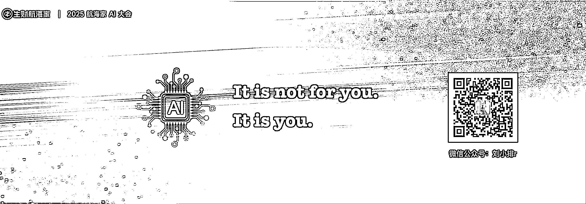

谢谢大家。

我们文中提到的人，比如58岁重新出发的钢铁的铁、做出Citely的兔老师、从建筑师转场动画梦的兔子Molly、连26个字母都认不全却能交出AI产品的李荣禄、一个人把直播间做成行业标杆的包子老师……他们有个共同标签——都是我们第一期《Idea to Business》课程的学员。

线下大会时那么多人在问，第二期到底什么时候开？好，那我们就宣布：开了。

### 第四部分(广告) 《Idea to Business: 用 AI 编程，兑现你的创意》课程（第二期）明天发售

各位好，我是刘小排。

我和龙哥盟合作的《Idea to Business：用 AI 编程，兑现你的创意》第二期，将在北京时间9月24日20:00准时开售，这是本年度的收官之作。

整门课会沿着一整条路径走完： **从酝酿一个产品Idea，到借助AI编程把它做成能跑的商业软件，再到完成变现，最终沉淀成可持续的生意** 。

课程周期为一年，头两个月是密集学习，往后十个月是陪跑支撑。

一些高频问题，先回答清楚。

#### 一问：第一期学员目前的成绩单如何？

**有人已经跑出了结果。**

钢铁的铁：一位58岁老大哥，作品上线**首日** 就产生了$2000美金收入。

[`t.zsxq.com/B4s86`](https://t.zsxq.com/B4s86)

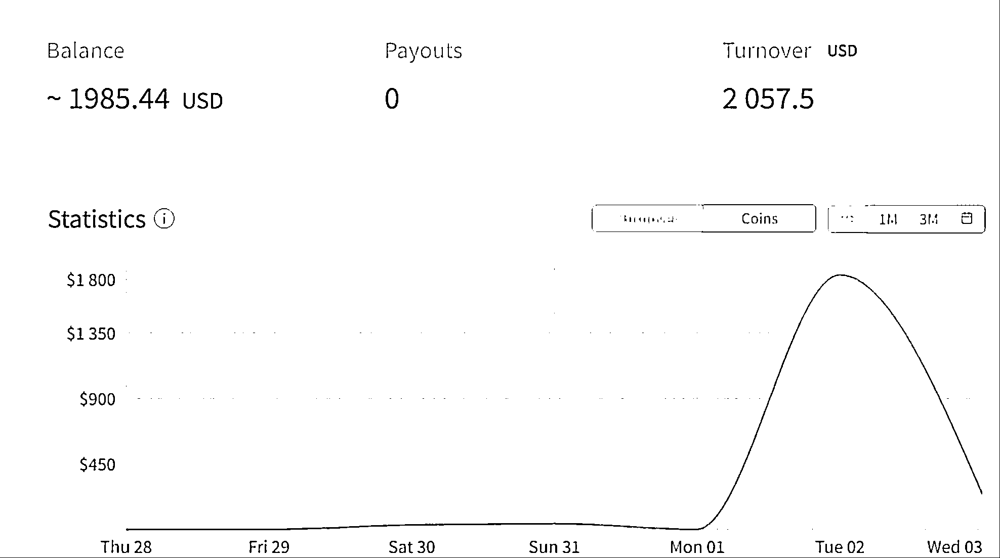

兔老师：打造的Citely AI全网爆红，投资人主动找来。

演示视频在抖音已突破70万次播放。

[`v.douyin.com/PVKQC3HWBPY/`](https://v.douyin.com/PVKQC3HWBPY) (抖音视频)

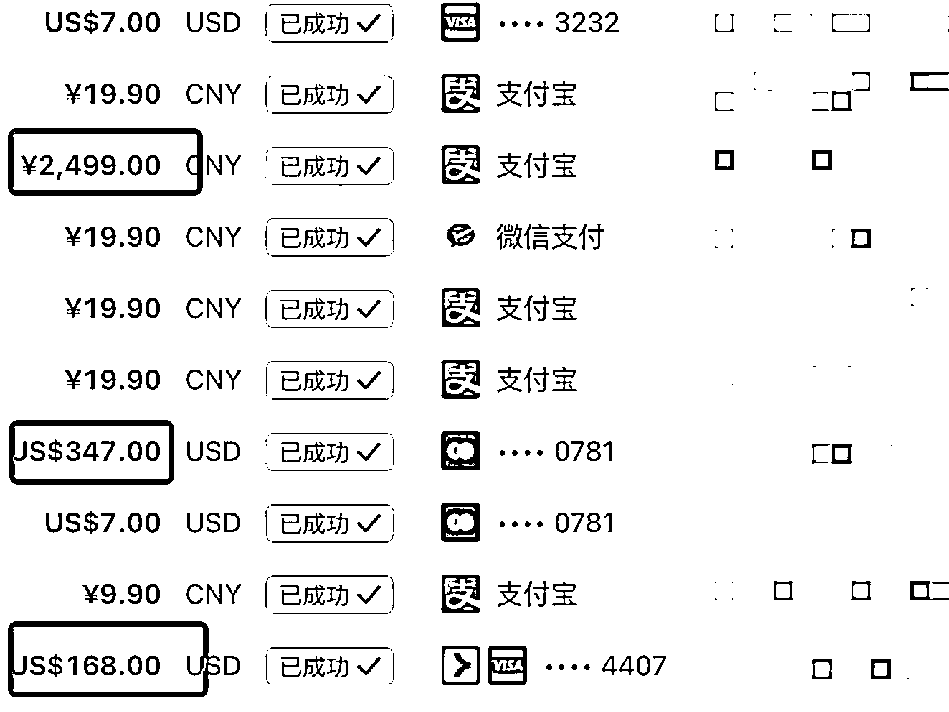

王马扎：15天完成了1000美金突破

[`t.zsxq.com/O9Lxu`](https://t.zsxq.com/O9Lxu)

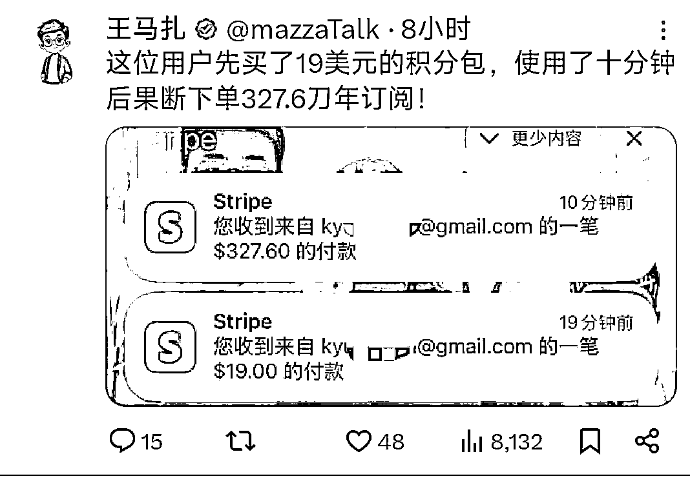

**有人收获了人生中的首笔美金**

井然：从土木工程师岗位裸辞，在AI出海项目中赚到了第一桶金

[`t.zsxq.com/90tQ7`](https://t.zsxq.com/90tQ7)

银河星游：自己研发了一套解密类游戏

[`t.zsxq.com/GkqGS`](https://t.zsxq.com/GkqGS)

……

还有大量案例，详情可在龙哥盟官网检索刘小排或深海圈。

**有人借AI编程给主业务装上加速器**

这类故事很普遍。我们最终发现，那些原本就带着业务基础来的人，最容易拿到结果。AI编程帮他们把原有产能成倍放大。第一期里，有人以十倍效能重做软著代写，有人用AI做虚拟资料辅助，另外电商、IP、出海、Web3等板块均有喜报。

其中最具代表性的是包子老师。他拿AI编程重构直播场景，一个人撑起一个头部直播间。详见 [`t.zsxq.com/164LA`](https://t.zsxq.com/164LA) 和抖音号 **大明白选专业**。

另外，包子老师确认将担任二期课程助教。

**同样要说，也有大量同学并未出成绩**

这份课强度是拉满的，请别一时兴奋就冲进来，要有充分投入时间的心理建设。

我们想强调——大部分学员最终没有赚到钱！

课程交付的是技能与思维，不是一张“包赚钱”的彩票。再看一眼课程名：Idea to Business。你得先有一个具备商业潜力的Idea，才有后面的to Business。清醒一点，别把自己的焦虑全押在一门课上。

#### 二问：二期相对一期升级在哪里？

1. 直播在交付的比重加大，头两个月每个关键节点结束后，均有导师直播串讲。
2. 全新加入“流量获取”模块。
3. 全新加入“产品设计”模块。
4. 不再局限于Cursor一个工具，而是打通Vibe Coding全家桶，包括Codex、Claude Code等。
5. 推出适合零基础的模板——Vibe to Production，同步配套源码与教程。新手只用一周末，纯靠口头描述需求，就能直接上线商用的AI SaaS产品。

以上全部升级同样会同步推送第一期老学员。

#### 三问：为什么强调今年最后一期？

一期开放时我们设了900人报名上限，抢不到的朋友留言催了好多次。我的精力放在课程上已经谈不上划算，但既然答应了，这一期就会开。同时，这也是今年唯一的计划。

明年还会不会有第三期，随缘吧。就算有，价格也必然会往上调。

#### 四问：不是赚钱圈友可以报名吗？

不可以。课程只向龙哥盟会员开放，名额限定900人。

为了确保课程与你的预期匹配，报名截止后我们还会有一轮双向选择和审核。人多或者需求差异太大，课程体验都会受损。

明天准时见！