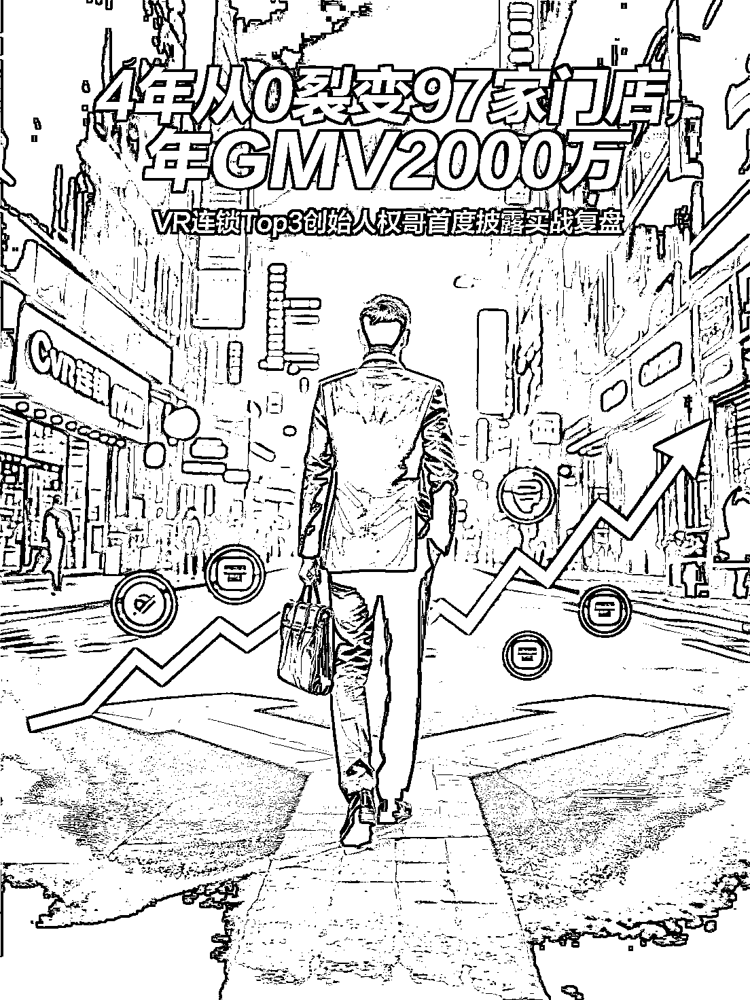
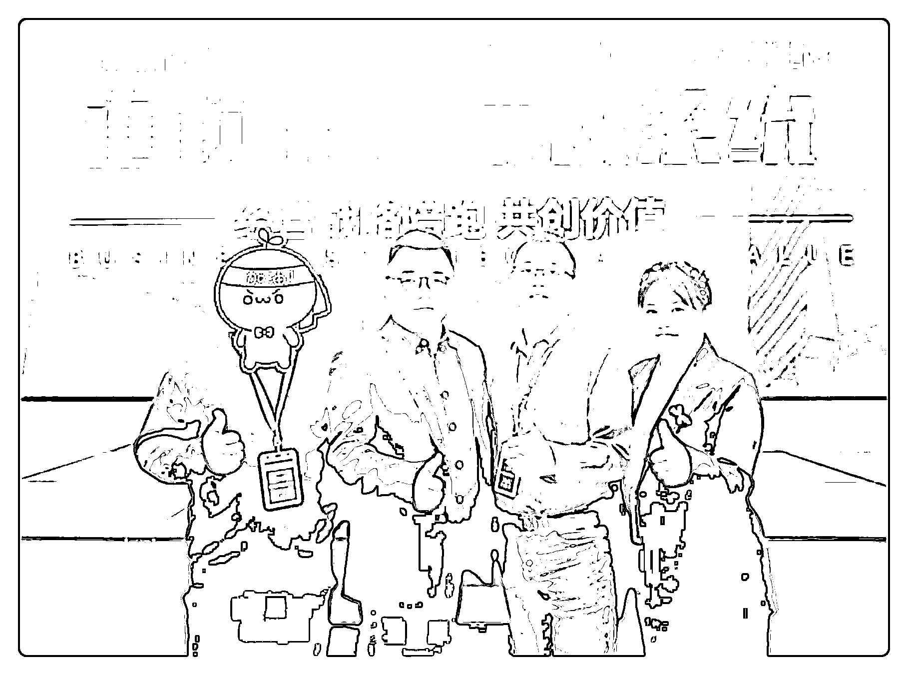
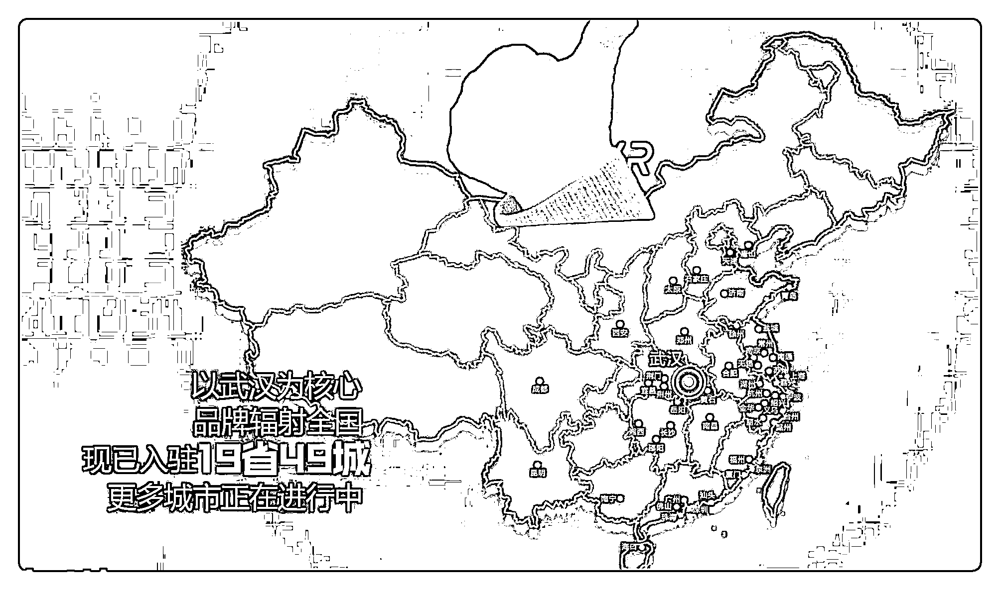

# (36 赞)4 年从 0 到 97 家店、年 GMV2000 万，VR 连锁创业复盘与再出发

四年时间，从零起步到97家门店，年GMV做到2000万——在VR连锁这条赛道上，权哥已经拼到了全国前三的位置。但就在事业最风光的时候，他却做了一个出人意料的决定：亲手把这一切清零。

最近，权哥首次公开复盘自己的创业全程，也聊到了清零之后的再出发。他没有搬出复杂的商业理论，而是把这些年踩过的坑、交过的上千万学费，浓缩成一篇万字长文。最终落地的核心，只有两个关键词：流量、人。

