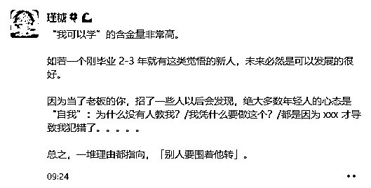
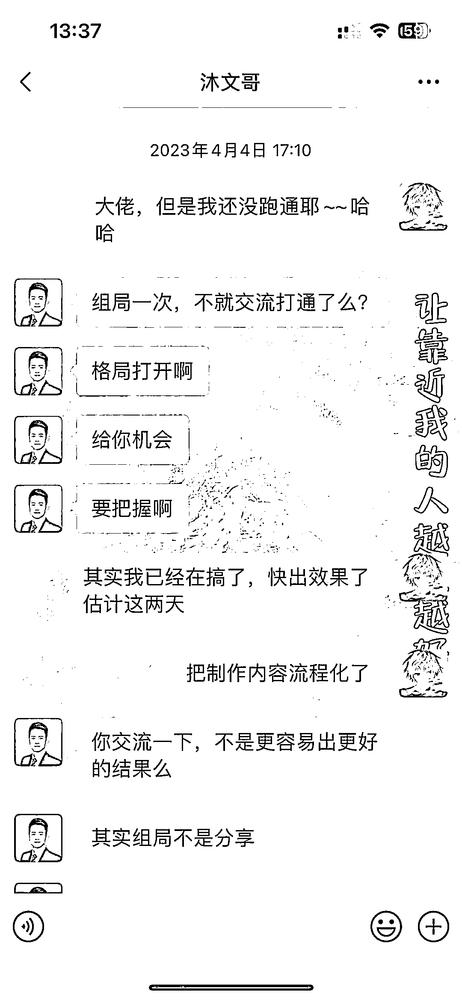
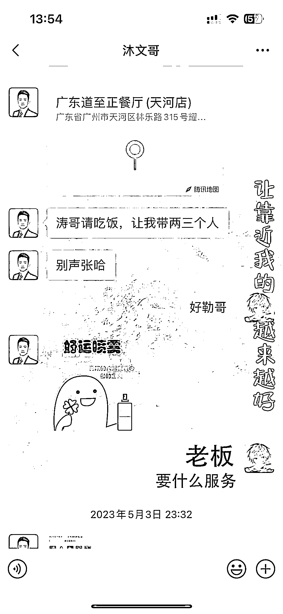
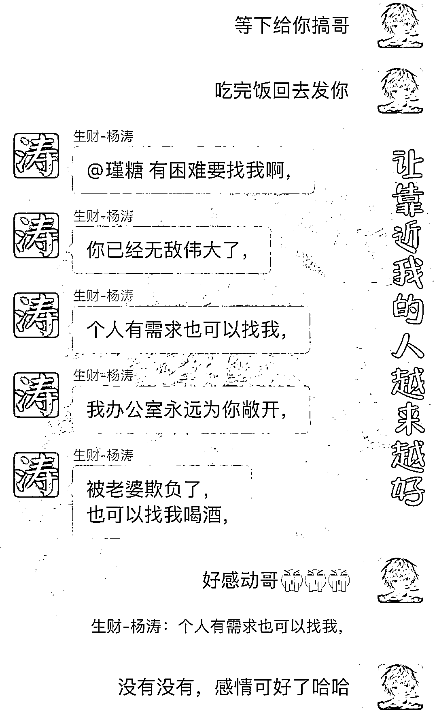
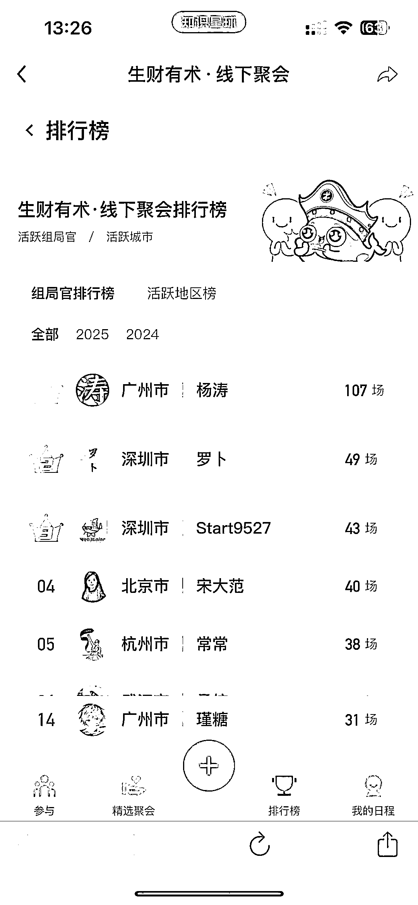
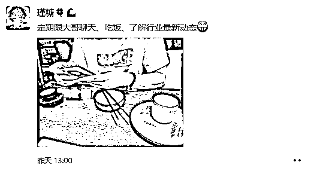
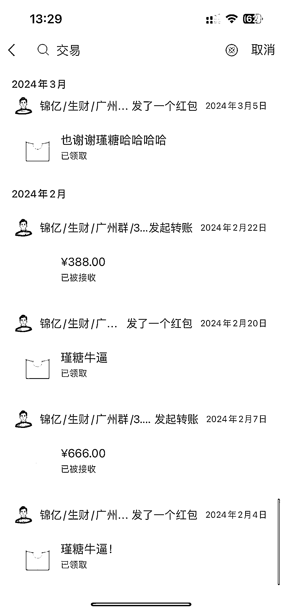
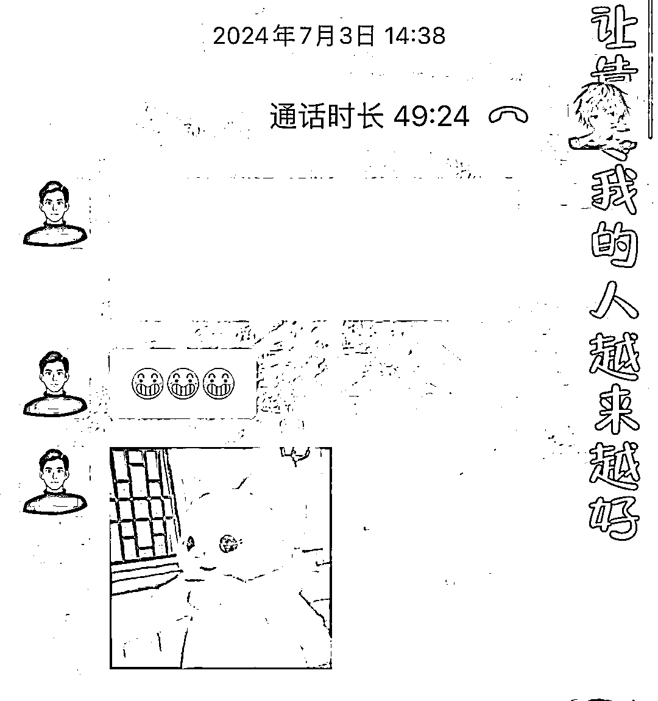
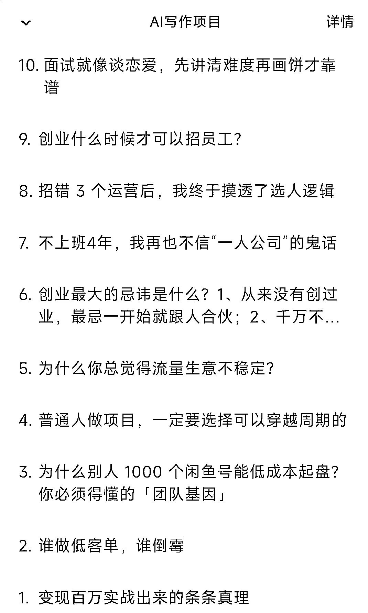

# 值不值得伸手帮你，就看这三件事
作者：龙哥

## 值不值得伸手帮你，就看这三件事

作者：瑾糖

日期：2025-09-19

今天我从两个身份聊这个话题。

**一个是我当年默默无闻、被前辈提携的阶段，**

**一个是我现在有了点成绩、开始带人的阶段。**

**想得到一位大哥的指导，本质上只有两种驱动。**

一是他在你身上看到了曾经的自己，希望你能比他当年走得更远。

二是他自己有目标需要推进，而你恰好在他身边，比其他人更像他年轻时的样子。

这就是核心逻辑。当然也有大哥天性仗义，会给所有新人一份固定的启动资源。

但要想让他持续加码，就得靠自己去争取了。

先从我的亲身经历说起，提到沐文哥的朋友应该都不陌生。他在我心里就是大哥的模板。

彼时沐文哥正全力冲几件事，而我只是他几十个小弟里不起眼的一员，最后为什么能被他单独押宝。

答案很直接。

**我是最卖力的那个**

别人一天花在老大交代的事情上大概一个小时，**我一天至少投进去 13 小时。**

他一眼就能看出，**这小子跟别人不一样。**

沐文哥曾拿下风向标王中王、带过龙珠训练营，手里的龙珠资源非常多。

他认为风向标的价值被低估了，想把里面的项目拆出来单独孵化，于是他在广州同时启动了十来个项目。

我跟进了 4 个。起初只是想跟着学，真正上手后，我没打算差不多就行，而是把自己那块做到极致。

等我把模块跑顺了，**大哥觉得我靠谱，就把整体规划和执行都交到我手上。**

第一个案例跑通时，**我会按时向他汇报进展，把高兴和结果都同步给他。**

我的高兴也是他的高兴，因为这正是他想实现的，我替他做出了第一个 MVP，刚好命中他的预期。

大哥带人干事，本来人人水平不一，

**你只要成为最显眼、最肯干的那个，** 在他心里就会种下值得投入的种子。

他清楚你会 **踏实把事情落地，还会主动回音，**
而不是把他的资源当成自己的本事，自然就会越帮越多。

沐文哥是这样，**涛哥也一样。**

涛哥会给每个人一份固定的初始帮助，但如果你能做出结果、及时反馈，还把他放在心里，他就会再往里加。

之前涛哥想把组局这块做起来，决心很大，于是把各城市的主理人叫出来做经验复盘。

我当时就想，无论如何都要帮大佬把这事推进好。

那一年我办了 40 多场局，量级比不上涛哥的五分之一，但在所有主理人里也能排得上号。

后来涛哥在群里说，哪怕我和老婆闹矛盾，半夜去找他，他办公室的门永远为我开着。

大佬召集小弟，本质是为了完成自己的目标，我们能顺带学到东西，但想多得到，就要多付出，**而回馈是最实在的付出。**

**我到现在还会不定期给沐文哥汇报近况，这就是维系信任的办法。**

还有一种大哥，不会在圈子里公开招人，他们有自己的筛选标准，多半在埋头做自己的事，未必缺人。

他们为什么会出手？因为在你身上看到了年少的自己。

他会想，如果当年有人带，我是不是能少走两年弯路。

一旦在你身上看到共鸣，就会不自觉地偏向你。

而当他的时间和精力换来你的回馈，帮助就会延续下去。

**恒哥对我就是这种关系。**

他这个级别的佬，**本不该跟我沾边，** 但因为组局认识后，我一直保持联系。

每次去请教，**我都不是空手去。**

我知道他业务盘子里缺什么，就主动把我认识的、有用的渠道和圈子推给他。

第一次找他聊后端团队搭建，他跟我聊了四五个小时，把自己盘子怎么搭、怎么培训的 **全盘托出。**

之后我也会**定期约他吃饭、汇报进展。**

团队什么状态、业务做到哪一步、接下来怎么规划，见面时会带点小特产。

不用贵重，顺手带的当地小礼物就行，他其实挺高兴。

就在昨天，他跟我说有个以前做过、随便做都能赚钱的老项目，想重新捡起来，拉我一起做。

你看，**大佬从不看你嘴上有多会说，只看你心里有没把他当回事。**

聊完被带的经历，再说说我带人的体感。

我在全力做组局的阶段，会毫无保留地分享。

我当时组局、做业务的那些核心经验，在**我眼里都是压箱底的，只要能解决问题，我都会给方案。**

这些年组局见过的人，不说一千也有八百，

**真正把我的话当回事、并给我回音的人，十个里都不一定有一个，能一直保持联系的只有一两个。**

**锦亿就是其中之一。**

他在业务扩张的路上，总会来找我。

不是单纯来要答案，而是带着问题和他自己的思路来对齐。

每次聊完，**他会把建议落实下去，后续还会主动同步效果。**

这个方案解决了什么、带来了什么成绩。

**而且每次结束他都会发个红包，这份心意和回馈，让我更愿意掏心窝子帮他。**

从他起步到现在，我们会固定聚餐、聊业务，互相给对方的板块当外脑。

反观另一些人，明明照着我的方案去做了，哪怕只做了一部分，却从没主动说过一句，我还是从别的渠道才知道的。

不是求回报，但如果他能主动讲一声，我只要有新想法，一定会再推他一把。

所以说，**拿到帮助后定期回馈太关键了，**
这对帮你的人来说是最好的回应，他能从中得到满足感。

另外，想去请教大哥，**一定要先做好功课。**

我每次去请教， **都是带着自己的思考和初步方案去的。**

但我也遇到过**有人直接问我 AI 写作有没有市场、怎么入行，**  **我直接不想理。**

我正在做这件事，**而且已经跑出成绩，50 多篇👸号文章**，那么多帖子里**都写清楚了怎么切入**，**他一篇没看就来问。**

**我要是觉得没搞头，还会继续做吗。**

当然，即便准备充分，**也要有被拒的心理预期。**

**帮你是情分，不帮是本分。**

大佬的时间非常昂贵，不会随意投放到别人身上，他们只会押注有亮点的人。

大哥的价值，是在你已经走完 99% 的时候，帮你收尾最后的 1%。

**千万别指望** 让大哥帮你走完 99% 的路。

大哥是你路上的那盏灯，照亮的是方向，**不是点燃你这盏灯的燃料。**

**世上没有无缘无故的提携，所有机会，都是你之前选择和态度的累积。**