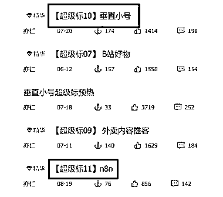
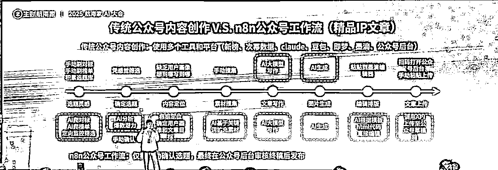

# ('(49 赞)垂直小号与工作流结合，让公众号创作效率提升 10 倍（含搭建全流程）', (2, 42))

垂直小号遇上 N8N 工作流，我的公众号生产效率实现了 10 倍跃迁（附完整搭建流程）

你有没有想过，把两个爆火的“超级标”拼在一起，会碰撞出什么？我原本也只是好奇，结果真的花了整整两天，搭出了一套从零到成稿全自动的公众号创作流水线。今天就把整个思路和实操路径分享出来。

先说下背景。7 月 20 日，亦仁发布了“垂直小号”超级标，圈内瞬间炸锅；8 月 19 日，“N8N”超级标接踵而至，又掀起一波高潮。等到 9 月 4 日大航海正式开启时，“垂直小号”吸引了 4165 人报名，“N8N”也有 3778 人报名，两个方向直接包揽了报名人数榜的第一和第二。在这个聚集了大批高认知玩家的社群里，大家用脚投票的结果，本身就说明了很多。

真正让我下定决心的，是 920 生财 AI 大会上圈友 kkk 展示的 N8N 公众号工作流。当时就被那个自动化的流畅程度震撼到了。于是我忍不住想：要是把垂直小号的内容定位能力和 N8N 的流程自动化能力深度结合，会不会让效率翻倍甚至翻几倍？带着这个念头，我埋头鼓捣了两天，终于把这套系统跑通了。

这套工作流覆盖了公众号创作的完整链路：灵感自动收集、选题智能推荐、素材抓取聚合、正文一键生成，再到 AI 配图和排版，最后成品会直接躺进你的公众号草稿箱。你只需要在发布前扫一眼，点个“发送”，完事。

详细的搭建过程我整理成了一篇飞书文档，每一步都有讲清楚，跟着操作就能复刻同款系统。链接给你放在这里：
[`a0u2vshvubw.feishu.cn/docx/UnPHdrxF7oOs9AxSjuIc0rlRnKg?from=from_copylink`](https://a0u2vshvubw.feishu.cn/docx/UnPHdrxF7oOs9AxSjuIc0rlRnKg?from=from_copylink)

有看完教程的圈友反馈说，这是目前少有的、能把 N8N 公众号工作流讲到这么清晰的帖子。还有人提出了很棒的优化建议：与其每次改提示词来切换风格、控制长短，不如直接在工作流里增加几个表单选项，让系统根据需求自动选择长篇、短篇或者不同排版风格。这个思路我很认同，本质上就是多加几个分支节点，有兴趣的朋友完全可以自行扩展。

如果你也在运营垂直小号，或者对 N8N 自动化感兴趣，强烈建议试试这套组合拳。生产效率翻倍的快乐，真的谁用谁知道。