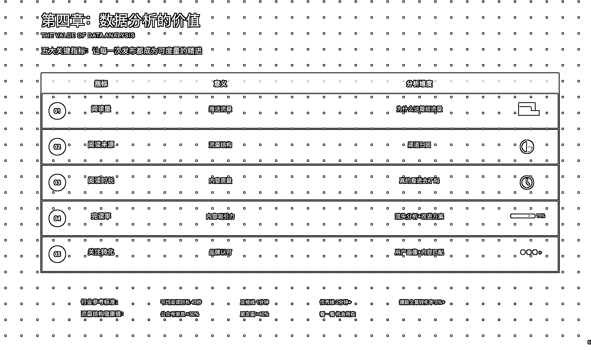
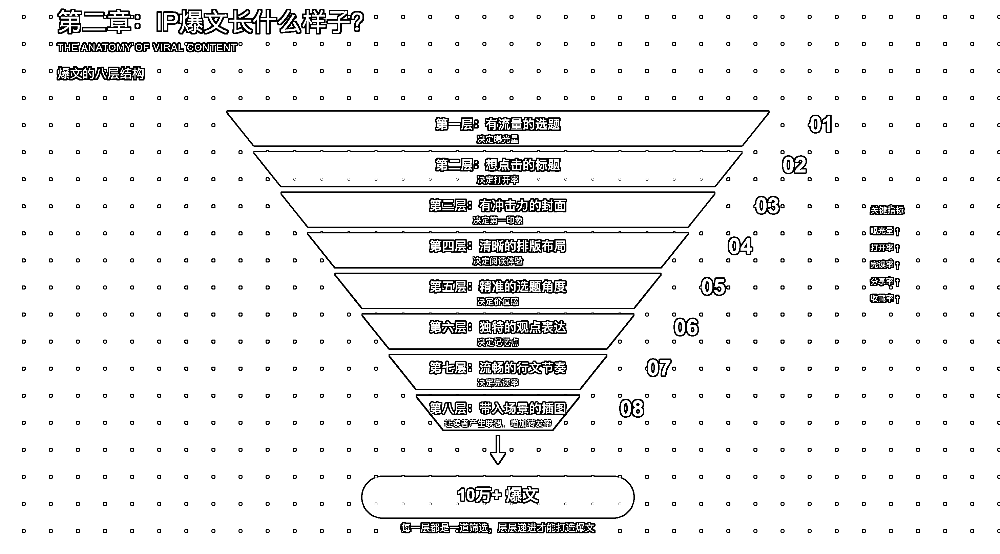
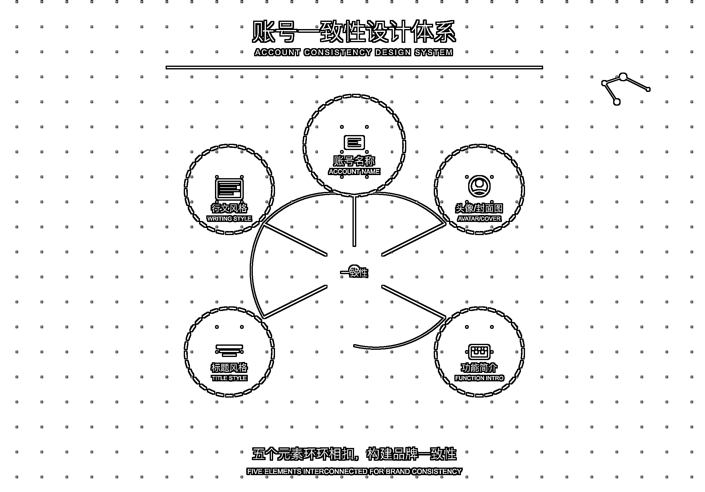

# 用 AI 重塑👸号：让你的个人品牌在算法时代被看见

## 用 AI 重塑👸号：让你的个人品牌在算法时代被看见

作者： 周知 1.0

日期：2025-09-24

大家好，我是周知，带垂直小号做成长的领航人，目前在深圳经营一家 AI Agent 公司。👸号是我作为 AI 超级个体起步的第一阵地。

过去一年里我沉淀下来的一套 AI 工具组合和数据复盘方法，今天以《AI 赋能👸号 - 用 AI 打造你的👸号品牌（加餐）》的形式，做成一份干货补充，分享给刚入场的垂直小号创作者。

短视频和直播横行的当下，很多人觉得👸号已经不香了。确实如此。但依然坚守阅读👸号的用户群，恰恰给了超级个体一个用深度内容链接粉丝的新窗口。

🛰️公众平台的分发逻辑正在发生迁移，从过去的严格订阅制，转向现在的算法推荐制。以前没有粉丝基数，再好的文章也触达不了人。现在只要内容足够硬核，系统会主动把内容推送给真正匹配的“你最深”的人群。

这次的内容我拆成 6 个模块来聊。

先聊清楚在 AI 时代，为什么“哪怕再小的个人，也能拥有自己的品牌”这句话变得更成立。再拆开一篇爆款文章背后的 7 层骨架，让你明白爆文不是靠运气，是能拆解能复刻的。

再把流量黑箱打开看。从“朋友推荐”带来的流量占比从 24.3% 提升到 45.9%这件事入手，讲讲算法到底在判断什么。

🛰️算法最看重的其实是三组核心信号：在看数、完读率、社交连接的深度。这三个指标背后，每一个都是可以持续优化的抓手。

内容形态上，长文、图文、漫画都可以被 AI 赋能提速创作。我也会分享一批真实可用的提示词，让 AI 真正变成你内容生产上的副驾。

我的一些额外思考也可以在这里继续看：[`aiawaken.feishu.cn/wiki/NzbPw4YIQiDwu0k33qhcmRy0nfa`](https://aiawaken.feishu.cn/wiki/NzbPw4YIQiDwu0k33qhcmRy0nfa)

* * *

评论区：

剑渊 : 太牛了[强]

深圳志哥 : 感谢教练的分享！！保存打印精读

ㄆ刂 丿丨 |༄༅ : 感谢教练分享，解决了我一直想解决而解决不了的问题