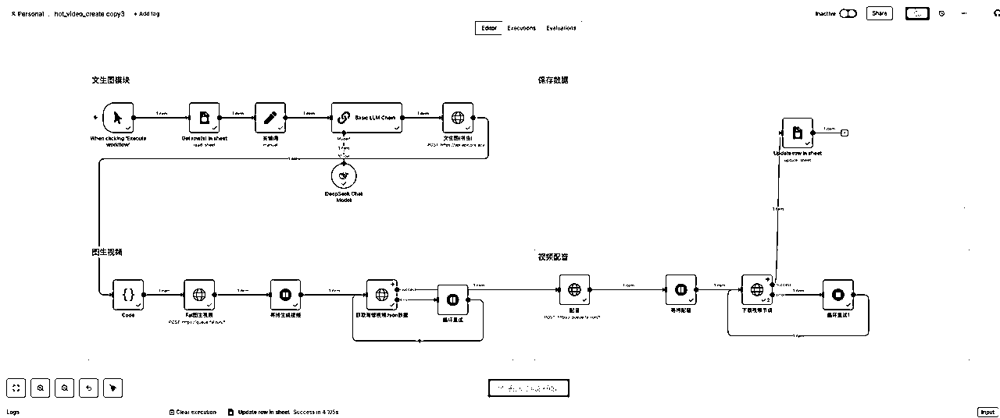
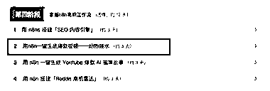

# 爆款在手，自动化在握：N8N 一键搞定 Youtube 动物跳水视频的完整拆解

## 如何用 N8N 自动化流水线批量产出 Youtube 动物跳水类爆款，超详细实操拆解

日期：2025-09-13

这篇笔记是我在 N8N 航海高阶营期间，对动物跳水自动化工作流的完整复盘拆解，目的很简单：让同样想入局的同学能快速复刻属于自己的爆款流水线。

先做个自我介绍，我是龙哥，长期在做 RPA 训练和 AI 智能体训练，专注于用自动化工具做效率提升。

这次航海营让我补齐了不少 N8N 的短板，在此感谢教练团队的付出。为回馈社区，我把这次的高阶作业 **动物跳水工作流** 全部梳理清楚，学习资料已整理到飞书。

* * *

评论区：

龙哥 : 投入了 8 个小时肝出来，欢迎点赞、投锚支持一下

小宋 : 龙哥太顶了

龙哥 : 多谢老板赏！[强][强][强]