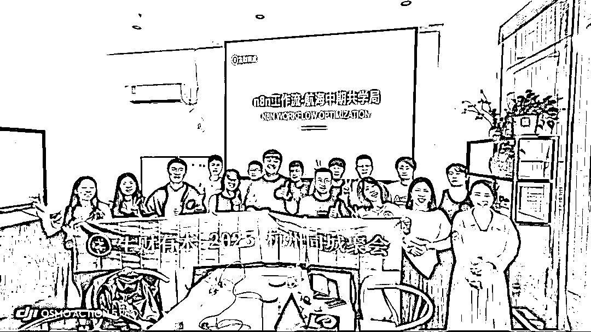
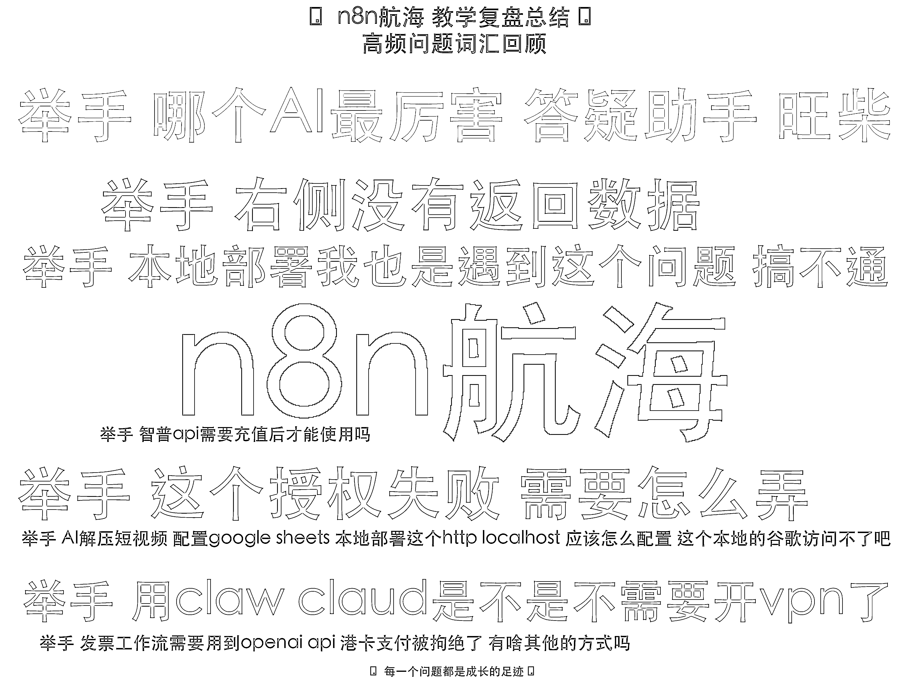
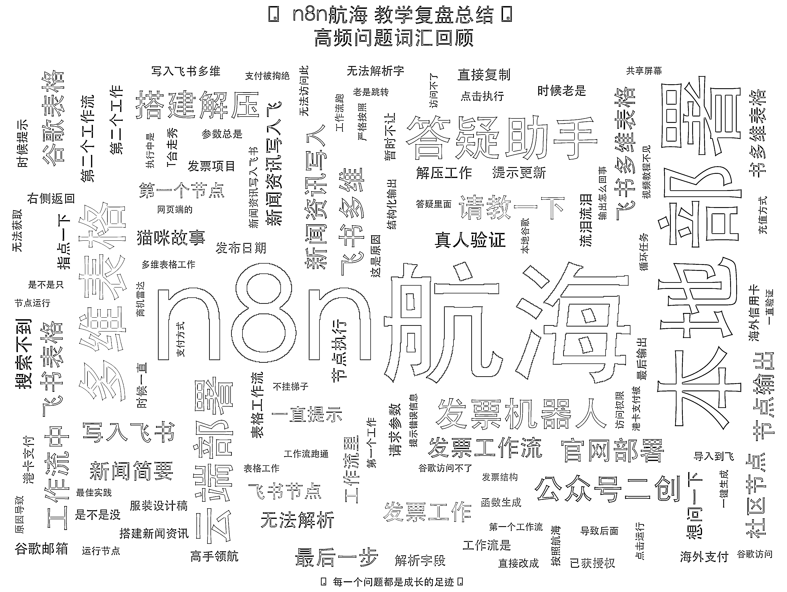

# (18 赞)9 月 3700+人参与的 n8n 航海复盘：答疑机器人新尝试及技术方案解析

9月的n8n航海实战刚刚收官，这一季共有3700多位伙伴一同上船。作为教练，Cyrus-赛探长在复盘里写下不少实战心得，其中最值得关注的，是他在🛰️答疑机器人上做出的新尝试，以及整套技术方案的落地过程。除此之外，数据分析、线下组局这些环节也有不少干货可挖。

有意思的是，在评论区里已经有人提到，看到赚钱圈也有不少人在讨论wxauto框架，说这个工具用了很久，体验确实不错。看来，n8n在🛰️自动化方向的探索，正在吸引越来越多人的注意。

目前这篇复盘已经获得了18个赞，如果你也想看看这次航海的技术细节，不妨点开飞书文档好好研究一下。