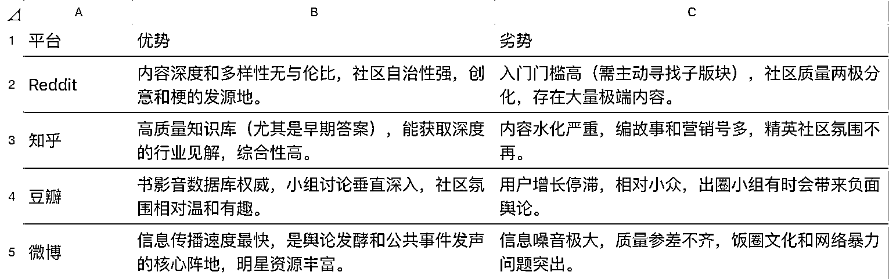
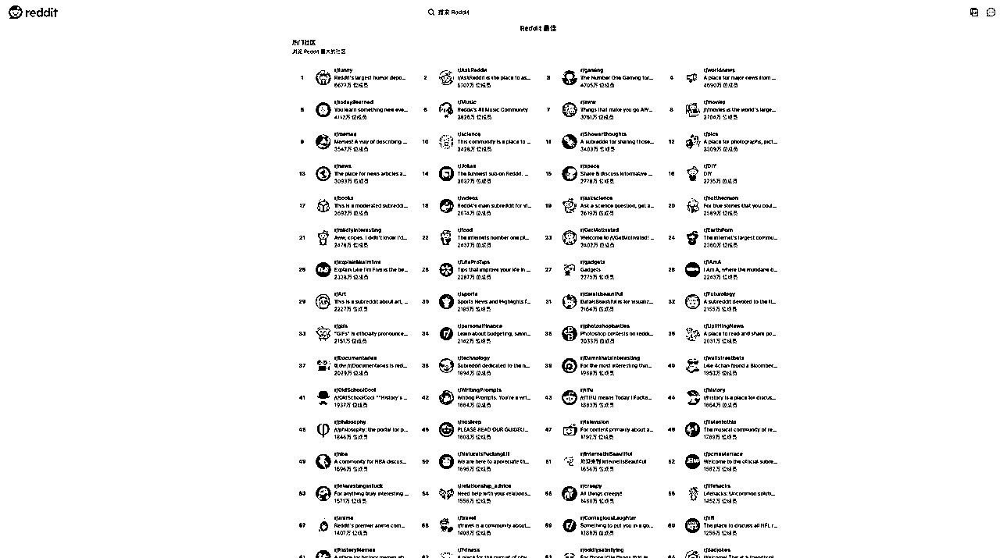
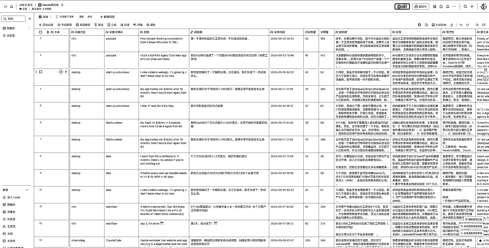
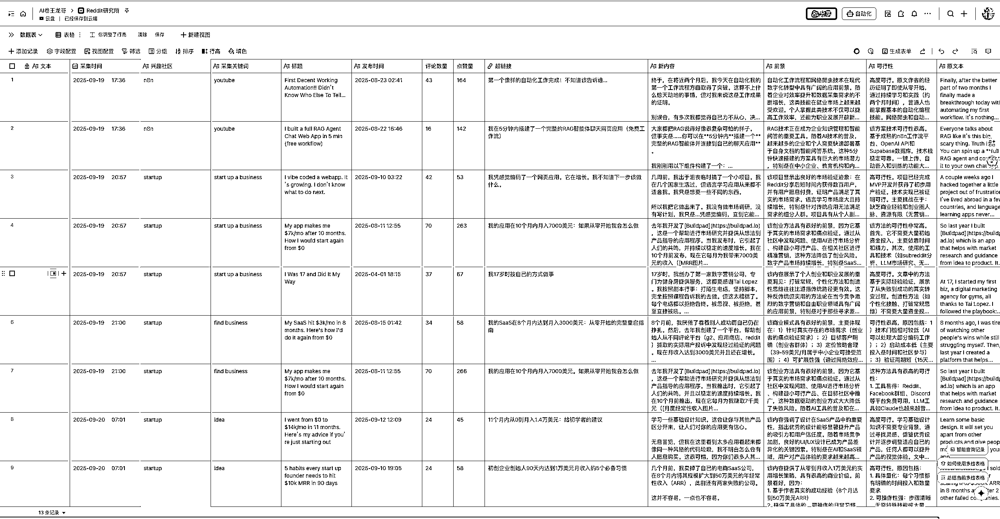
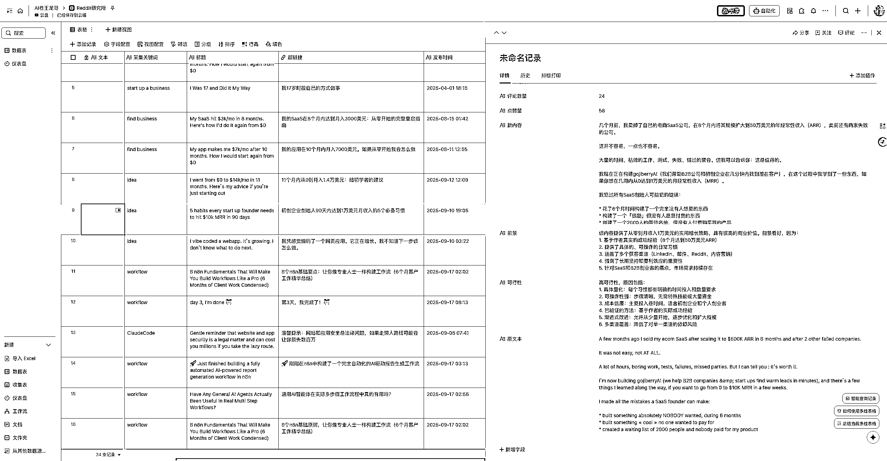
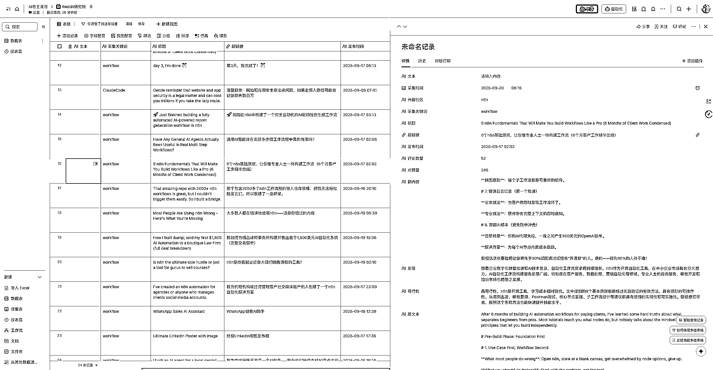
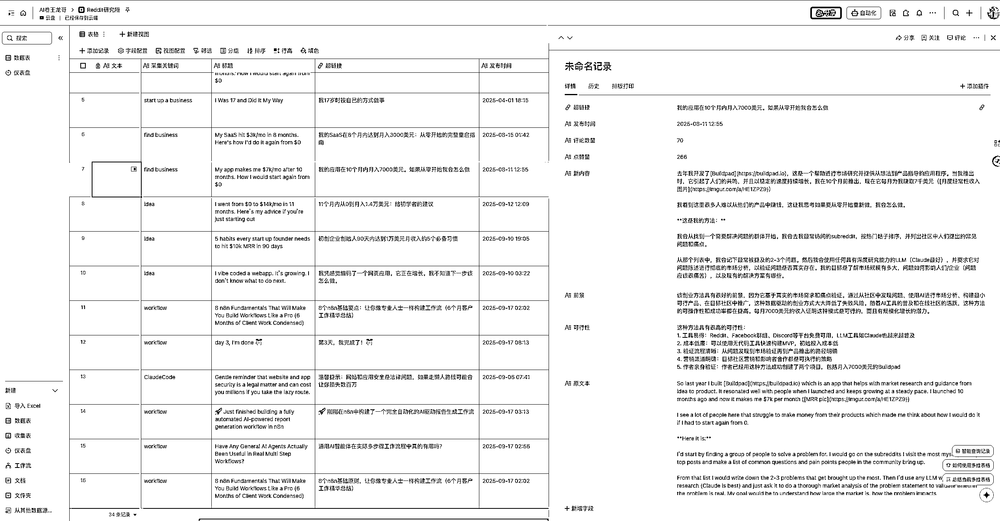
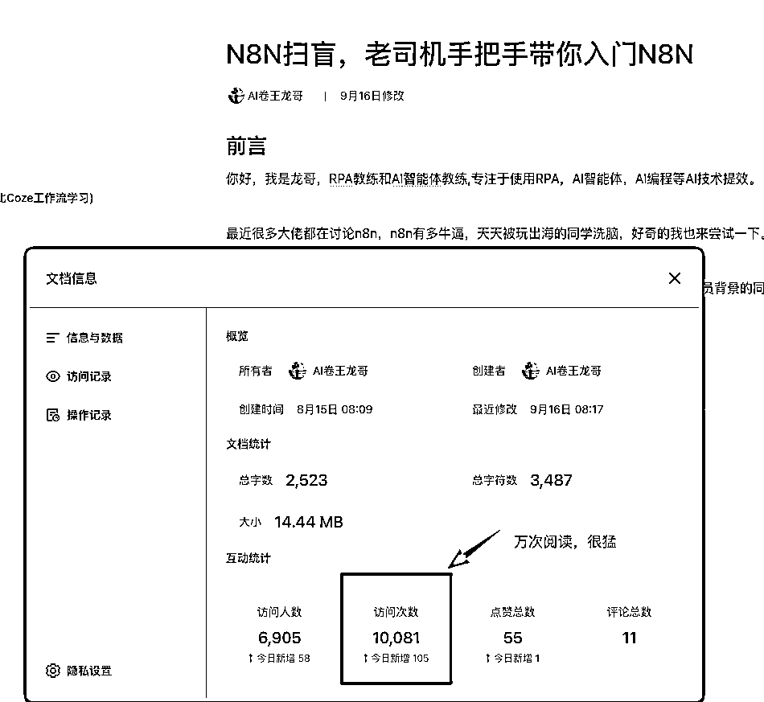

# (34 赞)N8N 抓取 Reddit 数据，助力出海需求挖掘与信息分析
作者：龙哥

最近被好多大佬反复安利 Reddit，我也忍不住跑去逛了一圈。结果一看就有点上头——这里才是真实世界的缩影啊。比起我们熟悉的🧣、知乎、豆瓣，Reddit 上的内容生态要丰富太多，足足 35 万个兴趣小组，不管你的爱好多小众、脑洞多清奇，都能找到同好。这里面藏着的真实需求、创意和玩法，简直是一座挖不完的宝藏。

我本身是搞 RPA 和 AI 智能体教练的，平时就喜欢用 N8N 来折腾各种自动化提效。借着这次航海的灵感，我直接搭了一套 N8N 工作流：只要输入任意频道和关键词，就能自动抓取 Reddit 上的热门帖子，再翻译、提炼成方便快速浏览的中文摘要。整个流程全自动跑，做出海需求挖掘和竞品信息分析都特别省力。

顺便把这次航海高阶部分的两个案例也详细复盘了一遍，希望能给同行的伙伴一些参考。另外报个喜：我之前写的 N8N 入门帖已经破万次阅读了，还拿到了“赚钱传术师”的称号，真心感谢赚钱这个平台。

最后想聊一点我自己的感悟。看到一位圈友发了条朋友圈，说在任何平台上都不要总想着索取，要想着怎么回馈平台。对于我们这些圈友来说，最拿得出手的回馈就是认真写精华帖。第一篇精华帖就像一场“成人礼”，跨过去之后，你会发现自己真的不一样了。

回想起来，我加入赚钱已经三年了。第一年基本在潜水，毫无存在感，甚至觉得钱白花了；第二年续费时犹豫了一下，最后还是咬咬牙续了；第三年又来了一遍同样的犹豫和续费。现在我才想明白：只有多和平台“发生连接”，你的存在感才会越来越强。如果既不发帖，也不看帖，还不参加任何线上线下活动，那你和平台其实是割裂的，慢慢就相忘于江湖了。

所以，拥抱平台、为平台创造价值、和平台一起成长，才是用好任何平台的底层逻辑。做长期的合作伙伴，而不是匆匆过客。

相关链接：
https://t.zsxq.com/HDzvO
https://t.zsxq.com/BwJS3

