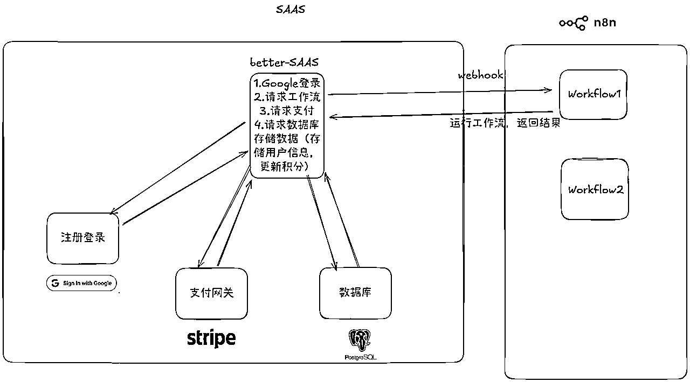

# n8n 跨界 Web，把自动化玩成出海 SaaS 的变现流水线

作者：达轮  
发布时间：2025-09-24

**n8n 搭上 Web，一起做能赚钱的出海 SaaS！**

我是龙哥，418 加入赚钱，一路跟着龙哥盟走到现在，很荣幸担任了 n8n 航海的教练。感谢这个社群让我结识了一批很厉害的伙伴。顺手翻 n8n 的官方手册，发现 Web 结合这块内容还不够全面，就来把这块补上。灵感来自之前大家的反馈，也离不开 @楞楞 的点拨。废话不多说，直接上硬菜。n8n 航海快收官了，给 Web 出海和 n8n 圈子来份加餐鸡腿🍗！

这篇内容适合哪类人？
- 想靠 n8n 把技能变成收入的你
- 想接入 Stripe 收海外用户的钱、做 MRR 的你
- 想真正上手 SaaS 开发逻辑的你
- 觉得 n8n 用起来有点浅，想解锁进阶玩法、更深组合的你

考虑到大家基础参差不齐，我会用初级、中级、高级的节奏来拆解，保证每一步都有正反馈，把信心拉满。

路上遇到卡点也别慌，现在信息获取成本极低，Google 一下、问下 AI，基本都能搞定。

说个关键思路。网上充斥着太多 AI 从零到一直接生一个网站的案例。实操中，我更推荐直接去 GitHub 扒一个成熟的 Web 模板作为底座，再做二次开发。这种方式效率更高。原因有三：提示词少、改动小就能复用，AI 的不确定性被大幅压低；模板经过社区检验，架构清晰、坑点已经被踩过，能省下大量排错时间；你在真实项目里能学到真正的工程实践，经验复用价值更高。

准备就绪就出发吧，这张藏宝图带你一步步打怪升级！📢📢📢📢📢

有任何建议欢迎拍砖指正。🙏🏻🙏🏻🙏🏻

* * *

评论区精华：

黄金号 : 那我是不是只差一杯冰美式和一杯白水就能起飞了

达轮 : 核心还是狠狠执行[得意]