# (32 赞)如何用 n8n 一键生成视频发 YouTube 思路分享，值得一看

用 n8n 搭出“全自动产片流水线”，我踩通后的思路复盘

昨天，我总算把 n8n 的整条链路调通，成功做出一支成片。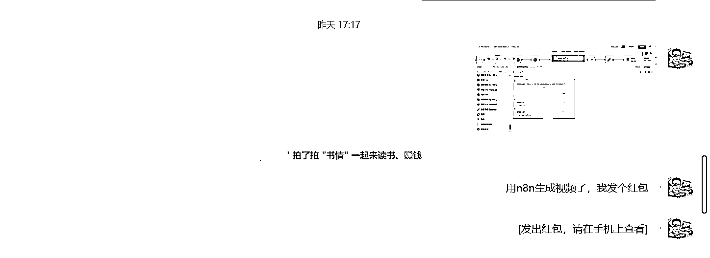 趁着热乎，把完整的想法整理出来，算是一次思路复盘。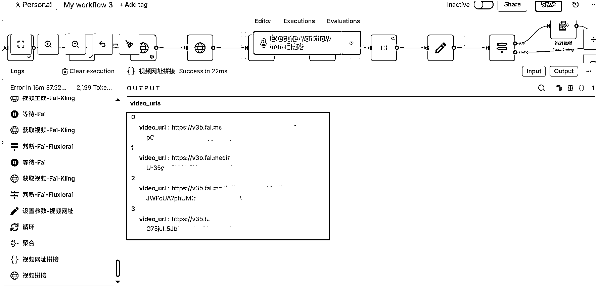

先说清楚：这篇只聊方法论，不教具体按钮怎么点。想一步步照着搭，直接翻阅配套手册即可。

在展开细节之前，先放几张截图，看看这套编排的整体样貌。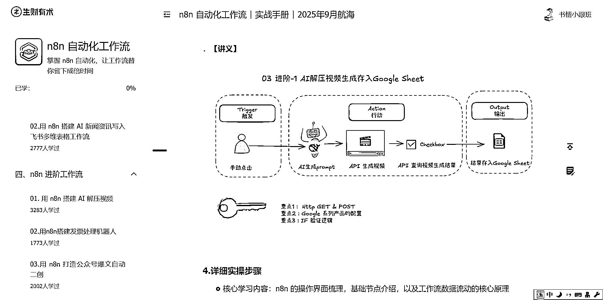 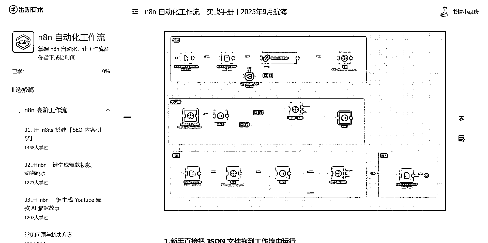 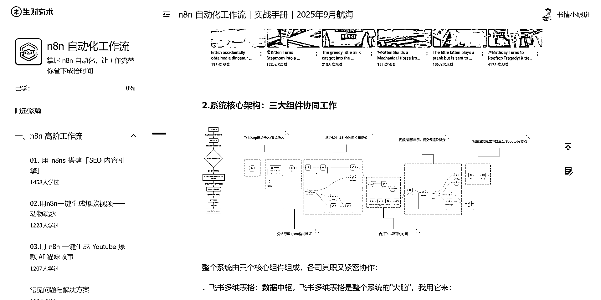

整套流程有两种启动方式。第一种是全自动模式，由系统按预设任务自行跑完，截图里已用红圈标出。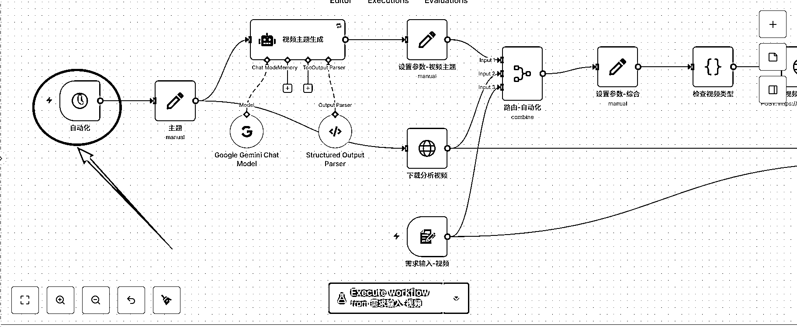 第二种是人工填写需求再触发。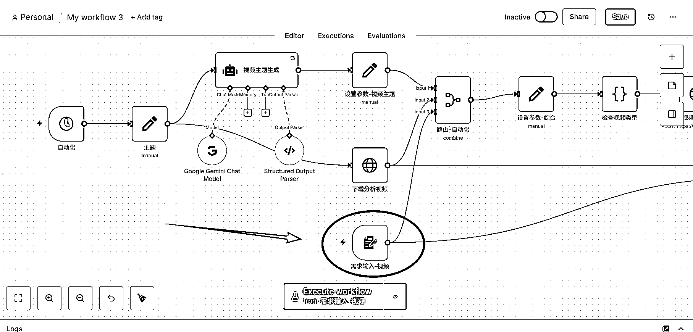

选择人工模式时，你需要提供三样东西：内容选题、Prompt 范例、镜头数量。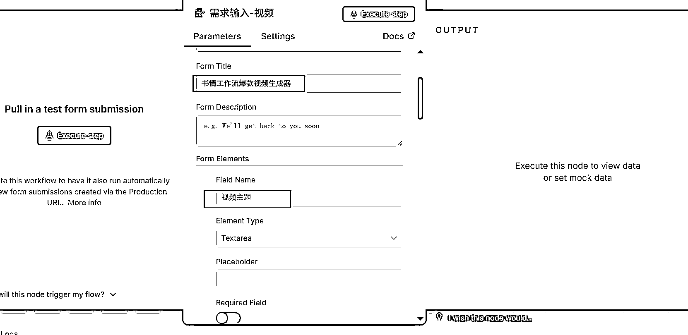 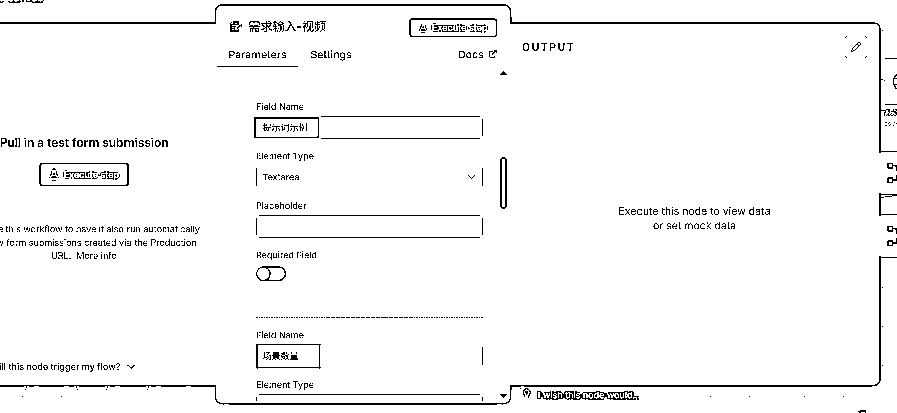 此外还有一组选项，可切换“全自动”与“填表启动”。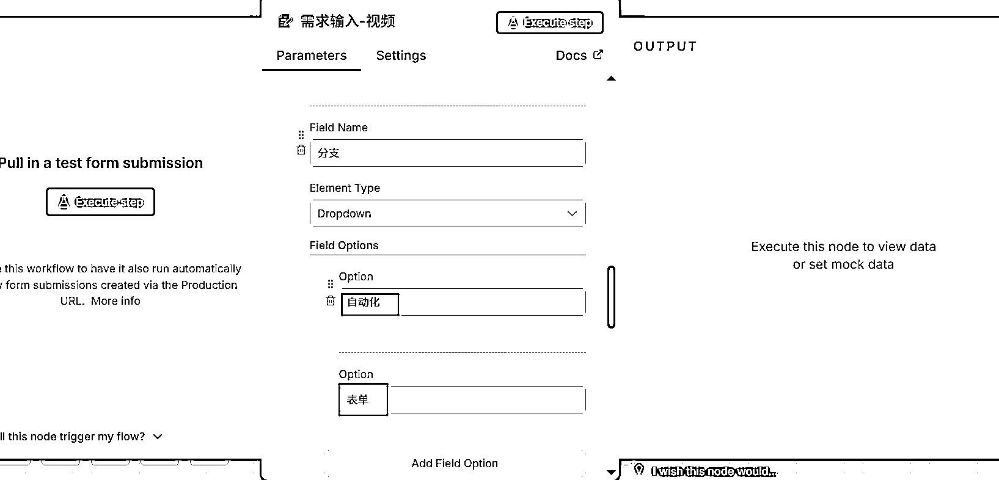

再往后的处理环节是：先传一条热门样片，让系统自动拆解它的走红要素，这个节点叫【爆款拆解】。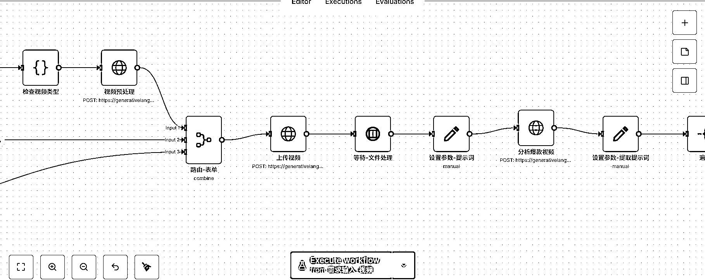

拆解完成，流程分为两条支线：一条产出原始素材，一条负责后期整合。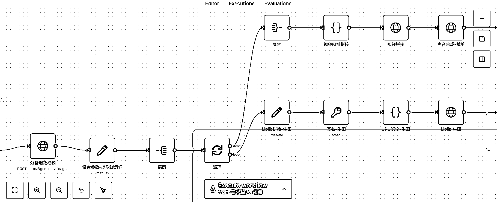

先看支线一。它前半段沿用文生图思路：按 Prompt 逐帧绘出分镜，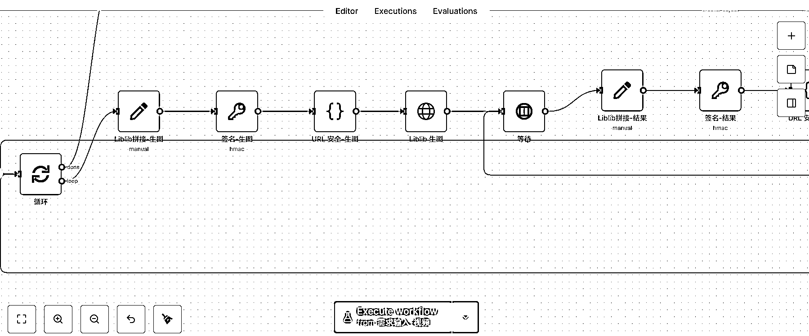 然后把图片全部存到本地，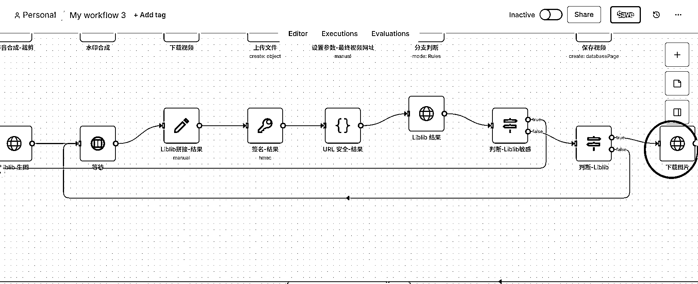 再交给影像合成模块产出成片。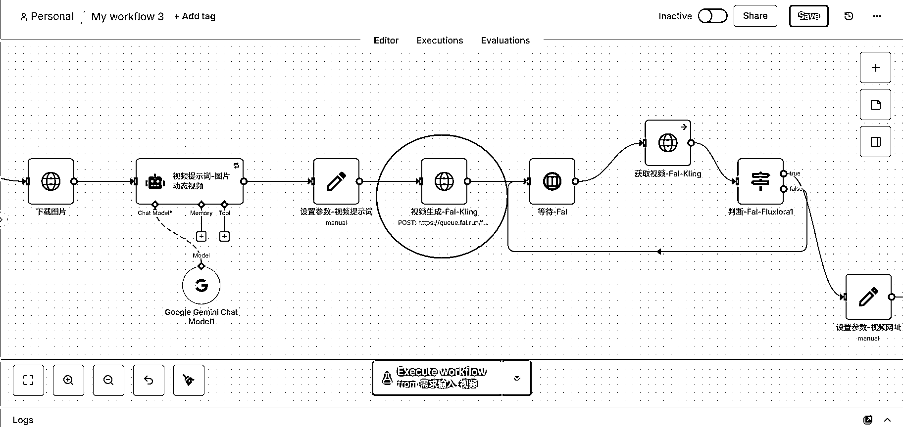 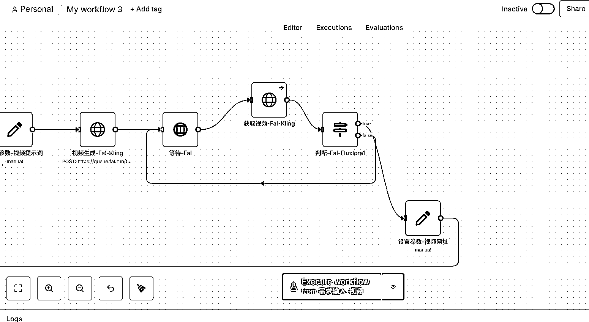

再看支线二。它的职责比较机械：把支线一的素材统一做后期，包含片段整合、音轨修剪、水印叠加，最后归档保存。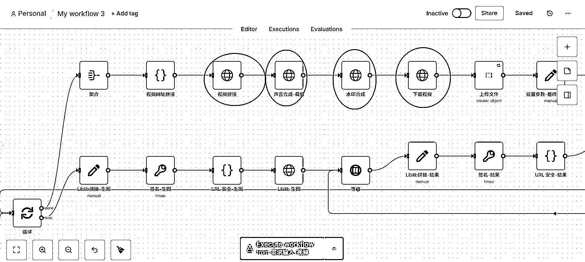 整条链路的收尾动作是自动上传并保存成片。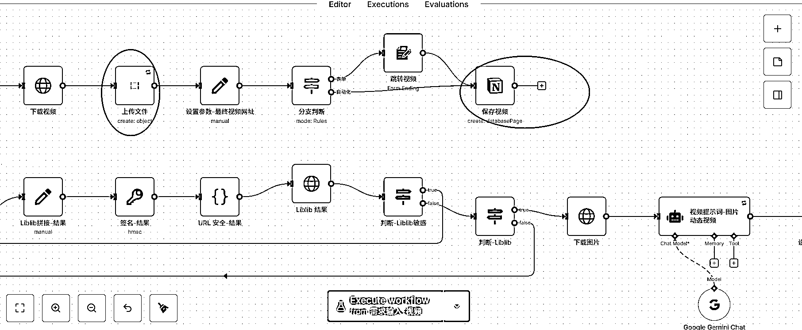

这套流程还有一个可升级的地方：直接把成片一键发到 YouTube，略过手动搬运。这个优化我计划后续补上。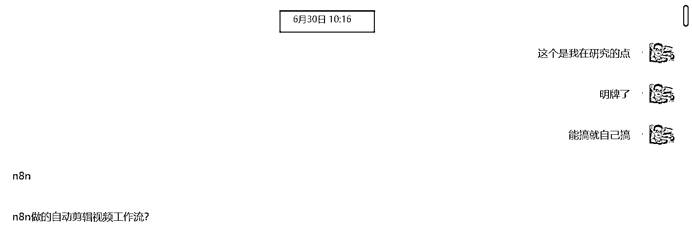

至于学习路径，项目手册里整理过一批学习站点；但要跑得更快，最直接的还是官网，那里资料最全。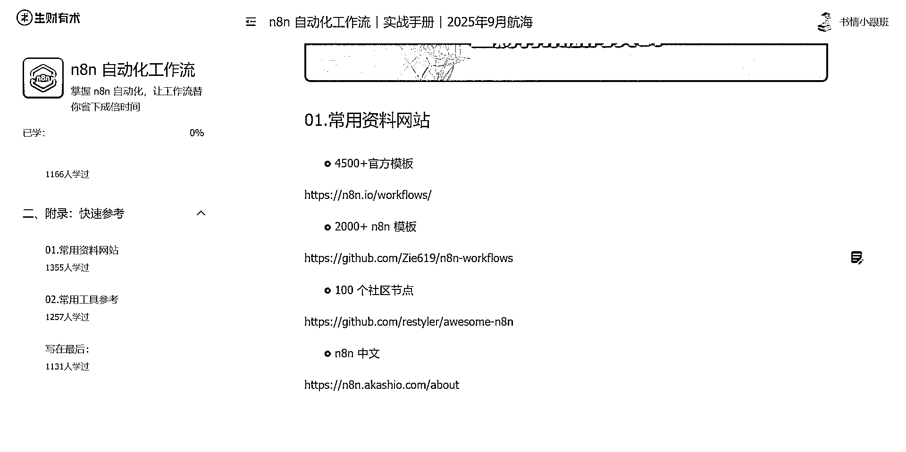 官方文档永远是第一手教材。倘若你学习能力强、行动也快，官网是首选；要是时间有限，想短期速成，那就按手册搭框架，再找几位带教老师答疑，上手效率会高很多。

聊聊我的真实感受。刚开始碰 n8n，我像个刚入职的新人，技能生疏，报错窗口一个接一个。毕竟这工具我完全没用过，能撑下来的只有四个字：遇事拆解。工作中我也一直如此——只要不放弃，总能找到解法。也想对害怕 n8n 的朋友说：别绕着走，迎上去。许多事等你亲手做成了，也就没那么吓人。

到现在我也还算 n8n 新手，这次就当作抛砖引玉。谢谢各位看到这里。

有人留言：“干货，n8n 和 YouTube 都聊到了。”另一位顺哥点了个赞。