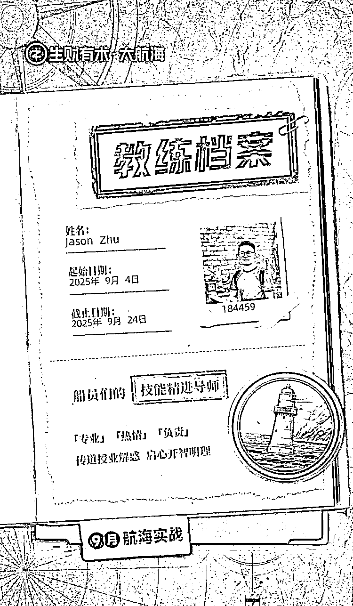

# 从零到变现：一个 AI 算法工程师的推特自媒体 50 天实战笔记

大家好，我是 Jason Zhu。

今年 8 月 13 号才加入龙哥盟，没想到 9 月就被邀请担任推特教练组的一员。现居杭州，过去 5 年一直在做 AI 算法，现阶段身份比较杂：独立开发者、SaaS 出海研究者、远程 AI 内容创作人，同时也在经营自己的个人品牌。

说点成绩给大家一个锚点：推特账号上线不到两个月，粉丝已破 5300+，成功拿到 X 平台创作者分成，50 天内变现逼近五位数。更关键的是，我在这个过程中完整跑通了从内容到带学到变现的闭环。

这篇超长的复盘，我主要想聊三件事：为什么我会选择做自媒体、第一次当推特教练的真实感受，以及推特运营和变现的底层逻辑拆解。文末我也整理了几本对内容创作者特别有用的书单。

看完这篇，你会明白自媒体不只是发帖子这么简单，它是一套可复制的增长系统。

* * *

评论互动精选：

fake : 真的牛！我跟着教练学，推特三天就破千粉了。Jason 教练就是我的财富密码

Jason Zhu : 加油继续深耕自媒体

少平 : 卧槽你不会是南信大的校友吧😂

Jason Zhu : 还真有可能，这圈子里校友挺多的

余小欢 : 太强了，膜拜

Jason Zhu : 多谢七天老师、leng 老师、马可乐老师抽空帮我审稿改框架

逸尘 : 大佬问下，X 的 premium 和 basic 到底差在哪？

Jason Zhu : basic 几乎没收益，premium 才能开通创作者分成