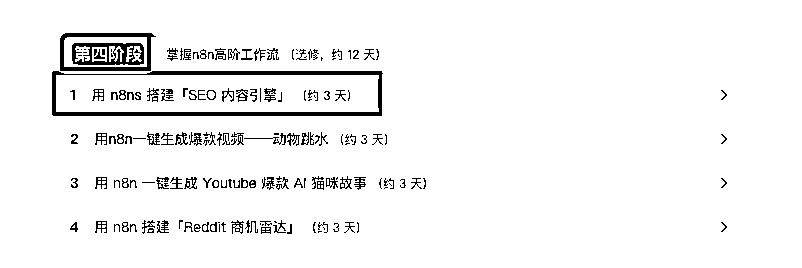
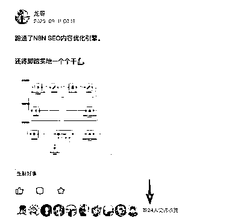
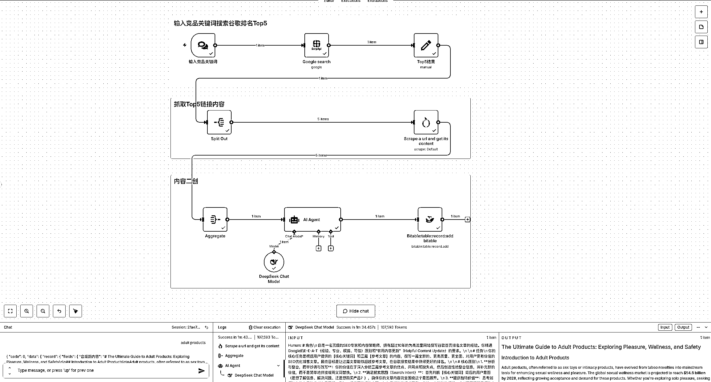
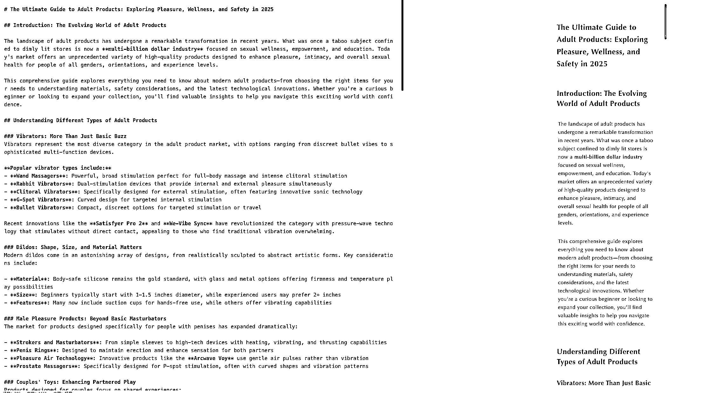

# 用 N8N 做一台「SEO 爆款内容流水线」，让流量主动找上门
作者：龙哥

## 用 N8N 做一台「SEO 爆款内容流水线」，让流量主动找上门

作者： 龙哥

日期：2025-09-11

大家好，我是龙哥。做 RPA 训练和 AI 智能体训练的，平时就喜欢用 RPA、智能体、AI 编程这些东西来降本提效。昨天的分享收获了二十多个赞，干劲直接拉满。

今天就把我最近搭好的那套 N8N SEO 爆款内容引擎拿出来拆开说说，目标只有一个：用自动化撬动持续的搜索流量。

互联网的底层规律没变过：曾经爆过的东西，结构和模式都是可以复用的。照着爆款的骨架再造一遍，成爆的概率会比从零硬写高得多。

以前做一篇合格的 SEO 文案，流程繁琐得很。先挖词、再扒对手、拆解爆款为什么爆、提炼核心因子，最后才动笔成稿。走完一轮，少说也要两三天。现在这套自动化工作流把重复劳动全接管了，你只需丢进去一个竞品关键词，等个几分钟，系统就能吐出一篇能打八十分的 SEO 初稿，省时间省精力也省心。

整个思路其实很直接，分三步走：

先拿你输入的关键词去 Google 里把排名前五的竞品页面抓下来，习惯前三也可以；
再把这五篇文章的核心内容批量抽取出来；
最后交给大模型做重写和融合，生成全新表达的内容，直接落到多维表格里存档。至此，一篇具备爆款基因的 SEO 文章就算收工了。

不多废话，直接上搭建笔记和演示：

* * *

评论区：

拿铁 : 龙哥无敌

龙哥 : [偷笑][偷笑]

龙哥 : 这篇是对 N8N 航海高阶工作流第一篇复盘，欢迎大家一起学习🌹