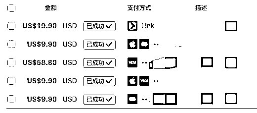

# (精华帖)(33 赞)土木工程师裸辞，零基础 3 个月跨界 AI，我在 AI 出海赚到了第一笔美金（深海圈）

裸辞土木副总，三个月转战AI出海，我一周赚到了第一笔美金

嗨，我是井然。最近很多人私信问我：你是土木工程师，怎么突然就做起了AI，还在海外赚到了美金？说实话，我也没想到这一步会这么快。今天索性把这段经历完整写出来，给正在寻找新方向的朋友们一些参考。

先交代下背景：我在土木行业干了五年，一路做到副总经理。收入稳定，职位体面，但我心里始终有个声音在说：这不是我想要的。于是我做了一个看似“疯狂”的决定——裸辞。当时手里没有Plan B，只有一股想改变的冲动。

辞职后，我开始大量接触新领域，AI就这样走进了我的生活。尤其是看到小排老师那股拼劲，我深受触动，觉得这才是我想成为的样子。我告诉自己：哪怕是从零开始，也要试一试。于是我用了大概三个月的时间，从完全不懂AI，到逐渐摸清门道，并顺利加入【深海圈】——一个专注海外AI产品的社群。

在深海圈，我学到了很多，也得益于几位贵人的关键指点。为了收款，我专门跑去香港办港卡，中间还遇到些小麻烦，但这些经历反而让我快速成长。那段时间，我每天的日常就是研究AI工具、琢磨用户需求、打磨产品，虽然辛苦，但特别充实。

最让我激动的是，我做的第三个AI工具站，上线仅一周就开张了——收到了一笔实实在在的美元订单。那一刻我才意识到，所有努力真的不会白费。

这次分享我准备按七个方面来讲：一是我的自我介绍；二是AI如何进入我的视野；三是我加入深海圈的过程；四是香港办卡踩过的小坑；五是我日常在做的出海工作；六是第三个AI工具站一周出单的经过；七是复盘我如何拿到这样的结果。我能拿到这些结果，靠的不是什么天赋，而是持续的实战复盘，以及一路遇到的贵人点拨。

完整故事我整理成了文档，放在飞书里，链接如下，感兴趣的朋友可以慢慢看：

[`acnwscsrr4nu.feishu.cn/wiki/IMLywNVP4iqkiwkmo6kcY5sRn9o`](https://acnwscsrr4nu.feishu.cn/wiki/IMLywNVP4iqkiwkmo6kcY5sRn9o)

最后想说，跨界没那么可怕，关键是迈出第一步。希望我的故事能给你一点勇气，也愿我们都能在AI出海这条路上赚到自己的第一桶金。